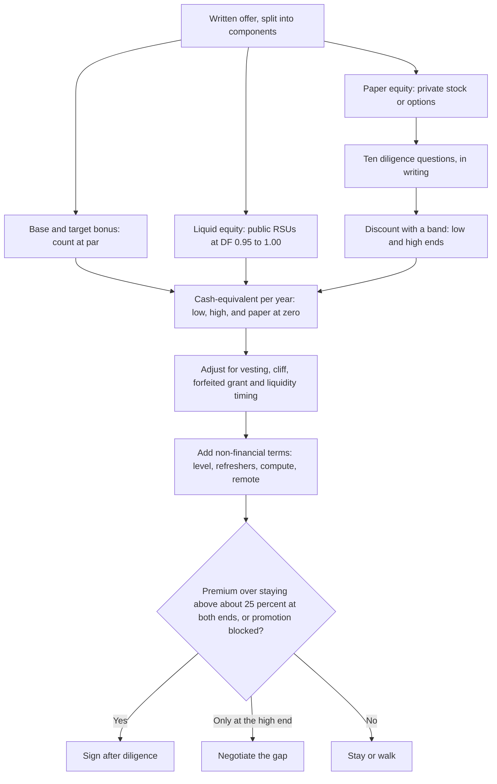

# Offer Evaluation: Cash, Liquid Equity and Paper Equity

> How to put GenAI offers on one cash-equivalent basis (base, bonus, liquid equity and discounted paper equity, adjusted for vesting, liquidity and non-financial terms), decide whether a move beats staying, and run equity due diligence before you sign.

**Dates.** Discount factors and the level figures in the worked example come from [T0-02](../../research/sessions/T0-02-global-regional-compensation-benchmarks.md) (evidence as of 2026-10-21); measured pay mixes and level ladders, each dated by its dataset, are in [pay benchmarks](pay-benchmarks.md). Hop-versus-stay rates, risk-adjusted values, liquidity facts and the trap register come from [T0-17](../../research/sessions/T0-17-compensation-progression-plateaus-equity.md) (2026-10-23). The due-diligence questions come from [T1-03](../../research/sessions/T1-03-interview-execution-offer-negotiation.md) (2026-10-25). Re-verify pay figures and tender terms by 2027-01-19. **Grades** (EGP-1.0): A primary or measured; B transparent secondary; C vendor or single source; D judgement; M model output (arithmetic on stated inputs, no stronger than its weakest input); P practice-curated and unmeasured. **Not advice.** Nothing here is tax, legal or financial advice [T1-03 L18]; treat every tax point as a question for a qualified adviser. For terms, see the [glossary](../00-start/glossary.md).

## The short answer

1. **Compare cash-equivalent totals, never headlines.** Count base and bonus at par, liquid equity (public RSUs) at 0.95–1.00, and paper equity times a discount factor (DF) for its stage: 0.64–0.88 for a frontier lab with tenders, 0.42–0.61 for late-stage private, 0.09–0.21 for Series A/B (0.21–0.53 only if you credit upside). The inputs are sourced (B); the DFs are model outputs [D · T0-02.F8; T0-02 L96].
2. **Read the mix before the total.** Base is compressed while stock scales with level. From OpenAI L2 to L5, base rises 2.1× and stock 7.0×, and base falls from 68% to 40% of the total [B · T0-02.F5]. A senior lab offer is mostly paper; a public Big Tech offer is mostly cash and liquid stock [B · T0-02 L217–224].
3. **Use a band, and decide only if the answer holds at both ends.** A second model, T0-17's, gives risk-adjusted values (RAV) of 0.5–0.8 for frontier-lab-like equity, 0.4–0.8 for Series C–D and 0.15–0.3 for a stale-vintage unicorn; for seed and Series A it says do not underwrite, treat the grant as option value and ask for cash [C/D · T0-17 L213–220; T1-03.F8]. Discount rate and bust probability move the value most; preference terms move it 3–12% [C/D · T0-17.F11]. The both-ends rule is practice [P].
4. **Price the vest and what you forfeit.** Forfeited value = grant × (1 − fraction vested when you leave); ask for a sign-on or equity at least that large [B/C · T0-17 L202–211]. At 24 months an Amazon-style 5/15/40/40 grant is 20% vested and a Google-style 33/33/22/12 grant 66% [B/C · T0-17 L207–208].
5. **Move for more than about 25%, or when promotion is blocked.** By T0-17's triangulation, same-tier moves pay ≈ +15–25% total compensation (TC); level-up moves ≈ +35–50%. A +15/+20/+25% hop every two years annualises to ≈ 7/9.5/11.8% a year, about what a promotion-track stayer earns (≈ 9–12%) [A/B/C · T0-17.F1; C · T0-17 L196–200].
6. **Ask ten equity questions in writing before you sign.** The answers turn paper equity into a value you can compute, and most candidates never ask [B/C/D · T1-03.F11]. A refusal is itself a signal: weight the offer toward cash [D · T1-03 L344, L429].

## At a glance



## The cash-equivalent model: four components, four adjustments

An offer has four pay components. Before you compare two offers, or an offer with staying, it needs four adjustments: discount the paper, price the vest, time the liquidity and list the non-financial terms.

### The four components, by employer archetype

"Liquid" means sellable at vest on a public market; "paper" means not freely sellable [T0-02 L215]. How the four components split by employer archetype (public Big Tech, frontier lab, AI-native startup, Indian employer) is measured, with each row's date, in [pay benchmarks: base, bonus and equity](pay-benchmarks.md#base-bonus-and-equity). The spread is wide: base is 77% of a Google ML L3 package but only 29% of an Anthropic Staff package, most of which is semi-liquid paper [B · T0-02 L217–L224]. Four readings for valuing an offer:

- **Posted ranges are base-only.** Only 14% of 43,480 US AI-engineering postings mention equity and 31% a bonus [B · T0-02.F8]. Compare base with base, then ask for the full package.
- **Lab paper is semi-liquid, not Series-A paper.** OpenAI's and Anthropic's 2026 tenders priced at the last round, with no visible discount; per-person caps and the share of vested stock that could be sold were not reported for them [B · T0-02.F7].
- **Startup paper shrinks once discounted.** In Carta's profile of a P80–95 AI/ML engineer at an AI-native startup valued above $500M, paper equity is 36% of paper TC; at late-stage DF 0.42–0.61 it is about 20–26% of cash-equivalent TC [B inputs; D share · T0-02 L223, L451].
- **Indian employers pay mostly cash.** See the India notes below.

### Adjustment 1: discount paper equity, with a band

| Equity type | DF (T0-02) | What drives the DF | RAV band (T0-17) |
|---|---|---|---|
| Public RSU | 0.95–1.00 | Price volatility only | not modelled |
| Frontier lab with tenders | 0.64–0.88 | Sellable fraction s, sold at the tender price less 5%; the rest carries a marketability discount (DLOM) of 34–47%. s = 25%: 0.64–0.73; s = 50%: 0.74–0.81; s = 75%: 0.85–0.88 | 0.5–0.8 |
| Late-stage private (Series C+) | 0.42–0.61; 0.64–0.91 if you credit a 1.5× upside multiple | P(liquidity) 0.70–0.90 × retention after dilution 0.85–0.95 × time value 0.712 (12% a year over 3 years) | 0.4–0.8 (Series C–D, $1–5B mark) |
| Stale-vintage unicorn (a 2021-era mark far above what an exit would pay) | not modelled | — | 0.15–0.3 |
| Series A/B | 0.09–0.21; 0.21–0.53 with a 2.5× upside multiple; about 0.04–0.05 in a downside cohort | P(liquidity) 0.25–0.50 × retention 0.60–0.75 × time value 0.567 (12% a year over 5 years) | Seed or Series A: do not underwrite; ask for cash |

Sources: T0-02 L419–439 (DF parameters and construction; inputs B, outputs D) and T0-17 L213–222 (RAV; C/D).

- **Both are model outputs.** T0-02 rates its confidence in every discount factor as low [T0-02 L15]. T0-17 calls its RAV a model output, not a measurement [T0-17.F11], and T1-03 advises using bands, not points [T1-03 L419].
- **Where the two disagree, run both ends of the wider band**, for example 0.5 and 0.88 for a frontier lab [P].
- **At a lab, the sellable fraction drives the DF.** Tender caps decide it, and the research found it unreported: the 25–75% input is an assumption [D · T0-02 L423]. Ask for it (question 5 below).
- **T1-03's shorthand for the lab band** is "$100K lab paper ≈ $50–80K liquid" [C/D · T1-03 L333].
- **Price the bust case too.** Common stock is economically a call option struck at the preference stack: it receives nothing when exit equity is at or below the stack [A · T0-17.F6; T0-17 L149]. Price every offer with paper at zero, and check it against your floor: the minimum TC (base + risk-adjusted equity + sign-on) at which you walk [D · T1-03 L268].

### Adjustment 2: vesting, cliff and forfeiture

Fraction of a new-hire grant vested if you leave at 18, 24 or 36 months [B/C · T0-17 L202–209]:

| Schedule | 18 months | 24 months | 36 months |
|---|---|---|---|
| Flat 25/25/25/25 (monthly, no cliff) | 37.5% | 50% | 75% |
| Amazon-style 5/15/40/40 | 12.5% | 20% | 60% |
| Google-style 33/33/22/12 | 49.5% | 66% | 88% |
| Google-style 38/32/20/10 | 54% | 70% | 90% |

- **Forfeited value = grant × (1 − vested).** Ask the new employer for a sign-on or equity at least that large [B/C · T0-17 L211].
- **Cliffs and schedule shapes change.** OpenAI removed its vesting cliff for new hires in December 2025 [B · T0-17 L180]. A cliff on a back-loaded schedule is a negotiable term ([negotiation playbook](negotiation-playbook.md)).
- **If you may not complete the vest, discount for it separately.** The expected vested fraction of a 4-year grant is ≈ 0.56 at 28% annual attrition and 0.71 at 17% [M · T0-17 L177, L222]. AI/ML annual attrition was reported at about 28%, against about 17% for software engineers (2025 data) [B · T0-17 L125].

### Adjustment 3: liquidity timing

Plan liquidity as three separate events: a tender, an IPO followed by a lock-up, and the sale itself. Assume no cash for 12–24 months unless a tender is scheduled and you are eligible [D · T0-17 L224].

| Event | What the research found | Grade · source |
|---|---|---|
| Tender | Carta tenders: median cap 20% of holdings (Q2 2025), median seller participation 57.9%, median discount 0%; in the median tender no ex-employees were eligible | A · T0-17 L158 |
| Tender at a lab | OpenAI, October 2025: per-person cap raised from $10M to $30M, with a two-year holding requirement. Anthropic, May 2025: up to 20% of holdings, a $2M cap, at least 2 years' tenure; its April 2026 tender required at least 12 months | B · T0-17 L159–160; T0-02.F7 |
| IPO and lock-up | SpaceX (including xAI) priced its IPO in mid-June 2026 and traded below the IPO price within about 5 weeks, under a nine-stage lock-up with a price-triggered tranche. Treat post-IPO swings of ±50% around a lock-up as plausible | B · T0-17 L165; D · T0-17 L224 |
| Sale price | Forge's median trade was −3% to −7% against the last primary (July–August 2026), but companies last priced in 2021 or Q1 2022 traded at a median −61%. At top AI names the cost is selling early at the tender price: Anthropic's May 2026 primary priced ≈ 2.5–2.8× its April 2026 tender | A/B · T0-17.F7; B/C · T0-17 L154 |

### Adjustment 4: non-financial terms

| Term | Why it counts | Grade · source |
|---|---|---|
| Level and title | Level-median steps are ×1.38–1.46 (×1.21 from Staff to Principal); the ladder is in [pay benchmarks](pay-benchmarks.md#us-all-company-ladder) | B/C · T1-03 L330; B · T0-17 L129 |
| Refresh policy and promotion timing | A promotion adds ≈ +16–24% TC at the event (base +6.5–8.6%, equity grant +39%). Refresh size and cadence by employer are not measured in the corpus, so count only what is written | C · T0-17 L195; P |
| Compute budget | Low cost to the employer, high value to you; a trade when they cannot match cash | D · T1-03 L322, L340 |
| Remote stipend, conference budget, relocation | The same logic | D · T1-03 L340 |
| Startup durability: runway and data moat | Paper equity is worth nothing if the company fails before liquidity | P; not in the corpus |

### Hop or stay

| Move | Expected TC change | Grade · source |
|---|---|---|
| Stay, merit only | +3.4% a year (AI/ML ≈ +4.4%) | B · T0-17 L194 (Pave H1 2026) |
| Stay with a promotion | ≈ +16–24% TC at the event (base +6.5–8.6%, equity grant +39%) | C · T0-17 L195 |
| Same-tier lateral move | ≈ +15–25% TC | C · T0-17 L196 |
| Level-up move (for example Senior to Staff elsewhere) | ≈ +35–50% (level-median step ×1.38–1.46) | B/C · T0-17 L197 |
| Tier jump (Big Tech to frontier lab) | Headline ×2.0–3.1 against US all-company medians; ≈ ×1.7–2.4 after equity risk-adjustment | C · T0-17 L132–133 |

T0-17 estimates that the median stayer's TC grows ≈ 5% a year; promotion-track performers reach ≈ 9–12% [C · T0-17 L117]. T0-17's decision table states the headline tier jump as ×1.6–2.9 [T0-17 L198]. Both versions are measured against all-company medians, which understate Big Tech baselines [C · T0-17 L132]; against a Big Tech package at the same tier the gap can be far smaller (worked example below).

| If | Then | Grade · source |
|---|---|---|
| The cash-equivalent premium is under about 25% at either end of the band, and your promotion path is open | Stay, or use the offer as market data | A/B/C · T1-03.F7; T0-17 L200 |
| The premium clears about 25% at both ends | Move, after the diligence questions | A/B/C · T1-03.F7 |
| Promotion is blocked | A move beats staying; aim for a level-up (≈ +35–50%) | B/C · T0-17 L197, L200 |
| You are a US Big Tech Senior weighing a frontier lab | Proceed if the risk-adjusted package clears roughly ×1.5 of the Big Tech offer, you can hold through a lock-up, and you have negotiated no cliff, tender eligibility and a sign-on that covers the forfeited vest | D · T0-17 L230 |
| Your employer makes a retention counter-offer | Treat it as market data; check whether it fixes the reason you started looking. The claim that retained employees leave within 12–18 months has no primary source | D · T1-03 L323 |

## How to do it

1. **Get each offer in writing, split into components:** base, target bonus, equity type (RSUs or options), grant size and grant-date mark, vesting schedule and cliff, sign-on, level and title. *Done when* every row of the comparison below traces to the offer letter or an email [P].
2. **Classify every grant as liquid or paper, and pick its band.** *Done when* each grant has a DF band and, for private stock, a RAV band (adjustment 1).
3. **Send the diligence questions for any paper equity.** *Done when* you hold written answers or a written refusal [T1-03 L344].
4. **Compute each offer at the low and high ends of the band, then with paper at zero.** *Done when* each offer and the stay option have three annual figures: low, high and bust.
5. **Price the vest.** *Done when* you know the value you would forfeit and the year-1 vest of each new grant [T0-17 L202–211].
6. **Compare with staying.** *Done when* you know each offer's premium over the stay column at both ends of the band (merit alone adds +3.4% a year; AI/ML ≈ +4.4%) [B · T0-17 L194].
7. **Decide or negotiate.** Sign after diligence if the offer clears your floor and the premium bar at the low end; negotiate if it clears only at the high end ([negotiation playbook](negotiation-playbook.md)); otherwise stay or walk [P]. *Done when* you have a written decision and, if negotiating, a target for each lever.

## Templates and examples

### The offer comparison worksheet [P]

Rows follow T0-02's four components [T0-02 L217]; the layout is practice [P]. Fill one column per offer, plus one for staying, in your own career repository, not in this one (decision D-022); [pramedha-template](https://github.com/bhaskarjha-dev/pramedha-template)'s `strategy/offer-comparison.md` holds the comparison and the decision. Add these rows to it:

| Row | How to fill it |
|---|---|
| 1. Base | Annual, at par |
| 2. Bonus | Annual target, not the maximum; at par |
| 3. Liquid equity × 0.95–1.00 | Public RSUs vesting per year |
| 4. Paper equity × DF | Annual vest at the grant-date mark, times the low and the high end of the band from adjustment 1 |
| **Cash-equivalent per year** (1 + 2 + 3 + 4) | Write both ends of the band |
| 5. Risk: paper at zero (1 + 2 + 3) | Compare with your floor |
| 6. Vesting | Schedule, cliff, year-1 vest and sign-on; for staying, the value forfeited if you leave (grant × (1 − vested)). Ask for a sign-on at least equal to the forfeited value |
| 7. Refreshers | Policy and cadence; count only written terms |
| 8. Non-financial | Level, scope, compute, remote and review date; score them separately, not in money |
| **Premium over staying** | Low = offer low ÷ stay high − 1; high = offer high ÷ stay low − 1 |

### Worked example: a same-tier lab offer against staying (illustrative arithmetic, Grade M)

**Inputs.** T0-02's US tier table puts Meta ML Engineer E6 and OpenAI SWE L5 in the same tier, "3 Premium" (Levels.fyi; base / stock per year / bonus) [B · T0-02 L230–235, L632; the Meta row is a search excerpt]. Frontier-lab medians have moved ±30–50% between snapshots [C · T0-17 L131]. The DF bands are T0-02's, which uses unrounded lab bounds of 0.635–0.878 [D · T0-02 L441]. This is arithmetic on stated inputs, not a market comparison or advice.

| Row | Stay: Meta ML E6 (public RSUs) | Offer: OpenAI L5 (tender-backed paper) |
|---|---|---|
| 1. Base | $261K | $361K |
| 2. Bonus | $39K | $0 |
| 3. Liquid equity × 0.95–1.00 | $481K → $456.95K–$481K | $0 |
| 4. Paper equity × 0.635–0.878 | $0 | $550K → $349.25K–$482.9K |
| **Cash-equivalent per year** | $756.95K–$781K | $710.25K–$843.9K (T0-02 rounds to $710–844K) |
| Headline | $782K (T0-02's total; the components are rounded) | $911K |
| 5. Risk: paper at zero | $756.95K–$781K | $361K |
| **Premium over staying** | — | −9.1% (710.25 ÷ 781 − 1) to +11.5% (843.9 ÷ 756.95 − 1) |

**Reading it.**

- The headline gap of +16.5% (911 ÷ 782 − 1) becomes −9.1% to +11.5% after discounting. With T0-17's lab band of 0.5–0.8 the offer is worth $636K–$801K, or −18.6% to +5.8%. Under both models it sits below the ~25% bar on money alone.
- Against a same-tier Big Tech package the headline multiple is ×1.16 (911 ÷ 782), not the ×2.0–3.1 measured against all-company medians.
- T0-17's ×1.5 rule would need a risk-adjusted $1,135.4K–$1,171.5K (1.5 × $756.95K–$781K); the offer reaches $843.9K at best.
- With paper at zero the offer pays $361K in cash, under half the stay case.
- So this move needs a non-money reason (row 8: scope, mission, learning) or a better package, such as a higher level [P].

### What $100K a year of equity is worth, by type (Grade M)

| Equity type | Band | Value per $100K a year at the grant-date mark |
|---|---|---|
| Public RSU | DF 0.95–1.00 | $95K–$100K |
| Frontier lab with tenders | DF 0.64–0.88; RAV 0.5–0.8 | $64K–$88K; $50K–$80K |
| Late-stage private | DF 0.42–0.61; RAV 0.4–0.8 (Series C–D) | $42K–$61K; $40K–$80K |
| Stale-vintage unicorn | RAV 0.15–0.3 | $15K–$30K |
| Series A/B | DF 0.09–0.21 (0.21–0.53 with upside) | $9K–$21K ($21K–$53K) |

Arithmetic on the bands in adjustment 1; T1-03 states the lab row as "$100K lab paper ≈ $50–80K liquid" [C/D · T1-03 L333].

**Forfeiture and the sign-on ask (Grade M).** Leaving at 24 months forfeits 80% of an Amazon-style 5/15/40/40 grant (1 − 0.20) and 34% of a Google-style 33/33/22/12 grant (1 − 0.66) [B/C inputs · T0-17 L207–208]. The sign-on ask is grant × (1 − vested). T1-03 puts this lever at 30–80% of a grant recovered [C · T1-03 L331].

### Equity due-diligence questions (ask in writing)

| # | Ask | Why it matters | What to look for |
|---|---|---|---|
| 1 | Fully diluted share count | Converts your shares into an ownership percentage | It must include all outstanding shares, options, warrants and the unallocated pool [T1-03 L348] |
| 2 | Last preferred price per share and last 409A fair market value | The gap between preferred and common is built into your grant | If the 409A is 50% of preferred, options are struck at half the last-round price [T1-03 L349] |
| 3 | Total liquidation preference stack and its seniority | Common receives nothing until the stack is repaid | 95.8% of Cooley's Q2 2026 financings carried a 1× preference, but the sample under-represents bespoke mega-round structures [A · T0-17 L148]; compute-for-equity and senior claims in mega-rounds are undisclosed (G) [T1-03 L350] |
| 4 | Any participating class, and its cap | Participating preferences take value at every exit size | 96.4% of those financings were non-participating; bespoke terms exist [A · T0-17 L148; T1-03 L351] |
| 5 | Last tender: date, price, cap, tenure gate, participation rate, ex-employee eligibility | Predicts when you can sell, and how much | Lab gates: OpenAI at least 2 years and a $30M cap (2025); Anthropic at least 1 year (2026) and a $2M cap (2025) [B · T1-03 L352] |
| 6 | Vesting schedule and cliff | What you forfeit if you leave early | Amazon-style 5/15/40/40 forfeits 80% at 24 months; OpenAI removed its cliff in December 2025 [B · T1-03 L353] |
| 7 | RSUs or options; for options, strike, exercise cost and early exercise | Tax treatment differs | RSUs are taxed at settlement; early exercise plus an 83(b) election shifts gains toward capital-gains treatment [A/B · T1-03 L354] |
| 8 | Post-termination exercise window | Missing it forfeits vested options | The 90-day default is recalled, not verified; ask for a longer window (T1-03 suggests 10 years) [D · T1-03 L355; T0-17 L181] |
| 9 | Acceleration on change of control: single- or double-trigger | Protects against acqui-hire carve-outs | In the 2025 Windsurf deal, employees hired within the prior year reportedly received no payout [B · T0-17 L180; T1-03 L356] |
| 10 | Treatment of new hires in earlier acquisitions | Shows behaviour, not only contract terms | Ask about licence-and-hire deals as well as full acquisitions [D · T1-03 L357] |

The checklist as a whole is graded B/C/D [T1-03.F11]. T0-17's version also lists repurchase or right-of-first-refusal (ROFR) rights [T0-17 L226]; ROFR, repurchase and clawback mechanics are recalled, not verified (D) [T0-17 L181].

**Startup durability checks.** The research does not cover runway or data moats, so the first two rows are practice [P].

| Check | Ask | Red flag |
|---|---|---|
| Runway [P] | Months of cash at the burn rate they plan, and the date and size of the last raise | Runway shorter than the time you need to vest and reach a liquidity event |
| Data moat [P] | Which data, distribution or workflow the product owns that a model provider could not copy | No specific answer |
| Valuation vintage | Date and price of the last priced round | A 2021-era mark: the stale-vintage band (RAV 0.15–0.3) applies [A · T0-17 L153; C/D · T0-17 L219] |

### The diligence email [P]

Adapted from T1-03's questions [T1-03 L344–357]; the wording is practice.

```text
Subject: [Company] offer: equity questions before I sign

Hi [recruiter name],

Thank you again for the offer. I am excited about [team or product]. Before I sign,
could you confirm the following in writing?

1. The fully diluted share count, so I can convert my [number] shares into an ownership percentage.
2. The last preferred price per share and the last 409A value, with its date.
3. The total liquidation preference stack, its seniority, and any participating class or cap.
4. The last tender: date, price, cap, tenure gate, participation rate, and whether former employees could sell.
5. The vesting schedule, cliff and refresh policy.
6. The grant type; for options, the strike price and whether early exercise and an 83(b) election are available.
7. The post-termination exercise window.
8. Acceleration on a change of control, single- or double-trigger.
9. How employees hired shortly before any earlier acquisition or licence-and-hire deal were treated.

If some of this is confidential, a call with [finance or equity contact] would also work.

Thank you,
[name]
```

### Weak → strong: how to read an offer [P]

| Weak | Strong |
|---|---|
| "$911K beats $782K by $129K." | "Cash-equivalent $710.25K–$843.9K against $756.95K–$781K: −9.1% to +11.5%, below the ~25% bar, and only $361K of it is cash." |
| "0.146% of a $500M company is $730K." | "0.146% of the fully diluted count at a $500M preferred mark; if options, struck at the 409A. If it vests over four years, that is $182.5K a year of paper, worth $76.7K–$111.3K at DF 0.42–0.61, and nothing below the preference stack." |
| "They run tenders, so it is basically cash." | "Last tender [date] at [price]; cap [ ]% or $[ ]; tenure gate [ ] years; former employees [eligible or not]. I qualify from [date]; until then I assume no cash." |
| "Refreshers will close the gap." | "Refresh policy in writing: [cadence, size]. If it is not written, I count zero." |

The 0.146% grant at a company valued above $500M is Carta's P80–95 AI/ML engineer profile [B · T0-02.F8]; the rest of that row is arithmetic (M).

## Persona and geography notes

### US Big Tech engineer weighing a frontier lab

Proceed if the risk-adjusted package still clears roughly ×1.5 of the Big Tech offer, you can hold through a lock-up, and you have negotiated no cliff, tender eligibility and a sign-on that covers the forfeited vest. Do not treat headline paper at a ~$1T mark as cash [D · T0-17 L230]. The worked example shows how far a same-tier offer can fall short.

### Research scientists

Equity is most of the package. Pave's August 2026 report puts median new-hire equity for AI Research Scientists at $4.09M (Pave level P6) and $4.72M (M6), more than double ML/AI Engineering [A · T0-02.F5]. The DF band therefore decides most of the comparison: run both ends. See [PhD to industry](../11-tracks/phd-to-industry.md).

### Early-stage startup offers

Do not underwrite seed or Series A paper: treat it as option value and ask for cash [C/D · T0-17 L220]. Carta's Series A → B graduation ran about 28% within two years for a normal (2018) cohort and 9–15% for 2022 cohorts [B · T0-02 L424]. Run the durability checks above.

### India-based engineers

> **Not tax advice.** These are pointers from the research, as of October 2026. Confirm every tax point with a chartered accountant before you sign [T0-17 L229; T1-03 L18].

- **Prefer cash-heavy packages when the equity is unlisted foreign stock.** Indian advisory blogs (Wisemonk, Treelife) report that such shares are taxed as a perquisite at vest or exercise and again as capital gains on sale (a 24-month threshold for long-term treatment, at a 12.5% rate), which creates a cash crunch before liquidity [C · T0-17 L229, L702–L703; T1-03 L369]. Ask for a cash-heavy mix, plan for the perquisite tax and clarify the pay band [C/G · T1-03 L339].
- **Indian employers pay mostly cash:** about 85% base, 5% bonus and 4.5% stock of a type not shown, on the Levels.fyi Bengaluru city page; ESOP data were not found [B · T0-02 L210, L224].
- **Benchmark against measured anchors, not tier bands.** Greater Bengaluru Senior SWE: median ≈ ₹56.0L, P90 ≈ ₹1.07Cr; top-employer senior medians ≈ ₹1.06–1.22Cr (Levels.fyi, n = 4,836) [B · T0-17 L137]. The two India tier-band sets in the research are not measured ([errata U14](../../research/ERRATA.md)). Full India bands and employer medians: [pay benchmarks](pay-benchmarks.md#india-by-city-level-and-employer).
- **Pick the currency lens for the goal.** Market FX (about ₹95.2 per USD on 19 Oct 2026) is the lens for savings and remittances; PPP (about ₹22–23 per international dollar) for local spending. Tax and cost of living were not modelled [A/B for FX, C for PPP · T0-02.F9].
- **More:** [India remote tax](india-remote-tax.md) and the [India remote playbook](../11-tracks/india-remote-playbook.md).

### UK and Europe

- **UK startups.** From 6 April 2026, EMI option limits rise to 500 employees, £120M gross assets and a £6M unexercised-option cap, with option life up to 15 years; T0-17 calls this materially better for UK AI start-ups [B · T0-17 L144]. Ask whether a UK grant is an EMI option [P].
- **Remote or US-band routes from Europe:** evidence is thin (G) [T0-17 L231]. Pay levels are in [pay benchmarks](pay-benchmarks.md).

## Checklist

- [ ] Every offer is in writing and split into base, bonus, liquid equity, paper equity, vesting, sign-on and level.
- [ ] Each paper grant has a DF band and a RAV band, and the worksheet shows both ends.
- [ ] I priced each offer with paper at zero and checked it against my floor.
- [ ] I know the unvested value I would forfeit and asked for a sign-on at least that large.
- [ ] I sent the ten diligence questions and hold written answers, or weighted a refusal toward cash.
- [ ] I know the tender gates and caps and when I would qualify; otherwise I assumed no cash for 12–24 months.
- [ ] I compared each offer with staying at both ends of the band, against the ~25% bar.
- [ ] I checked the traps below: 83(b) deadline, exercise window, acceleration, acqui-hire treatment, QSBS.
- [ ] The refreshers and non-financial terms I counted are in writing.
- [ ] India: I modelled perquisite tax on unlisted foreign shares and confirmed it with a chartered accountant.

## Pitfalls

Hidden traps, as red flag → why it hurts → fix. The verified items come from T0-17's trap register [A/D · T0-17.F12].

| Red flag | Why it hurts | Fix |
|---|---|---|
| You early-exercise options and nobody mentions 83(b) | The election must be filed within 30 days of transfer, with no extension, and it does not cover RSUs [A/B · T0-17 L180] | Diary the deadline at exercise; T0-17 reports it can be e-filed through an IRS online account; take tax advice |
| "You can sell in our tenders", with no terms | Tenure gates of 1–2 years, caps (a median 20% of holdings; $2M or $30M per person at the labs) and ex-employee exclusion decide what you can sell [A/B · T0-17.F8] | Ask question 5; negotiate day-one tender eligibility |
| A one-year cliff on a back-loaded schedule | An Amazon-style 5/15/40/40 grant is 12.5% vested at 18 months [B/C · T0-17 L207] | Ask for no cliff or front-loading; precedent: OpenAI dropped its cliff for new hires in December 2025 [B · T0-17 L180] |
| No change-of-control terms at a company that could be acqui-hired | In the 2025 Windsurf deal, employees hired within the prior year reportedly received no payout [B · T0-17 L180] | Ask questions 9–10; ask for double-trigger acceleration and no carve-out for new hires; trigger mechanics are recalled, not verified (D) [T0-17 L181; T1-03 L338] |
| Counting on startup gains being tax-free | US QSBS, for stock issued after 4 July 2025: 50/75/100% exclusion at 3/4/5 years, a $15M cap and a $75M asset test [B · T0-17 L180] | Confirm eligibility and holding period with a tax adviser before you count it |
| A 90-day post-termination exercise window | Missing it forfeits vested options; the 90-day default is recalled, not verified [D · T0-17 L181] | Ask in writing for a longer window [D · T1-03 L355] |
| An IPO pitched as your liquidity | Lock-ups can be staged and price-triggered; SpaceX (including xAI) fell below its IPO price within about 5 weeks [B/C · T0-17.F9] | Assume no cash for 12–24 months unless a tender is scheduled and you qualify [D · T0-17 L224] |
| The preference stack is not disclosed | Common gets nothing at exits at or below the stack [A · T0-17.F6] | Ask questions 3–4; if refused, weight toward cash [D · T1-03 L429] |
| A 2021-era valuation mark | Companies last priced in 2021 or Q1 2022 traded at a median −61% on Forge; Forge counts Airtable at −88% and Miro at −92% against their last rounds [A · T0-17 L150, L153] | Use the stale-vintage band (RAV 0.15–0.3) [C/D · T0-17 L219] |
| Comparing a posted range with your TC | Posted ranges are base-only: 14% of 43,480 US AI-engineering postings mention equity [B · T0-02.F8] | Compare base with base; ask for the full package |
| Selling everything at the first tender | At top AI names the cost is the tender price: Anthropic's May 2026 primary priced ≈ 2.5–2.8× its April 2026 tender [B/C · T0-17 L154] | Weigh diversification and tax needs against the gap [D · T0-17 L224] |

## Evidence and limits

- **Measured (A/B).** Levels.fyi pay mixes and level tables (B for the lab pages, with small samples: OpenAI n = 242, Anthropic n = 49; B for the Google, Meta and Bengaluru excerpts) [T0-02.F4; T0-02 L591, L594, L632]; Cooley's Q2 2026 terms (166 financings) and Carta's tender statistics (A) [T0-17 L148, L158]; lab tender gates and caps (B) [T0-17 L159–160]; the 83(b) rule (A/B) and QSBS tiers (B) [T0-17 L180].
- **Model outputs (D and C/D).** Every DF and RAV on this page. T0-02 rates its confidence in every discount factor as low [T0-02 L15]; T0-17 labels its RAV a model output [T0-17.F11]. Trust the structure (which inputs move the value) more than the point estimates [T1-03 L419].
- **Judgement.** The ~25% hop bar is a triangulation (C) [T0-17 L115–119]. The ×1.5 lab rule, the floor and the 12–24-month no-cash planning rule are judgement (D) [T0-17 L224, L230; T1-03 L268].
- **Not in the corpus.** Refresh policies by employer; startup runway and data-moat checks [P]; Indian ESOP data [T0-02 L224]; a primary source for counter-offer attrition (D) [T1-03 L411]; a controlled premium for systems expertise (G) [T0-17 L182].
- **Instability.** Frontier-lab medians have moved ±30–50% between snapshots [C · T0-17 L131]; cached OpenAI SWE pages showed US medians from $555K to $875K [B · T0-02.F4]. The worked example inherits this.
- **Context on moving.** One peer-reviewed study (investment banking, not tech) found external hires paid about 18% more than internal promotees, but they performed worse early and left sooner [A · T0-17 L113].
- **Errata applied.** India figures use the measured Levels.fyi anchors, not the tier bands ([errata U14](../../research/ERRATA.md)).
- **What would change this page.** T0-17's re-run triggers: a public S-1 from Anthropic or OpenAI (lock-up terms); a Forge median trade at or below −15% for two consecutive months, or P25 at or below −40%; buy-side indications of interest below 40%; Levels.fyi's end-of-year 2026 report; Pave H2 2026 data; Cooley Q3 2026 terms [T0-17 L233].
- **Dates.** Evidence as of 2026-10-21 (T0-02), 2026-10-23 (T0-17) and 2026-10-25 (T1-03). Re-verify pay figures and tender terms by 2027-01-19.

## Next steps

- **Offer close to your bar:** the [negotiation playbook](negotiation-playbook.md).
- **Benchmarks by level and city:** [pay benchmarks](pay-benchmarks.md).
- **India:** [India remote tax](india-remote-tax.md) and the [India remote playbook](../11-tracks/india-remote-playbook.md).
- **After you sign:** [first 90 days](../10-onboarding/first-90-days.md) and [growth and progression](../10-onboarding/growth-and-progression.md).
- **Other situations:** [career transitions](../11-tracks/career-transitions.md), [freelance and fractional](../11-tracks/freelance-fractional.md) for contract offers, [visa and relocation](../11-tracks/visa-and-relocation.md) for offers that need a move.
- **Employers and roles:** the [employer landscape](../01-landscape/employer-landscape.md); role hubs for the [AI Engineer](../02-roles/hubs/ai-engineer.md), [ML Engineer](../02-roles/hubs/ml-engineer.md), [Research Engineer](../02-roles/hubs/research-engineer.md), [AI Infrastructure Engineer](../02-roles/hubs/ai-infrastructure-engineer.md) and [Research Scientist](../02-roles/hubs/research-scientist.md).
- **Evidence:** the [stage 09 findings](../../research/findings.md#stage-09); sessions [T0-02](../../research/sessions/T0-02-global-regional-compensation-benchmarks.md), [T0-17](../../research/sessions/T0-17-compensation-progression-plateaus-equity.md) and [T1-03](../../research/sessions/T1-03-interview-execution-offer-negotiation.md).
