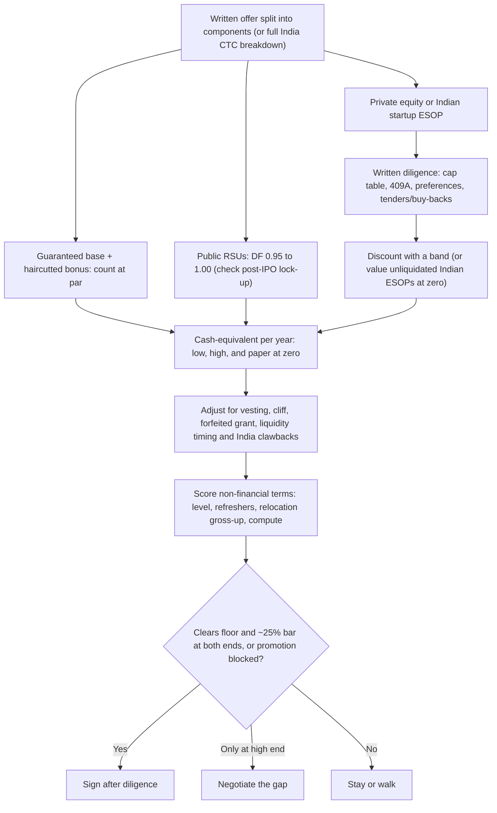

# Offer Evaluation: Cash, Liquid Equity and Paper Equity

> How to put GenAI offers on one cash-equivalent basis (base, bonus, liquid equity, locked IPO equity and discounted paper equity, plus India CTC and ESOP mechanics), decide whether moving beats staying, and run equity due diligence.

**Dates.** Discount factors come from [T0-02](../../research/sessions/T0-02-global-regional-compensation-benchmarks.md) (evidence as of 2026-10-21); hop-versus-stay rates, risk-adjusted values and the trap register come from [T0-17](../../research/sessions/T0-17-compensation-progression-plateaus-equity.md) (2026-10-23); due-diligence questions come from [T1-03](../../research/sessions/T1-03-interview-execution-offer-negotiation.md) (2026-10-25). Liquidity regime shifts (OpenAI buyback and PBC/RSU transition, Anthropic S-1 and lock-up, Forge and EquityZen closures, Pave 2026 attrition/merit) come from [T0-44](../../research/sessions/T0-44-pay-us-uk-europe-singapore-gulf.md) (retrieved 2026-11-13); India CTC structure, Labour Codes, IT-services variable payouts, Indian startup ESOP buy-backs and bond enforceability come from [T0-45](../../research/sessions/T0-45-pay-negotiation-india-city-employer.md) (retrieved 2026-11-13). Anthropic's IPO pricing (2026-11-18) and Nasdaq debut (2026-11-19), OpenAI's Oct 2025 PBC/RSU restructuring, Morgan Stanley's EquityZen fee cut and India's EPFO ceiling revision (Notification S.O. 5109(E), effective 2026-09-17) were verified externally on **2026-11-19**. Measured pay medians live in [pay benchmarks](pay-benchmarks.md) (D-019). Page-level `review_by` is **2027-01-19** (90 days from oldest retained Phase 0 pay data, D-018); re-check V0 items (Anthropic post-IPO trading/lock-up windows and Indian state Labour Code rules) within 14 days. **Grades** (EGP-1.0): A primary or measured; B transparent secondary; C vendor, press or single source; D judgement or model output; M arithmetic; P practice-curated. **Not advice.** Nothing here is tax, legal or financial advice [T1-03 L18]. For terms, see the [glossary](../00-start/glossary.md).

## The short answer

1. **Compare cash-equivalent totals, never headlines.** Count base and reliable bonus at par (haircutting variable pay where payout history is below 100%, such as Indian IT services [C · T0-45 L206]), public RSUs at 0.95–1.00, and private paper equity times a stage-appropriate discount factor (DF): 0.64–0.88 for a tender-backed private lab, 0.42–0.61 for late-stage private, and 0.09–0.21 for Series A/B (0.21–0.53 only if crediting upside) [B inputs, D outputs · T0-02.F8]. For **private Indian startup ESOPs, value them at zero until liquidity is documented** [C · T0-45 L74, L852].
2. **Account for the frontier-lab liquidity regime shift as of November 2026.** Anthropic priced its IPO at $83/share on 2026-11-18 and debuted on Nasdaq (**ANT**) on 2026-11-19 under a staged lock-up (up to 10% Day 1, +35% after FY2026 results, remainder at earlier of 180 days or Q1 2027 results for certain employees; COI, V0) [B/C · T0-44 L59, L667; external check 2026-11-19]. OpenAI converted to a PBC in Oct 2025 (moving 2026 new hires from PPUs to conventional 4-year RSUs), ran a $7B self-funded buyback at $852B in Aug 2026 and filed confidentially for an IPO in Jun 2026 [B/C · T0-44 L59, L151; external check 2026-11-19]. Value pre-IPO lab equity under **three cases** (last round, IPO range and 50% haircut) [C · T0-44 L77, L691].
3. **Use a valuation band and decide only if the answer holds at both ends.** T0-17's risk-adjusted values (RAV) are 0.5–0.8 for private lab paper, 0.4–0.8 for Series C–D and 0.15–0.3 for stale-vintage unicorns; for seed/Series A, do not underwrite and ask for cash [C/D · T0-17 L213–L220; T1-03.F8]. Discount rate and bust probability move value most; preference terms move it 3–12% [C/D · T0-17.F11]. The both-ends rule is practice [P].
4. **Price the vest, attrition and what you forfeit.** Forfeited value = grant × (1 − fraction vested at exit); ask for a sign-on at least that large [B/C · T0-17 L202–L211]. At 24 months an Amazon-style 5/15/40/40 grant is 20% vested against 66–70% for Google-style schedules [B/C · T0-17 L207–L208; T0-45 L216].
5. **Move for more than ~25% cash-equivalent gain, or when promotion is blocked.** In the US, same-tier moves yield ≈ +15–25% TC and level-ups ≈ +35–50%; staying on a promotion track compounds ~9–12% a year (non-promoted AI/ML merit is 4.4% in Pave H1 2026) [A/B/C · T0-17.F1, L196–L200; C · T0-44 L661]. In India, Aon puts 2026–2027 annual increments at 9.0–9.1% (IT services 6.6%, GCCs 9.3–9.4%, tech products 9.5%), while switch-hike claims ("up to 30%") are unmeasured ceilings [B/C · T0-45 L57–L58].
6. **In India, decompose CTC into in-hand cash before comparing, and run written equity diligence everywhere.** Indian CTC bundles employer PF, gratuity, insurance and target variable, and the four Labour Codes (in force from 2025-11-21) plus the higher EPFO wage ceiling (₹25,000/month from 2026-09-17) can reduce monthly take-home at the same CTC [A/C · T0-45 L59, L72, L211; external check 2026-11-19]. Always ask the ten written equity questions before signing [B/C/D · T1-03.F11].

## At a glance



## The cash-equivalent model: four components, four adjustments

An offer has four pay components (plus statutory deductions and benefits in CTC markets such as India). Putting two offers — or an offer and staying — on one footing requires four adjustments: discount paper or locked equity, price the vest and forfeiture, time the liquidity, and isolate non-financial terms.

### The four components, by employer archetype

Pay mixes by employer archetype (US public Big Tech, OpenAI, Anthropic, AI-native startups, Indian Big Tech and all-company India) are owned and dated in [pay benchmarks: base, bonus and equity](pay-benchmarks.md#base-bonus-and-equity). Five rules for reading an offer's mix:

- **Posted ranges are base-only.** In Axial Search's 2026 US corpora, only **14% of 43,480 AI-engineering postings** and **26% of 13,776 ML postings** mention equity, and 31% mention a bonus (correcting Phase 0's blurred attribution to Comprehensive.io) [B/C · T0-44 L56, L378]. Compare base with base, then request the full written package.
- **Publicly listed vs private frontier labs.** Base shrinks as a share of TC with level: at OpenAI L5, base is 36% ($335K) and stock 64% ($597.9K) [B · T0-44 L151, L639]; at Amazon Bengaluru Director, base is 47% (₹2.61Cr) and stock 49% (₹2.72Cr) [B/M · T0-45 L60, L204]. Never confuse company-wide accounting stock-based compensation expense (WSJ $1.5M/employee at OpenAI for 2025 vs $865K The Information relay) with cash promised to an individual [C · T0-44 L424, L662].
- **Startup paper shrinks steeply once discounted.** In Carta's profile of a P80–95 AI/ML engineer at a US AI-native startup >$500M, paper equity is 36% of paper TC; at late-stage DF 0.42–0.61 it drops to ~20–26% of cash-equivalent TC [B inputs, D share · T0-02 L223, L451].
- **Indian Big Tech vs Indian startups and services.** Bengaluru Big Tech is cash-heavy at IC levels (Google overall 70% base / 19% stock / 11% bonus; Amazon SDE II 73/23/4%), becoming stock-heavy only at Director+ [B/M · T0-45 L60, L204]. Indian IT-services variable pay is a share of the variable component and routinely pays below 100% (Infosys Q1 FY27 avg 70%, TCS Q3 FY26 up to 80% after ~2 yrs at 20–50%, Wipro Q3 FY26 100%; EY market avg performers 60–80%), whereas HCLTech reportedly merged quarterly variable pay into fixed pay in Q2 FY26 [C · T0-45 L206–L207, L258].
- **CTC is not in-hand pay.** In India, headline CTC includes employer PF, gratuity, medical insurance and target variable; always convert to fixed monthly cash in hand before comparing [B/P · T0-45 L72, L200, L849].

### Adjustment 1: discount paper or locked equity, with a band

| Equity type | DF (T0-02) | What drives the DF / valuation | RAV band (T0-17) / RP2 rule |
|---|---|---|---|
| Public RSU (unrestricted) | **0.95–1.00** | Public-market price volatility only | Not modelled (count near par) |
| Newly public IPO stock under staged lock-up (e.g., Anthropic **ANT** from 2026-11-19, COI) | Not modelled pre-IPO | Post-IPO swings of ±50% around lock-ups are plausible (SpaceX/xAI traded below IPO within ~5 weeks) [B/D · T0-17 L165, L224] | Treat locked tranches below par until unlocked; stress-test ±30–50% around unlock dates [D/P · T0-17 L224; T0-44 L667] |
| Pre-IPO frontier lab with tenders (e.g., OpenAI) | **0.64–0.88** | Sellable fraction *s* at tender price less 5%; remainder takes 34–47% marketability discount (s = 25%: 0.64–0.73; s = 50%: 0.74–0.81; s = 75%: 0.85–0.88) | **0.5–0.8**; T0-44 adds three-case test: last round ($852B), IPO range, and 50% haircut [C/D · T0-17 L213; T0-44 L77] |
| Late-stage private US (Series C+) | **0.42–0.61** (0.64–0.91 with 1.5× upside) | P(liquidity) 0.70–0.90 × dilution retention 0.85–0.95 × 3-yr discount factor 0.712 (12%/yr) | **0.4–0.8** (Series C–D, $1–5B mark) |
| Stale-vintage unicorn (2021–Q1 2022 mark) | Not modelled | Forge median trade for 2021/Q1 2022 vintage is −61% (Airtable −88%, Miro −92%) [A · T0-17 L150, L153] | **0.15–0.3** |
| Early-stage US startup (Series A/B) | **0.09–0.21** (0.21–0.53 with 2.5× upside; ~0.04–0.05 downside) | P(liquidity) 0.25–0.50 × retention 0.60–0.75 × 5-yr discount 0.567 | Seed/Series A: **do not underwrite**; treat as option value, ask for cash [C/D · T0-17 L220] |
| Private Indian startup ESOP | Not modelled | Buy-backs are infrequent, selective and can price below the last fundraise (e.g., Unacademy ₹50Cr, Feb 2026); preference holders rank ahead | **Value at ₹0 until liquidity is documented** [C · T0-45 L74, L225, L852] |

Sources: T0-02 L419–L439 (inputs B, outputs D), T0-17 L213–L222 (C/D), T0-44 L77, L691 (C) and T0-45 L74, L852 (C).

- **Both DF and RAV are model outputs.** Trust the structure (which variables move value) more than a single point; where DF and RAV differ, run both ends of the wider band (e.g., 0.50 and 0.88 for a private tender-backed lab) [D/P · T0-02 L15; T1-03 L419].
- **Price the bust case too.** Common stock is a call option struck at the preference stack and receives nothing at or below the stack [A · T0-17.F6, L149]. Price every offer with private paper at zero and verify it clears your walk-away floor [D · T1-03 L268].

### Adjustment 2: vesting, cliff and forfeiture

Fraction of a new-hire grant vested if you leave at 18, 24 or 36 months [B/C · T0-17 L202–L209; Google variants confirmed in India, T0-45 L216]:

| Schedule | 18 months | 24 months | 36 months |
|---|---|---|---|
| Flat 25/25/25/25 (monthly, no cliff) | 37.5% | 50% | 75% |
| Amazon-style 5/15/40/40 | 12.5% | 20% | 60% |
| Google-style 33/33/22/12 | 49.5% | 66% | 88% |
| Google-style 38/32/20/10 | 54% | 70% | 90% |

- **Forfeited value = grant × (1 − vested).** Ask the new employer for a sign-on or equity grant at least that large [B/C · T0-17 L211].
- **Cliffs and grant forms changed.** OpenAI removed its vesting cliff for new hires in Dec 2025 [B · T0-17 L180] and transitioned 2026 new-hire offers from synthetic PPUs to conventional 4-year RSUs after its Oct 2025 PBC restructuring (note tax shift: conventional RSUs are taxed as ordinary income at vest/settlement rather than only at tender sale — take tax advice) [B · T0-44 L151, L432; external check 2026-11-19].
- **Discount separately for attrition risk.** Expected vested fraction on a 4-year grant is ≈ 0.56 at 28% annual attrition and 0.71 at 17% [M · T0-17 L177, L222]. AI/ML annual turnover was reported at **21.8%** vs **16.8%** for SWEs in a 2026 Pave relay [C · T0-44 L326] (down from ~28% vs ~17% in 2025 data [B · T0-17 L125]).

### Adjustment 3: liquidity timing and secondary markets

Plan liquidity as three separate gates — a company tender or buy-back, an IPO plus staged lock-up, and the actual sale — and assume **no cash for 12–24 months** unless a tender or unlock tranche is scheduled and you qualify [D · T0-17 L224].

| Event / market | What the research found | Grade · source |
|---|---|---|
| **Private tender norms & Databricks liquidity (US)** | Carta recorded **71 tenders (~$3B) in H1 2026** (+34% count, +200% value YoY; 93.1% median subscription, 57.9% seller participation, 20% median cap, 0% median discount; median tender excluded former staff) [A · T0-17 L158, L441]. **Databricks** bundles liquidity into primary rounds (>$4B Series L at $134B Dec 2025; $5B at $190B Aug 2026) [A/B · T0-17 L161, L438]. Note **tender-price regret**: Anthropic's Apr 2026 tender at $350B trailed its May 2026 primary ($965B) by 2.5–2.8×, while OpenAI's Aug 2026 buyback ($852B) sat close to Sep Forge ($894B) [B · T0-17 L154–L160] | A / B · T0-17 L154–L161, L438, L441; T0-44 L384 |
| **OpenAI tenders & IPO prep** | Oct 2025: $6.6B tender (>600 sellers, ~75 at $30M cap, 2-yr hold reported). Jun 2026: confidential S-1 filing. Aug 2026: **$7B self-funded buyback at $852B valuation** (flat with Mar 2026 primary) | B/C · T0-44 L59, L151, L663–L664; ext. check 2026-11-19 |
| **Anthropic & SpaceX/xAI post-IPO lock-ups (V0)** | **Anthropic (COI):** priced **$83/share** on 2026-11-18 and trading on Nasdaq (**ANT**) from 2026-11-19 under a staged lock-up (up to **10% Day 1**, **+35%** after FY2026 results, remainder at earlier of **180 days or Q1 2027 results**; co-founders up to 365 days); double-trigger RSUs settle at IPO, triggering immediate W-2 withholding [B/C, COI · T0-44 L665–L667; ext. check 2026-11-19]. **SpaceX / xAI precedent:** mid-June 2026 IPO at **$135** peaked at **$225.64** then dropped **40–50%** below peak under a **9-stage price-triggered lock-up** ($175.50 release threshold on a 455.8M-share tranche) [B · T0-17 L165, L440] | B/C · T0-17 L165, L440; T0-44 L59, L665–L667 |
| **Secondary market platforms** | **Charles Schwab** completed its acquisition of **Forge Global** on **2026-03-02** (~$660M cash) [B · T0-44 L67, L385]. **Morgan Stanley** closed **EquityZen** on **2026-01-27** [B · T0-44 L67, L386] and lowered standard marketplace fees from 5% to 2.5% (external check 2026-11-19). Forge buy-side IOIs fell to a two-year low of **43.5%** in Sep 2026; median trades sat −3% to −7% vs last primary (Jul–Aug 2026), while 2021/Q1 2022 marks traded at median −61% | A/B · T0-17.F7, L155; T0-44 L385–L386; ext. check 2026-11-19 |
| **Indian startup buy-backs & IPO lock-ins** | Documented 2025–2026 events are uneven: **PhonePe** buy-back up to **₹800Cr** (1,000+ eligible, 2025-09-12); **Cashfree** 400+ employees incl. 175 former (size/price undisclosed, 2026-01-21); **Unacademy** **₹50Cr** buy-back priced **"significantly lower than our last fundraise"** with preference holders ahead (8 employees >₹1Cr, 17 >₹50L, 38 >₹10L, 2026-02-27). Post-IPO lock-in unlocks: **Pine Labs** ₹17,372Cr (May 2026), **Meesho** ~₹60,000Cr (Jun 2026) | C · T0-45 L224–L228, L837–L841 |

### Dilution, senior claims and tax mechanics (pointers, not tax advice)

- **Dilution arithmetic (`T0-17 KF10`):** New-money dilution (`raise ÷ post-money`) is modest in frontier mega-rounds — OpenAI Mar 2026 **14.3%** ceiling, Anthropic Series H **6.7%**, Databricks Series L **3.7%** and Aug 2026 **2.6%** [A/B · T0-17 L169, L451–L457] — whereas Carta's software medians dilute **19.5% (Seed) → 18% (Series A) → 14% (Series B) → 10% (Series C) = 48.9% cumulative** (founder plus employee pool drops from 55.1% to 10.9% by Series D) [A · T0-17 L458]. Up-round dilution is second-order; down-round dilution is first-order [M · T0-17 L169].
- **Senior claims act as a flat tax at every exit size (`T0-17 §6.3`):** Plain 1× non-participating preference matters only below a 1× exit, whereas bespoke senior claims (such as compute-for-equity obligations or senior notes) scale with the mark and cut RAV by **−6.0%** (at 10% of mark) to **−12.2%** (at 20% of mark) across exit multiples, compared with −2.9% for 1.5× preference and −5.4% for uncapped participation [A/M · T0-17 L358, L373–L379]. To stress-test a specific cap table, use the self-contained Python ERDM waterfall in [T0-17 §6.3](../../research/sessions/T0-17-compensation-progression-plateaus-equity.md) (L382).
- **US §83(b) filing mechanics and the grant-forfeiture trap (`T0-17 §6.7`):** File **IRS Form 15620 (Rev. 10-2024)** within 30 days of transfer (no extension; revocation requires IRS consent); online e-filing via an IRS **ID.me** account became available from mid-2025 per law-firm alerts (file one way only, keep proof and give the employer a copy) [A/B · T0-17 L486]. Crucially, §83(b) applies to restricted stock and early-exercised options, **not RSUs** [D · T0-17 L486]; where shares are *granted* (not purchased) with FMV > $0, filing §83(b) creates immediate ordinary income at grant that is **not recovered if the shares are later forfeited** [D · T0-17 L488].
- **India foreign-equity reporting (`T0-17 §6.7`):** Resident Indians holding or exercising foreign RSUs/ESOPs face perquisite tax at vest/exercise and capital gains on sale (24-month LTCG at 12.5% without indexation), plus mandatory **Schedule FA** disclosure (requiring **ITR-3**, not ITR-4), **Form 67** for foreign tax credits, and **RBI Liberalised Remittance Scheme (LRS)** caps when remitting exercise cash abroad — confirm every filing with a practising CA [C · T0-17 L494; A · T0-07 L194].

### Adjustment 4: non-financial and contractual terms

| Term | Why it counts | Grade · source |
|---|---|---|
| Level and title | US level steps ×1.38–1.46 (×1.21 Staff→Principal) [T0-44 L57]; India Google L4→L5 +65% [T0-45 L291] | B/M · T0-44 L57; T0-45 L291 |
| Refreshers and promotion timing | H1 2026 Pave promotion rate 8.6% [C · T0-44 L326]; Phase 0 cited +16–24% TC / +39% equity at promotion (T0-44 could not re-locate the 6.5% / +39% figures [T0-44 L383]). Count only written refresh terms | C / P · T0-17 L195; T0-44 L326, L383 |
| Relocation package & gross-up | Generic US corporate surveys (Atlas Van Lines n = 549, NEI 2026) show lump sums paid after start date, with tax gross-up in 81–91% of partial lump-sum programmes; GenAI employer postings omit amounts | C · T0-44 L81, L346 |
| Service bonds & clawbacks (India) | Supreme Court (*Vijaya Bank*, 2025-05-14) upheld a 3-year ₹2L service bond in a public-sector bank; read any joining-bonus or relocation repayment schedule as potentially enforceable | A/D · T0-45 L61, L215, L854 |
| Compute budget, remote stipend, runway & data moat | High personal value at marginal employer cost; startup paper is worth zero if runway runs out before liquidity | D · T1-03 L340; P (runway/moat) |

### Hop or stay

| Move | Expected TC change | Grade · source |
|---|---|---|
| US stay, merit only | **+3.4%** all employees / **+3.7%** R&D / **+4.4%** AI/ML (Pave May 2026) | C · T0-44 L383, L661 (confirms T0-17 L194) |
| US stay with a promotion | ≈ +16–24% TC at event (Phase 0 Pave; 6.5% / +39% unverified in T0-44) | C · T0-17 L195; T0-44 L383 |
| US same-tier lateral move | ≈ +15–25% TC | C · T0-17 L196 |
| US level-up move (e.g., Senior → Staff) | ≈ +35–50% (level-median step ×1.38–1.46) | B/C · T0-17 L197; T0-44 L57 |
| US tier jump (all-company median → frontier lab) | Headline ×2.1–3.1 (OpenAI $600K, Anthropic $882.5K); ≈ ×1.7–2.4 risk-adjusted vs all-company Staff; far smaller vs same-tier Big Tech (worked example below) | B/C · T0-44 L58; T0-17 L132–L133 |
| India stay, annual increment | **9.0%** actual 2026 / **9.1%** projected 2027 overall; IT services **6.6%**, GCCs **9.3–9.4%**, tech platforms/products **9.5%** (Aon, 1,200+ orgs) | B · T0-45 L57, L241 |
| India employer-tier switch | No measured switch-hike study exists (Michael Page **"up to 30%"** is a ceiling [C]); moving across employer tiers (e.g., IT services → product/GCC → Big Tech) moves pay 2–7.5× via level bands | B/C · T0-45 L54, L58, L183, L267 |

| If | Then | Grade · source |
|---|---|---|
| Cash-equivalent premium is under ~25% at either end of the band, and promotion is open | Stay, or use the offer as market data | A/B/C · T1-03.F7; T0-17 L200 |
| Premium clears ~25% at both ends | Move, after written equity and contract diligence | A/B/C · T1-03.F7 |
| Promotion is blocked (or in India, WiseMonk convenience sample notes 39% cited "no growth" vs 21% "better offer" [C · T0-45 L400]) | Moving beats staying; target a level-up or higher employer tier | B/C · T0-17 L197; T0-45 L400 |
| US Big Tech Senior weighing a private frontier lab | Proceed if risk-adjusted package clears ~1.5× Big Tech, you can hold through a lock-up, and you negotiated no cliff, tender clarity and forfeited-vest sign-on | D · T0-17 L230 |
| Retention counter-offer arrives | Judge it against why you looked; neither US nor India evidence proves the "leave within 12–18 months" claim | D · T1-03 L323; C · T0-45 L283, L857 |

## How to do it

1. **Get every offer in writing, split into components:** base, target bonus (and payout history), equity type (public RSUs, IPO-locked shares, private RSUs or options), grant size, mark, vesting/cliff, sign-on, relocation, clawback period, level and title; in India, demand the full CTC break-up under the Labour Codes [T0-45 L72; P]. *Done when* every line traces to an offer letter or email.
2. **Classify each equity grant and pick its band** (public 0.95–1.00, IPO-locked with volatility haircut, private lab DF/RAV + 3-case test, startup DF/RAV, or ₹0 for unliquidated Indian ESOPs). *Done when* every grant has low, high and bust multipliers.
3. **Send the written diligence questions** (below) for any private equity or locked IPO grant. *Done when* you hold written answers or a written refusal [T1-03 L344].
4. **Compute cash-equivalent totals at both ends plus the bust case** (and in India, monthly in-hand cash via official EPFO/Income Tax calculators or a CA [T0-45 L72, L867]). *Done when* every offer and staying have low, high and paper-at-zero figures.
5. **Price the vest and forfeiture** (or notice buy-out cost in India). *Done when* you know your year-1 cash and forfeited grant [T0-17 L202–L211; T0-45 L75].
6. **Compare against staying at both ends of the band.** *Done when* you know the percentage premium low-to-high.
7. **Sign, negotiate or stay.** Sign after diligence if the low end clears your floor and move bar; negotiate with the [negotiation playbook](negotiation-playbook.md) if only the high end clears; otherwise stay or walk [P]. *Done when* your written decision and lever targets are logged.

## Templates and examples

### The offer comparison worksheet [P]

Rows follow T0-02's four components plus T0-45's India CTC split [T0-02 L217; T0-45 L72]; layout is practice [P]. Keep personal offer numbers in your own personal career repository (decision D-022), such as [pramedha-template](https://github.com/bhaskarjha-dev/pramedha-template)'s `strategy/offer-comparison.md`:

| Row | How to fill it |
|---|---|
| 1. Guaranteed base / fixed cash | Annual base (in India: fixed cash after subtracting employer PF, gratuity and variable from CTC) |
| 2. Reliable bonus / variable | Target bonus × realistic payout ratio (e.g., 0.70–0.80 at Indian IT services unless guaranteed) |
| 3. Liquid public equity × 0.95–1.00 | Unrestricted public RSUs vesting per year (apply volatility stress if under an IPO lock-up) |
| 4. Paper equity × DF (or ₹0) | Annual vest at grant-date mark × low and high DF/RAV; ₹0 for unliquidated Indian startup ESOPs |
| **Cash-equivalent per year** (1 + 2 + 3 + 4) | Write both low and high ends |
| 5. Bust case: paper at zero (1 + 2 + 3) | Compare directly against your floor |
| 6. Vesting, forfeiture & clawbacks | Schedule, cliff, year-1 vest, sign-on, forfeited stay grant, relocation gross-up and any bond/clawback window |
| 7. Refreshers | Written cadence and policy only (unwritten = zero) |
| 8. Non-financial | Level, scope, compute, remote policy, review date (score separately, not in cash) |
| **Premium over staying** | Low = offer low ÷ stay high − 1; high = offer high ÷ stay low − 1 |

### Worked example: a same-tier private lab offer against staying (illustrative arithmetic, Grade M)

**Inputs.** T0-02 maps Meta ML Engineer E6 ($261K base, $39K bonus, $481K public RSUs; headline $782K rounded; T0-44 reports Meta E6 range $660K–$790K) against OpenAI SWE L5, refreshed in T0-44 (2026-11-01) at **$932.9K TC** ($335K base, $0 bonus, $597.9K RSUs) [B · T0-02 L235; T0-44 L151, L155, L639]. Frontier-lab medians shift ±30–50% between snapshots [C · T0-17 L131]. DF uses T0-02's unrounded lab bounds (0.635–0.878) [D · T0-02 L441]. Arithmetic on stated inputs only, not market advice.

| Row | Stay: Meta ML E6 (public RSUs) | Offer: OpenAI L5 (pre-IPO tender-backed RSUs) |
|---|---|---|
| 1. Base | $261.0K | $335.0K |
| 2. Bonus | $39.0K | $0 |
| 3. Liquid equity × 0.95–1.00 | $481.0K → $456.95K–$481.00K | $0 |
| 4. Paper equity × 0.635–0.878 | $0 | $597.92K → $379.68K–$524.97K |
| **Cash-equivalent per year** | **$756.95K–$781.00K** | **$714.68K–$859.97K** |
| Headline TC | $782.0K | $932.9K (+19.3%, ×1.19) |
| 5. Risk: paper at zero | $756.95K–$781.00K | **$335.0K** |
| **Premium over staying** | — | **−8.5% to +13.6%** |

**Reading it:**
- A headline +19.3% jump ($932.9K vs $782K) compresses to **−8.5% to +13.6%** at T0-02's lab DF (and **−18.8% to +7.4%**, $634.0K–$813.3K, under T0-17's 0.50–0.80 RAV). Under both models it falls short of the ~25% move bar and T0-17's ×1.5 rule ($1,135.4K–$1,171.5K).
- Under T0-44's three-case lab stress test (last round $852B, IPO upside, and 50% haircut), a 50% equity haircut drops OpenAI L5 to $634.0K (−18.8% below staying), and paper at zero leaves $335K cash — under half of Meta's liquid cash+RSU floor.
- Moving therefore needs a clear non-money thesis (scope, mission, post-IPO upside conviction) or a higher level/package [P].

### What $100K a year of equity is worth, by type (Grade M)

| Equity type | Band | Cash-equivalent per $100K/year at grant-date mark |
|---|---|---|
| Public RSU (unrestricted) | DF 0.95–1.00 | $95K–$100K |
| Pre-IPO frontier lab with tenders | DF 0.64–0.88; RAV 0.5–0.8 | $64K–$88K; $50K–$80K |
| Late-stage private US | DF 0.42–0.61; RAV 0.4–0.8 (Series C–D) | $42K–$61K; $40K–$80K |
| Stale-vintage unicorn | RAV 0.15–0.3 | $15K–$30K |
| Early-stage US startup (Series A/B) | DF 0.09–0.21 (0.21–0.53 with upside) | $9K–$21K ($21K–$53K) |
| Private Indian startup ESOP (no documented liquidity) | T0-45 conservative rule | **₹0** until liquidity is documented [C · T0-45 L74] |

**Forfeiture arithmetic (Grade M):** Leaving at 24 months forfeits 80% of an Amazon-style 5/15/40/40 grant and 30–34% of Google-style 38/32/20/10 or 33/33/22/12 grants [B/C inputs · T0-17 L207–L208; T0-45 L216]. Sign-on ask = grant × (1 − vested).

### Equity due-diligence questions (ask in writing)

| # | Ask | Why it matters | What to look for |
|---|---|---|---|
| 1 | Fully diluted share count | Converts shares into ownership % | Must include all shares, options, warrants and unallocated pool [T1-03 L348] |
| 2 | Last preferred price and last 409A FMV (or Indian valuation reference) | Shows preferred-vs-common gap and strike price | Options struck at 409A; in India, check whether buy-backs priced at or below last round (Unacademy priced below [C · T0-45 L225]) |
| 3 | Total liquidation preference stack and seniority | Common/ESOP holders receive nothing until stack is repaid | 95.8% of Cooley Q2 2026 financings had 1× preference, but mega-round compute-for-equity claims are undisclosed [A · T0-17 L148; T1-03 L350]; Indian preference holders also rank ahead in buy-backs [C · T0-45 L225] |
| 4 | Participating preferred classes and caps | Participating classes take value at every exit size | 96.4% of Cooley Q2 2026 financings were non-participating; bespoke terms exist [A · T0-17 L148] |
| 5 | Last tender/buy-back or IPO lock-up schedule: date, price, cap, tenure gate, ex-employee eligibility | Determines when and how much you can actually sell | OpenAI Oct 2025: 2-yr hold, $30M cap; Anthropic IPO (COI): staged 10% Day 1 / +35% FY26 / 180d–Q1 2027 lock-up; India: PhonePe ₹800Cr, Cashfree incl. 175 former staff, Unacademy ₹50Cr below last round [B/C · T0-44 L151, L667; T0-45 L224–L226] |
| 6 | Vesting schedule and cliff | Determines forfeiture on early departure | OpenAI dropped its cliff (Dec 2025); Google uses 38/32/20/10 or 25% flat; Amazon 5/15/40/40 forfeits 80% at 24 months [B · T0-17 L180, L207; T0-45 L216] |
| 7 | Grant instrument (RSUs vs options), strike, early exercise and tax trigger | Tax timing differs sharply | Conventional RSUs trigger ordinary income at vest/settlement (double-trigger RSUs settle at IPO, creating immediate W-2 tax); early exercise + 83(b) shifts US option gains; Indian startup ESOP perquisite tax deferral under s.192(1C) is restricted to eligible startups [A/B/C · T1-03 L354; T0-45 L217; ext. check 2026-11-19] |
| 8 | Post-termination exercise window | Missing it forfeits vested options | Ask for an extended window in writing (no sourced Indian startup norm exists [T0-45 L74]; US 90-day default is recalled, D [T0-17 L181]) |
| 9 | Change-of-control acceleration (single- or double-trigger) | Protects against acqui-hire carve-outs | Windsurf 2025 precedent: <1-year hires reportedly received no payout [B · T0-17 L180] |
| 10 | Treatment of new hires in prior acquisitions or licence-and-hire deals | Reveals practice beyond boilerplate | Ask specifically about licence-and-hire structures [D · T1-03 L357] |

Checklist graded B/C/D [T1-03.F11]. Also check **startup durability**: cash runway [P], data/distribution moat [P] and valuation vintage (2021-era marks carry RAV 0.15–0.3 [A · T0-17 L153]).

### The diligence email [P]

Adapted from T1-03 L344–L357 and T0-45 L853; wording is practice:

```text
Subject: [Company] offer: equity [and CTC structure] questions before I sign

Hi [recruiter name],

Thank you again for the written offer. I'm excited about [team or product]. Before I sign,
could you confirm the following in writing?

1. The fully diluted share count, so I can convert my [number] shares into an ownership %.
2. The last preferred price per share and most recent 409A / valuation reference, with date.
3. The total liquidation preference stack, seniority, and any participating class or cap.
4. Liquidity mechanics: last tender or ESOP buy-back (date, price vs last round, cap, tenure
   gate, former-employee eligibility) or applicable IPO lock-up release schedule.
5. The vesting schedule, cliff, refresh policy and any joining-bonus or relocation clawback.
6. Grant type (RSUs vs options); for options, strike price, early-exercise / 83(b) availability
   and post-termination exercise window.
7. Change-of-control acceleration (single- or double-trigger) and treatment of recent hires
   in any prior acquisition or licence-and-hire deal.
[8. For India offers: full written CTC break-up showing basic, HRA, special allowance,
   employer PF/gratuity under the Labour Codes, and variable payout history.]

If some equity details are confidential, a brief call with [finance / equity contact] works too.

Thank you,
[name]
```

### Weak → strong: how to read an offer [P]

| Weak | Strong |
|---|---|
| "$933K at OpenAI beats $782K at Meta by $151K." | "At lab DF 0.635–0.878 it is $715K–$860K against $757K–$781K (−8.5% to +13.6%), below the ~25% bar, and only $335K is cash." |
| "Anthropic is public now, so every dollar of my grant is instant cash." | "Anthropic debuted on 2026-11-19 (ANT), but pre-IPO holdings sit under a staged lock-up (10% Day 1 / +35% FY26 / 180d–Q1 2027) and double-trigger RSUs trigger W-2 withholding at IPO." |
| "My Bengaluru startup offer is ₹60L CTC including ₹18L ESOPs and ₹6L variable." | "Fixed cash is ₹36L minus employer PF/gratuity; at 75% variable payout that is ₹4.5L; private ESOPs are valued at ₹0 until a buy-back or listing is documented." |
| "0.146% of a $500M company is $730K." | "Over 4 years that is $182.5K/yr of paper, worth $76.7K–$111.3K at DF 0.42–0.61, and zero below the preference stack." |

## Persona and geography notes

### US Big Tech engineer weighing a frontier lab

Proceed if the risk-adjusted package clears ~1.5× your Big Tech total comp, you can hold through a staged IPO lock-up or 12–24 months without liquidity, and you have negotiated no cliff, tender/lock-up clarity and forfeited-vest sign-on [D · T0-17 L230; T0-44 L77]. Note OpenAI's shift from PPUs to conventional RSUs (taxed at vest/settlement) and Anthropic's post-IPO trading volatility (V0).

### Research scientists and early-stage startup offers

- **Research scientists:** Equity dominates packages (Pave Aug 2026 median new-hire equity $4.09M at P6 and $4.72M at M6 — intended annualised equity value at grant, not realised cash — >2× ML/AI Engineering [B/C · T0-02.F5; T0-44 L118; ERRATA U32]). Run both ends of the DF band and see [PhD to industry](../11-tracks/phd-to-industry.md).
- **Early-stage startups:** Do not underwrite seed or Series A paper — treat it as option value and ask for cash (Carta Series A → B 2-yr graduation ran ~28% for 2018 cohorts vs 9–15% for 2022 cohorts) [B · T0-02 L424; C/D · T0-17 L220].

### India-based engineers

> **Not tax or legal advice.** These are dated pointers as of November 2026; confirm every tax, PF and contract point with a practising Chartered Accountant or lawyer before signing [T0-17 L229; T0-45 L72].

- **Decompose CTC under the four Labour Codes.** All four codes commenced on **2025-11-21** [A · T0-45 L59, L209], final central rules were notified in May 2026 [B · T0-45 L209; external check 2026-11-19: 2026-05-08], and the statutory **EPFO wage ceiling rose from ₹15,000 to ₹25,000/month effective 2026-09-17** (Notification S.O. 5109(E), external check 2026-11-19; raising the 12% statutory cap from ₹1,800 to ₹3,000/month; ESIC stays ₹21,000/month). Under the 50% wage-definition rule, raising basic pay from 30% to 50% of CTC can cut monthly in-hand take-home by an illustrative ₹3,500–7,000/month at ₹7–15L CTC (note DLA Piper and K&S describe different 50% statutory limbs, and major Indian IT-services firms booked ₹4,000–5,400Cr in one-time Q3 FY26 Labour Code charges) [B/C · T0-45 L210–L211, L474–L475]. Fixed-term employees gain gratuity eligibility after **1 year instead of 5** (though DLA Piper flags an unresolved drafting conflict between the Industrial Relations Code and Social Security Code) [A/B · T0-45 L213, L475]. Use official EPFO and Income Tax Department calculators to model net cash [T0-45 L218, L867].
- **Value Indian startup ESOPs at zero until liquidity is documented.** Indian buy-backs are selective and can price below the last fundraise (Unacademy ₹50Cr below last round; Cashfree undisclosed; PhonePe up to ₹800Cr) [C · T0-45 L74, L224–L226]. Tax deferral on ESOP perquisites under s.192(1C) of the Income-tax Act 1961 applies only to eligible certified startups (stale 2023 explainer; successor under the Income-tax Act 2025 unverified) [C · T0-45 L217].
- **Unlisted foreign shares create a dry-tax and compliance crunch.** Indian advisory blogs (Wisemonk, Treelife) report perquisite tax at vest/exercise plus capital gains on sale (24-month LTCG threshold, 12.5% rate without indexation), mandatory **Schedule FA** disclosure (ITR-3), **Form 67** for foreign tax credits and **RBI LRS** remittance caps for exercise funds — ask for a cash-heavy mix and model with a CA [C · T0-17 L229, L494; T1-03 L369].
- **Haircut IT-services variable pay and read bond/clawback clauses.** Do not value variable at 100% where recent payouts averaged 70–80% [C · T0-45 L206]. Read any joining-bonus or service bond in light of *Vijaya Bank* (Supreme Court, 2025-05-14) [A · T0-45 L215].
- **Anchor on measured city/employer tables, not tier bands:** [pay benchmarks: India](pay-benchmarks.md#india-by-city-level-and-employer) [ERRATA U14]. For cross-border contracting vs EOR, see [India remote tax](india-remote-tax.md) and the [India remote playbook](../11-tracks/india-remote-playbook.md).

### UK and Europe

- **UK startups:** Expanded **EMI option limits** took effect on **2026-04-06** (500 employees, £120M gross assets, £6M unexercised-option cap, 15-year option life) [B · T0-17 L144]. Ask whether a UK startup grant qualifies as EMI [P].
- **Local package structure:** Check 13th-month instalments in Switzerland, Netherlands and Singapore [B · T0-44 L352–L353], Poland B2B vs employment-contract (UoP) net-pay equivalence [C · T0-44 L239, L354], and regional benchmarks in [pay benchmarks](pay-benchmarks.md#uk-europe-singapore-and-the-gcc).

## Checklist

- [ ] Every offer is in writing and decomposed into fixed cash, realistic variable, liquid/locked equity, paper equity, vesting, sign-on, relocation and level.
- [ ] Every paper or locked-IPO grant has a low, high and bust valuation (and unliquidated Indian startup ESOPs are valued at ₹0).
- [ ] I priced each offer with private paper at zero and checked it against my walk-away floor.
- [ ] I computed my forfeited unvested equity (or Indian notice buy-out) and asked for a sign-on at least that large.
- [ ] I sent the written equity diligence questions and hold written answers (or weighted a refusal towards cash).
- [ ] I checked tender tenure gates, caps, ex-employee eligibility or staged IPO lock-up tranches; otherwise I assumed zero equity cash for 12–24 months.
- [ ] I checked whether a move clears the ~25% cash-equivalent bar at both ends of the band (or fixes a blocked promotion).
- [ ] I checked key traps: 83(b) 30-day deadline, post-termination exercise window, change-of-control acceleration, QSBS, relocation gross-up and clawbacks.
- [ ] Refreshers and non-financial terms I counted are written in the offer letter.
- [ ] India: I received the full written CTC breakdown under the Labour Codes (noting the ₹25,000 EPFO ceiling from 2026-09-17), read every bond/clawback clause and checked ESOP/foreign-share tax with a CA.

## Pitfalls

Hidden traps, red flag → why it hurts → fix [T0-17.F12; T0-44; T0-45]:

| Red flag | Why it hurts | Fix |
|---|---|---|
| Treating a newly public IPO grant or OpenAI RSU like unrestricted cash | Staged IPO lock-ups (Anthropic: 10% Day 1 / +35% FY26 / 180d–Q1 2027; SpaceX/xAI traded below IPO in 5 weeks) and W-2 tax at RSU vest/settlement create volatility and cash-flow gaps [B/C · T0-17.F9; T0-44 L667; ext. check 2026-11-19] | Model ±30–50% lock-up swings and confirm RSU tax withholding rules with a tax adviser |
| Counting on company-wide SBC averages ("$1.5M/employee") | Accounting expense is not cash promised to new hires; OpenAI L5 TC is $932.9K ($335K base) [B/C · T0-44 L151, L424] | Value your specific grant under three cases (last round, IPO range, 50% haircut) [C · T0-44 L77] |
| Early-exercising US options without filing 83(b) — or filing 83(b) on *granted* high-FMV stock | Form 15620 must be filed within 30 days (no extension; ID.me e-filing available); does not cover RSUs; if granted shares with FMV > $0 are forfeited, tax paid at grant is not recovered [A/B/D · T0-17 L486–L488] | Diary deadline at exercise, confirm purchased vs granted shares, and take tax advice |
| "You can sell in our tenders" with no written terms | Tenure gates (1–2 yrs), caps (Carta median 20%; OpenAI $30M; Anthropic pre-IPO $2M), ex-employee exclusion and issuer ROFR / transfer-approval control (Trap #9) limit liquidity [A/B · T0-17.F8, L476] | Ask question 5; ask explicitly about ROFR, trading windows and day-one eligibility |
| Restrictive exit non-disparagement or broad release clauses (Trap #15) | Exit paperwork can put vested equity or repurchase rights at risk (recalled 2024 controversy) [D · T0-17 L482] | Read equity-plan repurchase clauses before signing and have employment counsel review exit agreements |
| Counting Indian startup ESOPs at last-round valuation | Buy-backs are selective and can price below the last round (Unacademy ₹50Cr, Feb 2026); preference holders rank ahead [C · T0-45 L225] | Value at ₹0 until documented; ask for cash if liquidity is unproven [C · T0-45 L74] |
| Ignoring India CTC structure under the Labour Codes | Shifting basic to 50% (in force from 2025-11-21; EPFO ceiling ₹25,000 from 2026-09-17) can drop monthly in-hand cash at the same CTC [A/C · T0-45 L59, L211; ext. check 2026-11-19] | Demand full written break-up and check with official EPFO/Income Tax calculators |
| Assuming an Indian service bond or joining-bonus clawback is unenforceable | Supreme Court upheld a 3-yr ₹2L bond on 2025-05-14 (*Vijaya Bank*, public-sector bank); private reach untested [A/D · T0-45 L61, L215] | Negotiate the repayment window before signing |
| One-year cliff on a back-loaded grant | Amazon-style 5/15/40/40 vests only 12.5% at 18 months and 20% at 24 months [B/C · T0-17 L207] | Negotiate cliff removal (OpenAI dropped its cliff Dec 2025) or front-loading [B · T0-17 L180] |
| No change-of-control acceleration at an acqui-hire target | Windsurf 2025 deal reportedly left <1-yr hires without payout [B · T0-17 L180] | Ask questions 9–10; negotiate double-trigger acceleration with no new-hire carve-out |
| Assuming startup gains are tax-free under US QSBS | For stock issued after 2025-07-04: 50/75/100% exclusion at 3/4/5 yrs, $15M cap, $75M asset test [B · T0-17 L180] | Verify eligibility and holding period with a tax adviser |
| 2021-era unicorn valuation mark | 2021/Q1 2022 companies traded at median −61% on Forge (Airtable −88%, Miro −92%) [A · T0-17 L150, L153] | Apply stale-vintage band (RAV 0.15–0.3) [C/D · T0-17 L219] |
| Comparing a posted range against TC | Axial Search shows only 14% of 43,480 AI postings (26% of ML) mention equity [B/C · T0-44 L56, L378] | Compare base to base; ask for the full written package |

## Evidence and limits

- **Measured (A/B):** Levels.fyi pay mixes and ladders (B per D-018) [T0-44 L151–L157; T0-45 L204, L216]; Axial Search 2026 US corpora (B salary, C equity mentions due to internal level-split inconsistency [T0-44 L413]); Schwab/Forge (2026-03-02) and Morgan Stanley/EquityZen (2026-01-27) closings (B) [T0-44 L385–L386]; OpenAI $7B buyback (Aug 2026, B) [T0-44 L664]; Cooley Q2 2026 financings and Carta tenders (A) [T0-17 L148, L158]; India Labour Codes commencement (2025-11-21) and Supreme Court *Vijaya Bank* judgment (2025-05-14) (A) [T0-45 L59, L61]; 83(b) and QSBS rules (A/B) [T0-17 L180]; external verification (2026-11-19) of Anthropic's IPO pricing/debut (ANT), OpenAI PBC/RSU conversion and India EPFO S.O. 5109(E).
- **Model outputs, relays and judgement (C/D/M):** Every DF and RAV band (D and C/D; low confidence on point values [T0-02 L15; T0-17.F11]); worked example arithmetic (M); Pave 2026 turnover (21.8% vs 16.8%) and merit (4.4%) relays (C) [T0-44 L326, L661]; Indian ESOP buy-back press reports and IT-services variable payouts (C) [T0-45 L206, L224–L228]; ~25% hop bar (C), ×1.5 lab rule and 12–24-month no-cash rule (D) [T0-17 L115–L119, L224, L230].
- **Not in the corpus:** Employer-by-employer refresher schedules; startup runway/moat metrics [P]; Indian fixed-to-variable splits by employer type and joining-bonus sizes/clawback periods [E · T0-45 L416]; Indian startup ESOP vesting/exercise-window norms and buy-back sizes for Lenskart, Groww, Zepto, Razorpay, Flipkart and Swiggy [E · T0-45 L417]; whether s.192(1C) has a successor under the Income-tax Act 2025 [E · T0-45 L421]; state Labour Code rule effective dates [E · T0-45 L429].
- **Errata applied:** India anchors follow [ERRATA U14](../../research/ERRATA.md); Pave new-hire equity grade and definition follow [ERRATA U32](../../research/ERRATA.md); Axial Search attribution follows T0-44 K15; EPFO ceiling updates T0-45's Feb 2026 pending snapshot via 2026-11-19 external verification (U51).
- **What would change this page:** Post-IPO trading and first unlock windows for Anthropic (**ANT**); an OpenAI public Form S-1 and lock-up schedule; state-level Indian Labour Code notifications; private-sector Indian rulings on joining-bonus clawbacks; Levels.fyi 2026 End of Year report and Pave H2 2026 / Cooley Q3 2026 releases.
- **Dates:** T0-44 and T0-45 retrieved 2026-11-13; Anthropic IPO, OpenAI PBC/RSU, EquityZen fees and India EPFO S.O. 5109(E) verified externally 2026-11-19; Phase 0 sessions 2026-10-21 to 2026-10-25. Re-verify by 2027-01-19 (V0 items within 14 days).

## Next steps

- **Offer close to your bar:** the [negotiation playbook](negotiation-playbook.md).
- **Benchmarks by level, city and employer:** [pay benchmarks](pay-benchmarks.md).
- **India:** [India remote tax](india-remote-tax.md) and the [India remote playbook](../11-tracks/india-remote-playbook.md).
- **After you sign:** [first 90 days](../10-onboarding/first-90-days.md) and [growth and progression](../10-onboarding/growth-and-progression.md).
- **Other situations:** [career transitions](../11-tracks/career-transitions.md), [freelance and fractional](../11-tracks/freelance-fractional.md) for contract offers, [visa and relocation](../11-tracks/visa-and-relocation.md) for cross-border moves.
- **Employers and roles:** the [employer landscape](../01-landscape/employer-landscape.md); role hubs for the [AI Engineer](../02-roles/hubs/ai-engineer.md), [ML Engineer](../02-roles/hubs/ml-engineer.md), [Research Engineer](../02-roles/hubs/research-engineer.md), [AI Infrastructure Engineer](../02-roles/hubs/ai-infrastructure-engineer.md) and [Research Scientist](../02-roles/hubs/research-scientist.md).
- **Evidence:** the [stage 09 findings](../../research/findings.md#stage-09); sessions [T0-44](../../research/sessions/T0-44-pay-us-uk-europe-singapore-gulf.md), [T0-45](../../research/sessions/T0-45-pay-negotiation-india-city-employer.md), [T0-02](../../research/sessions/T0-02-global-regional-compensation-benchmarks.md), [T0-17](../../research/sessions/T0-17-compensation-progression-plateaus-equity.md) and [T1-03](../../research/sessions/T1-03-interview-execution-offer-negotiation.md).
