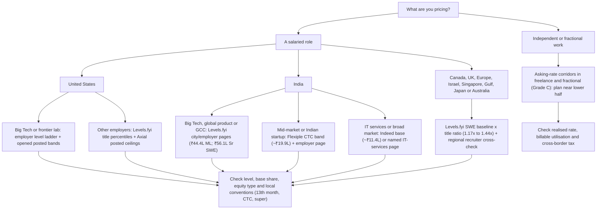

# Pay Benchmarks: What GenAI Roles Pay

> Measured pay for GenAI roles by title, city, level and employer type across the US, India, UK, Europe, Canada, Israel, Singapore, the Gulf, Japan and Australia as of November 2026, with source, date and grade on every row.

**Scope.** This page owns the repository's pay figures (decision D-019): every other page quotes at most a headline and links here. Independent, contract and fractional rates are owned by [freelance and fractional](../11-tracks/freelance-fractional.md). Tax and statutory take-home rules for India-based cross-border earners are in [India remote tax](india-remote-tax.md).

**Dates.** Every pay row shows the date of its dataset: the source page's own update stamp where it shows one, otherwise the retrieval or publication date. The sources are:
- **[T0-44](../../research/sessions/T0-44-pay-us-uk-europe-singapore-gulf.md)** (retrieved 2026-11-13): Levels.fyi `.md` and title pages stamped 2026-11-01 to 2026-11-12 across 11 countries; Axial Search US posted-range reports (Jan–Oct 2026); OpenAI San Francisco postings (Jan–May 2026) and five opened Anthropic London postings (COI disclosed: Anthropic developed the authoring model [T0-44 L13]); third-party H-1B LCA aggregators (FY2023–FY2026 Q3); recruiter guides and Indeed Hiring Lab pay-transparency shares (through Jul 2026).
- **[T0-45](../../research/sessions/T0-45-pay-negotiation-india-city-employer.md)** (retrieved 2026-11-13, finalised 2026-11-16): Levels.fyi India city, level, title and named-employer pages stamped 2026-09-30 to 2026-11-13; Flexiple (Aug 2026) and Indeed India (2026-09-08); Aon (2026-10-14), Deloitte, EY and Mercer increment surveys; TeamLease Digital and 1 Finance reports; nine Cutshort postings with INR ranges (2026-10-05 to 2026-11-05).
- **Phase 0 sessions retained where unrefreshed:** [T0-02](../../research/sessions/T0-02-global-regional-compensation-benchmarks.md) (retrieved 2026-10-21: Google US and Bengaluru ML ladders, same-employer cross-country ratios, WTW 2026, Carta Feb 2026, Robert Half Zurich, ByteDance Singapore), [T0-17](../../research/sessions/T0-17-compensation-progression-plateaus-equity.md) (2026-10-23: US level ladder and AI premium, confirmed in T0-44), [T0-03](../../research/sessions/T0-03-skills-compute-infra-eval-stack.md) (2026-10-24: S09 posted base 2026-08-05 and JobsPipe 2026-10-19), T0-15 (2026-10-21 to 2026-10-23: governance pay) and T0-06 (2026-10-21).
- **Live external verification (2026-11-19):** Anthropic's IPO pricing on 2026-11-18 and Nasdaq debut on 2026-11-19 (updating T0-44's pre-pricing V0 snapshot), and mid-November 2026 USD/INR and GBP/USD reference exchange rates.

**Re-verification.** This repository re-verifies pay 90 days after a figure was last verified at its source (decision D-018). The T0-44 and T0-45 pay series were retrieved on 2026-11-13 (valid to 2027-02-11), while unrefreshed Phase 0 rows retained on this page (Google US/Bengaluru ML ladders, S09 posted base, governance pay) were retrieved on 2026-10-21, so this page's conservative `review_by` is **2027-01-19**. Two classes expire faster: **V0** (Anthropic post-IPO trading and lock-up windows: re-check within 14 days) and **V1** (monthly posting pay-transparency shares: re-check within 31 days). T0-02 advises re-pulling Levels.fyi anchors every 30 days because pages update continuously [T0-02 L528].

**Grades** (EGP-1.0; definitions in [CONTRIBUTING §3](../../CONTRIBUTING.md#3-writing-standard-egp-10-in-brief)): A primary or measured (opened employer postings or official texts); B transparent secondary or platform aggregate; C vendor, recruiter, press relay or single source; D judgement, memory or unverified relay; E promotional, untraceable or absent (never asserted); M model output or arithmetic (inherits the weakest input); P practice-curated. **Platform data are always Grade B** (decision D-018): Levels.fyi, JobsPipe and Fast AI Jobs figures are graded B with their n and date; broad crowdsourced sites (Indeed, Glassdoor, AmbitionBox, Payscale, Flexiple) are Grade C; visa wage filings (LCA) are A for what was filed and never for pay (graded B here because every figure is third-party processing of DOL files [T0-44 L174]). Rows on Anthropic carry a conflict-of-interest (COI) flag because Anthropic developed T0-44's authoring model [T0-44 L13].

**Attribution.** Data source: Levels.fyi (https://www.levels.fyi). T0-02 left open whether the Levels.fyi data licence permits redistributing derived tables [T0-02 L24, L529].

## The short answer

1. **Read a pay figure only with its population, component, percentile, n and date.** US ML Engineer pay is **$286,958** as the Levels.fyi median total compensation (n = 1,027, 2026-11-11) [B · T0-44 L55, L101], **$197K** as the median top of posted base bands across 13,776 postings ($241K for senior IC; Axial Search, Jan–Oct 2026) [B · T0-44 L102, L550], and **$179,982** as a FY2025 H-1B LCA filed-wage floor (n = 3,745) [B · T0-44 L104].
2. **Employer type moves pay more than title or stack layer.** The US AI Engineer title earns 0.54–0.56× the ML Engineer title at every percentile [B/M · T0-44 L55, L365], while posted AI-engineering base ceilings sit only 5–12% below ML ceilings [B/M · T0-44 L56, L366]. Frontier-lab company medians run 2.1× (OpenAI $600K) to 3.1× (Anthropic leaderboard $882.5K, COI) the US ML median, and OpenAI L5 reaches 3.3× ($932.9K), with 60–67% in stock [B/C · T0-44 L58, L367]. In Bengaluru, named-employer senior medians span **7.5×** from Wipro (₹17.0L) to Google L5 (₹127.4L) and Amazon L6 (₹137.7L) [B/M · T0-45 L54, L183].
3. **In India, carry three populations, not two, and drop the ₹1.2 crore universal-ceiling claim.** For ML Engineer pay, Levels.fyi Bengaluru total comp median is **₹44.4L** (2026-11-12) [B], Flexiple Bengaluru self-disclosed CTC median is **₹19.9L** (n = 422, Aug 2026) [C], and Indeed India postings-based base average is **₹11.4L** (n = 49, 2026-09-08) [C · T0-45 L51]. Bengaluru Senior SWE P90 is **₹1.06Cr** (n = 4,752, 2026-11-11), so ₹1.2Cr is a high all-employer percentile, not a ceiling at top employers where Google L6 reaches ₹2.32Cr and Amazon L6 ₹1.38Cr [B · T0-45 L63, L319–L326, L396].
4. **Quote measured anchors, not tier bands.** The Phase 0 tier-band sets disagree and none is measured [ERRATA U4, U5, U7, U14]. Use the US all-company SWE ladder ($155K → $226K → $312K → $457K → $551K, confirmed in Levels.fyi 2025) [B · T0-44 L57, L368] and the measured city/employer tables below.
5. **AI and systems premiums are modest, level-dependent or uncontrolled.** US AI-focused engineers earn +6.2% (Entry) to +18.7% (Staff) above non-AI peers (Levels.fyi Q3 2025) [B · T0-44 L57, L369]. Systems titles (HPC, compiler, distributed) show +20% to +50% in total comp across 11 title–country pairs without seniority controls, yet inside OpenAI LCA filings AI Systems ($252.5K, n = 187) sits level with Software Engineer ($255K, n = 411) [M/B · T0-44 L370, L673]. In India, "30–40%" AI-premium claims lack same-level baselines [C · T0-45 L56, L196].
6. **Ignore viral headline numbers and read independent rates at their owner.** Viral India "₹ crore" and "30–50% switch hike" claims dissolve into single offers, ceilings or unsourced quotes on tracing [C/E · T0-45 L65, L374–L389]. Independent and fractional rates live in [freelance and fractional](../11-tracks/freelance-fractional.md#2-rates-and-income-as-of-october-2026) (D-019).

## At a glance: which benchmark answers which question

## How to read pay data without being misled

### Know which number you are holding

| Instrument | What it counts | What it leaves out | Use it for | Grade |
|---|---|---|---|---|
| Levels.fyi `.md` and title pages | Self-reported TC: base, annualised stock and bonus; `.md` pages show n | Skews to large, equity-paying employers; per-level tables often say "average" while FAQs say "median"; widgets are unfiltered and drift 14–28% in a week [T0-45 L119, L348] | Large-employer reference by title, city and named company | B (D-018) [T0-44 L42; T0-45 L348] |
| Posted pay range corpora (Axial Search, S09, Fast AI Jobs) | Advertised base; Axial reports the **top** of each posted band, not midpoints | Equity and bonus: in Axial Search's 2026 US corpora, only **14% of 43,480 AI-engineering postings** and **26% of 13,776 ML postings** mention equity, and 31% mention bonus [B/C · T0-44 L56, L378] | Base ceilings across role families and states | B (salary); C (equity mentions, as Axial's level splits are internally inconsistent [T0-44 L413]) |
| Opened employer postings (OpenAI, Anthropic, Cutshort) | Exact advertised base band for one role | Equity amounts; frontier bands span 2–3 internal levels (up to 2.4× wide) [A · T0-44 L145]; Cutshort INR postings are n = 1 each and omit CTC vs fixed [A · T0-45 L64] | Sanity checks and band-to-level questions | A for the stated band only (COI on Anthropic) |
| H-1B LCA filings (via careery.pro, Ellis, h1bvisajobs) | Filed offered base wage (or lower bound) for visa-sponsored workers | Bonus, equity and seniority ("Member of Technical Staff" hides level); lower bounds can sit at prevailing-wage floors | Floors and within-employer title checks, never market pay | A for raw DOL filings, never for pay (D-018); **B** here (third-party processing) [T0-44 L174] |
| Broad-market sites (Indeed, Flexiple, Glassdoor, Payscale, AmbitionBox) | Posting-weighted or employee-reported base or CTC | Opaque methods, small or fresher-heavy samples (Indeed India ML n = 49; Glassdoor India Applied ML n = 4; AmbitionBox stale Mar 2025) [T0-45 L349–L352] | Second and third populations in India; broad-market contrast elsewhere | C [T0-44 L381; T0-45 L349–L352] |
| Recruiter salary guides (Robert Half, Hays, Morgan McKinley, Michael Page, TeamLease) | Placed-candidate starting base or staffing-panel estimates | Equity; undisclosed n; commercial interest; Gulf/Saudi guides often arrive via press relays | Regional cross-checks outside Levels.fyi coverage | C (D for untraced relays) [T0-44 L382; T0-45 L354, L359–L360] |
| AI-generated salary aggregators | Modelled numbers untraceable to primary submissions | Real measurements; contaminate city-salary search results [T0-44 L68, L431, L516] | **Exclude completely** | E (never asserted) |

### Base, bonus and equity

"Liquid" means freely sellable at vest on a public market; "paper" means private stock or options not freely sellable [T0-02 L215]. Indian offers are additionally quoted as **CTC (cost to company)**, which bundles employer provident fund, gratuity, insurance and target variable pay — none of which is guaranteed cash in hand [T0-45 L200].

| Employer archetype | Base | Bonus | Liquid equity | Paper / locked equity | As of | Grade |
|---|---|---|---|---|---|---|
| Public Big Tech US, Google ML L3 | 77% | 5% | 18% | 0% | Excerpt 2026-08-04 | B [T0-02 L458] |
| Public Big Tech US, Google ML L4 | 64% | 6% | 30% | 0% | Excerpt 2026-08-04 | B [T0-02 L458] |
| Frontier lab US, OpenAI L5 ($932.9K TC) | 36% ($335K) | ~0% | 0% (private until IPO) | 64% ($597.9K RSUs, tender-backed) | 2026-11-01 | B [T0-44 L151, L639] |
| Frontier lab US, OpenAI new senior offers ($730K) | ~40% | ~0% | 0% (private until IPO) | 60% ($435K stock) | 2026-11-06 relay | C [T0-44 L151] |
| Frontier lab US, Anthropic Staff (~$1.25M–$1.41M, COI) | 29–33% | ~0% | Public from 2026-11-19 (ANT) | 67–72% equity, subject to staggered IPO lock-up | 2026-09-24 / 2026-11-06 / 2026-11-19 | B/C (COI) [T0-02 L222; T0-44 L152, L367; ext. check 2026-11-19] |
| AI-native US startup >$500M, Carta P80–95 AI/ML | 64% of paper TC | not reported | 0% | 36% of paper TC | Carta, Feb 2026 | B inputs / M split [T0-02 L458] |
| Big Tech India, Google Bengaluru (all levels) | 70% (₹40.7L) | 11% (₹6.1L) | 19% (₹11.1L yr-1 stock) | 0% | 2026-11-13 | B/M [T0-45 L60, L204] |
| Big Tech India, Amazon Bengaluru SDE II | 73% (₹47.8L) | 4% (₹2.6L) | 23% (₹15.4L) | 0% | 2026-11-04 | B/M [T0-45 L60, L204] |
| Big Tech India, Amazon Bengaluru Director | 47% (₹2.61Cr) | 4% (₹21.7L) | 49% (₹2.72Cr) | 0% | 2026-11-08 | B/M [T0-45 L60, L204] |
| Indian all-company median (Levels.fyi Bengaluru city) | ~85% | ~5% | ~4.5% (type not shown) | not shown | Cached, undated | B [T0-02 L210, L224] |

Cash-equivalent valuation of each equity class, including the Anthropic IPO lock-up and OpenAI's PPU-to-RSU conversion, is worked out in [offer evaluation](offer-evaluation.md).

Median component splits on ML Engineer city pages show the same cash-heavy pattern outside US Big Tech and labs (component medians do not sum to the total [T0-02 L204]): NYC $264.5K TC / $200K base (~76%, B), London £112.6K TC / £95.2K base (~84%, B), Bengaluru city ₹45.3L TC / ₹38.3L base (~85%, B), Hyderabad ₹30.3L TC / ₹26.9L base (~89%, 2026-10-12, B), Zurich CHF 134.2K TC / CHF 122.1K base (~91%, cached, C) [T0-02 L161, L206–L213].

### Data hygiene: anomalies and viral claims to reject

- **Levels.fyi export and page-variant traps.** Levels.fyi `.md` pages from April–July 2026 display unit-conversion errors that cannot be annual pay (e.g., Japan AI Engineer ¥40,682; Poland AI Engineer PLN 49,505) [T0-44 L241, L430]. Several `.md` exports (UK ML Engineer, Greater Bengaluru ML Engineer n = 97, Hong Kong) print `Location: United States` in the header over local-currency numbers [T0-44 L430; T0-45 L467; T0-02 L160]. URL and language variants of the same page can move ₹2.2L in a single week (Bengaluru AI Engineer ₹18.3L–₹20.5L across 2026-11-05 to 2026-11-13) [T0-45 L397, L467], and company pages often label tables "average" where their own FAQ says "median" [T0-45 L54, L171]. Always record the exact URL, currency, n and page stamp, and ignore unfiltered "top titles" and "top paying locations" widgets [T0-45 L119, L866].
- **Small samples drift sharply.** Scale AI's US ML Engineer median shifted between $181.3K and $178.1K (package $215K) [T0-44 L433]; OpenAI's all-level SWE median moved from $875K (n = 242, 2026-10-20) to $600K (n = 248, 2026-11-01; leaderboard $640K on 2026-11-11) [T0-02.F4; T0-44 L151, L638]; Anthropic's company page read $570–582.5K in Apr 2026 against $882.5K on the 2026-11-11 leaderboard (COI) [T0-44 L152, L640]. T0-17 treats frontier-lab medians as ±30–50% [C · T0-17 L131].
- **Population gaps repeat globally.** Sydney ML Engineer is A$93,528 on Payscale against Robert Half's Sydney AI Engineer base median A$185,300 (2.0×) [C · T0-44 L381]; Glassdoor Israel mislabels monthly salaries as annual [C · T0-44 L381]; NYC ML P90 is $460K on Levels.fyi against $189K on Payscale (2.4×) [B/C · T0-02 L409]; India spans three distinct populations across a 3.9× spread (₹44.4L vs ₹19.9L vs ₹11.4L) [B/C · T0-45 L51].
- **Viral India headlines traced and rejected [T0-45 L65, L374–L389]:**
  - *"Meta offered ₹3.6 crore to a 23-year-old"* → single individual's $400K anecdote, basis unstated (IndiaTV, 2025-08-31) **[E · T0-45 L376]**.
  - *"AI freshers get up to ₹22 lakh"* → one HCLTech ceiling offer and recruiter opinion; the same article puts typical fresher pay at ₹3.5–4L (AIM, 2026-01-31) **[E · T0-45 L377]**.
  - *"Upskilled AI engineers earn 2×"* → Scaler edtech-linked report (COI); base year and window unstated (PTI/The Week, 2026-05-15) **[C · T0-45 L379]**.
  - *"GCC AI professionals earn up to ₹1.08 crore"* → TeamLease Digital GCC fixed pay for **AI Architects with 15+ years**, mixing "median" and "up to" in one sentence (₹108.6L; 2026-10-26) **[C · T0-45 L380]**.
  - *"GCCs and startups give 30–50% AI jumps"* → Randstad executive quote with no sample (Storyboard18, 2025-12-08) **[D · T0-45 L382]**.
  - *"WiseMonk US vs India salary table ($185–210K vs $52–62K)"* → vendor marketing estimates, not survey data (~95% of WiseMonk's survey sample had under 7 years' experience) **[E · T0-45 L385]**.

### Weak and strong readings

| Weak reading | Strong reading | Evidence |
|---|---|---|
| "AI engineers earn $155K and ML engineers $287K, so ML work pays twice as much." | Employer mix drives much of the gap: within Google ML earns 26–39% more, and Axial's US posted base ceilings for AI engineering sit only 5–12% below ML across 57,256 postings. | [B · T0-02 L475; B/M · T0-44 L55–L56, L366] |
| "Comprehensive.io found 14% of 43,480 US postings mention equity." | That 14% / 43,480 dataset belongs to **Axial Search** (Jan–Sep 2026), not Comprehensive.io (whose current status is unverified). | [B · T0-44 L378, L555] |
| "OpenAI pays $1.5M in stock per employee." | $1.5M (WSJ 2025; a relay cites $865K from The Information) is company-wide accounting stock-based compensation expense, not a guaranteed grant. OpenAI's Levels.fyi SWE median is $600K (n = 248) and L5 is $932.9K ($597.9K stock). | [B/C · T0-44 L151, L424, L662] |
| "GenAI engineers in India earn ₹50L–₹1Cr, and ₹1.2Cr is the local Staff ceiling." | Three populations exist: Levels.fyi Bengaluru ML P50 ₹44.4L, Flexiple ₹19.9L CTC, Indeed India ₹11.4L base. ₹1.2Cr sits above Bengaluru Senior SWE P90 (₹1.06Cr), not above top employers (Google L6 ₹2.32Cr, Amazon L6 ₹1.38Cr). | [B/C · T0-45 L51, L63, L396] |
| "Systems engineers get a proven +13–31% base premium." | Across 11 title–country pairs systems titles show +20–50% TC (seniority uncontrolled), yet inside OpenAI FY2023–26 LCAs AI Systems ($252.5K, n = 187) sits level with SWE ($255K, n = 411). Still uncontrolled. | [M/B · T0-44 L165–L167, L370] |
| "OpenAI's LCA median is $260K, so OpenAI pays $260K." | LCA lower bounds are legal floors; OpenAI's FY2026 Q1–Q3 lower-bound median is $260K while its SF engineering/research postings carry a $339K median base midpoint and L5 TC reaches $932.9K. | [B/M · T0-44 L69, L151, L164] |

## United States: bands by title and city

### Levels.fyi US total compensation by title and city

| Title, location | P25 | P50 | P75 | P90 | n | As of | Grade |
|---|---|---|---|---|---|---|---|
| Software Engineer, United States (baseline) | $140,000 | $200,000 | $287,333 | $395,000 | 46,545 | 2026-11-11 | B [T0-44 L610] |
| ML Engineer, United States | $200,000 | $286,958 | $389,850 | $497,500 | 1,027 | 2026-11-11 | B [T0-44 L101, L531] |
| AI Engineer, United States | $110,000 | $155,000 | $212,000 | $280,000 | not shown | Extract 2026-11-13 | B [T0-44 L105, L536] |
| AI Engineer, SF Bay Area | $170,000 | $225,000 | $309,000 | $459,980 | not shown | 2026-06-15 | B [T0-44 L106, L537] |
| Forward Deployed Engineer, United States | $172,000 | $205,000 | $277,000 | $350,000 | not shown | 2026-09-08 | B [T0-44 L109, L538] |
| Applied AI Engineer, United States | $200,000 | $250,000 | $475,000 | $505,000–$605,000 *(cross-session P90 spread: $505K T0-53 2026-11-11 vs $605K T0-44 extract 2026-11-13)* | not shown | 2026-11-11 to 11-13 | B [T0-44 L113, L540; T0-53 L221] |
| ML Ops Engineer, United States | $120,000 | $145,200 | $200,000 | $295,000 | not shown | 2026-10-11 | B [T0-44 L120, L542] |
| AI Researcher, United States (wide, small n) | $56,000 | $172,000 | $340,000 | $490,000 | not shown | Extract 2026-11-13 | B [T0-44 L117, L541] |
| Amazon Applied Scientist, United States (single employer) | — | $306,000 ($335K pkg; L4 $245K–L7 $653K) | — | — | not shown | Extract 2026-11-13 | B [T0-44 L119, L543] |
| ML Engineer, SF Bay Area (Phase 0 snapshot) | $250,000 | $327,860 | $413,000 | $512,000 | not shown | 2026-10-14 | B [T0-02 L139] |
| ML Engineer, NYC area (Phase 0 snapshot) | $196,000 | $264,509 | $346,800 | $460,000 | not shown | Cached, undated | B [T0-02 L140] |

- **US city SWE baselines (Levels.fyi, 2026-11-11):** SF Bay Area **$300,000**, Seattle **$257,600**, New York **$215,900**, Austin **$200,000** (Boston not listed; ML-specific city medians did not surface in Nov 2026) [B · T0-44 L124, L621–L624]. Against US ML Engineer, SF Bay runs 1.25× at P25 but only 1.03× at P90 (city premiums compress at top percentiles) [M · T0-02 L171–L172].
- **AI-native startups vs corporate baseline:** Carta (Feb 2026) puts P80–95 AI/ML engineers at AI-native startups valued >$500M at ~$320K salary + 0.146% equity against $285K + 0.10% at non-AI-native peers [B · T0-02 L458], and a Carta relay reports startup AI/ML equity grants rose +59% between Jan 2024 and Feb 2026 [C · T0-44 L156, L384]. WTW's corporate survey (2026-05-06) puts mid-level US ML roles above $170K median TC (+2% base, +6% TC YoY) [B · T0-02 L183].

### Posted base by role family

**Read the statistic carefully:** Axial Search reports the **median top of the posted base band** (a ceiling, not a midpoint) [B · T0-44 L56]; S09, JobsPipe and Fast AI Jobs report posted ranges or medians; all rows exclude equity and bonus.

| Family / level | Posted base figure | Statistic | n | Dataset and date | Grade |
|---|---|---|---|---|---|
| ML Engineer, all levels (Axial) | $197K (CA $257K / NY $245K / WA $226K) | Median top of posted band | 13,776 | Axial Search, Jan–Oct 2026 | B [T0-44 L124, L550] |
| ML Engineer, IC junior / mid / senior / principal | $180K / $211K / $241K / $300K | Median top of posted band | 13,776 | Axial Search, Jan–Oct 2026 | B [T0-44 L102, L551–L554] |
| ML Engineer, manager / director | $234K / $279K | Median top of posted band | 13,776 | Axial Search, Jan–Oct 2026 | B [T0-44 L103] |
| AI Engineering, all levels (Axial) | $176K (CA $240K / WA $230K) | Median top of posted band | 43,480 | Axial Search, Jan–Sep 2026 | B [T0-44 L124, L555] |
| AI Engineering, IC junior / mid / senior / principal | $170K / $200K / $213K / $270K (5–12% below ML) | Median top of posted band | 43,480 | Axial Search, Jan–Sep 2026 | B/M [T0-44 L56, L107, L556–L559] |
| AI Engineering, manager / director | $262K / $290K | Median top of posted band | 43,480 | Axial Search, Jan–Sep 2026 | B [T0-44 L560–L561] |
| Forward Deployed Engineer, AI startups | $180,656 (range $75K–$375K) | Median disclosed base | 164 | Fast AI Jobs, retrieved 2026-11-13 | B [T0-44 L110, L539] |
| ML Engineer (S09 Phase 0) | $213–288K | Median posted base range | 201 | S09 corpus, 2026-08-05 | B [T0-03 L226] |
| AI Engineer, Application (S09 Phase 0) | $200–275K | Median posted base range | 55 | S09 corpus, 2026-08-05 | B [T0-03 L227] |
| Infrastructure / Platform (S09 Phase 0) | $203–270K | Median posted base range | 52 | S09 corpus, 2026-08-05 | B [T0-03 L228] |
| MLOps / ML Platform (S09 Phase 0) | $186–277K | Median posted base range | 10 | S09 corpus, 2026-08-05 | C (small n) [T0-03 L229] |
| Forward Deployed Engineer (S09 Phase 0) | $180–248K | Median posted base range | 304 | S09 corpus, 2026-08-05 | B [T0-03 L230] |
| All AI postings: Mid / Senior / Staff+ (JobsPipe) | $179–247K / $185–253K / $230–310K | Posted base range | 599 / 462 / 322 | JobsPipe, 2026-10-19 | B [T0-03 L220–L222, L658] |

**Observed frontier-lab posted base bands (San Francisco, Jan–May 2026):** Across nine OpenAI San Francisco engineering and research postings, base bands span **$230K–$460K** with a median band midpoint of **$339K** (against Levels.fyi OpenAI L5 base $335K), including an opened Staff/Senior Staff Backend Engineer posting at **$293K–$385K** plus unquantified equity [A/B/M · T0-44 L69, L130–L145, L670–L671]. Four SF Research Engineer postings carry midpoints of $345K–$420K (median $391K) [B/M · T0-44 L112, L133–L136], and an Agent Post-Training Researcher posting lists $250K–$380K [B · T0-44 L137]. An aggregator of 570 OpenAI postings (all roles, 2026-07-01) puts median midpoints at $308K in SF (n = 497) vs $247K in NYC (n = 22) [C · T0-44 L124, L672]. OpenAI's posting note states that research and engineering hires share the internal title "Member of Technical Staff" [A · T0-44 L69, L145]. An earlier Anthropic US inference-runtime posting (2026-06-13) listed $405–485K base [C · T0-03 L240].

**Role-dossier posted-base and regional anchors (November 2026, `T0-48`–`T0-64`):** The 19 RP2 role dossiers closed major role-level pay gaps (posted base excludes equity unless noted; Anthropic bands carry COI):

| Role | US posted base / TC highlights | UK / EU / India highlights | Grade · source |
|---|---|---|---|
| **AI Engineer / ML Engineer** | Within-Google check (`2026-10-19`): AI Eng P50 $240K (L3 $196K, L5 $355K, L6 $583K, n=38) vs MLE $290–302K (+21–26% MLE premium; 62–69% of overall gap is employer/level mix); JobsPipe posted base MLE $224K vs AI Eng $181K | India broad floor: Flexiple Bengaluru GenAI Eng P50 ₹9.2L (n=59, C), senior 6+ yr ₹21.6L (C) vs Levels.fyi MLE ₹44.4L (B) | B/C/M · T0-48 L270, L275, L667–668; T0-49 L65–67 |
| **Forward Deployed Engineer** | Palantir FDE TC P50 $233K (n=232, range $225–320K); Fast AI Jobs base $180.7K (n=222); labs: OpenAI $185–300K + equity, Anthropic $280–320K (COI); Phase 0 "0.4–0.8× haircut" dropped [E] | India FDE Levels.fyi median ₹16.75L (P25 ~₹16L, P75 ~₹42L, B); Glassdoor Bengaluru ₹17.0L (C); 5–7 yr posted band ₹25–40 LPA (B) | A/B/C · T0-51 L88–89, L360–374, L594 |
| **Applied AI & Agentic AI Engineer** | Applied AI US lab posted bands $197K–$320K (median midpoint $264.5K, mix of base/OTE, n=5); Agentic AI US posted midpoint ~$197K (n=8), Sierra LCA $155.6K–$250K (median $200K, n=8) | Applied AI: Anthropic London £225–240K base (A, COI), India none [E]. Agentic AI: UK ITJobsWatch £86,250 (n≈7, B); India Epitria ₹43–44 LPA (B) vs Glassdoor ₹6.4L (C) | A/B/C/M · T0-53 L232, L354; T0-57 L59–60, L353 |
| **Research Engineer / Scientist / Applied Scientist** | RE posted US base median $227.5K–$460K (n=14: Anthropic $315–850K COI, OpenAI $205–555K, xAI $180–600K, DeepMind $166–244K); RS US posted midpoints $329K labs vs $201K Big Tech (n=18); NBER WP 34964 finds +63% industry-vs-academia pay premium; Amazon AS L6 aligns with Google L5 / Meta E5 (US AS II base $136–223.4K; FY24 LCA mean $171.7K, n=312) | RE: Anthropic London £260–630K (A, COI). RS: UK £60–160K, Anthropic Zurich CHF 280–680K (C), Google India RS L3 ₹30.5L (2026-07-20, B). AS: 0/8 EU & 0/6 India disclose pay | A/B/C/M · T0-50 L65, L238–255; T0-52 L81, L263–287; T0-55 L92, L98, L233–278 |
| **AI Evaluation / Security / Safety** | Eval bimodal: Anthropic Post-Training Evals $500–850K (A, COI), Transluce $310–500K (B), Scale $179.4–270K (B), Microsoft IC4–5 $119.8–304.2K (A). Security: SANS medians $140K AI security (n>850) / $124K red team (n~100, B), Amazon Sr Red Team $178.4–226.7K (A), NVIDIA $224–431.3K (B). Safety: Anthropic $350–500K (A, COI), OpenAI $295–500K (B), METR $250–503K (B), DeepMind $174–253K + bonus/eq (B) | UK AISI £65–145K + 28.97% pension (B); Goodfire London £150–300K (B); Apollo £100–200K (B); India Eval Ressl ₹12–36L (B); India Security ₹25–35L (2–5 yr) to ₹50L founding (B) | A/B/C · T0-60 L69, L74, L78, L170–349 |
| **AI Infra / Inference / ML Platform / GPU Kernel / Physical AI** | Posted US base midpoints (M): AI Infra **$261.3K** (n=12; labs $360K; Fast AI Jobs $175K B); Inference **$287.5K** (n=14; labs $387.8K); ML Platform **$245K** (n=8 vs Fast AI Jobs $179.3K B vs Levels.fyi MLOps TC $145.2K B); GPU Kernel **$235.8K** (n=17; NVIDIA L3–L5 $152–356.5K, Levels.fyi NVIDIA SWE IC4 TC $373K B; Anthropic Perf Eng $280–850K COI); Physical AI **$242.5K** (n=18; wide company bands at Figure/Skild; physicalai.jobs $196.6K B; Tesla MLE TC $380K B) | UK: Anthropic London Infra/Inference £325–485K (A, COI), ITJobsWatch MLOps London £75K / ex-London £87.5K (B). EU: Graphcore Gdansk PLN 196–474K (B), BFL €130–240K (B). India: GPU Kernel Hirist ₹70–90 LPA (8–15 yr, C), Inference Weekday ₹24–36 LPA (B), NVIDIA India SWE Levels.fyi ₹60–63.3L TC (B) | A/B/C/M · T0-54 L60; T0-56 L67; T0-58 L65–66; T0-63 L77–78; T0-64 L59–60 |
| **AI PM / Governance / Risk / Responsible AI** | AI PM: Fast AI Jobs $205K (n=320, B), JobsPipe Remote $180K (n=922, B), InterviewStack +22% AI PM premium ($159K vs $130K, C), labs Anthropic $385–460K / OpenAI $347–490K (A). Governance: GRC Careers p50 $191K (n=34, B), Deloitte $134.5–265.1K (A), IAPP $151.8–169.7K (B). AI Risk: GRC Careers p50 $175K (n=18, B), IAPP legal/comp $205K (B). Responsible AI: Salesforce $172–334.6K (B), IAPP tech gov $221K (B) | India PM: Levels.fyi all-PM ₹45.4L (n=1,523; Google India ₹97.9L, B), Glassdoor AI PM ₹30L (n=21, C). Governance: UK London £75–100K (B), SG SGD 120–150K (C), India no employer-posted bands (aggregator ₹20–45L, C) | A/B/C · T0-59 L199–243; T0-61 L191–339 |
| **AI Solutions Architect / Enablement / Product Engineer** | SA: Axial $189K (n=16,927, B), Levels.fyi US SA TC $220K (n=1,200, B), AWS Sr/Principal $153.6–284K (B), Databricks $180–247.5K (B). Enablement: Fabletics $160.4–180K (A), Scotiabank $120–140K (B). AI PE: Within Staff $235–315K (A), OpenAI ChatGPT Shopping $230–385K (B), Indeed mid $140–205K (B) | SA: Anthropic London £165–190K OTE (A, COI), India Cognizant ₹39–56 LPA (B/C), AmbitionBox 6–12+ yr ₹32–49L (C). Enablement: London up to £130K + 20% (B), India Ather 0–2 yr ₹8–14 LPA (C). AI PE: London Founding ≤£90K + 1% eq (C), India 2–4 yr ₹10–18 LPA (B/C) | A/B/C · T0-62 L168–376 |

### Visa wage filings (LCA): floors, not pay

Every row below is third-party processing of US DOL OFLC disclosure data (raw DOL files were not fetched, so Grade B rather than A [T0-44 L174]).

| Employer / population | Scope | Certified LCAs | Wage statistic (base filed) | Period | Grade |
|---|---|---|---|---|---|
| All US employers | Titles matching "machine learning engineer" | 3,745 | P25 $145K / **P50 $179,982** / P75 $215K / P90 $250K (mean $182,461) | FY2025 | B [T0-44 L104, L171, L547] |
| All US employers | AI/ML engineer family (lower bound) | 3,816; 4,459 | **$165,350** (FY2025); **$169,000** (FY2026 Q1–Q3) | FY2025–FY2026 Q3 | B [T0-44 L108, L172, L548–L549] |
| OpenAI OpCo, LLC | All titles, lower bound (careery.pro) | 101; 210 | **$285,000** (FY2025); **$260,000** (FY2026 to Q3) | FY2025–FY2026 Q3 | B [T0-44 L164, L668] |
| OpenAI OpCo, LLC | By title (Ellis): SWE / AI Systems / untitled MTS / RE / RS / Research & AI Systems | 411 / 187 / 174 / 84 / 188 / 75 | **$255K** / **$252.5K** / **$310K** / **$335K** / **$360K** / **$370K** | FY2023–FY2026 | B [T0-44 L165–L167, L544–L546] |
| Anthropic, PBC (COI) | All titles (careery.pro / Ellis / BI relay) | 292 | Lower bound $209K overall (FY25 $300K → FY26 $189.6K); MTS spans **$133,952–$1,380,000** (two >$1M); avg prevailing wage $167,564; 2025 MTS Manager $405K | FY2025–FY2026 Q3 | B/C [T0-44 L170, L669; T0-02 L303] |

- **Why LCAs are floors:** One FY2025 OpenAI SOC 15-1221 filing lists an offered wage of $400K ($400K–$600K range) against a prevailing wage of $179,837 [B · T0-44 L168], while one Anthropic Research Engineer filing lists a lower bound equal to its prevailing wage ($138,445) with a range up to $500K [B · T0-02.F6]. Aggregators also split older corporate entities (OpenAI, INC. 2016–17 median $120K, n = 9 [B · T0-44 L169, L380]) and differ between lower-bound and title medians.
- **No systems premium inside OpenAI's multi-year LCAs:** Across FY2023–FY2026, OpenAI's `MTS (AI Systems Engineer)` median ($252.5K, n = 187) sits slightly below `MTS (Software Engineer)` ($255K, n = 411) — revising the FY2025-only $335K reading cited in Phase 0 (`T0-02 L313`) — while `MTS (Research & AI Systems)` (n = 75) reaches $370K [B · T0-44 L165–L167, L370].

## The level ladder

### US all-company ladder

| Level | Median total comp | Step from level below | AI premium over non-AI engineers |
|---|---|---|---|
| Entry | $155K | — | +6.2% |
| Mid (Engineer) | $226K | ×1.46 | +11.9% |
| Senior | $312K | ×1.38 | +14.2% |
| Staff | $457K | ×1.46 | +18.7% |
| Principal | $551K | ×1.21 | not reported |

Confirmed by T0-44 against Levels.fyi's 2025 End of Year Pay Report (all-company software engineers, not AI-specific; ERRATA U4) and Q3 2025 AI premium analysis (2025-07-17; no 2026 refresh found) [B · T0-44 L57, L322–L323, L368–L369, L641–L642]. Research roles posted the fastest US pay growth in 2025 (+15.38%) [B · T0-44 L57], while Principal SWE fell ≈ 6.6% YoY and Staff rose ≈ 7.5% [B · T0-17 L129].

- **Merit raises, promotion and turnover (Pave 2026):** Pave's May 2026 Merit Cycle report puts median non-promoted raises at **4.4%** for AI/ML engineers against **3.7%** for R&D and **3.4%** for all employees, with an H1 2026 promotion rate of **8.6%** [C · T0-44 L326, L383, L661]. Relayed Pave figures put P6 ML median base at $321K ($347K at M6) and AI/ML annual turnover at **21.8%** against **16.8%** for software engineers (compared with T0-17's 2025 report of ~28% vs ~17%) [C · T0-44 L326; B · T0-17 L125]. Note: T0-44 did not independently re-locate Pave's earlier 6.5% promoted raise and +39% promotion-equity figures [T0-44 L383].
- **Level steps beat lateral moves:** A same-tier move is worth ≈ +15–25% TC and a level-up move ≈ +35–50% (T0-17 triangulation) [C · T0-17.F1, L196–L197]. See [offer evaluation](offer-evaluation.md#hop-or-stay).

### Employer ladders and packages (US)

Levels.fyi total compensation across employer archetypes [T0-44 L149–L158, L324–L325; Phase 0 Google/Nvidia rows retained where unrefreshed, T0-02 L228–L239]:

| Employer (type) | Entry / Mid | Senior | Staff / Principal | Overall median & notes | As of | Grade |
|---|---|---|---|---|---|---|
| OpenAI (frontier lab) | L2 $249K (base $169K); L3 $336K | L4 $769K (Oct 2026); new senior offers $730K ($435K stock) | **L5 $932,917** (base $335K, stock $597.9K); L7 $1.89M | All-level SWE median **$600K** (n = 248; leaderboard $640K on 2026-11-11) | 2026-11-01 (L4 2026-10-20) | B/C [T0-44 L151, L638–L639; T0-02 L234] |
| Anthropic (frontier lab, COI) | Entry ~$367K (relay; Oct snapshot $483K) | Senior $550K–$591K (base $318K) | Lead $759K–$780K; Staff **~$1.25M** (~$843K stock, relay; Sep snapshot $1.41M) | Leaderboard median **$882,500** (2026-11-11); Apr 2026 page $570K–$582.5K | 2026-04-02 to 2026-11-11 | B/C (COI) [T0-44 L152, L325, L640] |
| xAI (frontier lab) | — | L4 Palo Alto $690K (base $290K, stock $400K) | — | Single package | 2026-01-30 | C [T0-44 L153, L565] |
| Meta (Big Tech, ML) | E3 $187K; E4 $303K–$331K | E5 **$472K–$497K** | E6 **$660K–$790K** | Two undated snapshots (Phase 0 E5 $458K, E6 $782K) | Undated extracts | B [T0-44 L155; T0-02 L232–L235] |
| Google (Big Tech, ML) | L3 $199–205K; L4 $294–312K | L5 $393–445K | L6 $607–646K; L7 $743K | Two undated Phase 0 snapshots; Google FDE median **$292K** [T0-44 L155] | Undated excerpts | B [T0-02 L232–L236; T0-44 L155] |
| Amazon (Big Tech) | Applied Scientist L4 $245K | ML L5 **$270K** | ML L6 **$401K**; Applied Scientist L7 **$653K** | Applied Scientist median reported $306K (package $335K) | Extracts 2026-11-13 | B [T0-44 L119, L155, L543] |
| Nvidia (Big Tech, ML) | IC1 $205K | IC3 $292K | IC4 $331K | ML median **$261K** | 2026-06-30 | B [T0-44 L154, L562] |
| Microsoft (Big Tech) | Levels 61–62 $216–229K | Senior ~$280K (relay comparison) | — | — | Extracts 2026-11-13 | B/C [T0-44 L58, L155] |
| Scale AI (AI-native startup, ML) | L3 $195K | L4 $254K | — | ML median TC **$178,100** (median package $215K) | 2026-07-01 | B [T0-44 L156, L566] |
| LinkedIn / Pinterest / Salesforce (Enterprise, ML) | LinkedIn IC2 $246K; Pinterest IC13 $226K | Salesforce Sr MTS **$308K** (median $268–286K); Pinterest IC15 **$465K** | LinkedIn IC5 **$690K**; Pinterest IC16 **$686K** | Public RSU packages | 2025-12-19 to 2026-05-16 | B [T0-44 L157, L563–L564] |

### Frontier labs: liquidity regime as of November 2026

- **Anthropic (COI, V0 — re-check within 14 days):** T0-44 (2026-11-13) recorded Anthropic's 10-for-1 split (2026-09-17), public Form S-1 (2026-10-26), roadshow launch (2026-11-10) at $70–78 for 825M shares, and unrecognised RSU expense of $23.7B (plus $2.9B IPO catch-up; relays differ) [C · T0-44 L59, L665–L666]. External verification on **2026-11-19** confirms Anthropic priced its IPO at **$83 per share on 2026-11-18** (980M shares, ~$81.3B public offering plus $26B concurrent private placement, ~$1.5T valuation) and began trading on Nasdaq Global Select Market under ticker **ANT** on **2026-11-19** under a staggered lock-up (non-founder officers, directors and certain employees: up to 10% on Day 1, +35% after FY2026 results, remainder at earlier of 180 days or Q1 2027 results; co-founders up to 365 days) [B/C, COI · external check 2026-11-19; T0-44 L667].
- **OpenAI:** Converted to OpenAI Group PBC in October 2025 (dissolving profit caps, converting legacy PPUs to shares and moving 2026 new-hire grants to conventional 4-year RSUs) [B · T0-44 L151, L432; external check 2026-11-19]. Completed a $6.6B tender in Oct 2025 (>600 sellers, ~75 at the $30M cap, 2-year hold reported), confidentially filed for an IPO in June 2026, and executed a **$7B self-funded employee share buyback at an $852B valuation in August 2026** [B/C · T0-44 L59, L151, L663–L664; external check 2026-11-19].
- **Research Scientist ceiling:** OpenAI Research Scientist cached TC median ~$1.25M (B) and Anthropic $0.75–0.83M (C) [T0-02 L236]; Pave's Aug 2026 report puts AI Research Scientist median new-hire equity at **$4.09M (P6)** and **$4.72M (M6)**, more than double ML/AI Engineering, with P90 senior new-hire equity reaching $45–60M at $1B–$5B+ SF Bay private firms [B/C · T0-02.F5, L459; T0-44 L118]. Google DeepMind and Meta FAIR pages remain unretrieved [T0-02 L290].

## India: by city, level and employer

### Three populations, not two

The same "ML Engineer" title carries three materially different figures in India because employer mix, pay basis (TC vs CTC vs base) and city scope all diverge [B/C · T0-45 L51, L395, L485]:

| Population | Source | Scope & basis | P25 | Median / Mean | P75 | P90 | n | As of | Grade |
|---|---|---|---|---|---|---|---|---|---|
| 1. Big Tech, global product & GCC skew | Levels.fyi | Greater Bengaluru ML Engineer, TC | ₹30.3L | **₹44.4L** (`.md` ₹44.7L, n = 97) | ₹65.7L | ₹80.7L | 97 (`.md`) | 2026-11-12 | B [T0-45 L51, L642–L646] |
| 2. Mid-market & hiring-platform pool | Flexiple | Bengaluru ML Engineer, self-disclosed CTC | ₹9.2L | **₹19.9L** | ₹35.6L | — | 422 | Aug 2026 | C (FAQ conflicts with table) [T0-45 L51, L722–L724] |
| 3. Broad market (postings & IT services) | Indeed India | India ML Engineer, average **base** | — | **₹11.4L** (mean) | — | — | 49 | 2026-09-08 | C [T0-45 L51, L716] |

Flexiple's India-wide ML Engineer experience cuts show internal disagreement between its own table and FAQ: entry (0–3 yrs, n = 700) ₹6.5L table vs ₹9.9L FAQ; mid (3–6 yrs, n = 576) ₹14.9L vs ₹20.1L; senior (6+ yrs, n = 242) ₹31.0L vs ₹38.4L [C · T0-45 L131, L725–L730]. Indeed India city ML base averages sit at Hyderabad ₹15.7L, Mumbai ₹14.0L, Noida ₹12.6L, Chennai ₹12.3L and Pune ₹12.3L (n unstated) [C · T0-45 L140, L717–L721]. Older Phase 0 broad-market relays (AIM Research 2025 ₹12–15L [B], Glassdoor Aug 2026 AI Engineer ~₹10L base / ₹12L total [C], AmbitionBox Hyderabad ML avg ₹11L / senior ~₹20L [C]) sit in the same third population [T0-02 L327–L343]; Glassdoor India Applied ML had n = 4 and AmbitionBox AI Engineer dated 2025-03-11 (stale) in T0-45 [T0-45 L351–L352].

### City and level gradient (Levels.fyi, total compensation, INR lakh)

Bengaluru supplies **55%** of India's Levels.fyi SWE sample (11,762 of 21,301), so India-wide aggregates lean heavily towards Bengaluru [B/M · T0-45 L53, L119].

| City / scope | Level | P25 | Median | P75 | P90 | Ratio to Bengaluru (M) | n | Page stamp | Grade |
|---|---|---|---|---|---|---|---|---|---|
| India (all cities) | All SWE | ₹17.8L | ₹30.8L | ₹49.9L | ₹70.6L | 0.83× | 21,301 | 2026-11-12 | B [T0-45 L104] |
| Greater Bengaluru | All SWE | ₹22.9L | **₹36.9L** | ₹57.6L | ₹79.6L | 1.00× | 11,762 | 2026-11-09 | B [T0-45 L105] |
| Greater Bengaluru | Entry SWE | ₹11.2L | **₹18.8L** | ₹28.1L | ₹34.5L | — | 1,011 | 2026-11-10 | B [T0-45 L106] |
| Greater Bengaluru | Senior SWE | ₹38.4L | **₹56.1L** | ₹80.0L | **₹1.06Cr** | 1.00× | 4,752 | 2026-11-11 | B [T0-45 L107, L638–L641] |
| Hyderabad | All SWE | ₹17.8L | **₹31.5L** | ₹50.5L | ₹70.6L | **0.85×** | 3,047 | 2026-11-03 | B [T0-45 L108] |
| Hyderabad | Senior SWE (scope ambiguous) | ₹34.4L | **₹51.2L** | ₹77.1L | ₹1.07Cr | **0.91×** | 1,128 | 2026-11-11 | B (indicative) [T0-45 L109, L119] |
| Gurgaon | All SWE | ₹16.6L | **₹26.6L** | ₹39.5L | ₹53.1L | **0.72×** | 1,045 | 2026-11-07 | B [T0-45 L110] |
| Greater Delhi Area | Senior SWE | ₹27.6L | **₹44.7L** | ₹63.0L | ₹81.7L | **0.80×** | 229 | 2026-10-17 | B [T0-45 L111] |
| Pune | All SWE | ₹13.0L | **₹21.0L** | ₹32.8L | ₹47.5L | **0.57×** | 1,837 | 2026-11-03 | B [T0-45 L113] |
| Pune Metro | Senior SWE | ₹26.1L | **₹34.9L** | ₹48.0L | ₹64.7L | **0.62×** | 690 | 2026-11-13 | B [T0-45 L114] |
| Mumbai | All SWE | ₹10.9L | **₹19.8L** | ₹31.6L | ₹45.8L | **0.54×** | 770 | 2026-11-11 | B [T0-45 L115] |
| Mumbai | Senior SWE | ₹25.2L | **₹34.5L** | ₹46.6L | ₹67.1L | **0.61×** | 227 | 2026-11-03 | B [T0-45 L116] |
| Chennai | All SWE | ₹11.0L | **₹18.9L** | ₹30.2L | ₹48.6L | **0.51×** | 1,039 | 2026-11-13 | B [T0-45 L117] |

New Delhi all-level (n = 69, median ₹19.9L) is too small to rely on; Noida and Chennai senior pages were not read [T0-45 L112, L119]. Hyderabad's Phase 0 ML Engineer median was ₹30.3L (P25 ₹23.4L, P75 ₹45.8L, P90 ₹84.7L, 2026-10-12) [B · T0-02 L149].

### India AI, ML and adjacent title bands (Levels.fyi, Oct–Nov 2026)

| Title / tag, location | P25 | P50 | P75 | P90 | n | Page stamp | Grade & note |
|---|---|---|---|---|---|---|---|
| ML Engineer, Greater Bengaluru | ₹30.3L | **₹44.4L** | ₹65.7L | ₹80.7L | 97 (`.md`) | 2026-11-12 | B (+20% vs Bengaluru all-SWE) [T0-45 L140, L194] |
| AI Engineer, Greater Bengaluru | ₹13.8L | **₹20.0L** | ₹39.7L | ₹60.6L | 90 (`.md`) | 2026-11-12 | B (unstable: ₹18.3L `.md` to ₹20.5L slug; −46% vs all-SWE) [T0-45 L55, L139, L397] |
| SWE (ML/AI focus), India | — | **₹28.7L** | — | — | not shown | 2026-10-26 | B (0.93× India all-SWE) [T0-45 L55, L194, L647] |
| ML Ops Engineer, Bengaluru (Phase 0 cached) | — | ₹23.6L | ₹41.1L | ₹63.5L | not shown | Cached | C [T0-02 L147] |
| Data Scientist, India (adjacent proxy) | — | **₹30.1L** | — | — | 1,024 | 2026-11-12 | B (adjacent) [T0-45 L143, L694] |
| Solution Architect, Greater Bengaluru (adjacent proxy) | ₹35.7L | **₹49.3L** | ₹68.2L | ₹89.2L | 179 | 2026-11-03 | B (adjacent; India P50 ₹45.9L, n = 357) [T0-45 L152, L700–L704] |
| Product Manager, India (adjacent proxy) | — | **₹45.2L** | — | — | 1,518 | 2026-11-13 | B (generic PM) [T0-45 L150, L699] |
| Senior Product Manager, Bengaluru (adjacent proxy) | ₹47.3L | **₹63.9L** | ₹90.9L | ₹1.27Cr | 578 | 2026-11-11 | B (generic PM) [T0-45 L150, L695–L698] |
| Software Engineering Manager, India (adjacent proxy) | ₹57.4L | **₹85.6L** | ₹1.25Cr | ₹1.62Cr | 975 | 2026-11-13 | B (generic EM) [T0-45 L163, L706–L709] |

**Posted INR ranges are rare and wide.** T0-45 found only nine Indian AI postings with INR ranges (Cutshort, 2026-10-05 to 2026-11-05, n = 1 each, CTC vs fixed unstated): from ₹3–23L (VY Systems) and ₹10–20L (Daivtech Senior AI) to ₹20–30L (Hello Edge Agents/Vision), ₹25–30L (MindBridge Chief Engineer AI), ₹30–65L (Asha Health Senior PM AI, listing-page summary, C) and ₹45–55L (Metadome.ai Principal AI) [A per posting / C · T0-45 L64, L139–L163, L751–L758]. Four opened postings (Sarvam AI ML Inference, EkaCare, Talentiser MLOps, Standard Chartered Head of AI Governance) disclosed no pay, and **zero Big Tech or frontier-lab India postings with INR ranges** were found [A · T0-45 L64, L420]. Use posted INR ranges as sanity checks only.

### Employer dispersion

Pay in India is a **7.5× continuous gradient across employer types**, not two neat clusters (Levels.fyi Greater Bengaluru SWE total compensation, stamped 2026-09-30 to 2026-11-13 [B · T0-45 L54, L125–L129, L173–L183, L659–L682]):

| Employer type | Named employers | Entry / Mid | Senior-equivalent | Staff / Principal / Director | Overall median | Grade |
|---|---|---|---|---|---|---|
| Big Tech India | Google | L3 ₹38.8L; L4 **₹77.2L** | **L5 ₹127.4L** | **L6 ₹2.32Cr**; **L7 ₹3.37Cr** | ₹57.9L | B [T0-45 L175, L659–L664] |
| Big Tech India | Amazon | L4 ₹29.3L | **L6 ₹137.7L** (FAQ median) | **Director ₹5.54Cr** (base ₹2.61Cr, stock ₹2.72Cr) | ₹55.2L | B [T0-45 L175, L665–L667, L710] |
| Big Tech India | Microsoft | — | **L63 ₹76.3L** (FAQ) | Principal SDE $150.5K (leaderboard, USD) | ₹54.0L | B [T0-45 L175, L668–L669, L692] |
| Global product / GCCs | Oracle; top-5 all-title list | Oracle IC-1 ₹24.7L | Oracle IC-4 ₹71.4L ("average") | All-title medians: Broadcom ₹132.3L, Rippling ₹124.6L, Rubrik ₹106.1L, Uber ₹105.3L, Airbnb ₹105.0L | Oracle ₹52.9L | B [T0-45 L176, L670–L672] |
| Indian product firms | Razorpay; Meesho | Razorpay entry ₹21.7L | Razorpay senior **₹40.3L**; Meesho SWE III ₹73.8L ("average") | — | Razorpay ₹32.7L; Meesho ₹35.3L | B [T0-45 L177, L673–L677] |
| Industrial engineering | Siemens | — | T9 senior **₹25.5L** | — | ₹25.0L | B [T0-45 L178, L681–L682] |
| IT services | Wipro | Entry ₹7.5L | Senior **₹17.0L** (FAQ median) | — | ₹16.5L (n = 569) | B [T0-45 L179, L678–L680] |
| GCC survey panels | TeamLease Digital; AIM Research | 0–2 yr AI-core fixed: DS ₹10.8L, GenAI ₹13.2L | Senior GenAI/MLOps ₹58–60L (Aug 2025) | 15+ yr AI Architect fixed "up to ₹108.6L"; Principal DS up to ₹92.8L | AIM all-role GCC median ₹18.4 LPA | C (COI, no sample) [T0-45 L181, L308–L309, L731–L735] |
| Indian AI-native startups | Sarvam AI, Krutrim, peers | No Levels.fyi employer page read | — | — | Gap (small-firm postings ₹10–55L) | E / A per posting [T0-45 L180] |

- **Phase 0 employer cross-checks retained:** Google Bengaluru ML Engineer small-n excerpts showed L3 ₹45.2L (base ₹23.9L), L4 ₹65.2L (base ₹38.1L) and L5 ₹168.3L (base ₹69.3L), representing **0.22–0.45× Google's US ML pay** against 0.17× for all-company medians [B, small n · T0-02 L254, L265]; Phase 0 also recorded X (₹40.5L entry / ₹121.9L senior), LinkedIn (₹47.0L / ₹109.6L), SAP (₹14.4L / ₹43.2L), Fidelity (₹13.1L / ₹28.9L) and Sony (₹13.5L / ₹24.9L) [B · T0-02 L241–L252].
- **Staff-plus ceiling updated (K2):** Across all Bengaluru senior SWE submissions P90 is ₹1.06Cr (n = 4,752), so ₹1.2Cr sits above 90% of that sample; however, top-employer Staff/Principal packages clear it comfortably (Google L6 ₹2.32Cr, L7 ₹3.37Cr; Amazon L6 ₹1.38Cr; Levels.fyi Bengaluru Staff leaderboard top-20 company medians $118K–$268K USD [~₹1.1–2.5Cr at ₹95/USD, M], though whether that leaderboard is strictly Bengaluru-filtered is unresolved) [B/M · T0-45 L63, L313, L319–L326, L396].

### India increments, variable pay and AI-premium claims

Increment surveys measure annual hikes for **existing staff**, not new-hire switch offers, and Aon, Deloitte and EY overlap heavily in sample [B/C · T0-45 L235, L248]:

| Survey / employer | Statistic & sector | Figure | Published | Grade |
|---|---|---|---|---|
| Aon India (1,200+ orgs, 45 industries) | 2026 actual / 2027 projected overall; attrition 18% (2025: 16.2%) | **9.0%** actual / **9.1%** proj.; IT services **6.6%**; GCCs **9.3% / 9.4%**; tech platforms/products **9.5%** | 2026-10-14 | B [T0-45 L57, L241] |
| Deloitte / EY / Mercer / OMAM | 2026 projected overall & sector splits | 8.9–9.1% overall; IT services 6.9% (Deloitte); IT products 9.2%; GCCs 8.8% (Deloitte) to 10.4% (EY) | Nov 2025–Apr 2026 | C [T0-45 L242–L245] |
| IT services variable payouts (shares of variable, **not** CTC) | Quarterly/average payouts | Infosys Q1 FY27 avg **70%** (65–80%); TCS Q3 FY26 up to **80%** (after ~2 yrs at 20–50%); Wipro Q3 FY26 **100%**; EY market avg performers 60–80%, top 120–150% | Feb–Aug 2026 | C [T0-45 L206–L207, L254–L257] |
| Switch hikes (Michael Page / foundit) | Recruiter ceiling vs expectation | Michael Page **"up to 30%"** ceiling for AI/chips/EV against unsourced 9.1%; foundit 70% expect 21%+ (**expectation**, not outcome). No measured switch-hike study exists | Mar–Sep 2026 | C [T0-45 L58, L267–L273] |
| India "AI premium" claims | Aon / EY / TeamLease / 1 Finance | Aon +10% YoY change in unstated premium; EY & TeamLease 30–40%; 1 Finance (950 postings) 20% (0–3 yr), 33% (3–5 yr), 29% (5–10 yr), 38% (10+ yr) vs "traditional IT". None is same-level like-for-like | Feb–Oct 2026 | C [T0-45 L56, L189–L196] |

### Market FX or purchasing-power parity

- **FX:** Mid-November 2026 USD/INR sits near **₹93.5** (range ₹93.24–₹94.25, external check 2026-11-19), compared with ₹95.25 on 2026-10-19 (8.3% weaker YoY at that date) [A/B · T0-02.F9; external check 2026-11-19]. At ₹93.5, Bengaluru ML Engineer P50 (₹44.4L) is ≈ $47.5K and Senior SWE P90 (₹1.06Cr) ≈ $113.4K [M].
- **PPP:** At market FX, US ML P50 ($287K) is ≈ 6.0× Bengaluru ML P50; at PPP (~₹22–23 per international dollar), the gap shrinks to ≈ 1.44× (US ML P50 ≈ ₹64L PPP, around P75 of Bengaluru ML) [A/B for FX, C for PPP · T0-02.F9]. Market FX governs USD savings and remittances; PPP governs local consumption. Tax, cost of living and visa costs are unmodelled [T0-02 L98, L355]. See [India remote tax](india-remote-tax.md), the [India remote playbook](../11-tracks/india-remote-playbook.md) and [visa and relocation](../11-tracks/visa-and-relocation.md).

## International markets: Canada, UK, Europe, Israel, Singapore, the Gulf, Japan and Australia

All figures below are in **nominal local currency** (avoiding FX distortion across dates); cross-country comparisons use same-source, same-currency title ratios (ML/SWE runs **1.17× to 1.44×** across six measured markets [M · T0-44 L75, L674]).

### Levels.fyi country baselines and AI/ML titles (November 2026)

| Country (key city medians) | SWE P25 / P50 / P75 / P90 (TC) | SWE n | AI / ML / FDE / RS title medians & named employers | Page stamp | Grade |
|---|---|---|---|---|---|
| **Canada** (Vancouver CA$186.1K; Toronto CA$140.3K; Montreal CA$121.8K) | CA$102.9K / **CA$136,907** / CA$185.5K / CA$236.4K | 5,338 | FDE **CA$186,280**; RS **CA$177,575**; Shopify ML CA$230K (Feb 2026); Layer 6 ML CA$208K (Jul 2026); Cohere top ML CA$366.1K | 2026-11-03 | B [T0-44 L156, L181–L184] |
| **United Kingdom** (London £105.3K; Cambridge £117.2K) | £60.2K / **£90,039** / £130.0K / £176.6K | 4,743 | **ML Engineer** (n = 114, 2026-11-12): P25 £80.2K / **P50 £104,887** (1.17×) / P75 £156.7K / P90 **£213,619**; FDE **£139,550**; RS **£129,774**; London ML (Oct 2026) £112.6K | 2026-11-11 / 12 | B [T0-44 L189–L192; T0-02 L142] |
| **Ireland** (Dublin €110.4K) | €78.3K / **€105,072** / €141.2K / €169.1K | 1,161 | Meta €191.6K; Stripe €166.2K; no ML title page found | 2026-11-11 | B [T0-44 L199–L201] |
| **Germany** (Berlin €93.5K; Munich €80.6K) | €70.7K / **€85,121** / €102.6K / €126.1K | 2,947 | Nvidia SWE €189.9K; HPC €116.1K; Bosch ML €85.6K; stale Berlin ML $97.7K (Jul 2025, do not use); WTW mid-level ML ~$122K (May 2026) | 2026-11-11 | B [T0-44 L206–L209; T0-02 L183] |
| **Netherlands** (Amsterdam €105.7K) | €73.9K / **€95,634** / €131.1K / €163.5K | 1,403 | **ML €122,301** (1.28×); **FDE €135,510** | 2026-11-11 | B [T0-44 L214–L215] |
| **France** (Paris €90.5K) | €47.0K / **€61,045** / €77.3K / €104.0K | 1,106 | **ML €75,458** (1.24×); Mistral AI SWE **€110,643** | 2026-11-12 | B [T0-44 L221–L222] |
| **Switzerland** (Zurich CHF 209.5K) | CHF 107.0K / **CHF 134,226** / CHF 192.6K / CHF 279.8K | 617 | **ML CHF 179,235** (1.34×); **FDE CHF 172,655**; Zurich ML cached CHF 134.2K (C) | 2026-11-11 | B [T0-44 L227–L228] |
| **Singapore** | SGD 85.5K / **SGD 114,974** / SGD 165.0K / SGD 216.3K | 1,360 | **ML SGD 151,000** (1.31×); Senior SWE SGD 180.5K (Apr 2026); Meta SGD 256.2K; Grab SGD 196.9K; ByteDance ML SGD 201.4K (Nov 2025) | 2026-11-12 | B [T0-44 L254–L256; T0-02 L408] |
| **Japan** (Tokyo ¥8.98M) | ¥6.56M / **¥8,413,533** / ¥11.73M / ¥16.87M | 384 | Morgan McKinley Tokyo ML base below; Geekly AI roles ¥6M+ (n = 4,548, C) | 2026-11-05 | B [T0-44 L273–L275] |
| **Australia** (Sydney A$162.2K) | A$114.9K / **A$152,290** / A$190.5K / A$243.7K | 1,590 | Atlassian A$312.2K; Canva A$268.7K; recruiter AI Engineer bands below | 2026-11-04 | B [T0-44 L280–L281] |

- **Frontier-lab London posted base bands (Anthropic, COI, opened 2026-11-13):** Four opened Research Engineer postings list **£260,000–£630,000** (three roles: Pretraining Scaling, Science of Scaling, RL) and **£375,000–£640,000** (RL Scaling Science); Post-Training snippet £270K–£340K; Applied AI Engineer (4+ yrs, customer-facing) **£225,000–£240,000** (opened) and Beneficial Deployments **£240,000–£255,000** (2026-07-15) [A/B, COI · T0-44 L61, L139–L143, L573–L577]. Even the lowest base floor (£225K) exceeds the UK ML Engineer P90 total comp (£213.6K); bands span multiple internal levels [T0-44 L61, L145].
- **Same-employer cross-country ratio:** Google's UK SWE pay runs 0.66–0.76× its US pay at L3–L5, narrower than the 0.53× all-company London/US gap [B · T0-02.F2].

### Recruiter guides, postings and emerging hubs (base-only or relays, Grade B–D)

| Market | Role / segment | Figure (basis) | Source & date | Grade |
|---|---|---|---|---|
| **London (UK)** | ML Engineer (placement base) | P25 £79,750 / **P50 £99,750** / P75 £126,250 | Robert Half UK (n/date unshown) | C [T0-44 L191, L580] |
| **Zurich (CH)** | Placed starting base (presumed CHF) | ML 121.9K; AI Eng 132.5K; AI/ML Perf 137.8K; MLOps 116.6K | Robert Half 2026 guide (Phase 0) | B/C [T0-02 L407] |
| **Warsaw / Poland** | ML Engineer (permanent posting); Senior AI Engineer (UoP gross/mo) | **PLN 263K–329K/yr** (gross/net unstated, 1 posting); Senior **PLN 25K–35K/mo**, Lead/Principal **PLN 32K–45K/mo** (Devire relay) | Michael Page (Jun 2026 ref); Devire via Egospodarka | B (posting) / C (relay) [T0-44 L237–L238, L592–L593] |
| **Sweden (Stockholm)** | Tech / AI | **No usable pay record**; ads routinely state "enligt avtal" (according to agreement) | Academic Work / Arbetsförmedlingen | E (pay) / C (norm) [T0-44 L232] |
| **Israel (Tel Aviv)** | GenAI devs (mean/mo); AI researchers (gross/mo + options); AI mgmt | GenAI **NIS 46,755/mo** (+10.6% vs non-GenAI algorithm NIS 42,255, H1 2025); researchers **NIS 50K–90K/mo**; mgmt **NIS 60K–80K/mo** + sign-on; Meta/Nvidia DS TC ~NIS 974K / 945K/yr | GotFriends / Globes (2025-07-20 & 2026-09-17) | C [T0-44 L246–L249, L595–L597] |
| **UAE (Dubai)** | GenAI Eng / MLOps; AI PM; Head/Director of AI (monthly base) | GenAI/MLOps **AED 30K–45K/mo**; AI PM **AED 30K–45K/mo**; Head/Director **AED 70K–120K/mo** (+4–6% in 2025). Dubai SWE TC median AED 300K/yr (Phase 0 proxy, B). No Abu Dhabi series | Michael Page UAE 2026 via Arabian Business (2025-11-19; 2027 guide launched Oct 2026, unopened) | C (relay) [T0-44 L261–L265; T0-02 L152] |
| **Saudi Arabia (Riyadh)** | Junior / Senior ML Engineer (monthly base) | Junior **SAR 20K–28K/mo**; Senior **SAR 42K–62K/mo** | Unverified relay of Cooper Fitch Q1 2026 (untraced) | D [T0-44 L268, L601–L602] |
| **Tokyo (Japan)** | ML Engineer (placement base, excl. bonus) | Low ¥6.0M / **Mid ¥8.0M** / High ¥12.0M | Morgan McKinley Japan 2026 guide | C [T0-44 L274, L603] |
| **Sydney / Australia** | AI Engineer (base) | Robert Half Sydney: P25 A$163.5K / **P50 A$185.3K** / P75 A$212.6K (order assumed); Hays AU **A$145K–200K+** | Robert Half AU; Hays (2026-04-30) | C [T0-44 L282–L283, L604–L605] |

### Local package conventions and posting pay transparency

| Place | Package convention | Share of postings showing pay (V1 — re-check within 31 days) | Source & grade |
|---|---|---|---|
| **US** | Base + annual bonus + RSU/options; 13 states mandate ranges in postings as of 2026-07-01 | **49%** (Jun 2026) | Indeed / legal summaries [T0-44 L315, L655, L659] · B/C |
| **Canada** | Base + bonus/equity; Ontario and BC mandate ranges | **71%** Ontario (up from 49% pre-law); **57%** Canada; 41% rest (Jun 2026) | Indeed Hiring Lab [T0-44 L314, L654] · B |
| **UK** | Base + bonus/equity (expanded EMI options from Apr 2026) | **56–60%** (Mar–Jul 2026; peak 64% early 2025) | Indeed Hiring Lab [T0-44 L311, L648] · B |
| **Netherlands / Switzerland / Singapore** | **13 instalments a year** usual (NL ~13.0, CH/SG 13th month) [B] | NL **49.5%** (Jul 2026); SG **10%** (Apr 2026); CH unmeasured | Levels.fyi / Indeed / fantastic.jobs [T0-44 L312, L317, L352–L353] · B/C |
| **France / Ireland / Germany / Italy** | Germany collective agreements shape bands; EU Directive 2023/970 transposition fragmented post-June 2026 | Italy **61%** (up from 35% Jan 2026); France **43%**; Ireland **34–39%**; Germany **12–14%** | Indeed Hiring Lab (Mar–Jul 2026) [T0-44 L312–L313, L649–L653] · B |
| **Poland / Sweden** | Poland: **62.1% B2B** vs 32% employment (UoP) on Just Join IT (not directly comparable); Sweden: collective-agreement norm ("enligt avtal") | Poland ranges common (share unmeasured); Sweden rarely stated | Just Join IT / Academic Work [T0-44 L239, L318, L354] · C |
| **UAE / Saudi Arabia** | End-of-service gratuity on **basic** salary (UAE: 21d/yr first 5 yrs, 30d after, cap 2 yrs; Saudi Art. 84: 0.5 mo/yr first 5 yrs, 1 mo after) — verify at u.ae / hrsd.gov.sa | Unmeasured | Memory (verify officially) [T0-44 L355–L356] · D |
| **Israel / Australia / Japan** | Israel: mandatory pension (~6.5% employer + 6% severance, 6% employee) + study fund [D]; Australia: **12% superannuation** from 2025-07-01 [D] — verify officially | Australia **19%**; Japan **conflicting** (97% Indeed vs 14% fantastic.jobs) | Memory [T0-44 L357–L358] · D; transparency [T0-44 L316–L317] · B/C |

## Independent, contract and leadership rates

- **Independent and fractional rates are owned by [freelance and fractional](../11-tracks/freelance-fractional.md#2-rates-and-income-as-of-october-2026)** (decision D-019): US, UK, European and India-based asking rates, retainers and modelled net income [C/D · T0-18.F1–F5, F10]. T0-45 notes that India remote vendor rate cards (e.g., Second Talent $50–75/hr senior international, $63–94/hr freelance; $70–110/hr lead, Grade D) come from the same vendor on both sides of local-vs-remote comparisons and should not be treated as measured benchmarks [D · T0-45 L90, L335, L864].
- **Salaried AI leadership:**
  - **US:** Axial Search posted base ceilings put AI Engineering **Manager at $262K** and **Director at $290K** (ML Manager $234K, Director $279K; Jan–Oct 2026, base only) [B · T0-44 L103, L560–L561]. Anthropic's 2025 "MTS (Manager)" LCA base floor is $405K [B · T0-02 L303]. Radford's Head of AI family remains paywalled [T0-02 L491]; US VP/Head of AI and CAIO have no measured pay series [D · role rankings].
  - **India:** Levels.fyi **Software Engineering Manager, India** median TC is **₹85.6L** (P25 ₹57.4L, P75 ₹1.25Cr, P90 ₹1.62Cr, n = 975, 2026-11-13, generic EM proxy) and **Amazon Bengaluru Director** is **₹5.54Cr** (2026-11-08) [B · T0-45 L163, L706–L710]. Vendor India CAIO cash bands (TheHireHub.AI, 2026-06-11: ₹1.5–2.8Cr Series B/C, ₹2.5–4Cr GCC, ₹3–4.5Cr listed enterprises) have **no sample or survey** and are graded **E** (quoted here only with that warning; do not use as a benchmark) [E · T0-45 L63, L164, L311].
  - **UAE and Israel:** Michael Page UAE 2026 (relayed) puts Head/Director of AI at **AED 70K–120K/month** [C · T0-44 L262]; GotFriends/Globes puts Israel AI team management at **NIS 60K–80K/month** often with sign-on [C · T0-44 L248].

## Pay by GenAI role: what the corpus measures

Every role figure below is a title proxy where no GenAI-specific series exists [T0-02 L61; T0-44 L40]. The Pay pillar of [role rankings](../02-roles/role-rankings.md) draws on these datasets.

| Role | Best US / global pay evidence | Best India pay evidence | As of | Grade |
|---|---|---|---|---|
| [ML Engineer](../02-roles/hubs/ml-engineer.md) | US TC P50 **$286,958**, P90 $497.5K (n = 1,027); UK £104.9K (n = 114); Axial base ceilings $180–300K (n = 13,776); LCA FY25 $180K (n = 3,745) | Bengaluru Levels.fyi TC **₹44.4L** (P90 ₹80.7L, n = 97 `.md`); Flexiple ₹19.9L CTC (n = 422); Indeed India ₹11.4L base (n = 49) | Nov 2026 (Flexiple Aug, Indeed Sep) | B (Levels.fyi/Axial) / C (Flexiple/Indeed) [T0-44 L101–L104; T0-45 L140] |
| [AI Engineer](../02-roles/hubs/ai-engineer.md) | US TC P50 **$155K**, P90 $280K (SF $225K / $460K); Axial base ceilings $170–270K (5–12% below ML, n = 43,480); S09 app base $200–275K | Bengaluru Levels.fyi TC **₹20.0L** (₹18.3–20.5L across variants; P90 ₹60.6L, n = 90 `.md`); Cutshort postings ₹10–55L; GCC 0–2 yr ₹13.2L fixed | Nov 2026 (S09 Aug 2026) | B / C [T0-44 L105–L108; T0-45 L139] |
| [Research Engineer](../02-roles/hubs/research-engineer.md) | OpenAI SWE/MTS median $600K (L5 $932.9K), SF RE postings median midpoint $391K (n = 4), LCA $335K (n = 84); Anthropic leaderboard $882.5K & London RE posted bases £260–640K (COI) | Unmeasured directly (adjacent: Bengaluru Big Tech senior/staff SWE ₹1.27–2.32Cr; leaderboard Principal MTS USD, region unresolved) | Nov 2026 (postings Jan–Nov 2026) | B / A (opened postings, COI) [T0-44 L111–L112, L139–L140; T0-45 L141] |
| [Research Scientist](../02-roles/hubs/research-scientist.md) | OpenAI RS LCA $360K (n = 188), cached TC ~$1.25M; Anthropic ~$0.75–0.83M; Pave new-hire equity $4.09M (P6); broad "AI Researcher" US TC $172K (P25 $56K–P90 $490K); UK £129.8K, CA CA$177.6K | Unmeasured (unfiltered widget excluded) | Nov 2026 (Pave Aug 2026) | B / C [T0-44 L115–L118; T0-45 L146] |
| [Forward Deployed Engineer](../02-roles/hubs/forward-deployed-engineer.md) | **New US TC:** P50 **$205K**, P75 $277K, P90 $350K; Google FDE $292K; Fast AI Jobs base $180.7K (n = 164); UK £139.6K, CA CA$186.3K, NL €135.5K, CH CHF 172.7K | Unmeasured (loose adjacent: Bengaluru Solution Architect ₹49.3L, n = 179) | Sep–Nov 2026 | B (US/intl) / D (India) [T0-44 L109–L110; T0-45 L142] |
| [Applied AI Engineer](../02-roles/hubs/applied-ai-engineer.md) | **New US TC:** P50 **$250K**, P75 $475K, P90 $605K (single extract, n/date unseen); Anthropic London posted base £225–255K (COI) | Partial: 4 Cutshort postings ₹3–55L (n = 1 each, sanity check only) | Nov 2026 | B/C (US) / A (opened London, COI) / D (India) [T0-44 L113, L141–L142; T0-45 L144] |
| [Applied Scientist](../02-roles/hubs/applied-scientist.md) | **New US TC:** Amazon Applied Scientist median reported **$306K** (package $335K; L4 $245K–L7 $653K; single employer) | Proxy only (India DS P50 ₹30.1L n = 1,024; Google Bengaluru ML L4 ₹65.2L / L5 ₹168.3L small n) | Nov 2026 | B (single employer) / D (India) [T0-44 L119; T0-45 L143] |
| [AI Infrastructure Engineer](../02-roles/hubs/ai-infrastructure-engineer.md) | S09 posted base $203–270K (n = 52); OpenAI MTS (AI Systems) LCA $252.5K (n = 187, no SWE premium); OpenAI Staff Backend SF posting $293–385K; 11 systems-title pairs +20–50% TC (uncontrolled) | Unmeasured | Aug–Nov 2026 | B / C / M [T0-44 L114, L130, L370; T0-45 L145] |
| [Inference Engineer](../02-roles/hubs/inference-engineer.md) | Phase 0: 8 named JDs ~$270K typical base ($150–485K); no new US dataset in T0-44 | Unmeasured (Sarvam AI / EkaCare postings omit pay) | Feb–Oct 2026 (checked Nov 2026) | C (US) / E (India) [T0-03 L237–L246; T0-44 L394; T0-45 L147] |
| [GPU Kernel Engineer](../02-roles/hubs/gpu-kernel-engineer.md) | Phase 0: 3 JDs (NVIDIA $152–356.5K, Anthropic $405–485K); no new dataset | Unmeasured | Jun–Oct 2026 (checked Nov 2026) | C (US) / E (India) [T0-03 L240; T0-45 L153] |
| [ML Platform Engineer](../02-roles/hubs/ml-platform-engineer.md) | **New US TC:** "ML Ops Engineer" P50 **$145.2K**, P75 $200K, P90 $295K (2026-10-11, single source); S09 base $186–277K (n = 10) | Phase 0 cached Bengaluru MLOps P50 ₹23.6L, P90 ₹63.5L; unrefreshed in T0-45 | Oct 2026 | B/C [T0-44 L120; T0-02 L147; T0-45 L149] |
| [AI Product Manager](../02-roles/hubs/ai-product-manager.md) | No US dataset; UAE AI PM AED 30–45K/mo (Michael Page 2026 relay, C) | **New proxy:** Levels.fyi India PM P50 **₹45.2L** (n = 1,518), Bengaluru Senior PM **₹63.9L** (P90 ₹1.27Cr, n = 578); Asha Health Senior PM AI ₹30–65L (C) | Nov 2026 | B/C (India proxy) / C (UAE) / D (US) [T0-44 L261; T0-45 L150] |
| [AI Solutions Architect](../02-roles/hubs/ai-solutions-architect.md) | No US dataset | **New proxy:** Levels.fyi Bengaluru Solution Architect P50 **₹49.3L** (P90 ₹89.2L, n = 179; India ₹45.9L n = 357); TeamLease GCC 15+ yr AI Architect fixed "up to ₹108.6L" (C) | Nov 2026 | B/C (India proxy) / D (US) [T0-45 L152] |
| [AI Governance Lead](../02-roles/hubs/ai-governance-lead.md) | IAPP medians $151.8K / $169.7K (with privacy); Axial top-of-range median $169K | Unmeasured (Standard Chartered posting "Not Disclosed") | 2025 / Oct 2026 | B / C [T0-15 L130, L162; T0-45 L155] |
| [Responsible AI Engineer](../02-roles/hubs/responsible-ai-engineer.md) | IAPP tech-sector technical AI governance median $221K; 1 posting $112.8–239.9K | Unmeasured | 2025 / Oct 2026 | B / C [T0-15 L303, L398; T0-45 L161] |
| [AI Risk & Assurance Specialist](../02-roles/hubs/ai-risk-assurance-specialist.md) | 1 posting: Deloitte Manager/Sr Manager $171.6–338.3K | Unmeasured | Oct 2026 | C [T0-15 L315; T0-45 L160] |
| [AI Product Engineer](../02-roles/hubs/ai-product-engineer.md) | 1 Staff AI Frontend posting $250–315K | Unmeasured | Oct 2026 | C/D [T0-06 L167; T0-45 L159] |
| [Domain Evaluation Specialist](../02-roles/hubs/domain-evaluation-specialist.md) | **Mercor own page (2026-06-23, COI):** **$31/hr** average ($12–$200+/hr, global/US-leaning); Bloomberg relay (Oct 2026): ~$85+/hr, ~$110 avg specialist subset | Unmeasured (global rates only) | Jun–Oct 2026 | A (own statement, COI) / C [T0-45 L162, L749–L750; T0-06 L177] |
| [AI Engineering Manager](../02-roles/hubs/ai-engineering-manager.md) | **New:** Axial US posted base ceilings **Manager $262K / Director $290K** (ML $234K / $279K); Anthropic MTS Manager LCA floor $405K | **New proxy:** Levels.fyi India SWE Manager P50 **₹85.6L** (P90 ₹1.62Cr, n = 975); Amazon Director ₹5.54Cr | Sep–Nov 2026 | B (ceilings/proxy) [T0-44 L103, L560–L561; T0-45 L163] |
| [Independent AI Consultant](../02-roles/hubs/independent-ai-consultant.md), [Fractional AI Leader](../02-roles/hubs/fractional-ai-leader.md) | Owned by [freelance and fractional](../11-tracks/freelance-fractional.md#2-rates-and-income-as-of-october-2026) | Vendor rate cards only (D; do not treat as measured) | Oct–Nov 2026 | C / D [T0-18; T0-45 L166] |
| No measured US or India pay series: [Agentic AI Engineer](../02-roles/hubs/agentic-ai-engineer.md) (1 Cutshort post ₹20–30L), [AI Evaluation Engineer](../02-roles/hubs/ai-evaluation-engineer.md), [AI Security Engineer](../02-roles/hubs/ai-security-engineer.md), [AI Enablement Engineer](../02-roles/hubs/ai-enablement-engineer.md), [Physical AI Engineer](../02-roles/hubs/physical-ai-engineer.md), [AI Safety Researcher](../02-roles/hubs/ai-safety-researcher.md), [VP / Head of AI](../02-roles/hubs/vp-head-of-ai.md) (UAE AED 70–120K/mo, Israel NIS 60–80K/mo relays only), [Chief AI Officer](../02-roles/hubs/chief-ai-officer.md) (India vendor bands E) | Role rankings use a default prior or proxy | Unmeasured in T0-45 | Checked 2026-11-13 | D / E [T0-44 L394–L395; T0-45 L148–L167, L901–L917] |

## The tier-band problem

The Phase 0 records name six pay tiers (T0 Entry to T5 Apex) with conflicting, unmeasured bands. This section is the repository's single discussion of those tiers (other pages link here rather than restating them). Treat tiers as navigation brackets only, never as measured pay [ERRATA U4, U5, U7, U14; decision D-003].

| Band set | US bands | India bands | Problem |
|---|---|---|---|
| FAD §4.1 (DECISIONS D-003) | T0 $80–120K; T1 $120–200K; T2 $200–350K; T3 $350–500K; T4 $500–800K; T5 $800K–2M+ | T0 ₹8–15L; T1 ₹15–30L; T2 ₹30–75L; T3 ₹75L–1.5Cr; T4 ₹1.5–3Cr; T5 ₹3–5Cr+ | US T0 and T1 caps sit below measured Entry and Mid medians (U5) |
| T2-01 §4.1 header | T1 $80–150K; T2 $150–312K; T3 $312–450K | T2 ₹30–75L; T3 ₹75L–1.5Cr | Differs from FAD (U7) |
| Research brief (used by T0-17, T1-03) | Not stated | T2 ₹60L–1.2Cr; T3 floor ₹1.2Cr | Conflicts with FAD; T3 floor exceeds all-company Senior P90 (U14) |

**Measured anchors to use instead (refreshed November 2026):**

| Tier | US anchor | India anchor | Verdict |
|---|---|---|---|
| T0 Entry | All-company Entry SWE $155K [B · T0-44 L322]; AI Engineer P25 $110K [B · T0-44 L105] | Broad market ₹11.4L (Indeed base) [C · T0-45 L51]; Bengaluru Entry SWE ₹18.8L (n = 1,011) [B · T0-45 L106] | FAD US cap sits below Entry median |
| T1 Growth | All-company Mid SWE $226K [B · T0-44 L322] | Flexiple Bengaluru ML ₹19.9L CTC [C]; Levels.fyi Bengaluru AI Engineer P50 ₹20.0L (₹18.3–20.5L) [B · T0-45 L51, L55] | FAD US cap sits below Mid median |
| T2 Senior | All-company Senior SWE $312K (not AI-specific, ERRATA U4) [B · T0-44 L322]; ML Engineer P50 $287K [B · T0-44 L101] | Bengaluru Senior SWE median **₹56.1L**, P75 ₹80.0L (n = 4,752) [B · T0-45 L107]; Hyderabad ₹51.2L [B · T0-45 L109] | FAD ₹30–75L consistent at median; brief's ₹60L floor sits above median |
| T3 Staff | All-company Staff SWE $457K [B · T0-44 L322]; ML Engineer P90 $497.5K [B · T0-44 L101] | All-employer Senior P90 **₹1.06Cr** [B · T0-45 L107]; top-employer Staff clears ₹1.2Cr: Amazon L6 **₹1.38Cr**, Google L6 **₹2.32Cr** [B · T0-45 L320, L396] | All-employer India Staff median unmeasured; top employers well above ₹1.2Cr |
| T4 Principal | All-company Principal SWE $551K [B · T0-44 L322]; OpenAI L5 $932.9K / Anthropic Staff ~$1.25M (COI) [B/C · T0-44 L151–L152] | Google Bengaluru L7 **₹3.37Cr**; Amazon Bengaluru Director **₹5.54Cr** [B · T0-45 L303–L305] | Employer-specific only in India |
| T5 Apex | Not observable in medians [T0-17 L134]; Pave P90 senior new-hire equity $45–60M at $1B–$5B+ SF Bay private firms [B · T0-02 L459] | None (CAIO vendor bands ₹1.5–4.5Cr are Grade E, unasserted [T0-45 L311]) | Unmeasured |

## Gaps: what this page cannot tell you

- **Role coverage:** T0-44 found no US pay dataset for Inference Engineer, Agentic AI Engineer, AI Product Manager or roles 13–24, and only single US sources for Applied Scientist, Applied AI Engineer and ML Platform Engineer [T0-44 L122, L394–L395]. T0-45 found no India pay series for 18 of 29 roles (including all infrastructure, inference, kernel, eval, security, safety and governance roles) and no per-level Levels.fyi ML/AI Engineer pages in India [T0-45 L408–L409, L901–L919].
- **Indian employer coverage:** T0-45 did not read Levels.fyi pages for Indian AI model builders (Sarvam AI, Krutrim) or for several major banks, GCCs, Indian unicorns (Flipkart, PhonePe, CRED, Swiggy) and IT-services peers (TCS, Infosys, HCLTech) [T0-45 L411].
- **Remote pay and localisation:** No measured percentile source exists for US remote, Indian remote USD/EOR employment or foreign-employer pay-localisation ratios for India [T0-02 L155; T0-45 L340, L424]. AI-titled postings remain rarely remote (AI Engineer 11.0%, ML Engineer 14.0% on JobsPipe JD, 2026-11-02 [B · role skill inventories](../03-skills-and-tech/role-skill-inventories.md)).
- **International gaps:** No usable pay data for **Sweden**; no ML-engineer title with n for **Ireland, Australia, Japan, Saudi Arabia or Abu Dhabi**; Saudi figures are untraced Grade D relays; UAE rests on a relayed 2026 guide (2027 guide unopened); no official national statistics agency (ONS, MOM, ABS, MHLW, CBS Israel) publishes an AI-specific occupation [T0-44 L399–L400, L406].
- **Raw DOL LCA files and non-OpenAI US postings:** Raw DOL disclosure files were not processed directly, and Anthropic US postings were blocked by bot detection [T0-44 L397–L398].
- **Fixed-to-variable splits, refreshers and relocation amounts:** Fixed-to-variable ratios by Indian employer type, frontier-lab refresher/sign-on structures and GenAI-specific relocation dollar amounts are unmeasured [T0-44 L401, L404; T0-45 L416].

## Checklist

- [ ] I named the population: Levels.fyi (large-employer/product skew), Flexiple/mid-market, Indeed/broad market, posted base ceiling, LCA floor or asking rate.
- [ ] I named the component: total compensation, CTC (including employer PF/gratuity/variable), base, posted ceiling or LCA floor.
- [ ] I quoted a percentile with n, URL variant and page stamp, not an unfiltered widget or viral headline.
- [ ] I checked each row's dataset date as well as this page's `review_by` date, and re-checked V0/V1 items (Anthropic post-IPO price, posting-transparency shares).
- [ ] I benchmarked a Big Tech, frontier-lab or MNC offer against that employer's ladder or same-employer cross-country ratio, not the all-company median.
- [ ] For India, I matched the employer to the right tier of the 7.5× gradient and carried all three market populations.
- [ ] I discounted private equity (and valued unliquidated Indian startup ESOPs at zero) using [offer evaluation](offer-evaluation.md).
- [ ] I stated the FX rate and date, and chose market FX or PPP to match the decision.
- [ ] I accounted for local conventions (13th-month pay, India CTC vs in-hand, Poland B2B vs UoP, Australia 12% super, Gulf gratuity on basic).
- [ ] I did not quote a Phase 0 tier band as measured pay (ERRATA U4, U5, U7, U14), and I re-pulled Levels.fyi anchors older than 30 days before negotiating [P · T0-02 L528].

## Evidence and limits

- **Measured (A/B):** Opened employer postings (Anthropic London COI, OpenAI SF, Cutshort INR n = 1 each [A]); Levels.fyi `.md`, city, level and employer pages (Grade B per D-018, self-reported with large-employer skew); Axial Search, S09, JobsPipe and Fast AI Jobs posted ranges (B); Aon India 2026–27 increment survey (B); third-party DOL LCA aggregations as floors only (B).
- **Third-party, vendor and model outputs (C/D/M):** Broad-market platforms (Flexiple, Indeed, Payscale, Glassdoor), recruiter guides (Robert Half, Hays, Morgan McKinley, Michael Page, TeamLease), press relays (UAE, Israel, India buy-backs and variable payouts) and Pave/Carta relays are C; untraced Saudi relays and vendor India rate cards are D; ratios and conversions are M. Vendor CAIO India bands and traced viral anecdotes are E and never asserted.
- **Conflicts and errata:** ERRATA U4, U5, U7 and U14 remain applied on tier bands. T0-44 updated Phase 0 K1, K3, K4, K7 and corrected K15 (attributing the 14% / 43,480 equity-mention statistic to Axial Search rather than Comprehensive.io). T0-45 updated Phase 0 K2 (top-employer India Staff roles clear ₹1.2Cr), K3 (Bengaluru AI Engineer moved down to ₹18.3–20.5L) and K4 (7.5× Bengaluru employer gradient). Note on T0-45 K5: T0-45 marked the 21.2% India vs 10.4% US entry-level AI share unverifiable after searching LinkedIn/Memeburn, but live verification on 2026-11-19 confirmed the figure comes from JobsPipe (`T0-01.F10`).
- **Dates:** T0-44 and T0-45 retrieved 2026-11-13; Anthropic IPO pricing/debut and FX cross-checked externally 2026-11-19; retained Phase 0 rows retrieved 2026-10-21 to 2026-10-24. Page-level `review_by: 2027-01-19` (90 days from oldest retained pay retrieval, D-018); re-check V0 items within 14 days and V1 shares within 31 days.
- **What would change this page:** Post-IPO trading history for Anthropic (ANT) and OpenAI S-1/pricing; Levels.fyi per-level ML/AI pages in India and Europe; a direct local run of raw DOL LCA files; Michael Page UAE 2027 guide; a measured India switch-hike study (Naukri/Xpheno).
- **Not advice:** Tax, statutory and legal items are pointers only; verify with a qualified adviser.

## Next steps

- **Turn a benchmark into a cash-equivalent comparison:** [offer evaluation](offer-evaluation.md), then the [negotiation playbook](negotiation-playbook.md).
- **India and cross-border:** [India remote tax](india-remote-tax.md), the [India remote playbook](../11-tracks/india-remote-playbook.md) and [visa and relocation](../11-tracks/visa-and-relocation.md).
- **Independent work:** [freelance and fractional](../11-tracks/freelance-fractional.md).
- **After the offer:** [growth and progression](../10-onboarding/growth-and-progression.md).
- **Choosing a role or employer:** [role rankings](../02-roles/role-rankings.md), [GenAI target roles](../02-roles/genai-target-roles.md), [employer landscape](../01-landscape/employer-landscape.md) and the [role catalog](../02-roles/role-catalog.md).
- **Stage overview:** [compensation stage README](README.md).
- **Evidence:** [T0-44](../../research/sessions/T0-44-pay-us-uk-europe-singapore-gulf.md), [T0-45](../../research/sessions/T0-45-pay-negotiation-india-city-employer.md), [T0-02](../../research/sessions/T0-02-global-regional-compensation-benchmarks.md), [T0-17](../../research/sessions/T0-17-compensation-progression-plateaus-equity.md), [T0-18](../../research/sessions/T0-18-freelance-fractional-ai-practice-economics.md), [stage 9 findings](../../research/findings.md#stage-09), [errata](../../research/ERRATA.md) and the [glossary](../00-start/glossary.md).
