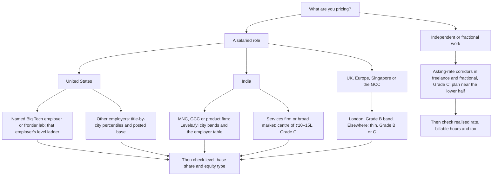

# Pay Benchmarks: What GenAI Roles Pay

> Measured pay for GenAI roles by title, city, level and employer type as of October 2026, with the source, date and grade of every figure, and the rules for reading pay data without being misled.

**Scope.** This page owns the repository's pay figures: every other page quotes at most a headline and links here. Independent, contract and fractional rates are owned by [freelance and fractional](../11-tracks/freelance-fractional.md).

**Dates.** Every pay row shows the date of its dataset: the source page's own update stamp where it shows one, otherwise how the research saw it (cached, undated, or the reading date). The sources are:
- **Levels.fyi pages in [T0-02](../../research/sessions/T0-02-global-regional-compensation-benchmarks.md),** all retrieved on 21 Oct 2026. The main pages are stamped 12–20 Oct 2026; Anthropic is stamped 24 Sep 2026, UK-wide 15 Sep 2026, the Google ML excerpt 4 Aug 2026, Singapore senior 1–2 Apr 2026 and ByteDance Singapore 2 Nov 2025, and the Meta, Google and Dubai pages carry no visible date [T0-02 L23].
- **[T0-17](../../research/sessions/T0-17-compensation-progression-plateaus-equity.md)** (dated 2026-10-23): the US level ladder is Levels.fyi's 2025 End of Year Pay Report, the AI premium its Q3 2025 analysis, and the Bengaluru Senior SWE page was generated on 21 Oct 2026 [T0-17 L129–L130, L632–L636].
- **Posted base in [T0-03](../../research/sessions/T0-03-skills-compute-infra-eval-stack.md)** (dated 2026-10-24): the S09 corpus is a snapshot of 5 Aug 2026, and the JobsPipe distribution is dated 19 Oct 2026 [T0-03 L192, L630, L658].
- **Role figures from T0-15** (read 2026-10-21 to 2026-10-23) and **T0-06** (dated 2026-10-21).

**Re-verification.** This repository re-verifies pay 90 days after a figure was last verified at its source (decision D-018). This page counts from the date the research retrieved each figure, not from the dataset's own date, and not from this page's fact-check of 2026-11-06, which re-read the sessions but not the sources. The earliest retrieval among the figures on this page is 21 Oct 2026 (T0-02, T0-06, T0-15), so `review_by` is 2027-01-19. Where a row's dataset date is older (the S09 snapshot of 5 Aug 2026, Levels.fyi's 2025 ladder, the Berlin page of 25 Jul 2025), the figure was already that old when it was retrieved: weigh it accordingly. T0-02 advises re-pulling Levels.fyi anchors about every 30 days, because the pages update continuously [T0-02 L528]. The JobsPipe remote shares under Gaps (retrieved 2026-11-02) are a share, class V3, and expire later.

**Grades** (EGP-1.0; definitions in [CONTRIBUTING §3](../../CONTRIBUTING.md#3-writing-standard-egp-10-in-brief)): A primary or measured; B transparent secondary; C vendor, practitioner or single source; D judgement; M model output or arithmetic; P practice-curated. **Platform data are Grade B** (decision D-018, rule 3): Levels.fyi and JobsPipe figures are graded B, a platform aggregate whose method is taken on trust, and are quoted with their n and date, even where T0-02 or T0-17 graded a page they opened A [T0-02 L31–L32; T1-02 L164]. A few rows are graded lower, C, because the page is stale, was seen only as a snippet or its URL was not retained; none is graded A. Levels.fyi data are self-reported. US visa wage filings (LCA) are A for what was filed and never for what people earn; the LCA figures here are third-party processing of the DOL files, which T0-02 could not open, so they are B [T0-02 L294; T1-02 L163].

**Attribution.** Data source: Levels.fyi (https://www.levels.fyi). The pages ask derived work to carry this credit. T0-02 left open whether the Levels.fyi data licence permits redistributing derived tables [T0-02 L24, L529].

## The short answer

1. **Read a pay figure only with its population, component, percentile, n and date.** "ML engineer pay" is $280K as the US Levels.fyi median of self-reported total compensation (n = 1,063, 19 Oct 2026) [B · T0-02.F1], $213–288K as a median posted base range that excludes equity (S09 corpus, 5 Aug 2026) [B · T0-03 KF1], and a visa wage filing (LCA) shows a legal floor, not pay [B · T0-02.F6].
2. **Employer type moves pay more than title or stack layer.** The US AI Engineer title earns 0.55–0.56× the ML Engineer title at every percentile, yet within Google the ML Engineer premium is 26–39%, so about half of the title gap is employer mix [B · T0-02.F1, L480]. Median posted base is nearly identical for AI Engineer, infrastructure/platform and ML Engineer postings ($200–288K); FDE is lower at $180–248K [B · T0-03 KF1, L230]. Frontier labs pay about 3× the US ML Engineer median in total compensation, and the premium is almost entirely equity [B · T0-02.F4, F5, L288].
3. **In India, carry two populations.** Levels.fyi Greater Bengaluru ML Engineer P50 is ₹44.5L (n = 96, 12 Oct 2026) [B · T0-02.F3]; broad-market sources such as Glassdoor and Indeed centre on ₹10–15L [C · T0-02.F3]. The local senior ceiling is a Bengaluru Senior SWE median of ≈ ₹56.0L and a P90 of ≈ ₹1.07Cr [B · T0-17.F4].
4. **Quote measured anchors, not tier bands.** The tier bands in the Phase 0 records conflict, and none is measured; the FAD US caps for T0 and T1 sit below the measured Entry ($155K) and Mid ($226K) medians [ERRATA U5, U14]. Use the US ladder instead: $155K → $226K → $312K → $457K → $551K (all-company software engineers, Levels.fyi 2025) [B · T0-17 L129].
5. **AI-specific premiums are modest and rise with level.** The AI premium over non-AI engineers rises from 6.2% at Entry to 18.7% at Staff [B · T0-17 L130]. A systems or infrastructure premium shows up as +13% to +31% in base in two datasets (OpenAI visa filings and Robert Half's Zurich guide), with seniority uncontrolled; it is not validated [B/C/D · T0-02.F12].
6. **Independent rates are asking rates, and another page owns them.** Asked, advertised and computed rates for consultants, contractors and fractional leaders, with modelled income, are in [freelance and fractional](../11-tracks/freelance-fractional.md#2-rates-and-income-as-of-october-2026). Posted offers there run below asks, and no AI-specific income distribution exists [C · T0-18.F1; D · T0-18.F10].

## At a glance: which benchmark answers which question

## How to read pay data without being misled

### Know which number you are holding

| Instrument | What it counts | What it leaves out | Use it for | Grade |
|---|---|---|---|---|
| Levels.fyi percentile page | Self-reported total compensation: base, stock per year and bonus | Skews to large, equity-paying employers; has no GenAI title; does not say whether stock uses the grant-date or a later valuation | Large-employer reference by title and city | B (D-018), whether opened, excerpted or cached: a platform aggregate whose method is taken on trust [T0-02 L31–L32, L539]; see also [role catalog §1.3](../02-roles/role-catalog.md#13-evidence-grades-and-conventions) |
| Posted pay range | Advertised base | Equity and bonus: only 14% of 43,480 US AI-engineering postings mention equity and 31% a bonus | Like-for-like base across role families | B/C [T0-02.F8] |
| H-1B LCA filing | Offered wage range for one visa-sponsored worker | Bonus, equity and seniority; the lower bound can sit at the legal minimum | A floor, and comparisons within one employer | A for what was filed, never for pay (D-018); B here, because every figure is third-party processing [T0-02.F6, L294] |
| Broad-market sites (Glassdoor, Indeed, Payscale, AmbitionBox) | Employee-reported or posting-weighted pay | Opaque method; all employer types mixed | The second population, especially in India | C [T0-02 L335–L339] |
| Recruiter salary guides | Starting base of placed candidates, or survey data | Equity; often marketing-driven | Regional cross-checks | B/C [T0-02 L407, L497] |
| Marketplace and vendor rate cards | Asking rates | Realised rates and billable utilisation | Independent work, as a ceiling; see [freelance and fractional](../11-tracks/freelance-fractional.md) | C [T0-18.F1, F2] |

### Base, bonus and equity

The mix depends on the employer type. "Liquid" means sellable at vest on a public market; "paper" means not freely sellable [T0-02 L215–L224].

| Employer archetype | Base | Bonus | Liquid equity | Paper equity | As of | Grade |
|---|---|---|---|---|---|---|
| Public Big Tech, Google ML L3 | 77% | 5% | 18% | 0% | Excerpt updated 4 Aug 2026 | B |
| Public Big Tech, Google ML L4 | 64% | 6% | 30% | 0% | Excerpt updated 4 Aug 2026 | B |
| Frontier lab, OpenAI L5 | 40% | about 0% | 0% by default | 60%, semi-liquid through tenders | 20 Oct 2026 | B (mix); B (tenders) |
| Frontier lab, Anthropic Staff | 29% | about 0% | 0% by default | 72%, semi-liquid through tenders | 24 Sep 2026 | B (mix); B (tenders) |
| AI-native startup valued above $500M, Carta P80–95 AI/ML engineer | 64% of paper TC | not reported | 0% | 36% of paper TC | Carta data, Feb 2026 | B (inputs); M (split) |
| Indian employer, all-company (Levels.fyi Bengaluru city page) | about 85% | about 5% | about 4.5% (type not shown) | not shown | Cached, undated | B |

Dates are the source pages' own [T0-02 L458, L591–L594]. The cash-equivalent value of each mix is worked out in [offer evaluation](offer-evaluation.md).

Median components for ML Engineer pages show the same pattern by city; component medians do not add up to the total [T0-02 L204].

| Location | Median total | Median base | Base share | As of | Grade |
|---|---|---|---|---|---|
| NYC | $264.5K | $200K | about 76% | cached | B |
| London | £112.6K | £95.2K | about 84% | cached excerpt | B |
| Bengaluru (city page) | ₹45.3L | ₹38.3L | about 85% | cached | B |
| Hyderabad | ₹30.3L | ₹26.9L | about 89% | 12 Oct 2026 | B |
| Zurich | CHF 134.2K | CHF 122.1K | about 91% | cached | C |

Sources: [T0-02 L161, L206–L213]. At large US employers the base share falls with level: from 77% to 64% (Google ML L3 → L4), 68% to 40% (OpenAI L2 → L5) and 55% to 29% (Anthropic entry → Staff) [B · T0-02.F5]. Outside them, pay is mostly cash: equity is 5–10% of the median package in Bengaluru and NYC [B · T0-02 L213].

### Percentiles, means and sample size

- **Quote the median, not "the average".** Blog claims of a Levels.fyi "AI Engineer average" of $242–245K sit above the page's own P75 of $212.5K (18–19 Oct 2026); a mean-versus-median difference or an older vintage may explain part of the gap [C · T0-02.F1]. OpenAI's SWE page shows a median of $875,000 and a mean of $840,800 (20 Oct 2026) [B · T0-02.F4].
- **Place a figure in the band.** $300K is about P55 for US ML Engineer and above P90 for US AI Engineer [B · T0-02.F1].
- **Small samples drift.** Anthropic's page has n = 49 (24 Sep 2026) [B · T0-02.F4]. Cached copies of the OpenAI SWE page show medians from $555K to $875K [B · T0-02.F4], and T0-17 treats frontier-lab medians as ±30–50% [C · T0-17 L131]. The Bengaluru AI Engineer median read ₹21.4L on a page dated 18 Oct 2026 and ₹24.5L on a fetch by 23 Oct 2026 [B · T0-02 L146; T0-17 L139].
- **Many pages hide n.** The SF Bay, NYC, London, UK-wide, Zurich and Hyderabad pages do not show it [T0-02 L136–L155]. Treat a band without n as indicative.

### Two populations, not one market

T0-02 tested the objection that Levels.fyi is self-reported and skews high. It found the objection valid for India and for any "market median" claim, and found no quantitative bias study [T0-02 L535]. The gap between populations repeats across geographies:

| Geography | Levels.fyi or recruiter band | Broad market | Gap | As of (band / broad market) | Grade |
|---|---|---|---|---|---|
| India | Bengaluru ML Engineer P50 ₹44.5L | Centre ₹10–15L | 3–4× | 12 Oct 2026 / relays seen May–Oct 2026 | B / C [T0-02.F3, L615] |
| New York | Levels.fyi ML Engineer P90 $460K | Payscale total pay P90 $189K | 2.4× | Cached / undated excerpt | B / C [T0-02 L409] |
| Dubai | Recruiter band AED 25–45K a month, mid-level AI/ML | About AED 6–15K a month | 2–4× | Aggregator relays of a 2026 guide, undated / undated relays | C [T0-02 L388, L398] |

Match the population to the employer you are pricing; for India, always carry the second reference population [P · T0-02 L95].

### Titles are proxies

- T0-02 found no public source that publishes a "GenAI engineer" percentile series. The closest proxies are Levels.fyi's ML Engineer and AI Engineer titles and the frontier-lab Software Engineer and Research Scientist pages [T0-02 L61].
- The AI Engineer title's 0.55–0.56× ratio to ML Engineer is a title and employer-mix gap (ML Engineer skews to Big Tech with equity), not a measured skill premium [B · T0-02.F1].
- Frontier labs compress titles into "Member of Technical Staff", so mapping their levels by years is approximate [D · T0-02 L132].
- The [role map](../02-roles/role-map.md)'s stack layers show where work sits, not what it pays: pay tracks employer tier and seniority, not app versus infrastructure [B · T0-03 KF1; decision D-015].

### Equity, currency and data hygiene

- **Private stock is not cash.** T0-02's model values tender-backed frontier-lab stock at 0.64–0.88 of its paper value, late-stage private stock at 0.42–0.61 and Series A/B stock at 0.09–0.21 (0.21–0.53 if you credit upside); public RSUs keep 0.95–1.00. These are model outputs on sourced inputs [D · T0-02.F8]. Valuation belongs in [offer evaluation](offer-evaluation.md).
- **State the FX rate and date.** T0-02 converts rupees at ₹95.25 per USD (about 95.2 on 19 Oct 2026, with the rupee about 8.3% weaker year on year) and other currencies at ECB rates of 13 Oct 2026 [A/B · T0-02.F9; T0-02 L165].
- **Validate exports.** Levels.fyi `.md` exports for Greater Bengaluru and Hong Kong carry a "United States" location label over local-currency values. Check currency, location and n before loading them [T0-02 L160].

### Weak and strong readings

| Weak reading | Strong reading | Evidence |
|---|---|---|
| "AI engineers earn $154K and ML engineers $280K, so ML work pays more." | The gap is mostly title and employer mix. Within Google, ML Engineer earns 26–39% more than AI Engineer, and like-for-like median posted base differs much less ($200–275K against $213–288K). | [B · T0-02.F1, L475; B · T0-03 KF1] |
| "GenAI engineers in India earn ₹50L–₹1Cr." | That band is about P56 to just above P90 of a self-selected, MNC- and product-heavy Levels.fyi sample; the broad market centres on ₹10–15L. | [B/C · T0-02.F3] |
| "GenAI pays $300K–$1M+ in the US." | $300K is about P55 of ML Engineer and above P90 of AI Engineer. The $1M+ end is frontier-lab L5+ territory (OpenAI L5 $911K, Anthropic Staff $1.41M), not a general GenAI figure. | [B · T0-02 L97] |
| "OpenAI's LCA median is $260K, so OpenAI pays $260K." | LCA lower bounds are floors. OpenAI's 2025 position-level median is $310K against an average prevailing wage of $162K, and its Levels.fyi base runs $170K (L2) to $361K (L5). | [B · T0-02.F6, L320] |
| "The T2 median is $312K." | $312K is the US all-company Senior median (Levels.fyi 2025). It is not AI-specific and is not a T0-02 figure. | [ERRATA U4; B · T0-17 L129] |
| "Inference skills earn 20–35% more." | Vendor guides claim 20–35% without a stated source. The evidence supports only "+13% to +31% in base at two datasets", with seniority uncontrolled. | [C/D · T0-02 L478; B/C/D · T0-02.F12] |

## United States: bands by title and city

Levels.fyi total compensation [T0-02 L136–L141]:

| Title, location | P25 | P50 | P75 | P90 | n | As of | Grade |
|---|---|---|---|---|---|---|---|
| ML Engineer, United States | $200,000 | $280,000 | $385,500 | $497,500 | 1,063 | 19 Oct 2026 | B |
| AI Engineer, United States | $110,000 | $154,000 | $212,500 | $280,000 | 335 | 18–19 Oct 2026 | B |
| ML Engineer, SF Bay Area | $250,000 | $327,860 | $413,000 | $512,000 | not shown | 14 Oct 2026 | B (search excerpt) |
| ML Engineer, NYC area | $196,000 | $264,509 | $346,800 | $460,000 | not shown | cached, undated | B |

- **City effects shrink at the top.** Against the US ML Engineer band, SF Bay runs 1.25× at P25 but 1.03× at P90; NYC runs 0.90–0.98× [M · T0-02 L171–L172].
- **Employer effects are larger.** Meta's ML Engineer median is $465K (n = 380; the cached copy was about five months old), about 1.7× the US ML Engineer median [B · T0-02 L290].
- **AI-native startups pay a salary premium plus paper equity.** Carta puts P80–95 AI/ML engineers at AI-native startups valued above $500M at about $320K salary plus 0.146% equity, against $285K and 0.10% at non-AI-native peers (Carta data, Feb 2026) [B · T0-02.F8, L458].
- **A broad corporate sample sits lower.** WTW's 2026 survey (press release of 6 May 2026) puts the median total compensation of mid-level technical-expert ML roles in the US above $170K, with average year-on-year growth of 2% in base and 6% in total compensation [B · T0-02 L183, L603].

### Posted base by role family

T0-03's table of posted base pay (§6.1.2) cites two published datasets without saying which row comes from which: the S09 corpus of 3,647 postings at 198 companies (snapshot 5 Aug 2026), which T0-03's KF1 names as the source of the family medians, and a JobsPipe distribution of 1,383 US postings that disclose base pay (S34, dated 19 Oct 2026). The seniority rows' samples (462 Senior, 322 Staff+ and 599 mid or unspecified) add up to those 1,383 postings, so this page dates them 19 Oct 2026 [T0-03 L94, L192, L218–L230, L630, L658]. All rows are base only.

| Family | Posted base range | n | Dataset and date | Grade |
|---|---|---|---|---|
| ML Engineer | $213–288K | 201 | S09, 5 Aug 2026 | B |
| AI Engineer (Application) | $200–275K | 55 | S09, 5 Aug 2026 | B |
| Infrastructure / Platform (GPU clusters, inference platforms) | $203–270K | 52 | S09, 5 Aug 2026 | B |
| MLOps / ML Platform | $186–277K | 10 | S09, 5 Aug 2026 | C (small n) |
| Forward Deployed Engineer | $180–248K | 304 | S09, 5 Aug 2026 | B |
| All AI-engineering postings, Mid or unspecified | $179–247K | 599 | JobsPipe, 19 Oct 2026 | B |
| All AI-engineering postings, Senior | $185–253K | 462 | JobsPipe, 19 Oct 2026 | B |
| All AI-engineering postings, Staff+ and Principal | $230–310K | 322 | JobsPipe, 19 Oct 2026 | B |

Top-of-band pay concentrates at labs and specialist vendors: an Anthropic inference-runtime posting (13 Jun 2026) shows $405–485K base [C · T0-03 KF1, L240].

### Visa wage filings (LCA): floors, not pay

These are third-party processing of DOL disclosure data; T0-02 could not process the raw files [B · T0-02.F6, L294]. The filed data run through Q3 of FY2026 (decisions to 30 Jun 2026; DOL released them on 14 Aug 2026), and the processors' pages were read in October 2026 [T0-02 L294, L597–L600].

| Employer | Measure | Median | As of | Grade |
|---|---|---|---|---|
| OpenAI | 311 certified LCAs, FY2025 and FY2026 through Q3, lower bound of the range | $270K (FY2025 $285K; FY2026 through Q3 $260K, middle half $245–325K) | FY2025 to Q3 FY2026 | B |
| OpenAI | 2025 positions | $310K, against an average prevailing wage of $162K | 2025 | B |
| OpenAI, by title | 2025 positions | MTS-Software Engineer $255K; MTS-Research Engineer $335K; MTS-AI Systems Engineer $335K; MTS-Research Scientist $360K | 2025 | B |
| Anthropic | 292 certified LCAs, lower bound | $209K (FY2025 $300K; FY2026 through Q3 $189.6K, middle half $169.5–213.5K) | FY2025 to Q3 FY2026 | B |
| Anthropic | 2025 positions | MTS $315K (223 positions); Research Engineer $215K (63); MTS (Manager) $405K | 2025 | B |

- **Filing style moves the median.** Anthropic's lower-bound median fell from $300K (FY2025) to $189.6K (FY2026 through Q3). One Anthropic Research Engineer LCA lists a base equal to its prevailing wage ($138,445) with a range up to $500,000 [B · T0-02.F6].
- **Aggregators disagree with themselves.** Ellis's two OpenAI pages give San Francisco medians of $180K and $310K [B · T0-02 L321].
- **Coverage is narrow.** LCAs cover visa-sponsored workers only and exclude bonus and equity. Use them as floors and for comparisons within one employer [B · T0-02 L322, L538].

## The level ladder

### US all-company ladder

| Level | Median total comp | Step from the level below | AI premium over non-AI engineers |
|---|---|---|---|
| Entry | $155K | — | +6.2% |
| Mid (Engineer) | $226K | ×1.46 | +11.9% |
| Senior | $312K | ×1.38 | +14.2% |
| Staff | $457K | ×1.46 | +18.7% |
| Principal | $551K | ×1.21 | not reported |

Software engineers at all companies, from Levels.fyi's 2025 End of Year Pay Report (2025 data) [B · T0-17 L129, L633]. The AI premium is from Levels.fyi's Q3 2025 analysis [B · T0-17 L130, L632]; T0-02 saw the same figures only through a relay and grades them C [T0-02 L477]. Principal fell ≈ 6.6% year on year while Staff rose ≈ 7.5% [B · T0-17 L129].

- **These are not AI-specific medians.** The ladder covers all software engineers; ERRATA U4 corrects documents that quote $312K as an AI "T2 median".
- **ML over generic software is small in base.** Pave's 2026 data for US companies that raised $200–500M put senior (P4) ML median base at $210K against $196K for generalist software engineers, +7% [A/B · T0-02 L473].
- **Years per level vary.** The average software engineer in Levels.fyi's database reaches Senior at about 8.6 years of experience [C · T0-17 L123]; Anthropic's page (snapshot of 24 Sep 2026) lists Senior at 6–8 years [B · T0-17 L123, L634].
- **A level step is worth more than a lateral move.** By T0-17's triangulation, a same-tier move is worth about +15–25% in total compensation, and +35–50% appears when a move also crosses a level; T0-17 found no verifiable source for the +35–50% figure itself [C · T0-17.F1, L119, L279]. See [growth and progression](../10-onboarding/growth-and-progression.md) and [offer evaluation](offer-evaluation.md#hop-or-stay).

### Employer ladders (US)

Levels.fyi total compensation, with base in the same cell. The tier labels and year ranges are T0-02's own operational mapping [D · T0-02 L119–L129].

| T0-02 tier (years) | Google ML Engineer | Meta ML Engineer | Nvidia ML Engineer | OpenAI SWE | Anthropic SWE |
|---|---|---|---|---|---|
| 0 Entry (0–2) | L3 $199–205K; base $154K | E3 $187K; base $138K | IC1 $205K; base $168K | L2 $249K; base $170K | Entry $483K; base $266K |
| 1 Growth (2–5) | L4 $294–312K; base $189K | E4 $310K; base $186K | IC2 $208K; base $164K | L3 $346K; base $220K | No separate level |
| 2 Breakout (5–8) | L5 $393–445K; base $214–216K | E5 $458K; base $230K | IC3 $315K; base $203K | L4 $769K; base $311K | Senior $621K; base $316K |
| 3 Premium (8–12) | L6 $607–646K; base $272K | E6 $782K; base $261K | IC4 $340K; base $231K | L5 $911K; base $361K | Lead $865K; base $336K |
| 4 Elite (principal, frontier research) | L7 $743K | E7 not shown | IC5+ not shown | L6 about $1.19–1.35M (cached); L7 up to about $1.9M | Staff $1.41M; base $403K |
| As of | Two undated snapshots | Undated excerpt (n = 380) | Undated excerpt (n = 35) | 20 Oct 2026 (n = 242); L6 from cached copies | 24 Sep 2026 (n = 49) |

Source: [T0-02 L228–L239; dates and samples from its source list, L592–L593, L630, L632]. The OpenAI and Anthropic columns are Grade B with small samples [B · T0-02.F4, F5]. The Google, Meta and Nvidia pages carry no visible date, two Google snapshots differ by up to 13% at L5, and role rankings grade the Google and Meta figures B as ML Engineer pay evidence [B · T0-02 L23, L239].

- **Stock, not base, makes the frontier premium.** From OpenAI L2 to L5, base rises 2.1× while stock rises 7.0×; from Anthropic entry to Staff, base rises 1.5× and stock 4.7× [B · T0-02.F5]. Frontier-lab base runs about 5–26% above Pave's P6 ML Engineering median base of $321K for comparable senior roles; the level mapping behind that comparison is T0-02's assumption [D · T0-02 L288].
- **Frontier medians are unstable.** T0-17's snapshot (OpenAI page updated 20 Oct 2026) shows OpenAI L5 at $918K, L6 at $1.28M and L7 at $1.89M; snapshots of the same pages at different dates put L3 between ≈ $272K and ≈ $436K [B/C · T0-17 L131, L635].
- **Tier mapping is not settled.** T0-02 places Anthropic Staff in its Tier 4; T0-17 treats it as Staff, Tier 3 [T0-02 L129, L228–L239; T0-17 L72].

### Frontier labs: what the medians say and do not say

- OpenAI SWE median $875,000 (n = 242, 20 Oct 2026); Anthropic SWE median $882,500 (n = 49, 24 Sep 2026) [B · T0-02.F4]. That is 3.1× the US ML Engineer median, 2.7× the SF Bay ML median and 1.8× the US ML Engineer P90 [M · T0-02 L281–L283].
- In T0-17's arithmetic, against US all-company medians the headline multiples are ×2.0–3.1. After an equity risk adjustment, an OpenAI-L6-like package is ≈ ×1.7–2.4 of the US all-company Staff median [C · T0-17 L132–L133].
- Research Scientist medians are about $1.25M at OpenAI (cached) and $0.75–0.83M at Anthropic (cached) [B/C · T0-02 L236]. Pave's August 2026 report (press release of 24 Aug 2026) puts median new-hire equity for AI Research Scientists at $4.09M at P6 and $4.72M at M6, more than double ML/AI Engineering [A · T0-02.F5, L604].
- Google DeepMind and Meta FAIR pages were not retrieved, so the corpus has no verified premium for them [T0-02 L290].
- The extreme tail is not visible in medians. The same Pave report puts 90th-percentile new-hire equity at $45–60M at the most senior levels of private SF Bay companies that raised $1B–$5B+ [B · T0-02 L459]. Reports of Meta offers to some AI researchers of up to $300M over four years rest on anonymous sourcing, and Meta disputes them [C · T0-17 L134].

## India: by city, level and employer

### Levels.fyi bands

| Title, location | P25 | P50 | P75 | P90 | n | As of | Grade |
|---|---|---|---|---|---|---|---|
| ML Engineer, Greater Bengaluru | ₹28.9L | ₹44.5L | ₹68.6L | ₹94.6L | 96 | 12 Oct 2026 | B |
| ML Engineer, Greater Hyderabad | ₹23.4L | ₹30.3L | ₹45.8L | ₹84.7L | not shown | 12 Oct 2026 | B |
| AI Engineer, Greater Bengaluru | not shown | ₹21.4L | not shown | not shown | not shown | 18 Oct 2026 | B |
| AI Engineer, Greater Bengaluru (second read) | not shown | ₹24.5L | ₹40.4L | ₹62.6L | not shown | Fetched by 23 Oct 2026; no stamp | B |
| Senior SWE, Greater Bengaluru | ₹38.4L | ₹56.0L | ₹79.9L | ₹1.07Cr | 4,836 | 21 Oct 2026 (page generated) | B |
| Entry-level SWE, Bengaluru (aggregated page) | ₹11.3L | ₹18.9L | ₹26.4L | ₹33.3L | not shown | 5 Apr 2026 | C (URL not retained) |

Sources: rows 1–3 [T0-02 L145–L149]; rows 4–5 [T0-17 L137, L139, L636–L637]; row 6 [T0-02 L252].

- In USD at ₹95.25, Bengaluru ML P50 is ≈ $46.7K and P90 ≈ $99.4K; Hyderabad P50 is ≈ $31.8K [M · T0-02 L165, L176–L177].
- Hyderabad's all-levels SWE median (₹30.7L) is within 2% of its ML Engineer median, so no ML premium is visible there [B · T0-02 L161].
- A cached Bengaluru ML Ops page shows P50 ₹23.6L, P75 ₹41.1L and P90 ₹63.5L [C · T0-02 L147].

### Employer dispersion

Bengaluru software-engineer medians on Levels.fyi, not ML-specific. The company pages were seen as undated search excerpts, retrieved on 21 Oct 2026 [B · T0-02.F3, L241–L252, L596]:

| Employer | Entry level | Senior level |
|---|---|---|
| X | ₹40.5L (SWE) | ₹121.9L (Senior SWE) |
| LinkedIn | ₹47.0L (IC1) | ₹109.6L (IC3) |
| Microsoft | ₹27.1L (SDE 59) | ₹71.5L (Senior SDE 63) |
| SAP | ₹14.4L (T1) | ₹43.2L (T3) |
| Fidelity Investments | ₹13.1L (L3) | ₹28.9L (L5) |
| Sony | ₹13.5L (L3) | ₹24.9L (L6) |

- The spread between employers is 3.6× at entry level and 4.9× at senior level [M · T0-02 L252].
- The highest senior medians are Broadcom ≈ ₹1.22Cr, LinkedIn ≈ ₹1.09Cr, Rippling ≈ ₹1.08Cr, Atlassian ≈ ₹1.06Cr and Rubrik ≈ ₹1.06Cr (Senior SWE page generated 21 Oct 2026). They sit at about the all-company P90 of ₹1.07Cr [B · T0-17.F4, L636; ERRATA U4].
- A local Staff role typically does not reach ₹1.2Cr: Levels.fyi job-board estimates for Broadcom Staff roles in Bengaluru show base salary of only ≈ $39–77K [C · T0-17 L138].
- Google ML Engineer in Bengaluru (small samples; undated excerpts): L3 ₹45.2L (base ₹23.9L), L4 ₹65.2L (base ₹38.1L), L5 ₹168.3L (base ₹69.3L). Against the all-company Bengaluru ML band, L3 sits at about P51, L4 at about P71 and L5 above P90 [B, small n · T0-02.F3, L254, L630].
- Google's Bengaluru ML pay is 0.22–0.45× its US ML pay at L3–L5, against 0.17× for the all-company medians. Benchmark an MNC offer against same-employer ratios, not the all-company ratio [B · T0-02.F2, L265].

### The broad market

| Source | Population | Annual figure | As of | Grade |
|---|---|---|---|---|
| AIM Research | Headline of a paywalled study | Median ₹12–15L | 2025 study | B |
| Glassdoor India, AI Engineer (relayed) | Employee-reported | Average base about ₹10L (range ₹6–15L); average total about ₹12L | Aug 2026 | C |
| Glassdoor India, AI Developer (n = 167, relayed) | Employee-reported | Average ₹6.95L | Jun 2026 | C |
| Indeed India, AI developer (n = 79, relayed) | Posting-weighted | Average ₹10.48L | Apr 2026 | C |
| Payscale, AI developer (relayed) | Employee-reported | Average base ₹4.5L | Undated relay | C |
| AmbitionBox via Codegnan, ML Engineer, Hyderabad (about 7.1k records) | Employee-reported | Average ₹11L; senior about ₹20L; lead about ₹25.5L | 2026 | C |
| Flexiple | Freelance and hiring-platform pool | ML Engineer, Bengaluru, median ₹19.9L (n = 422) | Aug 2026 | C (URL not retained) |
| Recruiter guides (Weekday, Taggd) | Marketing-driven | Experienced at product companies and GCCs ₹38–65L (Weekday); senior at GCCs and top product companies ₹55–80L+ (Taggd) | Undated relays | C |

Source: [T0-02 L327–L343]; T0-02 saw the relays as excerpts between May and October 2026 [T0-02 L615]. The broad market centres on ₹10–15L, Levels.fyi ML Engineer on ₹44.5L, and recruiter-quoted senior product and GCC roles on ₹55–120L. Employer type explains the gap [T0-02 L343].

### Market FX or purchasing-power parity

- At market FX, the US ML P50 ($280K) is 6.0× the Bengaluru ML P50. At PPP it is 1.44×, and its PPP equivalent in India is about ₹64L, roughly P70 of the Bengaluru ML band [A/B for FX, C for PPP · T0-02.F9].
- For scale, Levels.fyi's 2025 all-level software-engineer medians were ≈ $33.8K in India and ≈ $192.5K in the US (End of Year Pay Report) [B · T0-17 L140].
- Market FX governs dollar savings, remittances and anything priced globally; PPP governs local consumption. T0-02 did not model tax, cost of living, visa cost or savings rate, and those decide the answer [T0-02 L98, L355]. See [India remote tax](india-remote-tax.md), the [India remote playbook](../11-tracks/india-remote-playbook.md) and [visa and relocation](../11-tracks/visa-and-relocation.md).

## UK, Europe, Singapore and the GCC

| Title, location | P25 | P50 | P75 | P90 | P50 in USD | As of | Grade |
|---|---|---|---|---|---|---|---|
| ML Engineer, Greater London | £89,500 | £112,641 | £163,000 | £221,000 | $149.2K | 15 Oct 2026 | B |
| ML Engineer, United Kingdom | £76,611 | £102,971 | £150,133 | £214,191 | $136.4K | 15 Sep 2026 | B |
| ML Engineer, Zurich | CHF 108,263 | CHF 134,196 | CHF 211,453 | CHF 294,803 | $161.2K | cached | C (URL not retained) |
| ML Engineer, Berlin | $86,700 | $97,683 | $106,000 | $114,000 | $97.7K | 25 Jul 2025 | C: stale, small sample; do not use |
| Software Engineer, Singapore (all levels; not ML) | SGD 84,852 | SGD 114,754 | SGD 163,032 | SGD 214,982 | $89.7K | 18 Oct 2026 | B (proxy; n = 1,362) |
| Senior Software Engineer, Singapore (not ML) | SGD 129,000 | SGD 180,537 | SGD 234,000 | SGD 298,000 | $141.1K | 2 Apr 2026 | B (proxy) |
| Software Engineer, Dubai (all levels; not ML) | AED 240,000 | AED 300,041 | AED 430,000 | AED 546,000 | $81.7K | undated | B (proxy) |

Levels.fyi total compensation [T0-02 L142–L152]. USD conversions use ECB rates of 13 Oct 2026, and AED a recalled peg graded D [M · T0-02 L165–L181].

- **London by level (an undated Levels.fyi search snippet):** Senior median ≈ £122–123K, P75 ≈ £170K, P90 ≈ £221–226K; Entry ≈ £57–60K [C · T0-17 L143, L639]. The Europe-wide software-engineer median is ≈ $73.6K and Switzerland's ≈ $148.3K (Levels.fyi 2025 report) [B · T0-17 L143].
- **Germany:** WTW's 2026 broad sample (press release of 6 May 2026) puts mid-level ML roles at about $122K in Germany and just under $100K in the UK [B · T0-02 L183, L603]. That is above the stale Berlin page, so do not use the Berlin row [T0-02 L406].
- **Zurich starting base:** Robert Half's 2026 guide (placed candidates, base only, presumed CHF) gives P50s of 121,900 for ML Engineer, 132,500 for AI Engineer, 137,800 for AI/ML System Performance Specialist, and 116,600 each for MLOps and AI Developer [B/C · T0-02 L407].
- **Singapore:** ByteDance ML Engineer P50 is SGD 201.4K (about $157K; page dated 2 Nov 2025), mostly cash: base 72%, bonus 18%, equity 10% [B · T0-02 L408]. Indeed Singapore reports an average ML Engineer base of S$8,648 a month (n = 157; 21 Sep 2026) [C · T0-02 L408]. The ML premium over software engineers in Singapore was not measured.
- **GCC:** undated aggregator relays of Michael Page's 2026 UAE guide put mid-level AI/ML engineers in Dubai at AED 25–45K a month; another aggregator (12 Aug 2026) quotes AED 25–40K for mid-level and AED 40–65K+ for senior. Whether these figures are basic salary or total package is not known, and no independent Abu Dhabi series exists [C · T0-02.F10, L388–L401].
- **Same employer, narrower gap:** Google's UK software-engineer pay is 0.66–0.76× its US pay at L3–L5, against 0.53× for all-company London [B · T0-02.F2].

## Independent, contract and leadership rates

**Independent and fractional rates are owned by [freelance and fractional](../11-tracks/freelance-fractional.md#2-rates-and-income-as-of-october-2026):** asked, advertised and computed rates for US, UK, European and India-based consultants, contractors and fractional leaders, retainers and modelled net income, each with its date and grade [T0-18.F1–F5, F10; C · T0-02.F11]. Read them as asks, not transactions, and budget near the lower half of a corridor [C · T0-18.F1].

- **Salaried AI leadership has no pay series in the corpus.** Radford McLagan's Head of AI job family is paywalled [T0-02 L491]. The only top-of-market point is the Anthropic "MTS (Manager)" LCA base median of $405K (2025 positions), which is a floor [B · T0-02 L303]. Role rankings score VP / Head of AI and Chief AI Officer pay as unanchored judgements [D · role rankings].

## Pay by GenAI role: what the corpus measures

Every role figure below is a title proxy, because no GenAI-specific series exists [T0-02 L61]. The Pay pillar of [role rankings](../02-roles/role-rankings.md) (weight 25) asks what a role pays at senior level and at the reachable ceiling, and draws on these figures; roles with no pay data get a default prior graded D.

| Role | Best pay evidence in the corpus | As of | Grade |
|---|---|---|---|
| [ML Engineer](../02-roles/hubs/ml-engineer.md) | US TC P50 $280K, P90 $497.5K (n = 1,063); posted base $213–288K (n = 201) | TC 19 Oct 2026; posted base 5 Aug 2026 (S09) | B |
| [AI Engineer](../02-roles/hubs/ai-engineer.md) | US TC P50 $154K, P90 $280K (n = 335); posted base (Application) $200–275K (n = 55) | TC 18–19 Oct 2026; posted base 5 Aug 2026 (S09) | B |
| [Research Engineer](../02-roles/hubs/research-engineer.md) | OpenAI and Anthropic SWE/MTS TC medians $875K and $882.5K; LCA base medians: OpenAI MTS-Research Engineer $335K, Anthropic Research Engineer $215K | TC 20 Oct 2026 (OpenAI) and 24 Sep 2026 (Anthropic); LCA 2025 positions | B |
| [Research Scientist](../02-roles/hubs/research-scientist.md) | TC medians about $1.25M at OpenAI (cached) and $0.75–0.83M at Anthropic; Pave new-hire equity $4.09M at P6 | TC cached, undated; Pave 24 Aug 2026 | B (OpenAI), C (Anthropic), A (Pave) |
| [Forward Deployed Engineer](../02-roles/hubs/forward-deployed-engineer.md) | Posted base $180–248K (n = 304), the lowest family median; no total-compensation data | 5 Aug 2026 (S09) | B |
| [AI Infrastructure Engineer](../02-roles/hubs/ai-infrastructure-engineer.md) | Posted base $203–270K (n = 52); OpenAI GPU-infrastructure postings $230–490K base | 5 Aug 2026 (S09); postings undated | B / C |
| [Inference Engineer](../02-roles/hubs/inference-engineer.md) | Typical posted base about $270K across 8 named JDs (range $150–485K); systems premium not validated | JDs posted Feb–Oct 2026 | C |
| [GPU Kernel Engineer](../02-roles/hubs/gpu-kernel-engineer.md) | Three postings: NVIDIA DL SWE $152–356.5K base; Anthropic inference runtime $405–485K | Posted 13 Jun, 14 Jul and 10 Oct 2026 | C |
| [ML Platform Engineer](../02-roles/hubs/ml-platform-engineer.md) | MLOps/ML Platform posted base $186–277K (n = 10); Bengaluru ML Ops P50 ₹23.6L | 5 Aug 2026 (S09); ML Ops page cached | C |
| [AI Governance Lead](../02-roles/hubs/ai-governance-lead.md) | IAPP medians $151.8K (AI governance only) and $169.7K (with privacy); Axial median $169K, a top-of-range figure | IAPP survey fielded Mar–Apr 2025; Axial page read 21–23 Oct 2026 | B / C |
| [Responsible AI Engineer](../02-roles/hubs/responsible-ai-engineer.md) | IAPP tech-sector technical AI governance median $221K; one posted AI Governance Engineer range $112.8–239.9K | IAPP survey fielded Mar–Apr 2025; posting date not stated | B / C |
| [AI Risk & Assurance Specialist](../02-roles/hubs/ai-risk-assurance-specialist.md) | One posted range: Deloitte Manager/Senior Manager AI Risk & Validation $171.6–338.3K | Listing read 21–23 Oct 2026 | C |
| [AI Product Engineer](../02-roles/hubs/ai-product-engineer.md) | One Staff AI Frontend posting at $250–315K | Read by 21 Oct 2026 | C/D |
| [Domain Evaluation Specialist](../02-roles/hubs/domain-evaluation-specialist.md) | Mercor about $85+ an hour, about $110 average (Bloomberg relay) | A 2026 guide; Bloomberg, 16 Oct 2026 | C |
| [AI Engineering Manager](../02-roles/hubs/ai-engineering-manager.md) | One point: Anthropic "MTS (Manager)" LCA base median $405K | 2025 positions | B for the floor; D for the role |
| [Independent AI Consultant](../02-roles/hubs/independent-ai-consultant.md), [Fractional AI Leader](../02-roles/hubs/fractional-ai-leader.md) | Asking rates and modelled income in [freelance and fractional](../11-tracks/freelance-fractional.md#2-rates-and-income-as-of-october-2026), the owner of independent rates | Read about 2026-10-20 to 2026-10-25 | C |
| Proxies only: [Applied Scientist](../02-roles/hubs/applied-scientist.md), [Applied AI Engineer](../02-roles/hubs/applied-ai-engineer.md), [Agentic AI Engineer](../02-roles/hubs/agentic-ai-engineer.md), [AI Safety Researcher](../02-roles/hubs/ai-safety-researcher.md) | Big Tech ML Engineer ladders, frontier-lab medians, the AI Engineer title, or Research Scientist and Engineer ladders | As in their rows above | D |
| No pay data: [AI Product Manager](../02-roles/hubs/ai-product-manager.md), [AI Solutions Architect](../02-roles/hubs/ai-solutions-architect.md), [AI Evaluation Engineer](../02-roles/hubs/ai-evaluation-engineer.md), [AI Security Engineer](../02-roles/hubs/ai-security-engineer.md), [AI Enablement Engineer](../02-roles/hubs/ai-enablement-engineer.md), [Physical AI Engineer](../02-roles/hubs/physical-ai-engineer.md), [VP / Head of AI](../02-roles/hubs/vp-head-of-ai.md), [Chief AI Officer](../02-roles/hubs/chief-ai-officer.md) | None; role rankings use a default prior or an unanchored judgement | — | D |

Sessions behind the table: T0-02, T0-03 (KF1, §6.1.2, and the dated postings of §6.2 at L237–L246), T0-15 (L130, L162, L303–L304, L315, L398; retrieval dates at L619), T0-06 (L167, L177) and T0-17 (L182).

## The tier-band problem

The Phase 0 records name six pay tiers, T0 Entry to T5 Apex, and attach fixed bands to them. The band sets disagree with each other, and none is measured. This section is the repository's one discussion of the pay tiers: other pages, the [role catalog](../02-roles/role-catalog.md)'s §8.1 among them, link here rather than restating the bands. Treat tiers as design brackets for navigation, not as pay data [ERRATA U5, U7, U14; decision D-003].

| Band set | US bands | India bands | Problem |
|---|---|---|---|
| FAD §4.1 (DECISIONS D-003) | T0 $80–120K; T1 $120–200K; T2 $200–350K; T3 $350–500K; T4 $500–800K; T5 $800K–2M+ | T0 ₹8–15L; T1 ₹15–30L; T2 ₹30–75L; T3 ₹75L–1.5Cr; T4 ₹1.5–3Cr; T5 ₹3–5Cr+ | US T0 and T1 caps sit below the measured Entry and Mid medians (U5) |
| T2-01 §4.1 header | T1 $80–150K; T2 $150–312K; T3 $312–450K | T2 ₹30–75L; T3 ₹75L–1.5Cr | Differs from FAD (U7) |
| Research brief, used by T0-17 and T1-03 | Not stated | T2 ₹60L–1.2Cr; T3 floor ₹1.2Cr | Conflicts with FAD; the T3 floor exceeds every top-employer senior median (U14) |

Two figures are also misattributed. FAD and T1-01 credit a "$312K T2 median" and an "India T2 median ₹1.06–1.22Cr" to T0-02. Neither is in T0-02: $312K is the US all-company Senior median, and ₹1.06–1.22Cr is the range of the top five employers' senior medians, about P90 [ERRATA U4].

**Measured anchors to use instead.** Each anchor's date is in its source row above.

| Tier | US anchor | India anchor | Verdict on the bands |
|---|---|---|---|
| T0 Entry | All-company Entry median ≈ $155K [B · T0-17 L129]; AI Engineer all-level P25 $110K [B · T0-02.F1] | Broad market ₹10–15L [C · T0-02.F3]; Bengaluru entry SWE median ₹18.9L [C · T0-02 L252] | FAD US cap below the median |
| T1 Growth | Mid median ≈ $226K [B · T0-17 L129] | Bengaluru AI Engineer P50 ₹21.4–24.5L, an all-level title [B · T0-02 L146; T0-17 L139] | FAD US cap below the median |
| T2 Senior | Senior median ≈ $312K, all-company, not AI [B · T0-17 L129] | Bengaluru Senior SWE median ₹56.0L; P75 ₹79.9L [B · T0-17.F4] | FAD consistent at the median; the brief's ₹60L floor sits just above the local Senior median |
| T3 Staff | Staff median ≈ $457K [B · T0-17 L129] | Top-five employers' senior medians ₹1.06–1.22Cr ≈ all-company P90 ₹1.07Cr [B · T0-17.F4]; a local Staff role typically does not reach ₹1.2Cr [C · T0-17 L138] | US consistent; India Staff pay unmeasured |
| T4 Principal | Principal median ≈ $551K [B · T0-17 L129]; Google ML L7 $743K [B · T0-02 L236]; Anthropic Staff $1.41M [B · T0-02.F4] | Google Bengaluru ML L5 ₹168.3L, small n [B · T0-02 L254] | India unmeasured |
| T5 Apex | Not observable in medians [T0-17 L134]; indirect only: Pave's $45–60M P90 new-hire equity at the most senior levels [B · T0-02 L459] | None | Unmeasured |

Rules for using tiers [P]:

1. Use tier names to find your level; for pay, quote a measured anchor with its source and date.
2. When a document quotes "$312K T2" or "₹1.06–1.22Cr T2", read it through ERRATA U4.
3. Check which tier labels a source uses. T0-02's are Entry, Growth, Breakout, Premium, Elite and Apex [D · T0-02 L119–L130]; FAD pairs two schemes: Entry, Growth, Senior / Breakout, Staff / Premium, Principal / Elite and Distinguished / Apex [FAD §4.1].

## Gaps: what this page cannot tell you

- **No GenAI-specific series.** Every figure is a title proxy [T0-02 L61].
- **Remote pay.** No percentile source was located for US remote, Indian remote or international remote roles [T0-02 L155, L523]. AI-titled postings are rarely remote: AI Engineer 11.0% and MLE 14.0% of JobsPipe JDs [B · JobsPipe JD, 2026-11-02]; the measurements are shown in the [role skill inventories](../03-skills-and-tech/role-skill-inventories.md).
- **Levels by geography.** Tier-conditional ML percentiles are not available for any geography, and Hyderabad has no per-level data [T0-02 L239, L526].
- **Europe is thin.** No European band is better than Grade B, and London is the only fresh city page. The Berlin page is stale (25 Jul 2025), Zurich is Grade C, Germany has no ML series newer than that page, and Singapore has only software-engineer proxies and one employer's ML ladder [T0-02 L405–L408, L521–L522].
- **GCC.** Grade C only; Abu Dhabi was not found, and the Dubai ML page is about two years old [T0-02 L153–L154, L520].
- **Roles.** No pay data for AI PM, AI Solutions Architect, AI Evaluation, AI Security, AI Enablement, Physical AI or salaried AI leadership; FDE has posted base only [role rankings; role catalog §0].
- **Raw visa filings.** The DOL LCA files were not processed; every LCA figure is third-party processing [T0-02 L294, L518].
- **Contractors.** No platform-native rate distribution for India-based AI engineers [T0-02 L507], and no realised-rate dataset [T0-18.F4]; the asking rates are in [freelance and fractional](../11-tracks/freelance-fractional.md).

## Checklist

- [ ] I named the population: Levels.fyi (large-employer skew), broad market, posted base, LCA floor or asking rate.
- [ ] I named the component: total compensation, base or floor.
- [ ] I quoted a percentile, not "the average", with its n and page date.
- [ ] I read each row's dataset date as well as this page's review date: a figure retrieved in October 2026 can describe older data.
- [ ] I benchmarked a Big Tech or MNC offer against that employer's ladder or same-employer ratios, not the all-company band.
- [ ] For India, I carried both populations.
- [ ] I counted private stock at a discount, not at its paper value.
- [ ] I stated the FX rate and date, and chose market FX or PPP to fit the goal.
- [ ] I did not quote a tier band as a measured figure (ERRATA U4, U5, U7, U14).
- [ ] I re-pulled any Levels.fyi figure more than 30 days old before using it in a negotiation [P · T0-02 L528].

## Evidence and limits

- **Measured:** Levels.fyi percentile pages by title and city (B under decision D-018, whether opened, excerpted or cached: a platform aggregate whose method is taken on trust; see [CONTRIBUTING §3](../../CONTRIBUTING.md#3-writing-standard-egp-10-in-brief) and [role catalog §1.3](../02-roles/role-catalog.md#13-evidence-grades-and-conventions)); frontier-lab ladders (B, small samples); posted base from the S09 corpus and a JobsPipe distribution (B); LCA filings as floors (B, third-party processing).
- **Judgement and models:** T0-02's tier mapping (D), equity discount factors (D), the PPP factor (C) and the systems premium (B/C/D, not validated). Modelled independent income is on the [freelance and fractional](../11-tracks/freelance-fractional.md) page (D).
- **Dates:** each row shows its dataset's date: Levels.fyi pages stamped 12–20 Oct 2026 unless labelled, the S09 snapshot of 5 Aug 2026, the JobsPipe distribution of 19 Oct 2026, the US ladder from Levels.fyi's 2025 report and the AI premium from its Q3 2025 analysis. The 90-day pay re-verification counts from the research's retrieval dates, the earliest being 21 Oct 2026: re-verify by 2027-01-19 (D-018).
- **What would change this page:** Levels.fyi per-level and per-location pages for ML and AI titles; a local run of the DOL LCA files; Radford McLagan AI job-family cuts for the UK, Germany, India, UAE and Singapore; platform-native contractor rate cards [T0-02 L100].
- **Corrections applied:** ERRATA U4, U5, U7 and U14, on tier bands and misattributed medians; decision D-018 on grading platform data B.
- **Not advice:** tax, visa and legal effects on pay are pointers only; follow the linked guides.

## Next steps

- **Turn a benchmark into a decision:** [offer evaluation](offer-evaluation.md), then the [negotiation playbook](negotiation-playbook.md).
- **India and cross-border:** [India remote tax](india-remote-tax.md), the [India remote playbook](../11-tracks/india-remote-playbook.md) and [visa and relocation](../11-tracks/visa-and-relocation.md).
- **Independent work:** [freelance and fractional](../11-tracks/freelance-fractional.md).
- **After the offer:** [growth and progression](../10-onboarding/growth-and-progression.md).
- **Choosing a role or employer:** [role rankings](../02-roles/role-rankings.md), [GenAI target roles](../02-roles/genai-target-roles.md), [employer landscape](../01-landscape/employer-landscape.md) and the [role catalog](../02-roles/role-catalog.md).
- **Stage overview:** [compensation stage README](README.md).
- **Evidence:** [T0-02](../../research/sessions/T0-02-global-regional-compensation-benchmarks.md), [T0-17](../../research/sessions/T0-17-compensation-progression-plateaus-equity.md), [T0-18](../../research/sessions/T0-18-freelance-fractional-ai-practice-economics.md), [stage 9 findings](../../research/findings.md#stage-09), [errata](../../research/ERRATA.md) and the [glossary](../00-start/glossary.md).
