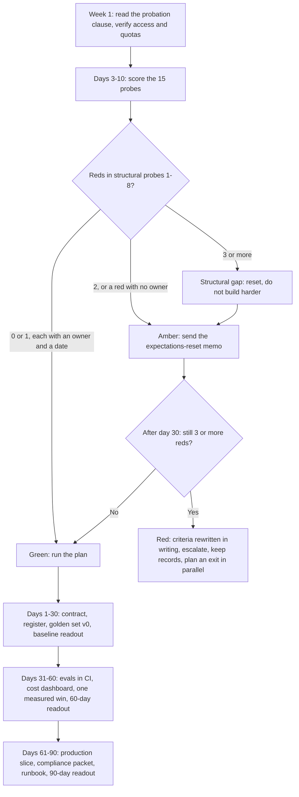

# First 90 Days: Close the Expectations Gap and Pass Probation

> How to pass probation in a GenAI role: score the expectations gap in weeks 1–2, navigate US/UK/EU/India probation rules, ship the 13 weekly artefacts of a 30-60-90 plan, confirm a scorecard by day 14, report variance and shipped outcomes upward, and escalate by written rules.

**Dates and grades.** Evidence comes from [T0-09](../../research/sessions/T0-09-onboarding-probation-first-90-days.md) (dated `2026-10-23`), [T0-71](../../research/sessions/T0-71-onboarding-growth-ai-roles.md) (dated `2026-11-13`, covering role ladders, AI-tool expectations, productivity attenuation, India Labour Codes and case libraries; 14 of 84 sources opened in full and 70 read as extracts, with COI marked on Anthropic docs, pricing, learning RCT and employer reports), the persona playbooks in [T2-01](../../research/sessions/T2-01-tier-calibrated-execution-playbooks.md) and one US equity deadline from [T0-17](../../research/sessions/T0-17-compensation-progression-plateaus-equity.md). UK and EU statutory probation mechanics were verified on `2026-11-19`; all legal, employment and regulatory items are pointers, not legal advice. Pending Karnataka working-hours rules (EGP-1.0 class V0, 14-day review) and the scheduled `2026-11-30` shutdown of OpenAI's hosted Evals platform set `review_by: 2026-12-03`; provider prices and credit programmes should be re-verified by `2027-01-20`. **Grades** (EGP-1.0): A primary or measured; B transparent secondary; C vendor, practitioner or single source; D judgement; E no evidence found after searching; M model output; P practice-curated and unmeasured.

## The short answer

1. **Treat expectations and relationships as week 1–2 deliverables.** Write down the problem, metric definitions and constraints in weeks 1–2 and get them acknowledged, while deliberately building peer relationships and naming a mentor. Bauer et al.'s `2024–25` meta-analysis (`256` eligible studies, `183` samples, updating their 2007 70-sample study) links newcomer adjustment to **proactive behaviour and social acceptance** alongside role clarity [B · T0-71 L62, L298]. A misunderstood or miscommunicated problem is the first of RAND's five root causes of AI project failure (`65` interviews; `84%` of 50 industry interviewees named leadership-driven causes as primary; prompt-only LLM projects were excluded) [A · T0-09 L75; T0-71 L63, L479].
2. **Diagnose before you build.** Score 15 probes green, amber or red in days 3–10. Three or more reds among the eight structural probes mean the gap is structural, not a communication glitch: take the reset path instead of building harder [D · T0-09 L170]. "No usable data" is a common starting state, not an exception [B · T0-09.F4].
3. **Ship one small, measured artefact every week — and keep eval tooling portable.** Two high-leverage practice wins are a regression eval suite built from real failures (`30–100` cases, or `20–50` to start) and a cost cut measured on your own traffic [P · T0-71 L87–88, L191–192, L299]. *Grade correction:* T0-09 previously graded these quick wins `[A]`; T0-71 downgrades them to **`[P]`** because support rests on OpenAI and Anthropic [COI] documentation and practitioner studies rather than probation-outcome studies (only provider pricing mechanics are Grade A, COI) [T0-71 L299]. Build evals in portable CI code: OpenAI's guide notes its hosted Evals platform is being deprecated (scheduled shutdown `2026-11-30`) [B · T0-71 L87, L352].
4. **Quantify variance before anyone forms a view from a demo.** In one test, 1,000 temperature-0 completions of one prompt gave 80 unique outputs; in another, accuracy varied by up to 15% across runs [A · T0-09 L98]. Put pass^k with error bars and the sample size in every status.
5. **Get probation criteria confirmed by day 14, and check your country's legal rules.** T0-71 confirmed that still **no public, named GenAI probation rubric exists** across employer handbooks (GitLab ML ladder `2026-10-30`, UK Government ML framework `2026-08-28`, Monzo v4.0, Cornell HR) [A/B · T0-71 L64, L120–124, L300], so your written artefacts become the criteria [D · T0-09 L146]. Know the statutory backdrop in your jurisdiction (US at-will, UK 6-month unfair-dismissal threshold, EU 6-month statutory cap, India contractual terms and Labour Codes effective `2025-11-21`).
6. **Use AI tools deliberately, report shipped outcomes (not commits), and guard your comprehension.** Meta, Microsoft, Google, Shopify, GitLab and Accenture have all written AI usage into role or promotion expectations with unpublished thresholds [B/C · T0-71 L65, L125–130]. Yet code volume overstates delivery (`NBER WP 35275`: commits up `30–240%` across tool generations, releases up only `~30%` [B · T0-71 L66, L175]), and an Anthropic RCT (`n=52`, mostly junior, COI) found AI-assisted learners scored `50%` vs `67%` on a comprehension quiz — under `40%` when delegating code or debugging versus `65%+` with conceptual questions [B, COI · T0-71 L68, L177].
7. **Escalate by decision memo, never by workaround.** Frame each constraint as a decision for an owner: options, cost of delay and a date [D · T0-09 L145]. Do not route around controls: shadow AI added $670,000 to the average breach cost in IBM's 2025 data [A · T0-09 L106].

## At a glance



The thresholds are T0-09's heuristics [D · T0-09 L170, L286–288]. The plan rows follow T0-09's R3 [D · T0-09 L174–191].

## Weeks 1–2: the expectations-gap diagnostic

"AI expectations gap" is a descriptive label found mostly in vendor material, not an established construct. The mechanism behind it is documented at project level: a misdefined problem, missing data, weak infrastructure, no evaluation baseline, non-determinism, and nobody owning pilot-to-production [B · T0-09.F2]. Run the probes in days 3–10 and mark each one green, amber or red. The probes and first actions are T0-09's [D · T0-09 L150–168]; the evidence for each is cited.

**Structural probes 1–8: count the reds.**

- [ ] **1. Owner and metric.** Which business metric moves? Who owns it and signs off pilot-to-production? *Red flag:* no named owner, or the goal is "use AI". *First action:* a one-paragraph problem statement initialled by the owner. In India GCCs, "nobody owns the space between a successful pilot and a production deployment" [B · T0-09 L77].
- [ ] **2. What "accurate" means.** Per field, per document or per answer? On which inputs, against which human baseline, and what does an error cost? *Red flag:* one headline number such as "99%", zero-shot, on unconstrained inputs, with no human fallback. *First action:* define the metric per field and severity, and commit to a measured range only after the golden-set run. On a 2026 benchmark of 1,475 pages, the best of 40 parsers scored about 74 out of 100, and that benchmark scores parsing, not business-field extraction [A · T0-09 L89].
- [ ] **3. Real examples.** Can someone show you 20 real inputs with their desired outputs, and where they live? *Red flag:* nobody can produce them within a week. *First action:* request samples; if none exist, propose a two-week collection and labelling spike. 63% of organisations lack, or are unsure they have, data-management practices for AI (Gartner; the page gives two inconsistent sample sizes) [A · T0-09 L87].
- [ ] **4. Data access.** Who approves access? Is production or customer data allowed in dev, in LLM APIs and in logs? *Red flag:* no classification; "use what you can find". *First action:* classify the data on Adobe's six intake points (audience, objective, input data type, input data classification, technology, output) and file it through one intake [B · T0-09 L107, L481].
- [ ] **5. Approved providers.** Which model providers, regions and retention terms are approved? *Red flag:* none are approved, or nobody knows. *First action:* map the use case to an approved path and quote standard enterprise clauses during intake (OpenAI enterprise privacy: no training on business data by default, API retention up to 30 days, zero data retention on request for eligible endpoints; AWS Bedrock: model providers have no access to prompts or completions — verify against your employer's signed contract) [A · T0-09 L158, L213, L279].
- [ ] **6. Compute path and quota.** API-only, hosted GPU or self-hosted? What quota exists, per region and model? *Red flag:* the infrastructure promised in the interview loop is absent or at default quota. *First action:* check quotas on days 1–2, file small requests and start building usage history. Azure gives priority to "customers who actively use their existing quota allocation" [A · T0-09 L92].
- [ ] **7. Spend controls.** Is there a monthly cap, a per-project key or workspace, alerting and cost attribution? *Red flag:* one shared organisation key and no caps. *First action:* a per-project key with a budget and a daily spend view. OWASP LLM10 lists unbounded consumption ("denial of wallet") as a risk [A · T0-09 L106].
- [ ] **8. Evaluation baseline.** Is there trace logging, a golden set, a regression test, or any baseline, even a heuristic? *Red flag:* none; "we eyeball it". *First action:* start logging traces and draft golden set v0 in week 3. Teams without evals "get bogged down in reactive loops" [A · T0-09 L161].

**Communication and history probes 9–15.**

- [ ] **9. Variance awareness.** Has anyone run the same input ten times, and do stakeholders know outputs vary? *Red flag:* the belief that temperature 0 means identical outputs. *First action:* run k = 10 on a handful of cases and show the spread [A · T0-09 L98].
- [ ] **10. Cost of being wrong.** What happens when it is wrong? Who is liable? Is there a human fallback? *Red flag:* autonomy expected for customer-facing, legal or financial output. *First action:* define severity classes, provenance checks and dev/prod isolation. Public precedents show the stakes: a tribunal held Air Canada responsible for its chatbot's statements (CA$650), Deloitte Australia issued a partial refund on an **A$440,000** government report containing AI-generated errors and fabricated citations (Oct 2025), and a Replit coding agent deleted a live production database (Jul 2025), prompting automatic dev/prod separation [B · T0-09 L107, L133, L376–378].
- [ ] **11. Review gates.** Which reviews apply (legal, infosec, privacy, vendor, model risk), and how long does each take? *Red flag:* unknown, or serial reviews started late. *First action:* list the gates with owners and SLAs, and book early slots [D · T0-09 L164].
- [ ] **12. Your own review instruments.** Which dashboards or tallies feed your performance review? *Red flag:* activity metrics only, such as AI-generated lines or usage counts. *First action:* ask for the rubric and propose outcome metrics. GitKraken Insights reports per-developer comparisons, and Meta's performance tool counts AI-generated lines among 200+ data points [B/C · T0-09.F11].
- [ ] **13. History.** What was tried before: postmortems, abandoned proofs of concept, prompt and eval history? *Red flag:* no history, or nobody who remembers. *First action:* read six months of history and interview the previous owner [D · T0-09 L166].
- [ ] **14. Promises against reality.** List what the interview loop promised (data, GPUs, team, scope) against what you see. *Red flag:* two or more material gaps. *First action:* document them neutrally, and turn each gap into an owner, a date or a re-scoped milestone. 43% of surveyed job seekers said the day-to-day role was not what the hiring process led them to expect (Jobvite 2018, via press) [B · T0-09 L81].
- [ ] **15. What leadership saw.** Was it a demo, and when do they expect production? *Red flag:* dates set from a demo. *First action:* restate the dates as staged milestones with exit criteria. At LinkedIn, the first month produced 80% of the basic design and the rest took four more months [B · T0-09 L100].

**The reset rule** [D · T0-09 L170, L286–288]. Count the reds in probes 1–8:
- **0 or 1**, each with an owner and a date by day 30: green. Run the plan.
- **2, or any red without an owner:** amber. Send the expectations-reset memo (template below).
- **3 or more:** the gap is structural, not a communication glitch. Send the memo instead of building harder; if three or more reds remain after day 30, the role is red.

## Escalation rules: green, amber, red

T0-09's heuristic, not legal advice [D · T0-09 L284–288].

| Level | Trigger | What to do |
|---|---|---|
| **Green** | At most one red in probes 1–8, and every red has an owner and a date by day 30 | Run the 30-60-90 plan |
| **Amber** | Two reds, or any red without an owner | Send a one-page expectations-reset memo to your manager and the owner: what is known from baseline data, what is not, the options (reduce scope, add human review, fund data collection, extend the timeline), the cost of delay and the decision needed by a date |
| **Red** | Three or more reds in probes 1–8 after day 30 despite the memo, or a success criterion of "autonomous 99%" with no fallback and no owner for data or budget | Treat the role as mis-specified: get the 60- and 90-day criteria rewritten in writing, escalate through your normal management chain, keep records and start exit planning in parallel |

Naming the gap can carry a political cost in hierarchical settings, and no evidence measures the outcome either way. That is why every escalation here is a written, data-based memo with options [D · T0-09 L542].

## The 30-60-90 plan: 13 weekly artefacts

Run the first 90 days as an expectations-and-evidence programme, not a build sprint [D · T0-09 L138]. Neither T0-09 nor T0-71 found a controlled study showing that any 30-60-90 plan reduces early attrition for GenAI engineers, so treat this plan as a hypothesis to test with your manager [E · T0-09 L138, L534; T0-71 L143]. Microsoft (`n = 411`) and ICSE newcomer studies back early small contributions, a named mentor and proactive questions [B · T0-71 L85, L188–189, L251–254].

| Week | Artefact | Done when | For |
|---|---|---|---|
| **Days 1–30** | **Establish credibility and map constraints** | | |
| 1 | Orientation; named mentor confirmed; one small reviewed change merged; access requests filed; AI-tool rules and on-call rota checked; six months of prompt, eval and incident history read | First PR merged, mentor named, and every access request has a ticket. DX's vendor benchmark median is 11 days to first PR; daily AI users reached their 10th PR in 49 days against 91 for non-users across six enterprises (observational) [B/C · T0-09 L111; C · T0-71 L179] | Team |
| 2 | Diagnostic scored; expectations contract v1: outcomes, metric definitions, constraints, decision rights, review cadence | The manager has signed or commented, and open items are listed. Written, co-authored criteria are a practitioner pattern [C · T0-09 L430; B/D · T0-71 L84] | Manager, owner |
| 3 | Access and constraints register; golden set v0 of 20–50 real cases (`30–100` target as failures accumulate); trace logging on | Every blocker has an owner and a date; a domain expert reviewed the labels [P · T0-71 L87] | Manager, platform, security |
| 4 | Baseline report and 30-day readout: a heuristic or human baseline against the existing system; k = 10 runs; pass@k and pass^k with intervals; cost per task; p50 and p95 latency; proposed 60- and 90-day criteria | The 60- and 90-day criteria are agreed in writing | Manager, owner |
| **Days 31–60** | **Make it measurable; first quick wins** | | |
| 5 | Portable regression eval suite in CI (not locked to a hosted vendor UI) | Runs on every prompt, model or configuration change; thresholds gate merges; failing cases link to traces [P · T0-71 L87, L191, L299]. OpenAI's guide warns against "vibe-based evals" and notes its hosted Evals platform is being deprecated (`2026-11-30` shutdown) [B · T0-71 L87, L352]. Onit's Pune postings make regression gates a 90-day deliverable [A · T0-09 L110, L123] | Team |
| 6 | Cost and latency instrumentation: per-project key, monthly cap, alerts, cost-per-task dashboard | The owner or finance can see daily spend by feature | Owner, finance |
| 7 | Quick win 1 behind a flag: a caching restructure, batch for offline jobs, or model routing | The eval suite shows no regression beyond error bars, and the cost change is measured on real traffic [P; A for price mechanics, COI · T0-71 L88, L192, L299] | Manager, owner |
| 8 | 60-day readout; first blameless postmortem of a real failed case | Owner decisions are logged: accuracy definition, human-review scope, budget | Manager, owner |
| **Days 61–90** | **Own something in production and formalise** | | |
| 9 | Vertical slice in production or shadow mode, with human review and a tested rollback | Real inputs flow and traces return; report shipped and used outcomes rather than code volume [B · T0-71 L66, L89] | Users, owner |
| 10 | Compliance packet: intake form, data-flow diagram, vendor retention terms, risk register mapped to NIST AI 600-1 and the OWASP LLM Top 10 | Required reviewers have signed or listed conditions | Security, legal, privacy |
| 11 | If you use an LLM judge, hand-label about 100 production traces and compare them with the judge; otherwise grow the golden set from production traces | Agreement is reported with the rubric. The ">0.7 correlation" target is "widely cited" (a practitioner blog) without a source: a starting point only [C · T0-09 L189] | Team |
| 12 | Ownership and runbook: you own one feature, eval or judge, including regression and recalibration after model upgrades | A teammate can run it on call without you | Team |
| 13 | 90-day readout: results against the signed criteria; quality, cost and latency trends; pending decisions; pace check; next-quarter plan with kill criteria and a "what we will not promise" list | Asked explicitly "am I on track for confirmation?" and checked extension/notice clauses; no surprises [C · T0-71 L262–263] | Manager, skip-level |

**Weekly rhythm** [D · T0-09 L193]. Monday: add the previous week's failures to the golden set. Friday: send the one-page update (template below). Every 1:1: the top three decisions you need, with owners and dates.

## The probation scorecard: confirm it by day 14

The only onboarding metrics with public definitions are time to first and 10th PR and a roughly 90-day sentiment survey [B/C · T0-09 L230]; the other rows are T0-09's proposal [D · T0-09 L230]. Copy the table, ask your manager to confirm or amend each row by day 14, and mark each row green, amber or red at every readout [P].

| Dimension | Default by day 30 | Default by day 60 | Default by day 90 | Metric (source) | Agreed by day 14 |
|---|---|---|---|---|---|
| Delivery | First PR merged; a small change shipped | About 10 PRs or equivalent shipped | Owns a feature end to end | Time to first and 10th PR: DX vendor P50/P75/P90 benchmarks `11 / 6.4 / 3` days (first PR) and `50 / 43.6 / 28` days (10th PR); Spotify cut 10th PR from `~60` to `<20` days [A vendor/promotional · T0-09 L111, L423–424] | [30 / 60 / 90 as agreed] |
| Evaluation | Golden set v0 (20–50 cases) and traces | Portable regression suite gating merges | Judge calibrated; incidents become tests | Case count; share of incidents turned into tests [P · T0-71 L87] | [30 / 60 / 90 as agreed] |
| Reliability reporting | pass@k and pass^k with intervals | Trend across releases | Variance targets agreed with the owner | pass^k with confidence intervals | [30 / 60 / 90 as agreed] |
| Cost and latency | Baseline cost per task; p95 latency | One measured saving shipped | Budget cap, alerts, forecast | % change on real traffic with no quality regression [P · T0-71 L88] | [30 / 60 / 90 as agreed] |
| Expectations and communication | Contract signed; 30-day readout | 60-day readout; decisions logged (plus halfway review — GitLab's handbook runs a halfway review and sends a manager reminder **28 days before probation ends** [A · T0-09 L113, L426]) | No surprises at review | Written 30/60/90 check-ins | [30 / 60 / 90 as agreed] |
| Risk and compliance | Access and constraints register | Intake filed | Compliance packet signed | Intake status; risk register | [30 / 60 / 90 as agreed] |
| Operations | On-call rota confirmed; shadowed on-call; read postmortems | First blameless postmortem | Runbook; on-call ready | Postmortems written; time to detect; GitLab ML requires on-call from Intermediate upward [A · T0-71 L121] | [30 / 60 / 90 as agreed] |
| AI fluency, where your employer expects it | Ask how it is measured and what training/autonomy you get | Show a verified AI-assisted workflow; use comprehension-seeking prompts on new libraries | Document where AI did and did not help with shipped outcomes, not lines or token volume | Meta, Microsoft, Google, Shopify, GitLab and Accenture expectations [B/C · T0-71 L65, L125–130]; NBER commit-to-release attenuation [B · T0-71 L66] | [30 / 60 / 90 as agreed] |

## Country-specific probation and notice mechanics

Pointers, not legal advice. Employment rules differ sharply across jurisdictions, so verify your written contract and current statutory text before relying on any timeline.

| Jurisdiction | Statutory probation framework | Confirmation and notice mechanics | Grade · source |
|---|---|---|---|
| **United States** | At-will employment is the default in most states; 90-day probation is employer policy, not a statutory boundary | Cornell University HR's generic 90-day policy instructs supervisors not to expect 100% efficiency, only "demonstrated capacity to eventually perform". Check any 83(b) election within 30 days of equity transfer (strict statutory deadline; does not cover RSUs; ask a tax adviser) | A/B · T0-17 L180; B · T0-71 L131 |
| **United Kingdom** | No statutory maximum probation length in employment law, **but** Employment Rights Act reform reduces the qualifying period for ordinary unfair dismissal from 24 months to **6 months**, concentrating formal confirmation decisions inside months 3–6 | Notice during probation is contractual (statutory minimum notice is 1 week after 1 month of service). Ask for written confirmation criteria before month 3 and track whether any extension clause pushes past the 6-month unfair-dismissal threshold | B · statutory verification `2026-11-19` |
| **European Union** | **EU Directive (EU) 2019/1152 Art. 8** caps probationary periods at **6 months** across Member States (exceptional proportionate extensions only, or extension for absence); national statutes or collective agreements may set shorter caps | Shorter notice rules often apply inside the probationary cap; verify the national transposition and collective-agreement terms in your employment contract | B · statutory verification `2026-11-19` |
| **India** | **No central statute caps probation.** The appointment letter governs (`3–6` months typical in tech; vendor/legal guides conflict on Model Standing Orders benchmarks: `3` months vs `6` months extendable to `12`). The **four Labour Codes took effect on `2025-11-21`** (Ministry of Labour PIB 2192463), listing mandatory written appointment letters for all workers; the Industrial Relations Code replaces the Standing Orders Act, meaning Karnataka's IT/ITeS exemption yields once applied | Notice is contractual — commonly `7–30` days during probation and `1–3` months post-confirmation (vendor guides). Confirm extension clauses and appraisal calendars early (Infosys runs Oct–Sep; TCS resumed April hikes). Working hours follow the OSH Code (8h/day, 48h/week) and state Shops & Establishments Acts; Karnataka's June 2025 draft for 10–12h/day remains unconfirmed (`V0`) | B/C · T0-71 L70, L157–163 |

## How to do it

1. **Read your contract in week 1.** Find the probation length, extension clause, notice terms (during and after probation), confirmation process and first formal review date against the country table above [B/C · T0-71 L93, L157–161]. In the US, check whether an 83(b) election applies within 30 days of transfer [A/B · T0-17 L180]. Pointers, not legal or tax advice. *Done when:* you know the review dates, extension rules and how confirmation is decided.
2. **Verify the infrastructure in the first 48 hours.** Check quotas, the data catalogue, access and approved vendors: probes 3–7 [D · T0-09 L220]. *Done when:* every gap has a ticket and an owner.
3. **Name a mentor and score the diagnostic in days 3–10.** Pair technical ramp-up with deliberate relationship-building (proactive behaviour and social acceptance drive newcomer adjustment [B · T0-71 L62, L188]). *Done when:* all 15 probes are marked, the reds in 1–8 are counted against the escalation rules, and you have a named peer mentor.
4. **Get the contract and the scorecard acknowledged by day 14.** *Done when:* your manager has confirmed or amended each scorecard row in writing. If no criteria come, send your written understanding and apply the escalation rules [D · T0-09 L243; B/D · T0-71 L84].
5. **Ask which dashboards, AI-tool expectations and on-call rotas apply, in week 1.** Clarify what AI training and autonomy you have (in Feng, Afroz & Sarma's ICSE-SEIS 2026 developer survey, **`22.4%` of 361 open responses reported zero meaningful AI learning support**, while autonomy and learning resources protected against burnout, `β = −0.36` [B · T0-71 L227]) and whether any usage metrics appear in reviews (propose shipped outcome metrics over code volume or token counts to avoid Goodhart traps) [B/C · T0-09 L130; T0-71 L89, L252–253, L350]. *Done when:* you know the instruments, AI-tool policy, learning support and on-call terms.
6. **Secure compute, budget and data with the ten moves below.** *Done when:* a per-project key with a budget and alerts exists, and every access request is sized, classified and logged in the register.
7. **Report variance and shipped outcomes upward every week.** *Done when:* each update carries pass^k with an interval, sample size and measured shipped results rather than raw commit counts or "10×" claims [A · T0-09 L99; B · T0-71 L66, L89].
8. **Clear the review gates by week 10.** *Done when:* the compliance packet is signed or its conditions are listed.

### Compute, API budget and data: ten moves

The mechanics come from vendor documentation [A · T0-09.F5; T0-71 L192]; the moves are T0-09's synthesis [D · T0-09 L95]. No study measures how engineers obtain quota, credits or data permissions, or how long a new hire waits for a first GPU, dataset or API grant [E · T0-09 L528].

| # | Move | Evidence |
|---|---|---|
| 1 | Start API-first and prove value before asking for GPUs | Google's Rules of ML: "Don't be afraid to launch a product without machine learning" [A · T0-09 L88] |
| 2 | Build usage history deliberately, and ask for increments in proportion to it | Quotas and API tiers rise with usage history; AWS links denials to "limited usage history or a very large increase" [A · T0-09.F5] |
| 3 | File quota requests early, with numbers: tokens per day or GPU-hours, duration, region, fallback | AWS GPU quotas are per region and counted in vCPUs; some are not adjustable and need a support case [A · T0-09.F5, L208] |
| 4 | Install your own guardrails first: a per-project key, a budget, alerts | Claude workspaces take spend caps (not the Default Workspace); LiteLLM team budgets return HTTP 422 when exceeded [A · T0-09 L92] |
| 5 | Use cost levers before asking for more budget, each verified against your eval suite on real traffic | Batch APIs cut input and output by `50%`; Anthropic prompt-cache reads bill at `0.025–0.1×` by model while cache writes bill at `1.25×` or `2×`, and newer tokenisers (`Claude 4.7+`) can emit roughly `30%` more tokens on the same text [A for price facts, COI; P for probation effect · T0-71 L88, L192, L299]. An independent 2026 preprint measured `41–80%` cost cuts from prompt caching on long-horizon agents while warning naive caching can raise latency [A · T0-09 L124] |
| 6 | Ask whether the company has applied for credits, and read the conditions (expect active spend governance: **98% of 1,192 FinOps respondents** manage AI spend, up from 31% two years earlier [A/B · T0-09 L93, L409]) | Google up to $350,000 for Scale-tier AI startups, third-party models excluded; AWS Activate Portfolio up to $200,000, redeemable for third-party Bedrock models; Microsoft typically $100,000 through an investor offer [A · T0-09 L93]. The IndiaAI portal lists 38,000+ GPUs at about Rs 65 per GPU-hour, allocated by eligibility — note that **~80% of allocated GPU-hours go to training while >60% of requesting startups want inference** [A-/B · T0-09 L93, L407]. All are conditional: verify live |
| 7 | Classify data first, then ask: propose low-risk "green" scenarios, start with public, synthetic or redacted data, and request production samples with a stated purpose and retention plan | Adobe's single intake, six data points and pre-agreed green scenarios [B · T0-09 L107]; the move itself is T0-09's [D · T0-09 L212] |
| 8 | Use approved providers whose contract terms you can quote (OpenAI API: no training on business data by default, up to 30-day retention, zero data retention on request; AWS Bedrock: model providers have no access to prompts or completions); verify your organisation's own contracts | [A · T0-09 L213, L279] |
| 9 | Pre-wire the gatekeepers: meet infosec, legal and privacy before you need them; ask for SLAs; use one intake channel and a tech radar of approved tools | Adobe's lessons [B · T0-09 L481] |
| 10 | Escalate by decision memo (options, cost of delay, a date), and log every ask and its outcome in the register | [D · T0-09 L215] |

Do not route around controls with personal accounts or unapproved tools [D · T0-09 L217].

### When the promised infrastructure is missing

"No data, no compute" is the common case, not the exception [B · T0-09.F4]. T0-09's sequence [D · T0-09 L219–226]:

1. Verify quotas, the data catalogue, access and approved vendors in the first 48 hours (probes 3–7).
2. Record the gap against what was said in interviews, neutrally and in writing (probe 14).
3. For the first 30 days, take the API-first path with a public or synthetic golden set, so evaluation is not blocked on approvals.
4. Request the minimum access with a sized business case and a data classification (move 7).
5. Propose a short data-collection or labelling spike with an owner. Andrew Ng's "costly initial data collection phase" is a normal cost, not a failure [B · T0-09 L88].
6. Re-baseline the milestones with the owner and put the new dates in the expectations contract.
7. Track the cost of delay per week in your status, so the decision sits with the person who can unblock it.

### Report non-determinism upward

1. **Replace "accuracy" with a distribution.** Show the same input ten times. pass@k counts at least one success in k tries; pass^k requires all k to succeed. Use "pass@k for tools where one success matters, pass^k for agents where consistency is essential" [A · T0-09 L99, L247]. On tau-bench retail, pass^8 was under 25% for gpt-4o-class agents [A · T0-09 L98].
2. **Show error bars and sample sizes,** and do not claim one-point gains on 50 cases [A · T0-09 L248].
3. **Make the acceptable failure rate an owner decision, and watch for "criteria drift".** Set pass thresholds per failure type and severity ("Your pass rate is a product decision"), layer Hamel Husain's three evaluation levels (unit tests, model/human evaluation after logging traces, and A/B testing — "remove all friction from looking at data"), and re-check human alignment because grading outputs shifts the criteria ("criteria drift") and LLM-generated evaluators inherit the flaws of the models they grade [A · T0-09 L99, L412].
4. **Offer a fallback ladder:** a heuristic, then an LLM with human review, then autonomy for a low-risk slice [D · T0-09 L250].
5. **Pre-commit to an experiment, not a number:** "We don't know how accurate the system will be in advance; this two-week experiment will tell us" [B · T0-09 L251].
6. **Plan on the curve:** a demo reaches about 80% quickly, and the last stretch takes most of the time [B · T0-09 L252].
7. **Name the engineering cause.** Run-to-run differences at temperature 0 come from load-dependent batch size, and deterministic kernels cost throughput (55 s against 26 s for default vLLM in the authors' test) [A · T0-09 L98].
8. **Keep a decision log and a weekly written update.** Blameless postmortems with criteria defined before incidents keep failures from becoming personal [A · T0-09 L255]. Seed your failure taxonomy and prior-art reading with verified case libraries: **Evidently AI** (`800+` production use cases across `185` companies as of `2025-12-22`, vendor-maintained self-reports [B · T0-71 L290]), the **AI Incident Database** (`1,460` human-mediated incidents) and **OECD AIM** (`~17,104` records, Beta with AI-generated labels — verify against sources [B · T0-71 L291]), plus **`danluu/post-mortems`** (infrastructure-heavy, entries into 2026 [B · T0-71 L292]).

### Compliance gates as of November 2026

Pointers, not legal advice. Statuses reflect [T0-09](../../research/sessions/T0-09-onboarding-probation-first-90-days.md) and [T0-71](../../research/sessions/T0-71-onboarding-growth-ai-roles.md) (through `2026-11-13`); check each against your employer's policy and the primary text before acting.

| Gate | Status as of November 2026 | What it means in your first 90 days | Grade · source |
|---|---|---|---|
| US bank model risk | SR 26-2 (17 Apr 2026) supersedes SR 11-7 and states that generative and agentic AI "are not within the scope of this guidance" | Do not assume a model-risk approval covers an LLM feature; ask which internal policy applies | A · T0-09 L103 |
| EU AI Act | Regulation (EU) 2026/1744 (signed `2026-07-08`, in force `2026-07-27`): Annex III high-risk obligations move to `2 Dec 2027` and Annex I to `2 Aug 2028`; GPAI duties continue; two new Art. 5 prohibitions apply from `2 Dec 2026` | Confirm whether the product touches the EU, and which tier applies, before assuming a deadline | A/B · T0-09 L104, L274 |
| India DPDP | Rules notified `13 Nov 2025`; consent-manager effective date (`13 Nov 2026`) has passed; core duties due `13 May 2027` (12 May per one firm) | Start a data inventory and consent/notice mapping in your first weeks; verify Gazette status in [governance careers](../11-tracks/governance-careers.md) | B · T0-09 L105, L477 |
| India Labour Codes & working hours | Four Labour Codes in force since `2025-11-21` (mandatory written appointment letters; IR Code supersedes Standing Orders Act, yielding Karnataka's IT/ITeS exemption); Karnataka's June 2025 working-hours draft (10–12h/day) unconfirmed (`V0`) | Verify probation, notice and working-hours clauses in your appointment letter | B/C · T0-71 L70, L158–163 |
| RBI FREE-AI | A framework of 7 sutras and 26 recommendations; binding status not stated in the source | In regulated Indian entities, use it as a checklist of expected controls | B · T0-09 L105, L276 |
| NIST AI 600-1 and OWASP LLM Top 10 | 12 GenAI risks; LLM02 sensitive information disclosure and LLM10 unbounded consumption | A shared vocabulary for the risk register in your compliance packet | A · T0-09 L106 |
| Shadow AI & governance | IBM 2025 (600 organisations): shadow AI added $670,000 to the average breach cost; 97% of organisations with an AI security incident lacked proper AI access controls; **63% had no AI governance policies** and **13% reported an attack affecting AI models or applications** | Use approved paths; expect infosec to ask for access-control and governance evidence | A · T0-09 L106, L480 |
| Liability & agent safeguards | Air Canada held liable for chatbot statements (CA$650); Deloitte Australia partial refund on A$440,000 AI-assisted report (Oct 2025); Replit agent deleted production database (Jul 2025) | Treat outputs as company statements; add provenance verification, fallback and strict dev/prod environment separation | B · T0-09 L107, L133, L376–378 |

## Setting and role-specific adjustments

No source documents controlled startup-versus-GCC probation outcomes; these setting contrasts combine T0-09's synthesis [D · T0-09 L195] with November 2026 employer-ladder and expectation evidence from T0-71 [A/B/C · T0-71 L120–137, L279–284].

| Setting | Compress or expand | Emphasise | Watch for |
|---|---|---|---|
| Frontier lab or Big Tech | Follow structured onboarding while clarifying unwritten AI-fluency bars early | Autonomy, engineering judgement and verified AI-assisted delivery (Anthropic reports technical scorecards cite AI-tool track record `~3×` more often in 2026 than 2024 [B, COI · T0-71 L130]; Google expects deeper AI fluency from senior staff [B/C · T0-71 L127]) | Frontier expectations gap: `59%` of Anthropic staff expect 4×+ speedups on AI-suited tasks vs `26%` of US AI-using workers (COI [B · T0-71 L510]); unpublished review thresholds |
| Venture-backed startup | Compress: a production-touching change by week 2–3 and the first eval suite by week 4. The contract can be a one-page message to the founder | Shipping cadence, scope judgement and cost discipline, since credits are finite and conditional. Ask in writing what "good at 90 days" means: probation may be informal | No data owner; demo-driven founder expectations; credits that exclude third-party models; `70–80+` hour norms advertised by some SF/NY AI startups [C · T0-71 L230] |
| Enterprise engineering organisation (non-GCC) | Expand weeks 2–4 for intake and approvals; file the intake in week 2 | Security and privacy hygiene; cost allocation; platform dependencies; clarify on-call expectations (GitLab's ML ladder requires Tier 2/3 weekday, weekend and night on-call from Intermediate upward [A · T0-71 L121]) | Shadow AI temptations; approval queues; tool procurement |
| India GCC or IT services | Expand weeks 1–4 for stakeholder mapping. Identify the dual mandate (global parent vs India leadership) and map GPU/API/data-residency ownership [D · T2-01 L340] | Who sets priorities, owns data and budget, and approves tools. Read the mandatory appointment letter for probation, extension and notice clauses (`3–6` months typical [B/C · T0-71 L157–160]). Confirm appraisal calendars (Infosys Oct–Sep; TCS April [C · T0-71 L161]). Name a pilot-to-production owner | Pilots that never graduate (`~70%` stuck at pilot [B · T0-09 L117]); Accenture records AI-platform usage in senior-manager promotions [C · T0-71 L129]; Blind India poll (`n=1,552`, self-selected) found `66%` expecting team headcount cuts within 3–6 months — probation can coincide with restructuring [C · T0-71 L348] |

**Seniority and role nuances to check in weeks 1–2:**
- **Early-career and junior hires:** junior pipelines are tightening at some employers (`27%→9%` of technical hires at Anthropic [B, COI · T0-71 L215]; `−7.7%` to `−9%` relative drop at AI-adopting firms in Harvard's 62M-worker study [B · T0-71 L216, L518]). When onboarding onto unfamiliar codebases or libraries, ask AI tools **conceptual questions** rather than delegating code or debugging — in Anthropic's RCT (`n=52`, COI), delegating scored under `40%` on a comprehension quiz versus `65%+` for conceptual questioning [B, COI · T0-71 L68, L177].
- **ML and platform engineers:** published ladders (UK Gov ML framework, GitLab ML ladder) emphasise deployment, assurance, unit-test coverage, MR review speed and on-call readiness rather than model accuracy alone [A · T0-71 L120–121]. Clarify on-call rota size, pager volume and time off in lieu before accepting on-call duties [P · T0-71 L90, L253].
- **Senior and Staff hires:** employers expect deeper AI fluency and scope ownership from day one [B/C · T0-71 L127, L137]; protect against "tokenmaxxing" or raw commit-volume optics by anchoring readouts to shipped, used outcomes [B · T0-71 L66, L350].

## Persona-specific risks

T2-01 maps T0-09's root causes onto five transition backgrounds: backend engineers fail on eval methodology, data scientists on production hygiene, non-technical entrants on scope definition, and PhDs on shipping velocity. It is a synthesis held at 0.70 confidence, not a measurement [D · T2-01 L47]. Every background's first defence is the same: an expectations contract that names AI deliverables.

| Background | Risks, by day | Prevention | Source |
|---|---|---|---|
| Backend software engineer | Days 1–3: "fix the infra first" instead of shipping a feature. Days 7–14: under-investing in eval because "the system works". Days 15–30: building a perfect serving layer instead of a working prototype. Days 30–60: scope creep into infrastructure work. Days 60–90: not documenting the non-determinism approach for the team | Map the serving architecture and observability gaps; ship the regression eval suite in days 7–14 using your CI instincts (earlier than week 5 in the general plan); deliver a measured cost reduction by day 30; own one end-to-end feature with eval gates; run a postmortem of a real failure | [D · T2-01 L334–338] |
| Data scientist | Days 1–14: assigned to "data work" instead of AI engineering. Days 15–30: notebook-only habits, no tests or CI. Days 30–60: three weeks of EDA instead of shipping. Days 60–90: the "can't ship to production" label | A contract that names AI application deliverables; tests from day 1; a one-week EDA budget and an imperfect v0 with an eval plan; deploy something, even a simple API endpoint, before the 90-day review | [D · T2-01 L410–413] |
| Frontend engineer | Relegated to styling ("just make the UI"); polishing the frontend at the expense of eval infrastructure; stack fragility as AI SDK versions change | A contract that specifies AI application ownership; ship the eval suite before polishing the UI; freeze stack choices for six weeks at a time | [D · T2-01 L461–463; D · T0-06 L254] |
| Non-technical professional: PM, operations or domain expert | Scope ambiguity ("you're the AI person, figure it out"); a technical team that does not trust your judgement; drift into pure PM work with no AI component | A contract with specific, measurable deliverables; lead with your domain rubric and labelled data; keep hands-on eval and data work in the role | [D · T2-01 L540–542] |
| PhD or researcher | Research perfectionism: three months on a paper-quality experiment; friction with peer code review; scope creep into pure research; jargon-heavy presentations | Ship an imperfect v0 in week 2; treat review as the bridge from research code to production code; tie every exploration to a shipping milestone with a due date; translate results into business impact | [D · T2-01 L620–623] |

Background playbooks: [Career transitions](../11-tracks/career-transitions.md) and [PhD to industry](../11-tracks/phd-to-industry.md). Role hubs for these entrants include [Domain Evaluation Specialist](../02-roles/hubs/domain-evaluation-specialist.md), [Forward-Deployed Engineer](../02-roles/hubs/forward-deployed-engineer.md), [Research Engineer](../02-roles/hubs/research-engineer.md) and [Applied Scientist](../02-roles/hubs/applied-scientist.md).

## Templates and examples

### Expectations contract v1

T0-09's week-2 artefact [D · T0-09 L178]; written, co-authored 30/60/90 criteria are a practitioner pattern [C · T0-09 L430].

```text
Expectations contract v1: [name], [role], [team], [date]
Problem: [one paragraph: the business metric that moves; the owner who signs off pilot-to-production]
Outcomes: day 30 [ ]; day 60 [ ]; day 90 [ ]
Metric definitions: [per field / per document / per answer]; inputs [ ]; human baseline [ ];
  cost of an error by severity [ ]
Constraints: data [sources, owners, classification]; compute [quota, region]; budget [monthly cap];
  vendors [approved, retention terms]; reviews [gates, owners, SLAs]
Decision rights: accuracy definition [owner]; human-review scope [owner]; budget [owner]
Review cadence: weekly update [day]; readouts [dates]; probation review [date from contract]
Not promised: [list]
Acknowledged: [manager, date]; [owner, date]
```

### Access and constraints register

T0-09's week-3 artefact [D · T0-09 L179].

| Item | Owner | Status | Needed by | Cost of delay per week |
|---|---|---|---|---|
| Data source: [name, classification] | [name] | [requested / granted / blocked] | [date] | [effect] |
| Quota: [model or GPU type, region] | [name] | [status] | [date] | [effect] |
| Budget: [monthly cap, alerting] | [name] | [status] | [date] | [effect] |
| Review gate: [legal / infosec / privacy / vendor / model risk], SLA [days] | [name] | [status] | [date] | [effect] |
| Approved vendor: [provider, region, retention terms] | [name] | [status] | [date] | [effect] |

### Expectations-reset memo (amber)

T0-09's amber response [D · T0-09 L287].

```text
To: [manager], [owner]
Subject: Decision needed by [date]: scope of [project]
Known: [baseline results: metric, n, interval, cost per task]
Not known: [what data or access would tell us]
Options:
  A. Reduce scope to [slice]: [effect on dates]
  B. Add human review for [cases]: [cost]
  C. Fund data collection: [weeks, people, cost]
  D. Extend the timeline to [date]
Cost of delay: [per week]
Decision needed: [option] from [owner] by [date]
```

### One-page weekly update

The format follows T0-09's R6, whose own example numbers were invented for illustration [D · T0-09 L257–267].

```text
Weekly update: [project], week [n] of 13, [date]
1. Metric: pass^[k] on golden set v[n] = [x]% (95% CI [a]-[b]%, n = [cases]); previous week [y]%
2. What changed: [change] moved [metric] by [points] on [slice]; no change elsewhere
3. Variance: same input x10 gave [m] identical outputs; failure types [A], [B]
4. Cost and latency: $[c] per task ([+/-]% against baseline); p95 [s] s
5. Decisions needed: [decision], owner [name], by [date]
6. Blockers: [blocker], owner [name], cost of delay [per week]
7. Next week: [plan]
```

### Weak and strong

Built from T0-09's R6 [D · T0-09 L247–252].

| Situation | Weak | Strong |
|---|---|---|
| Status | "The bot is about 95% accurate." | "pass^5 on golden set v3 is [x]% (95% CI [a]–[b]%, n = [cases]); the same input ten times gave [m] identical outputs." |
| Promise | "We'll hit 99% by [date]." | "We don't know how accurate the system will be in advance; this two-week experiment will tell us." |
| Blocker | "We can't do anything without data." | "Without labelled samples, evaluation slips [n] weeks. Options: a synthetic golden set, or a two-week labelling spike. Decision needed from [owner] by [date]." |
| Cost | "Caching will cut costs by 40%." | "A cache restructure behind a flag cut cost per task by [x]% on real traffic, with no eval regression beyond error bars." |

## Checklist

- [ ] Week 1: probation length, extension clause, notice terms, confirmation process, country statutory backdrop and first review date read from the contract
- [ ] First 48 hours: quotas, data catalogue, access and approved vendors checked; every gap ticketed
- [ ] Week 1: peer mentor named; first small PR merged; six months of prompt, eval and incident history read
- [ ] Week 1: asked which dashboards, AI-tool expectations (training and autonomy) and on-call rotas apply
- [ ] Days 3–10: 15 probes scored; reds in 1–8 counted; escalation level set
- [ ] Day 14: expectations contract v1 acknowledged and the scorecard confirmed in writing
- [ ] Week 3: access and constraints register live; golden set v0 of 20–50 real cases; traces logging
- [ ] Week 4: baseline with pass@k, pass^k, intervals, cost per task and p95 latency; 60- and 90-day criteria agreed in writing
- [ ] Week 5: portable regression eval suite gating merges in CI (not locked to a vendor UI)
- [ ] Week 6: per-project key, monthly cap, alerts and a cost-per-task dashboard
- [ ] Week 7: one saving measured on real traffic, with no eval regression beyond error bars
- [ ] Week 8: 60-day readout; first blameless postmortem
- [ ] Week 9: production or shadow slice with human review and a tested rollback
- [ ] Week 10: compliance packet signed, or its conditions listed
- [ ] Week 12: a runbook that a teammate can run on call
- [ ] Week 13: 90-day readout against the signed criteria; explicit confirmation check and pace check
- [ ] Every week: Monday golden-set update; Friday one-page update

## Pitfalls

| Red flag | Why it hurts | Fix |
|---|---|---|
| Building harder against three or more structural reds | The gap is structural; effort does not close it [D · T0-09 L170] | Send the reset memo; get the criteria rewritten |
| Reporting one accuracy number | Accuracy varied by up to 15% across runs in one study [A · T0-09 L98] | pass^k with an interval and the sample size |
| Locking probation evals into a hosted vendor UI | OpenAI's own guide notes its hosted Evals platform is being deprecated (`2026-11-30` shutdown) [B · T0-71 L87, L352] | Keep the regression suite as portable code in CI |
| Promising "~40%" savings before measuring | Savings depend on workload, naive caching can raise latency, and newer tokenisers (`Claude 4.7+`) can emit ~30% more tokens [A/P, COI · T0-09.F10; T0-71 L192] | Measure end-to-end cost per task on real traffic, gated on the eval suite |
| Delegating unfamiliar codebase learning to AI coding agents | In Anthropic's RCT (`n=52`, mostly junior, COI), delegating scored under `40%` on a comprehension quiz vs `65%+` for conceptual questioning [B, COI · T0-71 L68, L177] | Use comprehension-seeking prompts on unfamiliar libraries and write core debugging paths yourself |
| Chasing commit volume or "tokenmaxxing" leaderboards | Commits rose `30–240%` while releases rose `~30%` (NBER WP 35275), and usage leaderboards invite Goodhart effects [B · T0-71 L66, L175, L350] | Anchor reviews to shipped, used outcomes |
| Becoming the public face of unmeasured savings | Klarna rehired human agents and CBA reversed AI-driven job cuts [B · T0-09 L125] | Claim only measured numbers |
| Personal accounts or unapproved tools to get unblocked | Shadow AI added $670,000 to the average breach cost [A · T0-09 L106] | Approved paths and a decision memo |
| Assuming a model-risk approval covers an LLM feature | SR 26-2 excludes generative and agentic AI [A · T0-09 L103] | Ask which internal policy applies |
| Artefacts becoming the work | Over-documentation crowds out delivery [D · T0-09 L546] | One page each, tied to a decision |
| Quoting interview promises as accusations | Naming the gap has a political cost [D · T0-09 L547] | Neutral, data-based framing |
| A golden set frozen at week 3 | Built from past failures, it misses new failure modes [D · T0-09 L549] | Refresh it weekly from production traces |

## Evidence and limits

- **Measured or primary:** non-determinism and evaluation mechanics [A · T0-09.F6]; quota, budget and cost-lever mechanics from vendor documentation [A · T0-09.F5; A, COI · T0-71 L192]; published ML ladders at GitLab (`2026-10-30`) and UK Government (`2026-08-28`) [A · T0-71 L120–121]; regulator text, India Labour Codes release (`2025-11-21`) and UK/EU statutory probation provisions [A/B · T0-09.F7; T0-71 L70, L158]; newcomer meta-analyses (Bauer et al. `2007` and `2024–25`, general newcomers) and NBER WP 35275 commit-to-release attenuation [B · T0-71 L62, L66, L175]; RAND root causes (`65` interviews, prompt-only LLM projects excluded) [A · T0-71 L63, L479].
- **Practice-curated and downgraded (`T0-71 K2`):** T0-09 previously graded the two quick wins (regression eval suite, measured cost cut) `[A]`. T0-71 downgrades them to **`[P]`** (keeping `[A]` for vendor pricing mechanics only, COI) because support rests on OpenAI and Anthropic documentation and practitioner studies rather than probation-outcome studies [T0-71 L299]. The diagnostic, 30-60-90 plan, scorecard, escalation rules and setting contrasts remain synthesis [D · T0-09 L138]; persona risks are T2-01's mapping at 0.70 confidence [D · T2-01 L47].
- **Source-access and COI notes:** T0-71 opened 14 of 84 sources in full (70 read as extracts); Anthropic documentation, pricing, learning RCT (`n=52`) and employer reports carry COI [T0-71 L46, L56]. AI-use review rules at Meta, Microsoft, Google, Shopify and Accenture rest on leaked-memo reporting, corroborated by GitLab's public handbook [B/C · T0-71 L121, L125–129, L343].
- **Not found after searching (E):** a public, named GenAI probation rubric from an employer in startups, Big Tech or GCCs [T0-09 L520; T0-71 L313]; a probation-outcome or first-90-day attrition dataset for AI roles [T0-09 L519; T0-71 L314]; any measurement of wait times for first GPU, dataset permission or API quota [T0-09 L528]; enactment status of Karnataka's June 2025 working-hours draft [T0-71 L319].
- **Do not repeat untraceable early-turnover myths:** `"up to 35%"` of AI hires leaving in six months [E · T0-09.F1], `"20% in 45 days"` and `"30% in 90 days"` [E · T0-71 L144] all lack traceable origins. The nearest generic relays are Work Institute (as much as `40%` of turnover within year 1) and Gallup (`45%` of `22,558` US employees knowing what was expected, Nov 2024) [C · T0-71 L144, L520–521].
- **Productivity evidence is contested and attenuates before release.** METR's early-2025 RCT found maintainers `19%` slower; its February 2026 follow-up (`−18%` returning, `−4%` new, every interval spanning zero) was compromised by selection effects (`30–50%` withheld tasks) and METR itself calls the signal unreliable [B · T0-71 L66, L172–173, L499]. Do not stake your review on AI-usage counts.
- **Stated reasons and job-security anxiety are not exit rates.** Wisemonk's voluntary India survey (`n ≥ 200`, COI) ranked no growth (`39%`) above better offer (`21%`) and broken promises (`19%`), while a self-selected Blind India poll (`n = 1,552`, July 2026) found `66%` of AI/ML respondents expecting team headcount cuts within 3–6 months — context that probation can coincide with restructuring [C · T0-71 L145, L348, L519].
- **An upstream misreading, corrected here.** T2-01 KF6 summarises role ambiguity as "43% of all hires" and compute gating as "85% delayed" [T2-01 L78]. The sources measured 43% of surveyed job seekers in 2018 (general workforce) [B · T0-09 L81], and 85% of AI professionals whose organisations delayed projects for GPU access (vendor-sponsored survey) [C · T0-09 L94]. Logged as U21 in [errata](../../research/ERRATA.md).
- **Dates:** pending Karnataka working-hours draft (`V0`) and OpenAI hosted Evals shutdown (`2026-11-30`) set `review_by: 2026-12-03`; regulatory/statutory statuses verified through `2026-11-19`; provider prices and credit programmes should be re-verified by `2027-01-20`.
- **What would change this advice:** a realised early-exit or probation-outcome dataset for AI hires; published GenAI probation rubrics from named managers; enactment of Karnataka working-hours amendments; an employer review standard that formally scores AI-usage volume [T0-09 L564; T0-71 L95–101].

## Next steps

- **After day 90:** [Growth and progression](growth-and-progression.md): promotion velocity, Staff+ inflection, IC or manager, burnout and sustainable pace.
- **This stage:** [Onboarding README](README.md); stage findings in [findings, stage 10](../../research/findings.md#stage-10).
- **Role hubs:** [AI Engineer](../02-roles/hubs/ai-engineer.md), [Agentic AI Engineer](../02-roles/hubs/agentic-ai-engineer.md), [AI Evaluation Engineer](../02-roles/hubs/ai-evaluation-engineer.md), [Applied AI Engineer](../02-roles/hubs/applied-ai-engineer.md), [ML Engineer](../02-roles/hubs/ml-engineer.md).
- **By background and location:** [Career transitions](../11-tracks/career-transitions.md), [PhD to industry](../11-tracks/phd-to-industry.md), [India remote playbook](../11-tracks/india-remote-playbook.md).
- **Governance gates in depth:** [Governance careers](../11-tracks/governance-careers.md).
- **If the role turns out mis-specified and you return to the market:** [Offer evaluation](../09-compensation/offer-evaluation.md) and [Interview loops](../08-interviewing/interview-loops.md).
- **Eval, tracing and cost tools:** [Tool catalog](../00-start/tool-catalog.md); terms: [Glossary](../00-start/glossary.md).
- **Evidence:** [T0-09](../../research/sessions/T0-09-onboarding-probation-first-90-days.md), [T0-71](../../research/sessions/T0-71-onboarding-growth-ai-roles.md), [T2-01](../../research/sessions/T2-01-tier-calibrated-execution-playbooks.md), [errata](../../research/ERRATA.md).
