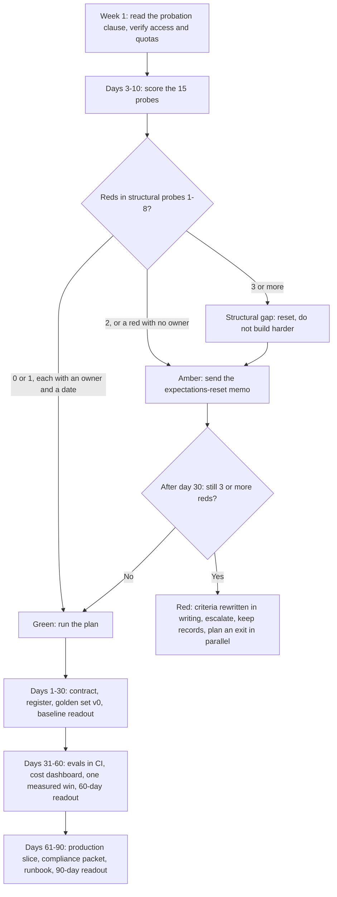

# First 90 Days: Close the Expectations Gap and Pass Probation

> How to pass probation in a GenAI role: score the expectations gap in weeks 1–2, ship the 13 weekly artefacts of a 30-60-90 plan, get a scorecard confirmed by day 14, report variance upward and escalate by written rules.

**Dates and grades.** Evidence comes from [T0-09](../../research/sessions/T0-09-onboarding-probation-first-90-days.md) (dated 2026-10-23; searches run 2026-10-21 to 2026-10-23), the persona playbooks in [T2-01](../../research/sessions/T2-01-tier-calibrated-execution-playbooks.md) and one equity deadline from [T0-17](../../research/sessions/T0-17-compensation-progression-plateaus-equity.md). Regulatory statuses are as of October 2026: re-verify them by 2026-11-23. Provider prices were fetched on 2026-10-22, and credit programmes change: re-verify both by 2027-01-20. **Grades** (EGP-1.0): A primary or measured; B transparent secondary; C vendor, practitioner or single source; D judgement; E no evidence found after searching; M model output; P practice-curated and unmeasured. The diagnostic, the plan, the scorecard and the escalation rules are T0-09's own synthesis (Grade D), built on the cited mechanics.

## The short answer

1. **Treat expectations as a deliverable.** Write down the problem, the metric definitions and the constraints in weeks 1–2, and get them acknowledged. Role clarity is linked to newcomer adjustment, performance and turnover in a 70-sample meta-analysis (abstract only) [B · T0-09 L80]. A misunderstood or miscommunicated problem is the first of RAND's five root causes of AI project failure [A · T0-09 L75].
2. **Diagnose before you build.** Score 15 probes green, amber or red in days 3–10. Three or more reds among the eight structural probes mean the gap is structural, not a communication glitch: take the reset path instead of building harder [D · T0-09 L170]. "No usable data" is a common starting state, not an exception [B · T0-09.F4].
3. **Ship one small, measured artefact every week.** The two quick wins with independent support are a regression eval suite built from real failures and a cost cut measured on your own traffic [A · T0-09.F10]. Anthropic's eval guide calls 20–50 simple tasks drawn from real failures "a great start" [A · T0-09 L99].
4. **Quantify variance before anyone forms a view from a demo.** In one test, 1,000 temperature-0 completions of one prompt gave 80 unique outputs; in another, accuracy varied by up to 15% across runs [A · T0-09 L98]. Put pass^k with error bars and the sample size in every status.
5. **Get the probation criteria confirmed by day 14.** No public, named GenAI probation rubric was found [B/C · T0-09.F8], and GitLab's handbook records the outcome against "performance" with no further criteria [A · T0-09 L113], so your artefacts become the criteria [D · T0-09 L146]. A manager who will not state criteria by day 14 is itself a finding [D · T0-09 L243].
6. **Escalate by decision memo, never by workaround.** Frame each constraint as a decision for an owner: options, cost of delay and a date [D · T0-09 L145]. Do not route around controls: shadow AI added $670,000 to the average breach cost in IBM's 2025 data [A · T0-09 L106].

## At a glance



The thresholds are T0-09's heuristics [D · T0-09 L170, L286–288]. The plan rows follow T0-09's R3 [D · T0-09 L174–191].

## Weeks 1–2: the expectations-gap diagnostic

"AI expectations gap" is a descriptive label found mostly in vendor material, not an established construct. The mechanism behind it is documented at project level: a misdefined problem, missing data, weak infrastructure, no evaluation baseline, non-determinism, and nobody owning pilot-to-production [B · T0-09.F2]. Run the probes in days 3–10 and mark each one green, amber or red. The probes and first actions are T0-09's [D · T0-09 L150–168]; the evidence for each is cited.

**Structural probes 1–8: count the reds.**

- [ ] **1. Owner and metric.** Which business metric moves? Who owns it and signs off pilot-to-production? *Red flag:* no named owner, or the goal is "use AI". *First action:* a one-paragraph problem statement initialled by the owner. In India GCCs, "nobody owns the space between a successful pilot and a production deployment" [B · T0-09 L77].
- [ ] **2. What "accurate" means.** Per field, per document or per answer? On which inputs, against which human baseline, and what does an error cost? *Red flag:* one headline number such as "99%", zero-shot, on unconstrained inputs, with no human fallback. *First action:* define the metric per field and severity, and commit to a measured range only after the golden-set run. On a 2026 benchmark of 1,475 pages, the best of 40 parsers scored about 74 out of 100, and that benchmark scores parsing, not business-field extraction [A · T0-09 L89].
- [ ] **3. Real examples.** Can someone show you 20 real inputs with their desired outputs, and where they live? *Red flag:* nobody can produce them within a week. *First action:* request samples; if none exist, propose a two-week collection and labelling spike. 63% of organisations lack, or are unsure they have, data-management practices for AI (Gartner; the page gives two inconsistent sample sizes) [A · T0-09 L87].
- [ ] **4. Data access.** Who approves access? Is production or customer data allowed in dev, in LLM APIs and in logs? *Red flag:* no classification; "use what you can find". *First action:* classify the data on Adobe's six intake points (audience, objective, input data type, input data classification, technology, output) and file it through one intake [B · T0-09 L107, L481].
- [ ] **5. Approved providers.** Which model providers, regions and retention terms are approved? *Red flag:* none are approved, or nobody knows. *First action:* map the use case to an approved path and request the retention terms your data class needs [D · T0-09 L158].
- [ ] **6. Compute path and quota.** API-only, hosted GPU or self-hosted? What quota exists, per region and model? *Red flag:* the infrastructure promised in the interview loop is absent or at default quota. *First action:* check quotas on days 1–2, file small requests and start building usage history. Azure gives priority to "customers who actively use their existing quota allocation" [A · T0-09 L92].
- [ ] **7. Spend controls.** Is there a monthly cap, a per-project key or workspace, alerting and cost attribution? *Red flag:* one shared organisation key and no caps. *First action:* a per-project key with a budget and a daily spend view. OWASP LLM10 lists unbounded consumption ("denial of wallet") as a risk [A · T0-09 L106].
- [ ] **8. Evaluation baseline.** Is there trace logging, a golden set, a regression test, or any baseline, even a heuristic? *Red flag:* none; "we eyeball it". *First action:* start logging traces and draft golden set v0 in week 3. Teams without evals "get bogged down in reactive loops" [A · T0-09 L161].

**Communication and history probes 9–15.**

- [ ] **9. Variance awareness.** Has anyone run the same input ten times, and do stakeholders know outputs vary? *Red flag:* the belief that temperature 0 means identical outputs. *First action:* run k = 10 on a handful of cases and show the spread [A · T0-09 L98].
- [ ] **10. Cost of being wrong.** What happens when it is wrong? Who is liable? Is there a human fallback? *Red flag:* autonomy expected for customer-facing, legal or financial output. *First action:* define severity classes and a fallback ladder. A tribunal held Air Canada responsible for its chatbot's statements [B · T0-09 L107].
- [ ] **11. Review gates.** Which reviews apply (legal, infosec, privacy, vendor, model risk), and how long does each take? *Red flag:* unknown, or serial reviews started late. *First action:* list the gates with owners and SLAs, and book early slots [D · T0-09 L164].
- [ ] **12. Your own review instruments.** Which dashboards or tallies feed your performance review? *Red flag:* activity metrics only, such as AI-generated lines or usage counts. *First action:* ask for the rubric and propose outcome metrics. GitKraken Insights reports per-developer comparisons, and Meta's performance tool counts AI-generated lines among 200+ data points [B/C · T0-09.F11].
- [ ] **13. History.** What was tried before: postmortems, abandoned proofs of concept, prompt and eval history? *Red flag:* no history, or nobody who remembers. *First action:* read six months of history and interview the previous owner [D · T0-09 L166].
- [ ] **14. Promises against reality.** List what the interview loop promised (data, GPUs, team, scope) against what you see. *Red flag:* two or more material gaps. *First action:* document them neutrally, and turn each gap into an owner, a date or a re-scoped milestone. 43% of surveyed job seekers said the day-to-day role was not what the hiring process led them to expect (Jobvite 2018, via press) [B · T0-09 L81].
- [ ] **15. What leadership saw.** Was it a demo, and when do they expect production? *Red flag:* dates set from a demo. *First action:* restate the dates as staged milestones with exit criteria. At LinkedIn, the first month produced 80% of the basic design and the rest took four more months [B · T0-09 L100].

**The reset rule** [D · T0-09 L170, L286–288]. Count the reds in probes 1–8:
- **0 or 1**, each with an owner and a date by day 30: green. Run the plan.
- **2, or any red without an owner:** amber. Send the expectations-reset memo (template below).
- **3 or more:** the gap is structural, not a communication glitch. Send the memo instead of building harder; if three or more reds remain after day 30, the role is red.

## Escalation rules: green, amber, red

T0-09's heuristic, not legal advice [D · T0-09 L284–288].

| Level | Trigger | What to do |
|---|---|---|
| **Green** | At most one red in probes 1–8, and every red has an owner and a date by day 30 | Run the 30-60-90 plan |
| **Amber** | Two reds, or any red without an owner | Send a one-page expectations-reset memo to your manager and the owner: what is known from baseline data, what is not, the options (reduce scope, add human review, fund data collection, extend the timeline), the cost of delay and the decision needed by a date |
| **Red** | Three or more reds in probes 1–8 after day 30 despite the memo, or a success criterion of "autonomous 99%" with no fallback and no owner for data or budget | Treat the role as mis-specified: get the 60- and 90-day criteria rewritten in writing, escalate through your normal management chain, keep records and start exit planning in parallel |

Naming the gap can carry a political cost in hierarchical settings, and no evidence measures the outcome either way. That is why every escalation here is a written, data-based memo with options [D · T0-09 L542].

## The 30-60-90 plan: 13 weekly artefacts

Run the first 90 days as an expectations-and-evidence programme, not a build sprint [D · T0-09 L138]. T0-09 found no controlled study showing that any 30-60-90 plan reduces early attrition for GenAI engineers, so treat this one as a hypothesis to test with your manager [E · T0-09 L138, L534].

| Week | Artefact | Done when | For |
|---|---|---|---|
| **Days 1–30** | **Establish credibility and map constraints** | | |
| 1 | Orientation; one small reviewed change merged; access requests filed; six months of prompt, eval and incident history read | First PR merged, and every access request has a ticket. DX's vendor benchmark median is 11 days to first PR; big-tech practice aims for a production change in week one [B/C · T0-09 L111] | Team |
| 2 | Diagnostic scored; expectations contract v1: outcomes, metric definitions, constraints, decision rights, review cadence | The manager has signed or commented, and open items are listed. Written, co-authored criteria are a practitioner pattern [C · T0-09 L430] | Manager, owner |
| 3 | Access and constraints register; golden set v0 of 20–50 real cases; trace logging on | Every blocker has an owner and a date; a domain expert reviewed the labels | Manager, platform, security |
| 4 | Baseline report and 30-day readout: a heuristic or human baseline against the existing system; k = 10 runs; pass@k and pass^k with intervals; cost per task; p50 and p95 latency; proposed 60- and 90-day criteria | The 60- and 90-day criteria are agreed in writing | Manager, owner |
| **Days 31–60** | **Make it measurable; first quick wins** | | |
| 5 | Regression eval suite in CI | It runs on every prompt, model or configuration change; thresholds gate merges; failing cases link to traces. Onit's AI Engineer postings in Pune make regression gates a 90-day deliverable [A · T0-09 L110, L123] | Team |
| 6 | Cost and latency instrumentation: per-project key, monthly cap, alerts, cost-per-task dashboard | The owner or finance can see daily spend by feature | Owner, finance |
| 7 | Quick win 1 behind a flag: a caching restructure, batch for offline jobs, or model routing | The eval suite shows no regression beyond error bars, and the cost change is measured on real traffic [A · T0-09.F10] | Manager, owner |
| 8 | 60-day readout; first blameless postmortem of a real failed case | Owner decisions are logged: accuracy definition, human-review scope, budget | Manager, owner |
| **Days 61–90** | **Own something in production and formalise** | | |
| 9 | Vertical slice in production or shadow mode, with human review and a tested rollback | Real inputs flow and traces return | Users, owner |
| 10 | Compliance packet: intake form, data-flow diagram, vendor retention terms, risk register mapped to NIST AI 600-1 and the OWASP LLM Top 10 | Required reviewers have signed or listed conditions | Security, legal, privacy |
| 11 | If you use an LLM judge, hand-label about 100 production traces and compare them with the judge; otherwise grow the golden set from production traces | Agreement is reported with the rubric. The ">0.7 correlation" target is "widely cited" (a practitioner blog) without a source: a starting point only [C · T0-09 L189] | Team |
| 12 | Ownership and runbook: you own one feature, eval or judge, including regression and recalibration after model upgrades | A teammate can run it on call without you | Team |
| 13 | 90-day readout: results against the signed criteria; quality, cost and latency trends; pending decisions; a next-quarter plan with kill criteria and a "what we will not promise" list | The probation or confirmation conversation holds no surprises | Manager, skip-level |

**Weekly rhythm** [D · T0-09 L193]. Monday: add the previous week's failures to the golden set. Friday: send the one-page update (template below). Every 1:1: the top three decisions you need, with owners and dates.

## The probation scorecard: confirm it by day 14

The only onboarding metrics with public definitions are time to first and 10th PR and a roughly 90-day sentiment survey [B/C · T0-09 L230]; the other rows are T0-09's proposal [D · T0-09 L230]. Copy the table, ask your manager to confirm or amend each row by day 14, and mark each row green, amber or red at every readout [P].

| Dimension | Default by day 30 | Default by day 60 | Default by day 90 | Metric (source) | Agreed by day 14 |
|---|---|---|---|---|---|
| Delivery | First PR merged; a small change shipped | About 10 PRs or equivalent shipped | Owns a feature end to end | Time to first and 10th PR; DX vendor medians 11 and 50 days [B/C · T0-09 L111] | [30 / 60 / 90 as agreed] |
| Evaluation | Golden set v0 (20–50 cases) and traces | Regression suite gating merges | Judge calibrated; incidents become tests | Case count; share of incidents turned into tests | [30 / 60 / 90 as agreed] |
| Reliability reporting | pass@k and pass^k with intervals | Trend across releases | Variance targets agreed with the owner | pass^k with confidence intervals | [30 / 60 / 90 as agreed] |
| Cost and latency | Baseline cost per task; p95 latency | One measured saving shipped | Budget cap, alerts, forecast | % change on real traffic with no quality regression | [30 / 60 / 90 as agreed] |
| Expectations and communication | Contract signed; 30-day readout | 60-day readout; decisions logged | No surprises at review | Written 30/60/90 check-ins | [30 / 60 / 90 as agreed] |
| Risk and compliance | Access and constraints register | Intake filed | Compliance packet signed | Intake status; risk register | [30 / 60 / 90 as agreed] |
| Operations | Shadowed on-call; read postmortems | First blameless postmortem | Runbook; on-call ready | Postmortems written; time to detect | [30 / 60 / 90 as agreed] |
| AI fluency, only if your employer uses it | Ask how it is measured | Show a verified AI-assisted workflow | Document where AI did and did not help, with data | Shopify and Meta criteria [B · T0-09 L112]; productivity evidence is contested [A · T0-09 L129] | [30 / 60 / 90 as agreed] |

**Emphasis by setting** [D · T0-09 L243]. Startups weigh delivery speed, scope judgement and cost discipline, and may have no formal rubric, so write one. GCCs tend to weigh stakeholder alignment across geographies, documentation, delivery predictability and compliance hygiene. Get the review calendar and confirmation terms in writing: probation there is typically about six months, according to an employer-of-record vendor, and is not capped by a central law [C · T0-09 L243].

## How to do it

1. **Read your contract in week 1.** Find the probation length, notice terms, confirmation process and the date of the first formal review. India has no central cap on probation (per an employer-of-record vendor), so these terms come from your contract and any applicable standing orders [C · T0-09 L289]. Four Labour Codes took effect on 21 Nov 2025, and whether state exemptions for IT/ITES from standing orders continue is unclear [B · T0-09 L501]. In the US, an 83(b) election must be filed within 30 days of transfer, with no extension, and does not cover RSUs [A/B · T0-17 L180]; ask a tax adviser whether your equity needs one. These are pointers, not legal or tax advice. *Done when:* you know the review dates and how the outcome is decided.
2. **Verify the infrastructure in the first 48 hours.** Check quotas, the data catalogue, access and approved vendors: probes 3–7 [D · T0-09 L220]. *Done when:* every gap has a ticket and an owner.
3. **Score the diagnostic in days 3–10.** *Done when:* all 15 probes are marked and the reds in 1–8 are counted against the escalation rules.
4. **Get the contract and the scorecard acknowledged by day 14.** *Done when:* your manager has confirmed or amended each scorecard row in writing. If no criteria come, record that and apply the escalation rules [D · T0-09 L243].
5. **Ask which dashboards feed your review, in week 1.** *Done when:* you know the instruments and have proposed outcome metrics in place of activity counts [B/C · T0-09 L130].
6. **Secure compute, budget and data with the ten moves below.** *Done when:* a per-project key with a budget and alerts exists, and every access request is sized, classified and logged in the register.
7. **Report variance upward every week.** *Done when:* each update carries pass^k with an interval and the sample size, and the acceptable failure rate is a recorded owner decision.
8. **Clear the review gates by week 10.** *Done when:* the compliance packet is signed or its conditions are listed.

### Compute, API budget and data: ten moves

The mechanics come from vendor documentation [A · T0-09.F5]; the moves are T0-09's synthesis [D · T0-09 L95]. No study measures how engineers obtain quota, credits or data permissions, or how long a new hire waits for a first GPU, dataset or API grant [E · T0-09 L528].

| # | Move | Evidence |
|---|---|---|
| 1 | Start API-first and prove value before asking for GPUs | Google's Rules of ML: "Don't be afraid to launch a product without machine learning" [A · T0-09 L88] |
| 2 | Build usage history deliberately, and ask for increments in proportion to it | Quotas and API tiers rise with usage history; AWS links denials to "limited usage history or a very large increase" [A · T0-09.F5] |
| 3 | File quota requests early, with numbers: tokens per day or GPU-hours, duration, region, fallback | AWS GPU quotas are per region and counted in vCPUs; some are not adjustable and need a support case [A · T0-09.F5, L208] |
| 4 | Install your own guardrails first: a per-project key, a budget, alerts | Claude workspaces take spend caps (not the Default Workspace); LiteLLM team budgets return HTTP 422 when exceeded [A · T0-09 L92] |
| 5 | Use cost levers before asking for more budget, each verified against your eval suite | Claude cache reads bill at 0.1x base input for most models; OpenAI's Batch API gives a 50% discount with a 24-hour window; an independent 2026 preprint measured 41–80% API-cost reduction from prompt caching on long-horizon agentic tasks and warns that naive caching can increase latency [A · T0-09 L124] |
| 6 | Ask whether the company has applied for credits, and read the conditions | Google up to $350,000 for Scale-tier AI startups, third-party models excluded; AWS Activate Portfolio up to $200,000, redeemable for third-party Bedrock models; Microsoft typically $100,000 through an investor offer [A · T0-09 L93]. The IndiaAI portal lists 38,000+ GPUs at about Rs 65 per GPU-hour, allocated by eligibility [B · T0-09 L93]. All are conditional: verify live |
| 7 | Classify data first, then ask: propose low-risk "green" scenarios, start with public, synthetic or redacted data, and request production samples with a stated purpose and retention plan | Adobe's single intake, six data points and pre-agreed green scenarios [B · T0-09 L107]; the move itself is T0-09's [D · T0-09 L212] |
| 8 | Use approved providers whose contract terms you can quote; your organisation's own contracts may differ | [D · T0-09 L213] |
| 9 | Pre-wire the gatekeepers: meet infosec, legal and privacy before you need them; ask for SLAs; use one intake channel and a tech radar of approved tools | Adobe's lessons [B · T0-09 L481] |
| 10 | Escalate by decision memo (options, cost of delay, a date), and log every ask and its outcome in the register | [D · T0-09 L215] |

Do not route around controls with personal accounts or unapproved tools [D · T0-09 L217].

### When the promised infrastructure is missing

"No data, no compute" is the common case, not the exception [B · T0-09.F4]. T0-09's sequence [D · T0-09 L219–226]:

1. Verify quotas, the data catalogue, access and approved vendors in the first 48 hours (probes 3–7).
2. Record the gap against what was said in interviews, neutrally and in writing (probe 14).
3. For the first 30 days, take the API-first path with a public or synthetic golden set, so evaluation is not blocked on approvals.
4. Request the minimum access with a sized business case and a data classification (move 7).
5. Propose a short data-collection or labelling spike with an owner. Andrew Ng's "costly initial data collection phase" is a normal cost, not a failure [B · T0-09 L88].
6. Re-baseline the milestones with the owner and put the new dates in the expectations contract.
7. Track the cost of delay per week in your status, so the decision sits with the person who can unblock it.

### Report non-determinism upward

1. **Replace "accuracy" with a distribution.** Show the same input ten times. pass@k counts at least one success in k tries; pass^k requires all k to succeed. Use "pass@k for tools where one success matters, pass^k for agents where consistency is essential" [A · T0-09 L99, L247]. On tau-bench retail, pass^8 was under 25% for gpt-4o-class agents [A · T0-09 L98].
2. **Show error bars and sample sizes,** and do not claim one-point gains on 50 cases [A · T0-09 L248].
3. **Make the acceptable failure rate an owner decision,** per failure type and severity: "Your pass rate is a product decision" [A · T0-09 L99].
4. **Offer a fallback ladder:** a heuristic, then an LLM with human review, then autonomy for a low-risk slice [D · T0-09 L250].
5. **Pre-commit to an experiment, not a number:** "We don't know how accurate the system will be in advance; this two-week experiment will tell us" [B · T0-09 L251].
6. **Plan on the curve:** a demo reaches about 80% quickly, and the last stretch takes most of the time [B · T0-09 L252].
7. **Name the engineering cause.** Run-to-run differences at temperature 0 come from load-dependent batch size, and deterministic kernels cost throughput (55 s against 26 s for default vLLM in the authors' test) [A · T0-09 L98].
8. **Keep a decision log and a weekly written update.** Blameless postmortems with criteria defined before incidents keep failures from becoming personal [A · T0-09 L255].

### Compliance gates as of October 2026

Pointers, not legal advice. Statuses are as T0-09 recorded them by 2026-10-23; check each against your employer's policy and the primary text before acting.

| Gate | Status as of October 2026 | What it means in your first 90 days | Grade · source |
|---|---|---|---|
| US bank model risk | SR 26-2 (17 Apr 2026) supersedes SR 11-7 and states that generative and agentic AI "are not within the scope of this guidance" | Do not assume a model-risk approval covers an LLM feature; ask which internal policy applies | A · T0-09 L103 |
| EU AI Act | Regulation (EU) 2026/1744 in force 27 Jul 2026: Annex III high-risk obligations move to 2 Dec 2027 and Annex I to 2 Aug 2028; GPAI duties continue; two new prohibitions apply from 2 Dec 2026 | Confirm whether the product touches the EU, and which tier applies, before assuming a deadline | B · T0-09 L104, L274 |
| India DPDP | Rules notified 13 Nov 2025; consent-manager rule from 13 Nov 2026 (12 Nov per one firm); core duties from 13 May 2027 per two sources (12 May per a third) | Start a data inventory and consent and notice mapping in your first weeks; verify dates on the Gazette | B · T0-09 L105, L477 |
| RBI FREE-AI | A framework of 7 sutras and 26 recommendations; binding status not stated in the source | In regulated Indian entities, use it as a checklist of expected controls | B · T0-09 L105, L276 |
| NIST AI 600-1 and OWASP LLM Top 10 | 12 GenAI risks; LLM02 sensitive information disclosure and LLM10 unbounded consumption | A shared vocabulary for the risk register in your compliance packet | A · T0-09 L106 |
| Shadow AI | IBM 2025: shadow AI added $670,000 to the average breach cost; 97% of organisations reporting an AI-related incident lacked proper AI access controls | Use approved paths; expect infosec to ask for access-control evidence | A · T0-09 L106 |
| Liability | A tribunal held Air Canada responsible for its chatbot's statements (about CA$650 in damages) | Treat outputs as company statements; define fallback and disclosure | B · T0-09 L107, L376 |

## Setting adjustments: startup, enterprise, India GCC

No source documents startup-versus-GCC probation practice. These contrasts are T0-09's synthesis [D · T0-09 L195], and the GCC evidence is about aggregates [B · T0-09.F9].

| Setting | Compress or expand | Emphasise | Watch for |
|---|---|---|---|
| Venture-backed startup | Compress: a production-touching change by week 2–3 and the first eval suite by week 4. The contract can be a one-page message to the founder | Shipping cadence, scope judgement and cost discipline, since credits are finite and conditional. Ask in writing what "good at 90 days" means: probation may be informal | No data owner; demo-driven founder expectations; credits that do not cover third-party models |
| Enterprise engineering organisation (non-GCC) | Expand weeks 2–4 for intake and approvals; file the intake in week 2 | Security and privacy hygiene; cost allocation; platform dependencies | Shadow AI temptations; approval queues; tool procurement |
| India GCC | Expand weeks 1–4 for stakeholder mapping. Identify the dual mandate (global parent against India leadership) and map the HQ dependency chain: who controls GPU allocation, model API access and data residency [D · T2-01 L340] | Who sets priorities, owns data and budget, and approves tools. Get probation terms and review dates in writing. Assume parent-company rules and Indian law (DPDP phases) both apply. Name a pilot-to-production owner | Pilots that never graduate; governance handled "after the fact"; remote stakeholders across time zones |

GCC context: 64% of GCC leaders report dual global mandates (a trade-press report of a survey of more than 50 leaders), and "nearly 70%" of India GCCs are stuck at AI pilots [B · T0-09 L117, L441]. That GPUs and credits are held at the parent company is not documented [D · T0-09 L445]. GCC probation as a formal 3–6 month cycle is plausible but thinly evidenced; an employer-of-record vendor gives six months as typical [C · T0-09 L446].

## Persona-specific risks

T2-01 maps T0-09's root causes onto five transition backgrounds: backend engineers fail on eval methodology, data scientists on production hygiene, non-technical entrants on scope definition, and PhDs on shipping velocity. It is a synthesis held at 0.70 confidence, not a measurement [D · T2-01 L47]. Every background's first defence is the same: an expectations contract that names AI deliverables.

| Background | Risks, by day | Prevention | Source |
|---|---|---|---|
| Backend software engineer | Days 1–3: "fix the infra first" instead of shipping a feature. Days 7–14: under-investing in eval because "the system works". Days 15–30: building a perfect serving layer instead of a working prototype. Days 30–60: scope creep into infrastructure work. Days 60–90: not documenting the non-determinism approach for the team | Map the serving architecture and observability gaps; ship the regression eval suite in days 7–14 using your CI instincts (earlier than week 5 in the general plan); deliver a measured cost reduction by day 30; own one end-to-end feature with eval gates; run a postmortem of a real failure | [D · T2-01 L334–338] |
| Data scientist | Days 1–14: assigned to "data work" instead of AI engineering. Days 15–30: notebook-only habits, no tests or CI. Days 30–60: three weeks of EDA instead of shipping. Days 60–90: the "can't ship to production" label | A contract that names AI application deliverables; tests from day 1; a one-week EDA budget and an imperfect v0 with an eval plan; deploy something, even a simple API endpoint, before the 90-day review | [D · T2-01 L410–413] |
| Frontend engineer | Relegated to styling ("just make the UI"); polishing the frontend at the expense of eval infrastructure; stack fragility as AI SDK versions change | A contract that specifies AI application ownership; ship the eval suite before polishing the UI; freeze stack choices for six weeks at a time | [D · T2-01 L461–463; D · T0-06 L254] |
| Non-technical professional: PM, operations or domain expert | Scope ambiguity ("you're the AI person, figure it out"); a technical team that does not trust your judgement; drift into pure PM work with no AI component | A contract with specific, measurable deliverables; lead with your domain rubric and labelled data; keep hands-on eval and data work in the role | [D · T2-01 L540–542] |
| PhD or researcher | Research perfectionism: three months on a paper-quality experiment; friction with peer code review; scope creep into pure research; jargon-heavy presentations | Ship an imperfect v0 in week 2; treat review as the bridge from research code to production code; tie every exploration to a shipping milestone with a due date; translate results into business impact | [D · T2-01 L620–623] |

Background playbooks: [Career transitions](../11-tracks/career-transitions.md) and [PhD to industry](../11-tracks/phd-to-industry.md). Role hubs for these entrants include [Domain Evaluation Specialist](../02-roles/hubs/domain-evaluation-specialist.md), [Forward-Deployed Engineer](../02-roles/hubs/forward-deployed-engineer.md), [Research Engineer](../02-roles/hubs/research-engineer.md) and [Applied Scientist](../02-roles/hubs/applied-scientist.md).

## Templates and examples

### Expectations contract v1

T0-09's week-2 artefact [D · T0-09 L178]; written, co-authored 30/60/90 criteria are a practitioner pattern [C · T0-09 L430].

```text
Expectations contract v1: [name], [role], [team], [date]
Problem: [one paragraph: the business metric that moves; the owner who signs off pilot-to-production]
Outcomes: day 30 [ ]; day 60 [ ]; day 90 [ ]
Metric definitions: [per field / per document / per answer]; inputs [ ]; human baseline [ ];
  cost of an error by severity [ ]
Constraints: data [sources, owners, classification]; compute [quota, region]; budget [monthly cap];
  vendors [approved, retention terms]; reviews [gates, owners, SLAs]
Decision rights: accuracy definition [owner]; human-review scope [owner]; budget [owner]
Review cadence: weekly update [day]; readouts [dates]; probation review [date from contract]
Not promised: [list]
Acknowledged: [manager, date]; [owner, date]
```

### Access and constraints register

T0-09's week-3 artefact [D · T0-09 L179].

| Item | Owner | Status | Needed by | Cost of delay per week |
|---|---|---|---|---|
| Data source: [name, classification] | [name] | [requested / granted / blocked] | [date] | [effect] |
| Quota: [model or GPU type, region] | [name] | [status] | [date] | [effect] |
| Budget: [monthly cap, alerting] | [name] | [status] | [date] | [effect] |
| Review gate: [legal / infosec / privacy / vendor / model risk], SLA [days] | [name] | [status] | [date] | [effect] |
| Approved vendor: [provider, region, retention terms] | [name] | [status] | [date] | [effect] |

### Expectations-reset memo (amber)

T0-09's amber response [D · T0-09 L287].

```text
To: [manager], [owner]
Subject: Decision needed by [date]: scope of [project]
Known: [baseline results: metric, n, interval, cost per task]
Not known: [what data or access would tell us]
Options:
  A. Reduce scope to [slice]: [effect on dates]
  B. Add human review for [cases]: [cost]
  C. Fund data collection: [weeks, people, cost]
  D. Extend the timeline to [date]
Cost of delay: [per week]
Decision needed: [option] from [owner] by [date]
```

### One-page weekly update

The format follows T0-09's R6, whose own example numbers were invented for illustration [D · T0-09 L257–267].

```text
Weekly update: [project], week [n] of 13, [date]
1. Metric: pass^[k] on golden set v[n] = [x]% (95% CI [a]-[b]%, n = [cases]); previous week [y]%
2. What changed: [change] moved [metric] by [points] on [slice]; no change elsewhere
3. Variance: same input x10 gave [m] identical outputs; failure types [A], [B]
4. Cost and latency: $[c] per task ([+/-]% against baseline); p95 [s] s
5. Decisions needed: [decision], owner [name], by [date]
6. Blockers: [blocker], owner [name], cost of delay [per week]
7. Next week: [plan]
```

### Weak and strong

Built from T0-09's R6 [D · T0-09 L247–252].

| Situation | Weak | Strong |
|---|---|---|
| Status | "The bot is about 95% accurate." | "pass^5 on golden set v3 is [x]% (95% CI [a]–[b]%, n = [cases]); the same input ten times gave [m] identical outputs." |
| Promise | "We'll hit 99% by [date]." | "We don't know how accurate the system will be in advance; this two-week experiment will tell us." |
| Blocker | "We can't do anything without data." | "Without labelled samples, evaluation slips [n] weeks. Options: a synthetic golden set, or a two-week labelling spike. Decision needed from [owner] by [date]." |
| Cost | "Caching will cut costs by 40%." | "A cache restructure behind a flag cut cost per task by [x]% on real traffic, with no eval regression beyond error bars." |

## Checklist

- [ ] Week 1: probation length, notice terms, confirmation process and first review date read from the contract
- [ ] First 48 hours: quotas, data catalogue, access and approved vendors checked; every gap ticketed
- [ ] Week 1: first PR merged; six months of prompt, eval and incident history read
- [ ] Week 1: asked which dashboards feed your review
- [ ] Days 3–10: 15 probes scored; reds in 1–8 counted; escalation level set
- [ ] Day 14: expectations contract v1 acknowledged and the scorecard confirmed in writing
- [ ] Week 3: access and constraints register live; golden set v0 of 20–50 real cases; traces logging
- [ ] Week 4: baseline with pass@k, pass^k, intervals, cost per task and p95 latency; 60- and 90-day criteria agreed in writing
- [ ] Week 5: regression suite gating merges
- [ ] Week 6: per-project key, monthly cap, alerts and a cost-per-task dashboard
- [ ] Week 7: one saving measured on real traffic, with no eval regression beyond error bars
- [ ] Week 8: 60-day readout; first blameless postmortem
- [ ] Week 9: production or shadow slice with human review and a tested rollback
- [ ] Week 10: compliance packet signed, or its conditions listed
- [ ] Week 12: a runbook that a teammate can run on call
- [ ] Week 13: 90-day readout against the signed criteria
- [ ] Every week: Monday golden-set update; Friday one-page update

## Pitfalls

| Red flag | Why it hurts | Fix |
|---|---|---|
| Building harder against three or more structural reds | The gap is structural; effort does not close it [D · T0-09 L170] | Send the reset memo; get the criteria rewritten |
| Reporting one accuracy number | Accuracy varied by up to 15% across runs in one study [A · T0-09 L98] | pass^k with an interval and the sample size |
| Promising "~40%" savings before measuring | Savings depend on the workload, and naive caching can increase latency [A · T0-09.F10] | Measure on real traffic, gated on the eval suite |
| Becoming the public face of unmeasured savings | Klarna rehired human agents and CBA reversed AI-driven job cuts [B · T0-09 L125] | Claim only measured numbers |
| Personal accounts or unapproved tools to get unblocked | Shadow AI added $670,000 to the average breach cost [A · T0-09 L106] | Approved paths and a decision memo |
| Assuming a model-risk approval covers an LLM feature | SR 26-2 excludes generative and agentic AI [A · T0-09 L103] | Ask which internal policy applies |
| Artefacts becoming the work | Over-documentation crowds out delivery [D · T0-09 L546] | One page each, tied to a decision |
| Quoting interview promises as accusations | Naming the gap has a political cost [D · T0-09 L547] | Neutral, data-based framing |
| A golden set frozen at week 3 | Built from past failures, it misses new failure modes [D · T0-09 L549] | Refresh it weekly from production traces |
| Activity counts as your evidence | Some analytics tools, such as GitKraken Insights, compare developers, and productivity evidence is contested [B/C · T0-09.F11] | Agree outcome metrics in week 1 |

## Evidence and limits

- **Measured or primary:** non-determinism and evaluation mechanics [A · T0-09.F6]; quota, budget and cost-lever mechanics from vendor documentation [A · T0-09.F5]; regulator text and law-firm summaries [A/B · T0-09.F7]; project-level failure causes and data-readiness surveys [B · T0-09.F2; B · T0-09.F4].
- **Judgement:** the diagnostic and its scoring rule, the 30-60-90 plan, the scorecard, the escalation rules and the setting contrasts are T0-09's synthesis [D · T0-09 L138]. The persona risks are T2-01's mapping, held at 0.70 confidence [D · T2-01 L47].
- **Not found after searching (E):** a GenAI probation or 30/60/90 rubric from a named engineering manager, in startups or GCCs [T0-09 L520]; an AI-specific early-exit dataset [T0-09 L519]; any measurement of how long a new hire waits for a first GPU, dataset permission or API quota [T0-09 L528]; HQ-held GPU allocation as a documented GCC pattern [T0-09 L120].
- **Do not repeat the "up to 35%" claim** that AI engineering hires face friction or leave within six months. Fifteen logged queries found no source; the nearest published figures are 31–34%, for general workers [E · T0-09.F1].
- **Productivity evidence is contested.** METR's 2025 randomised study found developers 19% slower; its 2026 update reports an 18% speed-up for original participants and 4% for new ones, with intervals that include no effect [A · T0-09 L129]. Do not stake your review on AI-usage counts.
- **Stated reasons are not revealed reasons.** In a vendor's voluntary survey of 200+ India AI and ML engineers (Jul–Sep 2026), no growth (39%), a better offer (21%) and "broken promises" (19%) led the reasons for leaving a role early. That is a mix of reasons, not an exit rate [C · T0-09 L69].
- **An upstream misreading, corrected here.** T2-01 KF6 summarises role ambiguity as "43% of all hires" and compute gating as "85% delayed" [T2-01 L78]. The sources measured 43% of surveyed job seekers in 2018, general workforce [B · T0-09 L81], and 85% of AI professionals whose organisations had delayed projects for lack of GPU access, in a vendor-sponsored survey [C · T0-09 L94]. This page quotes the originals; the correction is logged as U21 in the [errata](../../research/ERRATA.md).
- **Dates:** regulatory statuses as of 2026-10-23, re-verify by 2026-11-23; prices fetched 2026-10-22 and credit programmes, re-verify by 2027-01-20.
- **What would change this advice:** a realised early-exit dataset for AI hires; published probation rubrics from named managers; a pilot cohort run through this diagnostic and plan, with outcomes compared [T0-09 L564].

## Next steps

- **After day 90:** [Growth and progression](growth-and-progression.md): promotion, moves, IC or manager, and learning.
- **This stage:** [Onboarding README](README.md); stage findings in [findings, stage 10](../../research/findings.md#stage-10).
- **Role hubs:** [AI Engineer](../02-roles/hubs/ai-engineer.md), [Agentic AI Engineer](../02-roles/hubs/agentic-ai-engineer.md), [AI Evaluation Engineer](../02-roles/hubs/ai-evaluation-engineer.md), [Applied AI Engineer](../02-roles/hubs/applied-ai-engineer.md), [ML Engineer](../02-roles/hubs/ml-engineer.md).
- **By background and location:** [Career transitions](../11-tracks/career-transitions.md), [PhD to industry](../11-tracks/phd-to-industry.md), [India remote playbook](../11-tracks/india-remote-playbook.md).
- **Governance gates in depth:** [Governance careers](../11-tracks/governance-careers.md).
- **If the role turns out mis-specified and you return to the market:** [Offer evaluation](../09-compensation/offer-evaluation.md) and [Interview loops](../08-interviewing/interview-loops.md).
- **Eval, tracing and cost tools:** [Tool catalog](../00-start/tool-catalog.md); terms: [Glossary](../00-start/glossary.md).
- **Evidence:** [T0-09](../../research/sessions/T0-09-onboarding-probation-first-90-days.md), [T2-01](../../research/sessions/T2-01-tier-calibrated-execution-playbooks.md), [errata](../../research/ERRATA.md).
