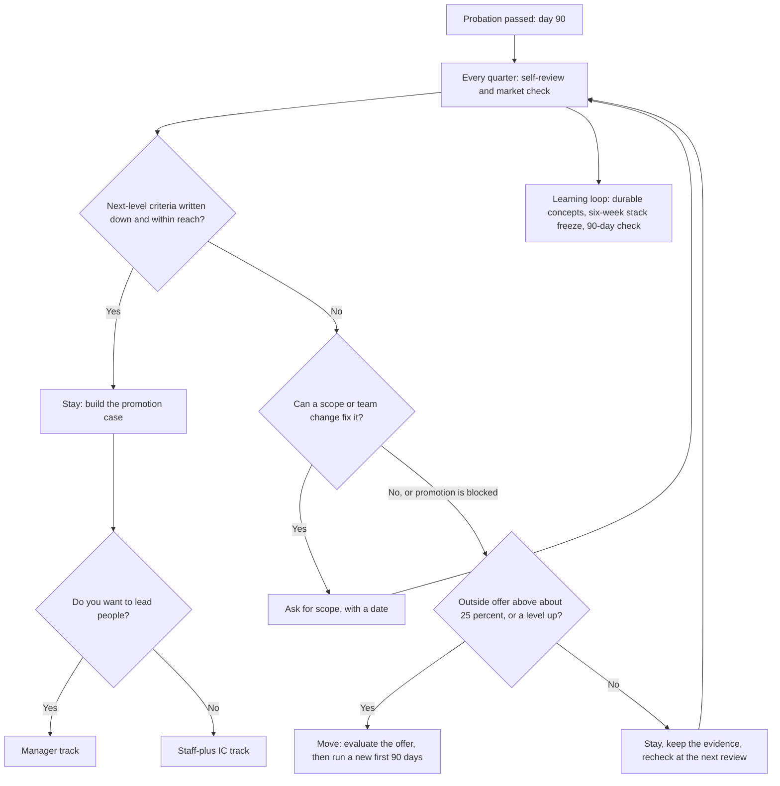

# Growth and Progression After the First 90 Days

> After the first 90 days: how promotion and levelling pay in GenAI careers, when a move beats staying, how to choose between the IC and manager tracks, and how to keep learning at a pace you can sustain.

**Dates and grades.** Pay and promotion figures come from [T0-17](../../research/sessions/T0-17-compensation-progression-plateaus-equity.md) (dated 2026-10-23), which compiles Levels.fyi 2025 data, Pave data and releases up to September 2026: re-verify them by 2027-01-21. The hop-or-stay rule comes from [T1-03](../../research/sessions/T1-03-interview-execution-offer-negotiation.md); reasons for leaving from [T0-09](../../research/sessions/T0-09-onboarding-probation-first-90-days.md); the learning routine from [T0-12](../../research/sessions/T0-12-high-signal-communities-technical-visibility.md) and [T0-06](../../research/sessions/T0-06-career-transition-timelines-5-backgrounds.md). [Errata](../../research/ERRATA.md) U4, U5 and U14 are applied: US medians carry the level labels T0-17 measured, and India figures use measured anchors, not tier bands. **Grades** (EGP-1.0): A primary or measured; B transparent secondary; C vendor, practitioner or single source; D judgement; E no evidence found after searching; M model output; P practice-curated and unmeasured.

## The short answer

1. **A promotion pays less than the gap between level medians.** US medians step ×1.2–1.5 per level [B · T0-17 L129], but a promotion delivers about 16–24% in total compensation: Pave puts promoted base raises at 6.5% for AI/ML engineers, and ongoing equity rises 39% on promotion [C · T0-17 L115]. Only 8.6% of employees are promoted in a year [B · T0-17 L125].
2. **Move only when the premium clears about 25% or promotion is blocked.** Same-tier lateral moves pay about +15–25% in total compensation and level-up moves +35–50%. "35–50% per hop" fails as a general rule; it describes tier-crossers [A/B/C · T0-17.F1; A/B/C · T1-03.F7].
3. **The AI premium grows with level, but AI promotion speed is not measured.** The premium over non-AI engineers rises from 6.2% at Entry to 18.7% at Staff [B · T0-17 L130]. No public dataset compares months per level for AI and non-AI engineers [E · T0-17 L122]; the average software engineer reaches Senior at about 8.6 years of experience [C · T0-17 L123].
4. **Choose IC or manager by the work, not the clock.** SignalFire reports that AI engineers move into management in under three years on average [C · T0-17 L126]. The sessions behind this page do not compare IC and manager pay for AI roles. Use the decision questions below [P].
5. **Treat a growth stall as the signal to act.** In a vendor's voluntary survey of 200+ India AI and ML engineers (Jul–Sep 2026), no growth (39%) outranked a better offer (21%) as the reason for leaving a role early [C · T0-09 L69]. Raise scope with your manager before you test the market [P].
6. **Learn durable concepts on a fixed cadence, and protect your energy.** Freeze stack choices six weeks at a time, and invest in context, retrieval, tool schemas and evals rather than API surfaces [D · T0-06 L254]. Burnout is not researched in this corpus; the load advice on this page is [P].

## At a glance



The 25% threshold and the blocked-promotion rule are T1-03's [A/B/C · T1-03.F7]. The quarterly cadence and the other branches are [P].

## How levels and pay progress

### The US ladder: measured anchors

US all-company medians step ×1.2–1.5 per level from Entry to Principal, and the AI premium over non-AI engineers rises from 6.2% at Entry to 18.7% at Staff (Levels.fyi 2025 data and Q3 2025 analysis) [B · T0-17 L129–L130]. The ladder itself, with every median, step and date, is in [pay benchmarks: the US all-company ladder](../09-compensation/pay-benchmarks.md#us-all-company-ladder); role and regional figures are on the same page.

**Time in level.** No AI-specific dataset exists [E · T0-17 L122]. The proxies:
- The average software engineer in Levels.fyi's database reaches Senior at about 8.6 years of experience, with Google and Apple at about 7–9 and Netflix mostly 10+ (reported by its cofounder; seen as a search snippet) [C · T0-17 L123].
- Anthropic's Levels.fyi page lists Senior at 6–8 years of experience and Lead at 7–8 (n = 49) [B · T0-17 L123].
- Community timelines at Google-style levels: L3→L4 about 1–2 years, L4→L5 about 2–4, L5→L6 about 3–5+ or never; many treat Meta's E5 as a de facto terminal level [C/D · T0-17 L124].

### What a promotion and a stay are worth

- **Raises.** AI/ML engineers get the highest non-promoted raise in R&D (4.4%) but near-bottom promoted raises (6.5%, against 7.7% for R&D and 8.6% for all employees). Employers reward AI talent through annual raises and equity more than through promotion jumps [B · T0-17 L115, L125].
- **A promotion** is worth about 16–24% in total compensation once equity is counted: equity is 30–50% of total pay, and ongoing equity rises 39% on promotion [C · T0-17 L115].
- **The level gap.** The Senior→Staff step between level medians is ×1.46, more than a promotion delivers. T0-17 reads the difference, about 22–30 percentage points for Senior→Staff and 14–22 for Engineer→Senior, as the most an external move can capture [C · T0-17 L115].
- **A median year.** About 5% total-compensation growth for the median stayer (3.4% median merit plus the odds of promotion); about 9–12% for promotion-track performers [M · T0-17 L117].

### Outside the US, and at frontier labs

- **India.** The local senior ceiling is a Greater Bengaluru Senior SWE median of ≈ ₹56.0L and a P90 of ≈ ₹1.07Cr (Levels.fyi, n = 4,836) [B · T0-17 L137], and a local Staff role typically does not reach ₹1.2Cr, on Levels.fyi job-board estimates [C · T0-17 L138]. The full distribution, the highest employer senior medians and the unstable "AI Engineer" title page are in [pay benchmarks: India](../09-compensation/pay-benchmarks.md#india-by-city-level-and-employer). Do not use the India "T2/T3" bands: neither band set is measured [errata U14]. The corpus does not measure what moves people past the local senior ceiling; see the [India remote playbook](../11-tracks/india-remote-playbook.md).
- **Europe.** No Europe-specific time-in-level data was found, so plateau claims are inference [E · T0-17 L145]. London's senior band, from a search snippet (Grade C), is in [pay benchmarks](../09-compensation/pay-benchmarks.md#uk-europe-singapore-and-the-gcc).
- **Frontier labs.** Headline Levels.fyi medians run ×2.0 (Anthropic Senior) to ×2.9 (OpenAI L5) of the US all-company Senior median, and ×2.8 (OpenAI L6) to ×3.1 (Anthropic Staff) at Staff; treat lab medians as ±30–50% [C · T0-17 L131–132]. After equity risk-adjustment, an OpenAI-L6-like package is ≈ ×1.7–2.4 of the all-company Staff median [C · T0-17 L133]. The largest single OpenAI step is L3→L4, ×2.2 [B · T0-17 L131].

## Hop or stay: the decision table

The money rule, and what each kind of move pays, belong to [offer evaluation: hop or stay](../09-compensation/offer-evaluation.md#hop-or-stay). In short: stay while promotion is within reach and outside offers at your level clear less than about 25%; move when the risk-adjusted premium clears about 25%, when the offer is a level up (≈ +35–50%), or when promotion is blocked by no scope, no budget or a level many treat as terminal [A/B/C · T1-03.F7; A/B/C · T0-17.F1]. Before you act on that rule, check the timing and the job, not only the number:

| If… | Lean | Why |
|---|---|---|
| A tender eligibility date or a large vest is close | Time the move | Frontier-lab tenders use 1–2-year tenure gates and dollar caps [A/B · T0-17.F8] |
| The new employer is a startup where an acqui-hire is plausible | Read the carve-outs | In the 2025 Windsurf deal, employees hired within the prior year reportedly received no payout [B · T0-17 L180] |
| Pay is your only complaint | Get a level-matched market number and ask internally first [P] | Stated drivers of early exits are mostly growth, scope and management; compensation was the least-named reason to stay (4%) in the India survey [C · T0-09 L83] |
| Any external move | Price in the reset | External hires were paid about 18% more than internal promotees but performed worse early and left sooner (about 5,000 investment-bank employees; non-tech, older) [A · T0-17 L113] |

**Background, not rules.**
- Economy-wide, ADP's September 2026 release puts job-changers at +4.8% base pay growth against +3.0% for stayers, across all industries [A · T0-17 L112]. The Atlanta Fed tracker had switchers at 4.8% against 4.6% for stayers in early 2025, the narrowest gap in about a decade [B · T0-17 L112].
- Levels.fyi's coaching cohort shows median improvements of about 21% (mid), 23% (senior) and 24% (staff). The buyers are self-selected, and the figures cover negotiation of any offer, not only job changes [B · T0-17 L114].
- "+35–50% every two years" would compound to ×4.5–7.6 over ten years, yet Levels.fyi medians rise only ×3.6 from Entry to Principal [C · T0-17 L116].
- If you might leave before a grant vests, discount the grant for attrition as [offer evaluation](../09-compensation/offer-evaluation.md#adjustment-2-vesting-cliff-and-forfeiture) shows.

## IC or manager: decision questions

**What the evidence says.** SignalFire reports that AI engineers move into management in under three years on average, a different measure from IC promotion speed [C · T0-17 L126]. A practitioner career ladder treats evaluation as the clearest seniority signal [C · T0-09 L429]. T0-17 and T0-09 do not compare pay for the two tracks; see the [AI Engineering Manager hub](../02-roles/hubs/ai-engineering-manager.md) for its own evidence.

Answer these before you accept or ask for a management role [P]:

| Question | If yes | If no |
|---|---|---|
| Do you want your results to come through other people's work: hiring, 1:1s, reviews, unblocking? | The manager track fits | Stay IC |
| Does your employer publish written Staff and Principal IC criteria? | The IC path has a next step | The IC ceiling may sit at Senior: weigh the manager track or a move |
| Are you choosing management to escape a stalled IC track? | Fix the stall first: scope, team or manager | Continue |
| Do you still want to own technical calls such as eval design and architecture? | Stay IC, or take a tech-lead role | The manager track fits |
| Can you try it reversibly, as a tech lead or acting manager? | Try before you switch | Ask what the way back looks like |

Leadership roles beyond line management: [VP or Head of AI](../02-roles/hubs/vp-head-of-ai.md), [Chief AI Officer](../02-roles/hubs/chief-ai-officer.md) and [Fractional AI Leader](../02-roles/hubs/fractional-ai-leader.md). Profile: [AI Engineering Manager in the role catalog](../02-roles/role-catalog.md#profile-ai-engineering-manager).

## How to do it

1. **Get the next-level criteria in writing** within a month of confirmation [P]. *Done when:* you hold your employer's ladder text for your level and the next, and your manager has said which criteria you meet.
2. **Run a quarterly self-review** with the template below [P]. *Done when:* every next-level criterion has linked evidence or a dated plan.
3. **Check the market every quarter** against level-matched medians in [Pay benchmarks](../09-compensation/pay-benchmarks.md) [P]. *Done when:* you know your gap to the level median, in percent.
4. **Ask for scope, not a title,** when the case is thin [P]. *Done when:* your manager has agreed a project that maps to a missing criterion, with a date.
5. **Decide stay or move at most twice a year,** with the decision table [P]. *Done when:* the decision and its numbers are written down.
6. **Keep the first-90-days habits:** a weekly written update, a decision log and measured results [D · T0-09 L193, L255]. *Done when:* a promotion packet can be assembled from existing artefacts.
7. **Run the learning loop and its 90-day check** (below). *Done when:* the check passes, or you have changed the type of artefact or the channel [D · T0-12 L175].

## A sustainable learning routine

T0-12 built this routine for an India-based engineer looking for AI-engineering roles, with roughly six hours a week; the hours are illustrative and the weighting is judgement [C · T0-12 L143]. Using it while employed is an adaptation [P]: scale the hours to your load, and drop slots before you drop rest.

| Cadence | Activity | Evidence |
|---|---|---|
| Weekly | One conversational community, such as Latent Space Discord and its weekly LLM Paper Club; after 4–6 weeks of attending, volunteer to facilitate a paper | [B · T0-12 L149] |
| Weekly | One depth community matched to your track: GPU MODE for kernels and performance, EleutherAI for research, evaluation and infrastructure, or vLLM for inference serving | [B · T0-12 L150] |
| Every 2–3 weeks | One substantive technical post, shared with context in each community's designated channel | The cadence is judgement, with anecdotal support only [C · T0-12 L152] |
| Monthly | A demo-first local meetup: AI Tinkerers, or Fifth Elephant meetups in Bengaluru, Hyderabad or Pune | [B/C · T0-12 L153] |
| Every six weeks | Review stack choices, and change them only at that boundary | API surfaces such as AI SDK 6 and WebMCP changed shape within months [D · T0-06 L254] |
| Passive | smol.ai AINews for summaries of AI Discords | [B/C · T0-12 L155] |
| Every 90 days | Check: six or more public artefacts, ten or more two-way technical exchanges with named practitioners, and any inbound that cites your work. Drop a community after 4–6 weeks with no two-way exchange | Heuristics [D · T0-12 L172–175] |

**Inside the job.** Owning an eval suite, a judge or a cost dashboard is both learning and promotion evidence; practitioners treat evals as the clearest seniority signal [C · T0-09 L429]. For what to learn next, use [Learning roadmaps](../03-skills-and-tech/learning-roadmaps.md) and the [Skills radar](../03-skills-and-tech/skills-radar.md).

**Load.** Burnout and recovery are not researched in this corpus, and workload only as a time budget: 17.5 study hours a week take about 56–74% of an employed adult's average leisure [M · T0-06 L213]. Practice-curated rules [P]:
- Put learning hours inside the working week where your employer allows it, not on top of it.
- Count your communities against the stop-loss rule; it doubles as a load limit [D · T0-12 L175].
- When on-call or launch pressure rises, pause the community slots first and keep one depth slot.
- If exhaustion persists for weeks, raise scope with your manager, and see a health professional if it affects your health.

## Warning signs and responses

| Signal | What the evidence says | Response |
|---|---|---|
| The same scope for two reviews in a row (threshold [P]) | No growth was the most-named reason for leaving a role early, at 39%, in a vendor's survey of India AI and ML engineers [C · T0-09 L69] | Propose a scope change with a date; if it is refused, run the decision table |
| The role differs from the one you accepted | "Broken promises", a role sold as one thing that turned out to be another in scope, ownership or growth path, were named by 19% in the same survey [C · T0-09 L387] | Document neutrally and renegotiate scope, as in the escalation rules of [First 90 days](first-90-days.md) |
| Poor management | Named by 18% in the same survey [C · T0-09 L83] | A skip-level conversation or an internal transfer [P] |
| A promotion raise that disappoints | AI/ML promoted base raises are 6.5% [B · T0-17 L125] | Compare total compensation including equity; run a market check |
| A long plateau at Senior | L5→L6 can take 3–5+ years or never happen; many treat Meta's E5 as terminal [C/D · T0-17 L124] | Seek Staff-scope work, or weigh a level-up move |
| The local pay ceiling in India | Bengaluru Senior P90 ≈ ₹1.07Cr; top employer senior medians ≈ ₹1.06–1.22Cr [B · T0-17 L137] | See the [India remote playbook](../11-tracks/india-remote-playbook.md) |
| Reviews that count AI usage or activity | Meta made "AI-driven impact" a core expectation from 2026, and its tool counts AI-generated lines among 200+ data points; Shopify set reflexive AI usage as a baseline expectation [B · T0-09 L112] | Agree outcome metrics; record where AI did and did not help, with data |
| Anxiety about stack churn | API surfaces such as AI SDK 6 and WebMCP changed shape within months [D · T0-06 L254] | A six-week freeze; durable concepts |
| Exhaustion that persists for weeks | Not researched in this corpus | Reduce scope with your manager, protect rest, and see a health professional if it affects your health [P] |

## Templates and examples

### Quarterly self-review [P]

```text
Quarterly self-review: [quarter], [level], [months in level]
1. Outcomes shipped, with measured numbers: [outcome], [metric], [interval], [n]
2. Scope: [what I own]; [who depends on it]
3. Next-level criteria [link to ladder]
   - [criterion]: evidence [link] or plan [project, date]
4. Growth: [skill applied in production]; [durable concept learned]
5. Market check: my total compensation [ ]; level-matched median [ ]; gap [ ]%
6. Signals: growth stall [y/n]; promises kept [y/n]; manager support [y/n]
7. Load: average hours a week [ ]; on-call weeks [ ]; sustainable [y/n]
8. Decision: stay and build / ask for scope / internal move / explore outside, by [date]
```

### Promotion case, one page [P]

```text
Promotion case: [name], [current level] to [next level], [date]
Scope: [systems or features owned]; [teams that depend on them]
Criterion 1 [from the ladder]: [outcome], [measured result], [link]
Criterion 2 [from the ladder]: [outcome], [measured result], [link]
Criterion 3 [from the ladder]: [outcome], [measured result], [link]
Operating evidence: [runbooks], [postmortems led], [evals or judges owned and recalibrated]
Influence: [designs adopted], [people mentored], [reviews given]
Gaps and plan: [criterion], [project], [date]
```

### Move decision worksheet [P]

```text
Move decision: [offer] against staying, [date]
Level: [same / up]. Tier: [same / up]
Offer total compensation, private equity risk-adjusted: [ ]
My total compensation: [ ]. Premium: [ ]%
Forfeited by leaving: unvested equity [ ]; refreshers [ ]; tender eligibility [ ]
Promotion within reach at my next cycle: [y/n], evidence [ ]
Rule (T1-03.F7): move if the premium is above about 25%, the offer is a level up, or promotion is blocked
Reset cost: a new first 90 days; notice period [ ]
Decision: [ ]
```

### Weak and strong [P]

| Situation | Weak | Strong |
|---|---|---|
| Promotion ask | "I've been here [n] years; I think I'm ready for Senior." | "Against the Senior criteria [link], here are three outcomes with measured results [links]. The gap is [criterion]. Can we agree [project] by [date] to close it?" |
| Retention talk | "Another company offered me more." | "A level-matched offer is [x]% above my total compensation after risk-adjusting its equity, and I would forfeit [amount] unvested. I would rather stay if [scope or level] is possible by [date]." |
| Learning plan | "I'll keep up with every new framework." | "For six weeks I'm on [stack]; I'm learning [durable concept] and shipping [artefact] by [date]." |

## Checklist

- [ ] Next-level criteria in writing within a month of confirmation
- [ ] Quarterly self-review completed and shared with your manager
- [ ] Quarterly market check against level-matched medians, including the AI premium for your level
- [ ] Move math counts risk-adjusted equity, unvested grants, refreshers and tender gates
- [ ] IC-or-manager questions answered before you accept or ask for a management role
- [ ] Stack choices reviewed every six weeks
- [ ] 90-day learning check run; communities with no two-way exchange dropped
- [ ] Load checked every quarter [P]

## Pitfalls

| Red flag | Why it hurts | Fix |
|---|---|---|
| Expecting "35–50% per hop" | It fails as a general rule; it describes tier-crossers and outliers [A/B/C · T0-17.F1] | Compare level-matched numbers |
| Comparing base salary only | Equity is 30–50% of total compensation [C · T0-17 L115] | Compare total compensation; see [Offer evaluation](../09-compensation/offer-evaluation.md) |
| Using the India "T2/T3" bands | Neither band set is measured [errata U14] | Use the measured Bengaluru anchors |
| Counting paper equity as growth | Secondary pricing is bimodal, and an IPO is not liquidity [A/B · T0-17.F7; B/C · T0-17.F9] | Risk-adjust private equity before comparing |
| Treating management as the default next step | No session behind this page shows that it pays more for AI roles | Answer the IC-or-manager questions first [P] |
| Chasing every framework release | API surfaces change within months [D · T0-06 L254] | A six-week freeze; durable concepts |
| Moving often to raise pay | Each move resets onboarding; in one older non-tech study, external hires performed worse early and left sooner [A · T0-17 L113] | Move on the decision table's rules, not on a calendar |
| Dropping the first-90-days habits | Promotion evidence then has to be rebuilt from memory [P] | Keep the weekly update and the decision log |

## Evidence and limits

- **Measured:** US level medians and steps from Levels.fyi 2025 [B · T0-17 L129]; the AI premium by level [B · T0-17 L130]; the Bengaluru Senior SWE distribution, n = 4,836 [B · T0-17 L137]; ADP switcher and stayer pay growth across all industries [A · T0-17 L112]; Pave raises, promotion rate and attrition from vendor payroll data [B · T0-17 L125].
- **Derived:** the 16–24% value of a promotion and the hop ranges are triangulations [C · T0-17 L115, L119]; the 5% and 9–12% annual growth figures are model output [M · T0-17 L117]; the frontier-lab multiples rest on small samples [C · T0-17 L131–133].
- **Single source or vendor:** SignalFire's under-three-years move into management [C · T0-17 L126]; the India AI-engineer survey, which is voluntary, skews early to mid career and does not state its question wording or response base [C · T0-09 L84]; T0-12's routine and stop-loss [C/D · T0-12 L143, L170].
- **Not found:** an AI-specific months-per-level dataset [E · T0-17 L122]; Europe time-in-level data [E · T0-17 L145]; a controlled estimate of a systems-expertise premium [E · T0-17 L182]; an IC-versus-manager pay comparison for AI roles in T0-17 or T0-09; any study of burnout, workload or sustainable learning for AI engineers in this corpus.
- **Attrition context, not a forecast:** AI/ML annual attrition ≈ 28% against ≈ 17% for software engineers (Pave, 2025 data) [B · T0-17 L125]; India GCC AI and Cloud attrition 18–25% (Zinnov 2026) [B · T0-09 L67].
- **Dates:** pay figures as compiled on 2026-10-23; re-verify by 2027-01-21.
- **What would change this advice:** an AI-specific promotion-velocity dataset; IC-versus-manager pay data for AI roles; a measured study of what sustains learning and prevents burnout.

## Next steps

- **The habits this page builds on:** [First 90 days](first-90-days.md). Run it again after any move.
- **Pay and offers:** [Pay benchmarks](../09-compensation/pay-benchmarks.md), [Offer evaluation](../09-compensation/offer-evaluation.md), [Negotiation playbook](../09-compensation/negotiation-playbook.md).
- **Management and leadership hubs:** [AI Engineering Manager](../02-roles/hubs/ai-engineering-manager.md), [VP or Head of AI](../02-roles/hubs/vp-head-of-ai.md), [Chief AI Officer](../02-roles/hubs/chief-ai-officer.md).
- **Independent paths:** [Freelance and fractional](../11-tracks/freelance-fractional.md), [Fractional AI Leader](../02-roles/hubs/fractional-ai-leader.md), [Independent AI Consultant](../02-roles/hubs/independent-ai-consultant.md).
- **India:** [India remote playbook](../11-tracks/india-remote-playbook.md).
- **Learning and visibility:** [Learning roadmaps](../03-skills-and-tech/learning-roadmaps.md), [Skills radar](../03-skills-and-tech/skills-radar.md), [Communities guide](../07-networking/communities-guide.md), [Online presence](../07-networking/online-presence.md).
- **This stage and the evidence:** [Onboarding README](README.md); findings for [stage 9](../../research/findings.md#stage-09) and [stage 10](../../research/findings.md#stage-10); [errata](../../research/ERRATA.md).
