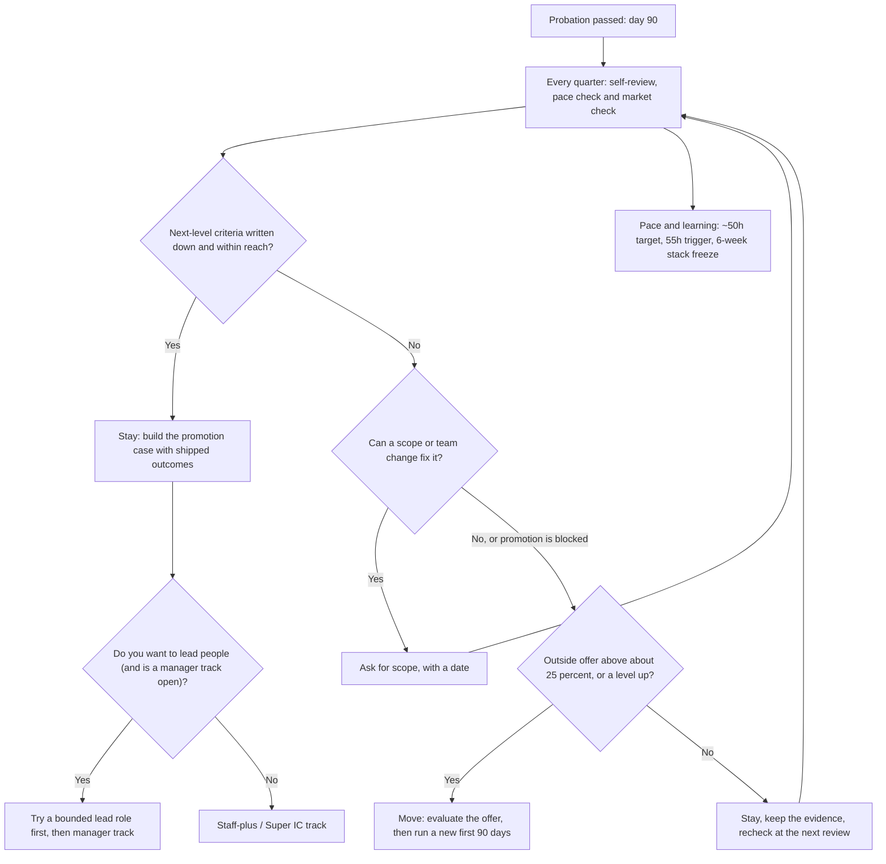

# Growth and Progression After the First 90 Days

> After the first 90 days: how promotion and levelling pay in GenAI careers, when a move beats staying, navigating thinning management tracks and Staff+ inflection, avoiding the 10x AI-productivity trap, and managing burnout and sustainable pace.

**Dates and grades.** Pay and levelling anchors come from [T0-17](../../research/sessions/T0-17-compensation-progression-plateaus-equity.md) (`2026-10-23`), refreshed by [T0-44](../../research/sessions/T0-44-pay-us-uk-europe-singapore-gulf.md) and [T0-45](../../research/sessions/T0-45-pay-negotiation-india-city-employer.md) (`2026-11-13`), [T0-65](../../research/sessions/T0-65-role-group-ai-leadership.md) (`2026-11-13`, AI leadership progression) and [T0-71](../../research/sessions/T0-71-onboarding-growth-ai-roles.md) (`2026-11-13`, cross-dataset promotion rates, thinning management layers, AI-tool productivity attenuation, occupational-health and GenAI burnout research; 14 of 84 sources opened in full and 70 read as extracts, with COI marked on Anthropic studies and employer reports). Re-verify by `2027-01-19`. The hop-or-stay rule comes from [T1-03](../../research/sessions/T1-03-interview-execution-offer-negotiation.md); reasons for leaving from [T0-09](../../research/sessions/T0-09-onboarding-probation-first-90-days.md) and [T0-71](../../research/sessions/T0-71-onboarding-growth-ai-roles.md); the learning routine from [T0-12](../../research/sessions/T0-12-high-signal-communities-technical-visibility.md) and [T0-06](../../research/sessions/T0-06-career-transition-timelines-5-backgrounds.md). [Errata](../../research/ERRATA.md) U4, U5, U14, U29 (`Pave 8.6%` half-year window), U30 (`SignalFire` leadership attribution), U45 (`EleutherAI` membership) and U47 (India Staff `₹1.2Cr` top-employer pay and CAIO prevalence) are applied. **Grades** (EGP-1.0): A primary or measured; B transparent secondary; C vendor, practitioner or single source; D judgement; E no evidence found after searching; M model output; P practice-curated and unmeasured.

## The short answer

1. **A promotion pays less than the gap between level medians, and promotion rates depend sharply on definition and window.** US level medians step ×1.2–1.5 per level [B · T0-17 L129], whereas promotion raises span `7.7%` (Pave R&D H1 2026) to `22.3%` (Ravio EU 2025) [B · T0-71 L71, L203–205], and T0-17's `16–24%` total-comp estimate is a triangulation rather than a traced standalone measure [C · T0-17 L115; T0-71 L210]. *Erratum fixed:* Pave's `8.6%` promotion rate is a **half-year** figure (H1 2025 and H1 2026), not annual; across datasets annual rates run from `4.0%` (Ravio EU) to `14.9%` (Pave US 2024) [B · T0-71 L71, L198–202, L301]. In India, nearly one in three workers who received a title change in two years got no raise or under `5%` (`n = 2,533`) [C · T0-71 L71, L206].
2. **Move only when the premium clears about 25% or promotion is blocked.** Same-tier lateral moves pay about +15–25% in total compensation and level-up moves +35–50%. "35–50% per hop" fails as a general rule; it describes tier-crossers [A/B/C · T0-17.F1; A/B/C · T1-03.F7].
3. **The AI premium grows with level, but independent AI promotion speed is still unmeasured.** The premium over non-AI engineers rises from 6.2% at Entry to 18.7% at Staff [B · T0-17 L130]. Still no independent dataset compares months per level for AI and non-AI engineers [E · T0-17 L122; T0-71 L315]; T0-17's `"8.6 years to Senior"` snippet was untraceable in T0-71, while SignalFire's proprietary dataset gives `2.1` years between promotions at startups against `3.18` at IBM and `3.07–5.37` years to senior among survivors [C · T0-71 L72, L207–208, L302].
4. **Choose IC or manager as management layers thin, and test a bounded lead role first.** *Erratum fixed:* SignalFire's primary text names **data engineering and DevOps** fastest to leadership (`2–3` years); `"AI engineers under 3 years"` comes only from CIO Dive's reading of a chart, and leadership ≠ people management [C · T0-71 L219, L303]. Management spans are widening (`~12` engineers per manager at Tech Majors from `10`, `~15` at startups) alongside `"Super IC"` roles [C · T0-71 L73, L214].
5. **Read growth, pay and work-life balance together — and never promise "10×" AI multipliers.** India retention surveys are mixed: Wisemonk (`n ≥ 200`, COI) puts no growth (`39%`) first, foundit June puts pay (`~40%`) slightly ahead of growth (`~37%`), foundit November (`n = 9,951`) puts growth (`40.3%`) ahead of pay (`29.7%`) as the top switch trigger while work-life balance leads priorities (`29.6%`), and Randstad 2026 puts work-life balance (`49%`) first [C · T0-71 L69, L145–151]. On AI coding speed, no controlled study backs `"10×"`: commits jump `30–240%` while releases rise `~30%` (NBER WP 35275) [B · T0-71 L66–67, L175].
6. **Protect sustainable pace: long hours and AI-driven intensification carry measurable health and burnout risk.** WHO/ILO links `≥55` hours/week to `+35%` stroke and `+17%` ischaemic-heart-disease death risk [A · T0-71 L74, L225], and Feng, Afroz & Sarma (`ICSE-SEIS 2026`, `n = 442`) link GenAI job demands to burnout (`β = 0.40`) while autonomy and learning resources protect (`β = −0.36`) [B · T0-71 L74, L227]. Aim near `50` hours/week, set a review trigger at `55`, freeze stack choices six weeks at a time, and keep one rest day [A/B/P · T0-71 L90, L237–242].

## At a glance



The 25% threshold and the blocked-promotion rule are T1-03's [A/B/C · T1-03.F7]. The bounded-lead test and 55-hour review trigger draw on T0-71 [A/B/C/P · T0-71 L90, L92]; the quarterly cadence is [P].

## How levels and pay progress

### The US ladder: measured anchors

US all-company medians step ×1.2–1.5 per level from Entry to Principal, and the AI premium over non-AI engineers rises from 6.2% at Entry to 18.7% at Staff (Levels.fyi 2025 data and Q3 2025 analysis) [B · T0-17 L129–L130]. The ladder itself, with every median, step and date, is in [pay benchmarks: the US all-company ladder](../09-compensation/pay-benchmarks.md#us-all-company-ladder); role and regional figures are on the same page.

**Time in level.** Still no independent AI-specific dataset exists [E · T0-17 L122; T0-71 L315]. The proxies:
- SignalFire's proprietary profile dataset reports `2.1` years between promotions at startups versus `3.18` years at IBM, and `3.07` years (top-tier graduates) to `5.37` years (no listed degree) to reach Senior among survivors who reached that level (does not isolate AI engineers) [C · T0-71 L72, L207–208, L488].
- T0-17's search snippet quoting `"8.6 years of experience"` to Senior on Levels.fyi could not be independently traced in T0-71 [C/E · T0-17 L123; T0-71 L302].
- Anthropic's Levels.fyi page lists Senior at 6–8 years of experience and Lead at 7–8 (n = 49) [B · T0-17 L123].
- Community timelines at Google-style levels: L3→L4 about 1–2 years, L4→L5 about 2–4, L5→L6 about 3–5+ or never; many treat Meta's E5 as a de facto terminal level [C/D · T0-17 L124].

### What a promotion and a stay are worth

Promotion rates and raises vary widely by dataset, definition (title change versus level jump) and time window [B · T0-71 L71, L198–210]:

| Measure | Value | Population and window | Grade · source |
|---|---|---|---|
| Promotion rate (annual) | `4.0%` (Ravio EU 2025); `5.0%` (Mercer global 2025, `5.5%` in 2024); `10.3%` (Gusto US payroll, May 2025); `14.9%` (Pave US, 2024) | Cross-market annual ranges | B · T0-71 L198–202 |
| Promotion rate (half-year — *erratum fixed*) | `8.6%` (`10.7%` at 1–200-employee firms) | Pave H1 2025 and H1 2026 (`200+` firms, `>100k` staff) — **half-year window**, not annual (correcting T0-17 L125) | B · T0-71 L200, L301, L491 |
| Base raise at promotion | `6.5%` AI/ML vs `7.7%` R&D (Pave H1 2026, down from `9.9%` in 2025); `~8–9%` (Mercer 2025); `22.3%` (Ravio EU tech average 2025) | AI/ML non-promoted raises led R&D (`4.4%`, Pave), while promoted base jumps sat near bottom | B · T0-17 L115, L125; T0-71 L203–205 |
| Title without raise (India) | Nearly `1 in 3` who got a title change in two years received `0%` or `<5%`; `52%` would pick higher pay over a better title; `~60%` say title does not match pay | Indeed India / Valuvox (`n = 2,533` employees, May–Jun 2026) | C · T0-71 L71, L206 |

- **Total compensation on promotion.** T0-17 triangulates a promotion at about `16–24%` in total compensation when equity (30–50% of pay) rises `39%` on promotion [C · T0-17 L115]; T0-71 notes this `16–24%` range is a triangulation rather than a traced standalone survey measure [T0-71 L210, L301].
- **The level gap.** The Senior→Staff step between US level medians is ×1.46, larger than a single promotion jump. T0-17 reads the gap (roughly 22–30 percentage points for Senior→Staff and 14–22 for Engineer→Senior) as the upper bound an external move can capture [C · T0-17 L115].
- **A median stayer year.** Pave's median merit raise drifted from `3.6%` to `3.5%` to `3.4%` (`2024–2026`). *Erratum note:* T0-17 L117 modelled ~5% expected annual stayer growth by plugging Pave's half-year `0.086` into an annual formula; using full-year rates (`4–15%`) yields roughly `4–7%` expected total-comp growth for a median stayer and `9–12%` on promotion track [M · T0-17 L117; B · T0-71 L198–202].

### Outside the US, and at frontier labs

- **India.** Greater Bengaluru Senior SWE median is **₹56.1L** and P90 is **₹1.06Cr** (Levels.fyi, `n = 4,752`, `2026-11-11`) [B · T0-45 L107]. `₹1.2Cr` sits above the all-employer Senior P90, **not** above top-employer Staff packages: Amazon L6 reaches **₹1.38Cr**, Google L6 **₹2.32Cr** and Google L7 **₹3.37Cr** (correcting T0-17's earlier universal-ceiling claim [B · T0-45 L320, L396; ERRATA U47]). Full distributions live in [pay benchmarks: India](../09-compensation/pay-benchmarks.md#india-by-city-level-and-employer) (do not use unmeasured "T2/T3" bands [errata U14]). Appraisal and review rules are tightening in services: Accenture's `2026-02-20` internal memo records AI-platform usage in senior-manager and associate-director promotions [C · T0-71 L129], Infosys runs an Oct–Sep appraisal calendar and TCS resumed April hikes [C · T0-71 L161], and Mint/Upstox reported TCS asking managers to identify `~5%` of staff for its lowest band/PIP (unverified against TCS) [C · T0-71 L162]. Frontier-AI attrition in India is reported at `21–45%` versus `5–12%` in enterprise roles (AIM, method undisclosed) [C · T0-71 L149], while a self-selected Blind India poll (`n = 1,552`, July 2026) found `66%` of AI/ML respondents expecting team headcount cuts within 3–6 months [C · T0-71 L348].
- **Europe and UK.** Ravio reports a `4.0%` European tech promotion rate and `22.3%` average raise at promotion (2025) [B · T0-71 L198, L205]; Europe-specific time-in-level data remain absent [E · T0-17 L145]. London Senior SWE sits at `£122–123K` median (`P75 £170K`, `P90 £221–226K` [C · T0-17 L143]); full UK and European bands are in [pay benchmarks](../09-compensation/pay-benchmarks.md#uk-europe-singapore-and-the-gcc).
- **Frontier labs.** Headline Levels.fyi medians run ×2.0 (Anthropic Senior) to ×2.9 (OpenAI L5) of the US all-company Senior median, and ×2.8 (OpenAI L6) to ×3.1 (Anthropic Staff) at Staff; treat lab medians as ±30–50% [C · T0-17 L131–132]. After equity risk-adjustment, an OpenAI-L6-like package is ≈ ×1.7–2.4 of the all-company Staff median [C · T0-17 L133]. The largest single OpenAI step is L3→L4, ×2.2 [B · T0-17 L131].

## Hop or stay: the decision table

The money rule, and what each kind of move pays, belong to [offer evaluation: hop or stay](../09-compensation/offer-evaluation.md#hop-or-stay). In short: stay while promotion is within reach and outside offers at your level clear less than about 25%; move when the risk-adjusted premium clears about 25%, when the offer is a level up (≈ +35–50%), or when promotion is blocked by no scope, no budget or a level many treat as terminal [A/B/C · T1-03.F7; A/B/C · T0-17.F1]. Before you act on that rule, check the timing and the job, not only the number:

| If… | Lean | Why |
|---|---|---|
| A tender eligibility date or a large vest is close | Time the move | Frontier-lab tenders use 1–2-year tenure gates and dollar caps [A/B · T0-17.F8] |
| The new employer is a startup where an acqui-hire is plausible | Read the carve-outs | In the 2025 Windsurf deal, employees hired within the prior year reportedly received no payout [B · T0-17 L180] |
| Pay is your only complaint | Get a level-matched market number and ask internally first [P] | India surveys are mixed — Wisemonk (`39%` no growth) and foundit Nov (`40.3%` growth trigger) lead with growth, while foundit Jun puts pay (`~40%`) slightly ahead and Randstad ranks work-life balance (`49%`) first [C · T0-71 L69, L145–151] |
| You received a title change with `<5%` raise | Treat it as a market-check trigger [P] | Nearly 1 in 3 title-changed Indian workers received `0%` or `<5%` (`n = 2,533`) [C · T0-71 L206] |
| Any external move | Price in the reset | External hires were paid about 18% more than internal promotees but performed worse early and left sooner (about 5,000 investment-bank employees; non-tech, older) [A · T0-17 L113] |

**Background, not rules.**
- Economy-wide, ADP's September 2026 release puts job-changers at +4.8% base pay growth against +3.0% for stayers, across all industries [A · T0-17 L112]. The Atlanta Fed tracker had switchers at 4.8% against 4.6% for stayers in early 2025, the narrowest gap in about a decade [B · T0-17 L112].
- Levels.fyi's coaching cohort shows median improvements of about 21% (mid), 23% (senior) and 24% (staff). The buyers are self-selected, and the figures cover negotiation of any offer, not only job changes [B · T0-17 L114].
- "+35–50% every two years" would compound to ×4.5–7.6 over ten years, yet Levels.fyi medians rise only ×3.6 from Entry to Principal [C · T0-17 L116].
- If you might leave before a grant vests, discount the grant for attrition as [offer evaluation](../09-compensation/offer-evaluation.md#adjustment-2-vesting-cliff-and-forfeiture) shows.

## IC or manager: Staff+ inflection and decision questions

**What the evidence says (November 2026):**
- **Management tracks are flattening while Staff+ / "Super IC" scope expands.** SignalFire's 2026 report puts spans at about `12` engineers per manager at Tech Majors (up from `10`) and about `15` at startups, with thinner senior management and `"Super IC"` roles carrying manager-scale scope [C · T0-71 L73, L214]. Anthropic's October 2026 employer report similarly shows about `17` engineers per product manager, managers committing code roughly twice as often, and ICs orchestrating coding agents needing manager-like scoping [B, COI · T0-71 L215].
- **SignalFire erratum corrected (`T0-17 L126`).** SignalFire's primary text names **data engineering and DevOps** as fastest to leadership (`2–3` years); the `"AI engineers in under three years"` line appears only in CIO Dive's description of a chart, and `"leadership"` is not synonymous with people management [C · T0-71 L219, L303].
- **Strong ICs do not automatically make strong managers.** Benson, Li & Shue (`QJE 2019`, sales workers) found firms weight current IC performance heavily in promotion while managerial quality of marginally promoted workers fell as pre-promotion IC output rose (transfer to engineering untested) [B · T0-71 L217]. Test management via a bounded tech-lead or acting-lead assignment first [C/B · T0-71 L92].
- **Published public ladders and thinner junior pipelines.** Two primary public ladders show what formal criteria measure: **GitLab's Handbook ML Engineering ladder** (modified `2026-10-30`) sets five IC levels (`Associate` to `Staff`, 1/2/3/5+ yr bars or MS/PhD) plus a parallel `Engineering Manager ML` track, requires Tier 2/3 weekday/weekend/occasional night on-call from Intermediate upward, tracks backend unit-test coverage, MR review time and MR age, and expects daily AI workflow integration [A · T0-71 L121, L218]; the **UK Government Digital & Data ML Engineer framework** (updated `2026-08-28`) defines Senior and Lead across six Practitioner/Expert skills centred on customising, deploying and assuring models across the lifecycle [A · T0-71 L120]. Practitioners also treat evaluation design as a clear IC seniority signal [C · T0-09 L429]. Meanwhile junior hiring tightened at AI-adopting firms (`−7.7%` to `−9%` relative drop across `62M` US workers in Harvard's study; `27%→9%` of technical hires at Anthropic, COI [B · T0-71 L215–216, L518]), shrinking the pool of junior reports for first-time managers. T0-17, T0-09 and T0-71 do not compare IC versus manager pay for AI roles; see the [AI Engineering Manager hub](../02-roles/hubs/ai-engineering-manager.md).
- **Leadership prerequisites and title traps (`T0-65`).**
  - **AI Engineering Manager:** Text-visible postings require **8+ years engineering and 2–6 (median 3) years managing** (`n = 8`, technical leadership and stakeholder partnership 6/8; 0/8 name certifications; Anthropic platform/eval EM postings require no research background) [A/M · T0-65 L71, L127]. In India, verify team size and reporting scope: Big-4 **"Manager"** titles are often consulting IC grades rather than people-management roles (e.g. Deloitte req 101515 lists designation *Manager* for a *Generative AI Engineer* role) [B · T0-65 L131, L718].
  - **VP / Head of AI:** Splits into two distinct tracks — hands-on **player-coach** (`5/11` text-visible postings; `6/11` reporting to CEO or CTO) versus **strategy and enablement lead** (leading portfolio governance without direct authority, e.g. Accela) [A/M · T0-65 L72]. Confirm reporting line, headcount and budget before accepting a "Head of AI" title to avoid solo-IC title inflation [D · T0-65 L87].
  - **Chief AI Officer (CAIO):** Rarely filled via open postings (only 2 dated in-window employer postings found: SBI GM & CAIO and UCSF Health); most appointments are internal moves or dual-hatted executives [B/C · T0-65 L67]. Named CAIO counts among large US firms sit at **10.7%** (`71` of `665` Fortune 500/S&P 500, Crist Kolder [B]) — sharply below IBM's **76%** CEO survey self-report (`n = 2,000`, survey vs counted title difference [A/B · T0-65 L66; ERRATA U47]) — and US federal OMB M-25-21 designates existing officials rather than creating an open hiring wave [A · T0-65 L65].

Answer these before you accept or ask for a management role [P]:

| Question | If yes | If no |
|---|---|---|
| Do you want your results to come through other people's work: hiring, 1:1s, reviews, unblocking? | The manager track fits | Stay IC |
| Does your employer publish written Staff and Principal IC criteria (and keep Staff+ / Super IC scope open)? | The IC path has a next step | The IC ceiling may sit at Senior: weigh the manager track or a move |
| Are you choosing management to escape a stalled IC track? | Fix the stall first: scope, team or manager | Continue |
| Do you still want to own technical calls such as eval design and architecture? | Stay IC, or take a tech-lead role | The manager track fits |
| Can you try it reversibly, as a bounded tech lead or acting manager? | Try before you switch [C/B · T0-71 L92] | Ask what the way back looks like |

Leadership roles beyond line management: [VP or Head of AI](../02-roles/hubs/vp-head-of-ai.md), [Chief AI Officer](../02-roles/hubs/chief-ai-officer.md) and [Fractional AI Leader](../02-roles/hubs/fractional-ai-leader.md). Profile: [AI Engineering Manager in the role catalog](../02-roles/role-catalog.md#profile-ai-engineering-manager).

## How to do it

1. **Get the next-level criteria and appraisal calendar in writing** within a month of confirmation [C/P · T0-71 L91, L271]. *Done when:* you hold your employer's ladder text for your level and the next, know the exact cycle dates (especially in India), and your manager has said which criteria you meet.
2. **Run a quarterly self-review** (GitLab's handbook recommends a career development conversation at least quarterly [B · T0-71 L122]) with the template below [P]. *Done when:* every next-level criterion has linked evidence or a dated plan.
3. **Check the market every quarter** against level-matched medians in [Pay benchmarks](../09-compensation/pay-benchmarks.md) [P]. *Done when:* you know your gap to the level median, in percent.
4. **Ask for scope, not a title,** when the case is thin [P]. *Done when:* your manager has agreed a project that maps to a missing criterion, with a date. If criteria are unpublished or no path exists after two review cycles, treat that as a finding [C · T0-71 L91].
5. **Decide stay or move at most twice a year,** with the decision table [P]. *Done when:* the decision and its numbers are written down.
6. **Keep the first-90-days habits:** a weekly written update, a decision log and measured shipped outcomes rather than code-volume counts [D · T0-09 L193, L255; B · T0-71 L89]. *Done when:* a promotion packet can be assembled from existing artefacts.
7. **Run the pace check and learning loop** (below). *Done when:* hours stay near 50/week (triggering review at 55) and the 90-day learning check passes [A/B/P · T0-71 L90; D · T0-12 L175].

### Two-year milestones

Synthesis from [T0-71 §8](../../research/sessions/T0-71-onboarding-growth-ai-roles.md) [B/C/P · T0-71 L267–275]; adjust to your employer's ladder and review calendar.

| Window | Milestone | Tag | Failure mode |
|---|---|---|---|
| **Months 4–6** | Own one production component with explicit quality gates; lead a blameless postmortem | P | Owning without decision authority |
| **Months 6–9** | Widen scope across teams; mentor a newer joiner; document architecture and evals | B (mentoring) / C (ladders) | Cross-team scope without a sponsor |
| **Months 9–12** | First formal appraisal cycle: evidence log, level criteria, timeline (confirm cycle dates in India) | C | Opaque cycle or title change without raise |
| **Months 12–18** | Promotion case or stay/move decision (SignalFire reports `2.1` yrs between promotions at startups vs `3.18` at IBM, though stability varies) | C | Moving into a new probation without a `~25%` premium or level-up |
| **Months 18–24** | Track choice: test a bounded tech-lead or project-lead role versus Staff-scope IC | C/B | Mismatched move into people management |
| **Throughout** | Protect debugging and review judgement by doing some core work without AI assistance; keep sustained hours near `50` and a weekly rest day | A/B/P | Skill erosion from blind delegation; cultural pressure toward `70+` hours |

## AI-tool productivity and avoiding the "10×" trap

Controlled studies and large-scale telemetry show real but bounded gains that **attenuate sharply before software actually ships**, and **no evidence supports a "10× engineer with AI"** [B/E · T0-71 L66–68, L169–181]:

| Study | Design and sample | Measured finding | Grade · source |
|---|---|---|---|
| Peng et al. (2023, cited via Google) | Lab-style Copilot task (`n = 95`) | `~+56%` faster on a bounded server task | B · T0-71 L169 |
| Cui et al. (*Management Science* 2025) | Three field RCTs (`n = 4,867`, 2022–23 tools) | `+26.08%` completed tasks (`SE 10.3`); less experienced developers gained more | B · T0-71 L170 |
| Paradis et al. (Google 2024) | Enterprise RCT (`n = 96`, one complex task) | `~+21%` faster (wide interval); senior and heavier coders faster | B · T0-71 L171 |
| METR (early 2025 & Feb 2026) | Task RCT on expert OSS maintainers (`n = 16`, 246 tasks; follow-up `n = 57`, 800+ tasks) | Early 2025: **`+19%` slower** (devs forecast `24%` faster). Feb 2026 follow-up (`−18%` returning, `−4%` new, every interval spanning zero) was **compromised by selection effects** (`30–50%` withheld tasks); METR calls the signal unreliable | B · T0-71 L172–173, L499 |
| Demirer, Musolff & Yang (`NBER WP 35275`, May 2026) | Matched GitHub event study (`100k+` devs; working paper) | Commits rose **`+30% / +180% / +240%`** (or `40 / 140 / 180%` PDF) across autocomplete, interactive and autonomous agents, **attenuating to `+80%` projects and `~+30%` releases** (elasticity `0.23–0.25`, strong complements) | B · T0-71 L66, L175 |
| METR survey (`2026-05-11`) | Convenience self-report (`n = 349`, ~2% response) | Median **`1.4–2×` value** (`3×` speed). Only `7` claimed `≥10×`; the `2` checked against public outputs were judged **overstated**. The `"10×"` label traces to a 1968 study unrelated to AI | B / E · T0-71 L67, L174 |
| Anthropic learning RCT (`2026-01-29`, COI) | Controlled study learning a new library (`n = 52`, mostly junior) | AI group scored **`50%` vs `67%`** on a comprehension quiz (`d = 0.74`, `p = 0.01`, ~2 min faster, non-significant); delegating code/debugging scored `<40%` vs `≥65%` for conceptual questioning | B, COI · T0-71 L68, L177 |
| Anthropic internal data (`2026-10-16`, COI) | Staggered adoption (`192` adopters, `74` non-adopters) | Commits per engineer `~5×` over six months; authors themselves warn **more code is not more impact** | B, COI · T0-71 L178 |

**What this means for progression:**
- **Report before-and-after shipped outcomes, never multipliers.** Count merged features that users rely on, latency/cost cuts and eval gains — not commits or token volume, which invite `"tokenmaxxing"` Goodhart effects [B · T0-71 L89, L350].
- **Protect long-term debugging judgement.** Periodically write and debug critical paths without AI delegation, and use comprehension-seeking prompts when entering unfamiliar domains, so AI speed does not hollow out the systems judgement required for Staff+ reviews [B/inference · T0-71 L68, L274].

## Burnout, workload and sustainable pace

Long working hours and AI-driven work intensification carry documented health and burnout risks. **Honest scope gap:** no AI-engineer-specific burnout prevalence dataset and no ML/LLM-specific on-call load measurement were found [E · T0-71 L235, L317]; the evidence below comes from large occupational-health reviews, 2026 software-developer studies and employer handbooks [A/B/C · T0-71 L74, L225–234]:

| Evidence | Finding | Transfer | Grade · source |
|---|---|---|---|
| **WHO / ILO systematic reviews (2021)** | Working **`≥55` hours/week** vs `35–40` hours is linked to **`+35%` higher stroke death risk** (`22` studies, `>839k` people) and **`+17%` ischaemic-heart-disease death risk** (`37` studies, `>768k` people) | General workforce | A · T0-71 L74, L225, L511 |
| **Pencavel (2015)** | Output scales with hours below **`~49` hours/week**, then flattens (`70` hours differs little from `56`) | Low (WWI munitions, observational) | B · T0-71 L226 |
| **Feng, Afroz & Sarma (`ICSE-SEIS 2026`)** | Survey of `442` developers (`14.9%` data/ML engineers): **job demands from GenAI adoption** (organisational pressure, workload) correlate with burnout (**`β = 0.40`**), while **autonomy and learning resources protect** (**`β = −0.36`**). Burnout did not vary by role, seniority or org size; **`22.4%`** of `361` open responses reported no meaningful learning support (cross-sectional, association not causation) | Medium (OSS & professional devs) | B · T0-71 L74, L227, L513 |
| **Haas ethnography (2026)** | 8-month study of a `~200`-person US tech firm (`40+` interviews): voluntary AI tool use drove faster pace, broader scope, longer hours and burnout risk (in-progress research) | Medium | B · T0-71 L228 |
| **Anthropic employer report (`2026-10-16`, COI)** | Human attention becomes the bottleneck: Claude sessions spend `~80%` idle waiting for input, meta-work rose `10% → 22%`, and the median employee spends **`+20%` more time in meetings** (no burnout measure) | One frontier lab (COI) | B, COI · T0-71 L229 |
| **996-style startup reports** | Some San Francisco and New York AI startups advertise `70+` or `80+` hour norms; prevalence unmeasured | SF/NY startups only | C · T0-71 L230 |
| **India work-life balance signal** | Randstad 2026 ranks work-life balance the `#1` reason Indian employees leave (`49%`, ahead of lack of growth `42%` and low pay `41%`); foundit Nov 2026 (`n = 9,951`) ranks work-life balance `#1` priority (`29.6%`) | India cross-industry | C · T0-71 L147–148, L231 |
| **On-call reference points** | GitLab requires Tier 2/3 weekday, weekend and occasional night on-call for ML engineers from Intermediate upward [A]; Google SRE reference practice caps on-call at `≤25%` of time, engineering at `≥50%` and `≤2` incidents per 12h shift [P] | GitLab ML / Google SRE | A / P · T0-71 L121, L232–233 |

**Safeguards for a sustainable pace** (`T0-71 L90, L237–242`):
- **Keep sustained hours near `50` a week, set a hard review trigger at `55`, and protect one full rest day a week** [A for health risk; P for target and trigger]. If an employer expects `70–80+` hours as cultural proof, choose that environment knowingly rather than drifting into it.
- **Ask explicitly for AI autonomy and dedicated learning time** — the two resources empirically associated with lower GenAI-adoption burnout (`β = −0.36`) [B · T0-71 L227, L242].
- **Manage AI-review overload:** declare when AI generated a change, segment large AI-written PRs, and budget dedicated review time [P · T0-71 L241].
- **Negotiate on-call terms before accepting:** ask for rota size, pager volume, and compensation or time off in lieu [P · T0-71 L90, L240].
- **Treat persistent exhaustion as a health signal:** raise scope with your manager early, pause optional community slots first, and consult a health professional if exhaustion affects your health [P].

## A sustainable learning routine

T0-12 built this routine for an India-based engineer looking for AI-engineering roles, with roughly six hours a week; the hours are illustrative and the weighting is judgement [C · T0-12 L143]. Using it while employed is an adaptation [P]: remember that `17.5` study hours a week consumes `56–74%` of an employed adult's average leisure [M · T0-06 L213], so put learning inside working hours where allowed and drop community slots before you drop rest.

| Cadence | Activity | Evidence |
|---|---|---|
| Weekly | One conversational community, such as Latent Space Discord and its weekly LLM Paper Club; after 4–6 weeks of attending, volunteer to facilitate a paper | [B · T0-12 L149] |
| Weekly | One depth community matched to your track: GPU MODE for kernels and performance, or vLLM for inference serving *(note: EleutherAI lists no open general-membership route [ERRATA U45; T0-21 L183–210])* | [B · T0-12 L150; ERRATA U45] |
| Every 2–3 weeks | One substantive technical post, shared with context in each community's designated channel | The cadence is judgement, with anecdotal support only [C · T0-12 L152] |
| Monthly | A demo-first local meetup: AI Tinkerers, or Fifth Elephant meetups in Bengaluru, Hyderabad or Pune | [B/C · T0-12 L153] |
| Every six weeks | Review stack choices, and change them only at that boundary | API surfaces such as AI SDK 6 and WebMCP changed shape within months [D · T0-06 L254] |
| Passive | smol.ai AINews for summaries of AI Discords | [B/C · T0-12 L155] |
| Every 90 days | Check: six or more public artefacts, ten or more two-way technical exchanges with named practitioners, and any inbound that cites your work. Drop a community after 4–6 weeks with no two-way exchange | Heuristics [D · T0-12 L172–175] |

**Inside the job.** Owning an eval suite, a judge or a cost dashboard is both learning and promotion evidence; practitioners treat evals as the clearest seniority signal [C · T0-09 L429]. For what to learn next, use [Learning roadmaps](../03-skills-and-tech/learning-roadmaps.md) and the [Skills radar](../03-skills-and-tech/skills-radar.md).

## Warning signs and responses

| Signal | What the evidence says | Response |
|---|---|---|
| The same scope for two reviews in a row (threshold [P]) | No growth led Wisemonk (`39%`, COI) and foundit Nov (`40.3%` top switch trigger, `n = 9,951`) [C · T0-71 L145, L147] | Propose a scope change with a date; if refused or criteria stay unpublished after two cycles, run the decision table [C · T0-71 L91] |
| A title promotion with `<5%` raise | Nearly 1 in 3 title-changed Indian employees received `0%` or `<5%` (`n = 2,533`); AI/ML promoted base raises averaged `6.5%` on Pave [B · T0-17 L125; C · T0-71 L206] | Compare total compensation including equity; run a market check |
| The role differs from the one you accepted | "Broken promises" in scope, ownership or growth path were named by `19%` in Wisemonk's India survey [C · T0-09 L387] | Document neutrally and renegotiate scope, as in [First 90 days](first-90-days.md) |
| Poor management or lowest-band quota risk | Poor management named by `18%` [C · T0-09 L83]; TCS reportedly asked managers to flag `~5%` for lowest rating/PIP (unverified) [C · T0-71 L162] | Keep a written evidence log of shipped outcomes; pursue a skip-level conversation or internal transfer [P] |
| A long plateau at Senior | L5→L6 can take 3–5+ years or never happen; many treat Meta's E5 as terminal [C/D · T0-17 L124] | Seek Staff-scope / Super IC work, or weigh a level-up move |
| Local pay compression in India outside top tiers | Bengaluru Senior SWE P90 is ₹1.06Cr (`n = 4,752`), while top-employer Staff clears ₹1.2Cr (Amazon L6 ₹1.38Cr, Google L6 ₹2.32Cr); outside Big Tech and top product/GCC tiers, local progression flattens [B · T0-45 L107, L320, L396; ERRATA U47] | Benchmark top-tier local employers or see the [India remote playbook](../11-tracks/india-remote-playbook.md) |
| Reviews that count AI usage volume or "tokenmaxxing" | Meta, Microsoft, Google, Shopify, GitLab and Accenture write AI use into expectations; leaderboards invite Goodhart effects while NBER shows commits outrun releases [B/C · T0-71 L65–66, L350] | Agree outcome metrics; record where AI did and did not help with measured shipped data |
| Anxiety about stack churn | API surfaces such as AI SDK 6 and WebMCP changed shape within months [D · T0-06 L254] | A six-week freeze; durable concepts |
| Sustained `≥55`-hour weeks, rising meetings or AI-intensified exhaustion | WHO/ILO links `≥55` h/week to `+35%` stroke / `+17%` IHD mortality [A]; ICSE-SEIS 2026 links GenAI job demands to burnout (`β = 0.40`) while autonomy/learning protect (`β = −0.36`) [B · T0-71 L74, L225–229] | Trigger a scope review at 55h, negotiate AI autonomy and learning time, pause optional community slots, and consult a health professional if health is affected |

## Templates and examples

### Quarterly self-review [P]

```text
Quarterly self-review: [quarter], [level], [months in level]
1. Outcomes shipped, with measured numbers: [outcome], [metric], [interval], [n]
2. Scope: [what I own]; [who depends on it]
3. Next-level criteria [link to ladder]
   - [criterion]: evidence [link] or plan [project, date]
4. Growth: [skill applied in production]; [durable concept learned]; [core work done without AI delegation]
5. Market check: my total compensation [ ]; level-matched median [ ]; gap [ ]%
6. Signals: growth stall [y/n]; promises kept [y/n]; manager support [y/n]
7. Pace check: average hours a week [ ] (trigger >=55); rest day kept [y/n]; on-call weeks [ ]; AI autonomy & learning time [y/n]
8. Decision: stay and build / ask for scope / internal move / explore outside, by [date]
```

### Promotion case, one page [P]

```text
Promotion case: [name], [current level] to [next level], [date]
Scope: [systems or features owned]; [teams that depend on them]
Criterion 1 [from the ladder]: [outcome], [measured result], [link]
Criterion 2 [from the ladder]: [outcome], [measured result], [link]
Criterion 3 [from the ladder]: [outcome], [measured result], [link]
Operating evidence: [runbooks], [postmortems led], [evals or judges owned and recalibrated]
Influence: [designs adopted], [people mentored], [reviews given]
Gaps and plan: [criterion], [project], [date]
```

### Move decision worksheet [P]

```text
Move decision: [offer] against staying, [date]
Level: [same / up]. Tier: [same / up]
Offer total compensation, private equity risk-adjusted: [ ]
My total compensation: [ ]. Premium: [ ]%
Forfeited by leaving: unvested equity [ ]; refreshers [ ]; tender eligibility [ ]
Promotion within reach at my next cycle: [y/n], evidence [ ]
Rule (T1-03.F7): move if the premium is above about 25%, the offer is a level up, or promotion is blocked
Reset cost: a new first 90 days; notice period [ ]; on-call & hours norms [ ]
Decision: [ ]
```

### Weak and strong [P]

| Situation | Weak | Strong |
|---|---|---|
| Promotion ask | "I've been here [n] years and shipped 5× more commits with AI." | "Against the Senior criteria [link], here are three shipped outcomes with measured results [links]. The gap is [criterion]. Can we agree [project] by [date] to close it?" |
| Retention talk | "Another company offered me more." | "A level-matched offer is [x]% above my total compensation after risk-adjusting its equity, and I would forfeit [amount] unvested. I would rather stay if [scope or level] is possible by [date]." |
| Workload / AI pace | "I'm burning out trying to keep up with AI tools." | "Weekly hours have averaged [58] over three weeks and review load doubled. Let's re-scope [project], reserve [N] hours for learning/evals and segment AI-generated PRs." |
| Learning plan | "I'll keep up with every new framework." | "For six weeks I'm on [stack]; I'm learning [durable concept] and shipping [artefact] by [date]." |

## Checklist

- [ ] Next-level criteria and appraisal cycle dates confirmed in writing within a month of confirmation
- [ ] Quarterly self-review completed and shared with your manager (using shipped outcomes, not commit volume or multipliers)
- [ ] Quarterly market check against level-matched medians, including the AI premium for your level
- [ ] Move math counts risk-adjusted equity, unvested grants, refreshers, tender gates and notice/hours norms
- [ ] IC-or-manager questions answered and a bounded lead role tested before committing to people management
- [ ] Sustained weekly hours tracked near 50, review trigger set at 55, one rest day protected, and on-call limits confirmed
- [ ] AI autonomy and dedicated learning time agreed; core review/debugging skills kept sharp without blind delegation
- [ ] Stack choices reviewed every six weeks; 90-day learning check run

## Pitfalls

| Red flag | Why it hurts | Fix |
|---|---|---|
| Expecting "35–50% per hop" | Fails as a general rule; describes tier-crossers and outliers [A/B/C · T0-17.F1] | Compare level-matched numbers |
| Treating Pave's 8.6% as an annual promotion rate or assuming every title jump pays | `8.6%` is a half-year window (annual rates span `4.0–14.9%`), and nearly 1 in 3 title-changed Indian workers got `<5%` [B/C · T0-71 L71, L200, L206] | Check both level criteria and total compensation before celebrating a title change |
| Promising "10×" AI speed or chasing commit leaderboards | No controlled study backs `10×`, commits outrun releases (`+30–240%` vs `~+30%`, NBER WP 35275), and leaderboards invite Goodhart effects [B · T0-71 L66–67, L350] | Measure and report before-and-after shipped outcomes |
| Working `70–80` hours to signal commitment | WHO/ILO links `≥55` h/week to `+35%` stroke / `+17%` IHD mortality, output flattens above `~49` h, and GenAI demands correlate with burnout (`β = 0.40`) [A/B · T0-71 L74, L225–227] | Hold a `50`h target and `55`h review trigger unless you explicitly choose a high-hours startup knowingly |
| Comparing base salary only or counting paper equity at face value | Equity is 30–50% of US total comp, secondary pricing is bimodal and an IPO is not immediate liquidity [A/B/C · T0-17.F7, F9, L115] | Risk-adjust private equity; see [Offer evaluation](../09-compensation/offer-evaluation.md) |
| Using the India "T2/T3" bands | Neither band set is measured [errata U14] | Use the measured Bengaluru anchors |
| Treating management as the default next step | Management layers are thinning (`12–15` eng/mgr), top ICs can make weaker managers (sales study), and no session shows management pays more for AI roles [B/C · T0-71 L73, L214, L217] | Test a bounded lead role first and answer the IC-or-manager questions [P] |
| Chasing every framework release | API surfaces change within months [D · T0-06 L254] | A six-week freeze; durable concepts |

## Evidence and limits

- **Measured:** US level medians and steps (Levels.fyi 2025) and AI premium by level [B · T0-17 L129–130]; Bengaluru Senior SWE distribution (`₹56.1L` median, `₹1.06Cr` P90, `n = 4,752`, `2026-11-11`) and top-employer Staff packages (Amazon L6 `₹1.38Cr`, Google L6 `₹2.32Cr`) [B · T0-45 L107, L320, L396; ERRATA U47]; ADP switcher/stayer pay growth [A · T0-17 L112]; cross-dataset promotion rates and raises across Pave (`H1 2025/2026` half-year and `2024` annual), Ravio EU, Mercer and Gusto [B · T0-71 L198–205]; WHO/ILO long-hours mortality reviews [A · T0-71 L225]; NBER WP 35275 commit-to-release attenuation (`100k+` GitHub devs, working paper) and Feng/Afroz/Sarma ICSE-SEIS 2026 GenAI burnout survey (`n = 442`, cross-sectional) [B · T0-71 L175, L227]; Harvard 62M-worker junior-hiring study [B · T0-71 L216, L518]; Crist Kolder `10.7%` Fortune/S&P 500 CAIO count and OMB M-25-21 text [A/B · T0-65 L65–66].
- **Errata corrected here (`ERRATA U29, U30, U45, U47`):** Pave's `8.6%` promotion rate is a **half-year** window (`H1 2025/2026`), not annual (`U29`); SignalFire's primary text names **data engineering and DevOps** fastest to leadership while `"AI engineers under 3 years"` is CIO Dive's chart reading and leadership ≠ management (`U30`); T0-17's `"8.6 years to Senior"` snippet was untraceable in T0-71; EleutherAI lists no open general-membership route (`U45`); top-employer India Staff clears `₹1.2Cr` and named CAIO prevalence (`10.7%`) must sit beside IBM's `76%` CEO survey (`U47`) [T0-71 L301–303; T0-45 L396; T0-65 L66].
- **Derived and single-source / COI:** T0-17's `16–24%` promotion total-comp value and hop ranges are triangulations [C · T0-17 L115, L119; T0-71 L210]; SignalFire spans and promotion speeds come from proprietary profiles [C · T0-71 L207–208, L214]; India retention surveys (Wisemonk COI, foundit Jun/Nov, Randstad, Valuvox) are Grade C vendor/staffing surveys with differing frames [C · T0-71 L145–151, L206]; Anthropic's learning RCT (`n = 52`) and employer report carry COI [B, COI · T0-71 L177–178, L215, L229]; T0-71 opened 14 of 84 sources in full (70 read as extracts) [T0-71 L46].
- **Not found after searching (E):** an independent AI-specific promotion-velocity / months-per-level dataset [E · T0-17 L122; T0-71 L315]; Europe time-in-level data [E · T0-17 L145]; a controlled systems-expertise pay premium [E · T0-17 L182]; an IC-versus-manager pay comparison for AI roles; **AI-engineer-specific burnout prevalence and ML/LLM-specific on-call load measurements** [E · T0-71 L235, L317]; any controlled evidence for `"10×"` AI coding multipliers [E · T0-71 L321].
- **Attrition context, not a forecast:** AI/ML annual attrition was **`21.8%` against `16.8%` for SWEs** in a 2026 Pave relay [C · T0-44 L326] (down from `≈ 28%` vs `≈ 17%` in Pave 2025 [B · T0-17 L125]); India GCC AI/Cloud attrition `18–25%` (Zinnov 2026) [B · T0-09 L67]; AIM India frontier-AI attrition `21–45%` vs `5–12%` enterprise (method undisclosed) [C · T0-71 L149].
- **Dates:** retained Phase 0 pay anchors compiled `2026-10-23`; leadership and progression/pace evidence verified `2026-11-19`; re-verify by `2027-01-19`.
- **What would change this advice:** an independent AI-specific promotion-velocity dataset; IC-versus-manager pay data for AI roles; AI-engineer-specific burnout or ML on-call studies; replication of ICSE-SEIS 2026 and Haas 2026 findings [T0-71 L95–101].

## Next steps

- **The habits this page builds on:** [First 90 days](first-90-days.md). Run it again after any move.
- **Pay and offers:** [Pay benchmarks](../09-compensation/pay-benchmarks.md), [Offer evaluation](../09-compensation/offer-evaluation.md), [Negotiation playbook](../09-compensation/negotiation-playbook.md).
- **Management and leadership hubs:** [AI Engineering Manager](../02-roles/hubs/ai-engineering-manager.md), [VP or Head of AI](../02-roles/hubs/vp-head-of-ai.md), [Chief AI Officer](../02-roles/hubs/chief-ai-officer.md).
- **Independent paths:** [Freelance and fractional](../11-tracks/freelance-fractional.md), [Fractional AI Leader](../02-roles/hubs/fractional-ai-leader.md), [Independent AI Consultant](../02-roles/hubs/independent-ai-consultant.md).
- **India:** [India remote playbook](../11-tracks/india-remote-playbook.md).
- **Learning and visibility:** [Learning roadmaps](../03-skills-and-tech/learning-roadmaps.md), [Skills radar](../03-skills-and-tech/skills-radar.md), [Communities guide](../07-networking/communities-guide.md), [Online presence](../07-networking/online-presence.md).
- **This stage and the evidence:** [Onboarding README](README.md); [T0-71](../../research/sessions/T0-71-onboarding-growth-ai-roles.md); findings for [stage 9](../../research/findings.md#stage-09) and [stage 10](../../research/findings.md#stage-10); [errata](../../research/ERRATA.md).
