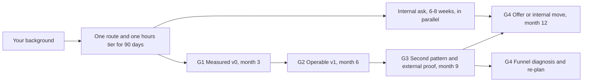

# Career Transitions into GenAI

> Roadmaps into GenAI from five starting backgrounds: what transfers, what to learn and unlearn, modelled months to a first offer, quarterly plans, and the gates that show whether you are on track.

**Dates and grades.** Roadmaps, gates and the time model come from [T0-06](../../research/sessions/T0-06-career-transition-timelines-5-backgrounds.md) (21 October 2026); the skills-stage week plans and the viability matrix come from [T2-01](../../research/sessions/T2-01-tier-calibrated-execution-playbooks.md) (25 October 2026). Market figures carry their own dates: re-verify pay figures by 2027-01-09 and the feeder posting counts (JobsPipe, 2026-11-02; a monthly series, EGP-1.0 class V1) by 2026-12-03. Grades (EGP-1.0): A primary or measured; B transparent secondary; C vendor or single source; D judgement; M model output; P practice-curated. **Every month count on this page is a model output, not cohort data:** no longitudinal study of GenAI career changers was found [D · T0-06.F9].

**Two kinds of tier.** *Hours tiers* A, B and C are your weekly study budget (T0-06). *Target tiers* T0 to T5 are employer and pay levels (T2-01). This page uses target-tier names only, because their band values are unmeasured and inconsistent ([ERRATA](../../research/ERRATA.md) U7, U14).

## The short answer

1. **Ask for an internal move first, and build in parallel.** Spend 6–8 weeks seeking a scoped AI assignment at your employer. Four practitioner accounts name internal transfer as the fastest route; it is not automatic, and one engineer was turned down by several internal teams first [D · T0-06 L205, L246].
2. **Move laterally; do not restart as a junior.** About 66% of US AI-engineering postings (Axial Search, January–July 2026) are individual-contributor roles, 35% mid-level and 31% senior [C · T0-06 L108]. Employment of 22–25-year-olds in the most AI-exposed occupations is 19% below trend, with no comparable gap for experienced workers [A · T0-06 L118]. Prior tacit experience is the hedge [A/B · T0-06.F2].
3. **Commit to one route and one hours tier for 90 days, and judge progress by gates G1–G4,** not by hours logged or courses finished. Re-plan at month 6 from your interview-funnel numbers [M · T0-06 L241].
4. **Make evaluation the spine of the portfolio.** It is the most-cited biggest challenge in the AI stack (20% of survey respondents) [B · T0-06 L139] and the universal gate across all five backgrounds [B · T2-01.F3]. Each background brings a different edge to it [M · T0-06 L146].
5. **Plan on modelled months, conditional on success.** At 15–20 hours a week the model gives about 6 months to a first offer for backend engineers, 7 for frontend and non-technical AI-adjacent routes, 8 for data scientists and PhDs, 11 for BI analysts and 22 for engineering from zero code [M · T0-06 L261–269]. Confidence is medium-low for backend and low elsewhere, and every value assumes you persist and eventually succeed [T0-06 L375].
6. **Do not mix funnels.** Expert-contract work, AI product management, forward-deployed engineering and AI engineering have different gatekeepers and different proof [M · T0-06 L255].

## At a glance



Months are for hours tier B.

### Background router

| Background | What transfers | First targets | Modelled months, tier B (range) | Role hubs |
|---|---|---|---|---|
| Backend or systems, 5+ years | Testing, CI/CD, observability, rate limiting, caching [M · T0-06 L414] | Applied AI engineer, AI platform or infrastructure, FDE-adjacent, at your level | ~6 (3.5–8) | [AI Engineer](../02-roles/hubs/ai-engineer.md), [Applied AI](../02-roles/hubs/applied-ai-engineer.md), [AI Infrastructure](../02-roles/hubs/ai-infrastructure-engineer.md), [FDE](../02-roles/hubs/forward-deployed-engineer.md) |
| Data scientist | Error analysis, metric design, experimental design, judge validation [C · T0-06 L490] | AI engineer with an evaluation edge; evaluation-heavy roles | ~8 (5–11) | [AI Engineer](../02-roles/hubs/ai-engineer.md), [AI Evaluation](../02-roles/hubs/ai-evaluation-engineer.md), [ML Engineer](../02-roles/hubs/ml-engineer.md) |
| BI analyst | SQL, metric definitions, stakeholder communication [M · T0-06 L469] | Analytics-AI engineer; analytics engineering with GenAI scope as a bridge | ~11 (7–15) | [AI Engineer](../02-roles/hubs/ai-engineer.md) |
| Frontend or full-stack | UX for uncertainty, streaming interfaces, product intuition [M · T0-06 L544] | AI product or full-stack engineer; frontend-heavy FDE | ~7 (5–11) | [AI Product Engineer](../02-roles/hubs/ai-product-engineer.md), [Applied AI](../02-roles/hubs/applied-ai-engineer.md), [FDE](../02-roles/hubs/forward-deployed-engineer.md) |
| Non-technical, 5+ years in a domain, product or operations | Domain judgement for rubrics, golden sets, pilots and customers [C · T0-06.F7] | One lane: AI PM, AI ops or enablement, domain-evaluation lead, solutions or FDE-adjacent | ~7 (5–11) | [AI Product Manager](../02-roles/hubs/ai-product-manager.md), [Domain Evaluation](../02-roles/hubs/domain-evaluation-specialist.md), [AI Solutions Architect](../02-roles/hubs/ai-solutions-architect.md) |
| Non-technical, engineering from zero code | Domain knowledge | Junior engineering, as a two-year plan | ~22 (15–34) | [AI Engineer](../02-roles/hubs/ai-engineer.md) |
| Academic or quantitative PhD who can code | Mathematics, statistics, experimental design, measurement rigour [M · T0-06 L658] | Applied AI engineer, applied scientist, research engineer; research scientist as upside | ~8 (5–12.5) | [Applied Scientist](../02-roles/hubs/applied-scientist.md), [Research Engineer](../02-roles/hubs/research-engineer.md) |

Months and targets: [M · T0-06 R2 L261–269]. Experienced software engineers are the dominant feeder into AI-engineer titles and data scientists a steady second; "backend is fastest" cannot be tested with public data [B/D · T0-06.F3].

### Where each background has a high-volume corridor

| Background | High-volume corridor ● | Plausible but extended ◐ |
|---|---|---|
| Backend or systems | T1 Growth (fastest), T2 Senior (primary) | T3 Staff, 12–18 months |
| Data scientist or BI | T1 Growth (data scientists) | T0 Entry (BI only), T2 Senior (production gap) |
| Frontend or full-stack | T1 Growth (AI product engineer) | T2 Senior (senior AI product) |
| Non-technical | None | T0 Entry (evaluation, annotation), T1 Growth (AI PM, ops) |
| PhD or researcher | T2 Senior (applied scientist) | T1 Growth (applied engineering), T3 Staff (research engineer), T4 Elite (frontier lab) |

Every other cell is implausible within 12 months. The matrix is a design judgement [D · T2-01 L92–104], and it has five high-volume cells, not the "8–12 corridors" its key finding claims (ERRATA U9).

## The shared spine: four gates and an hours budget

Each route below specialises one spine: four pass/fail gates, due at months 3, 6, 9 and 12 at hours tier B. The deliverables are author-designed, and each maps to a hiring signal in the sources [M · T0-06 L389–398].

| Gate | Due (tier B) | Done when | How a stranger checks it |
|---|---|---|---|
| **G1 Measured v0** | Month 3 | A running LLM application (retrieval and/or tool use) over a real corpus or task from your domain; 50+ labelled eval cases, 30+ of them hand-written from real work, versioned with the code; 2+ baselines compared; an error taxonomy from 100+ reviewed traces, with counts; a "what broke" memo of 500+ words naming three failures | The README's headline eval numbers reproduce in under 30 minutes |
| **G2 Operable v1** | Month 6 | Evals run in CI on every prompt, model or retrieval change, with a regression threshold; any LLM judge validated on 100+ human-labelled examples, with agreement reported and one bias (position or verbosity) tested; tracing with p50/p95 latency and cost per request; deployed to 1+ real user other than you; one postmortem of a real regression, with the test that stops it recurring | CI badge and log, judge-agreement table, live URL or recorded demo, postmortem |
| **G3 Second pattern and external proof** | Month 9 | A second system with a different failure surface; one public write-up with numbers; one external contribution (pull request, talk or community review); 5+ mock loops of your target loop type; 15–20 targeted applications | Public links, mock-loop notes, an application tracker |
| **G4 Convert or re-plan** | Month 12 | 1+ offer or internal role change, **or** a written funnel diagnosis and a re-plan that changes loop type, level or tier | Offer letter, or the diagnosis reviewed by one practitioner |

**When a gate slips** [M · T0-06 L251, L400–405]:
- **G1 not passed by the end of month 4:** check adherence, then scope creep, then whether an eval set exists. Move to the next-longer tier before adding hours.
- **G2 not passed by month 8:** the system is probably over-scoped. Cut features; keep the evals and CI.
- **No screens after 15 targeted applications:** the problem is positioning or résumé signal, not skill. Get a practitioner to review the artifacts and the résumé.
- **Three failed take-homes:** invest in eval design and error analysis.
- **Failed system-design onsites:** practise system design and DSA for big-company loops, or retarget applied-AI loops.
- **Logged hours below 70% of plan for three consecutive weeks:** re-plan on the next-longer tier instead of pushing harder.

Start applying when roughly 70% of the build gates are passed [M · T0-06 L221]. For the G3 contribution, go discussion-first: AI-generated "slop" has turned the drive-by pull request from a hiring tactic into a liability [B · T0-12.F10].

### Hours tiers

| Tier | Nominal h/week | Adherence | Effective h/week | Fits | Share of average leisure: no child under 18 / child under 18 |
|---|---|---|---|---|---|
| A | 9 | 0.75 | 6.75 | Employed, caregiving or heavy workload | 29% / 38% |
| B | 17.5 | 0.75 | 13.1 | Employed and disciplined; the central planning case | 56% / 74% |
| C | 38 | 0.85 | 32.3 | Sabbatical, notice period, bench time, full-time programme | 121% / 160%: not possible alongside full-time work |

Parameters and shares are T0-06's model [M · T0-06 L341–345, L379–383]. The base is BLS time-use data: employed adults without a child under 18 averaged 4.5 hours of leisure a day in 2025, more than an hour above those with one [A · T0-06 L211]. Hours, not compute, are the binding constraint [A · T0-06.F10]; API credits plus a free notebook tier cover months 1–6 of application-layer work [M · T0-06 L233].

### Modelled months to a first offer

| Route | Tier A | Tier B | Tier C | Core hours: central (low–high) | Search lag, weeks |
|---|---|---|---|---|---|
| Backend or systems, 5+ years | ~10 (6–14) | **~6 (3.5–8)** | ~3 (2–4.5) | 250 (150–350) | 6 (4–8) |
| Data scientist | ~13 (9–19) | **~8 (5–11)** | ~5 (3–6.5) | 300 (200–450) | 11 (8–14) |
| BI analyst | ~18 (12–26) | **~11 (7–15)** | ~6 (4–8) | 450 (300–650) | 12 (8–16) |
| Frontend or full-stack | ~12 (8–18) | **~7 (5–11)** | ~4 (3–6) | 300 (200–450) | 9 (6–12) |
| Non-technical, AI-adjacent roles | ~10.5 (7–16) | **~7 (5–11)** | ~5 (3.5–8) | 200 (120–300) | 16 (12–24) |
| Non-technical, engineering from zero code | not meaningful (~39) | **~22 (15–34)** | ~12 (8–18) | 1,000 (700–1,500) | 20 (12–32) |
| PhD, applied roles | ~13 (9–20) | **~8 (5–12.5)** | ~5 (3–8) | 300 (200–450) | 12 (8–20) |

Source: [M · T0-06 L261–269, L347–355]. How to read it:
- **Formula:** weeks = core hours ÷ (nominal hours × adherence) + search lag; months = weeks ÷ 4.345 [M · T0-06 L330–335].
- **Ranges are not intervals.** They run from all-low to all-high parameters [T0-06 L259].
- **Conditional on success.** Every value assumes you persist and eventually succeed; no denominators of attempts exist [T0-06 L375].
- **Anchors:** an 8-month employed frontend retrospective, a 14–19 month vendor reference class for zero-experience changers, and Huntr's 82–108 day search medians [D/C · T0-06 L275].
- **Sensitivity:** adherence of 0.6 instead of 0.75 stretches the build by 25%; doubling the search lag adds about 1.4–3.7 months (about 4.6 for engineering from zero code); core hours, the least-validated parameter, matter most. Recalibrate them from your own progress to G1 by month 3 [M · T0-06 L387].
- **Not modelled:** internal transfers can beat these numbers, but there is no timing data [T0-06 L272]. Expert-contract evaluation work can start in weeks; it is paid AI-adjacent work, not a first offer [M · T0-06 L273].

## Route 1: backend or systems engineer

**Profile.** Owns services, concurrency, queues, observability and on-call. Likely gaps: Python (if Java or Go only), LLM API patterns, retrieval, evaluation and probabilistic thinking [M · T0-06 L411]. Mature teams built much of their AI tooling in-house (Sentry chose not to adopt LangChain; incident.io used Postgres with pgvector alongside Go), and in one case in-house developers with no prior AI experience built a feature in about two months after an agency quoted six to nine [B, single case · T0-06 L414–415].

| Old habit | What it looks like | New habit | Evidence |
|---|---|---|---|
| Determinism assumption | Expecting 100% pass rates; treating a flaky eval as a bug in the test | Set pass-rate thresholds as a product decision, not a correctness target | [C · T0-06 L430] |
| "It's just an API call" | Underestimating the data and evaluation work behind a good answer | Budget the eval set and error analysis first | [M · T0-06 L431] |
| Retrieval by default | A vector database before measuring; no keyword search | Measure first; compare keyword, hybrid and reranked retrieval | [D · T0-06 L432] |
| Framework-first | Orchestration frameworks before the underlying patterns | Learn the patterns; framework APIs churn | [C/D · T0-06 L433] |
| Infra polish before measurement | A polished platform around unmeasured quality | Measure quality, then build the platform | [M · T0-06 L434] |

Watch for competence-transfer overconfidence, infra bias and demo bias [M · T0-06 L436].

**Ranked skill delta** [M · T0-06 L418–424]:
1. Evaluation design and error analysis: the largest gap.
2. LLM API fluency and context engineering: structured output, tool calling, streaming, token budgets.
3. Retrieval: hybrid search, chunking, reranking, and knowing when not to retrieve.
4. Python (async, typing, pydantic), if you come from Java or Go.
5. Agent reliability: loop limits, budgets, approvals, replayable traces.
6. A domain model of what "good" looks like for your application.

**Quarterly roadmap** (tier B; add about 4 months at tier A) [M · T0-06 L438–445]:

| Months | Focus | Done when | Gate |
|---|---|---|---|
| 1–3 | Fluency and a measured v0 | Python fluency if needed; a hosted-model app with structured output, tool calling and streaming over a corpus you know; 50 eval cases and a metrics table (recall@k, rubric correctness, citation faithfulness); two baselines; error analysis on 100+ traces with the top three failure classes fixed; hybrid retrieval and a reranker tested; cost and latency logged; memo written | G1 |
| 4–6 | Make it operable | Eval suite in CI with a regression threshold; judge calibrated on 100+ human labels; tracing; timeouts, retries, budgets and idempotent tool calls; container deployment; a real user; a load test; one postmortem | G2 |
| 7–9 | Second pattern and proof | A tool-using agent with human approval, per-run budget, sandboxed tools, deterministic trace replay and failure-injection tests; a serving lab measuring tokens/s, p95 latency and cost per million tokens for an open-weight model against an API; public write-up; one open-source contribution; 5+ mock loops; 15–20 targeted applications; an internal-role conversation | G3 |
| 10–12 | Convert | One eval-design and one LLM system-design round practised; one failure story with data; loops for applied AI engineer, AI platform or infrastructure and FDE-adjacent roles at your level | G4 |

**Skills stage in weeks.** T2-01 front-loads serving: weeks 1–2 serving architecture (KV-cache math, continuous batching, prefill/decode disaggregation) with a toy vLLM deployment; 3–4 retrieval over a real corpus from your domain; 5–6 evaluation (golden sets, LLM judges, pass^k) with 30+ hand-labelled cases and two baselines; 7–8 agent patterns with every call traced [D · T2-01 L233–241]. That order fits infrastructure-track targets, because backend moves to T3 and above interview infrastructure-heavy [B/C · T2-01.F5]. For application roles, keep T0-06's order, with the measured v0 first. Ignore T2-01's suggestion of the AWS Machine Learning – Specialty exam: it is retired (ERRATA U13).

**Checkpoints (tier B)** [M · T0-06 L447–451]: month 3, G1 and one public artifact; offers are unlikely unless the route is internal or FDE-adjacent. Month 6, G2 and active interviews; the modelled median first offer falls here (3.6–8.0 months). Month 9, most who persisted have an offer or decisive loop feedback. Month 12, offers for many who held to the gates; otherwise a G4 diagnosis.

**Portfolio specialisation.** A reliability layer for LLM applications: a small, well-tested gateway and harness with caching, backoff, budgets, fallbacks, trace replay, eval-regression CI and a public log of postmortems. It plays to your strengths and stands apart from the RAG-chatbot portfolios that hiring write-ups describe as commonplace [M/D · T0-06 L453].

## Route 2: data scientist or BI analyst

**Profile.** Data scientists bring statistics, ML, experimentation, SQL and notebooks; their likely gaps are production code, deployment, system design and on-call ownership. BI analysts bring SQL, metric definitions, dashboards and stakeholder communication; their gaps are Python, ML-adjacent skills and software engineering [M · T0-06 L468–469].

**The "can't ship" trope is half right** [C/D · T0-06.F5]. Data scientists are among the top three feeders into AI-engineer titles on both LinkedIn lists [C · T0-06 L130], and, as Hamel Husain argues, the core eval loop is data science: trace review, metric design, judge validation and test-set design [C · T0-06 L152]. The gaps show in big-company loops. A ranked hypothesis of what disqualifies data scientists, from guides and candidate reports with no frequency data [D · T0-06 L471–479]: coding rounds; system design; no production-ownership artifacts or stories; operational thinking about latency, cost and failure modes; customer-facing scoping. No source cited statistics or ML knowledge as the main disqualifier; that is an absence of evidence, not proof [T0-06 L481].

| Old habit | What it looks like | New habit | Evidence |
|---|---|---|---|
| Train-first identity | Fine-tuning before showing that prompting and retrieval fail | Exhaust prompting and retrieval first: 80% of surveyed teams prompt, 26% fine-tune | [B · T0-06 L496] |
| Notebook as deliverable | A notebook handed over as the product | An installable, tested package behind a service | [D · T0-06 L497] |
| Generic, unvalidated metrics | Off-the-shelf "helpfulness" scores; judges never checked against human labels | Task-specific metrics; judges validated against human labels | [C · T0-06 L498] |
| Months on theory | Weeks of derivations before shipping an API | Ship first; the 8-month retrospective dropped a four-week theory block as low-yield | [D · T0-06 L499] |
| Undervaluing cost and latency | No cost or latency view | Track both: 40% of surveyed teams say cost shapes their ambition | [B · T0-06 L500] |
| Dashboard thinking (BI) | A chat box on a dashboard with no evaluation of generated SQL or narrative | Score generated SQL by execution accuracy | [M · T0-06 L501, L518] |

Watch for expertise anchoring (LLM judges still need validation), the streetlight effect and the tool-hammer effect [M · T0-06 L503].

**Ranked skill delta, data scientist** [M · T0-06 L483–490]:
1. Production hygiene: typed, tested, installable Python; containers; CI/CD.
2. LLM application patterns: API fluency, structured outputs, tool use, retrieval.
3. Serving and operations: an API service with async handling, retries, auth, observability and cost tracking.
4. Loop preparation: DSA-style coding and system design for big-company loops.
5. Product scoping and communication. Lean on your strengths: error analysis, metric design, experimental design, judge validation.

**BI analyst:** the largest gaps are production Python, LLM API fluency, retrieval and production operations [M · T0-06 L740].

**Quarterly roadmap, data scientist** (tier B; add about 5 months at tier A) [M · T0-06 L505–512]:

| Months | Focus | Done when | Gate |
|---|---|---|---|
| 1–3 | Package discipline and a measured v0 | One prior analysis refactored into an installable package with tests, type checks, Docker and CI; the LLM application built; a stratified trace sample, an error taxonomy with agreement between two reviewers, and confidence intervals on every eval metric | G1 |
| 4–6 | Serve it and calibrate the judge | A FastAPI service (async, auth, retries, timeouts) deployed; hybrid retrieval plus a reranker; a published judge-calibration study (100+ human labels, agreement statistic, position and verbosity bias tests); eval in CI; a cost-quality frontier chart | G2 |
| 7–9 | Loop readiness and a second pattern | 4–6 weeks of DSA basics and LLM-app system design; a cost-reducing router or an embedding fine-tune as a GPU lab; mock loops and targeted applications | G3 |
| 10–12 | Convert | Loops for applied AI engineer and evaluation-heavy roles; your level floor decided before offers arrive | G4 |

**Quarterly roadmap, BI analyst** (tier B; add about 7 months at tier A) [M · T0-06 L514–521]:

| Months | Focus | Done when | Gate |
|---|---|---|---|
| 1–3 | Python and a text-to-SQL v0 | pandas, typing, pytest, packaging; a text-to-SQL copilot over a public schema with 50 questions and gold SQL, scored by execution accuracy | G1-lite |
| 4–6 | Governance and CI | Metric definitions as context (semantic layer); read-only access; row limits; eval in CI; deployed as an internal tool with at least one real user | G2 |
| 7–9 | Agentic analysis | A second pattern with human approvals and a documented business-impact case study | G3 |
| 10–12 | Convert | Analytics-AI roles in your industry; analytics engineering with GenAI scope as a bridge | G4 |

**Skills stage in weeks** [D · T2-01 L365–372]:

| Weeks | Data scientist | BI analyst |
|---|---|---|
| 1–3 | Python packaging, testing, CI/CD | Python fundamentals: scripts, tests and packages, not notebooks |
| 4–6 | LLM application patterns: RAG, tool use, agents | The same, plus basic ML and NLP concepts |
| 7–9 | Evaluation methodology | Evaluation plus text-to-SQL and analytics-copilot patterns |
| 10–12 | System design basics: API design, deployment, monitoring | Deployment: containers, cloud basics |

**Checkpoints (tier B)** [M · T0-06 L524–525]: data scientists have a refactored package and evals at month 3 (no offers expected), a published judge study and starting loops at month 6, and a modelled median first offer near month 8 (5.3–11.1). BI analysts have a v0 and Python fluency at month 3 and G2-lite plus applications at month 6; early offers are rare at month 9, and the modelled median is near month 11 (7.1–15.1), so month 12 is borderline. The data-scientist route targets mid level: watch for down-levelling and set your floor in advance [M · T0-06 L264, L512].

**Portfolio specialisation** [M · T0-06 L528–529]. Data scientist: an evaluation and error-analysis lab with a public golden set, an error taxonomy, judge calibration with bias tests and a cost-quality frontier. BI analyst: an analytics copilot with execution-accuracy evals, read-only guardrails and business-metric semantics.

## Route 3: frontend or full-stack engineer

**Profile.** Strong React and TypeScript, state management, streaming, design systems, accessibility and product sense. Likely gaps: retrieval and data work, evaluation, a service layer, system design for LLM applications and inference literacy [M · T0-06 L542]. The one detailed 8-month retrospective is from a React developer who also had to do real backend work: hybrid retrieval, reranking, async and caching, an eval harness [D · T0-06 L544].

**Test the frontend bet before relying on it.** The client-side platform is real as of October 2026: Khronos describes WebGPU as available in all major browsers (22 July 2026), Transformers.js v4 shipped a WebGPU runtime (9 February 2026), and Chrome's Translator, Language Detector and Summarizer APIs are stable from Chrome 138 [A · T0-06 L161–163]. Demand for AI-frontend specialists is thin and senior-skewed: the four postings examined in detail were Staff-level and asked for 5–6+ years, and no census exists [C/D · T0-06 L167]. Treat client-side AI as a differentiator on top of full-stack AI competence [M · T0-06 L169]. Count postings in your market that name frontend-specific AI skills against postings for full-stack AI engineers; if the former are a small minority, apply as a full-stack AI engineer [M · T0-06 L564].

| Old habit | What it looks like | New habit | Evidence |
|---|---|---|---|
| UI-wrapper plateau | A polished interface over a model whose quality is never measured | Measure quality before polishing the interface | [D · T0-06 L570] |
| Model output as trusted data | Unvalidated structured output crashing the UI | Validate output against a schema; design error and partial states | [M · T0-06 L571] |
| "Streaming means done" | Ignoring time to first token, cancellation, partial JSON and retries | Measure time to first token; handle cancellation and partial output | [M · T0-06 L572] |
| UX judged by vibes | No telemetry on acceptance, edit rate or abandonment | Instrument acceptance, edit rate and abandonment | [M · T0-06 L573] |
| Client-side inference as a universal fix | Ignoring device variance, download size, memory and battery | Feature-detect and fall back to WASM or a server | [A · T0-06 L558, L574] |
| Chasing API surfaces | Rebuilding for each framework release | Freeze stack choices for six weeks; invest in concepts | [M · T0-06 L254, L575] |

Watch for comfort-zone bias, the demo effect and novelty bias toward new APIs such as WebMCP [M · T0-06 L577].

**Ranked skill delta** [M · T0-06 L546–552]:
1. Evaluation and error analysis: the largest gap.
2. Retrieval and data: hybrid search, chunking, reranking; the "backend half" of most AI features.
3. A service layer with auth, queues, retries and observability, in Python (FastAPI) or server-side TypeScript.
4. Agent reliability and human-in-the-loop design: tool schemas, approvals, budgets.
5. Inference literacy: tokens, context windows, latency and throughput, on-device constraints.
6. System design for LLM applications, at interview grade.

**Quarterly roadmap** (tier B; add about 5 months at tier A) [M · T0-06 L579–586]:

| Months | Focus | Done when | Gate |
|---|---|---|---|
| 1–3 | Backend-capable measured v0 | A service path chosen (Python and FastAPI, or a TypeScript server with the AI SDK); a streaming chat or agent UI over an app with retrieval; 50 eval cases with task-success scoring plus UX metrics (time to first token p50/p95, abort handling, error states); two baselines; error taxonomy; memo | G1 |
| 4–6 | Citations, tools and approvals | Retrieval with citations; tool calling with a human-approval UI; schema-validated output; judge calibration; eval in CI; deployment; real users; acceptance and edit-rate telemetry; one postmortem | G2 |
| 7–9 | On-device module and proof | A Transformers.js v4 module for browser-side embeddings or a small model on a bounded task, measured for size, load time, throughput and accuracy against the server version on 3+ device and browser combinations, with feature detection and a fallback; public write-up; an accessible open-source component; mock loops; 15–20 targeted applications | G3 |
| 10–12 | Convert | Loops for AI product or full-stack engineer, AI-frontend engineer and frontend-heavy FDE roles; an LLM system-design answer and an agent-UX case study with numbers | G4 |

**Skills stage in weeks** [D · T2-01 L431–438]: weeks 1–3 Python backend basics if missing (FastAPI, basic cloud deployment); 4–6 LLM application patterns (RAG, tool use, streaming, agent UX); 7–8 evaluation, where your edge is UX and human-in-the-loop evals; 9–10 on-device AI (Transformers.js v4, Chrome's built-in Prompt API, WebGPU). Frontend moves to T2 interview on the application track [B/C · T2-01.F5].

**Checkpoints (tier B)** [M · T0-06 L588]: month 3, G1 with a streaming UI and evals; offers unlikely. Month 6, G2; interviews begin. Month 9, the on-device module ships; the modelled median first offer is near month 7 (4.9–10.7). Month 12, offers likely for most who held to the gates.

**Portfolio specialisation.** An agent-UX lab: measured UX outcomes (acceptance rate, edit distance, abandonment, time to first token), approval flows and failure states. Add a private, browser-first semantic search with measured latency and accuracy trade-offs, and accessible open-source components [M · T0-06 L590].

## Route 4: non-technical professional

**Core claim.** Raw-coding competition is the wrong game. The leverage is domain judgement applied to evaluation, product, operations or customer implementation, and each lane has an entry fee in experience, credentials or coding [C · T0-06.F7].

| Lane | Entry fee in the sources | First proof | Main risk | Hub |
|---|---|---|---|---|
| Domain evaluation lead, in-house first | Credentials and seniority; expert marketplaces seek advanced degrees and years of experience [C · T0-06 L606] | Golden set, rubric, inter-rater agreement | Contract volatility, credential gating, LLM judges used alongside human experts | [Domain Evaluation](../02-roles/hubs/domain-evaluation-specialist.md) |
| AI ops, enablement or internal-tools PM | Operations experience and process knowledge [D · T0-06 L605] | A pilot with adoption and time-saved metrics, a runbook, a risk register | Title confusion; budget cycles | [AI Product Manager](../02-roles/hubs/ai-product-manager.md) |
| AI product manager | Product fundamentals first; one recruiter's template asks for 4+ years of PM experience and one model-powered feature shipped and measured, and the recruiter is paid on placements [D · T0-06 L604] | A PRD, an eval rubric, pilot metrics | Credibility with engineers; many roles ask for technical fluency | [AI Product Manager](../02-roles/hubs/ai-product-manager.md) |
| Solutions, FDE-adjacent or AI consultant | AI consultants and strategists report a median of 8.2 years' experience on LinkedIn's 2026 list [C · T0-06 L174]; FDE postings need coding too [B · T0-06 L175] | A customer pilot case study | A senior bar; FDE needs code | [AI Solutions Architect](../02-roles/hubs/ai-solutions-architect.md), [FDE](../02-roles/hubs/forward-deployed-engineer.md) |
| Engineering from zero code | About 22 months (15–34) at tier B [M · T0-06 L268]; a vendor reference class says 14–19 months [D · T0-06 L199] | None until you can program | The entry-level squeeze [A · T0-06 L118] | [AI Engineer](../02-roles/hubs/ai-engineer.md) |

T0-06 ranks the niches by leverage: domain evaluation lead first, because evaluation is the top stack challenge and domain experts should own the labels; then AI ops or enablement PM; AI PM if you already have product fundamentals; solutions or FDE-adjacent roles; and expert-contract evaluation last, as a bridge rather than a destination [M · T0-06 L645–652]. The 8.2-year median belongs to AI consultants and strategists, not AI PMs (ERRATA U8). Mercor's senior domain-expert listings ask for 4+ years of full-time experience, at least 10 hours a week and at-will contractor status [C · T0-06 L177]; apply to expert networks only once your golden set exists [M · T0-06 L638].

**What AI-assisted building changes.** Under half of survey respondents say non-developers ship features (mostly internal), 17% say they regularly ship full-size customer-facing ones, and 59% agree that AI-generated code creates major liabilities [B · T0-06 L610]. Verification is the bottleneck, so evaluation skill matters more than prompting skill [M · T0-06 L610].

| Old habit | What it looks like | New habit | Evidence |
|---|---|---|---|
| Prompt-trick identity | Collecting prompts and tool demos | Measure outcomes on real tasks | [M · T0-06 L623] |
| Certificate collecting | Course completions without artifacts | Build artifacts; no source showed certificates carrying hiring signal | [D · T0-06 L624] |
| Fluency mistaken for competence | Using a tool well, taken as building and evaluating a system | Build and evaluate one workflow end to end | [M · T0-06 L625] |
| Automation bias | Trusting fluent outputs and LLM judges | Calibrate judges against human labels | [M · T0-06 L626] |
| Gig-market mirage | Treating expert-contract work as a career track | Use it as a bridge; it is volatile and credential-sensitive | [C · T0-06 L627] |
| Coding avoidance or overreach | Refusing any code, or shipping AI-written code without tests | Learn SQL and notebook Python; test what you ship | [M · T0-06 L628, L637] |

Watch for the Dunning-Kruger effect after early wins, the halo effect of fluent text and sunk cost on credentials [M · T0-06 L630].

**Ranked skill delta** [M · T0-06 L612–617]:
1. AI literacy beyond tool use: tokens and context, hallucination, retrieval versus fine-tuning versus prompting, cost and latency.
2. Evaluation fluency: rubrics, golden sets, inter-rater agreement, reading error analyses.
3. Notebook-level data skills: SQL and basic Python to analyse eval results and logs.
4. Pilot execution: scoping, adoption measurement, change management, risk and governance documents.
5. Technical communication with engineers.

**Quarterly roadmap, AI-adjacent lane** (tier B; add about 3–4 months at tier A) [M · T0-06 L632–639]:

| Months | Focus | Done when | Gate |
|---|---|---|---|
| 1–3 | Domain workflow and a golden set | One lane and one workflow you know deeply, built with hosted or low-code tools; a domain golden set of 100+ real tasks (de-identified, or synthetic with permission) with rubrics, adjudication rules and agreement between two reviewers; 2–3 models or prompts compared against the existing human process | G1-domain |
| 4–6 | Pilot and measurement | A pilot with 5–10 colleagues measuring adoption, time saved and error rate; judge agreement with human labels checked; a PRD or runbook and a risk register; SQL and notebook Python learned for log analysis | G2-domain |
| 7–9 | Scale and visibility | An extended pilot; a cost-per-task model; a governance and guardrails document; an internal presentation; a de-identified public write-up; a request to leadership to define a role; targeted applications to vertical-AI companies | G3 |
| 10–12 | Convert | Loops for AI PM, AI ops or solutions roles with scope negotiated, or an explicit plan for the next six months | G4 |

**Skills stage in weeks** [D · T2-01 L487–496]: weeks 1–3 LLM fundamentals (capabilities, cost, latency and quality trade-offs); 4–6 evaluation methodology (rubrics, labelling, judging quality); 7–9 product process (success metrics, managing expectations, reporting non-determinism); 10–12 hands-on prompt building and output evaluation in Anthropic Console or OpenAI Playground. T2-01 labels this track "no coding required", but T0-06 lists notebook-level coding among the lanes' entry fees [C · T0-06 L181] and as a mandatory skill; add SQL and notebook Python by month 6 [M · T0-06 L615, L637].

**Checkpoints (tier B)** [M · T0-06 L641]: month 3, golden set done and pilot starting; contract evaluation work is possible earlier. Month 6, pilot results and a PRD. Month 9, an internal role redefinition or interviews; the modelled median is near month 7 (4.9–10.8), concentrated in internal moves and vertical-AI companies. Engineering from zero code is not achievable within 12 months at tier A or B.

**Portfolio specialisation.** A domain gold standard: a de-identified benchmark with rubric and agreement statistics, pilot results, a governance playbook and an AI-ops runbook, the artifact engineers cannot produce without you [M · T0-06 L643]. Never put an employer's or client's confidential data in a portfolio artifact [M · T0-06 L847].

## Route 5: academic researcher or quantitative PhD

**Profile.** Strong in mathematics, statistics, experimental design and deep specialisation. Likely gaps: production engineering craft, iteration speed, scoping for product value, communication with non-experts, baseline discipline and an accurate picture of where roles exist [M · T0-06 L658]. New AI PhDs in the US and Canada rose 22% from 2022 to 2024, the increase went to academia [A · T0-06 L186], and the derived industry-bound count is roughly flat [M · T0-06 L187]. The plannable path is applied AI engineering, applied science or research engineering [M · T0-06 L192]. PhDs do not skip the skills stage (ERRATA U18).

| Old habit | What it looks like | New habit | Evidence |
|---|---|---|---|
| Novelty bias | The newest method before a baseline fails | Beat BM25 or a plain prompt first | [M · T0-06 L670, L687] |
| Perfectionism | Slow iteration, a delayed first release | Ship a v0 in two weeks | [M · T0-06 L688, L789] |
| Publication mindset | Paper-grade results | Decision-useful results in one-page memos | [M · T0-06 L689, L702] |
| Benchmark fixation | Leaderboard gains read as product gains | Use the user's outcome as the metric | [M · T0-06 L669, L690] |
| Solo-coding habits | No tests, no review, private repositories | Tests, CI and at least three reviewed pull requests | [M · T0-06 L691, L701] |
| Prestige signalling | A CV of papers where a repo of shipped, evaluated systems is wanted | Lead with repositories and eval tables | [M · T0-06 L692] |
| Over-targeting lab slots | Survivorship bias in lab success stories | Applied roles as the base case; lab roles as upside | [M · T0-06 L693] |

**Ranked skill delta** [M · T0-06 L675–681]:
1. Production engineering: tests, packaging, CI, code review, containers.
2. LLM application patterns: API fluency, retrieval, tool use.
3. Evaluation at production fidelity: golden sets, judge calibration, drift monitoring; a strength to lean on.
4. Product scoping and communication.
5. Loop preparation: DSA and system design.
6. Inference economics: cost and latency.

**Quarterly roadmap, applied track** (tier B; add about 5 months at tier A) [M · T0-06 L697–704]:

| Months | Focus | Done when | Gate |
|---|---|---|---|
| 1–3 | Productionise and measure | Your method, or a relevant technique, as a reproducible service or library with tests, type checks and CI; code review at least three times via open-source pull requests; G1 passed with every sophisticated step beating a simple baseline on the eval set | G1 |
| 4–6 | Product framing | A business-framed problem delivered to a real user; one-page decision memos; a cost and latency budget; eval in CI; judge calibration; deployment | G2 |
| 7–9 | Measurement-rigour artifact and applications | A statistical methodology for LLM evals published as a write-up and small open-source tool (confidence intervals, power analysis for eval-set size, judge-bias tests, drift detection); residency or fellowship applications for the research track; mock loops including DSA and system design; 15–20 targeted applications | G3 |
| 10–12 | Convert | Loops for applied AI engineer, applied scientist and research-engineer roles; level negotiated; a six-month plan if no offer lands | G4 |

**Checkpoints (tier B)** [M · T0-06 L708]: month 3, a productionised method and reviewed pull requests; offers unlikely. Month 6, an applied project with a real user; interviews begin. Month 9, the evaluation-rigour artifact is published; the modelled median first offer for applied roles is near month 8 (5.3–12.5). Frontier research roles are not plannable.

**Portfolio specialisation.** Rigorous evaluation and method-to-product translation: a public eval methodology and tool, a reproduction of a method as a service with ablations against simple baselines, and decision memos [M · T0-06 L710]. The 8-week skills block, role choice, fellowships and the O-1A angle are in [PhD to industry](phd-to-industry.md).

## Provisional routes [P]

These backgrounds have no T0-06 roadmap. The routes are practice-curated from adjacent evidence: treat them as hypotheses and name the gap when you rely on them.

| Background | Evidence in the corpus | Provisional route [P] | Research gap |
|---|---|---|---|
| DevOps, SRE or cloud engineer | Feeder counts only (JobsPipe, 2026-11-02): DevOps Engineer 1,269 US / 3,183 global / 429 India live postings, 69.4% naming Kubernetes; SRE 776 / 1,838 / 240; Cloud Engineer 803 / 1,587 / 128; all three feed ML platform or AI infrastructure roles [B · [role catalog](../02-roles/role-catalog.md) §7] | Route 1, weighted toward the serving lab and production operations; target [ML Platform](../02-roles/hubs/ml-platform-engineer.md) or [AI Infrastructure](../02-roles/hubs/ai-infrastructure-engineer.md) | No skill-delta, transition or timeline evidence; posting counts measure the feeder occupation, not transitions |
| Product manager | The AI PM lane: one recruiter's template asks for 4+ years of PM experience and one model-powered feature shipped and measured [D · T0-06 L604]; 15.4% of Product Manager postings name AI and 13.6% agentic AI (JobsPipe, 2026-11-02) [B · role catalog §7] | Route 4's AI-adjacent roadmap, with PM proof: a PRD, an eval rubric and pilot metrics | No time-to-offer or success rates for AI PM transitions [T0-06 L821]; the 8.2-year median is not an AI PM figure (ERRATA U8) |
| Student or new graduate | The junior door is narrowest [A · T0-06 L118]; AI-exposed entry-level roles are seven times more likely to require senior-type skills such as judgement and leadership [B · T0-06 L122]; the Stanford group notes that other studies disagree with the junior-decline finding [C · T0-06 L122] | One evaluated end-to-end system, the T0–T1 portfolio bar [B/C/D · T2-01.F9]; aim at employers that hire at entry level | No T0-06 roadmap, timeline or new-graduate outcome data; T0-06 judges entry-level pivots realistic mainly for BI analysts and new PhD graduates, at lower odds [M · T0-06 L124] |

### Geography

- **Most quantitative evidence in T0-06 is US-centric** [T0-06 L39]; check local postings before committing [M · T0-06 L848].
- **India:** AI-titled roles are 3.0% of India postings against 1.3% in the US, and the entry-level share of AI roles is 21.2% in India against 10.4% in the US (JobsPipe, 2026-10-11) [B · T0-01.F10]. India's AI-role profile is younger, but its absolute AI Engineer count is smaller than the US count. See the [India remote playbook](india-remote-playbook.md).

## How to do it: the first 14 days

Steps from T0-06's 14-day plan [M · T0-06 L277–285]:

1. **Score yourself.** Rate each skill from 0 (none) to 3 (owns it in production or could teach it) and run the three fast tests below [M · T0-06 L718]. *Done when* the scores and test results are written down.
2. **Pick a route and an hours tier.** Block the hours and compare them with the leisure shares in the tier table. *Done when* the blocks are in your calendar for 12 weeks.
3. **Hand-write 30 evaluation cases** from real work in one corpus or task from your domain. *Done when* they are versioned in a repository; they are the prerequisite for G1.
4. **Ship a v0 in two weeks** on a hosted model API, logging every trace. *Done when* it runs end to end and the traces are stored.
5. **Ask for internal scope.** Find an internal sponsor or AI initiative and ask for a scoped assignment. *Done when* you have asked and dated a check-in 6–8 weeks out.
6. **Open free accounts only** (Hugging Face, Modal credits, Kaggle); do not pay for GPUs yet. *Done when* nothing is billed.
7. **Calendar the gates.** Put G1–G4 in the calendar, plus a monthly review that records applications, screens, take-homes, onsite loops and offers. *Done when* the review recurs.

**Three fast tests, about one day each** [M · T0-06 L745–748]:
- **Q&A over 50 documents.** Build a pipeline for 20 questions with known answers; report recall@5 and answer faithfulness. *Pass:* a reproducible script, a metrics table and two failure cases explained.
- **Explain the request.** Explain what happens between a user pressing Enter and the answer appearing: context assembly, retrieval, tool calls, streaming, cost. *Pass:* failure modes and cost named at each stage.
- **Design the eval.** For a task in your domain, write 30 test cases, a rubric and a plan to validate an LLM judge. *Pass:* two reviewers score a 20-case pilot and you report their agreement.

**Largest gaps by background** [M · T0-06 L737–743]: backend, evaluation design, API fluency and retrieval (plus Python from Java or Go); data scientist, production code, production operations and system design, then API fluency and agents; BI analyst, production code, API fluency, retrieval and production operations; frontend, evaluation design, retrieval, error analysis and production operations; non-technical, evaluation fluency, error analysis, API fluency and basic code; PhD, production code and operations, system design, and product sense with stakeholder communication.

## Templates and examples

**Transition plan** [P]:

```text
Route: [backend | data scientist | BI | frontend | non-technical lane | PhD applied]
Hours tier: [A | B | C]; planned [h]/week; adherence = logged ÷ planned, reviewed weekly
Target: [role] at [level]; loop type [applied-AI startup | big-company ML/AI | frontier lab]
Internal ask: sponsor [name]; scope [assignment]; asked [date]; check-in [date]
Domain corpus or task: [corpus]; 30 hand-written eval cases by [date]
Gates: G1 [date] · G2 [date] · G3 [date] · G4 [date]
Level floor if down-levelled: [lowest level you will accept]
Monthly funnel review: [day]; applications, screens, take-homes, onsites, offers
```

**Recalibrate your timeline** [M, the formula from T0-06 L330–335]:

```text
Effective hours/week = [planned hours] × [adherence: logged ÷ planned]
Build weeks          = [core hours for your route] ÷ [effective hours/week]
Weeks to first offer = [build weeks] + [search lag for your route]
Months               = [weeks] ÷ 4.345
```

**Funnel diagnosis at G4** [M · T0-06 L398, L403–405]:

```text
Applications [n] → screens [n] → take-homes [n] → onsites [n] → offers [n]
Where I lose: [stage]
Rule that applies: [no screens after 15 → positioning | 3 failed take-homes → eval design | system-design onsites → DSA and design, or retarget applied-AI loops]
Change: [loop type | level | hours tier]; reviewed by [practitioner] on [date]
```

**Weak → strong** [P]:

| Weak | Strong |
|---|---|
| "Completed three GenAI courses and a RAG tutorial." | "Built [system] over [corpus]; [n]-case eval set versioned with the code; recall@5 of [x] against a BM25 baseline of [y]; [link]." |
| "Data scientist passionate about LLMs." | "Validated an LLM judge against [n] human labels (agreement [statistic]); tested position and verbosity bias; [link to write-up]." |
| "Domain expert interested in AI." | "Built a [domain] golden set of [n] real tasks with a rubric and two-reviewer agreement of [statistic]; piloted with [n] colleagues; time saved [x]." |

## Checklist

- [ ] Route, hours tier and target loop type written down; diagnostic scored and fast tests run
- [ ] Internal ask made in the first two weeks, with a check-in 6–8 weeks out
- [ ] 30 hand-written eval cases versioned; v0 shipped within two weeks, logging traces
- [ ] Adherence logged weekly; tier changed after three weeks below 70% of plan
- [ ] Month 3, G1: 50+ eval cases, 2+ baselines, an error taxonomy from 100+ traces with counts, a 500+ word memo; README numbers reproduce in under 30 minutes
- [ ] Month 6, G2: eval in CI with a regression threshold; judge validated on 100+ labels with agreement and one bias test; p50/p95 latency and cost per request; a real user; one postmortem
- [ ] Month 9, G3: a second system with a different failure surface; a public write-up with numbers; one discussion-first external contribution; 5+ mock loops; 15–20 targeted applications
- [ ] Month 12, G4: an offer or internal move, or a funnel diagnosis reviewed by a practitioner and a re-plan
- [ ] Monthly funnel review held and recorded
- [ ] Only one funnel worked per 90-day block

## Pitfalls

| Red flag | Why it hurts | Fix |
|---|---|---|
| Hours not logged | Planning fallacy: the one detailed retrospective spent much of its effort on evaluation, retrieval tuning and latency work that tutorials rarely budget for [D · T0-06 L786] | Log hours weekly; move to the next-longer tier when adherence is below 70% |
| Success stories quoted as base rates | Every retrospective comes from someone who made it; no denominator exists [D · T0-06 L787] | Treat all ranges as conditional; track your own funnel |
| Months 4–5 feel fraudulent | The retrospective describes this trough in both directions [D · T0-06 L788] | Pre-commit to G2 as the checkpoint, not to a feeling |
| A foundations-first plan for an application role | Tutorial hell; hiring write-ups ask for building and evaluating [D · T0-06 L253, L789] | Ship v0 in two weeks; reverse this only for the research-engineer track |
| Building in private | The retrospective built privately for five months and says visibility mattered [D · T0-06 L790] | Publish at G1 |
| Mass applications | 66% of recruiters plan to increase AI pre-screening in 2026, per LinkedIn [A · T0-06 L843] | Targeted applications with role-specific artifacts |
| Drive-by pull requests for G3 | AI "slop" has made them a liability [B · T0-12.F10] | Contribute discussion-first |
| Mixing funnels | Different gatekeepers and proof [M · T0-06 L255] | One funnel per 90-day block |
| Burnout at tier B | Tier B's 17.5 h/week is 56–74% of average leisure [M · T0-06 L382, L792] | Schedule recovery, or accept tier A and a longer horizon |
| Chasing API releases | AI SDK 6 and WebMCP both changed shape within months [C · T0-06 L793] | Freeze stack choices for six weeks; invest in concepts |

## Evidence and limits

- **Measured:** the market context. Demand weighting and the wage premium are B [B · T0-06.F1]; the junior squeeze is A but contested by other studies [A · T0-06 L118; C · T0-06 L122]; time-use data are A; the survey rankings are B.
- **Modelled:** every month count, hours figure and gate on this page is T0-06's model (M). Confidence is medium-low for backend and low for the rest [T0-06 L263–269], and the model is most sensitive to core hours, its least-validated parameter [T0-06 L387].
- **Judgement:** T2-01's viability matrix and skills-stage week plans are design judgements [D · T2-01 L104]. The provisional routes are [P].
- **Not found:** longitudinal cohort studies, success denominators, time to offer by background, non-vendor bootcamp outcomes, and AI PM or AI-ops transition rates [T0-06 L816–823].
- **Survivorship:** every anchor is a success story [T0-06 L804].
- **Errata applied:** U7 and U14 (tier band values not used), U8 (the 8.2-year median is the AI consultants' figure), U9 (five high-volume corridors), U13 (retired AWS exam), U18 (PhDs run the skills stage).
- **What would change this advice** [T0-06 L861–864]: a cohort study showing different speeds by background would rewrite the timelines; evidence that credentials outperform artifacts would revise the gates; agent-conducted interviews would revise the loop guidance; a collapse in posting volumes would extend every horizon.

## Next steps

- **Choose the target:** the [targeting workbook](../00-start/targeting-workbook.md), [GenAI target roles](../02-roles/genai-target-roles.md) and the [role map](../02-roles/role-map.md).
- **Learn:** the [learning roadmaps](../03-skills-and-tech/learning-roadmaps.md), [skill maps](../03-skills-and-tech/role-skill-maps.md) and the [skills radar](../03-skills-and-tech/skills-radar.md). Certificates are a tie-breaker at best: see [credential ROI](../04-certifications/credential-roi.md).
- **Build G1–G3 artifacts:** [project archetypes](../05-portfolio/project-archetypes.md) and [proof-of-work standards](../05-portfolio/proof-of-work-standards.md).
- **Search and interview:** [job-search strategy](../06-job-search/job-search-strategy.md#27-recommended-sequencing-expanding-rings), [referrals and outreach](../07-networking/referrals-and-outreach.md), [interview loops](../08-interviewing/interview-loops.md) and the [prep packs](../08-interviewing/prep-packs.md).
- **Other tracks:** [PhD to industry](phd-to-industry.md), [India remote playbook](india-remote-playbook.md), [governance careers](governance-careers.md), [freelance and fractional](freelance-fractional.md) and [visa and relocation](visa-and-relocation.md).
- **After the offer:** [first 90 days](../10-onboarding/first-90-days.md).
