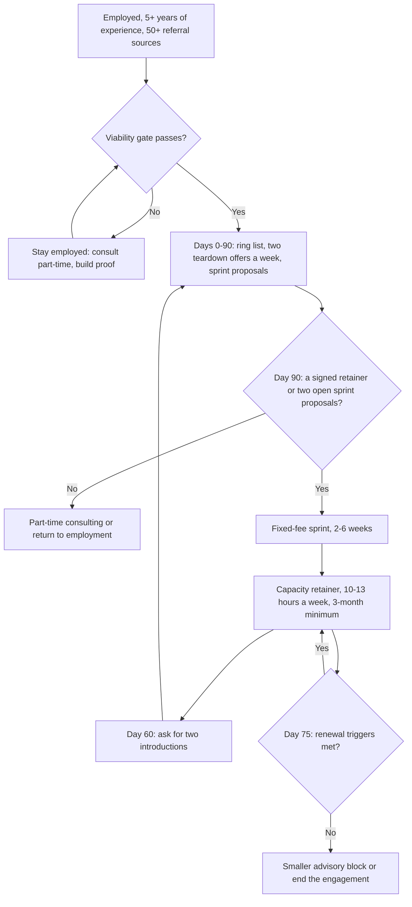

# Freelance and Fractional AI Work: Rates, Income Reality, Clients and Contracts

> Whether to go independent as an AI consultant or fractional Head of AI: dated rates and modelled income, the prerequisites to check first, a network-first client plan, retainer and contract terms to hold, and the stop rules for a practice that stalls.

**Dates.** Rates and platform fees are as read by [T0-18](../../research/sessions/T0-18-freelance-fractional-ai-practice-economics.md) between about 2026-10-20 and 2026-10-25; the session is dated as of 2026-10-24. Every rate on this page is asked, advertised or computed. None is a transacted rate. Re-verify them by 2027-01-18. **Grades** (EGP-1.0): A primary or measured; B transparent secondary; C vendor, platform or single source; D judgement, recalled or modelled (T0-18 grades its own income model D); E searched, nothing found; M calculation, which inherits the weakest grade of its inputs; P practice-curated and unmeasured. **This is not legal or tax advice.** Have a lawyer review contracts, and a CPA or chartered accountant review tax, in your jurisdiction.

## The short answer

1. **Independence is a separate career, entered from strength.** T2-01 makes it a branch at Stage 6 for practitioners with 5+ years of experience and a strong network. Network acquisition replaces job boards, contracts replace offer negotiation, and client retention replaces onboarding [B/C · T2-01 L79; C · T2-01 L629–635].
2. **Do not resign until the viability gate holds:** about 900–1,000 paid hours of committed or highly likely work in sight for year one, at least six months of living costs, and acceptance of a P25 net near $38K, or $19–24K if the outside view is right [D · T0-18 L145].
3. **Price from the asking corridor; plan below it.** US senior AI consultants ask $150–250 an hour on Go Fractional's benchmarks. Posted offers run at 0.59–0.91× of asks, so plan realised rates nearer the lower half; T0-18's model uses a $165 median [C · T0-18.F1]. Elsewhere, use local data: the UK median is £550 a day [B · T0-18.F3]; vendors quote India-based seniors at $50–100 an hour, so plan on $70–100 [C · T0-18.F4].
4. **Sell outcomes and capacity, not hours.** Open with a fixed-fee sprint of 2–6 weeks. Convert it to a capacity retainer for 10–13 hours a week, priced on a 52/12-week month: $8,700–12,700 a month at $200–225 an hour [D · T0-18 L129–133]. Retainers that vendors compute or list for that load run about $8–13K a month [C · T0-18.F5].
5. **Find clients through your network first.** 92% of Go Fractional's survey respondents find clients through networks; 94% of Fractional Jobs respondents won clients through referrals, and 72% found their first client through their personal network [C · T0-18.F6]. Agency-sourced work paid about half the direct rate in the one dataset that measured it [C · T0-18 L400–404].
6. **Hold three contract positions and one stop rule.** Cap liability at 1× fees over the prior 12 months, carve your pre-existing materials out of the assignment [A · T0-18.F7], and disclaim the accuracy of AI output [B · T0-18 L461]. If after 90 days you hold neither a signed retainer nor two outstanding sprint proposals, move to part-time consulting or back to employment [D · T0-18 L145].

## At a glance



The gate, the day-90 stop rule and the day-75 renewal check are T0-18's design judgement [D · T0-18 L145, L376]. The referral loop follows the network-first evidence [C · T0-18.F6].

## The five parts of an independent practice

| # | Part | The question it answers | Main evidence |
|---|---|---|---|
| 1 | The gate | Should you go independent yet? | T2-01 §6.6 prerequisites [C]; T0-18 Recommendation 6 [D] |
| 2 | Rates and income | What do clients pay, and what is left? | T0-18.F1–F5 [A–C]; T0-18.F10 [D] |
| 3 | Clients | Where does the work come from? | T0-18.F6 [C]; T0-18.F12 [A/C] |
| 4 | Pricing and engagement shape | How do you sell it? | T0-18 Detailed Findings 2–3 [D]; T0-18.F5 [A/C] |
| 5 | Contracts and insurance | What protects you? | T0-18.F7 [A]; T0-18.F9 [B/C] |

### 1. The gate: should you go independent?

**Decision rule.** Go when every row passes. If the pipeline or runway row fails, do not resign: consult part-time while employed and re-test the gate each quarter [P].

| Check | Passes when | Evidence |
|---|---|---|
| Experience | 5+ years of relevant professional experience | [C · T2-01 L632]. AI consultants and strategists report a median of 8.2 years on LinkedIn's Jobs on the Rise 2026 list [C · T0-06 L109]; T2-01 credits that figure to AI PMs, which [ERRATA U8](../../research/ERRATA.md) corrects |
| Referral sources | At least 50 people who could refer you, each of whom you can contact personally | [C · T2-01 L633] |
| Pipeline | About 900–1,000 paid hours of committed or highly likely work in sight for year one; two retainers at 10 hours a week for 48 weeks is 960 | [D · T0-18 L145] |
| Runway | At least six months of living costs in reserve | [C · T2-01 L634]; [D · T0-18 L145] |
| Year-one ramp | You can live on a modelled US year-one net of $52K / $71K / $92K at P25 / P50 / P75 (3 months at 10% utilisation, 3 at 40%, 6 at 60%) | [D · T0-18 L145] |
| Bad case | You accept a steady-year P25 near $38K, or $19–24K if 45–60% of entrants stall | [D · T0-18 L145, L597–599] |
| Differentiation | Domain expertise that a client cannot easily replace with an employee | [C · T2-01 L635] |
| Proof | Two or three engagements you can cite, or can run in the first 90 days | [D · T0-18 L142] |
| Insurance | Tech E&O and cyber quoted, and your broker asked in writing about AI-output claims | [C/B · T0-18.F9] |
| Employment terms | Your employment contract does not restrict the outside work you plan | [D · T0-18 L1284, recalled rather than found] |

The people who take this path skew senior. 87% of Fractional Jobs respondents (n=1,733 across all functions, including past and aspiring fractionals) have 11+ years of experience, and 83% are Director-level or above [C · T0-18 L1315, L1406].

**Which of the two roles.**

| | Independent AI consultant or contractor | Fractional Head of AI or CAIO |
|---|---|---|
| What you sell | Hands-on engineering or advice, by the hour or as a fixed-fee project | A part-time leadership seat, usually with hands-on work: 91% of Fractional Jobs respondents do hands-on execution [C · T0-18 L327] |
| Typical load | Not measured: no evidence in the corpus for independent AI consultants | 13 hours a week for a CAIO and 15 for a CTO on Go Fractional; about 10 in a typical Fractional Jobs posting. The median fractional worker (all functions) bills 21 client-facing hours a week, and 64% serve two or more clients [C · T0-18 L327] |
| Role page | [Independent AI Consultant / Contractor hub](../02-roles/hubs/independent-ai-consultant.md) | [Fractional Head of AI / Fractional CAIO hub](../02-roles/hubs/fractional-ai-leader.md) |

### 2. Rates and income, as of October 2026

**Rates.** All asked, advertised or computed; none transacted.

| Segment | Figure | Kind of figure | Grade · source | Date |
|---|---|---|---|---|
| US senior AI consultant | $150–250/hr (P25–P75 of Go Fractional's CAIO and CTO asks) | Asking rate | C · T0-18.F1 | About 2026-10-20 and 2026-10-25 |
| US fractional CAIO | Asks average $190–208; listings offer $125–189; offers 0.66–0.91× of asks | Ask vs posted offer; 6, then 10 posts in 90 days | C · T0-18 L193–198 | Same two reads |
| US fractional CTO | Asks average $209–212; listings offer $124–129; offers 0.59–0.61× of asks | Ask vs posted offer; 19, then 17 posts in 90 days | C · T0-18.F1 | Same two reads |
| US fractional survey averages | $153 across fractional roles and $218 for CAIO (Go Fractional, n=213); $209–229 by function, none AI-specific (Fractional Jobs, n=1,733) | Self-reported | C · T0-18.F1 | April 2026; 2026 report |
| US senior AI-engineer contractor | $130–235/hr: A.Team $130 / $165 / $200; Second Talent $155–235 | Vendor rate cards | C · T0-18.F2 | As of 2026-10-24 |
| US architect or CTO tier | $200 / $220 / $240+ (A.Team low / mid / high) | Vendor rate card | C · T0-18.F2 | As of 2026-10-24 |
| US retainer, 10–13 hours a week | About $8–13K a month | Computed by vendors and reported | C · T0-18.F5 | As of 2026-10-24 |
| One published package | Fractional AI Architect: 8 / 16 / 32 hours a month for $1,800 / $3,400 / $6,400 ($225 / $212.50 / $200 an hour) | One firm's own price | A · T0-18 L234–236 | As of 2026-10-24 |
| UK GenAI contract | Median £550 a day; P25 £463, P75 £675, P90 £788; London median £575 | 900 job-advert rates | B · T0-18.F3, L214 | Six months to 2026-10-20 |
| Germany, DACH survey | €103/hr average; €108 for data and analytics | Survey, n=5,412 | C · T0-18.F3 | Fielded November 2025 to February 2026 |
| France | €600–900 a day; €1,000–1,500 for gen-AI and agent specialists | Blog citing Malt, Hays and Free-Work | C · T0-18.F3 | As of 2026-10-24 |
| India-based senior, international clients | $50–100/hr quoted: Second Talent $50–75, Navtechy $60–100; $50–90 for gen-AI work | Vendor quotes; no realised-rate dataset | C · T0-18.F4 | As of 2026-10-24 |

**How to read the rates.**
- Treat $150–250 an hour as the US asking corridor and $300 as a stretch tier; figures above $300 appear only in agency marketing [C · T0-18.F2]. If your realised median is $140 rather than $165, modelled median net falls by $17K [D · T0-18 L1291].
- The AI premium is not a uniform multiplier. Claims run from 10–25% (A.Team) to 34% (Upwork) and 37% (Second Talent), while YunoJuno says AI skills "do not yet create a significant rate premium" market-wide [C · T0-18.F2].
- Ask whether a quoted retainer means hours a week or hours a month. One vendor's monthly-hours tiers imply $250–1,250 an hour, and T0-18 excluded them [C · T0-18 L241].

**Income.** No AI-specific income distribution exists [E · T0-18.F10]. The figures below come from T0-18's Monte Carlo model: a 42-hour week over 46 weeks, a realised-rate median of $165, overhead of $15,308 a year, health insurance of $7,500 a year, and federal tax only, with no state tax [D · T0-18 L557–567].

| US net after overhead, health insurance and federal tax (modelled) | P25 | P50 | P75 | P90 |
|---|---|---|---|---|
| Practitioners who get traction; revenue $135K / $167K / $205K / $245K | $83K | $105K | $130K | $160K |
| Planning case: 30% of entrants stall | $38K | $87K | $118K | $149K |
| 45% of entrants stall | $24K | $68K | $109K | $141K |
| Outside-view case: 60% of entrants stall | $19K | $39K | $94K | $131K |
| First year, with the ramp in part 1 | $52K | $71K | $92K | not given |

Sources: [D · T0-18 L580–582, L593–599, L145].

- **The traction row is conditional.** The median practitioner with traction bills about 1,030 hours (53% of working hours) at $165 and nets $105K. A W-2 job with the same take-home would need a salary of about $137K, before counting benefits, paid leave or retirement matching [D · T0-18 L587].
- **The stall sets the bottom, not the top.** P25 depends on whether you get traction at all; P75 and P90 depend on rate and traction [D · T0-18.F10]. T2-01 calls the path bimodal [D · T2-01 L683].
- **Low billing is common among freelancers generally.** In freelancermap's DACH survey, 24% of respondents bill under 50 days a year and 38% under 100, part-timers included [C · T0-18 L571].
- **All-freelancer proxies sit lower.** Upwork's median for full-time skilled freelancers is $85,000 (data year not stated); Consulting Success's bands imply roughly $29K (P25) and $84K (P50) a year for consultants in general, by T0-18's interpolation [C · T0-18.F10].
- **India-resident base case** ($70 an hour median): $38K / $53K / $64K / $85K at P25 / P50 / P75 / P90 [D · T0-18.F10]. See the geography notes below.

### 3. Clients: networks first

- **Networks dominate in every survey T0-18 found.** 92% of Go Fractional respondents (n=213, April 2026) find clients through networks, 54% through LinkedIn and 29% through platforms; 94% of Fractional Jobs respondents (n=1,733) won clients through referrals [C · T0-18 L385–386].
- **Acquisition is the main pain.** It is the top challenge for 90% of Go Fractional respondents, and 78% of Antenna's 2019 sample of $100K+ consultants name business development a top-three pain [C · T0-18 L385, L387].
- **Volume channels are not income channels.** In Consulting Success's data, outbound phone and direct mail win the most clients, while referrals (38%) and networking (18%) sit behind the highest incomes [C · T0-18 L388, L394].
- **Not found:** AI-specific conversion rates by channel, cost per client, time to a first retainer, or any quantified value of open-source or content reputation [E · T0-18 L440].
- **Trust the direction, not the magnitudes:** the two biggest surveys are sponsor-run [D · T0-18 L1294].

| Channel | Use it as | Evidence | Watch for |
|---|---|---|---|
| Personal network and referrals | Primary | 92–94% find or win clients this way [C · T0-18.F6]; fully direct work averaged $223 an hour in Antenna's 2019 sample (n=80, selected on earning $100K+) [C · T0-18 L400–402] | Small volumes suffice: see the funnel table under "How to do it" |
| LinkedIn | Extension of the network | 54% of Go Fractional respondents find clients through it [C · T0-18 L385] | No AI-specific conversion data [E · T0-18 L440] |
| Fractional networks | Secondary | Go Fractional membership is free [A · T0-18.F12]; Fractionus accepts under 3% of applicants [C · T0-18 L420]; 29% of Go Fractional respondents find clients through platforms [C · T0-18 L385] | Small samples: 6–19 posts in 90 days on Go Fractional's CAIO and CTO pages [C · T0-18.F1] |
| Talent marketplaces | Utilisation filler | Upwork's freelancer fee is 0–15% per contract; Toptal charges talent nothing; Braintrust lets talent keep 100% on clients they bring [A · T0-18.F12]. Client-side markups are estimates: Toptal 30–50%, Braintrust 10–15%, Catalant 20–30% of total fees [C · T0-18.F12] | Non-circumvention terms; Upwork reports gen-AI and creative per-contract earnings down 13% while contract starts rose 90% [C · T0-18.F11] |
| Agency or boutique subcontracting | Floor | Fully agency-sourced work averaged $113 an hour against $223 direct, a 49% drop (2019, n=80) [C · T0-18 L400–404] | Price at about half your direct rate if the agency owns the client; negotiate the right to cite the work [D · T0-18 L422] |
| Content and open source | Support for referrals | Not quantified [E · T0-18 L424]; 70% of consultants get zero website leads in Consulting Success's data [C · T0-18.F6] | Treat it as something a referrer can forward, not as a funnel [D · T0-18 L424] |

### 4. Pricing and engagement shape

1. **Front door: a fixed-fee sprint.** A 1–2 week diagnostic or a 2–6 week pilot at estimated hours × list rate × 1.2–1.25; the multiplier covers a 20% unbilled-hours case with a margin [D · T0-18 L133, L418]. A fixed fee keeps the gain from AI-assisted delivery, which hourly billing hands to the client [D · T0-18 L133]. The evidence for value-based pricing is weak: 51% of value-based pricers against 39% of hourly pricers report $10K+ average projects, in self-reported data published by a coaching business [C · T0-18 L133].
2. **Core: a capacity retainer** priced as hours a week × 52/12 × rate. The vendor convention of 4 weeks a month gives away about 8% of the fee: a $200 rate becomes $184.62 [D · T0-18 L130, L283].
3. **Terms that protect the rate:** a 3-month minimum, billing monthly in advance, an hours cap with a stated overage rate, no rollover, 30 days' notice after the minimum, and a client project owner for 2–4 hours a week [D · T0-18 L130]. One firm publishes most of these terms in its own package [A · T0-18 L101].
4. **Cap the hours.** At 12 hours of actual work a week, an $8,000 retainer for a nominal 10 hours earns $167 an hour on a 4-week month and $154 on 52/12 weeks, a 17–23% cut [D · T0-18 L294–304].
5. **Do not let AI efficiency cut your revenue.** If AI cuts delivery hours by 20%, 30% or 50%, an hourly rate must rise 25%, 43% or 100% to hold revenue [D · T0-18 L320–322]. 98% of Fractional Jobs respondents say AI made them more efficient [C · T0-18.F11].
6. **Equity only on top of cash.** Take 0.15–0.25% (the FAST Standard tier) with 2-year vesting and a 3-month cliff, and only beside a near-market cash retainer [D · T0-18 L347]. One CMO-focused source says equity-only deals work only in a narrow band and otherwise fail within six months; T0-18 found no outcome data on advisory equity for AI leaders [C · T0-18 L314].
7. **Review rates every six months** against the Go Fractional benchmarks [D · T0-18 L148].

**Starting rate card.** These are T0-18's inferred list prices, not market statistics [D · T0-18 L260–266].

| Offer | US-market clients | Europe | India-based, selling to US or EU |
|---|---|---|---|
| Senior hands-on engineering, time and materials | $175–225/hr list; floor $150 | UK £675–790 a day; Germany €100–130/hr; France €800–1,200 a day | $70–100/hr; test $120+ only with evidence |
| Architect or fractional-leader hourly | $225–275/hr list | No source; do not extrapolate | $100–150/hr is a hypothesis with no data |
| Fractional Head of AI retainer, 10–13 hours a week | $8,700–12,700 a month | Local day rate × days a week × 4.33; no European retainer data | $3,000–5,600 a month on the same formula |
| Advisory block | 8 / 16 / 32 hours a month at about $1,800 / $3,400 / $6,400 | n/a | n/a |
| Fixed-fee sprint, 2–6 weeks | Estimated hours × list rate × 1.2–1.25 | Same formula, local rates | Same formula |

### 5. Contracts and insurance

Start from Common Paper's Professional Services Agreement v1.1, free under CC BY 4.0 [A · T0-18.F7], and hold these positions [D · T0-18 L135–136]:

| Clause | Position | Grade · source |
|---|---|---|
| General cap | 1× fees paid or payable under the SOW in the 12 months before the claim, the template default. Open at 6 months only if you will concede to 12; no source supports 3–6 months as standard | A · T0-18.F7; D · T0-18 L136 |
| Supercap | Confidentiality and data-security breaches only, at the lesser of 5× fees and your insurance limits; never for AI-output accuracy | A for the 5× default, D for the formula · T0-18 L453 |
| Consequential damages | Keep the mutual waiver | A · T0-18 L452 |
| Your pre-existing materials | Schedule agent harnesses, orchestration code, prompt templates, evaluation suites and tooling as Provider Materials; the client may use them only as needed to use the deliverables | A for the mechanism, D for the list · T0-18 L457 |
| Deliverables | Assign on payment, excluding Provider and third-party materials. No work-made-for-hire clause: in California it can make the client a statutory employer | A · T0-18 L456; B · T0-18 L458 |
| AI output | No accuracy warranty; a qualified person reviews output before consequential decisions; assign whatever rights exist without warranting copyright; take AI output out of the non-infringement warranty and indemnity | B · T0-18 L460–461; D for the carve-out · T0-18 L462 |
| Client data | No training or fine-tuning on client data except a model delivered to the client; model providers only under no-training terms | B · T0-18 L463 |
| Third-party models | Provider terms flow down; you notify deprecations you learn of; no warranty of continued availability | B · T0-18 L464 |
| Scope | Change orders in writing; the hours cap and overage rate in the SOW | A · T0-18 L469 |
| Retainer term | Put the 3-month minimum and 30-day notice in the SOW: the template allows ending for any reason only when no SOW is active | A · T0-18 L468 |
| Regulated deployments | Where EU or Colorado rules apply, assign the deployer role and compliance documentation in writing | D · T0-18 L136 |
| References | Ask in the SOW for permission to cite the client; the template has a "No Publicity" section | D · T0-18 L472 |

**Insurance.** Median annual broker quotes for small IT consultants are $899 for tech E&O and $1,540 for cyber, with typical $1M / $1M limits; they are not AI-specific [C · T0-18.F9]. Fenwick (2026-06-15) reports an ISO generative-AI exclusion on commercial general liability from January 2026, and some carriers declining AI-output liability under tech E&O [B · T0-18.F9]. Ask your broker in writing. If AI output is not covered, keep the AI-output cap at 1× fees and refuse any supercap for output accuracy [D · T0-18 L139].

**Regulation.** Output ownership, the EU AI Act timetable and Colorado's rules moved during 2026, and India's DPDP Rules were notified on 13 Nov 2025 [B · T0-18.F8]. Regulatory status expires within weeks, so this page does not restate it. Read T0-18.F8 (as of 2026-10-24), re-check before signing, and see [Governance careers](governance-careers.md).

**Kit.** Contract: Common Paper PSA v1.1 [A · T0-18 L154]; skip Docracy, which is offline or legacy [C · T0-18 L1270]. Invoicing: Stripe Invoicing at 0.4% or 0.5% per paid invoice plus processing, or Bonsai, whose plans run $9–49 per user per month on annual billing, with contracts and invoicing from the Essentials plan up [A · T0-18.F12]. Foreign receipts: Wise or Payoneer [D · T0-18 L151]. More tool verdicts are in the [tool catalog](../00-start/tool-catalog.md). T0-18's full clause table and illustrative sample wording are in its Detailed Findings 5 [D].

## How to do it: the network-first launch plan

1. **Run the gate while employed.** Score every row in part 1. *Done when:* every row passes, or you have a dated plan to close the gaps through part-time work [D · T0-18 L145].
2. **Set up to invoice (week 1).** US: an LLC or sole proprietorship. India: a sole proprietorship under the presumptive scheme if receipts stay at or below ₹75 lakh, GST registration with a Letter of Undertaking, and an authorised-dealer bank account for foreign receipts [D · T2-01 L652]. *Done when:* you can issue an invoice and receive a foreign payment, and an accountant has confirmed the structure.
3. **Assemble the contract kit (week 2).** Common Paper PSA v1.1 with the positions in part 5, a sprint SOW and a retainer SOW (templates A and B), and insurance quotes [D · T2-01 L653; T0-18 L135–139]. *Done when:* a lawyer has reviewed the kit and your broker has answered the AI-output question in writing.
4. **Build the ring list (weeks 1–2).** About 100 contacts in four rings: former managers and colleagues now at director level or above; founders and investors you have worked with; peers at adjacent consultancies; past clients [D · T0-18 L411]. *Done when:* the list holds at least 50 names, T2-01's floor [C · T2-01 L633], each with a last-contact date and a one-line guess at what they need [P].
5. **Activate the network (weeks 1–4, then weekly).** Announce the practice and set your LinkedIn positioning [D · T2-01 L654]. Then send two personal outreaches a week, each offering a 45-minute AI-readiness teardown, free or for a small fee, with a one-page written output [D · T0-18 L412]. *Done when:* every name on the list has heard from you once, and the two-a-week habit has a log.
6. **Turn calls into sprints.** Send a fixed-fee sprint proposal within 48 hours of any call that surfaces a concrete problem [D · T0-18 L413]. *Done when:* no qualifying call goes 48 hours without a proposal.
7. **Land proof work (months 1–3).** Aim for two or three proof engagements, and a first retainer ($8–13K a month) or project ($5–20K) [D · T0-18 L142; T2-01 L655]. *Done when:* by day 90 you hold a signed retainer or two outstanding sprint proposals. If not, take the stop rule [D · T0-18 L145].
8. **Add secondary channels.** A free Go Fractional profile and one or two networks; marketplaces only to fill utilisation, after reading their non-circumvention terms [D · T0-18 L142, L420]. *Done when:* profiles are live and no platform term stops you working directly with a client you brought [P].
9. **Reach two concurrent engagements (months 3–6), then hold steady (month 6 onwards).** Two concurrent engagements is T2-01's stability target; at a nine-month average life you need about 2.7 new retainers a year [D · T2-01 L656–657; T0-18 L428]. *Done when:* two retainers run at once, and first calls arrive at the rate the table below gives for your close rate.
10. **Harvest referrals inside each engagement.** At day 60, ask for two introductions and for permission to cite the client [D · T0-18 L414]. At day 75, run the renewal check (template D) [D · T0-18 L376]. *Done when:* every engagement has produced an introduction request and a renewal decision.

**How many first calls you need.** Modelled for two concurrent retainers, a nine-month average life, and half of first calls becoming proposals [D · T0-18 L428–434]:

| Proposal close rate (assumed) | New retainers a year | First calls a year | First calls a month |
|---|---|---|---|
| 30% | 2.7 | 18 | 1.5 |
| 50% | 2.7 | 11 | 0.9 |
| 70% | 2.7 | 8 | 0.6 |

The 30–70% close range is a coaching firm's claim for its own clients, with no sample [C · T0-18 L440]. The point holds either way: this is a relationship funnel, not a volume funnel, and fewer than two good first calls a month is enough [D · T0-18 L436].

## Templates and examples

### A. Fixed-fee sprint proposal [P]

The structure follows T0-18's Recommendation 2 and its productised ladder [D · T0-18 L133, L418]; the wording is unmeasured.

```text
Subject: [Client]: fixed-fee [diagnostic | pilot] on [problem in the client's words], [2–6] weeks

Problem (from our call on [date]): [one sentence, with the metric the client named]
Outcome by [end date]:
  1. [deliverable, e.g. three to five use cases scored on value, feasibility and risk]
  2. [deliverable, e.g. pilot readout with a KPI against its baseline]
Out of scope: [list]. Any change goes through a written change order.
Client inputs: a project owner, [name], for [2–4] hours a week; approvals within [3] business days.
Fee: [estimated hours] × [list rate] × [1.2–1.25] = [fixed fee]; payment terms [terms].
Terms: [Common Paper PSA v1.1 + this SOW]. A qualified person reviews AI output before relying on it.
After the readout: if [success criterion] is met, a capacity retainer of [10–13] hours a week from [date].
```

### B. Capacity retainer SOW [P]

The terms follow T0-18's proposed term sheet [D · T0-18 L338–351]. Go Fractional names weekly bandwidth, overage rates, 30/60/90 plans, decision rights and renewal triggers as the items to structure [C · T0-18 L334].

```text
Role: Fractional Head of AI for [Client]. Owns AI strategy and the use-case portfolio; sets architecture
  and evaluation standards; advises on build, buy and vendors; coaches the team. Build work: separate SOW.
Hours: up to [10–13] a week, tracked weekly. No rollover. Overage at [rate]/hr with written pre-approval.
Fee: [hours a week] × 52/12 × [rate] = [monthly fee], billed monthly in advance.
Term: 3-month minimum, then month-to-month on 30 days' written notice. Prepaid fees for hours not worked
  are refunded pro rata, except where Provider ends the SOW for Customer's uncured breach.
Client owner: [name], [2–4] hours a week; approvals within 3 business days.
Acceptance: monthly hours statement, plus a deliverable and decision log.
Reporting: weekly written update; monthly steering review; quarterly roadmap refresh.
Decision rights: Head of AI decides architecture and evaluation standards within budget; recommends
  use-case priority and vendors; advises on budget, headcount and risk acceptance. [Executive] approves.
Access: client-issued accounts, least privilege; no production credentials unless this SOW says so;
  AI tools used on client material only under no-training terms.
Equity (optional, on top of the fee): [0.15–0.25]%; 2-year vesting; 3-month cliff.
Exclusivity: none. Other clients in the same sector are disclosed.
Insurance: tech E&O and cyber held; certificate on request.
References: Provider may name Customer as a reference [yes | with approved wording | no].
```

### C. The first 90 days of a fractional Head of AI

| Phase | Deliverables [D · T0-18 L357–360] |
|---|---|
| Days 0–30: baseline | Inventory of AI use, data, tools and spend; stakeholder interviews; regulatory and privacy screen; three to five use cases scored on value, feasibility and risk; quick-win recommendation; 30-day readout |
| Days 31–60: operating model | Acceptable-use and data-handling policy; evaluation and red-team standard for LLM features; build, buy or partner decisions and a vendor shortlist; reference architecture with a model-provider and deprecation strategy; pilot kickoff; hiring plan |
| Days 61–90: delivery and hand-off | Pilot readout with KPIs and a cost model; 12-month roadmap and budget; team enablement sessions; renewal decision memo |
| Standing | Weekly update; monthly hours statement; decision log; quarterly roadmap refresh |

### D. Day-75 renewal check

```text
Renew only if all four hold:
[ ] (a) A pilot has a measured KPI against its baseline: [KPI], [baseline], [value at day 75]
[ ] (b) A named internal owner can run the roadmap: [name]
[ ] (c) A hiring plan or budget is approved: [what], [date]
[ ] (d) The client has used at least 70% of contracted hours: [used] / [contracted]
If (a) to (c) fail: offer an advisory block of [8–16] hours a month, or end the engagement.
```

Underuse of hours is a churn signal. In the one source that discusses early exits, they came from mismatches in scope, compensation and measurement [D/C · T0-18 L376].

### E. Weak and strong

| | Weak | Strong |
|---|---|---|
| Outreach note [P] | "I've gone independent. Let me know if you ever need help with AI." | "[Name], since [shared project] I've been helping [kind of company] [specific outcome]. I'm offering a 45-minute AI-readiness teardown of one workflow you choose, with a one-page written readout. Would [date] or [date] suit?" |
| Positioning [D · T0-18 L1300] | "Fractional Chief AI Officer, open to new clients." | "I take one AI use case to a pilot with a measured KPI, plus a 12-month roadmap, in 90 days." |
| Retainer quote [D · T0-18 L130, L289] | "$8,000 a month for about 10 hours a week; flexible." | "Up to 10 hours a week at $200 an hour: $8,667 a month (10 × 52/12 × $200), billed monthly in advance; overage at $200 an hour with written approval; no rollover; 3-month minimum, then 30 days' notice." |
| Sprint quote [D · T0-18 L133] | "About [60] hours at my hourly rate, billed as we go." | "Fixed fee: [60] estimated hours × [list rate] × 1.2 = [fee], for [two named deliverables] by [date]." |

Why the positioning row matters: Go Fractional showed 6, then 10 CAIO posts in 90 days (326 profiles on the first read), labelled "falling sharply", and T0-18's verdict is "sell outcomes, not the title" [C · T0-18 L193–194, L1261].

## Geography notes

### India-based providers selling to US or European clients

- **Rate.** Quote in USD at $70–100 an hour until you have evidence of a higher realised rate, then test $120 and above with a few clients; no dataset supports the higher figure [D · T0-18 L151]. T0-18 found no data on what US or European startups pay India-based AI consultants, and none on Indian domestic client rates [E · T0-18 L228].
- **Receipts.** Use Wise or Payoneer rather than PayPal. Payment friction runs from about 1.2% to 5% on Payoneer's own schedule to 8–9% on PayPal, per a payments vendor [C · T0-18.F4].
- **The tax ceiling.** The presumptive scheme (section 58 of the Income-tax Act 2025, which consolidates the old §44ADA) keeps about 83–84% of billing [M · T0-07 L90] up to ₹75 lakh (about $79K), provided cash receipts are at most 5% [A · T0-07 L84]. One rupee above ₹75 lakh adds about ₹11.8 lakh of tax, and matching the take-home needs about ₹92–98 lakh of billing [M · T0-07 L87; T2-01 L667]. T0-18's model has net income falling by about $7K as receipts rise from $75K to $80K [D · T0-18.F4].
- **Eligibility is not settled.** One source says technical consultancy "may qualify" for the scheme. If it does not apply, the modelled India P50 falls from $53K to $45K [C/D · T0-18 L1323–1324].
- **GST.** One accounting blog reports zero-rating for exported services under a Letter of Undertaking, and a ₹20 lakh registration threshold [C · T0-18 L151].
- **Do this:** see a chartered accountant before receipts approach ₹75 lakh, and read [India remote tax](../09-compensation/india-remote-tax.md) and the [India remote playbook](india-remote-playbook.md).

### Europe

- Price from local data in local currency; converting a US card overstates what the market shows [B/C · T0-18.F3].
- The UK median has not risen: £613–625 in 2024, then £550 in 2025 and in the six months to 2026-10-20 [B · T0-18.F3].
- T0-18 found no European retainer data, and no source that separates Heads of AI or fractional leaders in any European country [E · T0-18 L216].

## Checklist

- [ ] Every row of the gate passes, including 50+ referral sources and six months of living costs.
- [ ] I can see about 900–1,000 paid hours of committed or highly likely work for year one.
- [ ] I budgeted on the lower half of the asking corridor, not on the ask.
- [ ] My retainer uses hours a week × 52/12 × rate, with an hours cap, an overage rate and no rollover.
- [ ] I have a fixed-fee sprint offer priced at estimated hours × list rate × 1.2–1.25.
- [ ] My ring list has at least 50 names, and I send two personal teardown offers a week.
- [ ] Every qualifying call gets a sprint proposal within 48 hours.
- [ ] My contract kit starts from Common Paper PSA v1.1: a 1× fees, 12-month cap; a Provider Materials schedule; AI-output and no-training clauses; the retainer minimum and notice in the SOW. A lawyer has reviewed it.
- [ ] Tech E&O and cyber are in place, and the AI-output question is answered in writing.
- [ ] I read each marketplace's non-circumvention terms before signing.
- [ ] My day-90 stop rule is written down with a date.
- [ ] Every engagement has a day-60 introduction ask and a day-75 renewal check in the calendar.
- [ ] My rates are reviewed every six months.
- [ ] India: a chartered accountant has advised me before receipts approach ₹75 lakh, and receipts go through Wise or Payoneer.

## Pitfalls

| Red flag | Why it hurts | Fix |
|---|---|---|
| Resigning with no work in sight | P25 net falls from $83K to $19–38K when 30–60% of entrants stall [D · T0-18.F10]; acquisition is the top challenge for 90% of Go Fractional's surveyed fractionals [C · T0-18.F6] | Pass the gate first; consult part-time while employed |
| Budgeting on the asking rate | Go Fractional's posted offers run at 0.59–0.91× of asks [C · T0-18.F1]; a $140 realised median instead of $165 cuts modelled median net by $17K [D · T0-18 L1291] | Budget on the lower half of the corridor |
| Pricing a retainer on a 4-week month | Gives away about 8% of the fee [D · T0-18 L130] | Hours a week × 52/12 × rate |
| No hours cap | 12 hours worked on a 10-hour, $8,000 retainer earns $154–167 an hour [D · T0-18 L294–304]; scope creep is the top retainer-profit problem for 59 of 115 agencies in one survey, seen through an aggregator [C · T0-18.F11] | Hours cap, overage rate, change orders, no rollover |
| Pure hourly billing while AI speeds delivery | A 30% cut in hours needs a 43% higher rate to hold revenue [D · T0-18 L321]; the UK GenAI median fell from £613–625 (2024) to £550 [B · T0-18.F3] | Sell sprints and capacity retainers |
| Relying on marketplaces and agencies | Fully agency-sourced work averaged $113 an hour against $223 direct in Antenna's sample (2019, n=80) [C · T0-18 L400–404] | Network first; platforms fill gaps; read non-circumvention terms |
| Selling the title in a thin market | Go Fractional showed 6, then 10 CAIO posts in 90 days (326 profiles on the first read), labelled "falling sharply" [C · T0-18 L193–194] | Sell the outcome; keep fractional-CTO and architect positioning available [D · T0-18 L1300] |
| Equity instead of cash | Equity-only deals fail within six months outside a narrow band, per one source; no payoff data [C · T0-18 L314] | Equity only beside a near-market cash retainer |
| An uninsured supercap or an unlimited AI-output indemnity | Some tech E&O carriers decline AI-output liability [B · T0-18.F9] | AI-output liability at 1× fees; a supercap no higher than your policy limit |
| Two clients and no pipeline | Each is half your revenue; losing one costs about $16K of net for a three-month gap (modelled) [D · T0-18 L1339] | Keep first calls coming while fully booked [P] |
| Unreviewed AI output in a deliverable | Deloitte refunded over A$97,000 of a roughly A$440,000 government contract after AI-generated errors [C · T0-18.F11] | A human-review clause and practice; an accuracy disclaimer |
| India: drifting just past ₹75 lakh | One rupee over adds about ₹11.8 lakh of tax [M · T0-07 L87; T2-01 L667] | Plan billing with a chartered accountant: stay at or below ₹75 lakh, or commit to billing past about ₹94 lakh [M · T2-01 L667] |

## Evidence and limits

- **Rates are asks, not transactions.** Every rate is asked, advertised or computed. The strongest are the UK adverts (B) and one firm's published package (A); T0-18 found no invoice-level data [C · T0-18.F1–F5].
- **Income is modelled.** No AI-specific income percentiles exist. T0-18's figures come from its own Monte Carlo model (D), and the traction row describes the upper tail; plan with the 30–60% stall rows [D · T0-18.F10, L1312].
- **Acquisition surveys are sponsor-run.** Trust the direction (networks first), not the magnitudes. The network finding replicates across sponsor-run, independent and platform sources [C · T0-18 L1294].
- **Demand signals conflict.** Go Fractional labelled CAIO demand "falling sharply" and CTO demand "rising sharply", then "rising"; a Fractional Jobs sponsor release claims hiring up 149% year on year [C · T0-18.F11].
- **Return to employment is unresolved.** Only intent data exist: 90% not interested in returning (from a sample that mixes active, past and aspiring fractionals), 84% would be self-employed again, 78% plan to continue. Survivorship bias is likely. Consulting Success says over half of consultants regain their prior employee income within two years, which is not the same as staying [C · T0-18.F11].
- **Contract positions are judgement.** The template mechanics are A. The positions and T0-18's sample wording are design (D), untested in any jurisdiction [D · T0-18 L477].
- **India** has no realised-rate data and no domestic client rates [E · T0-18 L228], and scheme eligibility for AI consultancy is open [C · T0-18 L1323].
- **Corrections applied.** [ERRATA U8](../../research/ERRATA.md): the 8.2-year median belongs to AI consultants and strategists [C · T0-06 L109, L174], not to AI PMs as T2-01 L632 says. T2-01's rate table (L642) shows £58–99 an hour as a UK contractor rate; it is T0-18's 8-hour conversion of the advert day rates [B · T0-18 L95], so this page quotes the day rates.
- **Dates.** Rates are as of about 2026-10-20 to 2026-10-25; re-verify by 2027-01-18. Regulatory status is deliberately not restated (part 5).
- **What would change this advice** [T0-18 L156]: transaction-level data showing realised AI retainer rates well below $150 an hour; evidence that AI-output claims are uninsurable for solo providers; evidence that 3–6 month caps are routinely accepted in consulting; tax advice that the Indian presumptive scheme does not apply to AI consultancy; behavioural data showing that most independents return to employment within two years.

## Next steps

- **Role pages:** the [Independent AI Consultant / Contractor hub](../02-roles/hubs/independent-ai-consultant.md) and the [Fractional Head of AI / Fractional CAIO hub](../02-roles/hubs/fractional-ai-leader.md), with profiles in the role catalog ([consultant](../02-roles/role-catalog.md#profile-independent-ai-consultant), [fractional leader](../02-roles/role-catalog.md#profile-fractional-ai-leader)). For full-time leadership seats, see the [VP / Head of AI](../02-roles/hubs/vp-head-of-ai.md) and [Chief AI Officer](../02-roles/hubs/chief-ai-officer.md) hubs.
- **Build the network:** [Referrals and outreach](../07-networking/referrals-and-outreach.md), [Online presence](../07-networking/online-presence.md) and the [Communities guide](../07-networking/communities-guide.md).
- **Build proof:** [Proof-of-work standards](../05-portfolio/proof-of-work-standards.md) and [project archetypes](../05-portfolio/project-archetypes.md).
- **India:** [India remote tax](../09-compensation/india-remote-tax.md) and the [India remote playbook](india-remote-playbook.md).
- **Compare with a job:** [Pay benchmarks](../09-compensation/pay-benchmarks.md), [Offer evaluation](../09-compensation/offer-evaluation.md) and [Career transitions](career-transitions.md).
- **Governance and risk consulting:** [Governance careers](governance-careers.md).
- **If you return to employment:** [Job-search strategy](../06-job-search/job-search-strategy.md), the [Negotiation playbook](../09-compensation/negotiation-playbook.md) and [First 90 days](../10-onboarding/first-90-days.md).
- **Evidence:** [T0-18](../../research/sessions/T0-18-freelance-fractional-ai-practice-economics.md) (clause table and sample wording in its Detailed Findings 5), [T2-01 §6.6](../../research/sessions/T2-01-tier-calibrated-execution-playbooks.md), [T0-06](../../research/sessions/T0-06-career-transition-timelines-5-backgrounds.md), [T0-07](../../research/sessions/T0-07-india-remote-tax-statutory-compliance.md), the [findings registry](../../research/findings.md) and the [errata](../../research/ERRATA.md).
