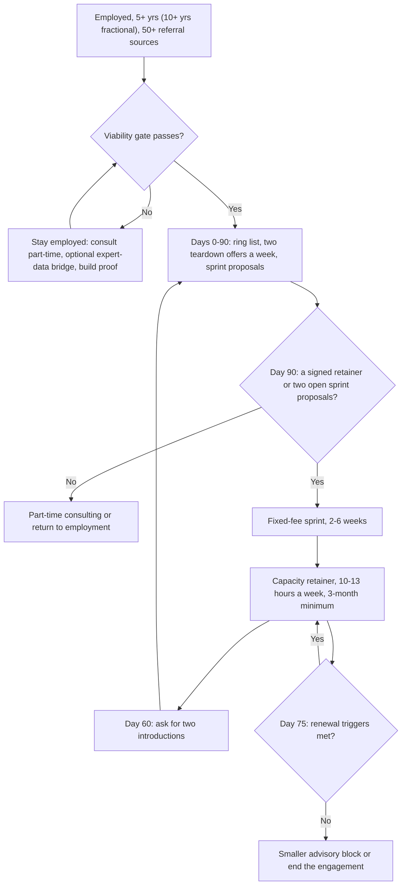

# Freelance, Fractional and Contract AI Work: Rates, Income Reality, Clients, Contracts and Expert Platforms

> Whether to go independent as an AI consultant, fractional AI leader or expert-data contractor: dated rates and modelled income, viability gates, network-first client acquisition, contracts and IP defaults, expert-platform reality, and stop rules.

**Dates.** Baseline independent rates, modelled income and contract clause analyses come from [T0-18](../../research/sessions/T0-18-freelance-fractional-ai-practice-economics.md) (read between about 2026-10-20 and 2026-10-25; dated 2026-10-24). Live contract postings, UK IT Jobs Watch trends (six months to 2026-11-12; live LLM count 2026-11-14), fractional bench reality, marketplace fee checks, Indian IP assignment rules and expert-data platform terms come from [T0-66](../../research/sessions/T0-66-role-group-independent-fractional-contract.md) (retrieved 2026-11-13 and 2026-11-14), reconciled with [T0-65](../../research/sessions/T0-65-role-group-ai-leadership.md) (retrieved 2026-11-13) and live web verification on 2026-11-19. The India mid-level rate card comes from [T0-02](../../research/sessions/T0-02-global-regional-compensation-benchmarks.md) (September–October 2026, retrieved 2026-10-21). **This page owns the repository's independent, fractional, contract and expert-platform rates** (decision D-019); salaried pay lives in [pay benchmarks](../09-compensation/pay-benchmarks.md). Every rate here is asked, advertised, posted or computed—none is an audited transacted invoice rate. Re-verify the V1 UK contract counts by 2026-12-13 and rates/platform statuses by 2027-01-18. **Grades** (EGP-1.0): A primary or measured; B transparent secondary or platform aggregate; C vendor, competitor or single source; D judgement, recalled or modelled (T0-18 grades its income model D); E searched, nothing found; M calculation inheriting its weakest input; P practice-curated. **This is not legal, tax or immigration advice.** Have a qualified lawyer review contracts and IP assignments, a CPA or chartered accountant review tax, and immigration counsel confirm work authorisation in your jurisdiction.

## The short answer

1. **Independence is a separate career, entered from strength.** T2-01 makes it a branch at Stage 6 for practitioners with 5+ years of experience and a strong network (fractional leaders typically need 10+ years or a prior Head/VP/CTO seat [A/B/M · T0-66 L54, L71]). Network acquisition replaces job boards, contracts replace offer negotiation, and client retention replaces onboarding [B/C · T2-01 L79; C · T2-01 L629–635].
2. **Do not resign until the viability gate holds:** about 900–1,000 paid hours of committed or highly likely work in sight for year one, at least six months of living costs, and acceptance of a P25 net near $38K, or $19–$24K if the outside view is right [D · T0-18 L145].
3. **Price from the asking corridor; plan against real floors.** US senior AI consultants and fractional leaders ask **$150–$250/hr** on Go Fractional benchmarks (posted fractional offers run 0.59–0.91× of asks; T0-18 models a $165/hr realised median) [C · T0-18.F1]. Employer-side fractional postings sit lower at **$75–$150/hr**, and US staffing-agency contract postings sit at **$50–$80/hr** [B · T0-66 L53, L56, L147–148, L226]. Elsewhere, anchor locally: UK GenAI contract median held flat at **£550/day** even as ad volume tripled [B · T0-66 L55]; India-based seniors quote **$50–$100/hr** to export clients (plan on $70–$100/hr) [C · T0-18.F4].
4. **Sell outcomes across flexible engagement shapes, not raw hours.** Open with a fixed-fee sprint (2–6 weeks) and convert to a capacity retainer (10–13 hours/week on a 52/12-week month: $8,700–$12,700/month at $200–$225/hr [D · T0-18 L129–133]), while recognising fractional work also clears as month-to-month marketplace terms, hourly 1099 contracts, project advisory or 1–5 days/week across portfolio companies [B · T0-66 L168, L339].
5. **Treat networks as primary and fractional "job boards" as benches.** While Go Fractional's sponsor survey reports 92% network sourcing, independent freelancer surveys place networks at **53–75%** and a 2026 Ruul report puts platforms first at 33% [C · T0-18.F6; C · T0-66 L346, L521]. Still, **12 of 13** fractional postings in T0-66 were advisor benches, search-firm templates or marketplaces rather than live employer vacancies [B/M · T0-66 L52, L701], and agency-sourced work paid roughly half direct rates in the one dataset measuring both [C · T0-18 L400–404].
6. **Hold four contract positions and one stop rule.** Cap liability at 1× prior-12-month fees, carve out Provider Materials [A · T0-18.F7], disclaim AI-output accuracy [B · T0-18 L461], and—under Indian law—explicitly state duration and territory in every IP assignment to avoid the statutory 5-year / India-only default [B · T0-66 L65, L741–742]. If by day 90 you hold neither a signed retainer nor two open sprint proposals, shift to part-time consulting or return to employment [D · T0-18 L145].
7. **Treat expert-data / AI-training platforms as a bridge, never a full-time replacement.** Mercor, Scale/Outlier, Surge/DataAnnotation, micro1, Turing and Handshake AI run **standing talent pools**, not vacancies: posted rates span $20–$300/hr by domain credential, but placement odds are low, projects end abruptly, H-1B/STEM OPT candidates are barred, and Mercor's March 2026 supply-chain data breach exposed sensitive contractor IDs and video interviews [A/B/C/D · T0-66 L59, L81–84, L729; live-verified 2026-11-19].

## At a glance



The gate, day-90 stop rule and day-75 renewal check are T0-18's design judgement [D · T0-18 L145, L376]. The referral loop follows network-first acquisition evidence [C · T0-18.F6], while expert-data pools sit strictly as an optional side or bridge lane while employed or between contracts [A/D · T0-66 L81, L729].

## The six parts of independent, fractional and contract AI work

| # | Part | The question it answers | Main evidence |
|---|---|---|---|
| 1 | The gate | Should you go independent—and on which of the three tracks? | T2-01 §6.6 [C]; T0-18 Rec 6 [D]; T0-66 KF1, KF3, KF9 [A/B/M] |
| 2 | Rates and income | What do clients and agencies pay, and what is left after costs? | T0-18.F1–F5, F10 [A–D]; T0-66 KF2, KF4–KF5 [B/C]; T0-65 L656 [B] |
| 3 | Clients and marketplaces | Where does work actually come from, and what do platforms charge? | T0-18.F6, F12 [A/C]; T0-66 KF1, KF13 [B/C]; live-verified 2026-11-19 |
| 4 | Pricing and engagement shape | How do you package sprints, retainers and portfolio days? | T0-18 DF 2–3 [D]; T0-66 L168, L728 [B/M] |
| 5 | Contracts, IP and insurance | What clauses, IP defaults and policies protect you? | T0-18.F7, F9 [A–C]; T0-66 KF14 [B]; live-verified 2026-11-19 |
| 6 | Expert-data / AI-training platforms | When are Mercor, Outlier, Surge, micro1 or Turing worth joining—and when are they a trap? | T0-66 KF7–KF11, KF15 [A–D]; live-verified 2026-11-19 |

### 1. The gate: should you go independent?

**Decision rule.** Go full-time independent only when every row passes. If the pipeline or runway row fails, stay employed, consult part-time (or test expert-data pools if work-authorised) and re-test each quarter [P].

| Check | Passes when | Evidence |
|---|---|---|
| Experience | 5+ years relevant experience for consulting; **10+ years (or 5+ years fractional C-suite and a prior Head/VP/CTO seat)** for fractional AI leadership | [C · T2-01 L632]; AI consultants/strategists report 8.2-year median on LinkedIn's 2026 list [C · T0-06 L109; [ERRATA U8](../../research/ERRATA.md)]; fractional postings ask 10+ yrs and 9/13 want prior exec seat [A/B/M · T0-66 L54, L171] |
| Referral sources | At least 50 people who could refer you personally | [C · T2-01 L633] |
| Pipeline | About 900–1,000 paid hours of committed or highly likely work in sight for year one (two 10 h/week retainers × 48 weeks = 960) | [D · T0-18 L145] |
| Runway | At least six months of living costs in reserve | [C · T2-01 L634]; [D · T0-18 L145] |
| Year-one ramp | You can live on modelled US year-one net of $52K / $71K / $92K at P25 / P50 / P75 (3 mo at 10% utilisation, 3 at 40%, 6 at 60%) | [D · T0-18 L145] |
| Bad case | You accept a steady-year P25 near $38K, or $19–$24K if 45–60% of entrants stall | [D · T0-18 L145, L597–599] |
| Differentiation | Domain or production-AI depth a client cannot trivially replace with an employee | [C · T2-01 L635] |
| Proof | Two or more shipped production AI projects with measurable business metrics you can cite | [A/B · T0-66 L74, L724]; [D · T0-18 L142] |
| Insurance | Tech E&O and cyber quoted, with your broker's written answer on AI-output exclusions | [B/C · T0-18.F9] |
| Employment & visa terms | No outside-work restriction in your current contract; independent-contractor work authorisation confirmed (H-1B/STEM OPT bar 1099 side work) | [D · T0-18 L1284]; [A · T0-66 L59, L330] |

Fractional leadership skews heavily senior: 87% of Fractional Jobs survey respondents (n = 1,733 across all functions) have 11+ years of experience and 83% are Director-level or above [C · T0-18 L1315, L1406], and Go Fractional's membership gate asks for 7+ years overall with 5+ in leadership or fractional client ownership [B · T0-66 L71, L466].

**Which of the three tracks:**

| | Independent AI consultant / contractor | Fractional Head of AI / Fractional CAIO | Expert-data / AI-training contractor |
|---|---|---|---|
| **What you sell** | Scoped hands-on LLM/RAG/agent engineering builds or technical advisory (hourly, daily or fixed-fee) [B · T0-66 L240, L245] | Part-time executive ownership of AI strategy, governance, ROI and coaching (91% also do hands-on work [C · T0-18 L327]) | Domain-specific prompts, reference answers, grading rubrics and red-teaming for AI labs [A · T0-66 L349] |
| **Typical load & terms** | 6–12 month agency contracts (1099/C2C/W2 or UK IR35) or direct fixed-fee sprints [B · T0-66 L240] | Month-to-month retainers (10–13 h/wk), hourly 1099 (10–20 h/wk), project sprints or 1–5 days/wk across portfolio firms; 64% serve 2+ clients [B · T0-66 L168; C · T0-18 L327] | Variable at-will project tasks (5–20 or 40 h/wk when matched); weekly payouts; projects can end early [A · T0-66 L59, L283] |
| **Role hub** | [Independent AI Consultant / Contractor](../02-roles/hubs/independent-ai-consultant.md) | [Fractional Head of AI / Fractional CAIO](../02-roles/hubs/fractional-ai-leader.md) | [Domain Evaluation Specialist / AI Trainer](../02-roles/hubs/domain-evaluation-specialist.md) |

<a id="2-rates-and-income-as-of-october-2026"></a>
### 2. Rates and income, as of October–November 2026

**Consulting, contract and fractional rates.** All asked, advertised, posted or computed; none is an audited invoice transaction. (Expert-data platform hourly rates are in [Part 6](#6-expert-data-and-ai-training-platforms-bridge-vs-full-time-trap).)

| Segment | Figure | Kind of figure | Grade · source | Date |
|---|---|---|---|---|
| US senior AI consultant / fractional asking corridor | **$150–$250/hr** (P25–P75 of Go Fractional CAIO/CTO asks); Upwork fractional CAIO profiles **$150–$195/hr** | Asking rates | C · T0-18.F1; C · T0-66 L150, L658 | Oct–Nov 2026 |
| US fractional CAIO vs CTO (marketplace asks vs offers) | CAIO asks $190–$208 (Go Fractional benchmark **$205/hr**, "from $5,000/mo"); offers $125–$189 (0.66–0.91×). CTO asks $209–$212; offers $124–$129 (0.59–0.61×) | Ask vs posted offer / vendor benchmark (COI) | C · T0-18 L193–198; C, COI · T0-66 L149, L656–657 | Oct–Nov 2026 (live-verified 2026-11-19) |
| US employer-side fractional postings | Estrin VIP **$75–$150/hr** (10–20 h/wk, 1099, law-firm background); OneSeven Tech **$100–$150/hr** on aggregator copy | Posted contract bands | B · T0-66 L147–148, L654–655 | Nov 2026 |
| US/Canada search-firm fractional templates | Axial Search posts **$180–$630/hr** US CAIO (copy says $250–$400), **$150–$280/hr** US Head of AI, **$110–$230/hr** Canada | Templated bench pages ("future opportunities") | B · T0-66 L145–146, L651–653 | Nov 2026 |
| US ZipRecruiter Fractional CAIO (reconciled from T0-65) | **$151,203** annualised mean (typical **$111,500–$185,000**); hours/week unstated — consistent with ~15–20 h/wk part-time billing | Aggregator annualised estimate (noisy) | B · T0-65 L514, L656 | 2026-10-13 |
| US fractional retainers | **$8,000–$13,000/month** for 10–13 h/wk (T0-18); broader vendor/practitioner range **$3,000–$10,000/mo** (2–6 days) and **$4,000–$20,000/mo** (8–32 h/mo); published package $1,800 / $3,400 / $6,400 for 8 / 16 / 32 h/mo | Vendor guides (COI) & one published package (A) | A/C · T0-18.F5, L234–236; C, COI · T0-66 L151, L659–660 | Oct–Nov 2026 |
| US senior AI-engineer contractor rate cards | **$130–$235/hr** (A.Team $130 / $165 / $200; Second Talent $155–$235); architect/CTO $200 / $220 / $240+ (untested on open boards in T0-66) | Vendor rate cards | C · T0-18.F2; T0-66 L56 | 2026-10-24 |
| US staffing-agency contract postings | **$50–$80/hr** across 4 postings (Dice $60–$70, $65–$80; Voyage Advisory $70–$80 [downgraded from A-on-Extract]; Twine up to $50); AJAIA $30–$300 uninformative | Agency job-board postings | B · T0-66 L56, L226, L671–675 | 2026-11-13 |
| UK GenAI & LLM contract adverts (IT Jobs Watch) | Median **£550/day** (P25 £460, P75 £675, P90 £788; n = 933 rates across **1,466 ads**, London £575, ex-London £530; flat vs 2025 £550, down from 2024 £625). Live LLM ads (n = 49): median **£550**, P90 **£800**. 8 live senior picks: **£500–£1,000/day**. UK fractional agency OTE **£250K+** scaled to days | Transparent job-advert series & live sample | B · T0-66 L55, L152, L221–225, L661–670, L695–697 | 6 months to 2026-11-12; live 2026-11-14 |
| Germany (DACH) & France | Germany **€103/hr** avg (€108 data/analytics, n = 5,412); France **€600–€900/day** (€1,000–€1,500 gen-AI/agents) | Survey / secondary blog | C · T0-18.F3 | Nov 2025–Oct 2026 |
| India-based senior, export clients | **$50–$100/hr** quoted (Second Talent 2026-09-14 card $50–$75/hr contract, $63–$94/hr freelance; lead $70–$110 / $88–$138; Navtechy $60–$100; Prakash $50–$90 gen-AI); Bengaluru Senior SWE P50/P90 break-even **$39.4–$75.8/h** at 1,500 h before overheads; domestic India independent rates **not found** | Vendor cards (Second Talent downgraded to **Grade D** — no sample/method, vendor COI [T0-45 L90, L335]); zero platform-native USD distributions found [E · T0-45 L424] | D (Second Talent) / C (other quotes) / M (break-even) · T0-18.F4; T0-43 L186, L200–204; T0-45 L90, L424 | Sep–Nov 2026 |
| India-based mid-level AI/ML engineer | **$35–$50/hr** export contract, **$44–$63/hr** freelance ($28–$72/hr overall); comparison markets: LatAm sr AI/ML ~$103K, Poland B2B **$74K–$92K** (62.1% of Just Join IT offers are B2B vs 32% UoP [C · T0-44 L239, L318]), Lemon.io sr SWE $39–$42/h outside NA | Vendor cards (COI) & Poland board split | D (Second Talent) / C · T0-02.F11; T0-43 L305–311; T0-44 L239 | Sep–Nov 2026 |

**How to read the rates:**
- **Separate direct rates from agency floors.** Direct US senior asks sit at **$150–$250/hr** ($300+ is marketing [C · T0-18.F2]), whereas US staffing-agency postings sit at **$50–$80/hr** [B · T0-66 L56] and employer-side fractional posts at **$75–$150/hr** [B · T0-66 L53]. Budget on the lower half of your channel's band: dropping modelled realised median from $165 to $140 cuts US net income by $17K [D · T0-18 L1291].
- **Ignore posted ranges wider than 5×** (such as AJAIA's $30–$300/hr or Axial's $180–$630/hr, which even contradicts Axial's own $250–$400/hr copy) [B/M · T0-66 L53, L728].
- **The AI rate premium is uneven and subject to compression.** Vendor claims run 10–37% while YunoJuno reports no broad rate premium [C · T0-18.F2], and UK GenAI contract volume **tripled** (176 → 472 → 1,466 ads from 2024 to 2026) while the median day rate stayed flat at £550 [B · T0-66 L55, L695].
- **Clarify weekly vs monthly hours on retainers.** Ambiguous monthly-hour quotes can imply $250–$1,250/hr and were excluded by T0-18 [C · T0-18 L241].

**Income reality (modelled).** No audited AI-specific independent income distribution exists [E · T0-18.F10]. T0-18's Monte Carlo model (42-hour week × 46 weeks, $165/hr realised median, $15,308 overhead, $7,500 health insurance, federal tax only, no state tax) gives the planning envelope [D · T0-18 L557–567]:

| US net after overhead, health insurance and federal tax (modelled) | P25 | P50 | P75 | P90 |
|---|---|---|---|---|
| Practitioners who get traction; revenue $135K / $167K / $205K / $245K | $83K | $105K | $130K | $160K |
| Planning case: 30% of entrants stall | $38K | $87K | $118K | $149K |
| 45% of entrants stall | $24K | $68K | $109K | $141K |
| Outside-view case: 60% of entrants stall | $19K | $39K | $94K | $131K |
| First year, with the ramp in Part 1 | $52K | $71K | $92K | not given |

Sources: [D · T0-18 L580–582, L593–599, L145].

- **The traction row is conditional.** The median practitioner with traction bills ~1,030 hours (53% of working hours) at $165 and nets $105K—equivalent to roughly a $137K W-2 salary before benefits, paid leave or retirement match [D · T0-18 L587].
- **Stalling sets the downside.** Low billing is common across freelancing (24% of DACH respondents bill under 50 days/year and 38% under 100 [C · T0-18 L571]); all-freelancer proxies sit near $84K–$85K P50 (Upwork / Consulting Success [C · T0-18.F10]), making the path strongly bimodal [D · T2-01 L683].
- **India-resident base case** ($70/hr median): $38K / $53K / $64K / $85K at P25 / P50 / P75 / P90 [D · T0-18.F10].

### 3. Clients and marketplaces: networks first, benches second

- **Networks lead for high-rate work, though magnitudes vary across surveys.** Go Fractional's sponsor survey (n = 213, April 2026) reports 92% finding clients via networks, 54% via LinkedIn and 29% via platforms, and Fractional Jobs (n = 1,733) reports 94% winning work via referrals [C · T0-18 L385–386]. However, T0-66 could not trace the 92% figure outside that sponsor survey: independent freelancer surveys put network/referral sourcing at **53–75%**, and a 2026 Ruul freelance-economy report places platforms first at **33%** [C · T0-66 L46, L346, L521]. Trust the strategic direction (direct referrals command the highest rates—$223/hr direct vs $113/hr fully agency-sourced in Antenna's 2019 n = 80 sample [C · T0-18 L400–404]), not a single survey percentage.
- **Fractional job boards are mostly benches, not vacancies.** Only **1 of 13** qualifying fractional AI postings in T0-66 sat on an employer's own page (OneSeven Tech, bench-building since March 2026); the rest were advisor networks (Arootah: no live engagement), search-firm templates (Axial: "for future opportunities") or marketplaces where **3 of 7** distinct AI-fractional postings were already closed and Go Fractional's home page showed `"0 open roles"` [A/B/E · T0-66 L52, L113–114, L701–702].
- **Business development is the primary pain:** named by 90% of Go Fractional respondents and 78% of Antenna's $100K+ consultants [C · T0-18 L385, L387]. AI-specific channel conversion rates remain unmeasured [E · T0-18 L440].

| Channel / platform | Role in your funnel | Fees & terms (dated Oct–Nov 2026) | Watch for |
|---|---|---|---|
| **Personal network & referrals** | Primary | 0% fee; highest realised rates ($223/hr vs $113/hr agency in Antenna's 2019 sample [C · T0-18 L400–404]) | Needs a 50+ contact ring list and weekly outreach cadence [D · T0-18 L411–412] |
| **LinkedIn** | Network extension | 54% of Go Fractional respondents source clients here [C · T0-18 L385]; OneSeven requires a LinkedIn URL [A · T0-66 L175] | No AI-specific conversion rate [E · T0-18 L440] |
| **Go Fractional** | Secondary fractional bench | Free base operator signup (optional paid *Go Fractional Pro* tier); **$500** client-referral cash/credit; 7+ yrs / 5+ leadership gate [B/C, COI · T0-66 L71, L731; live-verified 2026-11-19] | Live posting counts unverifiable (`"0 open roles"` counter [E · T0-66 L114]); `L731` downgraded from A to B/C |
| **Fractionus** | Secondary fractional marketplace | Hosts external redirects plus managed network (<3% acceptance claim, COI); own blog notes **80/20 split** (20% talent cut) [C, COI · T0-66 L732] | Confirm whether a listing is a direct redirect or subject to the 20% split |
| **Fractional Jobs** | Watch / secondary board | Fees **unverified** — competitors conflict ("no platform fees" vs "one-time fee") [C · T0-66 L364, L733] | Confirm pricing directly before relying on it |
| **Toptal** | Utilisation filler (vetted) | 0% talent fee; **$79/month client subscription**; client markup estimated **30–60%**; **24-month non-circumvention** per terms analysis; 4-stage screen + 2-week paid test project [C · T0-66 L64, L233, L365, L722, L735; live-verified 2026-11-19] | Non-circumvention bars direct work with Toptal-introduced clients; IP passes via Toptal before client [C · T0-66 L730] |
| **Braintrust** | Utilisation filler | 0% talent fee (100% on self-sourced clients); client fee reported at **10–15%** [C · T0-18.F12; T0-66 L64, L736] | Reported 15% full-time conversion fee within 6 months [C · T0-18 L1229] |
| **Catalant** | Enterprise senior projects | Competitor reports **20–30%** of project fees; T0-18 notes 10–20 yr senior profile [C · T0-18 L1230; T0-66 L367] | Official fee schedule unpublished; "paid regardless" claim untested in T0-66 |
| **Contra** | Portfolio & direct invoicing | **0% commission**; per-payment fees on free tier; Pro ~**$29/month** [C · T0-66 L64, L368, L737] | Annual Pro rate ($199) untested in T0-66 |
| **Upwork** | Utilisation filler only | Variable **0–15% freelancer fee** per contract since 2025-05-01 (effective ~20% total platform take rate; Connects costs apply); AI GSV ~$450M run-rate (+55% YoY Q3 2026) vs total GSV down ~10% [B/C · T0-66 L64, L369; T0-43 L70, L561; live-verified 2026-11-19] | Per-contract gen-AI/creative earnings fell 13% while starts rose 90% [C · T0-18.F11] |
| **Fiverr** | **Avoid** for senior AI | Flat **20% seller fee** (plus buyer fee); commodity pricing ceiling ($10–$125/hr AI strategy listed in T0-18) [B/C · T0-18 L1233; T0-66 L370, L738; live-verified 2026-11-19] | Rate compression; `L738` downgraded from T0-66 A-on-Extract to B |
| **Staffing agencies / boutiques** | Market floor | US posted $50–$80/hr [B · T0-66 L56]; UK £500–£1,000/day [B · T0-66 L225]; ~49% haircut vs direct in Antenna's sample [C · T0-18 L400–404] | Check W2 vs 1099 (US), inside vs outside IR35 (UK), and right to cite work |

### 4. Pricing and engagement shape

1. **Front door: a fixed-fee sprint.** Run a 1–2 week diagnostic or 2–6 week pilot priced at `estimated hours × list rate × 1.2–1.25` (covering 20% unbilled overhead plus margin) [D · T0-18 L133, L418]. Fixed fees preserve the productivity gain from AI-assisted delivery that hourly billing surrenders to the client [D · T0-18 L133].
2. **Core: capacity retainers—and flexible fractional shapes.** Price retainers on a 52/12-week month (`hours/week × 52/12 × rate`); a naive 4-week month gives away ~8% ($200/hr becomes $184.62) [D · T0-18 L130, L283]. Be ready to structure engagements across the four commercial shapes T0-66 observed in the market: month-to-month marketplace terms, hourly 1099 blocks (10–20 h/wk), fixed-scope advisory projects, or 1–5 portfolio days/week [B · T0-66 L168, L339].
3. **Terms that protect effective rate:** 3-month minimum, billed monthly in advance, explicit weekly hours cap with pre-approved overage rate, no rollover, 30 days' written notice after minimum, and a named client owner for 2–4 hours/week [A/D · T0-18 L101, L130]. Working 12 actual hours on a 10-hour $8,000 retainer cuts your effective rate by 17–23% ($154–$167/hr) [D · T0-18 L294–304].
4. **Defend against AI-efficiency revenue erosion.** If AI tooling cuts delivery hours by 20%, 30% or 50%, hourly rates must rise 25%, 43% or 100% just to hold revenue flat [D · T0-18 L320–322; confirmed arithmetic · T0-66 L343]; 98% of Fractional Jobs respondents say AI increased their efficiency [C · T0-18.F11].
5. **Equity only beside cash.** Take 0.15–0.25% (FAST Standard tier, 2-year vesting, 3-month cliff) only on top of a near-market cash retainer; equity-only advisory deals reportedly fail within six months outside a narrow band, with no AI payoff dataset [C/D · T0-18 L314, L347].
6. **Review rates every six months** against Go Fractional and UK IT Jobs Watch benchmarks [D · T0-18 L148].

**Starting rate card** (T0-18 inferred list prices, calibrated against T0-66 posting floors—not transacted statistics [D · T0-18 L260–266; B · T0-66 L53, L56]):

| Offer | US-market direct clients | Europe / UK | India-based, selling to US or EU |
|---|---|---|---|
| Senior hands-on engineering (T&M) | $175–$225/hr list (floor $150; agency floor sits lower at $50–$80/hr [B · T0-66 L56]) | UK £675–£790/day (market median £550, senior live picks £500–£1,000 [B · T0-66 L221, L225]); Germany €100–€130/hr; France €800–€1,200/day | $70–$100/hr; test $120+ only with proof |
| Architect or fractional-leader hourly | $225–$275/hr list (employer-side posts $75–$150/hr; Go Fractional benchmark $205/hr [B/C · T0-66 L53]) | Local day rate; no European fractional dataset [E · T0-18 L216] | $100–$150/hr is an untested hypothesis [D · T0-18 L264] |
| Fractional Head of AI retainer (10–13 h/wk) | $8,700–$12,700/month (marketplace starters from $5,000/month for smaller loads [C · T0-66 L149]) | Local day rate × days/wk × 4.33 | $3,000–$5,600/month on the same formula |
| Advisory block | 8 / 16 / 32 h/month at ~$1,800 / $3,400 / $6,400 [A · T0-18 L234–236] | n/a | n/a |
| Fixed-fee sprint (2–6 weeks) | `estimated hours × list rate × 1.2–1.25` | Same formula, local rates | Same formula |

### 5. Contracts, IP ownership and insurance

Start from **Common Paper's Professional Services Agreement v1.1** (CC BY 4.0, cover page sets general and increased liability caps and lets deliverables pass as created or on payment [A · T0-18.F7; corroborated · T0-66 L65, L371]) and hold these positions [D · T0-18 L135–136]:

| Clause | Position | Grade · source |
|---|---|---|
| General cap | 1× fees paid or payable under the SOW in the 12 months before the claim (template default); no source supports 3–6 months as standard | A · T0-18.F7; D · T0-18 L136 |
| Supercap | Confidentiality and data-security breaches only, at `min(5× fees, insurance limit)`; never for AI-output accuracy | A (5× default), D (formula) · T0-18 L453 |
| Consequential damages | Keep the mutual waiver | A · T0-18 L452 |
| Provider Materials | Explicitly schedule reusable agent harnesses, orchestration code, prompt templates, eval suites and tooling as Provider Materials | A (mechanism), D (list) · T0-18 L457 |
| Deliverables & IP assignment | Assign on payment, excluding Provider and third-party materials. Avoid "work made for hire" (in California it can trigger statutory employer status). **India:** explicitly state **duration** (e.g., perpetual) and **territory** (e.g., worldwide) in every signed written assignment—silence defaults to **5 years and India only** under Copyright Act 1957 s.17, s.19(2), s.19(5)–(6), applied by the Delhi High Court in *Pine Labs v. Gemalto* | A · T0-18 L456; B · T0-18 L458; B · T0-66 L65, L374, L741–742 (live-verified 2026-11-19) |
| AI output | No accuracy warranty; qualified human reviews output before consequential decisions; assign whatever rights exist without warranting copyright; exclude AI output from non-infringement indemnity | B · T0-18 L460–461; D · T0-18 L462 |
| Client data & third-party models | No training/fine-tuning on client data except a model delivered to the client; model providers only under no-training terms; provider terms flow down with no availability warranty | B · T0-18 L463–464 |
| Scope & retainer term | Written change orders; hours cap, overage rate, 3-month minimum and 30-day notice inside the SOW (template allows termination for convenience only when no SOW is active) | A · T0-18 L468–469 |
| Regulated deployments & references | Assign EU/Colorado deployer obligations in writing; request explicit SOW permission to cite the client (template includes "No Publicity") | D · T0-18 L136, L472 |

**Alternative templates & kit:**
- **Bonterms PSA v1.2:** Cover page offers licensed or assigned deliverables and is listed as CC0-1.0 on OpenAgreements, while other Bonterms standards use CC BY-ND; full PSA standard terms were not retrieved—verify the licence and standard terms with counsel before adopting [B · T0-66 L65, L372].
- **OpenAgreements:** Free comparison library preserving each template's source licence ("legal research, not legal advice") [C · T0-18 L1242; T0-66 L373].
- **Avoid Freelancers Union Contract Creator** for AI consulting: its 2024 launch post lists no IP clauses (downgraded from T0-66 A-on-Extract `S85` to B) [B · T0-18 L1241; T0-66 L374, L520], and skip Docracy (offline/legacy) [C · T0-18 L1270].
- **Invoicing & rails:** Stripe Invoicing (0.4–0.5% + processing) or Bonsai ($9–$49/user/mo annual) [A · T0-18.F12]; foreign receipts via Wise Business or Payoneer rather than PayPal [A/C/D · T0-18 L151, F4]. See the [tool catalog](../00-start/tool-catalog.md).

**Insurance and regulation.** Small IT-consultant median broker quotes run ~$899/yr for tech E&O and ~$1,540/yr for cyber ($1M/$1M limits, not AI-specific) [C · T0-18.F9]. Fenwick (2026-06-15) reports an ISO GenAI exclusion on commercial general liability from January 2026 and some E&O carriers declining AI-output liability [B · T0-18.F9]—get your broker's answer in writing and never accept an uninsured AI-output supercap [D · T0-18 L139]. Because EU AI Act, US state rules and India DPDP Rules (notified 2025-11-13) move rapidly, re-check compliance status before signing and see [Governance careers](governance-careers.md) [B · T0-18.F8].

### 6. Expert-data and AI-training platforms: bridge vs full-time trap

Expert-data platforms (Mercor, Scale AI / Outlier, Surge AI / DataAnnotation, micro1, Turing, Handshake AI, Alignerr, Invisible) contract domain experts and engineers to write evaluation prompts, rubrics, golden answers and adversarial red-teaming tests for frontier AI labs [A/B · T0-66 L60, L349].

**Decision rule.** Treat expert-data platforms strictly as **supplementary or bridge income** while employed, building a portfolio, or filling gaps between direct consulting sprints—**never resign from a salaried role relying on standing-pool earnings** [A/D · T0-66 L81–84, L729]. In India, salaried **in-house evaluation-engineering roles** (4 of 4 India evaluation postings in T0-66: Kore.ai, BT, Backbase, HCLTech) are a separate, steadier path [B · T0-66 L60, L95, L333].

**Dated platform rates, screening and risk matrix (as of November 2026; T0-66 + live-verified 2026-11-19):**

| Platform | Posted pay bands (USD/hr unless noted) | Screening & entry (contradicts legacy Product track [A · T0-66 L357]) | Work-authorisation & operational risks | Grade |
|---|---|---|---|---|
| **Mercor** | Language/audio **$35–$50**; generalist **$40–$70**; science **$60–$120**; ML **$70–$120**; bus ops **$90–$120**; legal **$100–$150**; IB/PE & internal medicine **$130–$180**; SWE **$80–$200** (specialised $120–$200); task-based up to $1,000/deliverable [A/B · T0-66 L293–294, L676–682]. *Average pay varies sharply by source: Mercor's own pay page (2026-06-23, COI) states **$31/hr average** (range $12–$200+/hr) [C, COI · T0-45 L162, L338], whereas Bloomberg (2026-10-16) relayed ~$110/hr and a tracker swung $141 → $80 after a June 2026 relabel [C · T0-66 L58, L296–297]* | Résumé + **~20-min AI video/audio interview** → credential/background check → **standing talent pool** (3/3 read listings are pools, not vacancies) → wait 1 week to months → project-level hire [A · T0-66 L59, L311, L716] | **No H-1B or STEM OPT**; projects can end early [A · T0-66 L59]; referral-site placement **6%** (29/527 [D · T0-66 L261]). **Security & litigation risk (live-verified 2026-11-19):** March 2026 LiteLLM supply-chain breach (disclosed 2026-03-31) reportedly exposed ~4 TB / ~40K contractors' IDs, W-9s and AI video interviews, triggering federal class actions (e.g. *Ananthula v. Mercor.io Corp.*, filed 2026-04-21; ~30,000-worker contractor litigation noted in `T0-43 L69, L293`) [B/C] | A (listings/terms), B/C (breach/averages), D (referral placement) |
| **Scale AI (HFC Research Advisor)** | **$300/hr** for 5–20 h/week (finance, legal, medical; requires 5+ yrs & MD/DO, JD/bar or finance depth) [A · T0-66 L60, L295, L565, L683] | Rolling application → **interview with the research team** → invitation (90-day wait to re-apply) [A · T0-66 L314, L719] | **US-only**; selective; co-authored benchmarks/papers noted as outputs [A · T0-66 L325, L330] | A · T0-66 L565 |
| **Outlier (Scale AI)** | Listed expert roles **up to $50/hr** [B, downgraded from T0-66 A-on-Extract `L686`]; live verification 2026-11-19 reports US general writers **$15–$35/hr**, US STEM/coding **$30–$50+/hr**, India coding tiers **~$13–$27+/hr** [B/C] | Profile → ID verification → domain/coding screens (e.g., HackerEarth) → **unpaid/low-paid rubric training** → graded assessment tasks [B/C · live-verified 2026-11-19] | 1099 only, no sponsorship [A · T0-66 L566]; mid-2025 Meta 49% stake in Scale AI (~$14.3B) prompted rival-lab diversification and reported "empty dashboard" volatility [B/C · live-verified 2026-11-19] | B/C (COI) |
| **Surge AI / DataAnnotation** | General RLHF **$20–$30/hr**; coding/STEM **$40+/hr** (PayPal payouts) [C · live-verified 2026-11-19] | Strict **one-shot Starter Assessment** (no retakes; ~2–3% reported acceptance) [C · live-verified 2026-11-19] | California contractor-misclassification class-action litigation reported [B/C · live-verified 2026-11-19] | B/C (live-verified 2026-11-19) |
| **micro1** | Global-remote AI Evaluation Specialist **$20–$35/hr** [B · T0-66 L300, L688]; US education/tutoring **$50–$100/hr** [C · T0-66 L689]; CEO relay $50–$200 [C] | Screening interview with an **AI recruiter** (video) + coding/domain screens [C · T0-66 L312, L717] | Aggregator median **51 days to hire** across 24 placements and **2%** referral placement (24/1,091) [C/D · T0-66 L261, L312] | B/C/D |
| **Turing** | Domain Expert Reviewer: pay unstated (8-week assignment, 40 h/wk, 4 h PST overlap; Master's + 3 yrs) [A · T0-66 L313, L567]; broader engineering/SME contracts **$30–$150+/hr** [C · live-verified 2026-11-19] | Complete domain/coding **assessment** → team review → selected candidates contacted [A · T0-66 L313, L718] | Unpaid pre-selection assessment; strict time-zone overlap on reviewer contract [A · T0-66 L567] | A/C |
| **Handshake AI** | Red-teaming domain expert **$40–$60/hr** (10–20 h/wk); older occupation-titled AI trainer listings **$75–$125/hr** (Dec 2025–Jan 2026) [B · T0-66 L301, L690] | 15–30 min AI or recruiter screen [C · live-verified 2026-11-19] | **STEM OPT not supported**; US remote [B · T0-66 L330, L417, L573] | B/C |
| **xAI, Alignerr, Invisible, 24 Mag** | xAI AI Tutor **$35–$65** (design **$35–$75**) [B · T0-66 L299]; 24 Mag rubric specialist **$40–$60** [B · T0-66 L302]; Alignerr $15–$150 older copy, non-US rates vary [B/C · T0-66 L303]; Invisible candidate-stated rate [B · T0-66 L304] | Education vetting (PhD verified at Alignerr) or direct application [B · T0-66 L315, L571–572] | 1099 no sponsorship; non-US geographic rate discounts [B · T0-66 L303, L330] | B/C |

**How to use expert-data pools safely (if eligible):**
1. **Lead with a verifiable domain credential** (MD, JD, CPA, CFA, Master's/PhD, 5+ yrs in function) rather than an "AI trainer" title—Mercor and micro1 state no AI background is required, and credentials are verified [A · T0-66 L326, L362, L726].
2. **Apply once per pool and keep expectations capped:** treat matches as bonus income, never fixed runway; confirm tax and work-authorisation legality first [A · T0-66 L82–84, L729].
3. **Protect sensitive PII:** review data-retention, biometric-consent and arbitration clauses before uploading passports, SSNs or recorded video screens [B/C · live-verified 2026-11-19]. See the [Domain Evaluation Specialist hub](../02-roles/hubs/domain-evaluation-specialist.md) for skill tiers and the salaried India track.

## How to do it: the network-first launch plan

1. **Run the gate while employed.** Score every row in Part 1. *Done when:* every row passes, or you have a dated plan to close gaps via part-time work [D · T0-18 L145].
2. **Set up to invoice (week 1).** US: LLC or sole proprietorship. India: sole proprietorship under §44ADA if receipts stay at or below ₹75 lakh, GST registration with Letter of Undertaking for exports, and an authorised-dealer bank account [D · T2-01 L652]. *Done when:* you can invoice and receive foreign wire/rail payments and a CA/CPA has confirmed the structure.
3. **Assemble the contract kit (week 2).** Common Paper PSA v1.1 with Part 5 positions (plus explicit duration and worldwide territory if under Indian law), sprint and retainer SOWs (Templates A & B), and written broker answers on tech E&O/cyber AI exclusions [A/B/D · T2-01 L653; T0-18 L135–139; T0-66 L727]. *Done when:* legal counsel has reviewed the kit.
4. **Build the ring list (weeks 1–2).** ~100 contacts across four rings: former managers/colleagues at Director+, founders/investors, adjacent consultancy peers, past clients [D · T0-18 L411]. *Done when:* 50+ names sit in a tracker with last-contact dates and problem hypotheses [C/P · T2-01 L633].
5. **Activate the network (weeks 1–4, then weekly).** Update LinkedIn positioning (mandatory on fractional benches [A · T0-66 L175]) and send two personal outreaches a week offering a 45-minute AI-readiness teardown with a one-page readout [D · T0-18 L412; T2-01 L654]. *Done when:* every contact has heard from you once and the weekly habit is logged.
6. **Turn calls into sprints.** Send a fixed-fee sprint proposal within 48 hours of any call uncovering a concrete problem [D · T0-18 L413]. *Done when:* no qualifying call passes 48 hours without a written proposal.
7. **Land proof work (months 1–3).** Target 2–3 proof engagements and a first retainer ($8K–$13K/mo US) or project ($5K–$20K) [D · T0-18 L142; T2-01 L655]. *Done when:* by day 90 you hold a signed retainer or two open sprint proposals—otherwise execute the stop rule [D · T0-18 L145].
8. **Add secondary channels cleanly.** Join free Go Fractional and 1–2 curated benches; use marketplaces (Toptal/Braintrust/Upwork) strictly to fill utilisation after reading non-circumvention and split terms [B/C/D · T0-18 L142, L420; T0-66 L725, L730]. Optionally join 1–2 expert-data pools only if work-authorised and comfortable with PII/security terms [A/C · T0-66 L82]. *Done when:* profiles are live and no clause blocks direct clients you originate [P].
9. **Stabilise at two concurrent engagements (months 3–6+).** At a nine-month average retainer life you need ~2.7 new retainers/year [D · T2-01 L656–657; T0-18 L428]. *Done when:* two retainers run concurrently and first calls arrive at the table's cadence.
10. **Harvest referrals inside each engagement.** Ask for two introductions and reference permission at day 60 [D · T0-18 L414]; run the renewal check at day 75 (Template D) [D · T0-18 L376]. *Done when:* every client engagement triggers both checkpoints.

**How many first calls you need** (modelled for two concurrent retainers, 9-month average life, 50% call-to-proposal rate [D · T0-18 L428–434]):

| Proposal close rate (assumed) | New retainers a year | First calls a year | First calls a month |
|---|---|---|---|
| 30% | 2.7 | 18 | 1.5 |
| 50% | 2.7 | 11 | 0.9 |
| 70% | 2.7 | 8 | 0.6 |

The 30–70% range is a coaching firm's claim with no sample [C · T0-18 L440]. The operational conclusion holds either way: this is a relationship funnel where fewer than two qualified first calls a month sustains a full practice [D · T0-18 L436].

## Templates and examples

### A. Fixed-fee sprint proposal [P]

Structure follows T0-18 Recommendation 2 and its productised ladder [D · T0-18 L133, L418]; wording is unmeasured.

```text
Subject: [Client]: fixed-fee [diagnostic | pilot] on [problem in the client's words], [2–6] weeks

Problem (from our call on [date]): [one sentence, with the metric the client named]
Outcome by [end date]:
  1. [deliverable, e.g. three to five use cases scored on value, feasibility and risk]
  2. [deliverable, e.g. pilot readout with a KPI against its baseline]
Out of scope: [list]. Any change goes through a written change order.
Client inputs: a project owner, [name], for [2–4] hours a week; approvals within [3] business days.
Fee: [estimated hours] × [list rate] × [1.2–1.25] = [fixed fee]; payment terms [terms].
Terms: [Common Paper PSA v1.1 + this SOW; explicit IP duration & territory if India]. A qualified person reviews AI output before relying on it.
After the readout: if [success criterion] is met, a capacity retainer of [10–13] hours a week from [date].
```

### B. Capacity retainer SOW [P]

Terms follow T0-18's proposed term sheet [D · T0-18 L338–351]; Go Fractional names weekly bandwidth, overage rates, 30/60/90 plans, decision rights and renewal triggers [C · T0-18 L334].

```text
Role: Fractional Head of AI for [Client]. Owns AI strategy and the use-case portfolio; sets architecture
  and evaluation standards; advises on build, buy and vendors; coaches the team. Build work: separate SOW.
Hours: up to [10–13] a week, tracked weekly. No rollover. Overage at [rate]/hr with written pre-approval.
Fee: [hours a week] × 52/12 × [rate] = [monthly fee], billed monthly in advance.
Term: 3-month minimum, then month-to-month on 30 days' written notice. Prepaid fees for hours not worked
  are refunded pro rata, except where Provider ends the SOW for Customer's uncured breach.
Client owner: [name], [2–4] hours a week; approvals within 3 business days.
Acceptance: monthly hours statement, plus a deliverable and decision log.
Reporting: weekly written update; monthly steering review; quarterly roadmap refresh.
Decision rights: Head of AI decides architecture and evaluation standards within budget; recommends
  use-case priority and vendors; advises on budget, headcount and risk acceptance. [Executive] approves.
Access: client-issued accounts, least privilege; no production credentials unless this SOW says so;
  AI tools used on client material only under no-training terms.
Equity (optional, on top of the fee): [0.15–0.25]%; 2-year vesting; 3-month cliff.
Exclusivity: none. Other clients in the same sector are disclosed.
Insurance: tech E&O and cyber held; certificate on request.
References: Provider may name Customer as a reference [yes | with approved wording | no].
```

### C. The first 90 days of a fractional Head of AI

| Phase | Deliverables [D · T0-18 L357–360] |
|---|---|
| Days 0–30: baseline | Inventory of AI use, data, tools and spend; stakeholder interviews; regulatory and privacy screen; 3–5 use cases scored on value, feasibility and risk; quick-win recommendation; 30-day readout |
| Days 31–60: operating model | Acceptable-use and data-handling policy; evaluation and red-team standard for LLM features; build/buy/partner decisions and vendor shortlist; reference architecture with model-deprecation plan; pilot kickoff; hiring plan |
| Days 61–90: delivery and hand-off | Pilot readout with KPIs and cost model; 12-month roadmap and budget; team enablement sessions; renewal decision memo |
| Standing | Weekly update; monthly hours statement; decision log; quarterly roadmap refresh |

### D. Day-75 renewal check

```text
Renew only if all four hold:
[ ] (a) A pilot has a measured KPI against its baseline: [KPI], [baseline], [value at day 75]
[ ] (b) A named internal owner can run the roadmap: [name]
[ ] (c) A hiring plan or budget is approved: [what], [date]
[ ] (d) The client has used at least 70% of contracted hours: [used] / [contracted]
If (a) to (c) fail: offer an advisory block of [8–16] hours a month, or end the engagement.
```

Underuse of hours signals churn; early exits typically stem from scope, compensation and measurement mismatches [C/D · T0-18 L376].

### E. Weak and strong

| | Weak | Strong |
|---|---|---|
| Outreach note [P] | "I've gone independent. Let me know if you ever need help with AI." | "[Name], since [shared project] I've been helping [kind of company] [specific outcome]. I'm offering a 45-minute AI-readiness teardown of one workflow you choose, with a one-page written readout. Would [date] or [date] suit?" |
| Positioning [D · T0-18 L1300] | "Fractional Chief AI Officer, open to new clients." | "I take one AI use case to a pilot with a measured KPI, plus a 12-month roadmap, in 90 days." |
| Fractional case study [A/P · T0-66 L175] | "Advised enterprise executives on GenAI adoption." | "Led [AI initiative] from discovery to production deployment, delivering [verified business metric] in [period]." |
| Retainer quote [D · T0-18 L130, L289] | "$8,000 a month for about 10 hours a week; flexible." | "Up to 10 hours a week at $200/hr: $8,667/month (`10 × 52/12 × $200`), billed monthly in advance; overage at $200/hr with written approval; no rollover; 3-month minimum, then 30 days' notice." |
| Expert-pool profile [A · T0-66 L726] | "AI Trainer & Prompt Engineer looking for RLHF work." | "[CPA / MD / Senior ML Engineer], [N] years in [domain]; wrote [N] grading rubrics and reference evaluations across [domain] tasks." |

## Geography notes

### India-based providers selling to US or European clients

- **Domestic market reality (T0-66 update).** In India, **15 of 17** "AI consultant" search results were salaried employee roles at consultancies/IT-services firms (Capgemini, Genpact, Deloitte India, NTT DATA, Thoughtworks), **0** India fractional AI leader postings surfaced, and **4 of 4** India evaluation postings were salaried office/hybrid evaluation-engineering jobs in Hyderabad and Bengaluru [B/M/E · T0-66 L57, L177, L333, L705]. Plan independent/fractional revenue around **US, UK or EU export clients** [M · T0-66 L79].
- **Export rates.** Quote USD at **$70–$100/hr** until you hold realised proof to test $120+ [D · T0-18 L151]. No realised dataset covers US/EU startup payments to India-based AI consultants or domestic India independent rates [E · T0-18 L228; T0-66 L227]. Global-remote expert-data rates sit much lower than US pools: micro1's global evaluation listing pays **$20–$35/hr** [B · T0-66 L300, L688] and Outlier's India coding tiers reportedly run ~$13–$27+/hr [C · live-verified 2026-11-19].
- **Against a salary.** At 160 billable hours/month, the mid-level card's $35–$63/hr is $5.6K–$10.1K/month, or ₹64–115 lakh/year at ₹95.25/USD—roughly P70 to >P90 of Levels.fyi Bengaluru full-time ML pay before benefits, tax and bench time, straddling the ₹75 lakh §44ADA cliff [C/M · T0-02.F11].
- **Mandatory IP & non-compete rules (India).** Under Indian law, an independent contractor (contract *for* service) is the **first owner** of software copyright; any written assignment that omits duration or territory defaults to **five years** and **India only** (Copyright Act 1957 s.17, s.19(2), s.19(5)–(6), applied by the Delhi High Court in *Pine Labs v. Gemalto*), while post-termination non-compete clauses are generally void under Indian Contract Act 1872 s.27 [B · T0-66 L65, L741–742; T0-43 L67, L256–258; live-verified 2026-11-19]. State duration (e.g., perpetual) and worldwide territory explicitly in export contracts, reviewed by Indian counsel.
- **Receipts, FEMA 2026, PA-CB cap, §44ADA / s.58(2) cliff and GST.** Watch the RBI **₹25 lakh per-transaction** PA-CB cap on fintech rails (2025-09-15 Master Directions), FEMA 2026's 9-month (12-month INR) realisation and unified monthly EDF replacing standalone SOFTEX, and Finance Act 2026 s.157 omitting IGST s.13(8)(b) [A/B · T0-43 L245, L276]. Use Wise Business or Payoneer (1.2–5% friction) over PayPal (8–9%) [C · T0-18.F4]. Under §44ADA (Income-tax Act 2025 s.58(2)), drifting past ₹75 lakh triggers a ~₹11.8 lakh tax cliff [D · T0-18.F4]. Consult a chartered accountant before approaching ₹75 lakh and read [India remote tax](../09-compensation/india-remote-tax.md#the-structure-ladder-four-billing-bands-and-one-override), [Cross-border remote work](remote-cross-border.md) and the [India remote playbook](india-remote-playbook.md).

### Europe and the UK

- **Price in local currency from local data**; converting US cards overstates European budgets [B/C · T0-18.F3]. In Poland, B2B contracting is the mainstream norm — **62.1%** of Just Join IT tech job offers are B2B contracts against 32% employment contracts (UoP), with Poland B2B benchmarks near $74K–$92K [C · T0-44 L239, L318; T0-43 L305–311].
- **UK contract market (T0-66 update):** GenAI contract ad volume tripled from 176 (2024) to 472 (2025) to **1,466** (six months to 2026-11-12), while the median held flat at **£550/day** (London £575, ex-London £530; P75 £675, P90 £788–£800) [B · T0-66 L55, L221–224, L695]. Live UK LLM contracts are London-heavy (31 of 49 on 2026-11-14) and frequently impose **inside-IR35** tax status, **UK residence** or **SC security clearance**—check official HMRC IR35 guidance rather than recruiter notes [B · T0-66 L186, L246, L248].
- **Gap:** No European retainer dataset or country-level fractional Head of AI benchmark exists [E · T0-18 L216; T0-66 L393].

## Checklist

- [ ] Every row of the Part 1 gate passes (50+ referral sources, 6+ months reserves, 900–1,000 paid hours in sight, and 10+ yrs / exec track record if fractional).
- [ ] I budgeted on the lower half of my channel's corridor (not agency marketing or >5× templated bands).
- [ ] My retainer uses `hours/week × 52/12 × rate` with an hours cap, overage rate and no rollover, and I have a fixed-fee sprint offer (`hours × rate × 1.2–1.25`).
- [ ] My ring list holds 50+ contacts, I send two personal teardown offers a week, and every qualifying call receives a proposal within 48 hours.
- [ ] My contract kit starts from Common Paper PSA v1.1 (1× 12-month cap, Provider Materials schedule, AI-output/no-training clauses, SOW minimum/notice), reviewed by a lawyer.
- [ ] Tech E&O and cyber insurance are active, with AI-output coverage confirmed in writing.
- [ ] Before joining any marketplace or fractional bench, I checked talent splits (e.g., Fractionus 20%), non-circumvention windows (e.g., Toptal 24 months) and whether a live funded mandate exists.
- [ ] If using expert-data platforms, I confirmed independent-contractor work authorisation (no H-1B/STEM OPT violation), reviewed PII/biometric risk, and treated payouts as bridge income only.
- [ ] My day-90 stop rule is written down with a date, and every engagement schedules a day-60 referral ask and day-75 renewal check.
- [ ] India: a CA advised me before ₹75 lakh, receipts use Wise/Payoneer, and every IP assignment explicitly states duration and worldwide territory.

## Pitfalls

| Red flag | Why it hurts | Fix |
|---|---|---|
| Resigning with no pipeline in sight | P25 net collapses from $83K to $19K–$38K when 30–60% stall [D · T0-18.F10] | Pass the gate first; consult part-time while employed |
| Treating fractional "postings" as live vacancies | 12 of 13 fractional listings in T0-66 were benches, search templates or closed marketplaces [A/B/M · T0-66 L52, L701–702] | Join 1–2 benches as secondary channels while running your own ring list |
| Anchoring on >5× templated bands or asking rates | Axial posts $180–$630/hr while employer posts sit at $75–$150/hr and US agency contracts at $50–$80/hr [B · T0-66 L53, L56, L728] | Ignore >5× ranges; budget on channel-specific floors |
| Pricing a retainer on 4 weeks/month or uncapped hours | Gives away ~8% on calendar math and 17–23% when 10 hours drifts to 12 [D · T0-18 L130, L294–304] | Use `52/12`, hard hours cap, written overage and no rollover |
| Pure hourly billing while AI accelerates delivery | A 30% cut in hours demands a 43% higher rate to hold revenue [D · T0-18 L321]; UK median flat at £550 despite 3× ad growth [B · T0-66 L55] | Package fixed-fee sprints and capacity retainers |
| Treating expert-data pools as full-time income | Standing pools, low placement (2–6% referral-site stats [D]), abrupt project endings, no H-1B/STEM OPT, and March 2026 Mercor breach risk [A/B/C · T0-66 L59, L261; live-verified 2026-11-19] | Bridge income only; check visa & PII risk; pursue salaried evaluation-engineering roles in India [B · T0-66 L95] |
| Ignoring marketplace non-circumvention & splits | Toptal's reported 24-month non-circumvention blocks direct client work; Fractionus's blog cites an 80/20 split [C · T0-66 L730, L732] | Read terms before joining; keep direct clients off-platform |
| Silent IP assignment under Indian law | Copyright Act 1957 s.19(5)–(6) defaults silent assignments to 5 years and India only (*Pine Labs v. Gemalto*) [B · T0-66 L65, L742] | State duration (perpetual) and territory (worldwide) in signed assignments with counsel |
| Inside-IR35 or W2/1099 ambiguity | Tax treatment and take-home change materially [B · T0-66 L248] | Verify HMRC IR35 status (UK) or W2/1099 classification (US) before quoting |
| Uninsured supercaps or unreviewed AI output | Carriers decline AI-output liability [B · T0-18.F9]; Deloitte refunded >A$97K of a ~A$440K contract over AI errors [C · T0-18.F11] | 1× AI-output cap; human-review clause; broker confirmation in writing |
| India: drifting just past ₹75 lakh | Crossing ₹75 lakh adds ~₹11.8 lakh tax immediately [M · T0-07 L87; T2-01 L667] | Plan with a CA: stay <=₹75L or bill past ~₹94L |

## Evidence and limits

- **Rates are not transacted invoices.** Every consulting, fractional and contract rate is asked, posted or computed; the strongest datasets are UK IT Jobs Watch adverts (n = 1,466 / 933 rates, B [T0-66 L221]), full-read Mercor/Scale/Turing listings (A [T0-66 L44]) and one firm's published advisory package (A [T0-18 L234]). No invoice-level consulting dataset exists [E · T0-18.F1–F5; T0-66 L85].
- **Income is modelled.** No AI-specific independent income distribution exists; T0-18's percentiles are Monte Carlo model outputs (D) sensitive to the 30–60% stall assumption [D · T0-18.F10, L1312].
- **Reconciliation of T0-18, T0-65 and T0-66:**
  - *Network sourcing (K8):* T0-18's 92% Go Fractional figure is sponsor-run and could not be independently traced in T0-66; independent surveys range 53–75% and Ruul 2026 puts platforms first at 33% [C · T0-66 L346, L521].
  - *Go Fractional counts & fees (K3, K25):* Live posting counts remain unverifiable (`"0 open roles"` counter [E · T0-66 L114]); live verification on 2026-11-19 resolved K25 by confirming free base operator signup, an optional paid *Go Fractional Pro* tier (explaining competitor fee claims), and the $500 client-referral programme.
  - *Fractional CAIO pay (T0-65 vs T0-66):* T0-65's ZipRecruiter annualised mean ($151,203; typical $111.5K–$185K [B · T0-65 L656]) is reconciled as part-time annualised billing aligned with T0-66's hourly/retainer evidence.
  - *Expert-data interview track (K19 contradicted):* T0-66 and 2026-11-19 live verification overturn Phase 0's `Product` interview track—entry is an AI screen, domain/coding assessment or research-team interview followed by pool matching [A · T0-66 L357, L716–719].
- **Downgrades applied to T0-66 Extract-only Grade A records.** Voyage Advisory (`L544`, `L672`), Outlier homepage pay/tool (`L686`, `L740`), Go Fractional loop/tool (`L721`, `L731`), Fiverr (`L738`), India Copyright Act `S78` (`L741`), India excluded postings (`S65`) and Freelancers Union 2024 launch post (`S85`) were graded A in T0-66 despite Extract-only access; all are **downgraded to Grade B** (or B/C with COI where vendor/competitor sources mix), with core terms independently live-verified on 2026-11-19.
- **Live-verified 2026-11-19 risk additions.** Mercor's March 2026 LiteLLM data breach and federal class-action lawsuits, Scale AI's mid-2025 Meta 49% stake / Outlier dashboard volatility, and Surge AI's California misclassification litigation rest on Grade B/C secondary press and legal reporting.
- **Named absences (Grade E).** Audited Go Fractional / Fractional Jobs volumes and verified Fractional Jobs fees; direct US senior independent consulting rates ($130–$235/hr untested on boards); India domestic independent, fractional and expert-grader pay/volume; direct client-side consulting selection loops and India in-house evaluation loops; European fractional retainer data; behavioural return-to-employment rates [E · T0-18.F11; T0-66 L380–394, L743–757].
- **Corrections applied.** [ERRATA U8](../../research/ERRATA.md) (8.2-year median belongs to AI consultants/strategists [C · T0-06 L109], not AI PMs); [ERRATA U23](../../research/ERRATA.md) (UK £58–£99/hr mixes P25–P75 with P90—this page cites day rates directly).
- **What would change this advice** [T0-18 L156; T0-66 L85]: invoice-level realised AI consulting/retainer rates well below $150/hr US; employer-board fractional postings in volume; audited Mercor/Outlier placement and earnings distributions; evidence that AI-output claims are uninsurable for solo providers; formal Indian tax rulings excluding AI consultancy from §44ADA.

## Next steps

- **Role hubs:** [Independent AI Consultant / Contractor](../02-roles/hubs/independent-ai-consultant.md), [Fractional Head of AI / Fractional CAIO](../02-roles/hubs/fractional-ai-leader.md) and [Domain Evaluation Specialist / AI Trainer](../02-roles/hubs/domain-evaluation-specialist.md), plus full-time leadership hubs [VP / Head of AI](../02-roles/hubs/vp-head-of-ai.md) and [Chief AI Officer](../02-roles/hubs/chief-ai-officer.md).
- **Build the network & proof:** [Referrals and outreach](../07-networking/referrals-and-outreach.md), [Online presence](../07-networking/online-presence.md), [Proof-of-work standards](../05-portfolio/proof-of-work-standards.md) and [Tool catalog](../00-start/tool-catalog.md).
- **India & cross-border:** [India remote tax](../09-compensation/india-remote-tax.md) and [India remote playbook](india-remote-playbook.md).
- **Compare with salaried roles:** [Pay benchmarks](../09-compensation/pay-benchmarks.md), [Offer evaluation](../09-compensation/offer-evaluation.md), [Career transitions](career-transitions.md) and [Governance careers](governance-careers.md).
- **Evidence:** [T0-18](../../research/sessions/T0-18-freelance-fractional-ai-practice-economics.md), [T0-66](../../research/sessions/T0-66-role-group-independent-fractional-contract.md), [T0-65](../../research/sessions/T0-65-role-group-ai-leadership.md), [T2-01 §6.6](../../research/sessions/T2-01-tier-calibrated-execution-playbooks.md), [T0-06](../../research/sessions/T0-06-career-transition-timelines-5-backgrounds.md), [T0-07](../../research/sessions/T0-07-india-remote-tax-statutory-compliance.md), the [findings registry](../../research/findings.md) and [ERRATA](../../research/ERRATA.md).
