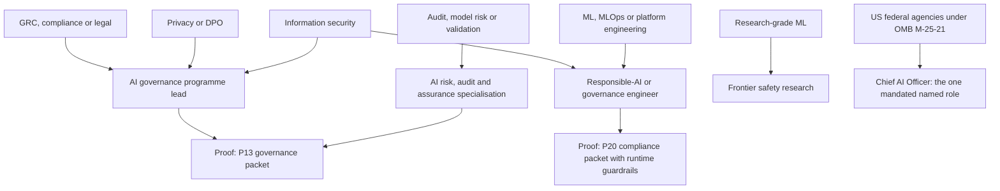
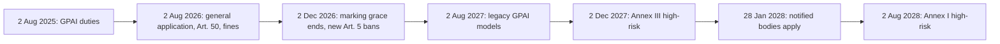

# Governance Careers: Entering AI Governance, Risk and Assurance

> Entering AI governance, risk and assurance from GRC, privacy, audit, legal, security or ML engineering: the career families regulation has created, their real volumes, entry routes by background, and the proof and credentials worth having.

**Dates.** Regulatory statuses, posting counts, pay and credential facts are as retrieved by [T0-15](../../research/sessions/T0-15-regulatory-ai-governance-career-families.md) on 2026-10-21 to 2026-10-23, unless another date is given. Regulatory status is a 14–31-day class, so this page is due for re-verification by 2026-11-21; pay, credential and tool facts are a 90-day class. [ERRATA](../../research/ERRATA.md) lists no correction to T0-15, T0-09 or T0-01 as of 2026-11-06. **Legal material here is a career pointer, not legal advice:** check the primary text before you rely on a date. **Grades** (EGP-1.0): A primary or measured; B transparent secondary; C vendor, recruiter or single source; D judgement; M model output; P practice-curated and unmeasured. For unfamiliar terms, see the [glossary](../00-start/glossary.md).

## The short answer

1. **Regulation created one dedicated career; most other work is absorbed.** The dedicated role is a senior, mostly non-coding AI governance programme lead: 6 of 13 sampled job descriptions are this class [C · T0-15 L320]. Specialist compliance work stays with privacy, legal, IT, security, risk and audit teams [B · T0-15.F5]. "Algorithmic auditor" is a specialisation inside assurance firms, certification bodies and internal audit [A/B · T0-15.F7]. The enterprise responsible-AI engineer is a thin niche that grows out of ML-platform, MLOps and security engineering [C · T0-15.F6].
2. **Expect low thousands of postings a year, not a mass profession.** Axial counted 1,997 US AI-governance postings in January to September 2026 [C · T0-15.F4], about 2,700 a year annualised [M · T0-15 L277]. In the UK, 119 live ITJobsWatch postings named the EU AI Act, about 0.7% of AI-citing postings by T0-15's own ratio; across 8 EU countries there were about 7 AI builders per governance hire, per a vendor press release (Axipro); India has no usable count [C · T0-15.F4]. Openings skew senior and large: 73% are senior or above and 56% come from firms with 10,000+ staff [C · T0-15 L260].
3. **Enter from a functional anchor.** Programme leads come from GRC, privacy, audit or security with about five years' experience: Axial's median minimum is about 5 years, ERGO asks for 5+ and Alstom for 8 to 10 [C · T0-15 L162]. Engineers come from ML, MLOps, platform or security engineering; auditors stay in audit, model risk or validation and add AI scope [D · T0-15 L163–L164].
4. **Time your move to the legal clock, not to headlines.** In 2025 and 2026 the EU's legal pull falls on providers of general-purpose models and generative systems: GPAI duties since 2 Aug 2025, Art. 50 transparency duties and Art. 101 fines from 2 Aug 2026 [A · T0-15.F1]. Enterprise high-risk duties start on 2 Dec 2027 (Annex III) and 2 Aug 2028 (Annex I), and most Annex III conformity is self-assessment, so no notified-body labour market exists before 2028 [A/B · T0-15.F3]. US demand follows sector regulators and contracts [B · T0-15.F11]; Indian demand starts with privacy engineering and DPOs ahead of the DPDP main obligations on 13 May 2027 [B · T0-15.F12].
5. **Domain credential first; AIGP second and optional.** Hold CIPP or CIPM, or CISSP, CISA or CRISC; add AIGP ($649 for IAPP members, $799 otherwise) only as a cheap differentiator. AIGP is mentioned in 8.9% of Axial's US postings and required in none of the 13 descriptions, and no credential has an evidenced pay premium [C · T0-15.F9].
6. **Show a governance packet, not a certificate list.** The [role catalog](../02-roles/role-catalog.md) names an AI inventory, a risk register and a governance playbook mapped to the EU AI Act, NIST AI RMF and ISO/IEC 42001 as the highest-signal proof for these roles [P]. Employers ask for the same artefacts: AI registers at ERGO and Alstom; model cards, evaluation reports and risk logs at Infosys [C · T0-15 L330]. Build [P13](../05-portfolio/project-archetypes.md#p13); engineers build [P20](../05-portfolio/project-archetypes.md#p20).

## At a glance



The arrows follow T0-15's recommended entry routes [D · T0-15 L162–L165] and the proof each project archetype targets; the legal route rests on IAPP's ownership data instead [B · T0-15 L101]. The Chief AI Officer stands apart: the evidence shows a mandate, not an entry route [B · T0-15 L357].

## Three families and one mandated role

T0-15 tells candidates to plan for three things, not four titles: a small, senior, mostly non-coding programme role; a thin technical responsible-AI niche; and assurance specialisations inside existing audit, certification and model-risk careers [D · T0-15 L146]. The Chief AI Officer is added here because it is the one role a mandate names [B · T0-15 L363].

### What regulation created, instrument by instrument

Statuses as retrieved 2026-10-21 to 2026-10-23; re-verify by 2026-11-21.

| Instrument | Status, with date | Work it creates | Who does it | Grade · source |
|---|---|---|---|---|
| EU AI Act: general-purpose AI (GPAI) duties | Have applied since 2 Aug 2025; models placed on the market before then must comply by 2 Aug 2027 | Annex XI technical documentation, Annex XII information for downstream providers, an EU copyright policy, a public training-content summary; for systemic-risk models (presumed above 10^25 FLOP), evaluation with documented adversarial testing, risk mitigation, serious-incident reporting and cybersecurity | Model-development teams at GPAI providers, with legal, policy and security; 22 listed GPAI Code signatories | [A · T0-15 L221]; 2027 date [B · T0-15 L224] |
| EU AI Act: general application and Art. 50 transparency | From 2 Aug 2026, with Art. 101 fines; the AI Office sent its first formal information requests on 29 Aug 2026, including to more than 30 firms on training-content summaries and copyright | Machine-readable marking of synthetic output (Art. 50(2)); deepfake disclosure by deployers (Art. 50(4)); answers to AI Office requests | Product ML, trust and safety, legal and security at providers of generative systems | [A · T0-15 L222]; requests [B · T0-15 L231] |
| EU AI Act: 2 Dec 2026 | Marking grace ends for generative systems on the market before 2 Aug 2026; new Art. 5 bans on generators of non-consensual intimate imagery and child sexual abuse material start | Marking retrofits; safeguards against the banned uses | Product ML, trust and safety | [B · T0-15 L223] |
| EU AI Act: Annex III high-risk | From 2 Dec 2027; it was 2 Aug 2026 before the Digital Omnibus, in force 27 Jul 2026 per law-firm sources | Art. 12 event logs; Annex IV documentation (test metrics including "potentially discriminatory impacts", risk management, post-market monitoring); conformity by internal control for Annex III points 2 to 8 | The provider's own product engineering, quality and compliance, MLOps and legal staff | [A · T0-15 L225]; Omnibus date [B · T0-15 L74; T0-09 L274] |
| EU AI Act: notified bodies and Annex I | Sectoral notified bodies must apply for AI designation by 28 Jan 2028; Annex I duties from 2 Aug 2028, moved from 2 Aug 2027 | The clearest opening for an independent AI conformity assessor; sectoral conformity with AI requirements added | Notified bodies; product-safety and regulatory-affairs teams | [A · T0-15 L226–L227] |
| ISO/IEC 42001 | Voluntary; outside EU harmonisation, so no presumption of conformity; ISO/IEC 42006 for certification bodies published 7 Jul 2025; BSI gained ANAB accreditation on 10 Mar 2026; no certificate counts found | AI management-system implementation, internal audit and certification audits | Accredited certification bodies; in-house programme teams | [A/B · T0-15 L87, L372] |
| NIST AI RMF 1.0 (26 Jan 2023) and Generative AI Profile (26 Jul 2024) | Voluntary; NIST's page, modified 13 Aug 2026, says the framework "is being revised"; no revision found; COSAIS control overlays in development | A shared control vocabulary for risk registers and programmes | Programme leads, risk and security teams | [B · T0-15 L483] |
| US OMB M-25-21 | Applies to federal agencies | A Chief AI Officer within 60 days, AI governance boards within 90 days, strategies within 180 days | Federal agencies; the only mandate in the evidence that names a role | [B · T0-15 L357] |
| US SR 26-2 (banks) | Issued 17 Apr 2026; supersedes SR 11-7; excludes generative and agentic AI | Model-risk validation of predictive AI; generative and agentic AI left without a designated owner | Second-line model risk | [B · T0-15 L355] |
| US NAIC AI Model Bulletin (insurers) | Adopted in 29 jurisdictions at 8 Oct 2026 | A written AI programme, vendor diligence and a cross-functional governance committee, not a new role | Business, actuarial, data-science, compliance and legal staff | [A/B · T0-15 L354] |
| NYC Local Law 144 (automated hiring tools) | Enforcement audited for July 2023 to June 2025: the city reviewed 32 sites and flagged 1 likely violation where the Comptroller's auditors found 17 (released 2 Dec 2025) | Independent bias audits; in a 2024 study only 18 of 391 employers had posted an audit report | Independent auditors engaged by employers | [A · T0-15 L369] |
| US states and the 11 Dec 2025 executive order | Colorado SB 24-205 never took effect; SB26-189 (signed 14 May 2026, most provisions from 1 Jan 2027) drops impact assessments; the order set up a DOJ AI Litigation Task Force; no federal preemption as of 22 Jun 2026, not checked since | Notice, disclosure and human-review processes; less pull for impact-assessment auditors | Legal and compliance | [B · T0-15 L479–L481] |
| EU Digital Services Act audits | 23 public audit reports in the 2025 cycle: 21 very large platforms, 2 search engines | Independent audits, including tests of algorithmic-system obligations | Assurance firms; KPMG names its Technology Assurance, TechLaw & Privacy and Digital TMT teams | [B · T0-15 L370] |
| India DPDP Act and Rules | Rules notified 13 Nov 2025; consent managers from 13 Nov 2026; main obligations from 13 May 2027 (12 May per one firm); the Data Protection Board is not fully operational | Itemised notice and consent; encryption, masking or virtual-token safeguards; processing logs kept at least one year; breach reports within 72 hours; for Significant Data Fiduciaries, an annual DPIA and audit plus "algorithmic due diligence" | Privacy engineers and DPOs first; AI-specific roles expected to follow 13 May 2027, by T0-15's judgement | [B · T0-15.F12, L457–L463; T0-09 L275] |
| India IT Rules amendment on synthetic content | In force since 20 Feb 2026 | Prominent labels with permanent metadata or provenance markers; takedown within 3 hours of a government or court order | Platform trust and safety; product ML | [B · T0-15 L466] |
| EIOPA Opinion (EU insurers); RBI FREE-AI (India) | EIOPA calls an AI officer optional and sets no new requirements; FREE-AI (13 Aug 2025) makes 26 recommendations and is recommendatory | Work absorbed by compliance, audit, DPO and actuarial functions; a board-approved AI policy and capacity building | Existing functions | EIOPA [B · T0-15 L353]; FREE-AI [A · T0-15 L356], partly read |

Reading the table:

- **The near-term pull is on providers.** In 2025 and 2026 the legal pull lands on product and ML teams at model and generative-system providers, not on enterprise conformity teams [A · T0-15 L231]. About 190 transparency-Code and 22 GPAI-Code signatories show who has engaged, not everyone who is bound [B · T0-15 L231].
- **Most compliance is first-party work.** Annex III points 2 to 8 use internal control; no harmonised standard had been cited in the Official Journal by 28 Apr 2026; only 9 Member States had clearly designated both authorities by 17 Jun 2026 [A/B · T0-15.F3].
- **One mandate names a role.** OMB M-25-21's Chief AI Officer is the only mandated named role in the evidence; the EU AI Act articles T0-15 read name no required officer [B · T0-15 L363; A · T0-15 L513].
- **The clock has moved once.** The Annex III and Annex I dates each slipped, from 2 Aug 2026 and 2 Aug 2027 [A · T0-15 L232]. A second delay would lower the chance of a 2027–28 hiring wave [D · T0-15 L193].



### The families compared

| | [Governance programme lead](../02-roles/hubs/ai-governance-lead.md) | [Risk, audit and assurance](../02-roles/hubs/ai-risk-assurance-specialist.md) | [Responsible-AI engineer](../02-roles/hubs/responsible-ai-engineer.md) | [Chief AI Officer](../02-roles/hubs/chief-ai-officer.md) |
|---|---|---|---|---|
| Dedicated or absorbed | Dedicated at programme-owner level [B · T0-15.F5] | A specialisation inside audit, certification and model-risk careers [A/B · T0-15.F7] | A thin niche: an extension of ML-platform, MLOps and security engineering [C · T0-15.F6] | Mandated only for US federal agencies [B · T0-15 L357]; EIOPA calls an AI officer optional [B · T0-15 L353] |
| Core work | AI inventory and registry, risk method, committees, conformity with the EU AI Act, NIST AI RMF and ISO/IEC 42001 [D · T0-15 L162] | Algorithmic audits (NYC LL144, EU DSA), validation of predictive models under SR 26-2, privacy and DPO work, ISO/IEC 42001 audits [A/B · T0-15.F7] | Runtime guardrails, red-teaming, evaluation pipelines (hallucination, groundedness, subgroup analysis), observability, model cards and risk logs [C · T0-15.F6] | The memo requires a CAIO, governance boards and strategies [B · T0-15 L357]; duties beyond that are not in the evidence |
| Coding | Mostly none [C · T0-15 L320] | Medium: substantive testing [D · T0-15 L155] | Python required; an ordinary MLOps stack [C · T0-15.F6] | Not measured |
| Volume signal | 6 of 13 sampled descriptions [C · T0-15 L320]; Axial's 1,997 US postings are not split by class [C · T0-15.F4, L540] | One Deloitte "AI Risk & Validation" requisition listed 16 times, one per city [C · T0-15 L315]; 23 DSA audit reports in the 2025 cycle [B · T0-15 L370] | 4 technical and 2 hybrid of the 13 descriptions; no count of technical postings exists [C · T0-15 L310, L540] | 33 of 50 large banks had executive-level AI-governance positions in Q4 2024, against 15 in 2023 [B · T0-15 L351]; "76% of firms report a CAIO" comes from IBM via a secondary source [C · T0-01.F12] |
| Entry | About 5 years in GRC, privacy, audit or security [C · T0-15 L162] | An existing audit, model-risk or validation career [D · T0-15 L164] | ML, MLOps, platform or security engineering [D · T0-15 L163] | Not covered by T0-15 |
| Where hired | Professional-services firms and consultancies, banks and insurers, large manufacturers, global capability centres [C · T0-15 L152; D · T0-15 L162] | Big Four, certification bodies, internal audit, model validation [A/B · T0-15.F7] | IT-services firms (Cognizant, Infosys), a Microsoft-stack staffing client, medtech (Stryker), industrial (Eaton) [C · T0-15 L154, F6] | US federal agencies [B · T0-15 L357] |
| Posted pay, US | Axial median $169,000, a top-of-range figure; PwC $99,000 to $252,450; McKinsey $152,300 to $203,000 (Dec 2024) [C · T0-15 L162, L398] | Deloitte Manager or Senior Manager $171,600 to $338,300 [C · T0-15 L315] | Stryker $112,800 to $239,900; Beacon Hill $75 to $85 an hour [C · T0-15 L398] | No pay data in the corpus |
| Proof | [P13](../05-portfolio/project-archetypes.md#p13) governance packet | P13 plus an audit test plan [P] | [P20](../05-portfolio/project-archetypes.md#p20) compliance packet | Not measured |
| Interview track | Scoping or solutions round; frameworks ([governance pack](../08-interviewing/prep-packs.md#governance-pack)) | Same track | Same track; P20 also prepares [system-design archetypes](../08-interviewing/system-design-archetypes.md) A14 and A15 | Not measured |

**A fifth, research-grade market.** Frontier safety serves providers of systemic-risk models, which owe evaluation with documented adversarial testing under Art. 55 [A · T0-15 L244]. One single-author 2025 estimate counts about 600 technical and 500 non-technical FTEs across 67 and 49 organisations [C · T0-15 L380]. T0-15 could not read frontier-lab postings, so pay and volume are not measured [T0-15 L380]. It sits outside commercial-compliance careers: see the [AI safety researcher hub](../02-roles/hubs/ai-safety-researcher.md) [D · T0-15 L165].

**Adjacent: AI security.** Information security is the most common primary governance function in the Stanford AI Index 2026 series, at 21% in 2024 and 2025 [B · T0-15 L349]. If you want to stay hands-on in security, compare the [AI security engineer hub](../02-roles/hubs/ai-security-engineer.md).

**Skills employers name.** In Axial's US sample: observability or monitoring 42.3%, Python 27.1%, foundation models 25.6%, cloud platforms 18.2%, Microsoft Azure 11.1%, OneTrust 8.7% (9.2% in Axial's text). Axial reports no rate for NIST AI RMF, ISO 42001, the EU AI Act or GDPR, and a mention is not a requirement [C · T0-15 L340; T0-15.F6]. Per-role skills are in the skill maps for the [lead](../03-skills-and-tech/role-skill-maps.md#skills-ai-governance-lead), [risk and assurance](../03-skills-and-tech/role-skill-maps.md#skills-ai-risk-assurance-specialist) and the [engineer](../03-skills-and-tech/role-skill-maps.md#skills-responsible-ai-engineer).

**Titles to search.** Programme: AI Governance Manager, Lead, Specialist or Analyst, and Responsible AI Governance Lead [C · T0-15 L296–L301]. Risk: banks and insurers label these roles model risk or business risk and control, for example Nationwide's "Model Risk Associate, AI Risk Governance" and Citigroup's "AI Business Risk and Control Director" [C · T0-15 L315]. Engineering: Responsible AI Engineer, AI Governance Engineer, Sr. Responsible AI Analyst, and Workday's Senior Responsible AI Systems Engineer (title only) [C · T0-15 L303–L307, L314]. "Responsible AI Officer" appears in the RBI FREE-AI report as an observation, not a recommendation [A · T0-15 L356].

### Credentials: what each one buys

Statuses as retrieved 2026-10-21 to 2026-10-23. The decision rule and the dated register are in [credential ROI](../04-certifications/credential-roi.md).

| Credential | Cost and prerequisites | Hiring weight | Pay effect | Take it when |
|---|---|---|---|---|
| CIPP or CIPM (IAPP) | Fees not in T0-15; see credential ROI | CIPP 8.2% and CIPM 6.8% of Axial's US postings; Eaton prefers CIPP [C · T0-15 L392] | IAPP medians are higher with certification, which IAPP calls "not proof of cause and effect" [B · T0-15 L392] | Your anchor is privacy [D · T0-15 L169] |
| CISSP, CISM, CRISC or CISA (ISC2, ISACA) | Fees not in T0-15; see credential ROI | CISSP 10.4%, CISM 8.1%, CRISC 6.4%, CISA 5.9%; Eaton prefers CISSP, CIPP or CISA [C · T0-15 L393] | Not measured | Your anchor is security, risk or audit [D · T0-15 L169] |
| AIGP (IAPP) | $649 for members, $799 otherwise; no prerequisites; three-hour exam of 100 questions; two-year term with 20 CPE credits [A · T0-15 L391] | 8.9% of Axial's US postings; 0 of 13 descriptions; 0 of 20 visible listings on ZipRecruiter's IAPP page [C · T0-15 L391] | No AIGP-specific premium published; a training vendor's "13% or 27% higher salary" claims are unsourced [D · T0-15 L391] | You hold a domain credential and want a cheap extra signal [C · T0-15.F9] |
| ISACA AAIA | Requires CISA, CIA or CPA; launched 19 May 2025 [B · T0-15 L373, L395] | Not reported | Not reported | You hold the prerequisite and target assurance work [D · T0-15 L164] |
| ISO/IEC 42001 auditor or implementer course | Various providers | Not measured; certification-body accreditation began after ISO/IEC 42006 (7 Jul 2025) [B · T0-15.F7] | Not measured | You target certification-body work [D · T0-15 L169] |
| CAIGP | Issuer not checked | 2.4% of Axial's postings [C · T0-15 L394] | Not measured | No evidence to prefer it |

T0-15 has no evidence on an ISO/IEC 42001 "lead auditor" credential by that name; it covers auditor or implementer courses only, with no hiring-weight data [T0-15 L396]. For every role's list, see [credentials by role](../04-certifications/credentials-by-role.md).

**Pay context.** IAPP's 2025-26 salary survey (more than 1,600 respondents in over 60 countries, fielded March to April 2025, sponsored by the credential's owner) reports medians of $151.8K for people in AI governance only, $123K for privacy only and $169.7K for both; tech-sector technical AI governance is $221K and tech-sector legal and compliance $205K [B · T0-15 L398]. These are medians of different groups and do not show what a credential adds. Axial's seniority figures are tops of posted ranges (senior $208K, manager $244K, director $268K), and VP at $227K sits below director, which suggests small samples [C · T0-15 L417]. No INR ranges are sourced [T0-15 L469]. Method and other roles: [pay benchmarks](../09-compensation/pay-benchmarks.md).

### Where the evidence differs by geography and sector

- **EU and UK.** For multinationals the EU is the main driver [D · T0-15 L517]. Fewer than 3 in 10 EU governance postings mention the AI Act (Axipro, a vendor press release) [C · T0-15 L93]. In the UK on 21 Oct 2026, 119 live ITJobsWatch postings named the EU AI Act: 87 in London, 42 hybrid or remote, median GBP 107,500 [C · T0-15 L261]. Authorities were not ready: 9 of 27 Member States had clearly designated both authorities by 17 Jun 2026 [B · T0-15 L234]; one news item puts the AI Office at "over 125 professionals" seeking about 40 contract agents, with no primary source [D · T0-15 L270].
- **US.** Demand comes through insurance (NAIC bulletin), banking (SR 26-2), hiring-tool audits (NYC LL144) and procurement more than through AI statutes [B · T0-15.F11]. California SB 53, Texas TRAIGA and Illinois HB 3773 took effect on 1 Jan 2026 [B · T0-15 L482].
- **India.** No platform count exists; visible postings sit at global capability centres and IT-services firms: Alstom (Bangalore), Eaton (Pune), EXL, Cognizant (Chennai) and Infosys (Bengaluru) [C · T0-15 L469]. DPO-type hiring was reported by the trade press (Storyboard18) in February 2025 at Meta, Kotak Mahindra Bank and GMR Group, with Tsaaro and EY hiring for clients [C · T0-15 L267]. T0-15 found no official Indian guidance on LLM training, retention or unlearning [B · T0-15.F12]. See the [India remote playbook](india-remote-playbook.md).
- **Sectors.** Professional services lead volume (32 to 36% of Axial's postings), then financial services (13 to 15%) [C · T0-15 L134]. On pay, using tops of posted ranges, life sciences ($272K, 56 postings) and healthcare ($249K, 108) rank above technology ($242K), manufacturing ($237K) and professional services ($219K); financial services, government and defence, and automotive are not reported [C · T0-15.F10]. Some professional-services volume may be firms delivering governance to clients, which T0-15 infers but did not test [D · T0-15 L134].

## How to do it

1. **Pick one family from your anchor**, using the route table below. *Done when* you can name the family, two employer types that hire it and the hub you will track.
2. **Learn the instruments that bind your targets, from the official texts** (EUR-Lex for the EU AI Act, NIST, ISO); this page maps them to work and does not teach them [P]. *Done when* you can say, with dates, which milestones apply to a named system and why most Annex III conformity is internal control.
3. **Build the proof for your family:** P13 for programme and assurance roles, P20 for engineers. *Done when* the packet meets P13's evidence list: inventory and risk register as structured data with a scoring method and dates, a framework mapping with gaps marked, one system taken through the playbook, and every regulatory statement dated ([P13](../05-portfolio/project-archetypes.md#p13)).
4. **Add at most one credential, chosen from your target postings** [P]. *Done when* you have read at least [10] target postings, logged the credentials they name, and either booked one domain credential or decided none is needed.
5. **Aim where postings are:** professional services, financial services and firms with 10,000+ staff in the US; GCCs and IT-services firms in India [C · T0-15 L134, L260, L469]. *Done when* at least half of your target list sits in those segments [P].
6. **Prepare for the governance interview track.** *Done when* you can run a scoping round on an unfamiliar AI use case, from inventory entry to risk tier to controls, using the [governance pack](../08-interviewing/prep-packs.md#governance-pack) [P].

### Routes by background

| Your background | Target family | What to add | Proof | Done when [P] | Evidence |
|---|---|---|---|---|---|
| GRC or compliance | Programme lead | EU AI Act, NIST AI RMF and ISO/IEC 42001 literacy; an AI inventory; a risk-assessment method; committee operations | P13 | One system goes from intake to a committee decision, with the decision record published | [D · T0-15 L162] |
| Privacy or DPO | Programme lead | GenAI privacy controls: masking or tokenising personal data before prompts, logs and fine-tuning sets; consent records; retention rules | P13 plus a privacy assessment of one GenAI system | The assessment ties consent, masking and log retention to cited, dated rules | Privacy is a joint-largest primary owner (22%) in IAPP's sample [B · T0-15 L101]; controls [B · T0-15 L338; D · T0-15 L473] |
| Legal | Programme lead, or AI work inside legal and compliance | Translating legal text into evidence: which artefact proves which article | An obligation-to-evidence map | Each obligation names an artefact, an owner and a dated source | Legal and compliance is the other 22% owner [B · T0-15 L101]; that translation is what is specific to compliance [D · T0-15 L342] |
| Information security | Programme lead, or the security side of the engineer route | AI incident handling, including how to halt a system; red-teaming; AI security controls | P13 with an incident runbook, or P20 | The runbook says who can halt the system, how, and how fast | 56% of ISACA's respondents cannot say how fast they could halt an AI system after a security incident [B · T0-15 L350] |
| Internal, IT or external audit | Assurance | AAIA if you hold CISA, CIA or CPA; an ISO/IEC 42001 auditor route only for certification-body work | An audit test plan for one AI system | Each test names the control, the evidence sampled and the pass criterion | [B · T0-15 L395; D · T0-15 L164] |
| Model risk or validation | AI risk | Generative and agentic AI, which SR 26-2 leaves outside model-risk scope | A validation memo for one LLM use case | The memo names the internal policy that covers the system and how effective challenge applies | [B · T0-15 L355; P · T0-09 L273] |
| ML, MLOps, platform or security engineering | Responsible-AI engineer | Annex IV-style documentation, Art. 12-style logging, subgroup evaluation with Fairlearn, an LLM red-team or evaluation harness, a c2pa-python provenance demo | P20 | Guardrail precision and recall, subgroup results with intervals and a calibrated judge are published with pinned versions | [D · T0-15 L163]; expect few openings |

### Persona notes

- **Engineers who want a fast switch.** The [role catalog](../02-roles/role-catalog.md#profile-ai-governance-lead) rates the programme-lead route as poor for engineers looking for a fast switch [D]. The engineer route fits, with few openings [D · T0-15 L163].
- **Early career.** One closed Infosys posting in Bengaluru, for a Sr. Responsible AI Analyst, accepted 0 to 1 year of experience [C · T0-15 L307]. It is a single data point, not a sized route.
- **Research-minded candidates.** Frontier safety is research-grade work: use the [AI safety researcher hub](../02-roles/hubs/ai-safety-researcher.md) and the [research pack](../08-interviewing/prep-packs.md#research-pack) rather than this guide [D · T0-15 L165].

### Tooling for the engineer route

Registry pages were read on 21 and 22 Oct 2026 [T0-15 L430]; tool statuses are a 90-day class. Build on maintained components: Fairlearn 0.15.0 (12 Oct 2026), c2pa-python 0.38.0 (29 Sep 2026; pre-1.0, so pin versions), Guardrails AI 0.11.0 (14 Aug 2026, with breaking changes), NeMo Guardrails, and Giskard v3 (a pre-release with no tabular testing) [A · T0-15 L182]. Treat AIF360 (last PyPI release 8 Apr 2024) and holisticai (3 Mar 2025) as stale unless repository activity shows otherwise [A · T0-15 L183]. No tool T0-15 examined is documented as delivering AI Act compliance by itself [C · T0-15 L184]. The repository's tool verdicts are in the [tool catalog](../00-start/tool-catalog.md).

## Templates and examples

### The governance packet [P]

Parts 1–5 and 7 follow P13's steps and evidence list; part 6 is P20's.

| Part | What it contains | Why employers recognise it |
|---|---|---|
| 1. AI inventory | Each system's purpose, owner, model, data sources and personal data, affected users, risk tier and status | AI registers at ERGO and Alstom [C · T0-15 L330] |
| 2. Classification | Each system against the EU AI Act and sector rules, citing the article and the date checked | Programme roles own conformity with the frameworks [D · T0-15 L162] |
| 3. Risk register | Risk, likelihood, impact, controls, owner and review date, under a stated scoring method | Risk logs at Infosys [C · T0-15 L330] |
| 4. Framework mapping | Each control against EU AI Act articles, NIST AI RMF functions and ISO/IEC 42001 clauses, with gaps marked | Framework literacy is asked for in technical postings [C · T0-15.F6] |
| 5. Playbook | Approval committee and go-live gate, vendor risk review, monitoring, incident handling; one system taken through end to end | ERGO reviews and approves AI systems before go-live [C · T0-15 L298] |
| 6. Technical evidence (engineers) | Annex IV-style documentation, guardrail precision and recall, subgroup evaluation with intervals, a calibrated judge, Art. 12-style logs | The Act's deliverables map onto this work [A · T0-15.F6] |
| 7. Limits | Non-claims, with every regulatory statement dated | The high-risk dates have moved once [A · T0-15 L232] |

```text
AI INVENTORY ENTRY [P]
System:            [name and version]
Owner:             [person, team]
Purpose and users: [what it decides or generates; who is affected]
Model and data:    [model; data sources; personal data: yes/no, which]
Classification:    [EU AI Act category, article, date checked] | [sector rule, or "none found on [date]"]
Risk tier:         [tier, using method [name]]
Status:            [pilot | production | retired]   Next review: [date]
```

```text
RISK REGISTER ENTRY [P]
Risk:        [what can go wrong, for whom]
Score:       likelihood [n] x impact [n] = [rating], method [name and version]
Controls:    [control IDs]
Evidence:    [artefact that shows each control works, e.g. subgroup test report]
Owner:       [person]   Review date: [date]
Mapped to:   [EU AI Act article] | [NIST AI RMF function] | [ISO/IEC 42001 clause]
```

```text
OBLIGATION-TO-EVIDENCE ENTRY [P]
Obligation:      [instrument, article or clause] (text checked on [date])
Applies because: [provider or deployer; tier; geography]
Control:         [what the organisation does]
Evidence:        [artefact, e.g. Art. 12-style event log, Annex IV section]
Produced by:     [team]   Gap: [none | description and owner]
```

### Weak and strong, side by side [P]

| Situation | Weak | Strong |
|---|---|---|
| Headline | "AI Ethicist, passionate about responsible AI" | "AI governance lead (privacy): inventory of [N] AI systems, [n] tiered against the EU AI Act and NIST AI RMF, [n] committee reviews before go-live" |
| Regulatory bullet | "Expert in the EU AI Act" | "Mapped [N] obligations (Art. 12 logging, Annex IV documentation, Art. 50(2) marking) to owners and evidence; closed [n] gaps by [date]" |
| Credentials | "AIGP certified" as the first line | Work first; then "[domain credential], [year]; AIGP, [year]" in the certifications section |
| Engineering bullet | "Implemented guardrails" | "Layered input, tool-permission and output guardrails: precision [x] and recall [y] on [n] labelled cases; false positives published" |
| Interview: "When do the EU high-risk rules apply?" | "From August 2026, so hire a compliance team" | "Since the Digital Omnibus, Annex III duties start on 2 Dec 2027 and Annex I on 2 Aug 2028. For a generative system, Art. 50(2) marking applies from 2 Aug 2026, with a grace to 2 Dec 2026 only for systems already on the market" [A/B · T0-15.F1] |
| Interview: "Do we need C2PA?" | "Yes, C2PA watermarking is mandatory" | "Art. 50(2) asks for machine-readable marking, technique-neutral and qualified by technical feasibility. C2PA signs provenance manifests; it is not a watermark, and it is one candidate layer" [A · T0-15.F2] |

### Positioning statement [P]

```text
I am a [privacy | risk | audit | security | ML platform] professional with [N] years in [domain],
moving into AI [governance | assurance | responsible-AI engineering].
I have built [link to P13 or P20], covering [instruments], each checked on [date].
I am targeting [employer types] where [instrument] drives demand.
```

## Checklist

- [ ] I have named my functional anchor and one target family.
- [ ] I can state the EU AI Act milestones with dates: 2 Aug 2025, 2 Aug 2026, 2 Dec 2026, 2 Aug 2027, 2 Dec 2027, 28 Jan 2028 and 2 Aug 2028.
- [ ] I know which instrument drives demand at each target employer: for example SR 26-2, the NAIC bulletin, Art. 50 or DPDP.
- [ ] My P13 or P20 packet is public, dated and states its limits.
- [ ] Every regulatory statement in my packet, résumé and interview notes carries the date I checked it.
- [ ] I hold, or am preparing for, one domain credential before I consider AIGP.
- [ ] I search alias titles (model risk, business risk and control, responsible AI) as well as "AI governance".
- [ ] My target list covers professional services, financial services and large firms in the US, or GCCs and IT-services firms in India.
- [ ] My headline pairs "AI governance" or "responsible AI" with an anchor, never "AI ethicist" alone.
- [ ] I have practised a scoping round with the governance prep pack.
- [ ] If I am reading this after 2026-11-21, I re-verify the regulatory table before quoting it.

## Pitfalls

| Red flag | Why it hurts | Fix |
|---|---|---|
| Calling yourself an "AI ethicist" | Whether that title survives is not shown either way; the work persists under "responsible AI" and "AI governance" titles [B · T0-15.F5] | Use "AI governance" or "responsible AI" plus your anchor: privacy, risk, security or engineering [D · T0-15 L167] |
| Leading with AIGP | It is required in 0 of 13 descriptions and no premium is published [C · T0-15.F9] | Domain credential first; AIGP as an optional extra |
| Waiting for a 2026 "compliance engineer surge" | High-risk duties moved to 2 Dec 2027 and 2 Aug 2028, and none of the 13 descriptions names C2PA or Guardrails AI [A/C · T0-15 L24] | Build on ML-platform, MLOps or security work and add the Act's deliverables (P20) |
| Training to be an independent "conformity assessor" | Annex III points 2 to 8 use internal control, notified bodies apply for AI designation only by 28 Jan 2028, and no notified-body count exists [A/B · T0-15.F3] | Aim at a provider's own compliance team, a certification body or Big Four assurance |
| Saying "C2PA watermarking is mandatory" | The Act is technique-neutral and does not name C2PA, and C2PA is a signed-manifest standard, not a watermark [A · T0-15.F2] | Say what Art. 50(2) requires and name C2PA as one candidate layer |
| Quoting $169,000 as a typical offer | Axial's figures are the top of each posted range [C · T0-15 L162] | Give ranges and say what each measures: survey medians, posted ranges |
| Reading ZipRecruiter "1000+" as demand | One Deloitte requisition appeared 16 times, one per city [C · T0-15 L94] | Count distinct requisitions |
| Assuming "SR 11-7 approval" covers an LLM feature | SR 26-2 superseded SR 11-7 and excludes generative and agentic AI [B · T0-15 L355; T0-09 L273] | Ask which internal policy covers it, and offer to own the gap |
| Citing Colorado's AI Act as a demand driver | SB 24-205 never took effect; SB26-189 drops impact assessments [B · T0-15 L481] | Point to sector rules (NAIC, SR 26-2, LL144) and procurement [B · T0-15.F11] |
| Assuming one team owns AI governance | Primary owners split across privacy, legal and compliance, IT, data governance, ethics and security [B · T0-15.F5] | Ask in screens who owns it, and present your anchor as that owner's ally |
| Undated regulatory claims | The high-risk dates have moved once and could move again [A · T0-15 L232; D · T0-15 L510] | Date every regulatory statement, as P13's evidence list requires |
| Building on stale libraries | AIF360's last PyPI release was 8 Apr 2024 and holisticai's 3 Mar 2025 [A · T0-15 L183] | Prefer maintained components and pin pre-1.0 versions |

## Evidence and limits

**What is solid.** Legal dates and the Act's deliverables are grade A, anchored on the Commission's consolidated text as at 27 Jul 2026; the Omnibus's entry into force and the Art. 50(2) grace are grade B [T0-15.F1–F3]. Tool versions are grade A as read from registry pages on 21 and 22 Oct 2026, with no hands-on testing [T0-15 L430].

**What is weak.**

- Volumes are grade C. Axial's classification method is undisclosed, and its weekly rate (about 71) disagrees with its own total (1,997 over 39 weeks is about 51); ITJobsWatch counts keywords; Axipro is a vendor press release; ZipRecruiter shows display claims [C · T0-15 L258–L263]. "Not a mass profession" rests on convergent weak sources, not one strong one [D · T0-15 L509].
- The 13 job descriptions are a purposive sample: they show what kinds of roles exist, not how many, and "preferred" is not "required" [T0-15 L292].
- Surveys and counts come from interested parties: IAPP owns AIGP, ISACA sells AAIA and Axial sells executive search. T0-15 grades them B or C and relies on primary texts for legal claims [T0-15 L515].
- T0-15 rates its own confidence medium: high for legal dates and tool versions, low to medium for volumes and credential effects [T0-15 L27].

**No evidence in the corpus** [T0-15 L469, L535–L554]:

- LinkedIn, Indeed, Glassdoor or Naukri counts, and any India posting count.
- A count of technical (class T) postings; frontier-lab postings and pay.
- AIGP holder numbers or an AIGP pay premium; ISO/IEC 42001 certificate counts; AI notified-body counts.
- INR pay ranges for these roles; CAIO pay (none in the corpus, per the role catalog) and CAIO entry routes.
- Health-sector and defence AI rules; US federal preemption after 22 Jun 2026; a time series of "AI ethicist" postings.

**What would change the advice.** T0-15's triggers [D · T0-15 L186–L197]:

| Trigger | What it would change here |
|---|---|
| First harmonised standard (for example prEN 18286) cited in the Official Journal | More standardised, hireable Annex III work |
| AI notified-body designations and complete national authority designations | More auditor and assessor demand |
| First AI Office fine or decision under Art. 101 | More GPAI compliance staffing at providers |
| A second Omnibus-style delay of the high-risk dates | Lower odds of a 2027–28 hiring wave |
| US posting counts doubling over two quarters, or LinkedIn and Indeed counts becoming obtainable | Higher volume estimates |
| NIST AI RMF revision published | A changed control vocabulary in postings |
| DPDP Board operational, official GenAI guidance, or earlier commencement | More India privacy and AI-governance demand |
| A federal preemption statute, or the outcome of SR 26-2's AI request for information | US demand shifts away from or toward AI-specific roles |

**Dates.** Regulatory statuses are as of 2026-10-21 to 2026-10-23 and set this page's review date, 2026-11-21. Pay, credential and tool facts are a 90-day class from the same dates. US federal preemption was last checked in sources dated 22 Jun 2026 [T0-15 L533].

## Next steps

- **Credentials:** [credential ROI](../04-certifications/credential-roi.md) for the decision rule and the dated register; [credentials by role](../04-certifications/credentials-by-role.md).
- **Role hubs:** [AI governance programme lead](../02-roles/hubs/ai-governance-lead.md), [AI risk, audit and compliance specialist](../02-roles/hubs/ai-risk-assurance-specialist.md), [responsible-AI engineer](../02-roles/hubs/responsible-ai-engineer.md), [Chief AI Officer](../02-roles/hubs/chief-ai-officer.md), [frontier AI safety researcher](../02-roles/hubs/ai-safety-researcher.md), [AI security engineer](../02-roles/hubs/ai-security-engineer.md).
- **Profiles:** role catalog entries for the [governance lead](../02-roles/role-catalog.md#profile-ai-governance-lead), [risk and assurance](../02-roles/role-catalog.md#profile-ai-risk-assurance-specialist), [responsible-AI engineer](../02-roles/role-catalog.md#profile-responsible-ai-engineer) and [CAIO](../02-roles/role-catalog.md#profile-chief-ai-officer); [role rankings](../02-roles/role-rankings.md).
- **Proof:** [P13](../05-portfolio/project-archetypes.md#p13) and [P20](../05-portfolio/project-archetypes.md#p20); [proof-of-work standards](../05-portfolio/proof-of-work-standards.md).
- **Résumé and search:** [résumé skills matrix](../06-job-search/resume-skills-matrix.md#resume-ai-governance-lead), [résumé strategy](../06-job-search/resume-strategy.md), [channels and boards](../06-job-search/channels-and-boards.md).
- **Interviews:** [governance prep pack](../08-interviewing/prep-packs.md#governance-pack), [interview loops](../08-interviewing/interview-loops.md), [system-design archetypes](../08-interviewing/system-design-archetypes.md).
- **Transitions and geography:** [career transitions](career-transitions.md), [India remote playbook](india-remote-playbook.md), [visa and relocation](visa-and-relocation.md).
- **After the offer:** [first 90 days](../10-onboarding/first-90-days.md).
- **Landscape:** [emerging roles](../01-landscape/emerging-roles.md), [employer landscape](../01-landscape/employer-landscape.md).
- **Evidence:** the [T0-15 session](../../research/sessions/T0-15-regulatory-ai-governance-career-families.md), the [findings registry](../../research/findings.md), [errata](../../research/ERRATA.md) and the [glossary](../00-start/glossary.md).
