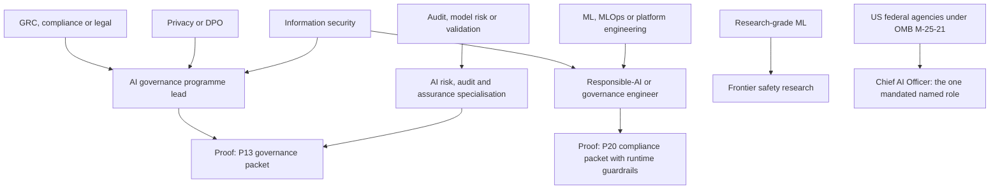
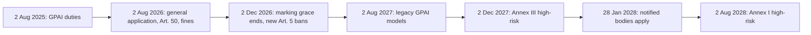

# Governance Careers: Entering AI Governance, Risk and Assurance

> Entering AI governance, risk and assurance from GRC, privacy, audit, legal, security or ML engineering: the career families regulation has created, their real volumes, entry routes by background, and the proof and credentials worth having.

**Dates.** Phase 0 baseline facts come from [T0-15](../../research/sessions/T0-15-regulatory-ai-governance-career-families.md) (October 2026), refreshed and cross-checked on 2026-11-19 against Research Pipeline 2 dossiers [T0-61](../../research/sessions/T0-61-role-group-governance-risk-responsible-ai.md), [T0-34](../../research/sessions/T0-34-certifications-governance-security-privacy-audit.md), [T0-65](../../research/sessions/T0-65-role-group-ai-leadership.md) and [T0-69](../../research/sessions/T0-69-skill-tool-momentum-dated-series.md) plus live web checks on EU Regulation (EU) 2026/1744, US SR 26-2, Colorado SB 26-189, NYC LL144 and India DPDP Rules 2025. Regulatory status carries a 14-day V0 expiry, setting `review_by: 2026-12-03`; pay, credential and tool facts are a 90-day class (to 2027-02-17). **Legal material here is a career pointer, not legal advice:** check the primary text before you rely on a date. **Grades** (EGP-1.0): A primary or measured; B transparent secondary; C vendor, recruiter or single source; D judgement; M model output; P practice-curated and unmeasured. For unfamiliar terms, see the [glossary](../00-start/glossary.md).

## The short answer

1. **Regulation created one dedicated career; most other work is absorbed.** The dedicated role is a senior, mostly non-coding AI governance programme lead: 6 of 13 sampled job descriptions in Phase 0 and the largest share in T0-61's November 2026 sample [C · T0-15 L320; T0-61 L83]. Specialist compliance work stays with privacy, legal, IT, security, risk and audit teams [B · T0-15.F5]; even across 50 large banks, Evident Insights (Q4 2024) counted just **247 responsible-AI staff in total (~4.9 per bank; JPMorgan led with 20)** [B · T0-15 L103, L351]. "Algorithmic auditor" is a specialisation inside assurance firms, certification bodies and internal audit [A/B · T0-15.F7]. The enterprise responsible-AI engineer is a thin niche growing out of ML-platform, MLOps and security engineering — where evals (75% of T0-61's sample) dominate over legacy fairness libraries (`Fairlearn`/`SHAP`/`LIME`/`Captum` 0/8) [A/M · T0-61 L307–L325].
2. **Expect low thousands of postings a year, not a mass profession.** Axial counted 1,997 US AI-governance postings across ~28.1 weeks at 71/wk — annualising to **2,660–3,700/yr** depending on denominator [C/M · T0-15.F4; T0-61 L83; [ERRATA U43](../../research/ERRATA.md)]. On GRC Careers (2026-11-12), 76 listings deduplicated to **67 distinct openings** (KPMG posted 10 duplicate city listings) [B · T0-61 L83, L86]. Watch for vendor-side false positives ("AI governance" roles at OneTrust, Vanta or ServiceNow FinOps are product/sales-engineering, not enterprise governance) [C/D · T0-61 L95–L96]. Openings skew senior and large: 73% are senior or above and 56% come from firms with 10,000+ staff [C · T0-15 L260].
3. **Enter from a functional anchor — and check experience bars by level.** All-level postings average ~5 years' experience (Axial), but dedicated manager/lead requisitions in T0-61 have a **10-year median stated minimum** (n=7, range 5–15 yrs), while risk/assurance roles ask 4–10+ yrs [M/B · T0-61 L85, L397, L411]. Programme leads come from GRC, privacy, audit or security; engineers come from ML, MLOps, platform or security engineering; auditors stay in audit, model risk or validation and add AI scope [D · T0-15 L162–L164].
4. **Time your move to the legal clock, not to headlines.** Regulation (EU) 2026/1744 (enacted 8 Jul 2026, OJ 24 Jul 2026, in force 27 Jul 2026) set Annex III high-risk duties to **2 Dec 2027**, Annex I to **2 Aug 2028**, and additional Art. 5 prohibitions to **2 Dec 2026** [B · T0-61 L89, L369–L370; verified 2026-11-19]. US demand follows sector regulators (SR 26-2, NAIC) and contracts [B · T0-15.F11]; Colorado replaced SB 24-205 with SB 26-189 (effective 1 Jan 2027) [B · T0-61 L374]; India's DPDP Rules Phase 2 (Consent Managers) commenced **13 Nov 2026** ahead of Phase 3 full Data Fiduciary duties on **13 May 2027** [B · T0-61 L89, L373; verified 2026-11-19].
5. **Domain credential first; AI certs second and optional.** In Axial's US AI-governance sample (n=1,997, Jan–Aug 2026, Grade C), **CISSP (10.4%)** leads — the only credential above 10% — ahead of **AIGP (8.9%)**, **CIPP (8.2%)**, **CISM (8.1%)**, **CIPM (6.8%)**, **CRISC (6.4%)**, **CISA (5.9%)** and **CAIGP (2.4%)** [C · T0-34 L51, L238]. On GRC Careers' AI Governance Jobs board (n=76 listings on 2026-11-12; 67 merged; Grade B, COI — board sells AIGP prep), **CISA (17.1% / 13 of 76)** ranks #1, followed by **CISM (13.2%)**, **CRISC (11.8%)**, **CIPP (9.2%)**, **CISSP (7.9%)**, **AIGP (6.6% raw / 7.5% merged; 10.0% = 3 of 30 merged AI-Governance-tagged listings)** and **CIPM (6.6%)** [B · T0-34 L52, L620–L628]. Across 11 newer AI governance/security exams (including AAIA, AAIR, SecAI+, OSAI and HTB COAE), targeted searches found **0 public posting hits** [B/C · T0-34 L53]. Neither the EU AI Act nor India's DPDP Rules mandates any individual certification [B · T0-34 L59, L321–L323]. Hold your domain credential first; add AIGP (BoK v2.1 effective Feb 2026) or ISO/IEC 42001 only where target postings reward it. See the ranked [credential catalog](../04-certifications/credential-catalog.md) and [credential ROI](../04-certifications/credential-roi.md).
6. **Show a governance packet, not a certificate list.** The [role catalog](../02-roles/role-catalog.md) names an AI inventory, a risk register and a governance playbook mapped to the EU AI Act, NIST AI RMF and ISO/IEC 42001 as the highest-signal proof [P]. Build [P13](../05-portfolio/project-archetypes.md#p13); engineers build [P20](../05-portfolio/project-archetypes.md#p20).

## At a glance



The arrows follow T0-15's recommended entry routes [D · T0-15 L162–L165] and the proof each project archetype targets; the legal route rests on IAPP's ownership data instead [B · T0-15 L101]. The Chief AI Officer stands apart: the evidence shows a mandate, not an entry route [B · T0-15 L357].

## Three families and one mandated role

T0-15 tells candidates to plan for three things, not four titles: a small, senior, mostly non-coding programme role; a thin technical responsible-AI niche; and assurance specialisations inside existing audit, certification and model-risk careers [D · T0-15 L146]. The Chief AI Officer is added here because it is the one role a mandate names [B · T0-15 L363].

### What regulation created, instrument by instrument

Statuses re-verified on 2026-11-19 against `T0-61`, `T0-34` and live official checks; re-verify V0 items by 2026-12-03.

| Instrument | Status, with date | Work it creates | Who does it | Grade · source |
|---|---|---|---|---|
| EU AI Act: general-purpose AI (GPAI) duties | Have applied since 2 Aug 2025; models placed on the market before then must comply by 2 Aug 2027. **Art. 53(2) open-source trap:** non-systemic-risk open-source GPAI models are exempt from Annex XI/XII technical documentation, **but carry NO exemption from the EU copyright policy (Art. 53(1)(c)) or public training-content summary (Art. 53(1)(d))** | Annex XI technical documentation, Annex XII information for downstream providers, an EU copyright policy, a public training-content summary; for systemic-risk models (presumed above 10^25 FLOP), evaluation with documented adversarial testing, risk mitigation, serious-incident reporting and cybersecurity | Model-development teams at GPAI providers (including open-weight releases), with legal, policy and security; 22 listed GPAI Code signatories | [A · T0-15 L221, L240–L243]; 2027 date [B · T0-15 L224] |
| EU AI Act: general application and Art. 50 transparency | From 2 Aug 2026, with **Art. 101 GPAI fines up to €15M or 3% of global turnover**; AI Office sent formal information requests to **>30 firms** on 29 Aug 2026 on training-content summaries and copyright. Note secondary-source conflict on Art. 50(2) watermarking grace (2 Aug 2026 vs 2 Dec 2026) [B/C · T0-61 L369–L370] | Machine-readable marking of synthetic output (Art. 50(2)); deepfake disclosure by deployers (Art. 50(4)); answers to AI Office requests | Product ML, trust and safety, legal and security at providers of generative systems | [A/B · T0-15 L70, L222, L233]; conflict [B/C · T0-61 L369–L370] |
| EU AI Act: 2 Dec 2026 | Additional Art. 5 prohibitions (non-consensual intimate imagery and CSAM generators) start under Regulation (EU) 2026/1744 [B · T0-61 L89, L369; verified 2026-11-19] | Marking retrofits; safeguards against the banned uses | Product ML, trust and safety | [B · T0-15 L223; T0-61 L89] |
| EU AI Act: Annex III high-risk | Formally set to **2 Dec 2027** by Digital Omnibus Regulation (EU) 2026/1744 (enacted 8 Jul 2026, OJ 24 Jul 2026, in force 27 Jul 2026) | Art. 12 event logs; Annex IV documentation (test metrics including "potentially discriminatory impacts", risk management, post-market monitoring); conformity by internal control for Annex III points 2 to 8 | The provider's own product engineering, quality and compliance, MLOps and legal staff | [A/B · T0-15 L225; T0-61 L89, L369; T0-34 L59; verified 2026-11-19] |
| EU AI Act: notified bodies and Annex I | Sectoral notified bodies must apply for AI designation by 28 Jan 2028; Annex I duties from **2 Aug 2028** under Regulation (EU) 2026/1744 | The clearest opening for an independent AI conformity assessor; sectoral conformity with AI requirements added | Notified bodies; product-safety and regulatory-affairs teams | [A/B · T0-15 L226–L227; T0-61 L89] |
| ISO/IEC 42001 | Voluntary; outside EU harmonisation, so **no Art. 40 presumption of conformity**; ISO/IEC 42006:2025 published 7 Jul 2025; BSI issued 11 certificates in 2025 and its **50th certificate on 2026-10-21** (>16 countries incl. India) [A · T0-69 L60, L250]; accredited certification bodies include BSI, Schellman, A-LIGN, Coalfire, DNV, TÜV SÜD and SGS (zero auditor postings captured in T0-61) | AI management-system implementation, internal audit and certification audits | Accredited certification bodies; in-house programme teams | [A/B/C · T0-15 L87, L372; T0-34 L321; T0-61 L105, L356, L380; T0-69 L250] |
| NIST AI RMF 1.0 (26 Jan 2023) and Generative AI Profile (26 Jul 2024) | Voluntary; NIST's page (modified 13 Aug 2026) says the framework "is being revised"; COSAIS control overlays in development | A shared control vocabulary for risk registers and programmes | Programme leads, risk and security teams | [B · T0-15 L483] |
| US OMB M-25-21 | Issued 3 Apr 2025; applies to federal agencies | A Chief AI Officer within 60 days, AI governance boards within 90 days, strategies within 180 days | Federal agencies; the only mandate in the evidence that names a role | [A/B · T0-15 L357; T0-65 L65] |
| US SR 26-2 / OCC 2026-13 / FDIC FIL-15-2026 (banks) | Issued 17 Apr 2026; supersedes SR 11-7; **Footnote 3 explicitly excludes generative and agentic AI** from formal MRM scope | Model-risk validation of predictive AI; banks split on generative/agentic ownership (e.g. U.S. Bank second-line corporate functions vs Fifth Third first-line [B · T0-61 L110]) | Second-line model risk (and ad-hoc first/second-line AI committees) | [B · T0-15 L355; T0-61 L89, L110, L371; verified 2026-11-19] |
| US NAIC AI Model Bulletin (insurers) | Adopted in 29 jurisdictions at 8 Oct 2026 | A written AI programme, vendor diligence and a cross-functional governance committee, not a new role | Business, actuarial, data-science, compliance and legal staff | [A/B · T0-15 L354] |
| NYC Local Law 144 (automated hiring tools) | NY State Comptroller audit (Dec 2025, covering Jul 2023–Jun 2025) found DCWP enforcement ineffective: 1 likely violation flagged vs ≥17 found by auditors, ~75% 311 routing failure, only 2 complaints in 2 yrs; post-audit scrutiny risk persists | Independent bias audits; in a 2024 study only 18 of 391 employers had posted an audit report | Independent auditors engaged by employers | [A/B · T0-15 L369; T0-61 L91, L372; verified 2026-11-19] |
| US states and EO 14365 (11 Dec 2025) | **Colorado** repealed SB 24-205 and enacted **SB 26-189** (signed 14 May 2026, eff. 1 Jan 2027: ADMT notice/explanation/human review, **≥3-yr records**, **60-day cure**, **no private right of action**, **no NIST/ISO safe harbour**; AG enforcement stayed under *xAI v. Weiser* on 27 Apr 2026). **CA SB 53** (frontier developers `>$500M` rev & `>10^26` FLOP; `$1M` cap), **TX TRAIGA** and **IL HB 3773** (**private right of action**) took effect 1 Jan 2026; EO 14365 launched DOJ AI Litigation Task Force (9 Jan 2026) | Notice, disclosure, frontier transparency and human-review processes; less pull for impact-assessment auditors | Legal and compliance | [B · T0-15 L479–L482; T0-61 L89, L374–L375; verified 2026-11-19] |
| EU Digital Services Act audits | 23 public audit reports in the 2025 cycle (21 very large platforms, 2 search engines): **19 of 23 overall negative opinions** (1 positive, 1 positive with comments, 2 no opinion on Meta services under probe) and **0 platforms had control maturity for control-only recommender testing** | Independent substantive or hybrid audits, including tests of eight algorithmic-system obligations | Assurance firms; KPMG names its Technology Assurance, TechLaw & Privacy and Digital TMT teams | [B · T0-15 L370] |
| India DPDP Act and Rules 2025 | Rules notified 13 Nov 2025 (penalty ceiling **₹250 crore**); **Phase 2 (Consent Managers: Indian entity, ₹2 crore net worth, 7-yr records, no payload access) commenced 13 Nov 2026**; **Phase 3 (full Data Fiduciary duties, SDF DPIAs/audits/India-based DPO) starts 13 May 2027**. **s.3(c)(ii)** public-data carve-out leaves scraped public training data untested; MeitY's 5 Nov 2025 AI Governance Guidelines ("seven sutras") are non-binding | Itemised notice and consent; encryption/masking/token safeguards; **Rule 8(3) 1-year log retention then erasure** (creating an unaddressed tension with EU AI Act Art. 12 lifetime logging for dual-regime RAG/LLM systems [D]); 72-hour breach reports; SDF annual DPIA, audit and algorithmic due diligence | Privacy engineers and DPOs first; AI-specific governance roles follow 13 May 2027 | [B · T0-15.F12, L457–L465, L473; T0-61 L89, L373; verified 2026-11-19] |
| India IT Rules amendment on synthetic content | In force since 20 Feb 2026 | Prominent labels with permanent metadata or provenance markers; takedown within 3 hours of a government or court order | Platform trust and safety; product ML | [B · T0-15 L466] |
| EIOPA Opinion (EU insurers); RBI FREE-AI (India) | EIOPA calls an AI officer optional and sets no new requirements; FREE-AI (13 Aug 2025) makes 26 recommendations and is recommendatory | Work absorbed by compliance, audit, DPO and actuarial functions; a board-approved AI policy and capacity building | Existing functions | EIOPA [B · T0-15 L353]; FREE-AI [A · T0-15 L356], partly read |

Reading the table:

- **The near-term pull is on providers.** In 2025 and 2026 the legal pull lands on product and ML teams at model and generative-system providers, not on enterprise conformity teams [A · T0-15 L231]. About 190 transparency-Code and 22 GPAI-Code signatories show who has engaged, not everyone who is bound [B · T0-15 L231].
- **Most compliance is first-party work.** Annex III points 2 to 8 use internal control; no harmonised standard had been cited in the Official Journal by 28 Apr 2026; only 9 Member States had clearly designated both authorities by 17 Jun 2026 [A/B · T0-15.F3].
- **One mandate names a role.** OMB M-25-21's Chief AI Officer is the only mandated named role in the evidence; the EU AI Act articles T0-15 read name no required officer [B · T0-15 L363; A · T0-15 L513].
- **The clock has moved once.** The Annex III and Annex I dates each slipped, from 2 Aug 2026 and 2 Aug 2027 [A · T0-15 L232]. A second delay would lower the chance of a 2027–28 hiring wave [D · T0-15 L193].



### The families compared

| | [Governance programme lead](../02-roles/hubs/ai-governance-lead.md) | [Risk, audit and assurance](../02-roles/hubs/ai-risk-assurance-specialist.md) | [Responsible-AI engineer](../02-roles/hubs/responsible-ai-engineer.md) | [Chief AI Officer](../02-roles/hubs/chief-ai-officer.md) |
|---|---|---|---|---|
| Dedicated or absorbed | Dedicated at programme-owner level [B · T0-15.F5] | A specialisation inside audit, certification and model-risk careers [A/B · T0-15.F7] | A thin niche: an extension of ML-platform, MLOps and security engineering [C · T0-15.F6] | Mandated only for US federal agencies [B · T0-15 L357]; EIOPA calls an AI officer optional [B · T0-15 L353] |
| Core work | AI inventory and registry, risk method, committees, conformity with the EU AI Act, NIST AI RMF and ISO/IEC 42001 [D · T0-15 L162] | Algorithmic audits (NYC LL144, EU DSA), validation of predictive models under SR 26-2, privacy and DPO work, ISO/IEC 42001 audits [A/B · T0-15.F7] | Runtime guardrails, red-teaming, evaluation pipelines (hallucination, groundedness, subgroup analysis), observability, model cards and risk logs [C · T0-15.F6] | The memo requires a CAIO, governance boards and strategies [B · T0-15 L357]; duties beyond that are not in the evidence |
| Coding | Mostly none [C · T0-15 L320] | Medium: substantive testing [D · T0-15 L155] | Python required; an ordinary MLOps stack [C · T0-15.F6] | Not measured |
| Volume signal | 6 of 13 sampled descriptions [C · T0-15 L320]; Axial's 1,997 US postings are not split by class [C · T0-15.F4, L540] | One Deloitte "AI Risk & Validation" requisition listed 16 times, one per city [C · T0-15 L315]; 23 DSA audit reports in the 2025 cycle [B · T0-15 L370] | 4 technical and 2 hybrid of the 13 descriptions; no count of technical postings exists [C · T0-15 L310, L540] | 33 of 50 large banks had executive-level AI-governance positions in Q4 2024, against 15 in 2023 [B · T0-15 L351]; "76% of firms report a CAIO" comes from IBM via a secondary source [C · T0-01.F12] |
| Entry | About 5 years in GRC, privacy, audit or security [C · T0-15 L162] | An existing audit, model-risk or validation career [D · T0-15 L164] | ML, MLOps, platform or security engineering [D · T0-15 L163] | Not covered by T0-15 |
| Where hired | Professional-services firms and consultancies, banks and insurers, large manufacturers, global capability centres [C · T0-15 L152; D · T0-15 L162] | Big Four, certification bodies, internal audit, model validation [A/B · T0-15.F7] | IT-services firms (Cognizant, Infosys), a Microsoft-stack staffing client, medtech (Stryker), industrial (Eaton) [C · T0-15 L154, F6] | US federal agencies [B · T0-15 L357] |
| Posted pay, US | Axial median $169,000, a top-of-range figure; PwC $99,000 to $252,450; McKinsey $152,300 to $203,000 (Dec 2024) [C · T0-15 L162, L398] | Deloitte Manager or Senior Manager $171,600 to $338,300 [C · T0-15 L315] | Stryker $112,800 to $239,900; Beacon Hill $75 to $85 an hour [C · T0-15 L398] | Bifurcated ([CAIO hub](../02-roles/hubs/chief-ai-officer.md)): US public/higher-ed base **$117.7K–$200K** [B], private corporate posted/recruiter base **$210K–$500K** [B/C], India SBI GM & CAIO up to **₹160L** [B · T0-65 L68, L329–L337] (ZipRecruiter fractional mean $151,203 reconciled on [freelance-fractional.md](freelance-fractional.md) [B · T0-65 L656]) |
| Proof | [P13](../05-portfolio/project-archetypes.md#p13) governance packet | P13 plus an audit test plan [P] | [P20](../05-portfolio/project-archetypes.md#p20) compliance packet | Not measured |
| Interview track | Scoping or solutions round; frameworks ([governance pack](../08-interviewing/prep-packs.md#governance-pack)) | Same track | Same track; P20 also prepares [system-design archetypes](../08-interviewing/system-design-archetypes.md) A14 and A15 | Not measured |

**A fifth, research-grade market.** Frontier safety serves providers of systemic-risk models, which owe evaluation with documented adversarial testing under Art. 55 [A · T0-15 L244]. One single-author 2025 estimate counts about 600 technical and 500 non-technical FTEs across 67 and 49 organisations [C · T0-15 L380]. T0-15 could not read frontier-lab postings, so pay and volume are not measured [T0-15 L380]. It sits outside commercial-compliance careers: see the [AI safety researcher hub](../02-roles/hubs/ai-safety-researcher.md) [D · T0-15 L165].

**Adjacent: AI security.** Information security is the most common primary governance function in the Stanford AI Index 2026 series, at 21% in 2024 and 2025 [B · T0-15 L349]. If you want to stay hands-on in security, compare the [AI security engineer hub](../02-roles/hubs/ai-security-engineer.md).

**Skills employers name.** In Axial's US sample: observability or monitoring 42.3%, Python 27.1%, foundation models 25.6%, cloud platforms 18.2%, Microsoft Azure 11.1%, OneTrust 8.7% (9.2% in Axial's text). Axial reports no rate for NIST AI RMF, ISO 42001, the EU AI Act or GDPR, and a mention is not a requirement [C · T0-15 L340; T0-15.F6]. Per-role skills are in the skill maps for the [lead](../03-skills-and-tech/role-skill-maps.md#skills-ai-governance-lead), [risk and assurance](../03-skills-and-tech/role-skill-maps.md#skills-ai-risk-assurance-specialist) and the [engineer](../03-skills-and-tech/role-skill-maps.md#skills-responsible-ai-engineer).

**Titles to search.** Programme: AI Governance Manager, Lead, Specialist or Analyst, and Responsible AI Governance Lead [C · T0-15 L296–L301]. Risk: banks and insurers label these roles model risk or business risk and control, for example Nationwide's "Model Risk Associate, AI Risk Governance" and Citigroup's "AI Business Risk and Control Director" [C · T0-15 L315]. Engineering: Responsible AI Engineer, AI Governance Engineer, Sr. Responsible AI Analyst, and Workday's Senior Responsible AI Systems Engineer (title only) [C · T0-15 L303–L307, L314]. "Responsible AI Officer" appears in the RBI FREE-AI report as an observation, not a recommendation [A · T0-15 L356].

### Credentials: what each one buys

Statuses refreshed on 2026-11-19 from `T0-34` and `T0-61`. The full 194-credential ranked catalog is in [credential catalog](../04-certifications/credential-catalog.md) and the decision rule is in [credential ROI](../04-certifications/credential-roi.md).

| Credential | Cost and prerequisites | Hiring weight | Pay effect | Take it when |
|---|---|---|---|---|
| **CIPP or CIPM (IAPP)** | ~$550 exam (resellers; vendors list CIPP/E, CIPP/US, CIPM, CIPT as ANAB ISO/IEC 17024 accredited); see [credential catalog](../04-certifications/credential-catalog.md) [A/C · T0-34 L50, L111, L269] | Axial US (n=1,997, Jan–Aug 2026, C): **CIPP 8.2%**, **CIPM 6.8%**; GRC Careers (n=76 / 67 merged, 2026-11-12, B COI): **CIPP 9.2%** (7/76, 10.4% merged), **CIPM 6.6%** (5/76, 7.5% merged); India purposive sample 3/9 [B/C · T0-34 L51–L52, L54, L238, L626, L628] | IAPP medians are higher with certification (owner COI, "not proof of cause and effect") [B/C · T0-15 L392; T0-34 L50] | Your anchor is privacy [D · T0-15 L169] |
| **CISSP, CISM, CRISC or CISA (ISC2, ISACA)** | CISSP $749 + $135/yr (5y exp); ISACA renewals $45/$85/yr; see [credential catalog](../04-certifications/credential-catalog.md) [A/C · T0-34 L56, L304] | Axial US (n=1,997, C): **CISSP 10.4%** (#1; only credential >10%), **CISM 8.1%**, **CRISC 6.4%**, **CISA 5.9%** (treat Axial as ±3 pp; outside governance, no cert exceeds ~3%) [C · T0-34 L51, L61, L238–L244]. GRC Careers (n=76 / 67 merged, B COI): **CISA 17.1%** (13/76, 19.4% merged — #1), **CISM 13.2%** (10/76, 14.9% merged), **CRISC 11.8%** (9/76, 13.4% merged), **CISSP 7.9%** (6/76, 9.0% merged) [B · T0-34 L52, L623–L627]. India purposive sample (n=9): CISA 6/9, CISSP 5/9, CRISC 5/9, CISM 3/9 [B · T0-34 L54, L631–L637] | Not measured | Your anchor is security, risk or audit [D · T0-15 L169] |
| **AIGP (IAPP)** | Year-1 total **$799 non-member** (includes first 2-yr maintenance; $250/2yr thereafter) vs **$944 member** ($649 exam + $295 membership); BoK v2.1 effective Feb 2026 (4 domains); no prerequisites; **no ISO/IEC 17024 listing found for AIGP** [A/B/M · T0-34 L50, L269, L300–L301] | Axial US (n=1,997, C): **AIGP 8.9%** (8.7% prose / 6.5% earlier snapshot; separate **CAIGP 2.4%**); GRC Careers (n=76 / 67 merged, B COI): **6.6%** raw (5/76) / **7.5%** merged, or **10.0%** (3/30) of merged AI-Governance-tagged listings (0/24 on page 1 of all-jobs); 5/21 (24%) programme-lead postings and 0/8 responsible-AI engineer postings in T0-61; India purposive sample 3/9 [B/C/M · T0-34 L51–L52, L54, L238, L620–L621, L629; T0-61 L88] | No AIGP-specific premium published (IAPP survey has owner COI; vendor "13–27%" claims unsourced) [C/D · T0-15 L391; T0-34 L50] | You hold a domain credential and target governance programme roles [C · T0-15.F9; T0-34 L51] |
| **ISACA AI Suite: AAIA, AAISM, AAIR (and AAIG beta)** | All three active exams cost $459 member / $599 non-member + $50 application fee ($509/$649 yr 1) and mandate **in-person PSI test centres** in India, mainland China and Hong Kong. **AAIA** accepts CISA or (with IT-audit/advisory role) CIA, US/AU/CA/JP/HK CPA, ACCA/FCCA, ICAEW, CA ANZ or Nigerian CNA — **explicitly excluding Indian CA**. **AAISM** requires CISM or CISSP. **AAIR** (launched 2026-04-15) accepts 27 qualifying designations (no Indian CA). **AAIG** beta closed 2026-11-13 [A/B · T0-34 L49, L55–L56, L114–L117, L303] | Zero public posting hits in T0-34 targeted searches across AAIA and AAIR (1 closed remote posting named AAISM; 0/9 India) [B/C/E · T0-34 L53–L54, L222] | Not measured | You already hold the prerequisite and target Big Four / assurance / model-risk teams [D · T0-34 L55] |
| **ISO/IEC 42001 Lead Auditor / Implementer (PECB vs BSI)** | **PECB** holds ISO/IEC 17024 accreditation (IAS, UKAS, COFRAC, KAB) and ANAB **ASTM E2659** accreditation for certificate programmes (distinguishing "certified" from "certificate holder"; ISO 42001 scope not opened); bundled 5-day partner course ~$2,000–$3,000 (AU$3,535+GST) vs reseller self-study **$599–$659** (+~$120/yr). **BSI** (£2,585 UK list; lower regional India fee) awards a Training Academy course certificate; TÜV Rheinland India cites CQI/IRCA [B/C · T0-34 L58, L274, L310]. Gives no EU AI Act presumption of conformity [B · T0-34 L321] | **5/9** India purposive postings (ANSR, FICO, HCLTech, Brillio, Hiring Mavericks — counts lean high); 3/7 US/UK/remote extracts; zero auditor postings captured in T0-61 [B/E · T0-34 L54, L221, L634; T0-61 L356] | Not measured | You target Indian IT-services/GCC readiness, accredited certification bodies or consulting delivery [D · T0-34 L58, L71] |
| **India DPDP: DSCI DCPP / DCPLA** | DCPP ₹15,000 + 18% GST (**₹17,700**); DCPLA ₹32,000 + 18% GST (**₹37,760**); not mandated by DPDP Rules [B/M · T0-34 L56, L311, L323] | **0/9** India AI-governance postings (even with `DCPP` in query) [B · T0-34 L54, L228, L639] | Not measured | You are targeting pure India DPDP privacy/DPO roles ahead of 2027-05-13 [B/D · T0-34 L71, L323] |
| **Hands-on AI Security / Red-Teaming (OffSec OSAI, HTB COAE, GIAC GAIPS/GASAE, CompTIA SecAI+, Practical DevSecOps CAISP)** | OffSec OSAI (AI-300, 24h proctored practical, from $1,749); HTB COAE (7-day practical + report, Silver/Gold Annual subscription); GIAC GAIPS/GASAE (~$999 exam-only; SANS bundle >$9,000); CompTIA SecAI+ (Feb 2026, resellers $298–$359); CAISP (6h practical, $1,099) [A/B/C · T0-34 L56–L57, L305–L309, L596–L598] | Zero public posting hits in T0-34 targeted searches (1 closed remote posting named CAISP) [B/C/E · T0-34 L53, L226–L227] | Not measured | You target technical AI security or red-teaming and want hands-on skill verification rather than ATS keywords [D · T0-34 L57] |

For every role's mapped list, see [credentials by role](../04-certifications/credentials-by-role.md) and the full [credential catalog](../04-certifications/credential-catalog.md).

**Pay context.** Detailed US, UK, Singapore and India governance pay bands live at the repository's owner page, [pay benchmarks](../09-compensation/pay-benchmarks.md) (D-019). Two traps to keep in mind: Axial's published figures ($169K overall, $208K senior, $244K manager, $268K director) are **tops of posted ranges** — whereas Deloitte's primary posting ($134.5K–$265.1K) explicitly notes hires are not typically near the top [A/C · T0-61 L86, L195], and GRC Careers midpoints sit at $191K (governance, n=34) and $175K (AI risk, n=18) [B · T0-61 L194, L266]. India has zero employer-posted INR bands across T0-15 and T0-61 [E · T0-61 L202, L276, L337].

### Where the evidence differs by geography and sector

- **EU and UK.** For multinationals the EU is the main driver [D · T0-15 L517]. Fewer than 3 in 10 EU governance postings mention the AI Act (Axipro, a vendor press release) [C · T0-15 L93]. In the UK on 21 Oct 2026, 119 live ITJobsWatch postings named the EU AI Act: 87 in London, 42 hybrid or remote, median GBP 107,500 [C · T0-15 L261]. Authorities were not ready: 9 of 27 Member States had clearly designated both authorities by 17 Jun 2026 [B · T0-15 L234].
- **US.** Demand comes through insurance (NAIC bulletin), banking (SR 26-2's predictive scope plus bank-by-bank generative policies), hiring-tool audits (NYC LL144) and procurement more than through AI statutes [B · T0-15.F11; T0-61 L89]. California SB 53, Texas TRAIGA and Illinois HB 3773 took effect on 1 Jan 2026 [B · T0-15 L482]. Watch an early trend toward partial governance automation (Visa stewardship agents, Deloitte AI-enabled governance — 2 postings [C/D · T0-61 L95–L96]).
- **India.** No platform count exists; T0-61 confirmed Alstom (2026-10-30) and expanded visible GCC/IT-services governance employers to EY GDS, Tech Mahindra, Capco, AlphaSense, Novartis, Accenture, GE Vernova, Visa and Deutsche Bank DWS Pune (Eaton and EXL from Phase 0 were not re-seen) [A/B/C · T0-61 L94, L363]. DPDP Phase 2 (Consent Managers) commenced 13 Nov 2026 ahead of Phase 3 on 13 May 2027 [B · T0-61 L89, L373]. See the [India remote playbook](india-remote-playbook.md).
- **Sectors & enterprise readiness benchmarks.** Professional services lead volume (32 to 36% of Axial's postings), then financial services (13 to 15%) [C · T0-15 L134]. On pay, using tops of posted ranges, life sciences ($272K, 56 postings) and healthcare ($249K, 108) rank above technology ($242K), manufacturing ($237K) and professional services ($219K) [C · T0-15.F10]. Across institutions, governance headcount stays small even where adoption is visible: **41 of 50 large banks** had dedicated AI-governance staff in Q4 2024 but averaged just **4.9 responsible-AI staff per bank** (247 total; JPMorgan led with 20 [B · T0-15 L103, L351]); in **ISACA's 2026 AI Pulse Poll** (n > 3,400, COI), **38%** report a formal comprehensive AI policy (up from 28%) and **36%** expect to add AI jobs in 12 months while **56%** cannot state how fast they could halt an AI system after a security incident [B · T0-15 L350]; and among **182 US hospital leaders** (Black Book, Oct–Nov 2025), median AI-governance spend is **4.2%** of 2026 IT/quality-and-safety budgets, only **22%** are highly confident they could produce a complete AI audit trail within 30 days, and **33%** cite unclear ownership [C · T0-15 L352].

## How to do it

1. **Pick one family from your anchor**, using the route table below. *Done when* you can name the family, two employer types that hire it and the hub you will track.
2. **Learn the instruments that bind your targets, from the official texts** (EUR-Lex for the EU AI Act, NIST, ISO); this page maps them to work and does not teach them [P]. *Done when* you can say, with dates, which milestones apply to a named system and why most Annex III conformity is internal control.
3. **Build the proof for your family:** P13 for programme and assurance roles, P20 for engineers. *Done when* the packet meets P13's evidence list: inventory and risk register as structured data with a scoring method and dates, a framework mapping with gaps marked, one system taken through the playbook, and every regulatory statement dated ([P13](../05-portfolio/project-archetypes.md#p13)).
4. **Add at most one credential, chosen from your target postings** [P]. *Done when* you have read at least [10] target postings, logged the credentials they name, and either booked one domain credential or decided none is needed.
5. **Aim where postings are:** professional services, financial services and firms with 10,000+ staff in the US; GCCs and IT-services firms in India [C · T0-15 L134, L260, L469]. *Done when* at least half of your target list sits in those segments [P].
6. **Prepare for the governance interview track.** *Done when* you can run a scoping round on an unfamiliar AI use case, from inventory entry to risk tier to controls, using the [governance pack](../08-interviewing/prep-packs.md#governance-pack) [P].

### Routes by background

| Your background | Target family | What to add | Proof | Done when [P] | Evidence |
|---|---|---|---|---|---|
| GRC or compliance | Programme lead | EU AI Act, NIST AI RMF and ISO/IEC 42001 literacy; an AI inventory; a risk-assessment method; committee operations | P13 | One system goes from intake to a committee decision, with the decision record published | [D · T0-15 L162] |
| Privacy or DPO | Programme lead | GenAI privacy controls: masking or tokenising personal data before prompts, logs and fine-tuning sets; consent records; retention rules | P13 plus a privacy assessment of one GenAI system | The assessment ties consent, masking and log retention to cited, dated rules | Privacy is a joint-largest primary owner (22%) in IAPP's sample [B · T0-15 L101]; controls [B · T0-15 L338; D · T0-15 L473] |
| Legal | Programme lead, or AI work inside legal and compliance | Translating legal text into evidence: which artefact proves which article | An obligation-to-evidence map | Each obligation names an artefact, an owner and a dated source | Legal and compliance is the other 22% owner [B · T0-15 L101]; that translation is what is specific to compliance [D · T0-15 L342] |
| Information security | Programme lead, or the security side of the engineer route | AI incident handling, including how to halt a system; red-teaming; AI security controls | P13 with an incident runbook, or P20 | The runbook says who can halt the system, how, and how fast | 56% of ISACA's respondents cannot say how fast they could halt an AI system after a security incident [B · T0-15 L350] |
| Internal, IT or external audit | Assurance | AAIA if you hold CISA or a qualifying international audit/accounting designation with IT-audit/advisory experience (**explicitly excluding Indian CA**; in-person PSI centre required in India/China/HK); an ISO/IEC 42001 auditor route only for certification-body or Indian services work | An audit test plan for one AI system | Each test names the control, the evidence sampled and the pass criterion | [A/B · T0-34 L55, L114; [ERRATA U43](../../research/ERRATA.md); D · T0-15 L164] |
| Model risk or validation | AI risk | Generative and agentic AI, which SR 26-2 leaves outside model-risk scope | A validation memo for one LLM use case | The memo names the internal policy that covers the system and how effective challenge applies | [B · T0-15 L355; P · T0-09 L273] |
| ML, MLOps, platform or security engineering | Responsible-AI engineer | LLM eval/red-team/guardrail harnesses (75% of T0-61's sample), Annex IV-style documentation and Art. 12-style logging first; treat tabular fairness (`Fairlearn` 0/8 in T0-61, 1/13 in T0-15) and `c2pa-python` provenance demos (0/13 in T0-15) as targeted secondary modules | P20 | Guardrail precision and recall, subgroup results with intervals and a calibrated judge are published with pinned versions | [A/C/D · T0-15 L110, L163, L440; T0-61 L307–L325]; expect few openings |

### Persona notes

- **Engineers who want a fast switch.** The [role catalog](../02-roles/role-catalog.md#profile-ai-governance-lead) rates the programme-lead route as poor for engineers looking for a fast switch [D]. The engineer route fits, with few openings [D · T0-15 L163].
- **Early career.** One closed Infosys posting in Bengaluru, for a Sr. Responsible AI Analyst, accepted 0 to 1 year of experience [C · T0-15 L307]. It is a single data point, not a sized route.
- **Research-minded candidates.** Frontier safety is research-grade work: use the [AI safety researcher hub](../02-roles/hubs/ai-safety-researcher.md) and the [research pack](../08-interviewing/prep-packs.md#research-pack) rather than this guide [D · T0-15 L165].

### Tooling for the engineer route

Registry pages were read on 21 and 22 Oct 2026 [T0-15 L430]; tool statuses are a 90-day class. Build on maintained components: Fairlearn 0.15.0 (12 Oct 2026), c2pa-python 0.38.0 (29 Sep 2026; pre-1.0, so pin versions), Guardrails AI 0.11.0 (14 Aug 2026, with breaking changes), NeMo Guardrails, and Giskard v3 (a pre-release with no tabular testing) [A · T0-15 L182]. Treat AIF360 (last PyPI release 8 Apr 2024) and holisticai (3 Mar 2025) as stale unless repository activity shows otherwise [A · T0-15 L183]. Know the technical limits of synthetic-content provenance tools before promising compliance: **C2PA** (Spec 2.4; 54 conformant products from 31 firms by 14 May 2026) signs manifests with X.509 trust-list keys, gives **no protection against complete manifest/metadata stripping**, and can be spoofed with a stolen key [A · T0-15 L81, L440]; **SynthID Text** (Hugging Face Transformers ≥4.46.0) loses confidence on factual responses and thoroughly rewritten text and is explicitly "not designed to directly stop motivated adversaries" [A · T0-15 L441]. No tool T0-15 examined is documented as delivering AI Act compliance by itself [C · T0-15 L184]. The repository's tool verdicts are in the [tool catalog](../00-start/tool-catalog.md).

## Templates and examples

### The governance packet [P]

Parts 1–5 and 7 follow P13's steps and evidence list; part 6 is P20's.

| Part | What it contains | Why employers recognise it |
|---|---|---|
| 1. AI inventory | Each system's purpose, owner, model, data sources and personal data, affected users, risk tier and status | AI registers at ERGO and Alstom [C · T0-15 L330] |
| 2. Classification | Each system against the EU AI Act and sector rules, citing the article and the date checked | Programme roles own conformity with the frameworks [D · T0-15 L162] |
| 3. Risk register | Risk, likelihood, impact, controls, owner and review date, under a stated scoring method | Risk logs at Infosys [C · T0-15 L330] |
| 4. Framework mapping | Each control against EU AI Act articles, NIST AI RMF functions and ISO/IEC 42001 clauses, with gaps marked | Framework literacy is asked for in technical postings [C · T0-15.F6] |
| 5. Playbook | Approval committee and go-live gate, vendor risk review, monitoring, incident handling; one system taken through end to end | ERGO reviews and approves AI systems before go-live [C · T0-15 L298] |
| 6. Technical evidence (engineers) | Annex IV-style documentation, guardrail precision and recall, subgroup evaluation with intervals, a calibrated judge, Art. 12-style logs | The Act's deliverables map onto this work [A · T0-15.F6] |
| 7. Limits | Non-claims, with every regulatory statement dated | The high-risk dates have moved once [A · T0-15 L232] |

```text
AI INVENTORY ENTRY [P]
System:            [name and version]
Owner:             [person, team]
Purpose and users: [what it decides or generates; who is affected]
Model and data:    [model; data sources; personal data: yes/no, which]
Classification:    [EU AI Act category, article, date checked] | [sector rule, or "none found on [date]"]
Risk tier:         [tier, using method [name]]
Status:            [pilot | production | retired]   Next review: [date]
```

```text
RISK REGISTER ENTRY [P]
Risk:        [what can go wrong, for whom]
Score:       likelihood [n] x impact [n] = [rating], method [name and version]
Controls:    [control IDs]
Evidence:    [artefact that shows each control works, e.g. subgroup test report]
Owner:       [person]   Review date: [date]
Mapped to:   [EU AI Act article] | [NIST AI RMF function] | [ISO/IEC 42001 clause]
```

```text
OBLIGATION-TO-EVIDENCE ENTRY [P]
Obligation:      [instrument, article or clause] (text checked on [date])
Applies because: [provider or deployer; tier; geography]
Control:         [what the organisation does]
Evidence:        [artefact, e.g. Art. 12-style event log, Annex IV section]
Produced by:     [team]   Gap: [none | description and owner]
```

### Weak and strong, side by side [P]

| Situation | Weak | Strong |
|---|---|---|
| Headline | "AI Ethicist, passionate about responsible AI" | "AI governance lead (privacy): inventory of [N] AI systems, [n] tiered against the EU AI Act and NIST AI RMF, [n] committee reviews before go-live" |
| Regulatory bullet | "Expert in the EU AI Act" | "Mapped [N] obligations (Art. 12 logging, Annex IV documentation, Art. 50(2) marking) to owners and evidence; closed [n] gaps by [date]" |
| Credentials | "AIGP certified" as the first line | Work first; then "[domain credential], [year]; AIGP, [year]" in the certifications section |
| Engineering bullet | "Implemented guardrails" | "Layered input, tool-permission and output guardrails: precision [x] and recall [y] on [n] labelled cases; false positives published" |
| Interview: "When do the EU high-risk rules apply?" | "From August 2026, so hire a compliance team" | "Since the Digital Omnibus, Annex III duties start on 2 Dec 2027 and Annex I on 2 Aug 2028. For a generative system, Art. 50(2) marking applies from 2 Aug 2026, with a grace to 2 Dec 2026 only for systems already on the market" [A/B · T0-15.F1] |
| Interview: "Do we need C2PA?" | "Yes, C2PA watermarking is mandatory" | "Art. 50(2) asks for machine-readable marking, technique-neutral and qualified by technical feasibility. C2PA signs provenance manifests; it is not a watermark, and it is one candidate layer" [A · T0-15.F2] |

### Positioning statement [P]

```text
I am a [privacy | risk | audit | security | ML platform] professional with [N] years in [domain],
moving into AI [governance | assurance | responsible-AI engineering].
I have built [link to P13 or P20], covering [instruments], each checked on [date].
I am targeting [employer types] where [instrument] drives demand.
```

## Checklist

- [ ] I have named my functional anchor and one target family.
- [ ] I can state the EU AI Act milestones with dates: 2 Aug 2025, 2 Aug 2026, 2 Dec 2026, 2 Aug 2027, 2 Dec 2027, 28 Jan 2028 and 2 Aug 2028.
- [ ] I know which instrument drives demand at each target employer: for example SR 26-2, the NAIC bulletin, Art. 50 or DPDP.
- [ ] My P13 or P20 packet is public, dated and states its limits.
- [ ] Every regulatory statement in my packet, résumé and interview notes carries the date I checked it.
- [ ] I hold, or am preparing for, one domain credential before I consider AIGP.
- [ ] I search alias titles (model risk, business risk and control, responsible AI) as well as "AI governance".
- [ ] My target list covers professional services, financial services and large firms in the US, or GCCs and IT-services firms in India.
- [ ] My headline pairs "AI governance" or "responsible AI" with an anchor, never "AI ethicist" alone.
- [ ] I have practised a scoping round with the governance prep pack.
- [ ] If I am reading this after 2026-12-03, I re-verify the V0 regulatory table before quoting it.

## Pitfalls

| Red flag | Why it hurts | Fix |
|---|---|---|
| Calling yourself an "AI ethicist" | Whether that title survives is not shown either way; the work persists under "responsible AI" and "AI governance" titles [B · T0-15.F5] | Use "AI governance" or "responsible AI" plus your anchor: privacy, risk, security or engineering [D · T0-15 L167] |
| Leading with AIGP | It is required in 0 of 13 descriptions and no premium is published [C · T0-15.F9] | Domain credential first; AIGP as an optional extra |
| Waiting for a 2026 "compliance engineer surge" | High-risk duties moved to 2 Dec 2027 and 2 Aug 2028, and none of the 13 descriptions names C2PA or Guardrails AI [A/C · T0-15 L24] | Build on ML-platform, MLOps or security work and add the Act's deliverables (P20) |
| Training to be an independent "conformity assessor" | Annex III points 2 to 8 use internal control, notified bodies apply for AI designation only by 28 Jan 2028, and no notified-body count exists [A/B · T0-15.F3] | Aim at a provider's own compliance team, a certification body or Big Four assurance |
| Saying "C2PA watermarking is mandatory" | The Act is technique-neutral and does not name C2PA, and C2PA is a signed-manifest standard, not a watermark [A · T0-15.F2] | Say what Art. 50(2) requires and name C2PA as one candidate layer |
| Quoting $169,000 as a typical offer | Axial's figures are the top of each posted range [C · T0-15 L162] | Give ranges and say what each measures: survey medians, posted ranges |
| Reading ZipRecruiter "1000+" as demand | One Deloitte requisition appeared 16 times, one per city [C · T0-15 L94] | Count distinct requisitions |
| Assuming "SR 11-7 approval" covers an LLM feature | SR 26-2 superseded SR 11-7 and excludes generative and agentic AI [B · T0-15 L355; T0-09 L273] | Ask which internal policy covers it, and offer to own the gap |
| Citing Colorado's AI Act as a demand driver | SB 24-205 never took effect; SB26-189 drops impact assessments [B · T0-15 L481] | Point to sector rules (NAIC, SR 26-2, LL144) and procurement [B · T0-15.F11] |
| Assuming one team owns AI governance | Primary owners split across privacy, legal and compliance, IT, data governance, ethics and security [B · T0-15.F5] | Ask in screens who owns it, and present your anchor as that owner's ally |
| Undated regulatory claims | The high-risk dates have moved once and could move again [A · T0-15 L232; D · T0-15 L510] | Date every regulatory statement, as P13's evidence list requires |
| Building on stale libraries | AIF360's last PyPI release was 8 Apr 2024 and holisticai's 3 Mar 2025 [A · T0-15 L183] | Prefer maintained components and pin pre-1.0 versions |

## Evidence and limits

**What is solid.** Legal dates and the Act's deliverables are grade A, anchored on the Commission's consolidated text as at 27 Jul 2026; the Omnibus's entry into force and the Art. 50(2) grace are grade B [T0-15.F1–F3]. Tool versions are grade A as read from registry pages on 21 and 22 Oct 2026, with no hands-on testing [T0-15 L430].

**What is weak.**

- Volumes are grade C. Axial's classification method is undisclosed, and its weekly rate (~71/wk implies 1,997 ÷ 71 ≈ 28.1 weeks, annualising to ~3,700/yr) disagrees with a full 39-week Jan–Sep window (1,997 ÷ 39 ≈ 51/wk, ~2,660/yr) — reconciled as **2,660–3,700/yr** ([ERRATA U43](../../research/ERRATA.md)); ITJobsWatch counts keywords; Axipro is a vendor press release; ZipRecruiter shows display claims [C/M · T0-15 L258–L263; T0-61 L83]. "Not a mass profession" rests on convergent weak sources, not one strong one [D · T0-15 L509].
- The 13 job descriptions are a purposive sample: they show what kinds of roles exist, not how many, and "preferred" is not "required" [T0-15 L292].
- Surveys and counts come from interested parties: IAPP owns AIGP, ISACA sells AAIA and Axial sells executive search. T0-15 grades them B or C and relies on primary texts for legal claims [T0-15 L515].
- T0-15 rates its own confidence medium: high for legal dates and tool versions, low to medium for volumes and credential effects [T0-15 L27].

**No evidence in the corpus** [T0-15 L469, L535–L554; T0-65 L722–L735; T0-69 L250]:

- LinkedIn, Indeed, Glassdoor or Naukri counts, and any India posting count.
- A count of technical (class T) postings; frontier-lab postings and pay.
- AIGP holder numbers or an AIGP pay premium; global cross-registrar ISO/IEC 42001 certificate totals (BSI's single-registrar count reached its 50th certificate on 2026-10-21 [A · T0-69 L60, L250]); AI notified-body counts.
- Employer-posted INR pay bands for programme/risk/engineer governance roles (SBI's fixed-term CAIO notice up to ₹160L is the lone verified INR figure [B · T0-65 L329]); audited corporate CAIO exit paths (see [CAIO hub](../02-roles/hubs/chief-ai-officer.md)).
- Health-sector and defence AI rules; US federal preemption after 22 Jun 2026; a time series of "AI ethicist" postings.

**What would change the advice.** T0-15's triggers [D · T0-15 L186–L197]:

| Trigger | What it would change here |
|---|---|
| First harmonised standard (for example prEN 18286) cited in the Official Journal | More standardised, hireable Annex III work |
| AI notified-body designations and complete national authority designations | More auditor and assessor demand |
| First AI Office fine or decision under Art. 101 | More GPAI compliance staffing at providers |
| A second Omnibus-style delay of the high-risk dates | Lower odds of a 2027–28 hiring wave |
| US posting counts doubling over two quarters, or LinkedIn and Indeed counts becoming obtainable | Higher volume estimates |
| NIST AI RMF revision published | A changed control vocabulary in postings |
| DPDP Board operational, official GenAI guidance, or earlier commencement | More India privacy and AI-governance demand |
| A federal preemption statute, or the outcome of SR 26-2's AI request for information | US demand shifts away from or toward AI-specific roles |

**Dates.** Regulatory statuses were re-verified on 2026-11-19 against `T0-61`, `T0-34`, `T0-65`, `T0-69` and live official checks, setting this page's 14-day V0 review date to `2026-12-03`. Pay, credential and tool facts are a 90-day class (to `2027-02-17`).

## Next steps

- **Credentials:** [credential catalog](../04-certifications/credential-catalog.md) (150 ranked credentials), [credential ROI](../04-certifications/credential-roi.md) and [credentials by role](../04-certifications/credentials-by-role.md).
- **Role hubs:** [AI governance programme lead](../02-roles/hubs/ai-governance-lead.md), [AI risk, audit and compliance specialist](../02-roles/hubs/ai-risk-assurance-specialist.md), [responsible-AI engineer](../02-roles/hubs/responsible-ai-engineer.md), [Chief AI Officer](../02-roles/hubs/chief-ai-officer.md), [frontier AI safety researcher](../02-roles/hubs/ai-safety-researcher.md), [AI security engineer](../02-roles/hubs/ai-security-engineer.md).
- **Profiles:** role catalog entries for the [governance lead](../02-roles/role-catalog.md#profile-ai-governance-lead), [risk and assurance](../02-roles/role-catalog.md#profile-ai-risk-assurance-specialist), [responsible-AI engineer](../02-roles/role-catalog.md#profile-responsible-ai-engineer) and [CAIO](../02-roles/role-catalog.md#profile-chief-ai-officer); [role rankings](../02-roles/role-rankings.md).
- **Proof:** [P13](../05-portfolio/project-archetypes.md#p13) and [P20](../05-portfolio/project-archetypes.md#p20); [proof-of-work standards](../05-portfolio/proof-of-work-standards.md).
- **Résumé and search:** [résumé skills matrix](../06-job-search/resume-skills-matrix.md#resume-ai-governance-lead), [résumé strategy](../06-job-search/resume-strategy.md), [channels and boards](../06-job-search/channels-and-boards.md).
- **Interviews:** [governance prep pack](../08-interviewing/prep-packs.md#governance-pack), [interview loops](../08-interviewing/interview-loops.md), [system-design archetypes](../08-interviewing/system-design-archetypes.md).
- **Transitions and geography:** [career transitions](career-transitions.md), [India remote playbook](india-remote-playbook.md), [visa and relocation](visa-and-relocation.md).
- **After the offer:** [first 90 days](../10-onboarding/first-90-days.md).
- **Landscape:** [emerging roles](../01-landscape/emerging-roles.md), [employer landscape](../01-landscape/employer-landscape.md).
- **Evidence:** the [T0-15 session](../../research/sessions/T0-15-regulatory-ai-governance-career-families.md), the [findings registry](../../research/findings.md), [errata](../../research/ERRATA.md) and the [glossary](../00-start/glossary.md).
