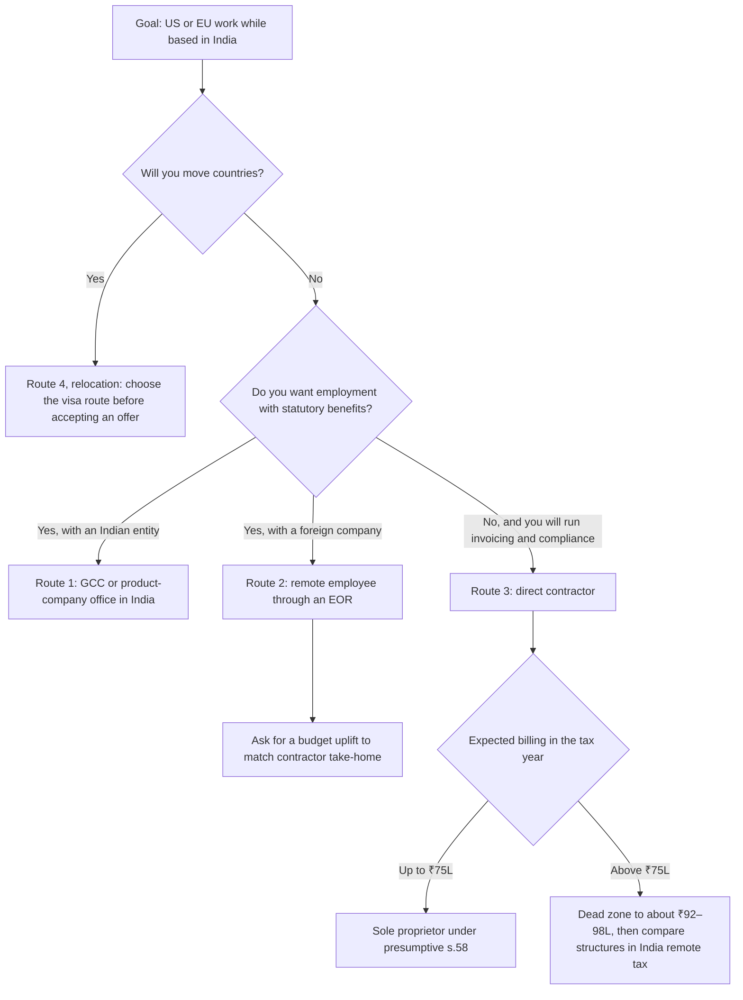

# India Remote Playbook: Routes from India to US and EU Work

> For India-based engineers who want US or EU work: how to choose between a GCC job, remote employment through an EOR, direct contracting and relocation, how to find the work from India, what each route pays, and what to set up before the first offer or invoice.

> [!NOTE]
> **Tax, visa and legal material on this page is pointers, not advice.** The tax and FEMA position is T0-07's as at 21 October 2026. [India remote tax](../09-compensation/india-remote-tax.md) carries the detail and the full disclaimer; confirm anything you act on with a practising Chartered Accountant (CA). Visa routes are covered in [Visa and relocation](visa-and-relocation.md).

**Dates, grades and one term.** Pay figures are Levels.fyi pages retrieved on 12 October 2026 for T0-02 (evidence as of 2026-10-21) and pages cited in T0-17, plus contractor rates relayed by one vendor in September–October 2026. Tax and FEMA pointers are as at 21 October 2026. Re-verify the regulatory pointers by 2026-11-21 and the pay figures within 90 days of their retrieval dates. Grades (EGP-1.0): A primary or measured; B transparent secondary; C vendor or single source, attributed; D judgement; M model output; P practice-curated. **GCC** here means a Global Capability Centre, a multinational's own engineering centre in India. T0-02's F10 uses "GCC" for the Gulf states (Dubai, Abu Dhabi); those UAE bands are not India pay [C · T0-02.F10].

## The short answer

1. **Benchmark against the population you are targeting, not "India".** Levels.fyi's Greater Bengaluru ML Engineer median is ₹44.5 lakh, while broad-market sources centre on ₹10–15 lakh: a 3–4× gap, explained by employer type. The often-quoted "₹50L–₹1Cr" is roughly P56 to just above P90 of the Levels.fyi sample, not the market [B for Levels.fyi, C for the broad market · T0-02.F3].
2. **Inside India, the ceiling is measurable.** The Greater Bengaluru Senior SWE median is about ₹56.0 lakh and the P90 about ₹1.07 crore; the highest employer senior medians run ₹1.06–1.22 crore, and a local Staff role typically does not reach ₹1.2 crore, on Levels.fyi job-board estimates [B · T0-17 KF4; C for the Staff estimate · T0-17 L138]. Above that line, the options are a foreign employer, contracting or relocation [D].
3. **At the same client spend, contracting directly keeps the most cash up to ₹75 lakh.** T0-07's model keeps 83–84% of billing under presumptive taxation; through an EOR, cash is 22–24% lower. If a client offers EOR, ask for a budget about 27–32% higher [M · T0-07.F4, T0-07.F5].
4. **Set the tax structure before you quote a rate.** A vendor-relayed rate card of $35–63 an hour, full time, comes to ₹64–115 lakh a year at ₹95.25 [C · T0-02.F11]. That range straddles the ₹75 lakh presumptive ceiling, where one rupee over costs about ₹11.8 lakh of tax [A · T0-07.F2; M · T0-07.F3]. T2-01 puts the structure decision before the first invoice [D · T2-01 L174].
5. **Find the work through remote, public-output routes first.** The best-documented global pathways are gated by geography; the accessible ones from India are competitions, research reading groups and OSS discussion boards [A/B · T0-12.F8]. In Bengaluru the best-evidenced high-signal venues are screened or approval-gated [B/C · T0-12.F7].
6. **Treat relocation as a separate project with longer lead times.** Choose the visa route before you accept an international offer; T2-01 puts O-1A evidence-building at 12–18 months before filing [D · T2-01 L177–178].

## At a glance: four routes

| Route | Typical employer | Pay population | Setup | Main risks | Evidence |
|---|---|---|---|---|---|
| **1. GCC or product-company office in India** | A multinational's capability centre, or a product company's India office | Levels.fyi Greater Bengaluru: ML Engineer P50 ₹44.5L, P90 ₹94.6L; Senior SWE median ≈₹56.0L, P90 ≈₹1.07Cr | Indian employment; nothing extra | The local ceiling; a dual mandate between the global parent and India leadership | B · T0-02.F3; B · T0-17 KF4; D · T0-09 L201 |
| **2. Remote employee through an EOR** | A US or EU company without an Indian entity, employing you through an EOR such as Deel, Remote or Oyster | No India-specific band in this evidence. At a client spend of ₹30L / ₹50L / ₹75L / ₹1.2Cr, cash take-home is ₹19.4L / ₹32.9L / ₹47.9L / ₹75.0L | Employment contract with the EOR's Indian entity; tax deducted from salary | 22–24% less cash than contracting up to ₹75L; outside work usually restricted; the employer owns your code | M; prices A/B · T0-07.F5; B, D · T0-07 L415 |
| **3. Direct contractor** | A US, EU or UK client paying you as a sole proprietor, sometimes through a contractor platform | Vendor-relayed rate card: $35–50/h on international-client contracts, $44–63/h freelance; full time, $35–63/h is ₹64–115L a year at ₹95.25 | GST and LUT, an AD bank or authorised provider, e-FIRC or FIRA with P0802, a monthly EDF, W-8BEN, an MSA | The ₹75L cliff; compliance load; bench time; misclassification; clients that refuse individual contractors | C · T0-02.F11; B · T0-07 L119–138 |
| **4. Relocation** | An employer abroad; some visa routes depend on the employer | Destination-market pay: the US ML P50 is 6.0× the Bengaluru P50 at market FX, 1.44× at PPP | A visa route, chosen before you accept | A wrong route can waste 6–18 months; tax, cost of living and visa cost not modelled | A/B for FX, C for PPP · T0-02.F9; D · T2-01 L178 |



## What each route pays

### Employees in India: the measured anchors

| Population (Levels.fyi unless stated) | P25 | P50 | P75 | P90 | Evidence |
|---|---|---|---|---|---|
| Greater Bengaluru ML Engineer (n = 96, 12 Oct 2026) | ₹28.9L | ₹44.5L | ₹68.6L | ₹94.6L | B · T0-02.F3 |
| Hyderabad ML Engineer (12 Oct 2026) | ₹23.4L | ₹30.3L | ₹45.8L | ₹84.7L | B · T0-02.F3 |
| Greater Bengaluru Senior SWE (n = 4,836) | ≈₹38.4L | ≈₹56.0L | ≈₹79.9L | ≈₹1.07Cr | B · T0-17 KF4 |
| Bengaluru "AI Engineer" page, as fetched | — | ≈₹24.5L | ≈₹40.4L | ≈₹62.6L | B · T0-17 L139 |
| Broad market: Glassdoor, Indeed, AIM Research | — | centre ₹10–15L | — | — | C · T0-02.F3 |

- The Levels.fyi sample is self-selected and heavy in multinationals and product companies; the broad market sits 3–4× lower, and the difference is employer type [B, C · T0-02.F3].
- The "AI Engineer" page is unstable: a search snapshot of the same URL showed ≈₹21.4L [B · T0-17 L139].
- Google Bengaluru ML runs ₹45.2L (L3), ₹65.2L (L4) and ₹168.3L (L5) [B · T0-02.F3].

### The same title at different employers

Medians of total compensation for Greater Bengaluru software engineers, not ML-specific [B · T0-02 L241–250]:

| Employer | Entry level | Senior level |
|---|---|---|
| X | ₹40.5L (SWE) | ₹121.9L (Senior SWE) |
| LinkedIn | ₹47.0L (IC1) | ₹109.6L (IC3) |
| Microsoft | ₹27.1L (SDE 59) | ₹71.5L (Senior SDE 63) |
| SAP | ₹14.4L (T1) | ₹43.2L (T3) |
| Fidelity Investments | ₹13.1L (L3) | ₹28.9L (L5) |
| Sony | ₹13.5L (L3) | ₹24.9L (L6) |

T0-17 lists the highest senior medians by employer as Broadcom ≈₹1.22Cr, LinkedIn ≈₹1.09Cr, Rippling ≈₹1.08Cr, Atlassian ≈₹1.06Cr and Rubrik ≈₹1.06Cr [B · T0-17 L137]. A local Staff role typically does not reach ₹1.2Cr: Levels.fyi job-board estimates put Broadcom Staff base salary in Bengaluru at only ≈$39–77K [C · T0-17 L138].

### Contractors and EOR employees

- **Contractor rates [C · T0-02.F11; T0-02 marks its criterion unmet].** One vendor relays marketplace ranges for September–October 2026: Upwork $25–150/h, Toptal $70–200/h, Arc $61–100/h. The same vendor reports India mid-level AI/ML engineers at $28–72/h overall, with a rate card of $35–50/h for international-client contracts and $44–63/h freelance. At 160 hours a month, $35–63/h is $5.6–10.1K a month, or ₹64–115L a year at ₹95.25: about P70 to above P90 of Levels.fyi Bengaluru full-time pay, before benefits, tax and bench time. No platform-native percentile data was found, and T0-02 did not collect platform rate cards [T0-02 L100].
- **The cliff inside that range.** ₹64–115L straddles the ₹75L presumptive ceiling. T2-01 notes that a contractor billing $80K a year to a US client meets the cliff (about ₹75L at ₹96/$) "at almost exactly the billing level where freelance AI work becomes viable" [D · T2-01 L706].
- **EOR take-home [M · T0-07.F5].** At the same client spend, EOR cash is ₹19.4L / ₹32.9L / ₹47.9L / ₹75.0L at ₹30L / ₹50L / ₹75L / ₹1.2Cr: 22–24% below presumptive contracting up to ₹75L, and near parity at ₹1.2Cr. What foreign employers pay India-based EOR employees is not measured in the sessions this guide draws on.

### Comparing an Indian offer with a foreign one

Compute both lenses, then decide which one fits your goal [A/B for FX, C for PPP · T0-02.F9; T0-02 L98]. At market FX the US ML P50 is 6.0× the Bengaluru P50; at purchasing-power parity it is 1.44×, a PPP-equivalent of ≈₹64L, about P70. As of October 2026 the rupee was about 8.3% weaker year on year, which lifts the rupee value of any USD offer. Tax, cost of living, visa cost and savings rate were not modelled, and they decide the answer. For scale, Levels.fyi's all-level SWE medians for 2025 were ≈$33.8K in India and ≈$192.5K in the US [B · T0-17 L140].

## The four routes

### Route 1: GCC or product-company office in India

**Choose it when** you want the strongest local pay population on Indian payroll, without export compliance; or when you are early in your career, since a larger share of India's AI roles are entry-level: 21.2% against 10.4% in the US (JobsPipe, 2026-10-11) [B · T0-01.F10].

- **Demand.** Grade-C press sources cited by T0-01 (NASSCOM-Zinnov 2026; Quess for the supply gaps) put India's GCCs at 2,100+ centres, with AI and data the fastest-growing function (+38% year on year) and supply gaps of 18–43% in AI, MLOps and platform clusters [C · T0-01 L69, L198].
- **Ceiling.** Pay is bounded by the local distribution above. Plan the next step before you reach it [B · T0-17 KF4].
- **First 90 days.** Expand weeks 1–4 for stakeholder mapping. Identify the dual mandate (global parent against India leadership) and who sets priorities, owns data and budget, and approves tools. Get probation terms and review dates in writing, and assume both the parent's security and data rules and Indian law (DPDP phases) apply [D · T0-09 L201]. T2-01 expects a 3–6 month formal probation with a halfway review, and advises mapping in week 1 who controls GPU allocation, model API access and data-residency decisions [D · T2-01 L340]. T0-09 found no source that documents startup-versus-GCC probation practice [D · T0-09 L195].

### Route 2: Remote employee through an EOR

**Choose it when** the client mandates employment, you want PF, gratuity, leave and employment-law protection, or you do not want GST, EDF and e-FIRC chores [D · T0-07 L415].

- **How it works.** The EOR's Indian entity employs you; the client directs your work and pays the EOR's invoice (salary, employer contributions and fee). You are taxed as a salaried employee and make no taxable supply [D · T0-07 L405].
- **Cost.** Remote lists $599 per employee per month paid annually, or $699 month to month (A, vendor page); Deel is reported at $599 (B/C) and Oyster mostly at $699 (C). At ₹96/$, $599 a month is ₹6.9L a year: 23.0% of a ₹30L budget and 5.8% of ₹1.2Cr [M; prices A/B · T0-07.F5]. The fee comes out of the budget that funds your salary unless the client raises it [D · T0-07 L405].
- **Negotiate.** To match contractor take-home, ask for a budget about 27–32% higher up to ₹75L, or about 4% higher at ₹1.2Cr [M · T0-07 L127]. A script is in [India remote tax](../09-compensation/india-remote-tax.md).
- **Watch.** Copyright in work made in the course of employment goes to the employer [B · T0-07 L415]; contracts usually restrict outside work, and notice periods apply [D · T0-07 L415]. The Labour Codes, in force from 21 November 2025, raise the cost floor of employment [B/C · T0-07.F12].

### Route 3: Direct contractor

**Choose it when** the client accepts an individual contractor, you can carry a monthly compliance routine, and your billing plan fits a band in [India remote tax](../09-compensation/india-remote-tax.md).

- **Default structure.** Up to ₹75L with cash receipts at 5% or less: a sole proprietor under presumptive taxation (s.58, the old §44ADA) in the new regime, with GST and an annual LUT, bank-channel receipts, a monthly EDF, a W-8BEN and an IP-explicit MSA. The model keeps 83–84% of billing [M; statutory B · T0-07 L119].
- **Winning clients.** The freelance path leaves the employment funnel at discovery: network-based acquisition replaces job boards, MSA terms replace offer negotiation, and client retention replaces onboarding [B/C · T2-01.F7]. See [Freelance and fractional work](freelance-fractional.md).
- **Watch.** Some clients' vendor policies refuse individual contractors and require a company or an EOR [D · T0-07 L147]. Full-time, single-client work carries misclassification risk [D · T0-07 L498]. Rate arithmetic is before benefits, tax and bench time [C · T0-02.F11].

### Route 4: Relocation

**Choose it when** you want the destination market's pay and accept its visa process and costs. Routes 1–3 keep you in India, and route 3's no-withholding position with US clients rests on the work being performed outside the US [A · T0-07.F9]. This guide does not cover visa routes or tax residency on moving; see [Visa and relocation](visa-and-relocation.md).

- **Lead times.** Choose the visa route before accepting an international offer: a wrong route can waste 6–18 months, and some routes are employer-dependent. For the US O-1A, T2-01 puts evidence-building at 12–18 months before filing, with at least 3 of 8 criteria met with quality proof [D · T2-01 L177–178].

## Finding the work from India

In order of the evidence for India-based candidates:

1. **Remote, public-output programmes [A/B · T0-12.F8].** Examples T0-12 found, with their dates: GPU MODE competitions (an AMD end-to-end model speedrun with a $1.1M prize pool, teams of up to three, qualifiers from 6 March 2026); an NVIDIA Blackwell kernel hackathon run with GPU MODE; EleutherAI's public Discord; the vLLM developer Slack; and Cohere Labs, whose community lists members from 150 countries. T0-12's judgement is that these, not conference attendance, are the highest-return remote routes.
2. **Screened local venues [B/C · T0-12.F7].** In Bengaluru, apply to AI Tinkerers (demo-first and screened) with a demo, and join The Fifth Elephant's meetup circuit (HasGeek, running since 2012; a one-year membership gives priority access to offline meetups). The *import_ bengaluru* conference on 6 September 2026 listed 339+ registrations, with PyData Bangalore and PyTorch Bengaluru among its collaborators. Anthropic and OpenAI run India community events by invitation or approval. The largest gatherings (Cypher 2026, World AI Summit, Open Source India) are conference-and-expo formats.
3. **Referrals and inbound applications [A · T0-12.F4].** Referrals are about 15–18% of hires and inbound about half; the often-quoted 70–85% "hidden job market" has no evidence base. LinkedIn's documented problem is application-volume saturation [B · T0-12.F2]. Where to look: [Channels and boards](../06-job-search/channels-and-boards.md).
4. **Weak ties, not strangers [A · T0-12.F12].** Weak-tie research favours repeated low-cost interaction with moderately weak ties over cold outreach to strangers. See [Referrals and outreach](../07-networking/referrals-and-outreach.md) and the [Communities guide](../07-networking/communities-guide.md).

**Closed or weak from India.** The Anthropic Fellows programme requires work authorization in the US, UK or Canada and presence there during the programme, so the one pathway with a documented offer rate (over 40%) is closed to most India-based engineers. In-person AI Engineer events run in San Francisco, London, New York, Paris, Miami and Singapore, and a sponsor listing puts World's Fair tickets from $1,495 (C) [A/B · T0-12.F8]. At conferences and meetups the hiring signal is mostly sponsor marketing, or organisers disclaim it [B · T0-12.F6]. No community in scope has a measured community-to-job conversion rate [A · T0-12.F3].

## Persona and geography notes

- **Bengaluru** is the densest hub in the evidence. Start with AI Tinkerers and The Fifth Elephant [B/C · T0-12.F7].
- **Hyderabad, Pune and Delhi NCR** have AI Tinkerers or community meetups, but the evidence is event listings only, and T0-12 reads Delhi NCR as student- and hackathon-heavy. Use the local chapter to meet practitioners and do the rest remotely [C · T0-12.F7]. Hyderabad's ML Engineer median (₹30.3L) sits below Bengaluru's (₹44.5L) [B · T0-02.F3].
- **Early career:** route 1 first, given the larger entry-level share of AI roles in India [B · T0-01.F10]. The contract rates in the evidence are for mid-level engineers [C · T0-02.F11].
- **Senior engineers near the local ceiling:** routes 2–4 [D]. Price route 3 against the ₹75L cliff before quoting [M · T0-07.F3].
- **Time budget.** T2-01's gate timings assume 15–20 hours a week; multiply them by about 1.5 at 8–10 hours a week, and by about 0.5 at 35–40 hours [D · T2-01 L153].

## How to do it

1. **Benchmark yourself (week 1).** Pull Levels.fyi pages for your title, level and city; note P50, P90 and the sample size; place each target employer on the dispersion table. T0-02 names per-level, per-location Levels.fyi pages as the first gap to close [T0-02 L100]. *Done when:* each target employer has a median at your level and a population label: multinational, GCC or product company, or the broad market [B · T0-02.F3].
2. **Choose a primary route and one fallback (weeks 1–2).** Use the route table and the decision flow. *Done when:* the route decision record below is complete [P].
3. **Build proof that a remote reviewer can check.** T2-01's gates at 15–20 hours a week: a measured v0 by month 3 (at least 50 labelled eval cases, at least two baselines, an error taxonomy); an operable v1 by month 6 (evals in CI, an LLM judge validated on at least 100 human-labelled examples, tracing, at least one real user); external proof by month 9 (a second system with a different failure surface, one public write-up with numbers, one external contribution, at least five mock loops and 15–20 targeted applications) [D · T2-01 L157–159]. *Done when:* the month-9 artifacts are public. Standards: [Proof-of-work standards](../05-portfolio/proof-of-work-standards.md), [Project archetypes](../05-portfolio/project-archetypes.md).
4. **Work the channels alongside step 3, not after it.** One remote public-output programme, one local venue where you live, referrals through weak ties, and targeted applications. T2-01's rule: if month 9 arrives with fewer than five applications sent, the bottleneck is search, not preparation [D · T2-01 L165]. *Done when:* you keep a weekly cadence you can sustain, logging [n] contributions and [n] applications [P].
5. **Set up before the first offer or invoice.** Route 3: the banking, invoicing and compliance items in the checklist. Route 2: the EOR contract. Route 4: the visa route. *Done when:* the checklist items for your route are ticked [B · T0-07 L129–138; D · T2-01 L174–178].
6. **Compare offers like for like.** Put contract and EOR options at the same all-in client spend and compute the cash kept; for relocation, compute both the FX and the PPP lens. *Done when:* the comparison table below is filled in for every live option [M · T0-07 D3; A/B · T0-02.F9].
7. **Negotiate the structure as well as the number.** For an EOR, the budget uplift. For a contract: payment in 30–45 days, the payer bearing bank charges, fees exclusive of VAT and GST, and a gross-up if withholding is imposed [D · T0-07 L429–430]. *Done when:* the signed contract carries these terms. See the [Negotiation playbook](../09-compensation/negotiation-playbook.md).
8. **Run the year.** Route 3: the monthly close and annual checklist in [India remote tax](../09-compensation/india-remote-tax.md). Route 1: written success metrics for 30, 60 and 90 days, agreed with your manager [D · T2-01 L187]. *Done when:* each month closes without gaps, or the probation review is passed. See [First 90 days](../10-onboarding/first-90-days.md).

## Templates and examples

### Route decision record [P]

```text
Date:            [yyyy-mm-dd]
Target:          [role] at [employer type], [US / EU / UK] market
Primary route:   [1 GCC / 2 EOR / 3 contractor / 4 relocation]      Fallback: [route]
Why:             [pay population, benefits, compliance appetite, mobility]
Benchmark:       [title, level, city]: P50 [₹ amount], P90 [₹ amount] (Levels.fyi, n = [n], retrieved [date])
Route 3 only:    expected billing [₹ amount] a year; band [band] (India remote tax)
Route 4 only:    visa route [route]; evidence needed [items]; lead time [months]
Review on:       [date]
```

### Like-for-like comparison [P]

| Option | Gross or client spend | Structure | Cash kept a year | Locked benefits | Main risk |
|---|---|---|---|---|---|
| [GCC offer] | [₹ CTC] | Salary | [₹ amount] | [PF, gratuity] | [ceiling, dual mandate] |
| [EOR offer] | [₹ client spend] | EOR salary | [₹ amount] | [PF, gratuity] | [fee drag] |
| [Contract] | [₹ a year] | [presumptive or books] | [₹ amount] | none | [₹75L cliff, bench time] |
| [Relocation] | [amount, destination currency] | [destination payroll] | [amount] | [benefits] | [visa, cost of living] |

Reference point from T0-07's model at a ₹75 lakh client spend: presumptive contracting keeps ₹62.77 lakh, an EOR ₹47.90 lakh [M · T0-07 L223, L229].

### Outreach from India: weak and strong [P]

| Situation | Weak | Strong | Why |
|---|---|---|---|
| A community server | DMs a CV to members: "Any remote openings?" | A post in the designated jobs channel: "Open to [remote contract / EOR] work on [evals / inference / agents] from [city], [n] hours' overlap with [US Eastern / CET]. Shipped: [artifact with a measured result, link]." | Self-promotion belongs in designated channels; mass-DMed CVs are spam [A · T0-12.F9] |
| An open-source project | An unsolicited, AI-generated pull request | A discussion or issue first, then a scoped pull request the maintainers asked for | Discussion-first contribution is the documented norm [B · T0-12.F10] |
| Someone you want a referral from | A cold message to a stranger asking for a referral | Several low-cost exchanges with a moderately weak tie, such as a reviewer of your PR or a meetup co-attendee, then a specific ask | Weak-tie research favours repeated interaction [A · T0-12.F12] |
| A company's AI product | Probing its model for weaknesses without permission and emailing the findings | Building on its documented API with your own account, or on OSS you run yourself, and sharing a write-up | Green-zone work is routine [D · T0-05 L531]; an advocacy source (IFF, 2021) says India's IT Act s.43 does not distinguish ethical researchers [C · T0-05 L484] |

## Checklist

### Before you apply (all routes)

- [ ] Levels.fyi anchors for your title, level and city, with sample sizes [B · T0-02.F3]
- [ ] Route decision record filled in, with a fallback [P]
- [ ] Proof at T2-01's month-9 standard, or a date for it [D · T2-01 L159]
- [ ] One remote public-output programme and one local venue chosen [A/B · T0-12.F8; B/C · T0-12.F7]

### Banking (route 3)

- [ ] An AD-bank account, optionally an EEFC account, for export proceeds [A · T0-07 L382]
- [ ] Any fintech's PA-CB status checked on RBI's list of authorised payment aggregators [C · T0-07 L380]
- [ ] Written confirmation of who files the monthly EDF, and that each e-FIRC or FIRA will quote P0802 [B · T0-07 L347; A · T0-07.F8]
- [ ] Each bank's own fee schedule: compilers' figures conflict (HDFC FIRC from ₹200 + GST to ₹1,500; FX markups 0.5–3.5%) [C/D · T0-07 L369]
- [ ] No plan to leave proceeds in a foreign-held balance [C · T0-07 L382]

### Invoicing (route 3)

- [ ] GSTIN, and the LUT ARN for the financial year [B · T0-07.F6]
- [ ] Invoice template: zero-rated under the LUT, no IGST, the LUT ARN, "services performed entirely in India", and a reverse-charge note for EU and UK businesses; the template is in [India remote tax](../09-compensation/india-remote-tax.md) [B/C · T0-07 L332; A · T0-07 L396; C · T0-07 L400]
- [ ] Payment terms of 30–45 days, with the payer bearing bank charges [D · T0-07 L429]

### Compliance pointers (route 3)

- [ ] Written CA opinion on structure and profession classification, before the first invoice [B · T0-07 L506; D · T2-01 L174]
- [ ] GST registration once aggregate turnover passes ₹20L (T2-01 times it before) [B · T0-07 L131; D · T2-01 L175]
- [ ] A monthly receipts tracker against ₹75L [D · T0-07 L491]
- [ ] A W-8BEN for each US client, and an MSA with a perpetual, worldwide IP assignment [A · T0-07.F9; B · T0-07.F11]
- [ ] Advance tax in one instalment by 15 March if presumptive; ITR-3 rather than ITR-4 if you hold foreign assets [B · T0-07.F10; A · T0-07 L194]

### Route 2 (EOR)

- [ ] The client's all-in budget known, and the uplift asked for [M · T0-07 L127]
- [ ] Contract read for IP, outside work and notice period [B, D · T0-07 L415]
- [ ] PF basis asked: the wage ceiling or full wages [B/C · T0-07 L413]

### Route 1 (GCC)

- [ ] Probation terms, review dates, and the owners of data, budget and tool approval in writing [D · T0-09 L201]

### Route 4 (relocation)

- [ ] Visa route chosen before accepting an offer [D · T2-01 L178]; details in [Visa and relocation](visa-and-relocation.md)

## Pitfalls

| Red flag | Why it hurts | Fix | Evidence |
|---|---|---|---|
| Benchmarking a multinational or GCC offer against Glassdoor-style India averages, or a services offer against Levels.fyi | The two populations differ 3–4× | Benchmark against the employer's own population | B, C · T0-02.F3 |
| Quoting India tier bands (₹30–75L, ₹60L–1.2Cr) as if measured | Two incompatible band sets circulate, and neither is measured | Use the measured anchors in this guide | [ERRATA U14](../../research/ERRATA.md) |
| Reading T0-02's "GCC" bands as capability-centre pay | They are UAE bands | Use Levels.fyi employer pages for India | C · T0-02.F10 |
| A full-time contract rate that lands just above ₹75L | About ₹11.8L of extra tax at the line, and ₹92–98L needed to recover | Choose the structure first; price at or below ₹75L, or clear the dead zone | M · T0-07.F3 |
| Accepting EOR at the number you would have invoiced | 22–24% less cash at the same spend, up to ₹75L | Ask for the parity uplift, or contract directly | M · T0-07.F5 |
| Making conferences the main route | The top in-person events are abroad, and conference hiring signal is mostly sponsor marketing | Remote public-output programmes and screened local meetups | A/B · T0-12.F8; B · T0-12.F6 |
| Mass-DMing CVs in community servers | Treated as spam | Designated channels, after contributing | A · T0-12.F9 |
| Drive-by AI-generated pull requests | A liability, not a hiring tactic | Discussion first, then a scoped PR | B · T0-12.F10 |
| Probing a company's AI product without permission to impress it | OpenAI's usage policies (effective 2025-10-29) prohibit "unsolicited safety testing"; India's IT Act s.43 does not distinguish ethical researchers, per an advocacy source (IFF, 2021) | Green-zone work; written permission or a vendor disclosure policy | A · T0-05 L60; C · T0-05 L484 |
| Choosing a visa route after the offer | 6–18 months can be lost, and some routes are employer-dependent | Choose the route before accepting | D · T2-01 L178 |
| Starting in a GCC without written probation terms | A dual mandate, and pilots that never graduate | An expectations contract and probation terms in writing in weeks 1–4 | D · T0-09 L201 |
| Leaving export proceeds in a foreign-held balance | A FEMA repatriation question; Schedule FA and ITR-3 | Repatriate to an Indian or EEFC account | C (T0-07 inference) · T0-07 L382 |

## Evidence and limits

- **Pay data.** Levels.fyi bands are Grade B, a platform aggregate whose method is taken on trust, even where T0-02 graded them A ([CONTRIBUTING §3](../../CONTRIBUTING.md#3-writing-standard-egp-10-in-brief); [role catalog §1.3](../02-roles/role-catalog.md#13-evidence-grades-and-conventions)). They measure a self-selected sample heavy in multinationals and product companies; broad-market figures are C [T0-02.F3]. T0-02 rates its own confidence medium-low: high for the Levels.fyi all-level bands, low for tier-conditional non-US values, contractor rates and the Gulf "GCC" bands [T0-02 L14–15]. Small Levels.fyi pages move between snapshots [B · T0-17 L139].
- **Tier bands.** Two incompatible India tier-band sets circulate in the research: T2 ₹60L–1.2Cr with a T3 floor of ₹1.2Cr, against T2 ₹30–75L and T3 ₹75L–1.5Cr. Neither is measured, so this guide uses the measured anchors [ERRATA U14]. T2-01 calls India-to-US remote work at its "Tier 2–3" the highest-ROI corridor [A/B · T2-01.F8], but no longitudinal outcome data exists for any corridor, and every T2-01 timeline is a model [D · T2-01.F10].
- **A unit slip to avoid.** T2-01 L706 labels the dead zone "$75K–$94K". They appear to be T0-07's rupee figures (₹75 lakh to ₹94 lakh with sole-proprietor books) with a dollar sign; at T0-07's ₹96/$ the ₹75L to ₹92–98L band is about $78K to $96–102K. Quote the rupee band [M · T0-07.F3]. [ERRATA U19](../../research/ERRATA.md) records this correction (2026-11-05).
- **Not measured here.** Pay for India-based EOR employees of foreign companies; platform-native contractor percentiles, since T0-02 did not collect Arc, Toptal, Turing or Upwork rate cards [T0-02 L100]; any conversion rate from community activity to jobs [A · T0-12.F3]; privacy and anti-spam law for cold email (GDPR, India's DPDP Act, CAN-SPAM) [T0-05 L559]; visa routes, which [Visa and relocation](visa-and-relocation.md) covers.
- **Grade C or vendor-sourced.** The GCC demand figures [C · T0-01 L69]; the contractor rates, relayed by one vendor [C · T0-02.F11]; EOR prices other than Remote's [B/C, C · T0-07 L407–411].
- **Tax and FEMA.** T0-07's limits carry over: confidence 0.62, the FEMA 2026 rules taken from secondary sources, and model figures sensitive to cost inputs. See [India remote tax](../09-compensation/india-remote-tax.md).
- **What would change this advice:** a measured pay band for India-based remote employees; platform-native rate percentiles; RBI's primary EDF text, or bank procedures that change the contractor's burden; a tribunal or court ruling on IT freelancers under §44ADA or s.58.

## Next steps

- Tax structure, thresholds and the monthly routine: [India remote tax](../09-compensation/india-remote-tax.md).
- Moving instead of staying: [Visa and relocation](visa-and-relocation.md).
- Pay by role, level and geography: [Pay benchmarks](../09-compensation/pay-benchmarks.md); then [Offer evaluation](../09-compensation/offer-evaluation.md) and the [Negotiation playbook](../09-compensation/negotiation-playbook.md).
- Where to look and whom to meet: [Channels and boards](../06-job-search/channels-and-boards.md), [Communities guide](../07-networking/communities-guide.md), [Referrals and outreach](../07-networking/referrals-and-outreach.md), [Online presence](../07-networking/online-presence.md).
- Contract work as a business: [Freelance and fractional work](freelance-fractional.md).
- What to build: [Proof-of-work standards](../05-portfolio/proof-of-work-standards.md), [Project archetypes](../05-portfolio/project-archetypes.md).
- Choosing the role: [GenAI target roles](../02-roles/genai-target-roles.md), [Targeting workbook](../00-start/targeting-workbook.md); hubs for [AI engineer](../02-roles/hubs/ai-engineer.md) and [Independent AI consultant](../02-roles/hubs/independent-ai-consultant.md).
- Evidence: [findings for this stage](../../research/findings.md#stage-11), [ERRATA](../../research/ERRATA.md), and the sessions [T0-02](../../research/sessions/T0-02-global-regional-compensation-benchmarks.md), [T0-07](../../research/sessions/T0-07-india-remote-tax-statutory-compliance.md), [T0-12](../../research/sessions/T0-12-high-signal-communities-technical-visibility.md) and [T2-01](../../research/sessions/T2-01-tier-calibrated-execution-playbooks.md).
