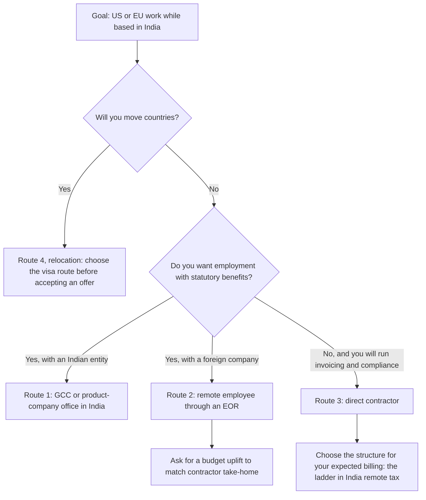

# India Remote Playbook: Routes from India to US and EU Work

> For India-based engineers who want US or EU work: how to choose between a GCC job, remote employment through an EOR, direct contracting and relocation, how to find the work from India, what each route pays, and what to set up before the first offer or invoice.

> [!NOTE]
> **Tax, visa and legal material on this page is pointers, not advice.** The tax, FEMA and payment-rail position combines `T0-07`, `T0-43` and primary-source checks as at **19 November 2026**. [India remote tax](../09-compensation/india-remote-tax.md) carries the detail and the full disclaimer; confirm anything you act on with a practising Chartered Accountant (CA). Visa routes are covered in [Visa and relocation](visa-and-relocation.md).

**This page routes; the facts it routes on live with their owners.** Pay bands are in [pay benchmarks](../09-compensation/pay-benchmarks.md); tax, FEMA, payment-rail and EOR cost models in [India remote tax](../09-compensation/india-remote-tax.md); cross-border remote hiring shares, EOR/CoR structures, PE risk and scam checks in [cross-border remote work](remote-cross-border.md); 33-country destination and time-zone rankings in [country and city rankings](country-rankings.md); contract rates in [freelance and fractional](freelance-fractional.md); community venues in the [communities guide](../07-networking/communities-guide.md); India market facts in the [market overview](../01-landscape/market-overview.md#8-india-more-ai-intensive-younger-smaller-in-counts-split-in-pay); visas in [visa and relocation](visa-and-relocation.md). This page keeps one headline per point and the decision it supports.

**Dates, grades and one term.** Pay headlines draw on Levels.fyi snapshots retrieved by `T0-02` (12 October 2026), `T0-17` (21 October 2026), `T0-36` (12–14 November 2026) and `T0-43` (13 November 2026, with RBI USD/INR at ₹93.7650 on 12 November 2026). Expiry follows decision D-018: pay, EOR, payment-rail and programme facts (class V2) are re-verified by 2027-02-17; posting-share snapshots are class V1 (31 days). The tax and FEMA rules this page points to expire on the [India remote tax](../09-compensation/india-remote-tax.md) page's own date. Grades (EGP-1.0): A primary or measured; B transparent secondary (including platform aggregates such as Levels.fyi, JobsPipe and Jobgether per D-018); C vendor or single source, attributed; D judgement; M model output; P practice-curated. **GCC** here means a Global Capability Centre, a multinational's own engineering centre in India. T0-02's F10 uses "GCC" for the Gulf states (Dubai, Abu Dhabi); those UAE bands are not India pay [C · T0-02.F10].

## The short answer

1. **Benchmark against the population you are targeting, not "India".** India splits into **three** distinct ML Engineer pay populations — Levels.fyi Greater Bengaluru TC P50 ₹44.4L [B], Flexiple Bengaluru CTC P50 ₹19.9L (n=422) [C], and Indeed India base mean ₹11.4L (n=49) [C] — a **7.5× employer dispersion gradient** from Wipro senior (₹17.0L) to Google L5 / Amazon L6 (₹1.27Cr–₹1.38Cr) [B/C · T0-45 L51, L54, L183]. All three populations, city ratios (Hyderabad 0.85×, Gurgaon 0.72×, Pune 0.57×, Mumbai 0.54×, Chennai 0.51× vs Bengaluru) and dates live in [pay benchmarks](../09-compensation/pay-benchmarks.md#india-by-city-level-and-employer).
2. **Inside India, the ceiling is employer-specific, not universal.** The Greater Bengaluru Senior SWE median sits at ₹56.1 lakh and P90 at ₹1.06 crore (n=4,752, 2026-11-11) [B · T0-45 L63, L107]. Earlier Phase 0 estimates put local Staff pay below ₹1.2 crore [C · T0-17 L138], but top foreign product employers clear ₹1.2 crore substantially (Amazon L6 ₹1.38Cr, Google L6 ₹2.32Cr, Google L7 ₹3.37Cr, Amazon Director ₹5.54Cr; Broadcom/Rippling/Rubrik/Airbnb/Stripe all-level medians ₹99.4L–₹1.22Cr) [B · T0-45 L63, L319–326; T0-43 L181]. Above your target employer's ceiling, the options are foreign direct contracting, EOR or relocation [D].
3. **Genuine cross-border remote AI roles open to India are scarce — qualify early and price against local senior pay.** An estimated **0.2–1.2%** of AI-engineer postings are both remote and open to India residents, and distributed firms such as PostHog explicitly exclude India on time-zone grounds [M/A · T0-43 L58–59, L118, L127]. Matching Bengaluru Senior SWE P50/P90 requires **$39.4/h to $75.8/h** at 1,500 billable hours before contractor overheads [M · T0-43 L62, L200–204]; see [Cross-border remote work](remote-cross-border.md).
4. **At the same client spend, direct contracting keeps more cash than an EOR.** In T0-07's model, a sole proprietor under presumptive taxation keeps the most up to the ₹75 lakh (~$80k at ₹93.765/$) presumptive-tax ceiling, and an EOR leaves 22–24% less of the same budget, so ask for a higher budget if a client offers EOR [M · T0-07.F4, T0-07.F5; T0-43 L336]. The take-home figures and uplift script are in [India remote tax: contractor or EOR](../09-compensation/india-remote-tax.md#contractor-or-eor).
5. **Set the tax structure before you quote a rate.** Full-time foreign contract rates straddle the ₹75 lakh presumptive ceiling, where one extra rupee triggers a large tax step [C · T0-02.F11; M · T0-07.F3]. Choose the structure for your billing level from the [structure ladder](../09-compensation/india-remote-tax.md#the-structure-ladder-four-billing-bands-and-one-override); T2-01 puts that decision before the first invoice [D · T2-01 L174].
6. **Find the work through remote, public-output routes and screened hubs first, and plan relocation on a separate track.** Accessible remote routes from India are competitions, research reading groups and OSS discussion boards [A/B · T0-12.F8]; Bengaluru holds the densest local venues [B/C · T0-12.F7]. For relocation, compare destinations in [country and city rankings](country-rankings.md) and choose the visa route before accepting an international offer [D · T2-01 L177–178].

## At a glance: four routes

| Route | Typical employer | Pay population | Setup | Main risks | Evidence |
|---|---|---|---|---|---|
| **1. GCC or product-company office in India** | A multinational's capability centre, or a product company's India office | Levels.fyi Greater Bengaluru bands, the strongest local population ([pay benchmarks](../09-compensation/pay-benchmarks.md#india-by-city-level-and-employer)) | Indian employment; nothing extra | The local ceiling; a dual mandate between the global parent and India leadership | B · T0-02.F3; B · T0-17 KF4; D · T0-09 L201 |
| **2. Remote employee through an EOR** | A US or EU company without an Indian entity, employing you through an EOR such as Deel, Remote or Oyster | No India-specific band in this evidence; what you keep at a given client spend is in [India remote tax](../09-compensation/india-remote-tax.md#contractor-or-eor) | Employment contract with the EOR's Indian entity; tax deducted from salary | Less cash than contracting at the same spend; outside work usually restricted; the employer owns your code | M · T0-07.F5; B, D · T0-07 L415 |
| **3. Direct contractor** | A US, EU or UK client paying you as a sole proprietor, sometimes through a contractor platform | Vendor-relayed rate cards ([freelance and fractional](freelance-fractional.md#india-based-providers-selling-to-us-or-european-clients)) | Registrations, receipts reporting, client forms and an MSA, from the [India remote tax checklist](../09-compensation/india-remote-tax.md#checklist) | The presumptive-tax ceiling; compliance load; bench time; misclassification; clients that refuse individual contractors | C · T0-02.F11; B · T0-07 L119–138 |
| **4. Relocation** | An employer abroad; some visa routes depend on the employer | Destination-market pay, read through both the FX and the PPP lens ([pay benchmarks](../09-compensation/pay-benchmarks.md#market-fx-or-purchasing-power-parity)) | A visa route, chosen before you accept | A wrong route can waste 6–18 months; tax, cost of living and visa cost not modelled | A/B for FX, C for PPP · T0-02.F9; D · T2-01 L178 |



## What each route pays

One headline per population; the figures, with their dates, live with their owners.

- **Employees in India (route 1).** Levels.fyi's Greater Bengaluru ML Engineer P50 is ₹44.5L and P90 ₹94.6L (n = 96, 12 Oct 2026) [B · T0-02.F3], and the Bengaluru Senior SWE distribution sets the local ceiling [B · T0-17 KF4]. The Levels.fyi sample is self-selected and heavy in multinationals and product companies; the broad market sits 3–4× lower, and the difference is employer type [B, C · T0-02.F3]. Every India band, the unstable "AI Engineer" page and Google's Bengaluru ladder: [pay benchmarks: India](../09-compensation/pay-benchmarks.md#india-by-city-level-and-employer).
- **The same title at different employers.** Bengaluru software-engineer medians spread 3.6× at entry level and 4.9× at senior level across employers [M · T0-02 L252]; the table is in [pay benchmarks: employer dispersion](../09-compensation/pay-benchmarks.md#employer-dispersion).
- **Contractors (route 3).** One vendor relays a rate card for India-based mid-level AI/ML engineers on international contracts; at full time it lands around P70 to above P90 of Levels.fyi Bengaluru full-time pay, before benefits, tax and bench time [C · T0-02.F11]. The rates and the conversion are in [freelance and fractional](freelance-fractional.md#india-based-providers-selling-to-us-or-european-clients). No platform-native percentile data was found, and T0-02 did not collect platform rate cards [T0-02 L100].
- **EOR employees (route 2).** What foreign employers pay India-based EOR employees is not measured in the sessions this guide draws on. What you keep at a given client spend, against contracting, is in [India remote tax](../09-compensation/india-remote-tax.md#contractor-or-eor) [M · T0-07.F5].
- **Comparing an Indian offer with a foreign one (route 4).** Compute both lenses, then decide which one fits your goal: market FX for dollar savings and remittances, purchasing-power parity for local spending [A/B for FX, C for PPP · T0-02.F9; T0-02 L98]. The ratios and the rupee's year-on-year move are in [pay benchmarks](../09-compensation/pay-benchmarks.md#market-fx-or-purchasing-power-parity). Tax, cost of living, visa cost and savings rate were not modelled, and they decide the answer.

## The four routes

### Route 1: GCC or product-company office in India

**Choose it when** you want the strongest local pay population on Indian payroll, without export compliance; or when you are early in your career, since a larger share of India's AI roles are entry-level: 21.2% against 10.4% in the US (JobsPipe, 2026-10-11) [B · T0-01.F10].

- **Demand.** Grade-C press sources cited by T0-01 put India's GCCs at 2,100+ centres, with AI and data the fastest-growing function and supply gaps in AI, MLOps and platform clusters [C · T0-01 L69, L198]; the figures are in the [market overview's India section](../01-landscape/market-overview.md#8-india-more-ai-intensive-younger-smaller-in-counts-split-in-pay).
- **Ceiling.** Pay is bounded by the local distribution above. Plan the next step before you reach it [B · T0-17 KF4].
- **First 90 days.** Expand weeks 1–4 for stakeholder mapping. Identify the dual mandate (global parent against India leadership) and who sets priorities, owns data and budget, and approves tools. Get probation terms and review dates in writing, and assume both the parent's security and data rules and Indian law (DPDP phases) apply [D · T0-09 L201]. T2-01 expects a 3–6 month formal probation with a halfway review, and advises mapping in week 1 who controls GPU allocation, model API access and data-residency decisions [D · T2-01 L340]. T0-09 found no source that documents startup-versus-GCC probation practice [D · T0-09 L195]. The playbook is in [first 90 days](../10-onboarding/first-90-days.md).

### Route 2: Remote employee through an EOR

**Choose it when** the client mandates employment, you want PF, gratuity, leave and employment-law protection, or you do not want GST, EDF and e-FIRC chores [D · T0-07 L415].

- **How it works.** The EOR's Indian entity employs you; the client directs your work and pays the EOR's invoice (salary, employer contributions and fee). You are taxed as a salaried employee and make no taxable supply [D · T0-07 L405]. Full comparison of Deel, Remote, Oyster, Pebl, Multiplier, Rippling, Papaya and India-specialist EORs plus Contractor of Record (CoR) alternatives lives in [Cross-border remote work](remote-cross-border.md#choosing-a-legal-structure-direct-contracting-cor-eor-or-local-entity) [A/B/C · T0-43 L61, L219].
- **Cost.** The EOR's fee comes out of the budget that funds your salary unless the client raises it [D · T0-07 L405]. Vendor prices, and the fee as a share of the budget at each spend level, are in [India remote tax](../09-compensation/india-remote-tax.md#contractor-or-eor).
- **Negotiate.** Ask for the budget uplift that restores contractor take-home [M · T0-07 L127]. Its size and a script are in [India remote tax](../09-compensation/india-remote-tax.md#contractor-or-eor).
- **Watch.** Copyright in work made in the course of employment goes to the employer [B · T0-07 L415]; contracts usually restrict outside work, and notice periods apply [D · T0-07 L415]. An EOR reduces misclassification risk but does **not** eliminate dependent-agent permanent-establishment (PE) risk if you conclude contracts locally [C · T0-43 L230]. The four Labour Codes commenced 21 November 2025 (final Central Rules notified 8 May 2026 [A/B · T0-45 L59, L209]), and EPFO raised its statutory wage ceiling from ₹15,000 to **₹25,000/month** effective 17 September 2026 (`S.O. 5109(E)`, lifting the 12% statutory cap from ₹1,800 to ₹3,000/month; ESIC remains ₹21,000; live-verified 2026-11-19). Confirm whether the EOR contributes PF on the ₹25,000 ceiling or full basic wages.

### Route 3: Direct contractor

**Choose it when** the client accepts an individual contractor, you can carry a monthly compliance routine, and your billing plan fits a band of the [structure ladder](../09-compensation/india-remote-tax.md#the-structure-ladder-four-billing-bands-and-one-override).

- **Default structure.** Up to the presumptive-tax ceiling (₹75 lakh, about $80k at ₹93.765/USD), the default is a sole proprietor under presumptive taxation (Income-tax Act 2025 s.58(2), replacing §44ADA) in the new regime, with GST and an annual LUT, bank-channel receipts (watching the RBI ₹25 lakh per-transaction PA-CB cap on fintech rails), a monthly EDF, a W-8BEN and an IP-explicit MSA [M; statutory A/B · T0-07 L119; T0-43 L245, L276, L336]. The thresholds, rails, take-home model and structures above the ceiling are in [India remote tax](../09-compensation/india-remote-tax.md).
- **Winning clients.** The freelance path leaves the employment funnel at discovery: network-based acquisition replaces job boards, MSA terms replace offer negotiation, and client retention replaces onboarding [B/C · T2-01.F7]. See [Freelance and fractional work](freelance-fractional.md) and [Cross-border remote work](remote-cross-border.md). Treat AI-training platforms (Mercor, Scale, Surge) as supplemental cashflow only given misclassification litigation and weak protections [B/C · T0-43 L69, L293].
- **Watch.** Some clients' vendor policies refuse individual contractors and require a company, a CoR or an EOR [D · T0-07 L147; T0-43 L219]. Full-time, single-client work carries misclassification risk [D · T0-07 L498]. Rate arithmetic is before benefits, tax and bench time [C · T0-02.F11; M · T0-43 L200–204]. T2-01 notes that a contractor billing a US client $80K a year meets the presumptive-tax ceiling "at almost exactly the billing level where freelance AI work becomes viable" [D · T2-01 L706].

### Route 4: Relocation

**Choose it when** you want the destination market's pay and accept its visa process and costs. Routes 1–3 keep you in India, and route 3's position with US clients depends on that: see [client geography in India remote tax](../09-compensation/india-remote-tax.md#client-geography-us-eu-and-uk) [A · T0-07.F9]. Compare 33 destination countries on Indian-national legal access, net pay, long-term settlement and IST overlap in [Country and city rankings](country-rankings.md), then execute visa steps via [Visa and relocation](visa-and-relocation.md).

- **Lead times.** Choose the visa route before accepting an international offer: a wrong route can waste 6–18 months, and some routes are employer-dependent. For the US O-1A, T2-01 puts evidence-building at 12–18 months before filing, with at least 3 of 8 criteria met with quality proof [D · T2-01 L177–178].

## Finding the work from India

In order of the evidence for India-based candidates. Community venues are owned by the [communities guide](../07-networking/communities-guide.md), India board mechanics by [channels and boards (India section)](../06-job-search/channels-and-boards.md#india-job-platforms-in-depth), and employer ATS URLs plus official sponsor registers by the [target employers directory](../01-landscape/target-employers.md).

1. **Remote, public-output programmes [A/B · T0-12.F8].** GPU MODE competitions, EleutherAI's public Discord, the vLLM developer Slack and Cohere Labs are open from India. T0-12's examples include an AMD end-to-end model speedrun with a $1.1M prize pool and an NVIDIA Blackwell kernel hackathon run with GPU MODE.
2. **Screened local venues [B/C · T0-12.F7].** In Bengaluru, apply to AI Tinkerers (demo-first and screened) with a demo, and join The Fifth Elephant's meetups; vendor community events from Anthropic and OpenAI are by invitation or approval. Python-community events add topic fit: *import_ bengaluru* (6 September 2026) listed PyData Bangalore and PyTorch Bengaluru among its collaborators.
3. **Match your board to your employer tier (Route 1 & Route 4) [B/C/M · T0-25 L54–58; T0-27 L59–62, L163].**
   - *GCCs (2,117 centres; >50% peer-GCC hiring; 30.3% AI/data/cyber demand in Q2 FY27):* apply directly via parent-company portals (Workday or custom), LinkedIn and referrals rather than mass Indian boards.
   - *Startups & domestic AI labs:* use **Cutshort** (53% startups, 50% numeric pay) and **Wellfound India** (watch low bands), plus direct Ashby/Greenhouse boards (e.g. Sarvam AI listed 46 roles, 37 Bengaluru, on 2026-11-02; Anthropic Bengaluru opened 2026-02-16 sales/partnerships/applied-AI first; OpenAI New Delhi planned [B/C · T0-27 L62, L112–113, L120]).
   - *Mass Indian boards (Naukri free tier, foundit, Hirist):* 67–72% IT services/staffing in public samples and rarely disclose pay; do **not** pay for Naukri FastForward before testing a free profile for 4 weeks (no independent lift), avoid unofficial Naukri scrapers (no public API [C · T0-26 L75]), and never pay placement fees (report scams to `cybercrime.gov.in` or `1930` [B · T0-25 L57, L74]).
   - *Global remote & relocation:* "worldwide" boards (We Work Remotely, Remote OK, `hiring.cafe`) frequently impose country/EOR limits and remote-only postings converted lower in Huntr Q1 (3.63% vs 5.76% onsite-only [B/C · T0-24 L70, L251]). For Route 4 relocation, filter via the official sponsor registers in [target employers](../01-landscape/target-employers.md) (UK CSV, NL IND, Canada LMIA, Denmark SIRI + Denmark's 2027 route covering India from 2027-01-01) and visa-filtered boards (Japan Dev, TokyoDev) [A/B/C · T0-25 L64; T0-27 L59, L174–177].
4. **Weak ties and referrals [A · T0-12.F4, F12].** Referrals are about one hire in six and weak-tie research favours repeated low-cost interaction over cold DMs to strangers. See [Referrals and outreach](../07-networking/referrals-and-outreach.md).

**Closed or weak from India.** The Anthropic Fellows programme, the one pathway with a documented offer rate (over 40%), requires work authorisation in the US, UK or Canada and presence there during the programme; the in-person AI Engineer events run abroad, and a sponsor listing puts World's Fair tickets from $1,495 (C) [A/B · T0-12.F8]. At conferences and meetups the hiring signal is mostly sponsor marketing, or organisers disclaim it [B · T0-12.F6]. No community in scope has a measured community-to-job conversion rate [A · T0-12.F3].

## Persona and geography notes

### India's six GenAI hubs compared (`T0-36`)

India's domestic remote-tagged tech share was only **0.8%** on LinkedIn and Naukri tech feeds in October 2026 (`B · T0-36 L324`), so city choice still shapes Route 1 access and local networking density. Full employer-level pay bands belong to [pay benchmarks](../09-compensation/pay-benchmarks.md#india-by-city-level-and-employer) (D-019); the snapshot below contrasts volume, Levels.fyi ML Engineer medians, broad-market baselines and Numbeo rent captures across `T0-36`'s six cities (India total on `aimlroles.com`: **1,558** postings; `B · T0-36 L102–108`):

| City | `aimlroles.com` postings (Nov 2026) | Levels.fyi ML Engineer P50 | Broad-market contrast | 1-BR monthly rent (`T0-36` Numbeo, Grade C) | Local positioning | Grade · Source |
|---|---|---|---|---|---|---|
| **Bengaluru** | **575** (37% of India) | ₹44.4 lakh (AI Eng ₹20.4–21.4L) | ₹11.25–13.25L (AmbitionBox); ₹19.9L (Flexiple, n=422) | ~₹31,500 (~$324–335/mo) | Densest GCC, product, AI startup & screened community hub (AI Tinkerers, Fifth Elephant) | B/C · T0-36 L103, L153–155, L293, L1261 |
| **Hyderabad** | **163** | ₹30.3 lakh | ₹12.49L base (Glassdoor) | ₹22,000–54,000 (wide area spread) | #2 Big Tech & GCC volume hub; strong senior SWE depth at ~85–91% of Bengaluru | B/C · T0-36 L104, L156–157, L294 |
| **Pune** | **151** | ₹20.6 lakh | ₹10.19L total (Payscale, n=28) | Not retrieved in `T0-36` | Enterprise/automotive GCC and mid-market engineering base; lower cost base | B/C · T0-36 L105, L158–159, L297 |
| **Delhi NCR** | **91** | Not retrieved in `T0-36` | See [pay benchmarks](../09-compensation/pay-benchmarks.md#india-by-city-level-and-employer) | Not retrieved in `T0-36` | Consumer-tech/startup & Gurgaon GCC hub; communities skew younger/hackathon-heavy | B/C · T0-36 L106, L297; T0-12.F7 |
| **Chennai** | **65** | Not retrieved in `T0-36` | See [pay benchmarks](../09-compensation/pay-benchmarks.md#india-by-city-level-and-employer) | Not retrieved in `T0-36` | B2B SaaS and banking/industrial GCC cluster | B · T0-36 L107, L297 |
| **Mumbai** | **41** | Not retrieved in `T0-36` | See [pay benchmarks](../09-compensation/pay-benchmarks.md#india-by-city-level-and-employer) | ~$481–650/mo (priciest areas / 2025 Numbeo) | Financial-services, quant and enterprise AI hub; highest Indian city-centre rent | B/C · T0-36 L108, L295 |

- **Early career:** Route 1 first, given India's larger entry-level share of AI roles: **21.2%** against 10.4% in the US on JobsPipe (2026-10-11), behind Japan's 27.2% (`B · T0-01.F10; T0-36 L58`). Foreign contract rate cards skew mid-to-senior (`C · T0-02.F11; T0-43 L186`).
- **Senior engineers near their target employer's local ceiling:** Routes 2–4 (`D`). Price Route 3 against both the Bengaluru Senior SWE break-even ($39.4–$75.8/h at 1,500 h; `M · T0-43 L200–204`) and the ₹75 lakh presumptive-tax ceiling in [India remote tax](../09-compensation/india-remote-tax.md) (`M · T0-07.F3`).
- **Time budget.** T2-01's gate timings assume 15–20 hours a week; multiply them by about 1.5 at 8–10 hours a week, and by about 0.5 at 35–40 hours (`D · T2-01 L153`). The hours tiers are in [career transitions](career-transitions.md#hours-tiers).

## How to do it

1. **Benchmark yourself (week 1).** Pull Levels.fyi pages for your title, level and city; note P50, P90 and the sample size; place each target employer on the [employer dispersion table](../09-compensation/pay-benchmarks.md#employer-dispersion). T0-02 names per-level, per-location Levels.fyi pages as the first gap to close [T0-02 L100]. *Done when:* each target employer has a median at your level and a population label: multinational, GCC or product company, or the broad market [B · T0-02.F3].
2. **Choose a primary route and one fallback (weeks 1–2).** Use the route table and the decision flow. *Done when:* the route decision record below is complete [P].
3. **Build proof that a remote reviewer can check.** Pass gates G1–G3 of the shared transition spine at 15–20 hours a week: a measured v0 by month 3, an operable v1 by month 6 and external proof by month 9, as T2-01 adopts them from T0-06 [D · T2-01 L157–159]. The pass criteria are defined once, in [career transitions](career-transitions.md#the-shared-spine-four-gates-and-an-hours-budget). *Done when:* the month-9 artifacts are public. Standards: [Proof-of-work standards](../05-portfolio/proof-of-work-standards.md), [Project archetypes](../05-portfolio/project-archetypes.md).
4. **Work the channels alongside step 3, not after it.** One remote public-output programme, one local venue where you live, referrals through weak ties, and targeted applications. T2-01's rule: if month 9 arrives with fewer than five applications sent, the bottleneck is search, not preparation [D · T2-01 L165]. *Done when:* you keep a weekly cadence you can sustain, logging [n] contributions and [n] applications [P].
5. **Set up before the first offer or invoice.** Route 3: the one-time setup in the [India remote tax checklist](../09-compensation/india-remote-tax.md#checklist). Route 2: the EOR contract. Route 4: the visa route. *Done when:* the checklist items for your route are ticked [B · T0-07 L129–138; D · T2-01 L174–178].
6. **Compare offers like for like.** Put contract and EOR options at the same all-in client spend and compute the cash kept with [T0-07's model](../09-compensation/india-remote-tax.md#the-take-home-model-worked); for relocation, compute both the FX and the PPP lens. *Done when:* the comparison table below is filled in for every live option [M · T0-07 D3; A/B · T0-02.F9].
7. **Negotiate the structure as well as the number.** For an EOR, the budget uplift. For a contract: payment in 30–45 days, the payer bearing bank charges, fees exclusive of VAT and GST, and a gross-up if withholding is imposed [D · T0-07 L429–430]. *Done when:* the signed contract carries these terms. See the [Negotiation playbook](../09-compensation/negotiation-playbook.md).
8. **Run the year.** Route 3: the monthly close and annual checklist in [India remote tax](../09-compensation/india-remote-tax.md). Route 1: written success metrics for 30, 60 and 90 days, agreed with your manager [D · T2-01 L187]. *Done when:* each month closes without gaps, or the probation review is passed. See [First 90 days](../10-onboarding/first-90-days.md).

## Templates and examples

### Route decision record [P]

```text
Date:            [yyyy-mm-dd]
Target:          [role] at [employer type], [US / EU / UK] market
Primary route:   [1 GCC / 2 EOR / 3 contractor / 4 relocation]      Fallback: [route]
Why:             [pay population, benefits, compliance appetite, mobility]
Benchmark:       [title, level, city]: P50 [₹ amount], P90 [₹ amount] (Levels.fyi, n = [n], retrieved [date])
Route 3 only:    expected billing [₹ amount] a year; band [band] (India remote tax)
Route 4 only:    visa route [route]; evidence needed [items]; lead time [months]
Review on:       [date]
```

### Like-for-like comparison [P]

| Option | Gross or client spend | Structure | Cash kept a year | Locked benefits | Main risk |
|---|---|---|---|---|---|
| [GCC offer] | [₹ CTC] | Salary | [₹ amount] | [PF, gratuity] | [ceiling, dual mandate] |
| [EOR offer] | [₹ client spend] | EOR salary | [₹ amount] | [PF, gratuity] | [fee drag] |
| [Contract] | [₹ a year] | [presumptive or books] | [₹ amount] | none | [tax ceiling, bench time] |
| [Relocation] | [amount, destination currency] | [destination payroll] | [amount] | [benefits] | [visa, cost of living] |

Reference points from T0-07's model, at four client-spend levels and for each structure, are in [India remote tax](../09-compensation/india-remote-tax.md#the-take-home-model-worked) [M · T0-07 L221–L230].

### Outreach from India: weak and strong [P]

| Situation | Weak | Strong | Why |
|---|---|---|---|
| A community server | DMs a CV to members: "Any remote openings?" | A post in the designated jobs channel: "Open to [remote contract / EOR] work on [evals / inference / agents] from [city], [n] hours' overlap with [US Eastern / CET]. Shipped: [artifact with a measured result, link]." | Self-promotion belongs in designated channels; mass-DMed CVs are spam [A · T0-12.F9] |
| An open-source project | An unsolicited, AI-generated pull request | A discussion or issue first, then a scoped pull request the maintainers asked for | Discussion-first contribution is the documented norm [B · T0-12.F10] |
| Someone you want a referral from | A cold message to a stranger asking for a referral | Several low-cost exchanges with a moderately weak tie, such as a reviewer of your PR or a meetup co-attendee, then a specific ask | Weak-tie research favours repeated interaction [A · T0-12.F12] |
| A company's AI product | Probing its model for weaknesses without permission and emailing the findings | Building on its documented API with your own account, or on OSS you run yourself, and sharing a write-up | Green-zone work is routine [D · T0-05 L531]; an advocacy source (IFF, 2021) says India's IT Act s.43 does not distinguish ethical researchers [C · T0-05 L484] |

## Checklist

### Before you apply (all routes)

- [ ] Levels.fyi anchors for your title, level and city, with sample sizes [B · T0-02.F3]
- [ ] Route decision record filled in, with a fallback [P]
- [ ] Proof at gate G3 of [career transitions](career-transitions.md#the-shared-spine-four-gates-and-an-hours-budget), or a date for it [D · T2-01 L159]
- [ ] One remote public-output programme and one local venue chosen [A/B · T0-12.F8; B/C · T0-12.F7]

### Route 3 (direct contractor)

- [ ] Written CA opinion on structure and profession classification, before the first invoice [B · T0-07 L506; D · T2-01 L174]
- [ ] The one-time setup, every-month and every-year items in the [India remote tax checklist](../09-compensation/india-remote-tax.md#checklist): GST and the LUT, the receiving bank or provider, EDF responsibility, invoices, a W-8BEN for each US client, the MSA and a receipts tracker [B · T0-07 L129–138]

### Route 2 (EOR)

- [ ] The client's all-in budget known, and the uplift asked for [M · T0-07 L127]
- [ ] Contract read for IP, outside work and notice period [B, D · T0-07 L415]
- [ ] PF basis asked: statutory ₹25,000/month ceiling (effective 2026-09-17 via `S.O. 5109(E)`) or full basic wages [A/B · T0-07 L413; live-verified 2026-11-19]

### Route 1 (GCC)

- [ ] Probation terms, review dates, and the owners of data, budget and tool approval in writing [D · T0-09 L201]

### Route 4 (relocation)

- [ ] Visa route chosen before accepting an offer [D · T2-01 L178]; details in [Visa and relocation](visa-and-relocation.md)

## Pitfalls

| Red flag | Why it hurts | Fix | Evidence |
|---|---|---|---|
| Benchmarking a multinational or GCC offer against Glassdoor-style India averages, or a services offer against Levels.fyi | The two populations differ 3–4× | Benchmark against the employer's own population | B, C · T0-02.F3 |
| Quoting India tier bands (₹30–75L, ₹60L–1.2Cr) as if measured | Two incompatible band sets circulate, and neither is measured | Use the measured anchors in [pay benchmarks](../09-compensation/pay-benchmarks.md#the-tier-band-problem) | [ERRATA U14](../../research/ERRATA.md) |
| Reading T0-02's "GCC" bands as capability-centre pay | They are UAE bands | Use Levels.fyi employer pages for India | C · T0-02.F10 |
| A full-time contract rate that lands just above the presumptive-tax ceiling | A large step in tax at the line, and much more billing needed to recover ([India remote tax](../09-compensation/india-remote-tax.md#the-take-home-model-worked)) | Choose the structure first; price below the ceiling, or clear the dead zone | M · T0-07.F3 |
| Accepting EOR at the number you would have invoiced | Markedly less cash at the same spend ([India remote tax](../09-compensation/india-remote-tax.md#contractor-or-eor)) | Ask for the parity uplift, or contract directly | M · T0-07.F5 |
| Making conferences the main route | The top in-person events are abroad, and conference hiring signal is mostly sponsor marketing | Remote public-output programmes and screened local meetups | A/B · T0-12.F8; B · T0-12.F6 |
| Mass-DMing CVs in community servers | Treated as spam | Designated channels, after contributing | A · T0-12.F9 |
| Drive-by AI-generated pull requests | A liability, not a hiring tactic | Discussion first, then a scoped PR | B · T0-12.F10 |
| Probing a company's AI product without permission to impress it | OpenAI's usage policies (effective 2025-10-29) prohibit "unsolicited safety testing"; India's IT Act s.43 does not distinguish ethical researchers, per an advocacy source (IFF, 2021) | Green-zone work; written permission or a vendor disclosure policy | A · T0-05 L60; C · T0-05 L484 |
| Choosing a visa route after the offer | 6–18 months can be lost, and some routes are employer-dependent | Choose the route before accepting | D · T2-01 L178 |
| Starting in a GCC without written probation terms | A dual mandate, and pilots that never graduate | An expectations contract and probation terms in writing in weeks 1–4 | D · T0-09 L201 |
| Leaving export proceeds in a foreign-held balance | A FEMA repatriation question; Schedule FA and ITR-3 | Repatriate to an Indian or EEFC account | C (T0-07 inference) · T0-07 L382 |
| Applying blindly to "Anywhere" remote board tags | Nearly half of Jobgether's India-filtered AI roles come from unvetted ATS feeds, and distributed firms like PostHog exclude India on time zones | Confirm India eligibility and hiring structure on screen 1 | A/B · T0-43 L59, L111, L127 |
| Accepting a sub-$40/h foreign contract as a senior engineer | Falls below Bengaluru Senior SWE P50 total comp (₹55.4L) before contractor overheads and bench time | Price against your real local offer divided by 1,500 h plus 15–25% overhead | M · T0-43 L62, L200–204 |

## Evidence and limits

- **Pay data.** The Levels.fyi headlines here are Grade B, a platform aggregate whose method is taken on trust, even where earlier sessions graded them A (decision D-018; [CONTRIBUTING §3](../../CONTRIBUTING.md#3-writing-standard-egp-10-in-brief)). They measure a self-selected sample heavy in multinationals and product companies; broad-market figures are C [T0-02.F3; T0-36 L57, L1261]. `T0-43` updates the earlier Staff ceiling by documenting top-employer Bengaluru all-level medians of ₹99.4L–₹1.22Cr [B · T0-43 L181].
- **RP2 session audit (`T0-36`, `T0-43`).** `T0-36` had a 9% Read rate and `T0-43` a 6% Read rate (9 of 141 sources opened in full); Extract-only Grade A claims were downgraded to Grade B, platform aggregates (JobsPipe, Jobgether, Fast AI Jobs, Levels.fyi) are graded B under D-018, and vendor rate quotes carry explicit COI attribution [T0-36 L527–748; T0-43 L402–547].
- **Tier bands.** Two incompatible India tier-band sets circulate in the research, and neither is measured, so this guide uses measured anchors ([pay benchmarks: the tier-band problem](../09-compensation/pay-benchmarks.md#the-tier-band-problem); ERRATA U14). T2-01 calls India-to-US remote work at its "Tier 2–3" the highest-ROI corridor [A/B · T2-01.F8], but no longitudinal outcome data exists for any corridor, and every T2-01 timeline is a model [D · T2-01.F10].
- **A unit slip to avoid.** T2-01 L706 prints the presumptive-tax dead zone with a dollar sign; [ERRATA U19](../../research/ERRATA.md) corrects it to T0-07's rupee band, which [India remote tax](../09-compensation/india-remote-tax.md) uses.
- **Not measured here.** Independent worker-side pay distributions for foreign-band remote roles paid into India (vendor quotes only, Grade C/COI); remote-to-relocation conversion rates [T0-43 L295–301]; Numbeo rents for Pune, Delhi NCR and Chennai in `T0-36` [T0-36 L297]; community-to-job conversion rates [A · T0-12.F3]; privacy and anti-spam law for cold email (GDPR, India's DPDP Act, CAN-SPAM) [T0-05 L559].
- **Tax, FEMA and rails.** Updated on 2026-11-19 against `T0-43` and live primary-source verification of Income-tax Act 2025 sections, FEMA 2026 Regulations (including the 22 September 2026 amendment) and the RBI ₹25 lakh PA-CB cap. See [India remote tax](../09-compensation/india-remote-tax.md) for full caveats.
- **Dates.** Pay headlines from `T0-02` (21 October 2026), `T0-17` (23 October 2026), `T0-36` (14 November 2026) and `T0-43` (13 November 2026). Re-verify by 2027-02-17 (decision D-018; posting-share snapshots expire on 31-day V1 cadence).
- **What would change this advice:** an independent worker-side dataset of foreign-band remote pay into India; published AD-bank EDF workflows that change the contractor's compliance burden; a tribunal or court ruling on IT freelancers under §44ADA or s.58(2).

## Next steps

- Cross-border remote hiring shares, EOR vs CoR vs B2B structures, PE risk and scam checks: [Cross-border remote work](remote-cross-border.md).
- Compare 33 countries on Indian-national access, net pay, settlement and IST overlap: [Country and city rankings](country-rankings.md).
- Tax structure, thresholds, FEMA/EDF, payment rails and the monthly routine: [India remote tax](../09-compensation/india-remote-tax.md).
- Moving instead of staying: [Visa and relocation](visa-and-relocation.md).
- Pay by role, level and geography: [Pay benchmarks](../09-compensation/pay-benchmarks.md); then [Offer evaluation](../09-compensation/offer-evaluation.md) and the [Negotiation playbook](../09-compensation/negotiation-playbook.md).
- Where to look and whom to meet: [Channels and boards](../06-job-search/channels-and-boards.md), [Communities guide](../07-networking/communities-guide.md), [Referrals and outreach](../07-networking/referrals-and-outreach.md), [Online presence](../07-networking/online-presence.md).
- Contract work as a business: [Freelance and fractional work](freelance-fractional.md).
- What to build: [Proof-of-work standards](../05-portfolio/proof-of-work-standards.md), [Project archetypes](../05-portfolio/project-archetypes.md).
- Choosing the role: [GenAI target roles](../02-roles/genai-target-roles.md), [Targeting workbook](../00-start/targeting-workbook.md); hubs for [AI engineer](../02-roles/hubs/ai-engineer.md) and [Independent AI consultant](../02-roles/hubs/independent-ai-consultant.md).
- Evidence: [findings for this stage](../../research/findings.md#stage-11), [ERRATA](../../research/ERRATA.md), and the sessions [T0-02](../../research/sessions/T0-02-global-regional-compensation-benchmarks.md), [T0-07](../../research/sessions/T0-07-india-remote-tax-statutory-compliance.md), [T0-12](../../research/sessions/T0-12-high-signal-communities-technical-visibility.md), [T0-36](../../research/sessions/T0-36-countries-cities-gulf-india-asia-pacific.md), [T0-43](../../research/sessions/T0-43-remote-cross-border-work-eor-platforms.md) and [T2-01](../../research/sessions/T2-01-tier-calibrated-execution-playbooks.md).
