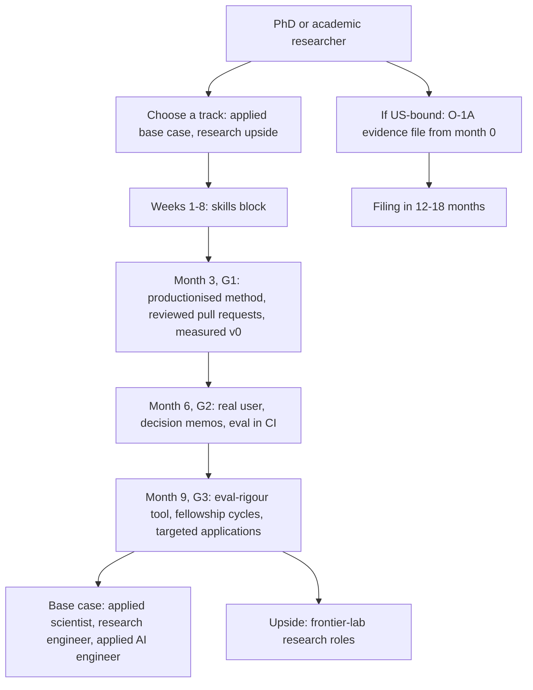

# PhD to Industry: Research and Applied Routes into GenAI

> For PhDs and academic researchers moving into GenAI: which role to target, the engineering gap that decides offers, an 8-week skills block, fellowships, modelled timelines, and how a research record maps to O-1A evidence.

**Dates and grades.** Sources are [T0-06](../../research/sessions/T0-06-career-transition-timelines-5-backgrounds.md), [T0-08](../../research/sessions/T0-08-global-talent-visa-relocation-pathways.md) and [T0-12](../../research/sessions/T0-12-high-signal-communities-technical-visibility.md) (all 21 October 2026) and [T2-01](../../research/sessions/T2-01-tier-calibrated-execution-playbooks.md) (25 October 2026). Grades (EGP-1.0): A primary or measured; B transparent secondary; C vendor or single source; D judgement; M model output; P practice-curated. Timelines are model outputs, conditional on success. Visa material expires first: re-verify it by 2026-11-21. **The O-1A section is pointers, not legal or immigration advice.**

## The short answer

1. **Plan for applied roles; treat lab research roles as upside.** New AI PhDs in the US and Canada rose 22% from 2022 to 2024, and the increase went to academia [A · T0-06 L186]. Industry-bound graduates per 100 baseline graduates were about 77 in both years, roughly flat [M · T0-06 L187]. T2-01's high-volume corridor for PhDs is applied scientist or research engineer at T2 Senior; frontier-lab research is "lottery-style upside" [D · T2-01 L557–559].
2. **Do not skip the skills stage.** Run an 8-week block of production Python, LLM deployment, evaluation infrastructure and agent patterns [D · T2-01 L574–581]. An earlier plan let PhDs skip it; that was wrong ([ERRATA](../../research/ERRATA.md) U18).
3. **The gap is craft, not knowledge.** Researchers who moved to industry stress code review, writing code with others and reproducible end-to-end systems, and engineering-track candidates face standard DSA and system-design loops [D · T0-06 L189]. Whether craft or market structure is the bigger barrier is unresolved [T0-06 L810].
4. **Lead with measurement rigour.** Evaluation is the most-cited biggest challenge in the AI stack (20% of survey respondents) [B · T0-06 L139], and a PhD's eval work should be the strongest of any background [B/C · T2-01 L565]. Make a public evaluation-methodology tool your signature artifact [M · T0-06 L703, L710].
5. **Fellowships convert, but they are gated.** Anthropic Fellows runs about four months full-time with a stipend and compute [B · T0-06 L188], and the programme states that over 40% of fellows received full-time offers [A, programme statement · T0-12 L266]. It requires work authorisation in the US, UK or Canada [A/B · T0-12.F8], and acceptance rates were not found [T0-06 L822].
6. **If a US move is possible, open an O-1A evidence file at month 0.** Filing is 12–18 months away, by a practitioner estimate from Tukki, an O-1 provider [C · T0-08 L96, L375; ERRATA U22]. A petition needs a major award or three of eight criteria, then a final-merits review [A · T0-08 L137]; papers, completed peer reviews and research with documented impact map to three of them [D · T2-01 L595–599].

## At a glance



Months are for hours tier B, 15–20 hours a week.

## Choose the role

| Role | What the role is | How it interviews | Highest-signal proof | Plannability | Hub |
|---|---|---|---|---|---|
| Applied scientist | Research-to-production scientist at large technology firms: modelling, experimentation, shipping models | Classic ML system design plus "where would an LLM help?"; big-company loops add coding and system design, the usual PhD gap [D · T2-01 L608] | Baseline-first modelling with measured lift; production-quality code | Primary target: T2 Senior in ~8 months (5–12.5) at tier B [D · T2-01 L557]; posting volume unmeasured (ERRATA U1) | [Applied Scientist](../02-roles/hubs/applied-scientist.md) |
| Research engineer | Engineering for frontier research: training runs, post-training and reinforcement learning, evaluations, research infrastructure; often titled Member of Technical Staff | Research talk plus coding; the full research loop at frontier labs | Papers, open-source paper re-implementations with rigorous evals, fellowships | T2 Senior alongside applied scientist; T3 Staff at a well-funded lab in ~12–18 months [D · T2-01 L557–558] | [Research Engineer](../02-roles/hubs/research-engineer.md) |
| Research scientist | Originates new methods, publishes and leads research agendas in ML and LLMs | Research talk, coding and values at frontier labs; production coding is the gap [D · T2-01 L609] | As for research engineer | Upside only [M · T0-06 L269]; the apex tier needs a sustained publication record [D · T2-01 L560] | [Research Scientist](../02-roles/hubs/research-scientist.md) |
| AI safety researcher | Alignment, interpretability, dangerous-capability evaluations and other safety research at frontier labs and safety organisations | Research talk plus coding | As for research engineer | No timeline evidence in the corpus | [AI Safety Researcher](../02-roles/hubs/ai-safety-researcher.md) |
| Applied AI engineer | Builds GenAI applications at a product company; T0-06's base-case track for PhDs [M · T0-06 L660] | Take-home plus scoping; shipping speed and customer orientation are the gap [D · T2-01 L607] | One evaluated end-to-end system, the T0–T1 portfolio bar [B/C/D · T2-01.F9] | T1 Growth in ~6–8 months, which may feel like a step down [D · T2-01 L556] | [Applied AI Engineer](../02-roles/hubs/applied-ai-engineer.md) |

Definitions, interview tracks and proof follow the role hubs and the [role catalog](../02-roles/role-catalog.md) §8.2. Target-tier names follow T2-01; their pay bands are omitted because they are unmeasured (ERRATA U7, U14).

**Decision rules:**
- **Need an offer within 12 months?** Target applied scientist or applied AI engineer. Frontier research roles are not plannable [M · T0-06 L708].
- **Engineering depth is your edge?** Target research engineer, and reverse foundations-first sequencing there, because depth is the differentiator [D · T0-06 L253; T2-01 L583].
- **Want to originate methods or do safety research?** Treat research scientist and safety roles as upside, entered through papers, re-implementations and fellowships (role catalog §8.2).
- **Searching for "post-training specialist"?** T2-01 lists it as a PhD target [T2-01 L548], but LLM post-training is not a quorum-level exact title [C · T0-01.F9]. Post-training work sits inside the research-engineer role; search for that title instead.

## The skills gap that matters

### What you have and what you need

| You already have [B/C · T2-01 L562–566] | You need to build [D · T2-01 L568–572] |
|---|---|
| Deep mathematical and statistical foundations | Production engineering: code-review culture, testing, CI/CD, version-control discipline |
| Research methodology and experimental design | Shipping velocity: research code to production code is the central translation barrier |
| Measurement rigour | Product speed: a 2-week sprint cadence, not a 6-month paper cadence |
| Publication and presentation skills | Impact framing: "I shipped" or "I scaled", not "I researched" |

### Seven translation barriers

No systematic study of PhD-to-industry AI transitions was found, so most barriers rest on practitioner accounts [T0-06 L663].

| # | Barrier | What it looks like | Grade and line |
|---|---|---|---|
| 1 | Collaborative engineering craft | Research code does not survive review, tests or shared ownership; one researcher-turned-engineer had never been through code review | D · T0-06 L667 |
| 2 | Shipping under constraints | Writing code between meetings and for shared systems, not at research-project pace | D · T0-06 L668 |
| 3 | Value framing | Optimising a benchmark when the user's outcome is the metric | M · T0-06 L669 |
| 4 | Baseline discipline | A sophisticated method before beating BM25 or a plain prompt | M · T0-06 L670 |
| 5 | Scoping and communication | Weak performance in customer-style or scoping rounds | D · T0-06 L671 |
| 6 | Market structure | Supply up 22% from 2022 to 2024, with the growth going to academia; the industry-bound count roughly flat | A headline, M derivation · T0-06 L672 |
| 7 | Loop preparation | Big-company loops test DSA-style coding and system design, which a research career rarely exercises | D · T0-06 L673 |

### Mandatory skill deltas

From T0-06's PhD roadmap [M · T0-06 L675–681]:
1. Production engineering: tests, packaging, CI, code review, containers.
2. LLM application patterns: API fluency, retrieval, tool use.
3. Evaluation at production fidelity: golden sets, judge calibration, drift monitoring. This is a strength to lean on.
4. Product scoping and communication.
5. Loop preparation: DSA and system design.
6. Inference economics: cost and latency.

### The 8-week skills block

The focus column is T2-01's stage-3 plan [D · T2-01 L574–581]. The done-when column is [P], mapped to T0-06's G1 artifacts.

| Weeks | Focus | Done when [P] |
|---|---|---|
| 1–2 | Production Python: packaging, testing, CI/CD, code-review workflow | Your method packaged as a library with tests, type checks and CI; the first of three open-source pull requests in review [M · T0-06 L701] |
| 3–4 | LLM deployment patterns: serving, batching, cost management | An open-weight model served once, with tokens per second, p95 latency and cost per million tokens measured against an API [M · T0-06 L774] |
| 5–6 | Evaluation infrastructure: building pipelines, not just running experiments | 50+ labelled eval cases, 30+ of them hand-written from real work, versioned with the code; 2+ baselines compared [M · T0-06 L395] |
| 7–8 | Agent and tool-use patterns: research concepts applied | Tool use added to your system, every call traced, failure cases logged for the G1 error taxonomy |

Skip foundations-first sequencing for application roles, and reverse it for the research-engineer track, where depth is the differentiator [D · T2-01 L583]. For the basics, Hugging Face Learn offers free LLM, Agents, MCP and smol (post-training) courses, as of October 2026 [A · T0-06 L230].

## Publications versus engineering proof

**Decision rule.** Papers prove research ability. Research-track loops value them, along with open-source re-implementations and fellowships (role catalog §8.2). Applied loops want a repository of shipped, evaluated systems [M · T0-06 L692]. One artifact serves both: a public evaluation-methodology tool [M · T0-06 L703].

| What you need to show | Paper-first form | Industry form |
|---|---|---|
| A method works | Benchmark gains in a paper | The method as a tested service, with ablations against simple baselines [M · T0-06 L710] |
| Rigour | Significance tests in a results section | An open-source eval tool: confidence intervals, power analysis for eval-set size, judge-bias tests, drift detection [M · T0-06 L703] |
| Judgement | A discussion section | One-page decision memos: what was measured, what will be done [M · T0-06 L702] |
| Collaboration | Co-authorship | 3+ reviewed open-source pull requests [M · T0-06 L701], contributed discussion-first [B · T0-12.F10] |
| Impact | Citations | A real user and a cost and latency budget [M · T0-06 L702]; adoption numbers [P] |

**Match the proof to the target tier** [B/C/D · T2-01.F9]. T0–T1 needs one evaluated end-to-end system. T2–T3 needs two systems with different failure surfaces plus CI-gated evals. T4–T5 needs published research, industry-visible contributions and evidence meeting O-1A or an equivalent standard. For applied scientist and research engineer at T2, T2-01 asks for one system that bridges your research area to a product use case, with deployment, monitoring, an eval suite and cost analysis: "paper to production, not just paper to paper" [D · T2-01 L587–590]. For frontier labs it adds fellowship applications and open-source paper implementations with rigorous evaluation [D · T2-01 L592–594].

**Ownership is the behavioural risk.** Academic work is collaborative and publication-oriented, so "what did you do?" is where PhDs lose behavioural rounds [D · T2-01 L611–612]. The reframing pairs are under Templates.

## Fellowships and residencies

| Programme | Format | Requirements | Outcome evidence | Caveats |
|---|---|---|---|---|
| Anthropic Fellows | About four months full-time, with a stipend and compute [B · T0-06 L188] | No PhD, publications or prior ML experience needed [B · T0-06 L188, L320]; work authorisation in the US, UK or Canada and presence there during the programme [A/B · T0-12 L111] | The posting says over 40% of fellows in previous cohorts received a full-time offer [A, programme statement · T0-12 L81, L266]; T0-06 relays it as over 40% of the first cohort later joining full-time [B · T0-06 L188] | Self-reported by the programme owner; offers are not promised; T0-06's author is an Anthropic model and discloses the conflict [T0-06 L811]; acceptance rate not found [T0-06 L822] |
| OpenAI safety fellowship | Named in one roundup snippet | Not in the corpus | Not in the corpus | [C · T0-06 L706] |
| Other lab programmes | T0-06 notes that other labs run comparable programmes | Not in the corpus | Not in the corpus | [D · T0-06 L706] |

**Decision rules:**
- **Apply if eligible, as competitive upside.** Acceptance rates are unknown; check the next cohort dates during months 7–9 [M · T0-06 L703, L706].
- **Check eligibility first.** The work-authorisation rule closes the one route with a documented offer rate to most India-based engineers [A/B · T0-12.F8; T0-12 L111]. Open-to-anyone routes with real depth include GPU MODE competitions, EleutherAI's public Discord, the vLLM developer Slack and Cohere Labs [A/B · T0-12 L111]; see the [communities guide](../07-networking/communities-guide.md).
- **Read the offer share as a filter's output, not a forecast.** It describes fellows the programme selected; no figure exists for applicants [T0-06 L822].

## Timelines

### Modelled months to a first applied-role offer

| Hours tier | Weekly hours | Months, central (range) |
|---|---|---|
| A | 8–10 | ~13 (9–20) |
| B | 15–20 | ~8 (5–12.5) |
| C | 35–40 | ~5 (3–8) |

This is T0-06's model with 300 core hours (200–450) and a 12-week search lag (8–20) [M · T0-06 L269, L355]. Ranges run from all-low to all-high parameters, and every value assumes you persist and eventually succeed [T0-06 L259, L375]. The model and its hours tiers are explained in [career transitions](career-transitions.md).

### By target tier

| Target tier | T2-01 verdict | Timeline at tier B | What it means |
|---|---|---|---|
| T1 Growth | Plausible but extended | ~6–8 months | Applied engineering; may feel like a step down from research |
| T2 Senior | High-volume corridor | ~8 months (5–12.5) | Applied scientist or research engineer: the primary target |
| T3 Staff | Plausible but extended | ~12–18 months | Research engineer at a well-funded lab |
| T4 Elite | Plausible but extended | Highly selective | Frontier lab; plan it as a bonus, not a base case |
| T5 Apex | Implausible within 12 months | Multi-year | Requires a sustained publication record |

Source: [D · T2-01 L554–560].

### Quarter by quarter

| Months | Focus | Gate | Realistic state [M · T0-06 L708] |
|---|---|---|---|
| 1–3 | The 8-week block, then productionise and measure your method | G1 | A productionised method and reviewed pull requests; offers unlikely |
| 4–6 | Product framing: a real user, decision memos, eval in CI | G2 | Interviews begin |
| 7–9 | The measurement-rigour artifact; fellowship cycles; mock loops with DSA and system design; 15–20 targeted applications | G3 | Artifact published; the modelled median first offer falls near month 8 |
| 10–12 | Loops for applied AI engineer, applied scientist and research engineer; negotiate level | G4 | Offers plausible for applied roles; frontier research roles not plannable |

Add about 5 months at tier A [M · T0-06 L697]. The full deliverables per quarter are in [career transitions](career-transitions.md), route 5.

## The O-1A angle: mapping a research record to evidence

> **Pointers, not legal advice.** Immigration rules change. Confirm with an immigration attorney and read [visa and relocation](visa-and-relocation.md) before acting. Re-verify this section by 2026-11-21.

**The rule, as T0-08 read it on 21 October 2026** [A · T0-08 L46, L137]:
- O-1A needs "sustained national or international acclaim": a major internationally recognised award, or at least three of eight evidentiary criteria. An officer then weighs everything in a separate final-merits step; meeting three criteria "does not necessarily" establish eligibility. The burden is a preponderance of the evidence.
- There is no degree, PhD, citation-count or academic-employment prerequisite, and citations matter less early in a career.
- Authorship of even one qualifying article satisfies criterion 6 at the evidence step; quality is weighed at the final-merits step.
- The work must continue in your area of extraordinary ability, which USCIS reads broadly; the Policy Manual names an academic moving into a private company as an example.
- Caveat: the manual chapter T0-08 could read predates the January 2025 revision that added AI and critical-and-emerging-technology examples.

| # | Criterion | Evidence from a research record | What failed in 2025–26 AAO decisions |
|---|---|---|---|
| 1 | Awards | Best-paper awards; selective, open-field competition placements; awards that name you personally | Funding or accelerator acceptance; awards given to the company |
| 2 | Membership | Only bodies with merit-based admission; practitioner sources name IEEE Senior Member and ACM Distinguished Member or Fellow (check the bylaws) | A selection offered as membership, where the record did not describe admission criteria |
| 3 | Published material about you | A feature or profile of your project, model or system that names you | Passing mentions and quotes; coverage of the company, not you |
| 4 | Judging | Completed peer reviews for conferences or journals [D · T2-01 L597]; keep the invitation, the submitted review and the organiser's confirmation | Invitations or "I'll review" replies without completed reviews (March 2026) |
| 5 | Original contributions of major significance | Research with documented impact [D · T2-01 L598]: named outside adopters, usage metrics with baselines, benchmarks or datasets used by independent groups, independent expert letters | Adoption by one or a few companies; potential rather than impact; citation totals without a baseline; adjectives-only letters (April and June 2026) |
| 6 | Authorship of scholarly articles | Your conference, workshop and journal papers [D · T2-01 L596] | Problems appear at the final-merits step, not here |
| 7 | Critical or essential capacity | Org charts, results attributable to you, specific letters from senior leaders, proof of the employer's distinguished reputation; the January 2025 update adds a "key committee or high-performing team" | Not among the decisions T0-08 summarised |
| 8 | Salary | Comparable evidence is allowed: for founders, highly valued equity can stand in for salary [A · T0-08 L46] | See [visa and relocation](visa-and-relocation.md) |

Criterion wording and the rule are A. The evidence column adapts T0-08's own mapping (analysis) for engineers; the failure column draws on Tukki's article summarising nine AAO decisions [A/C · T0-08 L139–150, L477]. T2-01 maps PhDs to criteria 4, 5 and 6 [D · T2-01 L595–599].

**Decision rules:**
- **Start at month 0.** Evidence-building runs 12–18 months before filing, a practitioner estimate (Tukki) [C · T0-08 L96, L375; ERRATA U22], and it cannot be retrofitted [D · T2-01.F4].
- **Turn review invitations into completed, documented reviews** [A/C · T0-08 L147].
- **Measure adoption against a baseline** for your code, benchmarks and datasets; citation totals without a baseline have failed [A/C · T0-08 L148].
- **Keep the file in one place,** with dates and third-party confirmations, using the log template below [P].

## How to do it

1. **Choose the track and write down targets.** Applied is the base case; research is upside. *Done when* you have listed three target roles, their loop types and the prep pack for each.
2. **Run the 8-week skills block.** *Done when* every row of the block table meets its done-when.
3. **Pass G1 by month 3 with baseline-first discipline.** *Done when* your method runs as a tested service, three pull requests have been through review, and every sophisticated step beats a simple baseline on the eval set [M · T0-06 L701].
4. **Deliver to a real user by month 6 (G2).** *Done when* a business-framed problem has a real user, eval in CI, a calibrated judge, a cost and latency budget and one-page decision memos [M · T0-06 L702].
5. **Publish the measurement-rigour tool and start applying by month 9 (G3).** *Done when* the write-up and tool are public, fellowship cycles are checked, mock loops have covered DSA and system design, and 15–20 targeted applications are out [M · T0-06 L703].
6. **Convert or re-plan by month 12 (G4).** *Done when* you hold an offer, or a written funnel diagnosis with a re-plan that changes loop type, level or tier [M · T0-06 L398, L704].
7. **If US-bound, update the O-1A file monthly from month 0.** *Done when* each criterion you can plausibly meet has dated, third-party-confirmed evidence [P].

## Templates and examples

**Reframing research as ownership and impact** [P, after T2-01 L612–614]:

| Weak | Strong |
|---|---|
| "We published a paper on [topic]." | "I designed the evaluation methodology, implemented the baseline comparison and reduced [cost or latency] by [x]% through [method]; it serves [n] requests a day." |
| "PhD in [field], [n] publications in [venues]." | "Re-implemented [method] as a tested service; beat a BM25 baseline by [x] on a [n]-case eval set; code and eval table at [link]." |
| "I researched [topic] for [n] years." | "I shipped [tool], used by [n] outside groups; [metric] moved from [a] to [b] against [baseline]." |

**Decision memo** [P, after T0-06 L702]:

```text
Decision: [what we will do]
Measured: [metric] on [n] cases; baseline [value]; candidate [value]; interval [low–high]
Cost and latency: [cost per request]; p95 [ms]
Known failure classes: [top three, with counts]
Next step and date: [action], [date]
```

**O-1A evidence log** [P]:

```text
Criterion: [number and name]
Item: [paper | completed review | adoption | award | coverage | letter]
Date: [date]   Proof: [link or file]   Third-party confirmation: [who, how]
Significance against a baseline: [one line]
```

## Checklist

- [ ] Track chosen, with target roles, loop types and prep packs listed
- [ ] Hours tier set and adherence logged weekly
- [ ] 8-week skills block finished, every row's done-when met
- [ ] Three open-source pull requests through review, contributed discussion-first
- [ ] G1 by month 3: every sophisticated step beats a simple baseline on the eval set
- [ ] G2 by month 6: a real user, eval in CI, a calibrated judge, a cost and latency budget, decision memos
- [ ] G3 by month 9: the measurement-rigour tool published; 5+ mock loops including DSA and system design; 15–20 targeted applications
- [ ] Fellowship eligibility checked and cohort dates in the calendar
- [ ] Ownership stories rewritten in the first person, with numbers
- [ ] If US-bound: O-1A evidence file opened at month 0, with completed reviews documented
- [ ] G4 by month 12: an offer, or a funnel diagnosis and a re-plan

## Pitfalls

| Red flag | Why it hurts | Fix |
|---|---|---|
| Planning around lab research slots | Survivorship bias in lab success stories; slots are scarce [M · T0-06 L693] | Applied roles as the base case; labs as upside |
| Skipping the skills stage | The old "PhDs skip stage 3" plan was wrong (ERRATA U18) | Run the 8-week block |
| A CV of papers for an applied role | Applied loops want shipped, evaluated systems [M · T0-06 L692] | Lead with repositories, eval tables and memos |
| No baseline | Novelty bias: the newest method before a simple baseline fails [M · T0-06 L670, L687] | Every sophisticated step must beat BM25 or a plain prompt |
| Leaderboard gains read as product gains | Benchmark fixation [M · T0-06 L690] | Use the user's outcome as the metric |
| Months on one experiment | Perfectionism delays the first release [M · T0-06 L688] | Ship a v0 in two weeks |
| Solo, private, untested code | It fails code review and shared ownership [D · T0-06 L667] | Tests, CI and reviewed pull requests |
| "We" answers in interviews | Ownership is the PhD's biggest behavioural risk [D · T2-01 L612] | First-person answers with numbers |
| No DSA or system-design practice | Big-company and engineering-track loops test both [D · T0-06 L673] | Mock loops from month 7 |
| Fellowship applications without work authorisation | US, UK or Canada authorisation is required [A/B · T0-12 L111] | Check eligibility; use open community routes |
| Searching for a "post-training specialist" title | It is not a quorum-level exact title [C · T0-01.F9] | Search research-engineer postings |
| Drive-by pull requests | AI "slop" has made them a liability [B · T0-12.F10] | Open a discussion before the pull request |

### After you land

| Risk in the first 90 days | Mitigation |
|---|---|
| Research perfectionism: three months on a paper-quality experiment instead of shipping | Ship an imperfect v0 in week 2; iterate on real user feedback |
| Code-review friction | Treat review as the bridge from research code to production code |
| Scope creep into pure research | Tie every exploration to a shipping milestone with a due date |
| Jargon-heavy presentations to non-technical stakeholders | Translate to business impact in every presentation |

Source: [D · T2-01 L618–623]. More in [first 90 days](../10-onboarding/first-90-days.md).

## Evidence and limits

- **Market structure:** the 22% supply rise is A. The flat industry-bound count is derived from secondary figures (M), and the AI Index industry share for 2022 differs between editions (70.7% against 77%), so treat levels as soft [T0-06 L186–187, L831].
- **Barriers:** Grade D, from practitioner accounts; no systematic study of PhD-to-industry outcomes was found [T0-06 L663]. Whether craft or market structure matters more is open [T0-06 L810].
- **Timelines:** model outputs (M), conditional on success. T2-01's tier verdicts are design judgement [D · T2-01 L104].
- **Fellowships:** the outcome figures are the programme's own, acceptance rates were not found [T0-06 L822], and Anthropic-linked evidence deserves extra scrutiny [T0-06 L811].
- **Demand for research titles:** Applied Scientist posting volume is unmeasured (ERRATA U1); post-training is not a quorum-level title [C · T0-01.F9].
- **O-1A:** the rule is A as read on 21 October 2026, from a manual chapter that predates the January 2025 revision; the failure modes are C; the PhD-to-criteria mapping is T2-01's judgement [D].
- **What would change this advice:** cohort data on PhD transitions, published fellowship acceptance rates, or a change in O-1A policy or in how industry absorbs new PhDs.

## Next steps

- **Other backgrounds and the full time model:** [career transitions](career-transitions.md).
- **Visas:** [visa and relocation](visa-and-relocation.md).
- **Role hubs:** [Research Scientist](../02-roles/hubs/research-scientist.md), [Research Engineer](../02-roles/hubs/research-engineer.md), [Applied Scientist](../02-roles/hubs/applied-scientist.md), [AI Safety Researcher](../02-roles/hubs/ai-safety-researcher.md) and [Applied AI Engineer](../02-roles/hubs/applied-ai-engineer.md).
- **Interview preparation:** the [research pack](../08-interviewing/prep-packs.md#research-pack), [classic ML system design pack](../08-interviewing/prep-packs.md#classic-ml-system-design-pack) and [coding pack](../08-interviewing/prep-packs.md#coding-pack); [interview loops](../08-interviewing/interview-loops.md), [coding rounds](../08-interviewing/coding-rounds.md), [system design archetypes](../08-interviewing/system-design-archetypes.md) and [behavioural calibration](../08-interviewing/behavioral-calibration.md).
- **Proof of work:** [proof-of-work standards](../05-portfolio/proof-of-work-standards.md) and [project archetypes](../05-portfolio/project-archetypes.md).
- **Learning and communities:** [learning roadmaps](../03-skills-and-tech/learning-roadmaps.md) and the [communities guide](../07-networking/communities-guide.md).
- **After the offer:** [first 90 days](../10-onboarding/first-90-days.md) and [pay benchmarks](../09-compensation/pay-benchmarks.md).
