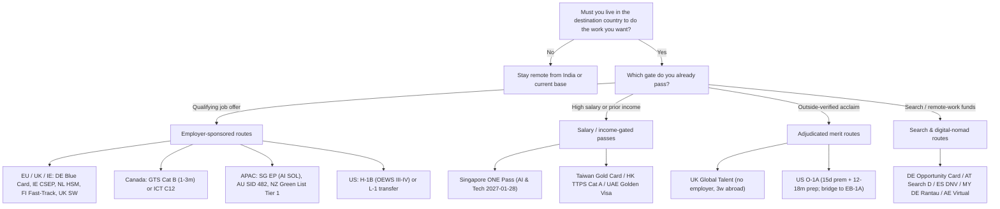

# Visa and Relocation: Global Talent-Visa Corridors for AI Professionals

> Global visa corridor comparison across 31 countries in six regions for GenAI professionals, with Indian-national depth, the central V0 contested-rule status table, and the O-1A / UK Global Talent evidence playbook. Not legal advice.

> [!CAUTION]
> **Pointers to official sources, not legal or immigration advice.** Thresholds, statutory fees, processing queues, and federal court injunctions change without notice. Confirm every rule directly on the national immigration authority's portal and with licensed immigration counsel in the destination country before signing an offer, resigning, paying fees, or filing.

**Ownership and freshness (D-025).** This hub owns the cross-corridor decision framework, the O-1A / Global Talent evidence playbook, and the **central [status table](#status-table)** tracking every pending, contested, or monthly-changing rule (V0/V1) across all six regions. Every status row was re-verified via live web check on `2026-11-19` (`review_by: 2026-12-03`, the 14-day V0 cadence under [D-018](../../research/DECISIONS.md)). Country-level mechanics, thresholds, fees, dependants, and bilateral notes live in the six [regional visa dossiers](visa/README.md).

**Evidence grades (EGP-1.0).** `[A]` primary government text or measured registry read directly; `[B]` transparent secondary, official snippet/fetch summary, or live web check against official/law-firm consensus; `[C]` single vendor, practitioner estimate, or conflicted source; `[D]` analytical judgement; `[M]` arithmetic over cited ranges; `[P]` practice-curated workflow. Where an underlying research session could not read raw official HTML/PDF (for example `uscis.gov`, `travel.state.gov`, `legifrance.gouv.fr`, and several Gulf/APAC portals), claims are capped at `[B]` unless confirmed from primary text.

## The short answer

1. **Choose by the gate you already pass, not by the country you prefer.** Every corridor across the 31 audited countries filters on one of four gates: a **qualifying job offer** (Ireland CSEP, Germany/Spain/Netherlands/France EU Blue Card & HSM, Canada GTS, Singapore EP, Australia SID 482, New Zealand Green List), a **salary or prior-income test** (Singapore ONE Pass, Taiwan Gold Card, Hong Kong TTPS Cat A, UAE Golden Visa), **adjudicated merit** (US O-1A with a petitioner; UK Global Talent with no employer), or **points / job-search / digital-nomad entry** (Germany Opportunity Card, Austria RWR search visa, Spain DNV, Malaysia DE Rantau) `[A/B · T0-08 L365–L367; T0-39–T0-42]`.
2. **With a job offer, European, Canadian, and APAC employer routes beat US lottery friction.** Germany's 2026 EU Blue Card (€50,700 std / €45,934.20 shortage; 21–27m PR) and two degree-free IT routes (`T0-39 L75–L77`), Ireland's CSEP (€40,904; 21-month Stamp 4, `T0-39 L81–L82`), Finland's 2-week Specialist fast track (€3,937/mo, `T0-40 L54`), Singapore's EP (explicit AI Shortage Occupation List, 10 business days, `T0-42 L63`), Australia's SID 482 Specialist Skills (AUD 146,576, 37–78d, 2y PR, `T0-42 L70`), and New Zealand's Green List Tier 1 Software Engineer (NZ$72.80/h, immediate PR, `T0-42 L71`) avoid annual lotteries entirely. Canada's GTS Category B takes 1–3 months realistically from India (`T0-38 L50`).
3. **Without an employer, UK Global Talent, Taiwan Gold Card, Hong Kong TTPS, and Germany's Opportunity Card are the cleanest unsponsored levers.** UK Global Talent Digital Technology (endorsed by Tech Nation; £766 + IHS £1,035/yr; GOV.UK offshore endorsement wait 3 weeks as of `2026-10-27`) needs no job offer (`T0-39 L74`; live check `2026-11-19`, `[A/B]`). Prior Phase 0 pass-rate figures (`72%`, `54–65%`) were untraceable to any primary source and are retired (`T0-39 L74, L959`). Taiwan Gold Card (≥NT$160k/mo prior salary, Digital field, `T0-42 L68`) and Germany's Opportunity Card (6 points + €1,091/mo blocked funds, `T0-39 L76`) offer strong regional alternatives.
4. **US entry in late 2026 requires dodging Level I H-1B odds and front-loading every packet.** Wage-weighted H-1B selection (4/3/2/1 entries for OEWS Levels IV–I) is in force, dropping Level I modelled odds to ~15% (`T0-37 L74, L191`, `[A]`). The `$100,000` H-1B proclamation is blocked by federal courts (not permanently struck down — appeals remain live) and DHS's `$103,265` cap-subject H-1B NPRM has no final rule as of `2026-11-19` (`T0-37 L75–L76`; live check `[B]`). Under USCIS **PA-2026-05** (`2026-08-05`), officers may deny incomplete petitions without an RFE (`T0-37 L77–L78`, `[A]`). O-1A remains viable (91.0% combined O approval FY2026 Q1–Q3, `[B · T0-37 L78]`), while EB-1A fell to 32.2% in FY2026 Q3 (`[C · T0-37 L79]`).
5. **For Indian nationals, separate entry speed from permanent-residence speed.** US EB-2 (`2013-11-01`, ~13.0y, 356,360 waiting) and EB-3 (`2014-01-22`, ~12.8y) face multi-decade effective queues (`T0-37 L80, L238`, `[B]`), Gulf states offer 0% tax with no standard PR/citizenship (`T0-41 L56–L63`), and Israel caps B/1 work stays at 63 months with no PR (`T0-41 L64`). By contrast, Canada, Ireland, Germany, Finland, Australia, and New Zealand impose **zero per-country Indian PR backlogs** (`T0-38–T0-42`).
6. **Build one dated evidence ledger and re-check V0 rows within 14 days of acting.** Completed judging, named outside adoption, press naming you, and independent expert letters serve US O-1A, UK Global Talent, and senior merit screens alike (`T0-08 L90`). Re-verify the [status table](#status-table) on official portals before every commitment `[P · D-007]`.

## At a glance



## Status table

This table is the **single repository owner** for every contested, enjoined, proposed, or rapidly shifting immigration rule (V0/V1) across all six regions. Every row was live-verified via web search on `2026-11-19`. Verify directly on the linked official authority before acting.

| Region / Country | Rule or series | Volatility | Status as of `2026-11-19` | Next trigger / watch date | Evidence & source |
|---|---|---|---|---|---|
| **US** | `$100,000` H-1B Proclamation (10973; extended by 11069 to `2027-09-21`) | V0 | **Blocked / not collected.** Agency policies vacated (`California v. Mullin`, D. Mass. `2026-06-08`; 1st Cir. stay denied `2026-07-24`) & enjoined (`Global Nurse Force v. Trump`, N.D. Cal. `2026-09-30`); `Chamber of Commerce` upheld at D.D.C. (D.C. Cir. undecided). Appeals live. | Circuit rulings (1st, 9th, D.C. Cir.) | `[B · T0-37 L75, L296; live check 2026-11-19]` |
| **US** | DHS `$103,265` cap-subject H-1B fee NPRM (`91 FR 54817`, `USCIS-2026-0298`) | V0 | **Proposed only (not in effect).** Comments closed `2026-09-24`; no final rule published. Cap-exempt excluded. | Publication of Final Rule | `[A/B · T0-37 L76; live check 2026-11-19]` |
| **US** | DHS `$70k/$30k` OPT school fee NPRM (`91 FR 64566`, `ICEB-2026-0100`) & 60-day grace-period elimination (`91 FR 57807`) | V0 | **Proposed only.** OPT core comments closed `2026-11-09` (PRA comments open to `2026-12-07`); grace-period comments closed `2026-11-10`; deference (`USCIS-2026-0529`) & DOL wage (`91 FR 15454`) also pending. | `2026-12-07` PRA close / Final Rules | `[B · T0-37 L77, L82; live check 2026-11-19]` |
| **US** | USCIS **PA-2026-05** (denial without RFE/NOID) & `AAUP v. Mullin` (`1:26-cv-14527`) | V0 | **In force** since `2026-08-05`; federal challenge filed `2026-10-05` in D. Mass., pending. | District court ruling | `[A/B · T0-37 L77–L78; live check 2026-11-19]` |
| **US** | Gold Card (`EO 14351`, Form I-140G) & `AAUP v. DHS` | V0 | **Live** inside existing EB-1/EB-2 caps (`$1M`/`$2M` + `$15k`); low early approvals; litigation pending. | Court ruling / USCIS data | `[B · T0-37 L85, L145; live check 2026-11-19]` |
| **US** | `$250` Visa Integrity Fee (P.L. 119-21) | V0 | **Enacted; staggered consular rollout.** Active at select US posts; check local embassy payment instructions before interview. | Consular rollout notices | `[B · T0-37 L177; live check 2026-11-19]` |
| **US** | Visa Bulletin (India Final Action) & O-1A adjudication stats | V1 | **December 2026 bulletin not yet published** as of `2026-11-19`. **November 2026 India Final Action:** EB-1 `2023-02-01`, EB-2 `2013-11-01`, EB-3 `2014-01-22` (DOF: `2024-07-01` / `2015-01-15` / `2015-01-15`). O-class FY2026 Q1–Q3 approval **91.0%** (Q4 unpublished). | Dec 2026 bulletin (imminent) | `[B · T0-37 L78, L80; live check 2026-11-19]` |
| **US** | Wage-weighted H-1B cap selection (`90 FR 60864`) | V1 | **In force** since `2026-02-27` (4/3/2/1 entries for OEWS IV–I). FY2027 filled (no second round); FY2028 dates unpublished (historically March). | FY2028 registration notice (early 2027) | `[A/B · T0-37 L74, L192; live check 2026-11-19]` |
| **Canada** | Express Entry CRS overhaul (`2026-11-03`) & invitation-round pause | V0 | **Draws paused through mid-November 2026** for score recalculation (+high-wage LMIA-free points; researcher update `2026-11-17`). No post-reset CEC cut-off published yet; zero STEM draws in 2025–2026. | First post-reset Express Entry draw | `[A/B · T0-38 L51–L53; live check 2026-11-19]` |
| **Canada** | Budget 2025 H-1B pathway, AI GTS expansion & Start-Up Visa pause | V0 | **H-1B pathway not launched** (consultations closed `2026-09-01`); **AI GTS rules unpublished**; **Start-Up Visa paused** since `2026-06-30` (replacement pilot unconfirmed). | 2027 IRCC category announcements | `[A/B · T0-38 L54–L55, L57; live check 2026-11-19]` |
| **UK** | Earned Settlement (*A Fairer Pathway to Settlement*, CP 1707) & B2 English | V0 | **Policy confirmed (`2026-11-02`):** 10y default, 5y at ≥£50,271, 3y at ≥£125,141 — **no implementing Statement of Changes laid yet** as of `2026-11-19`. **B2 English for settlement enacted** (`2027-03-26`); Graduate shrinks to 18m (`2027-01-01`). | Dec 2026 Statement of Changes | `[A/B · T0-39 L71, L73, L233; live check 2026-11-19]` |
| **UK** | Global Talent Digital Technology endorsing body & wait | V1 | **Tech Nation** confirmed as continuing endorsing body; GOV.UK wait **3w abroad / 8w inside UK** (`2026-10-27`). | Ongoing GOV.UK updates | `[A/B · T0-39 L74, L958; live check 2026-11-19]` |
| **Germany** | 2027 EU Blue Card salary thresholds (`Drucksache 576/26`) | V0 | **Pending Bundesrat / BMI notice.** Draft €106,200 ceiling implies €53,100 std / €48,108.60 reduced (`[M]`); **2026 binding floors remain €50,700 / €45,934.20**. | Dec 2026 Bundesanzeiger notice | `[A/M · T0-39 L75; live check 2026-11-19]` |
| **Netherlands** | 30% → 27% expat tax ruling (`Belastingplan 2027`) & 2027 IND HSM norms | V0 | **27% cap legislated for `2027-01-01`** (2024+ entrants; pre-2024 transitional 30%). *Belastingplan 2027* **passed Tweede Kamer (`2026-11-12`, 76–74)**, now before Eerste Kamer. **2027 IND HSM norms unpublished** (2026: €5,942 / €4,357). | Dec 2026 Eerste Kamer vote & IND notice | `[B · T0-39 L78–L79; live check 2026-11-19]` |
| **France** | Decree 2026-1001 (`2026-10-30`) & Blue Card min contract length | V0 | **Decree in force `2026-10-30`** (90d decision limit, 6m employer-change cap, unemployment search window). Minimum contract duration still conflicts across official sites (`service-public.fr` none vs older 6m/12m text); ICT floor pending order. | Ministerial ICT order / portal reconciliation | `[B · T0-39 L83; live check 2026-11-19]` |
| **Switzerland** | 2027 third-country B/L federal quotas | V0 | **Pending Federal Council decision.** 2026 cap confirmed at **8,500 (4,500 B + 4,000 L)**; 2027 decree not confirmed published as of `2026-11-19`. | Late Nov 2026 Federal Council release | `[A/B · T0-39 L84; live check 2026-11-19]` |
| **Nordics / EU** | Sweden `2026-12-02` extension floor; Portugal job-search visa; Estonia Aliens Act; EU–India FTA | V0 | **Sweden:** SEK 34,470/mo (90% median) compulsory for extensions registered ≥`2026-12-02`. **Portugal:** Law 61/2025 qualified job-search visa suspended pending *portaria*. **Estonia:** employer switch live `2026-05-22`, short-term permit ends `2027-01-01`. **EU–India FTA:** concluded `2026-01-27`, awaiting signature/ratification. | `2026-12-02` (SE); `2027-01-01` (EE) | `[A/B · T0-40 L51, L57, L61, L63; live check 2026-11-19]` |
| **UAE & Saudi** | UAE Golden Visa AED 30k basic-vs-gross split; Saudi skill tiers & kafala | V0 | **UAE:** Law firms report strict **AED 30,000 basic salary** audits (+6m bank statements), while Arabic ADRO text does not specify basic vs gross; ADRO Green Visa nomination paused. **Saudi:** 2025 skill tiers lack published SAR floors; ILO closed Art. 26 complaint `2026-11-16` on a 5y workplan (kafala abolition unconfirmed). | Official ICP/ADRO & MHRSD texts | `[B · T0-41 L57, L61, L70; live check 2026-11-19]` |
| **Israel** | B/1 Hi-Tech spouse work authorisation (Procedure 5.3.0043) | V0 | **Extension unconfirmed on `gov.il`.** Innovation Authority/law firms still describe open spouse B/1 EAS, but Procedure 5.3.0043 stated an end date of `2026-03-01` and only emergency 3m blanket extensions were confirmed. | PIBA updated procedure publication | `[B · T0-41 L82, L440, L451; live check 2026-11-19]` |
| **Singapore** | Jan 2027 EP hike, Tech.Pass closure & ONE Pass AI & Tech launch | V0 | **Enacted:** EP rises to **S$6,000 / S$6,600** (`2027-01-01`); **Tech.Pass closes `2027-01-27 23:59`**; **ONE Pass AI & Tech opens `2027-01-28`** (≥S$30k total, ≥S$22.5k fixed + vested ESOP). | `2027-01-01` & `2027-01-28` | `[A/B · T0-42 L62–L64; live check 2026-11-19]` |
| **Japan & Taiwan** | Japan HSP income ordinance & `2027-04-01` PR guidelines; Taiwan 2025 Act rules | V0 | **Japan:** PR fee jumped to **¥200,000** (`2026-10-01`); HSP ¥3m floor increase due by `2027-03-31`; B1 Japanese / pension PR rules effective `2027-04-01`. **Taiwan:** 2025 Act (1y PR at ≥NT$6m) implementing rules unverified. | `2027-03-31` / `2027-04-01` (JP) | `[B/C · T0-42 L66, L68; live check 2026-11-19]` |
| **AU / NZ / MY** | AU SID 482 floors & MATES; NZ Green List & India FTA TEE; MY DE Rantau | V0 | **Resolved `2026-11-19`:** AU 2026–27 floors **AUD 146,576** (SSIT) / **AUD 79,423** (CSIT) (`homeaffairs.gov.au`); NZ Green List Software Engineer **NZ$72.80/h** (`immigration.govt.nz`). **Pending:** AU MATES 2026–27 ballot dates; NZ–India FTA TEE (in force `2026-10-20`, 5,000 cap, no direct PR) launch details; **MY DE Rantau reopens `2026-12-01`** at USD 36,000/yr (up to 4y). | `2026-12-01` (MY); AU MATES ballot | `[A/B · T0-42 L70–L72; live check 2026-11-19]` |

## Global corridor comparison

Compare corridors across two separate axes — **generic non-EU/third-country access** and **Indian-national friction** (caps, green-card backlogs, consular waits, and document attestation) — then drill into the matching regional dossier.

| Region & dossier | Strongest employer-sponsored routes | Strongest unsponsored / merit / search routes | Generic non-EU access & PR path | Indian-national differences (caps, queues, attestation) |
|---|---|---|---|---|
| **[United States](visa/united-states.md)** (`T0-37`) | H-1B (wage-weighted IV–III), L-1A / L-1B (L-2S spouse work), O-1A (employer/agent) | No unsponsored work visa; self-petition **EB-1A** (32.2% Q3 `[C]`) or **EB-2 NIW** (55.3% Q3 `[C]`) | High compensation; non-backlogged nationalities clear EB-2/NIW PR in ~1–3 years `[B]` | **Severe India PR backlog:** EB-1 `2023-02-01` (~3.8y), EB-2 `2013-11-01` (~13.0y), EB-3 `2014-01-22` (~12.8y). No TN/E-3/H-1B1 treaties; 3y Indian bachelor's blocks single-source EB-2; India consular waits 1–6.5m `[B · T0-37 L80, L84, L241]` |
| **[Canada](visa/canada.md)** (`T0-38`) | GTS Cat B (9d LMIA, 1–3m total), ICT (C12), Francophone Mobility (C16) | Express Entry (post-`2026-11-03` high-wage LMIA-free points; French draw 407); **SUV paused** | Direct PR via Express Entry / PNP; citizenship 1,095 days / 5y; zero STEM draws 2025–2026 `[A]` | **No Indian cap** (43.5% of 2024 EE ITAs); 10-week work-permit wait from India; ECA + Passport Seva PCC required; H-1B pathway not launched `[A/B · T0-38 L50, L54, L59]` |
| **[UK, Ireland & Western Europe](visa/uk-ireland-western-europe.md)** (`T0-39`) | IE CSEP (€40,904), DE Blue Card (€50,700 / €45,934.20 + 2 degree-free IT paths), NL HSM (€5,942/mo), UK SW (£41.7k+ / SOC ~£55k), FR Blue Card (€59,373) | **UK Global Talent** (3w abroad, no offer), DE Opportunity Card (1y), NL Zoekjaar (top-200) | Clear PR: **IE Stamp 4 in 21m**, **DE 21–27m**, NL/FR 5y, UK transitioning to 10y/5y/3y; CH strictly capped (8,500/yr) `[A/B]` | **No Indian PR caps.** UK HPI has **zero Indian univs**; UK–India CETA/DCC in force `2026-07-15`; **Germany rejects Indian Apostilles** (~8w `Urkundenüberprüfung`); NL MVV ≤10 working days in India `[A/B · T0-39 L80, L241, L557]` |
| **[Nordics, Southern & Central Europe](visa/nordics-southern-central-europe.md)** (`T0-40`) | FI Specialist (€3,937/mo, 2w), ES Blue Card (€41,356, 20d), SE Work/Blue Card (SEK 34,470 / 53,625), DK Pay Limit (DKK 552k), EE Top Spec (€3,138), PL/AT/IT Blue Card | AT RWR Search Visa D (6m, ≥70 pts), **ES Teleworker DNV** (~€2,849/mo + 24% tax), IT impatriate 50% tax | Clean 4–5y PR (FI 4y at >€40k/yr; DK 4y fast / 8y std; SE 4y work PR, 8y citizenship); strong EU Blue Card mobility `[A/B]` | **No Indian caps** (20.8% of 2024 EU Blue Cards). All 10 accept **Hague Apostilles**; social-security pacts cover AT, DK, FI, NO, PT, SE (not ES, IT, PL, EE); EU–India FTA awaiting ratification `[A · T0-40 L63]` |
| **[Gulf States & Israel](visa/gulf-and-israel.md)** (`T0-41`) | UAE MoHRE (2d), Saudi Qiwa, Bahrain LMRA (21d, free switch after 12m), Israel B/1 Hi-Tech (6d, NIS 27,132/mo) | UAE Golden Visa (≥AED 30k/mo, basic-vs-gross V0), UAE Virtual Working (USD 3.5k/mo), Saudi Special Talent (SAR 35k/mo `[B]`) | Gulf: **0% income tax, fast entry, no standard PR/citizenship**. Israel: **63-month cap, no PR** `[B]` | **No Indian caps**; degree holders ECR-exempt; bilateral pacts exclude IT/AI. **UAE & Qatar are NOT Hague Apostille members** (need MEA + Embassy + MOFA chain); SA/BH/IL are members `[A/B · T0-41 L66]` |
| **[Asia-Pacific](visa/asia-pacific.md)** (`T0-42`) | SG EP (AI SOL, S$6k from `2027-01-01`, 10d), AU SID 482 (AUD 146,576 Spec / 79,423 Core), NZ Green List Tier 1 (NZ$72.80/h), JP Engineer/HSP, KR E-7-1/Top-Tier | **SG ONE Pass AI & Tech** (`2027-01-28`), **TW Gold Card** (≥NT$160k/mo), HK TTPS, JP J-Skip (1y PR) / J-Find, **MY DE Rantau** (`2026-12-01`, USD 36k) | Fastest PR in world: **NZ Green List immediate**, **JP J-Skip/HSP 1y**, **AU ENS 186 2y**; SG PR discretionary; MY DE Rantau no PR `[A/B]` | **No Indian PR caps** (India #1 AU 482 source + exclusive MATES 3k/yr + NZ FTA 5k TEE cap). Watch **SG COMPASS C3 ≥25% nationality diversity**; **JP DNV excludes India**; KR Workation & MY DE Rantau accept India `[A/B · T0-42 L63, L70–L74]` |

## Relocate or stay remote

Do not treat relocation as the default answer. In the compensation data curated elsewhere in this repository, **global remote roles paying in USD from India** frequently beat local net savings in medium-tax European hubs once rent, taxes, and dual-career spousal friction are counted (`T0-08 L79`; see [pay-benchmarks.md](../09-compensation/pay-benchmarks.md) and [india-remote-playbook.md](india-remote-playbook.md)).

- **Stay remote** when you want USD-denominated savings, hold strong India-side career leverage, or do not yet clear a clean offer/merit/salary gate — and use the next 12–18 months to build your evidence ledger `[D · T0-08 L90]`.
- **Relocate** when you need in-person access to frontier AI labs or hardware clusters, want direct access to equity/leadership networks concentrated in SF/NYC/London/Zurich/Singapore, or are deliberately optimising for a second passport (Canada, Ireland, Germany, Finland, Australia, New Zealand) `[D · T0-08 L79; T0-38–T0-42]`.
- **Verify tax residency before moving:** Remotely working for a foreign employer while physically inside another country on a tourist visa is unauthorised employment in the US and most jurisdictions (`T0-37 L250`). For India-resident export-of-services tax mechanics (Section 44ADA, GST LUT, FEMA), see [india-remote-tax.md](../09-compensation/india-remote-tax.md).

## How to do it

1. **Decide whether physical presence is worth the friction.** Compare net take-home, equity upside, spousal career continuity, and passport horizon against remote USD billing from India `[P]`. *Done when:* you have a written one-paragraph rationale linking relocation to a concrete opportunity you cannot access remotely.
2. **Pick one primary corridor and one backup from the comparison table.** Match your current gate (offer, high pay, outside acclaim, or search funds) and open the corresponding [regional visa dossier](visa/README.md) `[D · T0-08 L365]`. *Done when:* both corridors clear your nationality, degree, and dependant work-rights constraints.
3. **Check every live threshold and contract clause before signing.** Confirm fixed base pay (not variable bonus or unvested equity) clears the statutory floor — especially US OEWS wage level, UK SOC going rate + £50,271 Earned Settlement bar, Germany Blue Card floor + ISCO-08 code, Netherlands IND HSM norm vs 27% tax-ruling norm, Singapore COMPASS C3 diversity, and UAE **basic** salary (`≥AED 30,000`) `[A/B · T0-37–T0-42]`. *Done when:* the offer letter reflects fixed base pay and employer sponsorship obligations in writing.
4. **Audit your evidence (for O-1A or UK Global Talent).** Score every artefact in your ledger against four filters: *Does it name you? Is the source independent? Is it dated? Is the act complete?* `[D · T0-08 L384]`. *Done when:* three O-1A criteria, or Tech Nation's mandatory + two optional criteria, pass all four filters — and for US filings under PA-2026-05, the packet stands on its own without counting on an RFE `[A · T0-37 L77–L78]`.
5. **Get a written legal screen before paying full retainer fees.** Treat commercial vendor approval rates as self-reported marketing over pre-screened cohorts (`T0-37 L86`; `T0-08 L213`, `[C]`). *Done when:* licensed counsel specifies in writing which criteria hold today and which need 6–12 more months.
6. **Plan past entry approval.** Book consular appointments early (accounting for India wait times, narrowed US dropbox waivers, and non-Apostille legalisation for Germany, UAE, and Qatar), verify dependant work authorisation, and map the separate PR and language timeline (UK B2 from `2027-03-26`, Germany A1/B1, France A2/B1/civic exam, Japan B1 from `2027-04-01`) `[A/B · T0-37–T0-42]`. *Done when:* you have one dated schedule from filing to landing and from landing to settlement.
7. **Re-verify the status table within 14 days of acting.** Re-check every [status table](#status-table) row touching your route on its official government portal `[P · D-007]`. *Done when:* no rule, injunction, or threshold has shifted since your last check.

## Building the evidence for O-1A and Global Talent

The same externally verifiable artefacts serve US O-1A, US EB-1A, and UK Global Talent, so build one unified evidence ledger `[D · T0-08 L90]`. Plan **12–18 months** of deliberate evidence collection (a practitioner estimate `[C · T0-08 L375]`); as T2-01 notes, third-party proof "cannot be manufactured retroactively" `[D · T2-01 L177]`. Under USCIS **PA-2026-05** (`2026-08-05`), filing a thin O-1A or EB-1A packet risks immediate denial without an RFE `[A · T0-37 L77–L78]`.

### O-1A: the eight criteria for an industry engineer

| # | Criterion | Evidence that fits an industry engineer (T0-08 analysis) | What failed in 2025–26 appeal decisions |
|---|---|---|---|
| 1 | Awards | Placements in selective, open-field competitions; best-paper awards; industry awards that name you | Funding or accelerator acceptance offered as an award; awards given to the company |
| 2 | Membership | Bodies with merit-based admission; practitioners name IEEE Senior Member and ACM Distinguished Member or Fellow (check the bylaws) | An investor's selection offered as membership, with no description of admission criteria |
| 3 | Published material about you | A feature or profile of your open-source project, model or system that names you | Passing mentions and quotes; coverage of the company rather than of you |
| 4 | Judging | Completed peer reviews; hackathon or competition judging; accelerator selection panels. Keep the invitation, the submitted evaluation and the organiser's confirmation | Invitations, registrations and "I'll review" replies without completed reviews |
| 5 | Original contributions of major significance | Named outside adopters; usage metrics with baselines; licensed or commercialised patents; benchmarks or datasets used by independent groups; expert letters that explain significance and the writer's basis of knowledge | Adoption by one or a few companies; potential rather than impact; citation totals without a baseline; adjectives-only letters |
| 6 | Scholarly articles | Conference or workshop papers, journal articles, scholarly pieces in major media; authorship alone meets the criterion at the evidence step | Problems appear at the final-merits step, not here |
| 7 | Critical or essential capacity | Org charts, scope documents, results attributable to you, specific letters from senior leaders, plus proof of the employer's distinguished reputation; the January 2025 update adds a "key committee or high-performing team" `[T0-08 L150]` | Not among the nine decisions summarised; the manual requires proof of both the reputation and your role |
| 8 | High salary | A US offer or contract, occupation-and-region comparison data, an employer justification; for founders, highly valued equity as comparable evidence | An equity value contradicted by the company's own fair-market value (`$0.00001` a share) |

Grades: criterion wording `[A]`; evidence column is T0-08's analysis `[D]`; failure column is a vendor summary of nine AAO decisions (`2026-09-17`), `[C · T0-08 L140–L151, L477]`.

- **Which three?** On paper the lowest-friction triad for an industry engineer is **7 + 8 + 4** (critical role at a distinguished employer, high salary, completed judging), while **5 and 3** carry the heaviest weight at the *Kazarian* step-two final-merits review (which practitioners continue to treat as active despite `Mukherji v. Miller`, `T0-37 L210`, `[B]`) `[D/C · T0-08 L153]`.
- **Comparable evidence:** Where a criterion does not fit an industry role, comparable evidence may be argued criterion by criterion (still meeting three distinct criteria) `[A · T0-08 L168]`. PA-2025-02 added critical/emerging-technology examples referencing AI, though open-source work is best anchored under criteria 3 and 5 with independent adoption proof `[A/C · T0-08 L169]`.
- **18-month build sequence (`[D/C · T0-08 L375–L382]`):**
  - *Weeks 0–4:* Legal screen; define narrow field; choose petitioner (employer, agent, or owned entity); open ledger; benchmark salary.
  - *Months 1–6:* Accumulate completed judging; present at selective technical venues; log outside adoption against baselines; secure press naming you.
  - *Months 7–12:* Collect independent expert letters explaining contribution, significance, and basis of knowledge; obtain advisory opinion; compile employer-reputation and compensation proof.
  - *Months 12–18:* Final counsel audit (built to survive PA-2026-05 without an RFE); file with `$2,965` premium processing (15 business days vs 14.5 months standard, `T0-37 L78, L138`); prepare consistent DS-160 and consular answers.

### UK Global Talent: Exceptional Talent vs Exceptional Promise

| Dimension | Exceptional Talent | Exceptional Promise |
|---|---|---|
| Mandatory criterion | Recognised in the last 5 years as a **leading talent** in digital technology | Recognised in the last 5 years as having the **potential** to be a leading talent |
| Optional criteria (2 of 4) | Innovation; contributions outside day-to-day work; significant technical/commercial/entrepreneurial impact; academic contributions | Same four areas with a lower bar and no senior-executive requirement |
| Career stage | Typically 5+ years, already leading | Under 5 years; cannot later switch to Talent |
| Settlement (pre-Earned Settlement rules; watch Dec 2026 Statement of Changes) | 3 years (note: Earned Settlement CP 1707 also sets a 3-year tier at ≥£125,141; B2 English eff. `2027-03-26`) | 5 years (verify against implementing Rules; B2 English eff. `2027-03-26`) |

Grades: rubric `[B/C · T0-08 L242–L248]`; settlement & B2 English `[A/B · T0-39 L71, L233]`. Endorsing body for Digital Technology confirmed as **Tech Nation** (live check `2026-11-19`, `[B]`); GOV.UK endorsement wait **3 weeks outside UK / 8 weeks inside** (`2026-10-27`, `[A · T0-39 L74, L958]`).

- **Strict format rules (`[A · T0-08 L256]`):** Three dated letters from three different well-established digital-technology organisations (law-firm guides add ≥12 months' personal knowledge `[B/C]`), a CV, up to **10 evidence items**, and **zero live web links or digital files** (submit scanned pages showing URLs). Letters solely from managers or colleagues are widely reported as insufficient `[C · T0-08 L257]`.

## Templates and examples

### Evidence ledger

```text
EVIDENCE LEDGER  (one row per artefact; store source PDFs/scans in one folder)
Criterion        | Item                                   | Names me? | Independent source? | Date         | Document location | Status
[4 Judging]      | [Completed reviews for [venue] [year]] | [Yes]     | [Yes: organiser]    | [YYYY-MM-DD] | [folder/file]     | [Confirmation saved]
[5 Contribution] | [Adoption of [project] by [org]]       | [Yes]     | [Yes]               | [YYYY-MM-DD] | [folder/file]     | [Letter requested]
[3 Press]        | [[Outlet] profile of [project]]        | [Yes]     | [Yes]               | [YYYY-MM-DD] | [folder/file]     | [Scanned PDF]
```

Columns `[D · T0-08 L384]`; rows are placeholders.

### Expert-letter request `[P]`

```text
To: [expert name], [title], [organisation]
How you know my work: [since YYYY-MM; in what capacity]
The contribution: [what I built or published, in one sentence]
Why it mattered outside my employer: [named adopters; metrics vs baseline]
Evidence you may cite: [ledger item numbers]
Request: please explain what the work changed and your basis of knowledge, rather than general praise.
```

### Questions for immigration counsel `[P]`

```text
1. Which criteria do my ledger items satisfy as of [YYYY-MM-DD], and can this packet survive adjudication without an RFE (for US PA-2026-05)?
2. Which petitioner or route fits best (employer, US agent, own entity, or unsponsored UK/TW/HK route)?
3. What does the retainer include (advisory opinion, letters, RFE/NOID response, dependant filings)?
4. What anonymised outcomes do you have for industry-only applicants without a PhD (and what denominator do your published rates use)?
5. What exact evidence gap would make you advise waiting 6–12 months before filing?
```

### Weak vs strong evidence

| Artefact | Weak | Strong |
|---|---|---|
| Award | "Our startup was accepted into [accelerator]." | "Placed [rank] of [n] entrants in [open competition], judged by [panel]." |
| Press | "[Outlet] covered the company and quoted me once." | "[Outlet] profiled my [project] on [date], naming me as creator." |
| Judging | "Invited to review for [venue]." | "Completed [n] reviews for [venue] [year]; organiser confirmation attached." |
| Contribution | "Used by several teams; letters call me brilliant." | "Adopted by [named external organisations]; [metric] moved from [baseline] to [value]; letters explain impact." |
| Salary | "Equity valued via secondary-market estimate." | "Guaranteed base offer of [amount] exceeds [benchmark] for [SOC/region]." |
| UK letters | "Three letters from my manager and teammates." | "Three dated letters from senior experts at three distinct established organisations who have known my work 12+ months." |

Weak column reflects appeal/refusal failure patterns `[C · T0-08 L144–L151, L257]`; strong column follows statutory criteria and format rules `[A · T0-08 L144–L151, L256]`; phrasing `[P]`.

## Persona and geography notes

- **Indian nationals:** No per-country PR backlog exists in Canada, Europe, the UK, Australia, or New Zealand (`T0-38–T0-42`), whereas US EB-2/EB-3 runs a 12–13-year Visa Bulletin gap (`T0-37 L80`). Watch three operational traps: (1) **non-Apostille countries** — Germany (`Urkundenüberprüfung`, ~8w), UAE, and Qatar (MEA + Embassy + MOFA) reject Indian Hague Apostilles (`T0-39 L557; T0-41 L66`); (2) **3-year Indian bachelor's degrees** — blocked from single-source US EB-2 (`T0-37 L241`); and (3) **nationality-concentration caps** — Singapore COMPASS C3 gives 0 points if one nationality reaches ≥25% of the firm's PMETs (`T0-42 L63, L74`).
- **Engineers at IT-services / outsourcing firms:** Canada's `2026-09-18` ESDC rule tightening against contractor misclassification affects IT staffing models (`T0-38 L160`, `[A]`); US 50+/50% employers pay the `$4,000` H-1B / `$4,500` L-1 surcharge on **all extensions** through `2027-09-30` (`T0-37 L169`, `[A]`); UK Tech Nation optional criteria favour product-led impact over confidential client delivery (`T0-08 L251`, `[D]`).
- **PhD holders and researchers:** Publications satisfy O-1A criterion 6 at the evidence step and peer review feeds criterion 4 (`T0-08 L149`; see [phd-to-industry.md](phd-to-industry.md)). Also check cap-exempt US H-1B employers (`T0-37 L137`), UK Royal Society/RAEng/UKRI fast-track Global Talent (2–5 weeks, `T0-39 L74, L162`), France `Talent — chercheur` (`T0-39 L83`), Japan J-Skip / HSP 80-point 1-year PR (`T0-42 L66`), and Canada's `2026-11-17` researcher Express Entry refinement (`live check 2026-11-19`, `[B]`).
- **Founders and fractional leaders:** Owned US entities may petition for O-1A (`T0-08 L172`); Singapore's ONE Pass AI & Tech track (`2027-01-28`) counts founder tenure and startups with ≥US$30m raised (`T0-42 L62`); Canada's Start-Up Visa is **paused** (`T0-38 L57`); UAE licensed freelancers pay 9% corporate tax on net business profit above AED 375,000 (`T0-08 L359`; see [freelance-fractional.md](freelance-fractional.md)).

## Checklist

- [ ] I wrote down why physical relocation beats remote USD work from my current base, backed by concrete pay and career numbers.
- [ ] I selected one primary corridor and one backup from the global comparison table and read both regional dossiers under [visa/](visa/README.md).
- [ ] I verified my fixed/guaranteed base salary clears the exact statutory floor (and checked separate tax-ruling floors in the Netherlands and basic-vs-gross salary in the UAE).
- [ ] If targeting a merit route (US O-1A / UK Global Talent), my ledger passes all four filters (names me, independent, dated, complete) and is strong enough to survive US PA-2026-05 without an RFE.
- [ ] My UK Global Talent pack has 3 dated letters from 3 distinct organisations, ≤10 evidence items, and zero live web links or digital files.
- [ ] I obtained a written legal screen and discounted every vendor's self-reported approval rate against official USCIS/national baselines.
- [ ] I checked my spouse's and dependants' open work rights (for example, O-3 and F-2 cannot work; L-2S works incident to status; verify Israel B/1 spouse extension in writing).
- [ ] I mapped the separate permanent-residence, language-test (UK B2 `2027-03-26`, DE A1/B1, FR A2/B1, JP B1 `2027-04-01`), and document-attestation schedule (Apostille vs full legalisation).
- [ ] I re-verified every relevant row of the [status table](#status-table) on official government portals within 14 days of acting.

## Pitfalls

| Red flag | Why it hurts | Fix |
|---|---|---|
| Treating the US `$100,000` H-1B fee as "permanently dead" | Proclamation 11069 extended it to `2027-09-21` and circuit appeals remain active (`T0-37 L75`) | Monitor court dockets and DHS's parallel `$103,265` NPRM (`USCIS-2026-0298`) before relying on cap-subject H-1B |
| Filing a thin US O-1A or EB-1A expecting an RFE | USCIS **PA-2026-05** (`2026-08-05`) allows immediate denial without RFE/NOID (`T0-37 L77–L78`) | Front-load complete primary proof, baselines, and independent letters on initial submission |
| Relying on vendor pass rates (WeGreened 98–99%, Beyond Border 98%, retired UK 72%/54–65%) | Vendor rates cover pre-screened cohorts without denominators; UK rates had no primary source (`T0-37 L86; T0-39 L74, L959`) | Benchmark against official baselines (USCIS FY2026 Q3: EB-1A 32.2%, NIW 55.3%, O-class 91.0%) |
| Expecting a Canada STEM Express Entry draw, H-1B pathway, or Start-Up Visa | Zero STEM draws in 2025–2026; H-1B pathway unlaunched; Start-Up Visa paused `2026-06-30` (`T0-38 L53–L57`) | Anchor on GTS Cat B (1–3m realistic), ICT C12, post-`2026-11-03` high-wage offer points, or French NCLC 7+ |
| Counting allowances or variable pay toward salary floors | Fails in Germany, Canada, Singapore EP/ONE Pass (pre-2027 track), and UAE Golden Visa basic-pay audits (`T0-39–T0-42`) | Lock guaranteed/basic base pay above the floor in the signed contract |
| Submitting an Indian Hague Apostille to Germany, the UAE, or Qatar | Germany objects to Indian apostilles; UAE and Qatar are non-members (`T0-39 L557; T0-41 L66`) | Budget 3–8 weeks for Germany's `Urkundenüberprüfung` or MEA + Embassy + MOFA legalisation |
| Assuming Singapore Tech.Pass or NZ–India FTA TEE gives automatic transition/PR | Tech.Pass closes `2027-01-27` with no auto-transfer to ONE Pass AI & Tech; NZ TEE has no direct PR (`T0-42 L64, L71`) | Apply directly to ONE Pass AI & Tech (`2027-01-28`) or NZ Green List Tier 1 |
| Buying UAE "lifetime Golden Visa" or "3-year AI residence visa" packages | Contradicted by ICP (`2025-07`); AI announcement is a visit visa only (`T0-41 L59, L69`) | Use official portals (`icp.gov.ae`, `gdrfad.gov.ae`) and confirm contract basic salary |
| Assuming Bahrain Golden Residency grants work rights | Employee track requires prior Bahrain residency AND a separate employer LMRA work permit (`T0-41 L63`) | Treat Bahrain Golden Residency as residency stability after moving, not an entry work visa |
| Counting invitations as judging or company press as personal acclaim | Failed repeatedly in AAO O-1A decisions (`T0-08 L144–L151`) | Log only completed reviews with confirmations and press/adopters naming you |

## Evidence and limits

- **Audit base:** This hub synthesises six RP2 regional visa dossiers (`T0-37` United States, `T0-38` Canada, `T0-39` UK/Ireland/Western Europe, `T0-40` Nordics/Southern/Central Europe, `T0-41` Gulf/Israel, `T0-42` Asia-Pacific — 31 countries retrieved `2026-11-13` to `2026-11-18`), the Phase 0 talent-visa audit (`T0-08`, `2026-10-21`), and live web checks across all six regions on `2026-11-19`.
- **Major updates over Phase 0 (`T0-08`):** Corrected the US `$100,000` proclamation status (blocked on appeal, not permanently struck down, `T0-37 L296`); added PA-2026-05, `$103,265` H-1B NPRM, and `$70k/$30k` OPT NPRM (`T0-37 L76–L82`); split Canada GTS Category A vs B and widened offer-to-start to 1–3 months (`T0-38 L50, L253`); retired untraceable UK Global Talent 72%/54–65% pass rates and updated endorsement wait to 3w/8w (`T0-39 L74, L958–L959`); added Germany's 2-in-5 IT route and replaced unverified 2–3 month §81a totals with component clocks (`T0-39 L76–L77, L962`); updated France Blue Card with Decree 2026-1001 (`T0-39 L83`); updated Singapore ONE Pass to 4 weeks (`T0-42 L62, L395`); and replaced UAE vendor fee estimates with official GDRFA itemisation while flagging basic-vs-gross pay (`T0-41 L57, L594`).
- **Retrieval limits & sceptical grading:** Automated fetches were blocked on `uscis.gov`, `travel.state.gov`, `legifrance.gouv.fr`, `france-visas.gouv.fr`, `immi.homeaffairs.gov.au`, `immigration.govt.nz`, `moj.go.jp/isa`, `moj.go.kr`, `aima.gov.pt`, and `pr.gov.sa`, and `T0-41` relied on fetch summaries throughout. Claims from un-fetched primary sites are capped at Grade `[B]` (or `[C]` for single vendors), with Australia 482 SSIT/CSIT (`AUD 146,576` / `AUD 79,423`) and NZ Green List Software Engineer (`NZ$72.80/h`) conflicts resolved via live `search_web` checks against official domains on `2026-11-19`.
- **Absences:** No country in the 31-nation audit publishes GenAI-role-specific visa approval rates; no independent longitudinal outcome dataset tracks career trajectories across visa corridors (`T2-01.F10`); India-side remittance, social-security, and double-taxation mechanics beyond basic pointers require specialist cross-border tax advice.

## Next steps

- **Drill into a region:** Open [Regional Visa Dossiers](visa/README.md) — [United States](visa/united-states.md), [Canada](visa/canada.md), [UK, Ireland & Western Europe](visa/uk-ireland-western-europe.md), [Nordics, Southern & Central Europe](visa/nordics-southern-central-europe.md), [Gulf States & Israel](visa/gulf-and-israel.md), or [Asia-Pacific](visa/asia-pacific.md).
- **Compare destination markets and cities:** [Country and city rankings](country-rankings.md) (33 countries and 50 cities across six Monte Carlo lenses) and [Remote cross-border AI employment](remote-cross-border.md).
- **Staying in India and billing globally:** [India remote playbook](india-remote-playbook.md) and [India remote tax](../09-compensation/india-remote-tax.md).
- **Leaving academia or changing tracks:** [PhD to industry](phd-to-industry.md), [Career transitions](career-transitions.md), [Freelance and fractional](freelance-fractional.md), and [Governance careers](governance-careers.md).
- **Building externally verifiable proof:** [Proof-of-work standards](../05-portfolio/proof-of-work-standards.md), [Online presence](../07-networking/online-presence.md), and [Communities guide](../07-networking/communities-guide.md).
- **Evaluating an international offer:** [Offer evaluation](../09-compensation/offer-evaluation.md), [Negotiation playbook](../09-compensation/negotiation-playbook.md), [Pay benchmarks](../09-compensation/pay-benchmarks.md), and [First 90 days](../10-onboarding/first-90-days.md).
- **Context and evidence:** [Tracks index](README.md), [Tool catalog](../00-start/tool-catalog.md), [Glossary](../00-start/glossary.md), [findings registry](../../research/findings.md), [ERRATA](../../research/ERRATA.md), and [DECISIONS](../../research/DECISIONS.md) (D-007, D-018, D-025).
