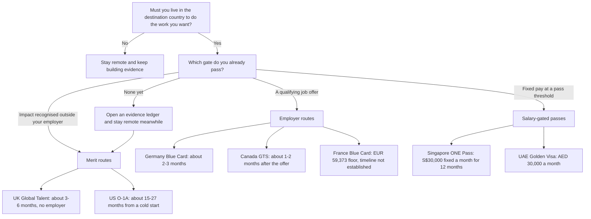

# Visa and Relocation: Talent-Visa Corridors for AI Professionals

> Which talent-visa and employer-offer routes fit an AI professional, with depth for Indian nationals: what evidence each needs, how long and how much it takes, whether to relocate at all, and what to verify before acting. Not legal advice.

> [!CAUTION]
> **Pointers, not legal advice. Verify the rules in force before you act.** This page curates one dated audit, [T0-08](../../research/sessions/T0-08-global-talent-visa-relocation-pathways.md) (as of 21 October 2026), which calls itself "a research audit, not legal advice" [T0-08 L19]. Thresholds, fees and processing times change within weeks. Before you resign, sign, pay or file, confirm each rule on the official pages listed under "How to do it" and with licensed counsel in the destination country [T0-08 L74].

**The status rows are past their expiry.** Every pending, contested or monthly-changing fact on this page sits in one dated [status table](#status-table). Each row is past its expiry class (14 or 31 days), or carries no date at all: check the official source named in the row before acting.

**Dates and grades.** Route rules and fees are as T0-08 read them on 21 October 2026; sources marked "re-checked" were fetched again on 22 October 2026 [T0-08 L464]. Expiry follows [decision D-018](../../research/DECISIONS.md). The rule facts in the body (statute, guidance and fee text; class V4) last 365 days from that reading. Pending or contested statuses (class V0, 14 days) and monthly series such as the Visa Bulletin, consular waits and processing times (class V1, 31 days) are in the status table, each with the date it describes. This page counts their expiry from that date, D-018's conservative option, because re-reading an old status later does not re-verify it. The earliest is the July 2026 processing-time figure for O petitions (class V1, counted from 1 July 2026), so `review_by` is 2026-08-01: the page was due before it was published, and stays due until someone re-verifies the table. Grades (EGP-1.0): A primary or measured; B transparent secondary; C vendor, practitioner or single source; D judgement; M model output (here, T0-08's arithmetic over cited ranges); P practice-curated and unmeasured.

## The short answer

1. **Choose by the gate you already pass, not by the country you prefer.** The routes split into three gates: a qualifying job offer (EU Blue Card in Germany or France, Canada's Global Talent Stream), a salary test (Singapore ONE Pass, UAE Golden Visa), or adjudicated merit (UK Global Talent with no employer, US O-1A with a petitioner) [A · T0-08 L365–L367]. Use a salary-gated pass only if you already meet the salary test [D · T0-08 L79].
2. **With an offer, the employer routes are the fastest and least ambiguous.** Germany's 2026 Blue Card floors are €50,700, or €45,934.20 for ICT and other shortage roles, and ICT specialists without a degree qualify with 3 years' experience in the last 7 [A · T0-08.F9]. With the employer's §81a fast-track the process takes about 2–3 months [M · T0-08 L99], and settlement can follow after 21 months with B1 German or 27 months with A1 [B · T0-08.F9].
3. **Without an employer, UK Global Talent is the only route that needs no job.** A Tech Nation endorsement (one mandatory and two optional criteria, three dated letters, up to ten evidence items) comes before the visa; fees are £766 plus the Immigration Health Surcharge (IHS) of £1,035 a year [A · T0-08.F7]. No Exceptional Promise pass rate is published; law-firm and adviser pages report historical endorsement rates of about 72% across all fields and 54–65% for digital technology [C · T0-08.F7].
4. **O-1A is open to industry engineers, but it rewards proof, not credentials.** USCIS sets no degree, PhD or citation prerequisite: a major award or three of eight criteria, then a final-merits judgement of sustained acclaim [A · T0-08.F1]. In one vendor's summary of nine appeal decisions, petitions failed on evidence that names the company rather than the person, invitations offered as judging, and letters that assert rather than explain [C · T0-08.F2]. Plan 12–18 months of evidence work (a practitioner estimate) [C · T0-08 L96] and US$10k–25k all-in (vendor-published budgets) [C · T0-08.F4].
5. **Treat O-1A as a bridge, not a green card.** Permanent residence needs a separate petition, and the EB-1 India queue ran years behind in the October 2026 Visa Bulletin ([status table](#status-table)) [B · T0-08.F6]. If settlement is the goal, Germany and the UK have defined paths [B · T0-08 L369].
6. **Build one dated evidence ledger, and re-verify before every step.** Completed judging, outside adoption of your work, press that names you and independent expert letters serve O-1A, Tech Nation's criteria and Singapore's experience conditions alike [D · T0-08 L90]. Check every row of the [status table](#status-table) on its official page within 14 days of acting [P · D-007].

## At a glance



Timelines are T0-08's arithmetic over cited ranges, and "targets are not guarantees" [M · T0-08 L92].

## Status table

Every fact on this page that was pending, contested or part of a monthly series when T0-08 read it, with the date the status describes. Under decision D-018 a contested or pending status (class V0) expires 14 days after that date, and a monthly series (class V1) after 31 days; a month-only date counts from the month's first day, and an undated source can be valid at best until its class expires after the day T0-08 read it. **Every row is past its expiry, or undated: check the official source before acting.** The stable rule facts stay in the sections below.

| Route | Item | Status as T0-08 recorded it | As of | Class and expiry | Official source to check | Grade · source |
|---|---|---|---|---|---|---|
| US | H-1B $100,000 proclamation | Extended to 21 Sep 2027, but struck down by two courts (Massachusetts in June 2026; N.D. California on 30 Sep 2026, scope of that ruling not confirmed). H-1B is outside this audit | Re-checked 22 Oct 2026 | V0; expired 5 Nov 2026 | USCIS H-1B pages and the court orders; T0-08 read law-firm summaries | B · T0-08 L230, L433, L485 |
| US | DHS H-1B fee proposal of $103,265 (August 2026) | Pending; not affected by the two rulings | Re-checked 22 Oct 2026 | V0; expired 5 Nov 2026 | The proposal in the Federal Register | B · T0-08 L230, L485 |
| US | O-1 chapter of the USCIS Policy Manual | T0-08 read a cached chapter that predates the January 2025 revision (PA-2025-02). AILA reported the revision still in effect on 4 Feb 2025; T0-08 found no later rollback but did not read the live chapter | 21 Oct 2026 | V0; expired 4 Nov 2026 | USCIS Policy Manual, Vol. 2 Part M | A/B · T0-08 L169, L413 |
| US | Standard processing of O petitions | Sources conflict: a tracker reports 12.5 months to complete 80% of O petitions; a vendor page cites about 4–6 months. USCIS's own processing-time page was not opened | July 2026 (tracker); vendor page undated | V1; expired 1 Aug 2026 | USCIS processing times | B/C · T0-08 L198 |
| US | Consular appointment waits in India (petition-based visas) | About 1.5 months at Chennai and Mumbai, 3 at New Delhi and 5.5 at Hyderabad (State Department data via aggregators) | 17 Sep 2026 | V1; expired 18 Oct 2026 | State Department visa appointment wait times | C · T0-08 L219 |
| US | Visa Bulletin, India | EB-1 final action 1 Feb 2023 (filing date 1 Jul 2024), about 3.7 years behind; EB-2 1 Nov 2013; EB-3 1 Jan 2014 | October 2026 bulletin; summaries re-checked 22 Oct 2026 | V1 (monthly); expired 1 Nov 2026 | State Department Visa Bulletin; T0-08 read law-firm summaries | B · T0-08 L221, F6 |
| UK | English level for settlement | A law-firm page reports B2 for settlement applications from 26 Mar 2027 under HC 1691, on routes including Global Talent; the Home Office guidance (v19.0) states B1 and no change date. HC 1691 was not retrieved, so plan for B2 | 24 Sep 2026 (law stated on that page); re-checked 22 Oct 2026 | V0; expired 8 Oct 2026 | HC 1691 on GOV.UK or legislation.gov.uk | C · T0-08 L271, L423 |
| UK | Earned settlement (a 10-year baseline) | Consultation ran 20 Nov 2025 to 12 Feb 2026; no government response, and no Statement of Changes had introduced the baseline; stated target autumn 2026 | 24 Sep 2026 | V0; expired 8 Oct 2026 | GOV.UK: the consultation response and Statements of Changes | C · T0-08 L271, L425 |
| UK | Tech Nation endorsement time | About 5–8 weeks, per secondary sources | Undated sources, read 21 Oct 2026 | V1; undated, so at best valid to 21 Nov 2026 | GOV.UK Global Talent; Tech Nation | C · T0-08 L238 |
| Canada | Employer test for LMIAs | Secondary coverage reports that from 18 Sep 2026 staffing agencies recruiting for other businesses are not employers; the ESDC page re-read on 22 Oct 2026 carries a "New: September 18, 2026" heading but does not describe the change | 22 Oct 2026 | V0; expired 5 Nov 2026 | ESDC Global Talent Stream requirements | B · T0-08 L299 |
| Canada | Pathway for H-1B holders | Announced in Budget 2025; no launch or eligibility rules published. IRCC consulted from 4 Aug to 1 Sep 2026 on 2027 Express Entry categories, including a possible H-1B category | September 2026 | V0; expired 15 Sep 2026 | IRCC Express Entry announcements | B/C · T0-08 L301 |
| Germany | 2027 Blue Card salary floors | Not yet published; the floors are published in December. One secondary source derives €53,100 and €48,108.60 | 22 Oct 2026 | V0; expired 5 Nov 2026 | The Bundesanzeiger notice; the Berlin immigration office page | C · T0-08 L322; D · T0-08 L425 |
| France | Minimum contract for the Blue Card | At least 6 months per summaries of Decree 2026-308; at least one year per the France-Visas page re-read on 22 Oct 2026. Unresolved | 22 Oct 2026 | V0; expired 5 Nov 2026 | France-Visas; the prefecture | A/B · T0-08 L326 |
| France | Shortage occupations | The ministerial order listing occupations (3 years' experience in the last 7) was not yet published; a 1.2× shortage threshold appears on one employer-guide site only | 22 Oct 2026 | V0; expired 5 Nov 2026 | France-Visas | B/C · T0-08 L326, L328 |
| Singapore | ONE Pass AI & Tech track | Announced to open on 28 Jan 2027 (MOM page updated 14 Sep 2026); the final rules were an open question | 21 Oct 2026 | V0; expired 4 Nov 2026 | MOM ONE Pass eligibility | A · T0-08 L335, L420 |
| UAE | Dubai Golden Visa documentation | Reported tightening: AED 30,000 basic salary excluding allowances, two years of payment evidence and a link to tenure with the current employer. The advisory is undated | Undated advisory, read 21 Oct 2026 | V0; undated, so at best valid to 4 Nov 2026 | ICP | B/C · T0-08 L352, L419 |

T0-08's own list of items likely to change within six months of 21 October 2026 [T0-08 L425] is folded into this table. Its one scheduled item, Singapore's Employment Pass salaries from 1 January 2027, stays in the body with its date.

## The seven corridors, compared

T0-08 audited six routes for Indian GenAI professionals without an academic PhD; counting Germany and France separately gives seven corridors [T0-08 L6]. Most of the rules are written for any foreign national. The nationality-specific parts T0-08 found are US green-card backlogs, consular waits in India and Singapore's COMPASS nationality score [D].

| Route | Who it fits | Evidence bar | Indicative timeline [M] | Fees and costs | Status as of | Grade |
|---|---|---|---|---|---|---|
| **US O-1A** | You want the US and can spend 12–18 months and US$10k–25k; a US employer, a US agent or your own entity can petition | A major award, or 3 of 8 criteria, then a final-merits test of "sustained national or international acclaim"; no degree, PhD or citation prerequisite | About 15–27 months from a cold start; about 3–9 months once the evidence exists | Government: $1,655 (employer with more than 25 staff) or $830 (small employer); $4,620 or $3,795 with premium processing; consular MRV $205. Attorney about $5k–15k; all-in $10k–25k | 21 Oct 2026; fees and approval data re-checked 22 Oct 2026; the manual text read predates the January 2025 revision | A rules; B government fees and approval data; C attorney costs, the MRV fee and preparation time |
| **UK Global Talent** (digital technology) | No employer yet; 2–10 years at product companies with documented, externally visible impact | Tech Nation endorsement: 1 mandatory and 2 of 4 optional criteria; 3 dated letters; up to 10 evidence items | About 3–6 months | £766 per applicant (dependants £766 each) plus IHS £1,035 a year: £5,941 for a 5-year grant or £3,871 for 3 years (main applicant) | 22 Oct 2026 (GOV.UK page updated 20 Oct 2026) | A process and fees; C pass rates and endorsement time |
| **Canada Global Talent Stream** (Category B) | A Canadian employer ready to run an LMIA for an occupation on the Global Talent Occupations List | No worker merit test: the employer's LMIA, a Labour Market Benefits Plan and the prevailing wage | About 1–2 months after an offer | LMIA C$1,000 per position (employer); work permit about C$155 plus C$85 biometrics (vendor-reported) | 22 Oct 2026 (ESDC page modified 16 Sep 2026) | A rules and LMIA fee; B/C service standards; C permit fees |
| **EU Blue Card, Germany** | An offer at or above €45,934.20 (ICT and shortage roles) or €50,700, with a recognised degree or 3 years of ICT experience in the last 7 | Degree recognition (anabin) or the ICT experience test; contract of at least 6 months | About 2–3 months with the employer's §81a fast-track | Card about €100 (Berlin) plus visa €75; fast-track €411 (employer) | 22 Oct 2026 (2026 floors) | A floors and tests; B fast-track timing and fees |
| **EU Blue Card, France** | An offer at or above €59,373 | A 3-year higher-education degree or 5 years' experience; minimum contract unresolved ([status table](#status-table)) | Not established | Not audited | 22 Oct 2026 | A floor and degree rule; B decree |
| **Singapore ONE Pass** | Fixed pay of at least S$30,000 a month for 12 consecutive months from one established employer; from 28 Jan 2027, the AI & Tech track | Salary history and employer size; the achievements route excludes technology | About 1–2 months | S$105 application plus S$225 issuance (+S$30 if a Multiple Journey Visa applies) | 21 Oct 2026 (MOM page updated 14 Sep 2026) | A rules; B fees and speed |
| **UAE Golden Visa** (skilled professional) | A UAE employer paying at least AED 30,000 a month, a MOHRE level 1 or 2 role and a bachelor's degree | Salary certificate, bank statements, attested degree; a practising licence where the profession needs one | Not established | About AED 3,800–4,800 plus medical and Emirates ID (vendor estimate) | 22 Oct 2026 | A criteria; C cost |

Sources: fit [T0-08 L81–L88], timelines [T0-08 L94–L102], fees [T0-08 L104–L114], gates [T0-08 L363–L370], retrieval dates [T0-08 L464–L538].

### US O-1A

- **Standard.** An officer first checks the evidence against the wording of three criteria, then weighs everything together for sustained acclaim at the top of the field. Meeting three criteria "does not necessarily" establish eligibility, and the burden is a preponderance of the evidence [A · T0-08 L137].
- **Petitioner.** A US employer, a US agent, or a foreign employer through a US agent may file. An entity you own may petition, but you cannot petition as an individual [A · T0-08 L172].
- **Filing.** Form I-129, evidence for three criteria (or a major award), a written advisory opinion from a peer group or expert, the contract or a summary of an oral agreement, and an itinerary. File no more than one year before the need, ideally at least 45 days before [A · T0-08 L173].
- **Limits.** The initial grant runs up to three years. Work is limited to the petitioned engagement, and a new employer needs a new I-129. O-3 dependants cannot work, though they may study [B · T0-08 L174]. O-1 permits dual intent by regulation [B · T0-08 L175].
- **Approvals.** USCIS publishes only the combined O class (O-1 plus O-2): 93.9% in FY2025 (29,733 approved, 1,948 denied) and 91.0% in FY2026 Q1–Q3 (21,321 approved, 2,096 denied). RFEs were reported near 23% in Q3 FY2026, against about 19% a year earlier [B · T0-08.F3]. The pool mixes categories and extensions and is screened by attorneys, so it is not your odds. Vendor figures of 86–87% for O-1A alone are unsupported [B · T0-08 L188].
- **Processing.** Premium processing costs $2,965 (since 1 March 2026) and takes 15 business days; the clock restarts after an RFE [B · T0-08 L196]. Standard processing times conflict between sources: see the [status table](#status-table).
- **Consular step from India.** Appointment waits differ by post and change monthly: see the [status table](#status-table). A practitioner article of 21 June 2026 reported a spate of INA 214(b) refusals of approved O-1s. Officers may test whether your answers match the petition and DS-160; a refused applicant can re-apply [B · T0-08 L220, L486].
- **Green card.** A separate immigrant petition; the EB queues for India move monthly in the Visa Bulletin (October 2026 dates in the [status table](#status-table)). Reported EB-1A approval rates fell from 74.7% (Q1 FY2025) to 32.2% (Q3 FY2026) [B · T0-08 L221].
- **What public cases show.** T0-08 found no independently verifiable O-1A approval for an industry-only, no-PhD Indian national. Published success stories skew academic: a selection effect, not a legal rule [C · T0-08 L216].
- **H-1B is outside this audit.** The status of its $100,000 fee litigation and of a separate DHS fee proposal, as T0-08 recorded them, is in the [status table](#status-table) [B · T0-08 L230, L485].

### UK Global Talent (digital technology)

- **Two stages.** Endorsement through one GOV.UK form (since 4 August 2025, per secondary sources), passed to Tech Nation [C · T0-08 L236]; then the visa, within 3 months of the endorsement letter [A · T0-08 L236].
- **Timing.** The visa decision usually comes within 3 weeks from outside the UK (8 weeks inside). After a refusal, a review must be requested within 28 calendar days [A · T0-08 L238]. Endorsement time is reported only by secondary sources: see the [status table](#status-table).
- **Entry.** No job offer and no English test at entry; grants run 1–5 years [A · T0-08 L239].
- **Settlement.** ILR after 3 years (Exceptional Talent) or 5 years (Exceptional Promise), with absences of no more than 180 days in any 12 months, UK earnings in the endorsed field, B1 English and the Life in the UK test (Home Office guidance v19.0, 3 August 2026) [A · T0-08 L271].
- **Pending changes.** A reported move to B2 English for settlement, and the 10-year "earned settlement" baseline, were pending when T0-08 read them: see the [status table](#status-table) [C · T0-08 L271].
- **Endorser.** Secondary sources report that Tech Nation won the Home Office tender on 27 May 2025 for three years; GOV.UK names it as the digital-technology endorser [C · T0-08 L274].

### Canada Global Talent Stream

- **Employer-led.** The employer applies for the LMIA; the worker cannot. Category B needs no referral partner when the job is on the Global Talent Occupations List (updated December 2022). The list includes NOC 21211 data scientists, 21230 computer systems developers and programmers, 21231 software engineers and designers, 21232 software developers and programmers, 21220 cybersecurity specialists and 20012 computer and information systems managers [A · T0-08 L279].
- **Pay.** The prevailing wage is the higher of the Job Bank regional median and the employer's own range for similar staff; only guaranteed wages count [A · T0-08 L280]. For NOC 21231 the Toronto-region median is C$56.49 an hour, about C$117,500 a year; British Columbia's is C$62.50, about C$130,000 (Job Bank, updated 19 November 2025) [B · T0-08.F8; M for the annual figures].
- **Obligations.** The employer pays C$1,000 per position, non-refundable, and commits to a Labour Market Benefits Plan with annual progress reviews [A · T0-08 L281–L282].
- **Speed.** IRCC "aims" to process complete online permit applications from outside Canada within two weeks, including spouses and children who apply at the same time [A · T0-08 L283]. The 10-business-day LMIA figure appears only in secondary sources [B/C · T0-08 L283].
- **September 2026 changes.** On 15 September 2026 the Category A referral-partner list was updated, with one outlet reporting a 29% cut [B · T0-08 L300]. A reported employer test from 18 September 2026, under which staffing agencies recruiting for other businesses are not employers, was not yet described on the official page: see the [status table](#status-table) [B · T0-08 L299].
- **H-1B holders.** Budget 2025 announced an accelerated pathway; its status is in the [status table](#status-table) [B/C · T0-08 L301].

### EU Blue Card: Germany

- **Qualification.** A recognised or comparable degree (check anabin), or an ICT role in ISCO-08 group 133 or 25 with at least 3 years' experience in the last 7 [A · T0-08 L310]. Misclassification would defeat the no-degree exception [D · T0-08 L447].
- **Pay.** Federal Employment Agency consent applies below €50,700 (€4,225 a month) [A · T0-08 L312]. Success bonuses and fully variable payments do not count [B · T0-08 L313].
- **Contract and validity.** A contract of at least 6 months; the card runs up to 4 years [A · T0-08.F9]. After one year in the job any employment is allowed without notifying the authority, and the card needs no language test [B · T0-08 L314–L315].
- **Fast-track (§81a).** Employer-initiated: authority pre-approval in about 2–4 weeks, an embassy appointment within 3 weeks, and a decision within 3 weeks of a complete application [B · T0-08 L317].
- **Settlement.** After 27 months of Blue Card employment with pension contributions and A1 German, or 21 months with B1; a "Life in Germany" test is requested [B · T0-08 L318].
- **Annual drift.** The Berlin office says the limits "change every calendar year" [A · T0-08 L320]; the 2026 floors above apply to 2026. The 2027 floors had not been published: see the [status table](#status-table).

### EU Blue Card: France

- **Pay.** At least €59,373, which is 1.5 times the €39,582 reference salary, since 21 August 2025 [A · T0-08 L325]. The floor was previously €53,836.50 [B · T0-08 L325].
- **Contract.** The minimum contract length is unresolved between official and secondary sources: see the [status table](#status-table), and confirm with the prefecture [A/B · T0-08 L326].
- **Qualification.** A degree of at least 3 years of higher education, or 5 years of professional experience; no French at entry [A · T0-08.F10].
- **Long-term residence.** After 5 years of EU residence, the last 2 in France for a Blue Card holder, with B1 French and a civic exam (required since 1 January 2026) [B · T0-08.F10].
- **Unresolved.** The shortage-occupation order, and a claimed 1.2× threshold, are in the [status table](#status-table) [C · T0-08 L328]. Processing times and costs were not audited [T0-08 L100, L112].

### Singapore ONE Pass and Employment Pass

- **ONE Pass, salary route.** At least S$30,000 fixed monthly salary for the 12 consecutive months before applying, from one employer (two salaries cannot be added), at an established company with a market capitalisation of at least US$500m or annual revenue of at least US$200m; or a Singapore role at such a company starting within 6 months [A · T0-08 L333]. The achievements route covers sports, arts and culture, and academia and research, not technology [A · T0-08 L334].
- **AI & Tech track, from 28 January 2027.** At least S$30,000 a month for 12 consecutive months, of which at least S$22,500 fixed and the rest possibly vested ESOP/ESOW. At least 5 cumulative years in the last 10 as founder, C-suite or a technical role such as senior software engineer. An employer (tech company, tech division or tech VC firm) with a valuation or market cap of at least US$500m, revenue of at least US$200m, assets under management of at least US$500m or, for start-ups only, at least US$30m raised [A · T0-08 L335]. The final rules were still open: see the [status table](#status-table).
- **Flexibility.** COMPASS-exempt; you may work for several companies at once and need not reapply when changing jobs; valid for up to 5 years [A · T0-08 L336–L337].
- **Who holds it.** 8,500 holders at December 2025, with a median monthly salary at application of S$36,000 and a 25th percentile of S$31,900 [A · T0-08.F11]. The S$30,000 floor sits below the 25th percentile of holders [A · T0-08 L338].
- **Employment Pass.** As of 22 October 2026 the qualifying salary is S$5,600 (S$6,000 for new applications from 1 January 2027), rising with age to S$10,700 at 45 or older (S$11,500 from 2027), plus 40 COMPASS points. A fixed monthly salary of at least S$22,500 is exempt from COMPASS [A · T0-08 L342–L343].
- **COMPASS C3.** The diversity criterion scores the candidate's nationality share among the firm's PMETs: 20 points under 5%, 10 for 5% to under 25%, 0 at 25% or more; firms with fewer than 25 PMETs score 10 by default [A · T0-08 L343]. Where Indian nationals are 25% or more of a firm's PMETs, an Indian candidate scores 0 on C3; how often this binds is not measured [D · T0-08 L344].
- **Tax and PR.** Non-residents pay the higher of 15% or the progressive resident rates on employment income; resident rates run 0–24% in secondary summaries [A/B · T0-08 L347]. Whether ONE Pass holders can apply for PR was not verified [T0-08 L420].

### UAE Golden Visa

- **Skilled professional (Abu Dhabi ADDED page).** Employed in the UAE; a MOHRE level 1 (managers) or level 2 (professionals, including IT and engineering) role; at least a bachelor's degree; at least AED 30,000 a month; a salary certificate and bank statements (ADDED says the last 6 months, ADRO 3 months); an attested degree [A · T0-08 L352].
- **Dubai.** A reported tightening of the documentation rules rests on an undated advisory: see the [status table](#status-table) [B/C · T0-08 L352].
- **Specialist routes.** These rely on an attested PhD in priority fields, listed as "AI, Big Data, Computer and Software Engineering", or on a government recommendation [B · T0-08 L353]. A "UAE Artificial Intelligence Office nomination" track appears only on a vendor blog [C · T0-08 L354].
- **Misinformation.** In July 2025 the ICP denied reports of "lifetime" Golden Visas and said no consultancy may submit applications [B · T0-08 L355].
- **Validity and tax.** Vendor guides report validity of 10 years for skilled professionals [C · T0-08 L356]. Salary carries no personal income tax; a 9% corporate tax applies to business income, including a licensed freelancer's, above AED 375,000 [B · T0-08 L359].

### Settlement, employer tie and family

| Route | Path to permanent status | Employer tie | Family | Grade |
|---|---|---|---|---|
| US O-1A | None directly; a separate immigrant petition (EB-1 India queue: [status table](#status-table)) | Petitioner-specific; an agent or your own entity can petition | O-3 dependants cannot work; study is allowed | A/B |
| UK Global Talent | ILR after 3 years (Talent) or 5 (Promise); B1 English (a reported move to B2: [status table](#status-table)) and Life in the UK | None | Dependants £766 each, plus IHS (£776 a year for under-18s) | A; B fees |
| Canada GTS | None directly | Employer-specific | Spouses and children who apply at the same time are included in two-week processing | A |
| Germany Blue Card | Settlement after 21 months (B1 German) or 27 months (A1) | Tied for the first year, then free | The employer's fast-track covers spouse and minor children | A/B |
| France Blue Card | EU long-term card after 5 years of EU residence; B1 French and a civic exam | Employer-specific | Not audited | B |
| Singapore ONE Pass | Not verified | None; several employers at once | Family passes; a spouse may apply for a Letter of Consent | A |
| UAE Golden Visa | The visa itself runs 10 years (reported) | Employment-based; no sponsor required on the visa | Not audited | B/C |

Sources: [T0-08 L174, L237, L283, L316, L336, L365–L369].

## Relocate or stay remote

Decide this before you choose a route. The leanings below are judgement [D]; the facts behind them are cited.

| If this matters most | Lean | Why | Evidence |
|---|---|---|---|
| A defined path to settlement | Relocate via Germany or the UK | Germany: settlement after 21–27 months. UK: ILR after 3 or 5 years. O-1A and Canada GTS: no direct path | [B · T0-08 L369] |
| Speed, with an offer in hand | Relocate via an employer route | Canada about 1–2 months after an offer; Germany about 2–3 months | [M · T0-08 L98–L99] |
| No dependence on one employer | UK Global Talent or ONE Pass, or stay remote | Neither carries an employer tie. O-1A, Canada and France tie you to a petitioner or employer; Germany ties you for the first year | [A · T0-08 L367] |
| Take-home pay after tax | Compare route by route | UAE: no personal income tax on salary. Singapore: non-residents at least 15%, residents 0–24%. Other routes' tax was not audited | [B · T0-08 L371] |
| A partner's career | Check dependant work rights first | O-3 dependants cannot work; a ONE Pass holder's spouse may apply for a Letter of Consent | [B · T0-08 L174; A · T0-08 L336] |
| No offer, pay below the pass floors, little outside recognition | Stay remote and build evidence | No audited route fits yet; O-1A evidence takes 12–18 months to build, by a practitioner estimate | [C · T0-08 L96] |
| Income from foreign employers or clients while in India | Stay remote, with the tax set-up done first | Remote work from India runs through Indian tax and US client onboarding; relocation adds a third regime | [B · T2-01.F8] |

Two gaps matter. T0-08 did not audit India-side tax residency, social security or remittance consequences, nor the tax signal of the US, UK, Canadian, German and French routes [T0-08 L371, L421]. If you stay in India, T2-01 places the entity, GST/LUT and FEMA decisions at its Stage 6, around the first invoice [D · T2-01 L174–L176]. See the [India remote playbook](india-remote-playbook.md) and [India remote tax](../09-compensation/india-remote-tax.md).

## How to do it

1. **Name the reason to move.** Write down the one outcome relocation buys that remote work does not: settlement, a role that needs presence, family plans or tax [P]. *Done when:* the reason maps to a row in the relocate-or-remote table.
2. **Find the gate you pass.** Compare your offer, fixed pay and outside recognition with the corridor table. Decide before you accept an international offer: T2-01 judges that the wrong route can waste 6–18 months [D · T2-01 L178]. *Done when:* you have one primary and one backup route, as in T0-08's decision table (for example Germany with Canada or the UK as backup, or UK Global Talent with O-1A as backup) [D · T0-08 L81–L88].
3. **Verify the live rules.** Read the official pages T0-08 used [A · T0-08 L395–L407]:
   - US: USCIS Policy Manual, Vol. 2 Part M, and the USCIS O-1 page.
   - UK: GOV.UK Global Talent and the Home Office guidance; Tech Nation.
   - Canada: ESDC Global Talent Stream requirements, the Job Bank wage search and IRCC's Global Skills Strategy.
   - Germany: the Berlin immigration office Blue Card page and anabin.
   - France: France-Visas.
   - Singapore: MOM ONE Pass eligibility and the EP self-assessment tool.
   - UAE: ICP, ADDED and ADRO.

   *Done when:* every threshold, fee and timeline you rely on carries the date you checked it, and so does every row of the [status table](#status-table) that touches your route.
4. **Audit your evidence (merit routes).** Put each item in the ledger and test it: does it name you, is the source independent, is it dated, is the act complete [D · T0-08 L384]? *Done when:* three O-1A criteria, or Tech Nation's mandatory criterion plus two optional ones, have items that pass all four tests.
5. **Get a screen before paying full fees.** Institutional sponsors screen before spending legal fees, and specialists offer free eligibility screens [B · T0-08 L213]. Treat approval-rate claims as self-reported: no independent audit of any provider was found [C · T0-08 L213]. *Done when:* counsel has said in writing which criteria hold and which need more time.
6. **Plan past approval.** For O-1A from India, book the consular appointment early and keep DS-160 and interview answers consistent with the petition [B · T0-08 L220]. For the UK and Germany, plan the language level for settlement: UK B1, with a reported move to B2 in the [status table](#status-table); Germany A1 or B1 [A/C · T0-08 L271; B · T0-08 L318]. *Done when:* you have a dated plan from filing to arrival and from arrival to settlement.
7. **Re-verify within 14 days of acting.** Re-check every row of the [status table](#status-table) that touches your route on its official source [P · D-007]. *Done when:* nothing in those rows has changed, or you have re-planned.

## Building the evidence for O-1A and Global Talent

The same externally verifiable evidence serves both routes, so build it once [D · T0-08 L90]. Start 12–18 months before you plan to file (a practitioner estimate) [C · T0-08 L375]; T2-01 notes that this evidence "cannot be manufactured retroactively" [D · T2-01 L177]. The same items double as a senior portfolio: T2-01 sets "evidence meeting O-1A or equivalent standards" as the bar for its Tier 4–5 targets [D · T2-01.F9].

### O-1A: the eight criteria for an industry engineer

| # | Criterion | Evidence that fits an industry engineer (T0-08 analysis) | What failed in 2025–26 appeal decisions |
|---|---|---|---|
| 1 | Awards | Placements in selective, open-field competitions; best-paper awards; industry awards that name you | Funding or accelerator acceptance offered as an award; awards given to the company |
| 2 | Membership | Bodies with merit-based admission; practitioners name IEEE Senior Member and ACM Distinguished Member or Fellow (check the bylaws) | An investor's selection offered as membership, with no description of admission criteria |
| 3 | Published material about you | A feature or profile of your open-source project, model or system that names you | Passing mentions and quotes; coverage of the company rather than of you |
| 4 | Judging | Completed peer reviews; hackathon or competition judging; accelerator selection panels. Keep the invitation, the submitted evaluation and the organiser's confirmation | Invitations, registrations and "I'll review" replies without completed reviews |
| 5 | Original contributions of major significance | Named outside adopters; usage metrics with baselines; licensed or commercialised patents; benchmarks or datasets used by independent groups; expert letters that explain significance and the writer's basis of knowledge | Adoption by one or a few companies; potential rather than impact; citation totals without a baseline; adjectives-only letters |
| 6 | Scholarly articles | Conference or workshop papers, journal articles, scholarly pieces in major media; authorship alone meets the criterion at the evidence step | Problems appear at the final-merits step, not here |
| 7 | Critical or essential capacity | Org charts, scope documents, results attributable to you, specific letters from senior leaders, plus proof of the employer's distinguished reputation; the January 2025 update adds a "key committee or high-performing team" [T0-08 L150] | Not among the nine decisions summarised; the manual requires proof of both the reputation and your role |
| 8 | High salary | A US offer or contract, occupation-and-region comparison data, an employer justification; for founders, highly valued equity as comparable evidence | An equity value contradicted by the company's own fair-market value ($0.00001 a share) |

Grades: criterion wording A; the evidence column is T0-08's analysis, D; the failure column is a vendor summary of nine AAO decisions (17 September 2026), C [T0-08 L140–L151, L477].

**Which three?** On paper the cheapest set for an industry engineer is 7 + 8 + 4: a critical role at a distinguished employer, a high-pay offer and completed judging. Criteria 5 and 3 do most of the work at the final-merits step, because they show acclaim outside your employer. Criterion 6 is a low bar for anyone with one qualifying publication; criteria 1 and 2 are rarely buildable on demand. This is analysis plus a practitioner view, not an approval probability [D/C · T0-08 L153].

**Comparable evidence.** If a criterion does not readily apply to your occupation, you may offer comparable evidence criterion by criterion, for example a major trade-show presentation instead of scholarly articles, or highly valued start-up equity instead of salary. You must still meet three separate criteria [A · T0-08 L168]. The January 2025 update (PA-2025-02) added examples for critical and emerging technologies, with AI named in the background [A · T0-08 L169]. One vendor claims open-source contributions are "expressly included"; T0-08 could not confirm that wording [C · T0-08 L169].

### O-1A: an 18-month plan

| Window | Actions | Criteria served |
|---|---|---|
| Weeks 0–4 | Consult counsel; define your field narrowly and your area of ability broadly; choose the petitioner (employer, agent or own entity); open the ledger; gather salary comparisons | Structure |
| Months 1–6 | Seek completed judging; present at a recognised conference or trade event; document outside adoption with baselines; pitch press that is about you | 4, 3, 5, 6 |
| Months 7–12 | Obtain independent expert letters that explain your contribution, its significance and the writer's basis of knowledge; secure the advisory opinion; compile employer-reputation and role documents; assemble salary evidence | 5, 7, 8 |
| Months 12–18 | Counsel review ("which criteria hold; which need another year"); file with premium processing; prepare for a consistent consular interview | Petition |
| Throughout | Track EB-1 India dates; decide whether and when to pursue EB-1A | Green-card plan |

Source: T0-08's roadmap, analysis [D]; the 12–18-month span is a practitioner estimate [C · T0-08 L375–L382].

### UK Global Talent: Talent or Promise

| | Exceptional Talent | Exceptional Promise |
|---|---|---|
| Mandatory criterion | Recognised by others in the last 5 years as a leading talent in digital technology | Recognised in the last 5 years as having the potential to be a leading talent |
| Optional criteria (2 of 4) | Innovation; contributions outside day-to-day work; significant technical, commercial or entrepreneurial contributions; academic contributions | The same four areas with a lower bar and no senior-executive requirement |
| Typical career stage | 5+ years, already leading | Under 5 years; cannot later switch to Talent |
| Settlement | 3 years | 5 years |

Grades: the rubric comes from a law-firm reproduction of the guidance [B/C · T0-08 L242–L248]; the settlement periods are A [T0-08 L271].

- **Format rules.** Three dated letters from three different well-established organisations acknowledged as experts in digital technology; a CV; up to 10 evidence items; no objects, discs, digital files or web links (submit a scanned page with the link visible); evidence of any digital technology businesses in the last 5 years [A · T0-08 L256]. Law-firm summaries add that each writer must have known your work for at least 12 months [B/C · T0-08 L256].
- **Referees.** An immigration-service blog reports that letters from managers or colleagues alone are insufficient to show leading talent [C · T0-08 L257].
- **Product-led.** A Mondaq article describes a product-led company as one whose primary revenue comes from a proprietary digital product, service, platform or hardware [C · T0-08 L251].
- **Sequence.** Weeks 0–2: choose Talent or Promise, line up three independent referees and pick at most 10 items. Weeks 2–10: assemble a scanned, link-visible pack and submit the Stage 1 form. Then the endorsement decision (its reported time is in the [status table](#status-table)), 28 days to request a review if refused, Stage 2 within 3 months of the letter and the visa within about 3 weeks from abroad [D · T0-08 L387].

## Templates and examples

### Evidence ledger

The columns are T0-08's [D · T0-08 L384]; the rows are placeholders.

```text
EVIDENCE LEDGER  (one row per item; keep every source document in one folder)
Criterion        | Item                                   | Names me? | Independent source? | Date         | Document location | Status
[4 Judging]      | [Completed reviews for [venue] [year]] | [Yes]     | [Yes: organiser]    | [YYYY-MM-DD] | [folder/file]     | [Confirmation received]
[5 Contribution] | [Adoption of [project] by [org]]       | [Yes]     | [Yes]               | [YYYY-MM-DD] | [folder/file]     | [Letter requested]
[3 Press]        | [[Outlet] profile of [project]]        | [Yes]     | [Yes]               | [YYYY-MM-DD] | [folder/file]     | [Scanned]
```

### Expert-letter request [P]

```text
To: [expert name], [title], [organisation]
How you know my work: [since YYYY-MM; in what capacity]
The contribution: [what I built or found, in one sentence]
Why it mattered outside my employer: [named adopters; usage against a baseline]
Evidence you may cite: [ledger items]
Request: please explain what the work changed and how you know it, rather than describe me.
```

The content rule is sourced: letters should explain the contribution, its significance and the writer's basis of knowledge [A/C · T0-08 L148, L380], and letters that assert rather than explain failed on appeal, per a vendor's summary [C · T0-08.F2]. The layout is [P].

### Questions for counsel [P]

```text
1. Which criteria do my ledger items meet as of [date], and which need more time?
2. Which petitioner fits my case: an employer, an agent, or an entity I own?
3. What does the fee cover: advisory opinion, expert letters, RFE or NOID responses?
4. What anonymised outcomes can you share for industry-only applicants without a PhD?
5. What would make you advise me to wait another year?
```

Each question maps to a cited fact: the counsel review [T0-08 L381], petitioner options [T0-08 L172], fee components [C · T0-08 L159–L164] and the missing outcome data [T0-08 L415].

### Weak and strong evidence

| Evidence | Weak | Strong |
|---|---|---|
| Award | "Our start-up was accepted into [accelerator]." | "I placed [rank] of [n] entrants in [open competition], judged by [panel]." |
| Press | "[Outlet] covered the company and quoted me once." | "[Outlet] profiled my [project] on [date], naming me as its author." |
| Judging | "Invited to review for [venue]." | "Completed [n] reviews for [venue] [year]; organiser confirmation attached." |
| Contribution | "Used by a few companies; letters call me brilliant." | "Adopted by [named outside organisations]; [metric] rose from [baseline] to [value]; letters explain what changed." |
| Salary | "My equity is worth [value], per a secondary-market quote." | "My offer pays [amount]; [comparison data] shows it is high for [occupation] in [region]." |
| UK letters | "Three letters from my manager and colleagues." | "Three dated letters from experts at three different well-established organisations who have known my work for [12+] months." |

The weak column restates failure patterns from appeal decisions and reported UK refusals [C · T0-08 L144–L151, L257]; the strong column follows the criteria and Home Office format rules [A · T0-08 L144–L151, L256]. The phrasing is [P].

## Persona and geography notes

### Indian nationals

- After O-1A, the green-card queue binds: the EB-1 India final-action date ran years behind in October 2026 ([status table](#status-table)) [B · T0-08.F6]. Check the bulletin for the month you plan to file.
- The consular wait depends on the post, and the waits change monthly: see the [status table](#status-table) [C · T0-08 L219].
- In Singapore, ONE Pass and EP salaries of at least S$22,500 fixed are COMPASS-exempt, which removes the C3 nationality-share risk [A · T0-08 L336, L343].
- India-side tax residency, social security and remittance effects of relocating were not audited [T0-08 L421].

### Engineers at IT-services firms

- UK: engineers whose experience is mainly at services or outsourcing firms may find the optional criteria harder to evidence [D · T0-08 L251].
- Canada: a reported September 2026 test bars staffing agencies from being the employer, which matters for IT-services staffing models; its official text was not yet published ([status table](#status-table)) [B · T0-08 L299].
- O-1A criterion 7 needs proof of the organisation's distinguished reputation as well as your role [A · T0-08 L150]. Build evidence from work you can show outside client confidentiality [P].

### PhD holders and researchers

- Publications already meet criterion 6 at the evidence step, peer-review history counts toward criterion 4, and criterion 5 needs research with documented impact; start 12–18 months before filing [D · T2-01 L595–L599; A · T0-08 L149].
- The UAE's specialist route relies on an attested PhD in priority fields, which include AI [B · T0-08 L353].
- See [PhD to industry](phd-to-industry.md) for the rest of the transition.

### Founders, consultants and fractional leaders

- An entity you own may petition for your O-1A [A · T0-08 L172]. Highly valued equity can stand in for salary, but a claim contradicted by the company's own fair-market value failed [A/C · T0-08 L151].
- Singapore's AI & Tech track counts founder years and accepts start-ups with at least US$30m raised [A · T0-08 L335].
- In the UAE, a licensed freelancer's net business profit above AED 375,000 is taxed at 9% [B · T0-08 L359]. See [Freelance and fractional](freelance-fractional.md).

## Checklist

- [ ] I wrote down why relocation beats remote work for me, and the cited fact behind it.
- [ ] I know which gate I pass (offer, fixed pay or outside recognition) and have one backup route.
- [ ] I re-checked every threshold, fee and timeline on the official page, and dated each check.
- [ ] My ledger shows three O-1A criteria, or Tech Nation's mandatory plus two optional criteria, with items that name me, come from independent sources, are dated and are complete.
- [ ] My expert letters explain contribution, significance and basis of knowledge; none rests on adjectives.
- [ ] My UK pack has 3 dated letters from 3 organisations, at most 10 items and no web links or digital files.
- [ ] I counted only fixed or guaranteed pay toward salary floors (Germany, Canada, and Singapore before 28 January 2027).
- [ ] I chose UK Talent or Promise deliberately, knowing Promise cannot switch later and settles in 5 years, not 3.
- [ ] I have a written eligibility screen and treat provider approval rates as self-reported.
- [ ] I have a plan for the consular step: the post's wait, and DS-160 and interview answers that match the petition.
- [ ] I have a separate plan for permanent residence: the EB queue, or the UK or German language level.
- [ ] I checked my dependants' work rights.
- [ ] I re-checked every row of the status table that touches my route within 14 days of acting.

## Pitfalls

| Red flag | Why it hurts | Fix |
|---|---|---|
| Treating Canada's "two weeks" or "10 business days" as a guarantee | The permit figure is an aim; the LMIA figure is secondary-sourced [A/B · T0-08 L116, L283] | Plan on about 1–2 months after an offer [M · T0-08 L98] |
| Evidence that documents your employer instead of you | Appeals summarised by a vendor failed on funding offered as awards and press that mentions a founder in passing [C · T0-08.F2] | Keep only items that name you; fill the "Names me?" column |
| Invitations counted as judging | Invitations and "I'll review" replies without completed reviews were rejected in a March 2026 appeal, per a vendor summary [C · T0-08 L147] | Keep the invitation, the submitted evaluation and the organiser's confirmation |
| Bonuses or unvested equity counted toward floors | Variable pay does not count in Germany; bonuses and unvested equity do not count toward Singapore's S$30,000 before the 2027 track; only guaranteed wages count in Canada [B · T0-08 L116] | Agree fixed base pay above the floor [P] |
| Choosing a provider on its approval rate | Every rate found (for example Deel's "98%") is self-reported; no independent audit exists [C · T0-08.F5, L213] | Ask for a written screen and anonymised comparable outcomes [P] |
| Reading the 91% O-class rate as your odds | The pool mixes O-1A, O-1B, O-2 and extensions and is screened by attorneys [B · T0-08 L188] | Judge your own evidence against the criteria |
| "Lifetime" UAE Golden Visa offers | The ICP denied them in July 2025 and said no consultancy may submit applications [B · T0-08 L355] | Use the official portals (ICP, ADDED) |
| A GTS hire through a staffing or outsourcing intermediary | Secondary coverage reports that staffing agencies cannot be employers under a September 2026 test ([status table](#status-table)) [B · T0-08 L299] | Get the offer from the hiring company itself |
| Filing Exceptional Promise by default | Promise cannot later switch to Talent, and settlement takes 5 years instead of 3 [B/C · T0-08 L248; A · T0-08 L271] | Choose Talent if you can evidence leading talent |
| Letters only from your manager and colleagues | Reported as insufficient to show leading talent by an immigration-service blog [C · T0-08 L257] | Add experts from three different well-established organisations |
| Web links or digital files in a UK pack | Not accepted under Home Office guidance [A · T0-08 L256] | Submit scanned pages with the link visible |
| A German ICT role classified outside ISCO-08 group 133 or 25 | Misclassification would defeat the no-degree exception [D · T0-08 L447] | Confirm the classification with the employer before signing |
| Treating O-1A as a green card | O-1A is temporary, and EB-1 India is backlogged [B · T0-08.F6] | Plan the immigrant petition separately |
| Consular answers that drift from the petition | Officers may test whether answers match the petition and DS-160 [B · T0-08 L220] | Prepare from the petition and the itinerary |
| Assuming the O-1A manual names open-source work | One vendor claims it is "expressly included"; T0-08 could not confirm this [C · T0-08 L169] | Present open-source work through criteria 3 and 5, with outside adoption [A/C · T0-08 L146, L148] |

## Evidence and limits

- **Solid (A).** The legal tests, thresholds and fees, read from official pages on 21–22 October 2026: USCIS policy, GOV.UK and Home Office guidance, ESDC and IRCC, the Berlin immigration office, France-Visas, MOM and ADDED [T0-08 L464–L538]. T0-08 rates its confidence high for the US policy framework, the UK process, Canada, Germany and Singapore; medium for US outcome statistics, France and the UAE; and low for UK pass rates [T0-08 L70]. Its overall confidence is medium [T0-08 L14].
- **Secondary (B).** O-class approval counts and rates come from vendor pages citing USCIS data; USCIS's own tables were not opened. The Visa Bulletin figures come from law-firm summaries, and the German fast-track timings from excerpts of official pages [T0-08.F3, L221, L320].
- **Single-source (C).** The 12–18-month preparation estimate, attorney fees and all-in budgets, UK endorsement pass rates (not verified at source) and the AAO decision patterns (summarised by a vendor; the AAO PDFs blocked automated retrieval) [T0-08.F2, F4, F7, L375].
- **Not measured.** O-1A-specific approval and RFE rates; rates for Indian nationals or for industry-only applicants without a PhD; the Exceptional Promise pass rate; France and UAE processing times; whether ONE Pass holders can apply for PR; how often COMPASS C3 binds; India-side tax, social security and remittance effects; a detailed comparison with L-1 and other employer-tied statuses [T0-08 L413–L422].
- **No outcome data.** T0-08 found no independently verifiable industry-only, no-PhD Indian O-1A approval [T0-08 L216], and T2-01 reports no longitudinal outcome data for any career corridor [D · T2-01.F10]. Timelines on this page are arithmetic over cited ranges, not measured journeys [M · T0-08 L92].
- **Corrections checked.** [ERRATA](../../research/ERRATA.md) has no entry correcting T0-08 itself, and its T2-01 entries (U7–U9, U13, U14, U18, U19, U21) do not touch the lines used here. U22 records that D-007's rationale credits the 12–18-month estimate to T0-08 KF1 and the UK no-employer route to KF6; in the session these sit in §8.1 (a practitioner estimate, C) and F7. This page cites the session directly.
- **What would change the advice.** T0-08's list of items likely to change within six months of 21 October 2026 [T0-08 L425] is folded into the [status table](#status-table): the UK settlement rules, H-1B fee litigation and the DHS proposal, Singapore's AI & Tech track, Germany's 2027 thresholds, Canada's H-1B pathway and 2027 Express Entry categories, France's shortage-occupation order, Dubai's documentation rules, and USCIS processing and consular waits. Singapore's Employment Pass salaries from 1 January 2027 are dated in the body.

## Next steps

- **Staying in India and working remotely:** [India remote playbook](india-remote-playbook.md) and [India remote tax](../09-compensation/india-remote-tax.md).
- **Leaving academia:** [PhD to industry](phd-to-industry.md). **Changing field:** [Career transitions](career-transitions.md).
- **Consulting or fractional work:** [Freelance and fractional](freelance-fractional.md). **Governance roles:** [Governance careers](governance-careers.md).
- **Building evidence that names you:** [Proof-of-work standards](../05-portfolio/proof-of-work-standards.md), [Online presence](../07-networking/online-presence.md) and the [Communities guide](../07-networking/communities-guide.md).
- **Weighing an international offer:** [Offer evaluation](../09-compensation/offer-evaluation.md), [Negotiation playbook](../09-compensation/negotiation-playbook.md) and [Pay benchmarks](../09-compensation/pay-benchmarks.md).
- **Setting search constraints first:** [Job-search strategy](../06-job-search/job-search-strategy.md#26-the-constraints-that-bind-first).
- **After the move:** [First 90 days](../10-onboarding/first-90-days.md).
- **Context and evidence:** [Tracks index](README.md), [Role catalog](../02-roles/role-catalog.md), [Glossary](../00-start/glossary.md), [T0-08](../../research/sessions/T0-08-global-talent-visa-relocation-pathways.md), [T2-01](../../research/sessions/T2-01-tier-calibrated-execution-playbooks.md), the [findings registry](../../research/findings.md) and [DECISIONS](../../research/DECISIONS.md) (D-007).
