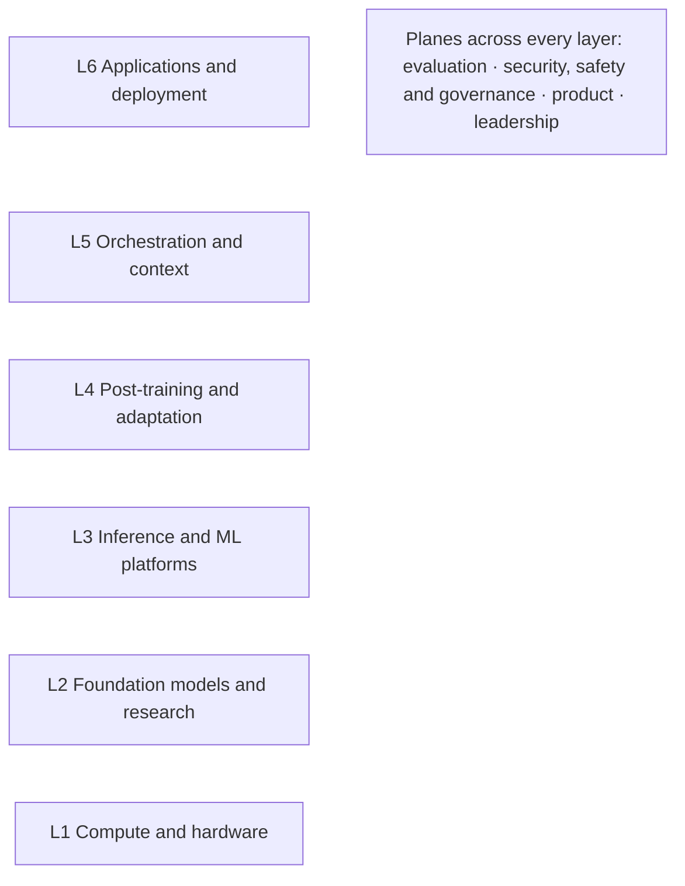

# Start Here

> Find the page for your situation in one click. Every page is evidence-graded, so you can see how sure each claim is and where it comes from.

This folder is the user-facing half of the repository. It follows the career lifecycle, from understanding the market to growing after your first 90 days, plus tracks for particular backgrounds, locations and ways of working.

## 1. Start from your situation

| Your situation | Read first | Then |
|---|---|---|
| **Exploring:** is GenAI work for you, and which roles exist? | [Role map](02-roles/role-map.md), then [market overview](01-landscape/market-overview.md) | [GenAI target roles](02-roles/genai-target-roles.md) → [targeting workbook](00-start/targeting-workbook.md) |
| **Switching** from another technical role | [Career transitions](11-tracks/career-transitions.md): the roadmap for your background | [Targeting workbook](00-start/targeting-workbook.md) → [learning roadmaps](03-skills-and-tech/learning-roadmaps.md) → [project archetypes](05-portfolio/project-archetypes.md) |
| **Student or new graduate** | [Career transitions](11-tracks/career-transitions.md) (the provisional student route) and [proof-of-work standards](05-portfolio/proof-of-work-standards.md) | [Targeting workbook](00-start/targeting-workbook.md) → [referrals and outreach](07-networking/referrals-and-outreach.md) |
| **Interviews scheduled** | [Interview loops](08-interviewing/interview-loops.md): classify your loop first | [System design](08-interviewing/system-design-archetypes.md), [behavioural](08-interviewing/behavioral-calibration.md), [coding rounds](08-interviewing/coding-rounds.md), [prep packs](08-interviewing/prep-packs.md) |
| **Holding an offer** | [Offer evaluation](09-compensation/offer-evaluation.md) | [Negotiation playbook](09-compensation/negotiation-playbook.md), [pay benchmarks](09-compensation/pay-benchmarks.md) |
| **Starting a new role** | [First 90 days](10-onboarding/first-90-days.md) | [Growth and progression](10-onboarding/growth-and-progression.md) |
| **India-based**, aiming for remote or international work | [India remote playbook](11-tracks/india-remote-playbook.md) | [India remote tax](09-compensation/india-remote-tax.md), [visa and relocation](11-tracks/visa-and-relocation.md) |
| **Going independent** or fractional | [Freelance and fractional](11-tracks/freelance-fractional.md) | The [independent consultant](02-roles/hubs/independent-ai-consultant.md) and [fractional leader](02-roles/hubs/fractional-ai-leader.md) hubs |
| **Already in AI**, moving up or sideways | [Growth and progression](10-onboarding/growth-and-progression.md) | [Role map](02-roles/role-map.md) for adjacent moves; [role hubs](02-roles/hubs/README.md) for the target |
| **Coming from GRC, privacy, audit or legal** | [Governance careers](11-tracks/governance-careers.md) | [Credential ROI](04-certifications/credential-roi.md) and the governance role hubs |
| **Coming from a PhD** | [PhD to industry](11-tracks/phd-to-industry.md) | [Visa and relocation](11-tracks/visa-and-relocation.md) for the O-1A angle |

## 2. Find your question

| If you want to know… | Go to |
|---|---|
| Where each role's work sits, from GPUs to applications | [Role map](02-roles/role-map.md) |
| Everything about one role on one page | [Role hubs](02-roles/hubs/README.md) |
| Which GenAI roles exist, and which titles are real | [Role catalog](02-roles/role-catalog.md) and [emerging roles](01-landscape/emerging-roles.md) |
| Which roles are best, with uncertainty, and for whom | [Role rankings](02-roles/role-rankings.md) |
| Which roles to target, in what order | [GenAI target roles](02-roles/genai-target-roles.md), then the [targeting workbook](00-start/targeting-workbook.md) |
| Which kinds of employer hire, and how they differ | [Employer landscape](01-landscape/employer-landscape.md) |
| What to learn first, and what to stop learning | [Skills radar](03-skills-and-tech/skills-radar.md) and [learning roadmaps](03-skills-and-tech/learning-roadmaps.md) |
| Everything a role needs, with priority and evidence | [Role skill inventories](03-skills-and-tech/role-skill-inventories.md) (one file per role) |
| What a skill or tool is, and whether it is still current | [Skills vocabulary](03-skills-and-tech/skills-vocabulary.md) |
| Whether a certificate is worth it | [Credential ROI](04-certifications/credential-roi.md) and [credentials by role](04-certifications/credentials-by-role.md) |
| What to build to prove you can do the job | [Proof-of-work standards](05-portfolio/proof-of-work-standards.md) and [project archetypes](05-portfolio/project-archetypes.md) |
| How to run a search and pass the screens | [Job-search strategy](06-job-search/job-search-strategy.md), [ATS mechanics](06-job-search/ats-mechanics.md), [application operating system](06-job-search/application-operating-system.md) |
| What a role pays | [Pay benchmarks](09-compensation/pay-benchmarks.md) |
| Which career tools are worth using | [Tool catalog](00-start/tool-catalog.md) |
| What a term or acronym means | [Glossary](00-start/glossary.md) |
| What the research found on any topic, with grades | [Findings registry](../research/findings.md) |
| What is written and what is still planned | [ROADMAP.md](../ROADMAP.md) |

## 3. The map of the field

GenAI work spans six layers, from compute up to applications, and four planes that cut across them. Each role has a work footprint on this map.

The [role map](02-roles/role-map.md) places every role, specialisation and project archetype on it. The map shows where work sits; it is not a pay or demand model. Pay tracks employer tier and seniority more than layer [B · T0-03].

## 4. How roles are organised

Five labels recur across the repository. Each is defined once:

| Label | What it tells you | Defined in |
|---|---|---|
| **Family** | The catalog's grouping of related roles, for example Applied AI Engineering | [Role catalog §2](02-roles/role-catalog.md#2-canonical-role-registry) |
| **Work footprint** | The layer where most of a role's work sits, the other layers it touches, and its planes | [Role map](02-roles/role-map.md) |
| **Résumé variant** | The skill-based résumé family a role shares (A–E for IC roles, L for leadership) | [Résumé skills matrix](06-job-search/resume-skills-matrix.md) |
| **GenAI target number** | The role's place in the GenAI-only target order (#1–#24) | [GenAI target roles](02-roles/genai-target-roles.md) |
| **CCI rank** | The role's rank on the evidence-weighted Composite Career Index across all demand (#1–#24; leadership L1–L5) | [Role rankings](02-roles/role-rankings.md) |

The two numbers differ by design: the target order counts GenAI demand only.

## 5. Follow the lifecycle

| Stage | The question it answers | Status |
|---|---|---|
| [00 Start-here tools](00-start/README.md) | Which tools help at every stage? | **Covered** |
| [01 Landscape](01-landscape/README.md) | What does the GenAI job market look like, globally and in India? | **Covered** |
| [02 Roles](02-roles/README.md) | Which roles exist, which are best, and which should I target? | **Covered** |
| [03 Skills and technology](03-skills-and-tech/README.md) | What does each role need me to know and use, and how much does each skill matter? | **Covered** |
| [04 Certifications](04-certifications/README.md) | Is a certificate worth it for my role and channel? | **Covered** |
| [05 Portfolio](05-portfolio/README.md) | What should I build to prove I can do the job? | **Covered** |
| [06 Job search](06-job-search/README.md) | How do I find postings, apply well and get past the screens? | **Covered** |
| [07 Networking](07-networking/README.md) | How do I get referred, and what do recruiters find about me? | **Covered** |
| [08 Interviewing](08-interviewing/README.md) | How do I pass the interview loop for my track? | **Covered** |
| [09 Compensation](09-compensation/README.md) | Is this offer good, and how do I negotiate it? | **Covered** |
| [10 Onboarding](10-onboarding/README.md) | How do I pass probation and keep growing? | **Covered** |
| [11 Tracks](11-tracks/README.md) | What changes for my background, location or way of working? | **Covered** |

"Covered" means the stage's core guides exist. Each stage README lists its documents, what is still planned, and the research behind them; [ROADMAP.md](../ROADMAP.md) lists the remaining gaps.

## 6. Paths by background

Five backgrounds have their own research-backed roadmap in [career transitions](11-tracks/career-transitions.md). The modelled time to a first offer assumes 15–20 hours a week and is a model output with low confidence, conditional on success [M · T0-06 R2]:

| Background | Modelled time to first offer | Start with |
|---|---|---|
| Backend or systems engineer (5+ years) | ~6 months (3.5–8) | [AI Engineer](02-roles/hubs/ai-engineer.md) or [Applied AI Engineer](02-roles/hubs/applied-ai-engineer.md) |
| Data scientist / BI analyst | ~8 months (5–11) / ~11 months (7–15) | [AI Engineer](02-roles/hubs/ai-engineer.md) with an evaluation edge; [AI Evaluation Engineer](02-roles/hubs/ai-evaluation-engineer.md) |
| Frontend or full-stack engineer | ~7 months (5–11) | [AI Product Engineer](02-roles/hubs/ai-product-engineer.md) or [AI Engineer](02-roles/hubs/ai-engineer.md) |
| Non-technical, 5+ years in a domain (AI-adjacent roles) | ~7 months (5–11); ~22 months (15–34) for an engineering role from zero code | [AI Product Manager](02-roles/hubs/ai-product-manager.md), [Domain Evaluation Specialist](02-roles/hubs/domain-evaluation-specialist.md), [AI Governance Lead](02-roles/hubs/ai-governance-lead.md) |
| PhD who can code | ~8 months (5–12.5) | [PhD to industry](11-tracks/phd-to-industry.md); [Research Engineer](02-roles/hubs/research-engineer.md), [Applied Scientist](02-roles/hubs/applied-scientist.md) |

Three more starting points have no dedicated research yet. [Career transitions](11-tracks/career-transitions.md) gives provisional routes for them, labelled [P]: DevOps or SRE engineers (toward [ML Platform](02-roles/hubs/ml-platform-engineer.md) and [AI Infrastructure](02-roles/hubs/ai-infrastructure-engineer.md)), product managers (toward [AI Product Manager](02-roles/hubs/ai-product-manager.md)) and students or new graduates.

**By geography:** India-based readers should add the India lens in the [role rankings](02-roles/role-rankings.md), the [India remote playbook](11-tracks/india-remote-playbook.md) and the India sections of [pay benchmarks](09-compensation/pay-benchmarks.md).

## 7. How to read the evidence

| Tag | Meaning |
|---|---|
| **A, B** | Measured or primary evidence |
| **C** | Small sample, vendor or practitioner evidence (attributed) |
| **D** | Judgement |
| **M** | A model output computed from graded inputs |
| **[JD x%]** | Share of live job postings that name the item |
| **[S · T0-xx]** | Named in a research session |
| **[P]** | Practice-curated: standard in the field but unmeasured, so check it against live postings |

- **Dates matter.** Figures are as of their stated dates. Pages with volatile facts (tool statuses, pay, visas, tax) carry a `review_by` date in their front matter.
- **Terms:** the [glossary](00-start/glossary.md) defines every acronym used here.
- **The full standard** is EGP-1.0 ([T1-02](../research/sessions/T1-02-evidence-grounding-protocol.md)); [CONTRIBUTING.md](../CONTRIBUTING.md) summarises it.
