# Research Pipeline: GenAI Career Intelligence System
## Generated by Vivechak v0.1.0

## Pipeline Overview

### Project Parameters

- **Project Name:** GenAI Career Intelligence System
- **Primary Domain Archetype:** Hybrid: Knowledge Systems / Career Intelligence Platform / Developer Ecosystem Intelligence (AI/ML & Systems Engineering)
- **Secondary Domain Archetype:** Regulatory & Immigration Knowledge Rails (cross-border remote compensation, global talent visas, statutory tax compliance, EU AI Act conformity)
- **Target Scope:** Global tech ecosystem with deep specialization in India — spanning early-career graduates (Tier 0: ₹8L–₹15L / $80K–$120K) to apex frontier lab ICs and executives (Tier 5: ₹3Cr–₹5Cr+ / $800K–$2M+). Canonical tier boundaries: see FAD.md §4.1.
- **Temporal Anchor:** October 2026. All findings must reflect current late-2026 ground truth, actively falsifying obsolete 2023–2024 assumptions.
- **Evidence Standard:** Cite-or-Flag. Every factual assertion must cite a verifiable primary source (Grade A/B) or be explicitly flagged as [UNVERIFIED]. Zero fabricated statistics or hallucinated salary figures.
- **Recency Stamps:** Mandatory 'Last Verified' timestamps on all technology, framework, API, and regulatory claims.
- **Maximize Session Parallelism:** 18 of 23 sessions (78.3%) are completely independent Layer 0 sessions with zero dependencies, executable simultaneously by parallel subagents.
- **Scope Boundaries:** NOT a generic coding curriculum, NOT a job board, NOT an opinion blog, no conventional wisdom recycled without empirical verification, no speculative job titles without live posting quorum.
- **Core Organizing Frameworks:**
  - **12-Stage Career Lifecycle Funnel:** Awareness → Exploration → Skills → Certifications → Portfolio → Discovery → Application → Networking → Interview Prep → Execution → Negotiation → First 90 Days.
  - **6-Tier Universal Compensation Model:** Tier 0 (Entry: ₹8L–₹15L / $80K–$120K) to Tier 5 (Apex: ₹3Cr–₹5Cr+ / $800K–$2M+). Canonical boundaries: FAD.md §4.1.
  - **5 Starting Background Personas:** Backend/Systems SWE, Data Scientist/Analyst, Frontend/Full-Stack, Non-Technical Professional, Academic/PhD Researcher.
  - **Universal Tool Cataloging Mandate:** Every single research session is required to identify, benchmark, and evaluate all relevant external tools, SaaS platforms, open-source repositories, and community resources for its domain. The repo acts as an authoritative orchestration layer: guiding users on WHAT to use, WHEN, and WHY at each lifecycle stage.
  - **Canonical 12-Stage Repository Blueprint:**
    ```
    career/
    ├── README.md                                    # Master Career Lifecycle Decision Tree & "Start Here"
    ├── 01-landscape/                                # Stages 1-2: Awareness + Exploration (Market, Employers, Comp, Geo, Regulation)
    ├── 02-roles/                                    # Stage 2: Exploration (Verified Role Taxonomies, Tier-1/2/3 Ladders)
    ├── 03-skills-and-tech/                          # Stage 3: Skill Building (Inference, Serving, Protocols, Evals, Curated Learning)
    ├── 04-certifications/                            # Stage 4: Certification (Cloud Cert ROI, Recruiter Filters, Vendor Badges)
    ├── 05-portfolio/                                # Stage 5: Portfolio & Proof-of-Work (High-Signal Project Archetypes, Eval Harnesses)
    ├── 06-job-search/                               # Stages 6-7: Discovery + Application (Channels, ATS Mechanics, Resumes, Cold Outreach)
    ├── 07-networking/                               # Stage 8: Networking & Communities (Discord, Slack, Conferences, CFP Strategies)
    ├── 08-interviewing/                             # Stages 9-10: Prep + Execution (System Design Archetypes, Live Coding, Behavioral)
    ├── 09-compensation/                             # Stage 11: Offer Negotiation (Comp Stratification, Equity Dilution, Scripts)
    ├── 10-onboarding/                               # Stage 12: First 90 Days (AI Expectations Gap, Probation Rubrics, Promotion Velocity)
    ├── 11-tracks/                                   # Cross-Cutting Deep Dives (India Remote Playbook, Visas, Fractional Practice)
    └── ecosystem/                                   # Universal Tool Catalog across all 12 Lifecycle Stages
    ```

### Open Research Questions (18 Unsettled Domains)

1. **Information Architecture:** How to structure a hybrid navigation matrix combining a 12-stage career lifecycle spine with cross-cutting role, tier, and persona views?
2. **Role Quorum:** Which GenAI job titles have verifiable live hiring volume (>=50 active postings) vs speculative buzzwords requiring quarantine?
3. **Multi-Geo Compensation:** What are the empirical salary distributions (Base/Bonus/Liquid Equity/Paper Equity) across US, UK, EU, India, Singapore, and GCC?
4. **Technical Competencies & Compute:** How do technical skills tier between table-stakes API orchestration and high-leverage infra (CUDA, Triton, vLLM, TensorRT-LLM, Ray, DeepEval, RAGAS)?
5. **ATS Mechanics & Conversion:** What are the exact parser failure modes in modern ATS platforms (Greenhouse, Lever, Ashby, Workday), and what is the real cold funnel conversion math?
6. **Unconventional Hiring Signals:** How effectively do open-source PRs, public engineering micro-audits, and cold engineering DMs bypass standard applicant queues?
7. **Transition Roadmaps:** What are the realistic quarterly milestone roadmaps and skill deltas across the 5 distinct starting backgrounds?
8. **India Remote Tax & Legal:** What is the optimal statutory structure (Section 44ADA ₹75L cap, GST LUT zero-rated export, FIRC Purpose Code P0802, W-8BEN, EOR vs contractor) for Indian engineers billing foreign clients?
9. **Global Talent Visas:** What are the verified evidentiary requirements and non-PhD qualification paths for US O-1A, UK Global Talent, EU Blue Card, Canada GTS, and Singapore ONE Pass?
10. **Day 1–90 Onboarding:** What root causes drive the 'AI Expectations Gap' and early probation attrition, and what 30-60-90 day playbook guarantees retention?
11. **Tooling Ecosystem:** Which external tools across all 12 lifecycle stages are high-utility vs predatory, low-quality, or ATS-banned?
12. **Certifications ROI:** Do commercial cloud AI credentials deliver measurable recruiter filtering value or salary premiums?
13. **High-Signal Communities:** Where do frontier AI engineers congregate, and which private Discord/Slack groups and open-source networks drive unadvertised referrals?
14. **Production Portfolio Standards:** What specific architectural proofs (eval harnesses, latency benchmarks, cost accounting) separate production proof-of-work from low-signal tutorial clones?
15. **System Design Interview Rubrics:** What are the 12-15 core AI system design interview archetypes, and how are latency budgets, KV-cache sizing, and evals scored?
16. **Regulatory AI Careers:** What dedicated engineering careers have materialized from the EU AI Act, NIST AI RMF, and India DPDP Act?
17. **Agentic Protocol Stack:** Has the open agentic protocol stack (MCP under Linux Foundation AAIF, A2A, ACP, AG-UI) created live hiring demand for agent gateway engineers?
18. **Independent Practice Economics:** What are the empirical rate cards ($100–$300+/hr), retainers, contract protections, and client acquisition funnels for fractional AI leadership and consulting?

### Complexity Score

| Dimension | Score | Rationale |
|---|---|---|
| Domain Novelty | 2 | Unconventional workflow: multi-tier evidence-grounded career intelligence operating manual spanning global and Indian markets. |
| Technical / Operational Novelty | 2 | New paradigm: orchestrating live hiring volume verification, multi-layer career intelligence, and agentic protocol stacks. |
| Regulatory Exposure | 2 | Complex cross-border taxation (Sec 44ADA, GST LUT, W-8BEN), EOR contracts, international immigration statutes, and EU AI Act compliance. |
| Reversibility | 2 | Core schema, role taxonomy, compensation models, and evidence protocols are one-way architectural doors governing the entire system. |
| Investment Horizon | 2 | Substantial multi-phase knowledge platform designed as an authoritative ecosystem reference. |
| Coordination Complexity | 2 | Cross-functional integration spanning recruitment data, tax/legal advisory, engineering hiring standards, and immigration laws. |
| Expected Longevity | 3 | 5+ year evergreen operating manual maintained with continuous verification cycles. |
| Integration Complexity | 2 | Integrates multiple disparate domains: ATS parsing rules, salary databases, legal statutes, and open-source ecosystems. |

**Total Complexity Score:** 17 / 24  
**Assigned Tier:** Tier 3 (17–24 sessions)  
**Pipeline Scope:** 23 Sessions (18 Layer 0 Landscape + 3 Layer 1 Architecture + 1 Layer 2 Blueprints + 1 Layer 3 Sink Grand Synthesis)

### Execution DAG

```mermaid
flowchart TD
  subgraph Layer0["Layer 0: Landscape & Discovery ⚡ (18 Sessions Fully Parallel)"]
    T0_01["T0-01: GenAI Role Taxonomy & Volume"]
    T0_02["T0-02: Compensation Benchmarking"]
    T0_03["T0-03: Skills & Compute Infra Stack"]
    T0_04["T0-04: ATS Filtering & Funnel Math"]
    T0_05["T0-05: Unconventional Hiring Tactics"]
    T0_06["T0-06: Transition Across 5 Backgrounds"]
    T0_07["T0-07: India Remote Tax & Legal"]
    T0_08["T0-08: Global Talent Visa Corridors"]
    T0_09["T0-09: Day 1-90 Onboarding & Success"]
    T0_10["T0-10: 12-Stage Tooling Ecosystem"]
    T0_11["T0-11: Certification & Credential ROI"]
    T0_12["T0-12: High-Signal Communities"]
    T0_13["T0-13: Production Portfolio Signals"]
    T0_14["T0-14: AI System Design Interviews"]
    T0_15["T0-15: Regulatory AI Career Families"]
    T0_16["T0-16: Agentic Protocols & Gateway"]
    T0_17["T0-17: Comp Progression & Dilution"]
    T0_18["T0-18: Freelance & Fractional Practice"]
  end

  subgraph Layer1["Layer 1: Structural Architecture & Standards (3 Sessions)"]
    T1_01["T1-01: Repo IA & 12-Stage Blueprint"]
    T1_02["T1-02: Evidence Grounding Protocol"]
    T1_03["T1-03: Interview Execution & Negotiation"]
  end

  subgraph Layer2["Layer 2: Action Plan Blueprints (1 Session)"]
    T2_01["T2-01: Tier-Calibrated Playbooks (6 Tiers x 5 Personas)"]
  end

  subgraph Layer3["Layer 3: Grand Synthesis & FAD (1 Sink Session)"]
    SYN_01["SYN-01: Founding Architecture Document (FAD)"]
  end

  T0_01 --> T1_01
  T0_02 --> T1_01
  T0_10 --> T1_01
  T0_17 --> T1_01

  T0_04 --> T1_03
  T0_14 --> T1_03
  T0_17 --> T1_03

  T1_01 --> T2_01
  T0_06 --> T2_01
  T0_07 --> T2_01
  T0_08 --> T2_01
  T0_09 --> T2_01
  T0_18 --> T2_01
  T1_03 --> T2_01

  T1_01 --> SYN_01
  T1_02 --> SYN_01
  T1_03 --> SYN_01
  T2_01 --> SYN_01
  T0_03 --> SYN_01
  T0_05 --> SYN_01
  T0_11 --> SYN_01
  T0_12 --> SYN_01
  T0_13 --> SYN_01
  T0_15 --> SYN_01
  T0_16 --> SYN_01

  style T0_01 fill:#2d5aa0,stroke:#1a3d6e,color:#fff
  style T0_02 fill:#2d5aa0,stroke:#1a3d6e,color:#fff
  style T0_03 fill:#2d5aa0,stroke:#1a3d6e,color:#fff
  style T0_04 fill:#2d5aa0,stroke:#1a3d6e,color:#fff
  style T0_05 fill:#2d5aa0,stroke:#1a3d6e,color:#fff
  style T0_06 fill:#2d5aa0,stroke:#1a3d6e,color:#fff
  style T0_07 fill:#2d5aa0,stroke:#1a3d6e,color:#fff
  style T0_08 fill:#2d5aa0,stroke:#1a3d6e,color:#fff
  style T0_09 fill:#2d5aa0,stroke:#1a3d6e,color:#fff
  style T0_10 fill:#2d5aa0,stroke:#1a3d6e,color:#fff
  style T0_11 fill:#2d5aa0,stroke:#1a3d6e,color:#fff
  style T0_12 fill:#2d5aa0,stroke:#1a3d6e,color:#fff
  style T0_13 fill:#2d5aa0,stroke:#1a3d6e,color:#fff
  style T0_14 fill:#2d5aa0,stroke:#1a3d6e,color:#fff
  style T0_15 fill:#2d5aa0,stroke:#1a3d6e,color:#fff
  style T0_16 fill:#2d5aa0,stroke:#1a3d6e,color:#fff
  style T0_17 fill:#2d5aa0,stroke:#1a3d6e,color:#fff
  style T0_18 fill:#2d5aa0,stroke:#1a3d6e,color:#fff
  style T1_01 fill:#8b5e3c,stroke:#6b4226,color:#fff
  style T1_02 fill:#8b5e3c,stroke:#6b4226,color:#fff
  style T1_03 fill:#8b5e3c,stroke:#6b4226,color:#fff
  style T2_01 fill:#6b3fa0,stroke:#4a2d73,color:#fff
  style SYN_01 fill:#c44536,stroke:#922e25,color:#fff
```



#### Parallel Execution Groups

- ⚡ **Group 0 (Layer 0 Landscape Discovery, 18 Sessions):** `T0-01` through `T0-18` are **100% independent** with zero inter-session dependencies. Can be executed simultaneously or in arbitrary batches with zero risk of cross-contamination.
- ⚡ **Group 1 (Layer 1 Structural Architecture & Standards, 3 Sessions):**
  - `T1-01`: Consumes `T0-01`, `T0-02`, `T0-10`, `T0-17`.
  - `T1-02`: Independent standards session (zero upstream dependencies; can run parallel with Group 0).
  - `T1-03`: Consumes `T0-04`, `T0-14`, `T0-17`.
- ⚡ **Group 2 (Layer 2 Action Plan Blueprints, 1 Session):** `T2-01` consumes `T1-01`, `T0-06`, `T0-07`, `T0-08`, `T0-09`, `T0-18`, and `T1-03`.
- ⚡ **Group 3 (Layer 3 Sink Grand Synthesis, 1 Session):** `SYN-01` consumes all upstream sessions to evaluate Phase 0 Exit Gates and produce `research/FAD.md`.

### How to Execute

#### With Vivechak MCP Server (Recommended)

1. **Start each session:** Call `vivechak_next_session(project_root=".", session_id="T0-01")` to get the prompt with upstream context auto-injected.
2. **Execute the research:** Send the prompt to a frontier AI deep research engine (Gemini Deep Research, ChatGPT Deep Research, Claude with active search).
3. **Save the output:** Call `vivechak_save_session(session_id="T0-01", content="...")` — auto-validates against schema.
4. **For one-way door decisions:** After informing sessions finish, call `vivechak_challenge(session_id="T1-01", mode="red_team")` to stress-test recommendations.
5. **Record decisions:** Call `vivechak_record_decision(decision_id="D-001", ...)` into `research/DECISIONS.md`.
6. **Run the gate:** After all sessions complete, call `vivechak_run_gate(project_root=".")` to validate Phase 0 exit criteria.

#### Manual Execution (Without MCP)

Reference contract templates in `research/templates/` (`SESSION.template.md`, `DECISIONS.template.md`, `CONFLICT-RESOLUTION.template.md`, `FOUNDING-ARCHITECTURE.template.md`, `PHASE-0-GATE.template.md`).

#### Session Normalization Note

A session represents one independent deep research execution (a single comprehensive prompt executed in a frontier AI model with web retrieval). In interactive chat, multiple turns may be used to reach the required 8–12 substantive findings with evidence grades.

#### Troubleshooting Guidance

- **Vague / Surface Output:** Re-run with directional research moves (`DEEPEN` to primary sources, `FALSIFY` leading assumptions).
- **Contradictory Upstream Findings:** Use `research/templates/CONFLICT-RESOLUTION.template.md` to evaluate conflicting claims based on evidence hierarchy (Grade A primary sources override Grade D blogs).
- **Exit Gate Gaps:** If `vivechak_run_gate` fails with unverified claims or missing ADR fields, spawn a targeted follow-up session or amend the decision record directly rather than restarting the pipeline.

---

## Research Sessions

---

### T0-01: GenAI Role Taxonomy & Live Market Volume Verification

| Field | Value |
|---|---|
| **Session ID** | T0-01 |
| **Title** | GenAI Role Taxonomy & Live Market Volume Verification |
| **Layer** | Layer 0 |
| **Door Type** | Informs one-way door (D-001, D-002) |
| **Decision ID** | D-001, D-002 |
| **Dependencies** | None |
| **Output Filename** | `sessions/T0-01-genai-role-taxonomy-market-volume.md` |

**Decision Context:** Informs D-001: Repository Information Architecture and D-002: Role Classification Quorum & Speculative Title Quarantine. Evaluates whether to establish a strict 50+ live job postings threshold across major platforms to separate verified production roles from speculative vendor buzzwords.

```prompt
DECISION:
Which GenAI job titles have verifiable live hiring volume (>=50 active postings across LinkedIn, Indeed, Wellfound, Otta, Ashby) in Q3/Q4 2026, and which are speculative titles that should be quarantined?

BRIEF:
Investigate current live job postings to construct an evidence-grounded taxonomy of GenAI engineering and technical roles. Distinguish established titles (e.g., AI Engineer, ML Platform Engineer, LLM Post-Training Engineer) from emerging or speculative buzzwords (e.g., Cognitive Architect, Context Engineer, Prompt Wizard). Provide empirical posting counts, primary skill requirements per role, and organizational reporting lines for an audience of engineering leaders.

SCOPE:
Temporal anchor: October 2026. In-scope: Global tech hubs (US, Europe, India, Remote) across startups, Big Tech, and Global Capability Centers (GCCs). Out-of-scope: Traditional generic software engineering roles with incidental AI tool usage. Source strategy: Primary job platform postings, Ashby/Greenhouse public listings, reputable hiring reports (Hired, Otta, Levels.fyi).

KNOWN:
UNVERIFIED: Industry blogs claim that 'AI Engineer' has split into specialized roles like 'Agent Architect' and 'Context Engineer'. Live hiring volume for these specialized titles is currently unverified.

CALIBRATION:
1. Treat your memory as a hypothesis to test. Note initial beliefs;
   report what evidence confirmed, updated, or contradicted.
2. A significant claim is most valuable when grounded with a verifiable
   source. "Not found after searching X, Y, Z" is a valid, valued result.
3. An unsupported claim presented as fact costs more than an honest gap.
4. Before finishing: state the strongest objections an expert would raise
   and what evidence you found for or against each.
5. Distinguish what you found from what you recalled. Mark recalled claims
   honestly — they are starting points, not conclusions.

APPROACH:
- Execute MULTIPLE SEARCH STRATEGIES:
  1. Direct: Query active job platforms for exact strings ("AI Engineer", "LLM Engineer", "Agent Architect", "Context Engineer", "Cognitive Architect").
  2. Adversarial: Search for "speculative AI job titles", "AI engineer hiring slowdown", "AI job title inflation".
  3. Comparative: Compare posting volumes of specialized titles vs established software/ML engineering roles.
  4. Community: Check tech hiring discussions on Hacker News, Reddit /r/MachineLearning, and Latent Space.
- Target 8-12 SUBSTANTIVE findings with evidence grades.
- For every role recommended for inclusion in the core taxonomy, document its live posting quorum.
- TOOL CATALOG: Catalog job market analytics platforms, salary transparency databases, and developer demand crawlers (LinkedIn Talent Insights, Indeed Hiring Lab, Lightcast/EMSI, Wellfound, Otta, Ashby public listings, Layoffs.fyi).
- Every Grade A/B finding MUST cite a specific source with URL.

DOMAIN PROBES:
- What is the live active job posting count across LinkedIn, Indeed, Wellfound, and Otta for 'Cognitive Architect', 'Context Engineer', and 'Agent Architect' vs 'AI Engineer' in Q3/Q4 2026?
- Are enterprise JDs asking for 'AI Engineers' actually seeking full-stack engineers with API wrapper experience or systems engineers with eval/infra competencies?
- What role titles have been formally created or deprecated at tier-1 AI firms (OpenAI, Anthropic, Google DeepMind, Meta FAIR, Databricks) over the past 18 months?
- How many live postings require fine-tuning/RLHF experience versus API orchestration and RAG pipelines?
- How do India-specific job titles and role definitions (e.g. GCC AI Specialist, GenAI Developer) differ from US/EU markets in scope, reporting lines, and volume?

DONE:
- This session is complete when live hiring volume for at least 15 candidate GenAI titles is measured against the 50+ posting quorum with primary sources cited.
- This session is complete when at least 5 speculative titles are identified, analyzed, and quarantined with documented rationale.
- This session is complete when core skill requirements and seniority expectations for all verified roles are mapped to real job descriptions.
- This session is complete when the criteria that would graduate a quarantined title to verified status are explicitly defined.
- This session is complete when India-specific role titling variations and enterprise GCC hiring volumes are explicitly benchmarked against US/EU markets.

FORMAT:
Single complete Markdown file artifact with YAML frontmatter.
Filename: sessions/T0-01-genai-role-taxonomy-market-volume.md
Required frontmatter fields: id, title, date, status, topic, tags, informs_decisions, confidence.
Body sections: Prior (3-5 checkable propositions) -> Research Question -> Key Findings (8-12 substantive findings with evidence grades) -> Recommendation -> Alternatives Considered -> Detailed Findings -> Open Questions & Risks -> Delta (belief change table) -> Sources & Evidence Ledger table.

---
### RESEARCH CALIBRATION (Active Rules)
1. **Memory ≠ Evidence:** Claims recalled from model weights cap at Grade D. Verify with web search.
2. **Upstream ≠ Exhaustive:** Injected upstream findings provide high-level architectural context, NOT implementation specifications. Exact schemas, library bundle sizes, API rate limits, and security configurations must be verified with current external sources.
3. **Qualified Provenance:** Grade A claims require canonical URLs, domain anchors, RFCs, or doc titles.
4. **Falsification Required:** Actively search for failure modes, gotchas, and production incident postmortems.
5. **Honest Gaps:** Explicitly stating "searched X and found no evidence" is valued. Never hallucinate sources.
```

---

### T0-02: Global & Regional Compensation Benchmarking by Tier & Geography

| Field | Value |
|---|---|
| **Session ID** | T0-02 |
| **Title** | Global & Regional Compensation Benchmarking by Tier & Geography |
| **Layer** | Layer 0 |
| **Door Type** | Informs one-way door (D-003) |
| **Decision ID** | D-003 |
| **Dependencies** | None |
| **Output Filename** | `sessions/T0-02-global-regional-compensation-benchmarks.md` |

**Decision Context:** Informs D-003: Universal Compensation Stratification & Geo-Currency Model. Evaluates nominal dual-currency reporting vs PPP normalization and establishes the 6-tier universal compensation ladder across US, UK, EU, India, and Singapore.

```prompt
DECISION:
What is the empirical compensation distribution (Base Cash, Performance Bonus, Liquid Equity, Paper Equity) for GenAI roles across the US, Europe, India, GCC, and International Remote markets as of October 2026?

BRIEF:
Compile verified, multi-geography compensation data for GenAI roles across experience tiers (Tier 0: Entry, Tier 1: Growth, Tier 2: Breakout, Tier 3: Premium, Tier 4: Elite, Tier 5: Apex). Deliver granular percentiles (P25, P50, P75, P90) cited to primary salary databases and labor filings, avoiding speculative blog estimates.

SCOPE:
Temporal anchor: October 2026. Geographies: US (SF Bay Area, NYC, US Remote), Europe (London, Berlin, Zurich), India (Bangalore, Hyderabad, Indian Remote), GCC (Dubai, Abu Dhabi), and Singapore. Source strategy: Levels.fyi verified submissions, US H-1B disclosure databases (LCA data), Comprehensive.io, Radford/Aon reports, Indian executive search reports.

KNOWN:
UNVERIFIED: Common claims state Indian AI engineers make ₹50L-₹1Cr and US AI engineers make $300K-$1M+. Exact splits between base cash and unvested/illiquid equity remain unverified.

CALIBRATION:
1. Treat your memory as a hypothesis to test. Note initial beliefs;
   report what evidence confirmed, updated, or contradicted.
2. A significant claim is most valuable when grounded with a verifiable
   source. "Not found after searching X, Y, Z" is a valid, valued result.
3. An unsupported claim presented as fact costs more than an honest gap.
4. Before finishing: state the strongest objections an expert would raise
   and what evidence you found for or against each.
5. Distinguish what you found from what you recalled. Mark recalled claims
   honestly — they are starting points, not conclusions.

APPROACH:
- Execute MULTIPLE SEARCH STRATEGIES:
  1. Direct: Query Levels.fyi for "AI Engineer", "Machine Learning Engineer", "Research Engineer" across target geos.
  2. Regulatory: Search US Department of Labor LCA disclosure filings for recent H-1B filings by AI startups and Big Tech.
  3. Regional: Search Indian tech salary benchmarks (Cutshort, Instahyre, Michael Page India Tech Salary Report).
  4. Remote: Search international contractor salary databases and remote job boards (Remotive, Wellfound, Arc).
- Target 8-12 SUBSTANTIVE findings with evidence grades.
- Disaggregate compensation into Base, Bonus, and Equity (noting liquid vs paper).
- Document PPP vs nominal exchange rate implications for Indian engineers evaluating foreign offers.
- TOOL CATALOG: Catalog verified compensation benchmarking platforms, tech salary crawlers, and equity calculators (Levels.fyi, Comprehensive.io, Radford/Aon datasets, Candor, FairOffer, US Dept of Labor LCA database).

DOMAIN PROBES:
- What are the verified P25, P50, P75, P90 total compensation figures for AI Engineers in Bangalore/Hyderabad vs SF Bay Area vs London in 2026?
- What percentage of total compensation is delivered as illiquid paper equity in Series A/B AI startups versus liquid public stock in Big Tech?
- What are actual US dollar contract rates paid to India-based AI engineers working remotely on W-8BEN / contractor terms for US startups?
- How does compensation for LLM/inference systems engineers (vLLM, TensorRT-LLM, Triton) compare to application-layer AI engineers (RAG, agent workflows)?
- What premium do frontier labs (OpenAI, Anthropic, Google DeepMind, Meta FAIR) pay above market median for specialized post-training and pre-training talent?

DONE:
- This session is complete when multi-geo compensation tables (US, UK, EU, India, Singapore) are established across all 6 compensation tiers with P25, P50, P75, P90 figures.
- This session is complete when base salary is explicitly decoupled from bonus and equity components for all roles.
- This session is complete when real-world contractor hourly and monthly USD rates for India-based talent are documented from primary platform data.
- This session is complete when the equity discount factor (paper vs liquid) is quantitatively modeled.
- This session is complete when salary premiums for infrastructure/systems AI vs application AI are empirically validated.

FORMAT:
Single complete Markdown file artifact with YAML frontmatter.
Filename: sessions/T0-02-global-regional-compensation-benchmarks.md
Required frontmatter fields: id, title, date, status, topic, tags, informs_decisions, confidence.
Body sections: Prior (3-5 checkable propositions) -> Research Question -> Key Findings (8-12 substantive findings with evidence grades) -> Recommendation -> Alternatives Considered -> Detailed Findings -> Open Questions & Risks -> Delta (belief change table) -> Sources & Evidence Ledger table.

---
### RESEARCH CALIBRATION (Active Rules)
1. **Memory ≠ Evidence:** Claims recalled from model weights cap at Grade D. Verify with web search.
2. **Upstream ≠ Exhaustive:** Injected upstream findings provide high-level architectural context, NOT implementation specifications. Exact schemas, library bundle sizes, API rate limits, and security configurations must be verified with current external sources.
3. **Qualified Provenance:** Grade A claims require canonical URLs, domain anchors, RFCs, or doc titles.
4. **Falsification Required:** Actively search for failure modes, gotchas, and production incident postmortems.
5. **Honest Gaps:** Explicitly stating "searched X and found no evidence" is valued. Never hallucinate sources.
```

---

### T0-03: Skills Classification, Compute Infrastructure & Evaluation Stack

| Field | Value |
|---|---|
| **Session ID** | T0-03 |
| **Title** | Skills Classification, Compute Infrastructure & Evaluation Stack |
| **Layer** | Layer 0 |
| **Door Type** | Informs one-way door (D-004) |
| **Decision ID** | D-004 |
| **Dependencies** | None |
| **Output Filename** | `sessions/T0-03-skills-compute-infra-eval-stack.md` |

**Decision Context:** Informs D-004: Skills Classification, Compute Infrastructure & Evaluation Stack. Evaluates how technical competencies divide between baseline table-stakes and high-leverage production differentiators.

```prompt
DECISION:
What technical skills, compute frameworks, and evaluation tooling separate commoditized application developers from high-earning production GenAI engineers in late 2026?

BRIEF:
Conduct an empirical audit of engineering job requirements, open-source production stacks, and technical postmortems to classify GenAI technical skills into: (1) Baseline Table-Stakes, (2) Differentiating Production Competencies, and (3) Frontier Capabilities. Focus on compute infrastructure (CUDA, Triton, vLLM, TensorRT-LLM, Ray), evaluation frameworks (DeepEval, RAGAS, promptfoo, Braintrust, TruLens), and production serving architectures.

SCOPE:
Temporal anchor: October 2026. In-scope: Technical skills for AI Engineers, ML Platform Engineers, and Inference Engineers. Out-of-scope: High-level prompt copywriting, basic consumer ChatGPT tricks. Source strategy: Live production job descriptions from tier-1 labs and scaleups, GitHub repository metrics and release notes, engineering blogs from Uber, Netflix, Stripe, Pinterest, Meta, Anthropic.

KNOWN:
UNVERIFIED: Basic API wrapping (calling OpenAI/Anthropic SDKs with LangChain) has become commoditized; true market premium has shifted entirely to evals, inference optimization, and custom agentic runtimes.

CALIBRATION:
1. Treat your memory as a hypothesis to test. Note initial beliefs;
   report what evidence confirmed, updated, or contradicted.
2. A significant claim is most valuable when grounded with a verifiable
   source. "Not found after searching X, Y, Z" is a valid, valued result.
3. An unsupported claim presented as fact costs more than an honest gap.
4. Before finishing: state the strongest objections an expert would raise
   and what evidence you found for or against each.
5. Distinguish what you found from what you recalled. Mark recalled claims
   honestly — they are starting points, not conclusions.

APPROACH:
- Execute MULTIPLE SEARCH STRATEGIES:
  1. Direct: Query requirements for "Senior AI Engineer", "Inference Engineer", "LLM Systems Engineer".
  2. Infrastructure: Audit trending compute stacks in production (vLLM, TensorRT-LLM, SGLang, Ray, Triton Inference Server).
  3. Evaluation: Investigate enterprise adoption of automated eval frameworks (RAGAS, DeepEval, promptfoo, Braintrust, Langfuse).
  4. Devaluation: Search for "skills losing value in AI", "LangChain in production backlash", "prompt engineering dead".
- Target 8-12 SUBSTANTIVE findings with evidence grades.
- Dissect the exact compute and tooling requirements mentioned in top-quartile compensation job postings.
- TOOL CATALOG: Catalog external evaluation tools and inference engines with version, license, and production adoption status (vLLM, TensorRT-LLM, SGLang, Triton, DeepEval, RAGAS, promptfoo, Arize Phoenix, LangSmith, Maxim, OpenTelemetry genai semantic conventions).

DOMAIN PROBES:
- What percentage of Senior/Staff AI Engineer job postings explicitly require experience with inference optimization frameworks (vLLM, TensorRT-LLM, SGLang, llama.cpp, Ollama)?
- How prominent is automated evaluation (LLM-as-a-judge, synthetic test sets, unit eval CI/CD via DeepEval, RAGAS, promptfoo, Braintrust, TruLens) in production hiring rubrics compared to model fine-tuning?
- What role do production observability and tracing stacks (Arize Phoenix, LangSmith, Maxim, OpenTelemetry genai semantic conventions) play in separating junior API wrappers from production systems engineers?
- Is CUDA/Triton kernel authoring required for general AI Engineers, or is it isolated strictly to specialized ML Systems/Compiler roles?
- What are the primary production orchestration runtimes replacing or augmenting naive LangChain deployments in enterprise architectures (e.g., LlamaIndex Workflows, LangGraph, custom state machines)?
- What compute budgeting and cost attribution skills (token economics, semantic caching, speculative decoding) are actively tested in technical screens?

DONE:
- This session is complete when skills are categorized into a 3-tier hierarchy (Table-Stakes, Differentiating, Frontier) with explicit justification from real JDs.
- This session is complete when the production compute stack (vLLM, TensorRT-LLM, SGLang, Triton) is mapped with exact adoption percentages.
- This session is complete when automated evaluation frameworks (RAGAS, DeepEval, promptfoo) and observability stacks (Arize Phoenix, LangSmith, OTel) are analyzed for enterprise hiring signal.
- This session is complete when skills undergoing rapid market devaluation are identified with empirical evidence.
- This session is complete when compute budgeting and inference economics skills are cataloged with operational examples.

FORMAT:
Single complete Markdown file artifact with YAML frontmatter.
Filename: sessions/T0-03-skills-compute-infra-eval-stack.md
Required frontmatter fields: id, title, date, status, topic, tags, informs_decisions, confidence.
Body sections: Prior (3-5 checkable propositions) -> Research Question -> Key Findings (8-12 substantive findings with evidence grades) -> Recommendation -> Alternatives Considered -> Detailed Findings -> Open Questions & Risks -> Delta (belief change table) -> Sources & Evidence Ledger table.

---
### RESEARCH CALIBRATION (Active Rules)
1. **Memory ≠ Evidence:** Claims recalled from model weights cap at Grade D. Verify with web search.
2. **Upstream ≠ Exhaustive:** Injected upstream findings provide high-level architectural context, NOT implementation specifications. Exact schemas, library bundle sizes, API rate limits, and security configurations must be verified with current external sources.
3. **Qualified Provenance:** Grade A claims require canonical URLs, domain anchors, RFCs, or doc titles.
4. **Falsification Required:** Actively search for failure modes, gotchas, and production incident postmortems.
5. **Honest Gaps:** Explicitly stating "searched X and found no evidence" is valued. Never hallucinate sources.
```

---

### T0-04: ATS Filtering Mechanics, Parsing Engine Failures & Funnel Conversion Math

| Field | Value |
|---|---|
| **Session ID** | T0-04 |
| **Title** | ATS Filtering Mechanics, Parsing Engine Failures & Funnel Conversion Math |
| **Layer** | Layer 0 |
| **Door Type** | Informs one-way door (D-009) |
| **Decision ID** | D-009 |
| **Dependencies** | None |
| **Output Filename** | `sessions/T0-04-ats-filtering-funnel-conversion-math.md` |

**Decision Context:** Informs D-009: Technical Interview Archetypes, ATS Mechanics & Executive Negotiation. Evaluates how candidate tracking engines parse resumes, where automated drop-off occurs, and conversion baselines across the career funnel.

```prompt
DECISION:
How do modern applicant tracking systems (Greenhouse, Lever, Ashby, Workday) and AI screening layers (Eightfold, Phenom, SeekOut) parse and filter GenAI engineering resumes in late 2026, and what is the real conversion funnel math?

BRIEF:
Conduct an end-to-end technical audit of candidate parsing pipelines in enterprise and startup recruiting stacks. Identify exact technical failure modes (multi-column tables, graphics, LaTeX PDF artifacts, missing standard section headers) that cause silent parsing rejections. Quantify the cold inbound application conversion funnel versus employee referral and recruiter outbound funnels.

SCOPE:
Temporal anchor: October 2026. In-scope: Major ATS platforms (Greenhouse, Lever, Ashby, Workday, Taleo) and AI matching/ranking layers. Out-of-scope: Unverifiable resume hacks, superstitious formatting tips lacking technical parser basis. Source strategy: ATS vendor documentation, engineering whitepapers on resume parsing engines (e.g. Sovren/Textkernel, Daxtra), recruiter screen recordings, verified candidate funnel metrics.

KNOWN:
UNVERIFIED: Over 75% of cold inbound resumes are rejected by automated filters before human review; two-column layouts and Canva templates are parsed as garbled text strings by standard parsers.

CALIBRATION:
1. Treat your memory as a hypothesis to test. Note initial beliefs;
   report what evidence confirmed, updated, or contradicted.
2. A significant claim is most valuable when grounded with a verifiable
   source. "Not found after searching X, Y, Z" is a valid, valued result.
3. An unsupported claim presented as fact costs more than an honest gap.
4. Before finishing: state the strongest objections an expert would raise
   and what evidence you found for or against each.
5. Distinguish what you found from what you recalled. Mark recalled claims
   honestly — they are starting points, not conclusions.

APPROACH:
- Execute MULTIPLE SEARCH STRATEGIES:
  1. Vendor Architecture: Audit parsing engines utilized by Ashby, Greenhouse, Lever, and Workday.
  2. AI Screening: Investigate how AI talent intelligence platforms (Eightfold.ai, Phenom, Beamery) score candidate relevance.
  3. Conversion Benchmarks: Gather empirical recruiting funnel statistics (Inbound -> Screen -> Technical -> Onsite -> Offer).
  4. Falsification: Test claims regarding keyword stuffing, white font tricks, and resume optimization tools.
- Target 8-12 SUBSTANTIVE findings with evidence grades.
- Document exact parser failure modes with text-extraction examples.
- TOOL CATALOG: Catalog ATS checkers, formatting validators, and application tracking tools (Textkernel, Sovren, Jobscan, Teal, Resume Worded, Huntr, Ashby candidate portal).

DOMAIN PROBES:
- Which underlying parsing engines (Textkernel, Sovren, native LLMs) power Greenhouse, Lever, Ashby, and Workday in 2026, and how do they handle modern PDF formatting?
- What specific mechanics drive the "Workday candidate portal black hole" (requiring tedious manual re-entry), and why do complex multi-column or table-heavy layouts corrupt during extraction?
- How do AI-native screening layers (Ashby AI candidate semantic matching, Eightfold.ai, Phenom) score candidate relevance, and how are automated knockout questions enforced before human review?
- What is the empirical pass-through rate of cold inbound applications (typically 1–3%) for GenAI roles at venture-backed startups vs Fortune 500 enterprises?
- What specific resume formatting rules (single-column plain text vs LaTeX vs Word DOCX, standard section headers, clean text encoding) guarantee 100% parse accuracy across Greenhouse, Lever, Ashby, and Workday?
- What are the documented conversion percentage deltas between cold inbound, verified employee referral, and recruiter outbound sourcing channels?

DONE:
- This session is complete when parser architecture and failure modes for top 4 ATS platforms are documented with technical root causes.
- This session is complete when the full conversion funnel math (Inbound Application -> Recruiter Screen -> Tech Screen -> System Design -> Final Offer) is benchmarked with real-world conversion rates.
- This session is complete when AI-driven screening and semantic matching algorithms are demystified with empirical ranking criteria.
- This session is complete when common resume optimization myths (e.g. white font stuffing, keyword dumping) are definitively debunked or validated.
- This session is complete when actionable, parser-proof formatting guidelines are established.

FORMAT:
Single complete Markdown file artifact with YAML frontmatter.
Filename: sessions/T0-04-ats-filtering-funnel-conversion-math.md
Required frontmatter fields: id, title, date, status, topic, tags, informs_decisions, confidence.
Body sections: Prior (3-5 checkable propositions) -> Research Question -> Key Findings (8-12 substantive findings with evidence grades) -> Recommendation -> Alternatives Considered -> Detailed Findings -> Open Questions & Risks -> Delta (belief change table) -> Sources & Evidence Ledger table.

---
### RESEARCH CALIBRATION (Active Rules)
1. **Memory ≠ Evidence:** Claims recalled from model weights cap at Grade D. Verify with web search.
2. **Upstream ≠ Exhaustive:** Injected upstream findings provide high-level architectural context, NOT implementation specifications. Exact schemas, library bundle sizes, API rate limits, and security configurations must be verified with current external sources.
3. **Qualified Provenance:** Grade A claims require canonical URLs, domain anchors, RFCs, or doc titles.
4. **Falsification Required:** Actively search for failure modes, gotchas, and production incident postmortems.
5. **Honest Gaps:** Explicitly stating "searched X and found no evidence" is valued. Never hallucinate sources.
```

---

### T0-05: Unconventional Hiring Tactics (OSS PRs, Public Micro-Audits, Cold DMs)

| Field | Value |
|---|---|
| **Session ID** | T0-05 |
| **Title** | Unconventional Hiring Tactics (OSS PRs, Public Micro-Audits, Cold DMs) |
| **Layer** | Layer 0 |
| **Door Type** | Informs two-way door (D-011) |
| **Decision ID** | D-011 |
| **Dependencies** | None |
| **Output Filename** | `sessions/T0-05-unconventional-hiring-tactics-oss-audits.md` |

**Decision Context:** Informs D-011: Production Portfolio Proof-of-Work Standards & Unconventional Entry Signals. Evaluates non-traditional application strategies that bypass standard applicant queues and create direct inbound recruiter interest.

```prompt
DECISION:
Which unconventional hiring tactics (open-source contributions, public technical micro-audits, targeted engineering leadership cold outreach) reliably bypass ATS queues and generate interview loops for GenAI roles in late 2026?

BRIEF:
Investigate alternative candidate acquisition pathways that circumvent crowded inbound job application portals. Evaluate the empirical efficacy, conversion rates, and execution blueprints of: (1) Targeted contributions to high-visibility open-source AI repositories (vLLM, Ollama, Langfuse, LiteLLM, SGLang), (2) Public engineering micro-audits and performance tear-downs of target company products, and (3) Strategic cold outreach to Engineering Directors and Founders using modern outbound stacks.

SCOPE:
Temporal anchor: October 2026. In-scope: Non-traditional hiring tactics for Tier 1 through Tier 4 engineering talent. Out-of-scope: Generic LinkedIn connection spam, mass automated email blasts, in-person local meetup networking. Source strategy: Case studies of successful non-traditional hires, hiring manager interviews and posts, open-source contributor-to-hire pipelines, cold outreach response rate datasets.

KNOWN:
UNVERIFIED: A single merged PR in a high-velocity tier-1 AI repository (vLLM, Hugging Face transformers, Ollama) delivers 10x higher recruiter inbound than 500 cold LinkedIn Easy Applies.

CALIBRATION:
1. Treat your memory as a hypothesis to test. Note initial beliefs;
   report what evidence confirmed, updated, or contradicted.
2. A significant claim is most valuable when grounded with a verifiable
   source. "Not found after searching X, Y, Z" is a valid, valued result.
3. An unsupported claim presented as fact costs more than an honest gap.
4. Before finishing: state the strongest objections an expert would raise
   and what evidence you found for or against each.
5. Distinguish what you found from what you recalled. Mark recalled claims
   honestly — they are starting points, not conclusions.

APPROACH:
- Execute MULTIPLE SEARCH STRATEGIES:
  1. Open-Source Pathways: Analyze how maintainers and active contributors to vLLM, LiteLLM, Langfuse, Ollama, and Axolotl transition to full-time roles.
  2. Public Engineering Teardowns: Document examples where candidates published detailed system architecture audits, latency benchmarks, or security teardowns and were hired directly.
  3. Executive Cold Outreach: Benchmark cold DM/email frameworks sent to VP of Eng / CTO / Founder roles, analyzing response rates by personalization depth.
  4. Failure Modes: Investigate negative repercussions of sloppy public audits, entitlement in OSS issue trackers, or intrusive messaging.
- Target 8-12 SUBSTANTIVE findings with evidence grades.
- Detail actionable, step-by-step protocols for each unconventional tactic.
- TOOL CATALOG: Catalog executive contact discovery and outreach automation tools (Apollo.io, Hunter.io, RocketReach, Clay, PhantomBuster, LinkedIn Sales Navigator) and open-source contribution tracking platforms (GitHub GraphQL API, OSS Insight).

DOMAIN PROBES:
- Which specific open-source AI repositories currently maintain active "hiring pipelines" or maintainer-sponsorship programs that lead directly to employment?
- What makes a public technical micro-audit successful in attracting hiring managers vs being dismissed as superficial marketing or critical badgering?
- What specific outbound automation tools (Apollo.io, Hunter.io, Clay, LinkedIn Sales Navigator) achieve high deliverability for reaching technical founders, and how should outreach be staged without burning domains?
- What reproducible templates exist for public engineering micro-audits (profiling TTFT/TPOT latency, detecting memory leaks, auditing prompt injection vulnerabilities on public endpoints)?
- What are verified response rates for high-context cold DMs (linking reproducible benchmarks or PRs) sent to engineering leaders versus standard recruiter inmails?
- What are the documented risks, boundary violations, or IP issues when publicly analyzing a private company's AI API or application vulnerabilities?

DONE:
- This session is complete when the open-source contributor-to-hire pipeline is documented with specific target repositories and qualification criteria.
- This session is complete when a concrete template and execution rubric for a public engineering micro-audit is formulated.
- This session is complete when cold outreach conversion benchmarks and communication scripts are documented with verified response rates.
- This session is complete when catastrophic failure modes and etiquette boundary violations are cataloged.
- This session is complete when comparison of time investment vs offer yield between unconventional tactics and standard applications is established.

FORMAT:
Single complete Markdown file artifact with YAML frontmatter.
Filename: sessions/T0-05-unconventional-hiring-tactics-oss-audits.md
Required frontmatter fields: id, title, date, status, topic, tags, informs_decisions, confidence.
Body sections: Prior (3-5 checkable propositions) -> Research Question -> Key Findings (8-12 substantive findings with evidence grades) -> Recommendation -> Alternatives Considered -> Detailed Findings -> Open Questions & Risks -> Delta (belief change table) -> Sources & Evidence Ledger table.

---
### RESEARCH CALIBRATION (Active Rules)
1. **Memory ≠ Evidence:** Claims recalled from model weights cap at Grade D. Verify with web search.
2. **Upstream ≠ Exhaustive:** Injected upstream findings provide high-level architectural context, NOT implementation specifications. Exact schemas, library bundle sizes, API rate limits, and security configurations must be verified with current external sources.
3. **Qualified Provenance:** Grade A claims require canonical URLs, domain anchors, RFCs, or doc titles.
4. **Falsification Required:** Actively search for failure modes, gotchas, and production incident postmortems.
5. **Honest Gaps:** Explicitly stating "searched X and found no evidence" is valued. Never hallucinate sources.
```

---

### T0-06: Career Transition Timelines & Skill Deltas across 5 Starting Backgrounds

| Field | Value |
|---|---|
| **Session ID** | T0-06 |
| **Title** | Career Transition Timelines & Skill Deltas across 5 Starting Backgrounds |
| **Layer** | Layer 0 |
| **Door Type** | Informs one-way door (D-008) |
| **Decision ID** | D-008 |
| **Dependencies** | None |
| **Output Filename** | `sessions/T0-06-career-transition-timelines-5-backgrounds.md` |

**Decision Context:** Informs D-008: Career Transition Sequencing & Milestone Roadmaps across 5 Backgrounds. Evaluates realistic learning curves, skill deltas, and multi-month milestone schedules for distinct professional archetypes.

```prompt
DECISION:
What are the realistic transition timelines, mandatory skill deltas, and quarterly milestone roadmaps for professionals pivoting into GenAI from 5 distinct starting backgrounds in 2026?

BRIEF:
Develop empirical, milestone-driven transition roadmaps for five specific starting archetypes: (1) Backend / Systems Software Engineer, (2) Data Scientist / Business Intelligence Analyst, (3) Frontend / Full-Stack Engineer, (4) Non-Technical Professional (Product/Operations/Domain Expert), and (5) Academic Researcher / Quantitative PhD. Identify the specific knowledge gaps, unlearning requirements, and realistic transition timelines (3, 6, 9, 12 months) for each.

SCOPE:
Temporal anchor: October 2026. In-scope: The 5 defined archetypes targeting Junior, Mid-Level, or Senior GenAI roles. Out-of-scope: "Zero-to-hero in 30 days" bootcamp marketing claims, unrealistic overnight transitions. Source strategy: Longitudinal career trajectory studies, verified engineering transition retrospectives, hiring manager interview feedback across diverse candidate backgrounds.

KNOWN:
UNVERIFIED: Backend engineers transition fastest due to distributed systems literacy; Data Scientists struggle with production software engineering; Non-technical transitions require domain specialization rather than raw coding competition.

CALIBRATION:
1. Treat your memory as a hypothesis to test. Note initial beliefs;
   report what evidence confirmed, updated, or contradicted.
2. A significant claim is most valuable when grounded with a verifiable
   source. "Not found after searching X, Y, Z" is a valid, valued result.
3. An unsupported claim presented as fact costs more than an honest gap.
4. Before finishing: state the strongest objections an expert would raise
   and what evidence you found for or against each.
5. Distinguish what you found from what you recalled. Mark recalled claims
   honestly — they are starting points, not conclusions.

APPROACH:
- Execute MULTIPLE SEARCH STRATEGIES:
  1. Archetype Gaps: Query specific delta requirements for Backend to AI Engineer, Frontend to AI Engineer, etc.
  2. Unlearning Traps: Search for common failure modes (e.g. Data Scientists spending months on mathematical proofs without shipping APIs, Frontend devs stopping at UI wrappers).
  3. Milestone Modeling: Structure quarterly progression checkpoints (Month 1-3, Month 4-6, Month 7-9, Month 10-12) with verifiable deliverables.
  4. Empirical Verification: Validate realistic weekly study hour commitments (part-time while employed vs full-time sabbaticals).
- Target 8-12 SUBSTANTIVE findings with evidence grades.
- Formulate concrete, testable progression milestones per archetype.
- TOOL CATALOG: Catalog self-paced assessment platforms, hands-on GPU cloud labs, and diagnostic skills matrices (RunPod, Lambda Labs, Modal, DeepLearning.AI, Coursera, Kaggle, Hugging Face Learn).

DOMAIN PROBES:
- What is the median time-to-first-offer for an experienced Backend Engineer (5+ yrs Java/Go) pivoting to AI Engineering while working full-time?
- What specific software engineering deficiencies most frequently disqualify traditional Data Scientists during production AI technical loops?
- How can Frontend / Full-Stack engineers leverage client-side AI runtimes (WebGPU, Transformers.js, streaming UI, agent interfaces) to bypass backend-heavy competition?
- What viable, high-leverage niche paths exist for non-technical professionals transitioning into the AI ecosystem (e.g. AI Product Ops, Domain Evaluation Specialist)?
- What translation barriers prevent academic PhDs from succeeding in fast-paced commercial GenAI product engineering?

DONE:
- This session is complete when distinct, calibrated transition roadmaps are established for all 5 defined archetypes.
- This session is complete when quarterly milestone deliverables (code artifacts, evaluation suites, deployments) are specified for each month bracket.
- This session is complete when specific "unlearning traps" and high-risk cognitive biases are documented per persona.
- This session is complete when realistic weekly time investment requirements are mapped against realistic pivot duration.
- This session is complete when portfolio specialization strategies unique to each background are clearly defined.

FORMAT:
Single complete Markdown file artifact with YAML frontmatter.
Filename: sessions/T0-06-career-transition-timelines-5-backgrounds.md
Required frontmatter fields: id, title, date, status, topic, tags, informs_decisions, confidence.
Body sections: Prior (3-5 checkable propositions) -> Research Question -> Key Findings (8-12 substantive findings with evidence grades) -> Recommendation -> Alternatives Considered -> Detailed Findings -> Open Questions & Risks -> Delta (belief change table) -> Sources & Evidence Ledger table.

---
### RESEARCH CALIBRATION (Active Rules)
1. **Memory ≠ Evidence:** Claims recalled from model weights cap at Grade D. Verify with web search.
2. **Upstream ≠ Exhaustive:** Injected upstream findings provide high-level architectural context, NOT implementation specifications. Exact schemas, library bundle sizes, API rate limits, and security configurations must be verified with current external sources.
3. **Qualified Provenance:** Grade A claims require canonical URLs, domain anchors, RFCs, or doc titles.
4. **Falsification Required:** Actively search for failure modes, gotchas, and production incident postmortems.
5. **Honest Gaps:** Explicitly stating "searched X and found no evidence" is valued. Never hallucinate sources.
```

---

### T0-07: India Remote Tax, Statutory Compliance & Entity Structuring

| Field | Value |
|---|---|
| **Session ID** | T0-07 |
| **Title** | India Remote Tax, Statutory Compliance & Entity Structuring |
| **Layer** | Layer 0 |
| **Door Type** | Informs one-way door (D-006) |
| **Decision ID** | D-006 |
| **Dependencies** | None |
| **Output Filename** | `sessions/T0-07-india-remote-tax-statutory-compliance.md` |

**Decision Context:** Informs D-006: India Remote Tax, Statutory Compliance & Entity Structuring. Evaluates Section 44ADA presumptive limits, GST Letter of Undertaking (LUT) zero-rated export mechanics, foreign remittance compliance (FIRC/Purpose Codes), and EOR vs direct contracting.

```prompt
DECISION:
What is the optimal legal, statutory, and tax structure for India-based software and AI engineers receiving direct foreign compensation from US/EU/UK entities as of October 2026?

BRIEF:
Conduct an authoritative, practitioner-grade tax and statutory analysis for Indian engineers working remotely for foreign clients. Compare: (1) Sole Proprietorship under Section 44ADA presumptive taxation (up to ₹75 Lakh digital receipts cap), (2) Limited Liability Partnership (LLP) or Private Limited Company (Pvt Ltd), and (3) Employer of Record (EOR) models (Deel, Remote, Oyster). Detail GST Letter of Undertaking (LUT) rules for zero-rated export of services, foreign inward remittance documentation (FIRC, FIRS, Purpose Code P0802), US IRS Form W-8BEN execution, and Indian advance tax compliance.

SCOPE:
Temporal anchor: October 2026. In-scope: Indian Income Tax Act 1961 (FY 2026-27 provisions), Central Goods and Services Tax (CGST) Act, Reserve Bank of India (RBI) FEMA regulations for export of software services. Out-of-scope: Illegal tax evasion, undisclosed offshore accounts. Source strategy: Official Central Board of Direct Taxes (CBDT) notifications, GST Council circulars, RBI circulars on trade remittances, verified Chartered Accountant (CA) practitioner advisories.

KNOWN:
UNVERIFIED: Section 44ADA threshold was expanded to ₹75 Lakhs provided digital receipts exceed 95% (cash <=5%), allowing 50% presumptive expense deduction; LLPs are legally excluded from Section 44ADA.

CALIBRATION:
1. Treat your memory as a hypothesis to test. Note initial beliefs;
   report what evidence confirmed, updated, or contradicted.
2. A significant claim is most valuable when grounded with a verifiable
   source. "Not found after searching X, Y, Z" is a valid, valued result.
3. An unsupported claim presented as fact costs more than an honest gap.
4. Before finishing: state the strongest objections an expert would raise
   and what evidence you found for or against each.
5. Distinguish what you found from what you recalled. Mark recalled claims
   honestly — they are starting points, not conclusions.

APPROACH:
- Execute MULTIPLE SEARCH STRATEGIES:
  1. Statutory Provisions: Query Income Tax Act Section 44ADA current caps and eligibility criteria for technical consultancy.
  2. Indirect Tax: Analyze GST registration mandates for export of services and annual Letter of Undertaking (Form GST RFD-11) requirements on the GST Portal.
  3. Banking & FEMA: Audit RBI requirements for Foreign Inward Remittance Certificate (FIRC) / Advice, Purpose Codes (P0802 vs P0803), and electronic FIRC generation via EDPMS across traditional banks and fintech platforms.
  4. Cross-Border Tax: Analyze US W-8BEN withholding rules (0% tax treaty benefit under Article 12/15) and foreign client invoicing standards.
- Target 8-12 SUBSTANTIVE findings with evidence grades.
- Calculate concrete take-home comparison tables across ₹30L, ₹50L, ₹75L, and ₹1.2Cr gross annual billing levels.
- TOOL CATALOG: Catalog cross-border invoicing, fintech remittance, and statutory compliance platforms (GST Portal RFD-11 LUT filing, Wise Business, Skydo, Payoneer, Deel, Remote, Oyster, ClearTax, Winman CA software).

DOMAIN PROBES:
- Does software/AI engineering consulting strictly qualify as an eligible profession under Section 44AA/44ADA, and what specific professional classification codes are upheld by ITAT rulings?
- What are the mandatory legal prerequisites for claiming zero-rated export of services under GST without paying IGST, and what are the exact steps to file Form GST RFD-11 annually on the GST portal?
- What are the exact banking documentation requirements for electronic FIRC / FIRS with Purpose Code P0802 across major banks (SBI, HDFC, ICICI) and fintech remittance providers (Wise Business, Skydo, Payoneer)?
- How strictly is the 95%+ digital receipt / 5% cash limitation enforced by CBDT to qualify for the enhanced ₹75 Lakh presumptive ceiling under Section 44ADA, and at what annual billing does a Pvt Ltd structure become mathematically superior?
- What is the total employer + employee fee drag (currency conversion margins, administrative markup, statutory benefits) when using EOR providers (Deel, Remote) versus direct 44ADA billing?
- What legal provisions must be included in direct foreign consulting master service agreements (MSAs) to protect against worker misclassification, cross-border IP disputes, and indemnity liability?

DONE:
- This session is complete when statutory eligibility and deduction calculations under Section 44ADA for AI consultants are verified with official CBDT rules.
- This session is complete when the step-by-step procedure for filing GST LUT (RFD-11) and invoicing foreign clients is completely documented.
- This session is complete when banking compliance (FIRC issuance, SWIFT Purpose Codes, EDPMS closure across traditional banks and fintech remitters) is comprehensively mapped.
- This session is complete when net take-home financial models comparing EOR, Sole Proprietorship (44ADA), and Pvt Ltd at ₹30L, ₹50L, ₹75L, and ₹1.2Cr are established.
- This session is complete when W-8BEN filing instructions and contractual indemnity safeguards are formulated.

FORMAT:
Single complete Markdown file artifact with YAML frontmatter.
Filename: sessions/T0-07-india-remote-tax-statutory-compliance.md
Required frontmatter fields: id, title, date, status, topic, tags, informs_decisions, confidence.
Body sections: Prior (3-5 checkable propositions) -> Research Question -> Key Findings (8-12 substantive findings with evidence grades) -> Recommendation -> Alternatives Considered -> Detailed Findings -> Open Questions & Risks -> Delta (belief change table) -> Sources & Evidence Ledger table.

---
### RESEARCH CALIBRATION (Active Rules)
1. **Memory ≠ Evidence:** Claims recalled from model weights cap at Grade D. Verify with web search.
2. **Upstream ≠ Exhaustive:** Injected upstream findings provide high-level architectural context, NOT implementation specifications. Exact schemas, library bundle sizes, API rate limits, and security configurations must be verified with current external sources.
3. **Qualified Provenance:** Grade A claims require canonical URLs, domain anchors, RFCs, or doc titles.
4. **Falsification Required:** Actively search for failure modes, gotchas, and production incident postmortems.
5. **Honest Gaps:** Explicitly stating "searched X and found no evidence" is valued. Never hallucinate sources.
```

---

### T0-08: Global Talent Visa Corridors & Relocation Evidentiary Standards

| Field | Value |
|---|---|
| **Session ID** | T0-08 |
| **Title** | Global Talent Visa Corridors & Relocation Evidentiary Standards |
| **Layer** | Layer 0 |
| **Door Type** | Informs one-way door (D-007) |
| **Decision ID** | D-007 |
| **Dependencies** | None |
| **Output Filename** | `sessions/T0-08-global-talent-visa-relocation-pathways.md` |

**Decision Context:** Informs D-007: Global Talent Visa Corridors & Relocation Evidentiary Standards. Evaluates merit-based talent visas (US O-1A, UK Global Talent, EU Blue Card, Canada GTS, Singapore ONE Pass) as strategic alternatives to restrictive employer-sponsored lotteries (H-1B).

```prompt
DECISION:
What are the verified evidentiary requirements, approval criteria, and strategic preparation timelines for Indian AI engineers pursuing merit-based talent visas (US O-1A, UK Global Talent, EU Blue Card, Canada GTS, UAE Golden Visa, Singapore ONE Pass) in 2026?

BRIEF:
Conduct an in-depth immigration policy and legal evidentiary audit of talent-based relocation pathways for Indian GenAI professionals. Analyze the practical viability of: (1) US O-1A (Extraordinary Ability in Science/Tech) without an academic PhD via industry proof-of-work and specialized petition providers (Legalpad, Fragomen, Unshackled), (2) Canada Global Talent Stream (GTS) 2-week fast-track LMIA processing, (3) UK Global Talent Visa (endorsed by Tech Nation / Royal Society / UKRI), (4) EU Blue Card reforms across Germany and France, and (5) Fast-track digital talent schemes in UAE (0% tax) and Singapore (ONE Pass / COMPASS framework). Establish concrete evidentiary criteria and preparation roadmaps.

SCOPE:
Temporal anchor: October 2026. In-scope: Immigration regulations and adjudicator policy manuals from USCIS, UK Home Office, German Federal Foreign Office, IRCC Canada, Singapore MOM. Out-of-scope: General lottery-bound H-1B filings, family-based immigration, student visas. Source strategy: Official government policy manuals, published administrative appeals (e.g. USCIS AAO decisions), top-tier immigration attorney advisories, verified successful applicant case studies.

KNOWN:
UNVERIFIED: O-1A visas are only accessible to academic researchers with dozens of citations; industry engineers without PhDs cannot qualify under USCIS criteria.

CALIBRATION:
1. Treat your memory as a hypothesis to test. Note initial beliefs;
   report what evidence confirmed, updated, or contradicted.
2. A significant claim is most valuable when grounded with a verifiable
   source. "Not found after searching X, Y, Z" is a valid, valued result.
3. An unsupported claim presented as fact costs more than an honest gap.
4. Before finishing: state the strongest objections an expert would raise
   and what evidence you found for or against each.
5. Distinguish what you found from what you recalled. Mark recalled claims
   honestly — they are starting points, not conclusions.

APPROACH:
- Execute MULTIPLE SEARCH STRATEGIES:
  1. US Policy Manuals: Audit USCIS Policy Manual Volume 2, Part M (O-1 Extraordinary Ability) and AAO precedent decisions for STEM/AI software practitioners.
  2. UK Endorsement: Review Tech Nation / UKRI Global Talent endorsement guidance, assessing "Exceptional Talent" vs "Exceptional Promise" evidence rubrics.
  3. Canada & Europe: Investigate Canada GTS 2-week processing rules and German Skilled Immigration Act reforms regarding EU Blue Card salary thresholds.
  4. Asia Hubs: Evaluate Singapore Tech.Pass / ONE Pass (S$30,000/mo) and UAE 10-year Golden Visa for tech specialists.
- Target 8-12 SUBSTANTIVE findings with evidence grades.
- Dissect the 8 regulatory criteria for O-1A and map realistic industry evidence for each.
- TOOL CATALOG: Catalog visa tracking registries, petition preparation platforms, and specialized immigration services (USCIS Case Status / AAO Precedent DB, Tech Nation / UKRI Global Talent Portal, Canada GTS LMIA portal, Legalpad, Fragomen, Unshackled, Singapore MOM COMPASS calculator).

DOMAIN PROBES:
- How can an industry software/AI engineer satisfy 3 out of 8 USCIS O-1A criteria (e.g. Critical Role, High Remuneration, Original Contributions, Authorship) without academic citations?
- What are the track records, fee structures ($10K–$25K), and vetting criteria of specialized O-1A petition providers and law firms (Legalpad, Unshackled, Fragomen)?
- How does Canada's Global Talent Stream (GTS) 2-week expedited work permit process function for AI engineers hired by Canadian firms or US tech hubs in Toronto/Vancouver?
- What specific evidence do UK Global Talent endorsing bodies require to prove "commercial innovation" in generative AI, and what is the current pass rate for "Exceptional Promise"?
- What are the exact 2026 EU Blue Card salary thresholds for shortage occupations (AI/Software) in Germany and France, and how fast does it lead to permanent residency?
- How do UAE Golden Visa (0% income tax) and Singapore ONE Pass (S$30,000/mo) / COMPASS criteria compare in terms of minimum salary, flexibility to consult, and local tax exposure?
- What are the legal costs, attorney timelines, and employer sponsorship flexibility differences between O-1A and standard employer-tied visas?

DONE:
- This session is complete when non-PhD evidentiary roadmaps for US O-1A are fully mapped across at least 4 regulatory criteria with law firm cost benchmarks.
- This session is complete when Canada GTS 2-week fast-track LMIA processes and tech hub salary baselines are codified.
- This session is complete when UK Global Talent endorsement requirements for Exceptional Promise are codified with specific evidence checklists.
- This session is complete when EU Blue Card salary floors, language requirements, and PR timelines for Germany/France are verified.
- This session is complete when Singapore and UAE talent visa pathways are benchmarked with minimum earning criteria and tax implications.

FORMAT:
Single complete Markdown file artifact with YAML frontmatter.
Filename: sessions/T0-08-global-talent-visa-relocation-pathways.md
Required frontmatter fields: id, title, date, status, topic, tags, informs_decisions, confidence.
Body sections: Prior (3-5 checkable propositions) -> Research Question -> Key Findings (8-12 substantive findings with evidence grades) -> Recommendation -> Alternatives Considered -> Detailed Findings -> Open Questions & Risks -> Delta (belief change table) -> Sources & Evidence Ledger table.

---
### RESEARCH CALIBRATION (Active Rules)
1. **Memory ≠ Evidence:** Claims recalled from model weights cap at Grade D. Verify with web search.
2. **Upstream ≠ Exhaustive:** Injected upstream findings provide high-level architectural context, NOT implementation specifications. Exact schemas, library bundle sizes, API rate limits, and security configurations must be verified with current external sources.
3. **Qualified Provenance:** Grade A claims require canonical URLs, domain anchors, RFCs, or doc titles.
4. **Falsification Required:** Actively search for failure modes, gotchas, and production incident postmortems.
5. **Honest Gaps:** Explicitly stating "searched X and found no evidence" is valued. Never hallucinate sources.
```

---

### T0-09: Day 1–90 Onboarding, Probation Review Rubrics & Attrition Prevention

| Field | Value |
|---|---|
| **Session ID** | T0-09 |
| **Title** | Day 1–90 Onboarding, Probation Review Rubrics & Attrition Prevention |
| **Layer** | Layer 0 |
| **Door Type** | Informs one-way door (D-010) |
| **Decision ID** | D-010 |
| **Dependencies** | None |
| **Output Filename** | `sessions/T0-09-onboarding-probation-first-90-days.md` |

**Decision Context:** Informs D-010: Post-Hire Onboarding Framework & 30-60-90 Evaluation. Evaluates probationary review rubrics, operational roadblocks (compute rationing, access permissions), and failure modes causing early AI engineer turnover.

```prompt
DECISION:
What structural obstacles, performance review rubrics, and operational deliverables determine whether a newly hired GenAI engineer succeeds during their first 90 days or experiences early failure/attrition in 2026?

BRIEF:
Conduct an empirical investigation into post-hire execution, probationary review standards, and early career retention in GenAI engineering teams. Identify the root causes of the "AI Expectations Gap"—where business leaders anticipate instant autonomous capabilities but encounter data quality hurdles, compute budget limits, and non-deterministic behavior. Formulate a structured 30-60-90 day operating playbook to establish technical credibility, unblock infrastructure access, and survive probation across startups vs GCCs.

SCOPE:
Temporal anchor: October 2026. In-scope: Early onboarding experiences across venture-backed AI startups, enterprise engineering orgs, and Global Capability Centers (GCCs). Out-of-scope: Generic corporate HR onboarding checklists (laptop setup, benefits enrollment). Source strategy: Engineering leadership postmortems, manager 1-on-1 rubrics, candidate onboarding retrospectives, engineering retention data.

KNOWN:
UNVERIFIED: Up to 35% of AI engineering hires face friction, performance reviews, or early departure within 6 months due to ambiguous business expectations and lack of access to clean domain data and GPU compute.

CALIBRATION:
1. Treat your memory as a hypothesis to test. Note initial beliefs;
   report what evidence confirmed, updated, or contradicted.
2. A significant claim is most valuable when grounded with a verifiable
   source. "Not found after searching X, Y, Z" is a valid, valued result.
3. An unsupported claim presented as fact costs more than an honest gap.
4. Before finishing: state the strongest objections an expert would raise
   and what evidence you found for or against each.
5. Distinguish what you found from what you recalled. Mark recalled claims
   honestly — they are starting points, not conclusions.

APPROACH:
- Execute MULTIPLE SEARCH STRATEGIES:
  1. Onboarding Roadblocks: Search for "AI engineer onboarding challenges", "first 90 days ML engineer", "why AI projects fail after hiring".
  2. Probation Rubrics: Query manager performance evaluations for new engineering hires, focusing on eval metrics and production releases.
  3. Operational Infrastructure: Investigate how engineers successfully negotiate GPU quotas, cloud credits, and compliance approval for proprietary data access.
  4. Expectations Gap: Analyze postmortems where AI hires struggled to bridge executive hype with engineering realities.
- Target 8-12 SUBSTANTIVE findings with evidence grades.
- Build a concrete Day 1-30, Day 31-60, Day 61-90 milestone framework.
- TOOL CATALOG: Catalog developer onboarding hubs, internal documentation tooling, and engineering team performance dashboards (Linear, Jira, Notion, Slite, Jellyfish, DX, GitKraken, incident postmortem repositories).

DOMAIN PROBES:
- What are the primary root causes behind early turnover and failed probation periods among GenAI and ML engineers in enterprise vs startup settings?
- What diagnostic checklist allows an AI engineer to quickly identify the "AI Expectations Gap" during weeks 1-2 (e.g. business expecting 99% accuracy on zero-shot unstructured PDFs), and what explicit 30-60-90 day scorecard prevents probation failure in startups vs GCCs?
- How should a new AI hire handle the "no data, no compute" reality when starting at an enterprise that promised robust AI infrastructure during the interview loop?
- What early, high-visibility "quick wins" (e.g., establishing the first automated regression eval suite, reducing LLM API token spend by 40%) best establish credibility?
- How do engineering managers evaluate new AI hires at the 30-day, 60-day, and 90-day marks, and what specific quantitative metrics are tracked?
- What political, security, or compliance cross-currents (legal review, info-sec data red-lines, model risk management) commonly stall new AI initiatives, and how can an engineer navigate them?

DONE:
- This session is complete when the root causes of the "AI Expectations Gap" and early attrition are empirically documented with case examples.
- This session is complete when a concrete 30-60-90 day execution framework with specific weekly deliverables is established.
- This session is complete when proven tactics for securing internal compute, API budgets, and data pipeline permissions are codified.
- This session is complete when probationary evaluation rubrics from top engineering managers (startups vs GCCs) are documented.
- This session is complete when strategies for managing upwards with non-technical business stakeholders regarding AI non-determinism are formulated.

FORMAT:
Single complete Markdown file artifact with YAML frontmatter.
Filename: sessions/T0-09-onboarding-probation-first-90-days.md
Required frontmatter fields: id, title, date, status, topic, tags, informs_decisions, confidence.
Body sections: Prior (3-5 checkable propositions) -> Research Question -> Key Findings (8-12 substantive findings with evidence grades) -> Recommendation -> Alternatives Considered -> Detailed Findings -> Open Questions & Risks -> Delta (belief change table) -> Sources & Evidence Ledger table.

---
### RESEARCH CALIBRATION (Active Rules)
1. **Memory ≠ Evidence:** Claims recalled from model weights cap at Grade D. Verify with web search.
2. **Upstream ≠ Exhaustive:** Injected upstream findings provide high-level architectural context, NOT implementation specifications. Exact schemas, library bundle sizes, API rate limits, and security configurations must be verified with current external sources.
3. **Qualified Provenance:** Grade A claims require canonical URLs, domain anchors, RFCs, or doc titles.
4. **Falsification Required:** Actively search for failure modes, gotchas, and production incident postmortems.
5. **Honest Gaps:** Explicitly stating "searched X and found no evidence" is valued. Never hallucinate sources.
```

---

### T0-10: Career Tooling Ecosystem Mapping across the 12-Stage Lifecycle Funnel

| Field | Value |
|---|---|
| **Session ID** | T0-10 |
| **Title** | Career Tooling Ecosystem Mapping across the 12-Stage Lifecycle Funnel |
| **Layer** | Layer 0 |
| **Door Type** | Informs two-way door (D-005) |
| **Decision ID** | D-005 |
| **Dependencies** | None |
| **Output Filename** | `sessions/T0-10-career-tooling-ecosystem-12-stage-funnel.md` |

**Decision Context:** Informs D-005: External Tool Cataloging & Lifecycle Stage Evaluation Methodology. Evaluates external software, platforms, AI job assistants, and tracking tools across the full 12-stage career lifecycle funnel.

```prompt
DECISION:
Which career tools, platforms, and automated job search assistants are genuinely effective, and which are predatory, low-quality, or dangerous to candidate reputation across each of the 12 career lifecycle stages in late 2026?

BRIEF:
Conduct an objective, evidence-graded audit of the external career tooling ecosystem mapped strictly against the 12-stage career lifecycle funnel (Stage 1: Awareness → Stage 2: Exploration → Stage 3: Skills → Stage 4: Certifications → Stage 5: Portfolio → Stage 6: Discovery → Stage 7: Application → Stage 8: Networking → Stage 9: Prep → Stage 10: Execution → Stage 11: Negotiation → Stage 12: Onboarding). Classify tools into Recommended, Viable, or Caution/Avoid, explicitly analyzing the risks of automated AI mass-application bots.

SCOPE:
Temporal anchor: October 2026. In-scope: All external tools, SaaS platforms, Chrome extensions, and LLM assistants used by candidates across the 12 stages. Out-of-scope: General productivity software (Notion, Google Docs) unless specifically integrated into career workflows. Source strategy: User reviews on Reddit/Hacker News, platform terms of service, technical security audits, recruiter sentiment surveys.

KNOWN:
UNVERIFIED: AI mass-application bots (LazyApply, Sonara, Simplify auto-apply) trigger automated IP blacklists and bot-detection heuristics in modern ATS platforms (Ashby, Greenhouse), resulting in shadow-bans.

CALIBRATION:
1. Treat your memory as a hypothesis to test. Note initial beliefs;
   report what evidence confirmed, updated, or contradicted.
2. A significant claim is most valuable when grounded with a verifiable
   source. "Not found after searching X, Y, Z" is a valid, valued result.
3. An unsupported claim presented as fact costs more than an honest gap.
4. Before finishing: state the strongest objections an expert would raise
   and what evidence you found for or against each.
5. Distinguish what you found from what you recalled. Mark recalled claims
   honestly — they are starting points, not conclusions.

APPROACH:
- Execute MULTIPLE SEARCH STRATEGIES:
  1. Funnel Mapping: Audit tools stage-by-stage across all 12 defined lifecycle stages.
  2. Auto-Apply Risk: Search for "auto-apply bot banned", "Ashby bot detection", "Greenhouse mass apply blacklist".
  3. Resume Optimization: Test claims of AI resume builders (Enhancv, Teal, Rezi, Kickresume) against ATS parsers.
  4. Negotiation & Comp: Evaluate compensation benchmarking platforms (Levels.fyi, Comprehensive.io, FairOffer, Candor).
- Target 8-12 SUBSTANTIVE findings with evidence grades.
- TOOL CATALOG: Produce a structured catalog table covering at least 35 tools with Name, Category, Lifecycle Stage, Pricing Model, Evidence Grade (A-E), and Status (Recommended/Viable/Caution/Avoid).

DOMAIN PROBES:
- What specific bot-detection mechanisms do Ashby, Greenhouse, and Lever deploy in 2026 to detect and automatically discard applications submitted by automated browser extensions?
- Which technical interview preparation platforms (LeetCode, NeetCode, Interviewing.io, HelloInterview, Exponent) provide verifiable value for GenAI system design vs legacy algorithms?
- Are AI-powered mock interview platforms (e.g., Final Round AI, Beyz, Interviews by AI) effective for practice, and what are the severe risks of using live AI assistants during actual screens?
- Which compensation benchmarking tools provide the most accurate equity valuation calculators for private, venture-backed AI scaleups?
- What are the privacy, data leakage, and security risks when uploading resumes and offer letters to third-party AI career coaching tools?

DONE:
- This session is complete when at least 35 career tools are audited and mapped across the 12 lifecycle stages in a structured catalog.
- This session is complete when the technical risks and ATS shadow-banning mechanisms of automated application tools are empirically verified.
- This session is complete when resume optimization and formatting tools are evaluated against modern parser benchmarks.
- This session is complete when negotiation coaching platforms and salary databases are vetted for data freshness.
- This session is complete when objective criteria for tool recommendation (Recommended vs Viable vs Caution) are codified.

FORMAT:
Single complete Markdown file artifact with YAML frontmatter.
Filename: sessions/T0-10-career-tooling-ecosystem-12-stage-funnel.md
Required frontmatter fields: id, title, date, status, topic, tags, informs_decisions, confidence.
Body sections: Prior (3-5 checkable propositions) -> Research Question -> Key Findings (8-12 substantive findings with evidence grades) -> Recommendation -> Alternatives Considered -> Detailed Findings -> Open Questions & Risks -> Delta (belief change table) -> Sources & Evidence Ledger table -> Complete 12-Stage Tool Catalog Table.

---
### RESEARCH CALIBRATION (Active Rules)
1. **Memory ≠ Evidence:** Claims recalled from model weights cap at Grade D. Verify with web search.
2. **Upstream ≠ Exhaustive:** Injected upstream findings provide high-level architectural context, NOT implementation specifications. Exact schemas, library bundle sizes, API rate limits, and security configurations must be verified with current external sources.
3. **Qualified Provenance:** Grade A claims require canonical URLs, domain anchors, RFCs, or doc titles.
4. **Falsification Required:** Actively search for failure modes, gotchas, and production incident postmortems.
5. **Honest Gaps:** Explicitly stating "searched X and found no evidence" is valued. Never hallucinate sources.
```

---

### T0-11: Commercial Certification & Cloud Credential ROI & Recruiter Filter Signal

| Field | Value |
|---|---|
| **Session ID** | T0-11 |
| **Title** | Commercial Certification & Cloud Credential ROI & Recruiter Filter Signal |
| **Layer** | Layer 0 |
| **Door Type** | Informs two-way door (D-005) |
| **Decision ID** | D-005 |
| **Dependencies** | None |
| **Output Filename** | `sessions/T0-11-certification-cloud-credential-roi.md` |

**Decision Context:** Informs D-005: External Tool Cataloging & Lifecycle Stage Evaluation Methodology. Evaluates the financial ROI, time investment, recruiter ATS filtering weight, and hiring manager perception of AI/ML credentials.

```prompt
DECISION:
Do commercial AI/ML certifications (AWS, GCP, Azure, NVIDIA, Databricks, DeepLearning.AI) deliver measurable career ROI, pass ATS recruiter filters, or influence hiring decisions for GenAI roles in late 2026?

BRIEF:
Conduct an evidence-grounded investigation into the true hiring market value of cloud and vendor AI certifications. Analyze whether credentials (e.g. AWS Certified Generative AI, Google Cloud Professional Machine Learning Engineer, Microsoft Azure AI Engineer Associate, Databricks Generative AI Engineer, NVIDIA DLI certifications) function as hard pass-through filters in corporate ATS systems or are dismissed as meaningless resume padding by engineering hiring managers.

SCOPE:
Temporal anchor: October 2026. In-scope: Major cloud hyperscaler credentials, leading vendor certs, and popular MOOC certificates. Out-of-scope: Traditional academic degrees (BS/MS in CS). Source strategy: Recruiter screening survey data, ATS keyword boolean string audits, engineering manager hiring rubrics, certification cost-benefit analyses.

KNOWN:
UNVERIFIED: Cloud certifications provide non-trivial filtering value in large IT consultancies (TCS, Infosys, Accenture) and enterprise GCCs due to partner tier status, but hold near-zero weight at AI startups and tier-1 tech firms.

CALIBRATION:
1. Treat your memory as a hypothesis to test. Note initial beliefs;
   report what evidence confirmed, updated, or contradicted.
2. A significant claim is most valuable when grounded with a verifiable
   source. "Not found after searching X, Y, Z" is a valid, valued result.
3. An unsupported claim presented as fact costs more than an honest gap.
4. Before finishing: state the strongest objections an expert would raise
   and what evidence you found for or against each.
5. Distinguish what you found from what you recalled. Mark recalled claims
   honestly — they are starting points, not conclusions.

APPROACH:
- Execute MULTIPLE SEARCH STRATEGIES:
  1. Recruiter Boolean Strings: Audit the exact search strings used by tech recruiters on LinkedIn Recruiter to see if certification acronyms are queried.
  2. Consultancies vs Tech: Compare the institutional value of certifications in system integrators (partner tiers requiring certified headcount) vs tech product companies.
  3. Cost & Time Audit: Quantify the total cost (exam fees, prep materials) and hours required for each major credential.
  4. Falsification: Search for "AI certifications useless", "do certifications help get AI jobs", "hiring manager view on ML certs".
- Target 8-12 SUBSTANTIVE findings with evidence grades.
- Build a comparative ROI matrix across the top 10 AI certifications.
- TOOL CATALOG: Catalog official credential portals, study platforms, and verification registries (AWS Training and Certification, Google Cloud Skills Boost, Microsoft Learn, Databricks Academy, NVIDIA Deep Learning Institute, DeepLearning.AI, Credly).

DOMAIN PROBES:
- Which specific commercial certifications appear as required or preferred criteria in >10% of enterprise GenAI job descriptions?
- How much financial value do IT service consultancies and GCCs attach to cloud AI certifications to maintain hyperscaler premier partner status?
- Do early-career / entry-level candidates benefit from certifications as a proxy for baseline competence, or does an equivalent time investment in open-source PRs deliver higher yield?
- Which vendor credentials carry the highest technical rigor (hands-on proctored lab exams) versus low-signal multiple-choice memorization tests?
- Are vendor-agnostic certifications (e.g. DeepLearning.AI, Stanford Online) perceived differently by hiring managers than hyperscaler cloud badges?

DONE:
- This session is complete when a comparative ROI matrix of top 10 AI certifications is built with verified costs, hours, and market signals.
- This session is complete when the divergence in certification value between IT consultancies/GCCs and tech product companies is empirically established.
- This session is complete when recruiter Boolean search practices regarding certification keywords are documented.
- This session is complete when the opportunity cost of certification pursuit versus open-source portfolio development is quantitatively modeled.
- This session is complete when explicit recommendations on which certifications are worth pursuing (by persona and career stage) are codified.

FORMAT:
Single complete Markdown file artifact with YAML frontmatter.
Filename: sessions/T0-11-certification-cloud-credential-roi.md
Required frontmatter fields: id, title, date, status, topic, tags, informs_decisions, confidence.
Body sections: Prior (3-5 checkable propositions) -> Research Question -> Key Findings (8-12 substantive findings with evidence grades) -> Recommendation -> Alternatives Considered -> Detailed Findings -> Open Questions & Risks -> Delta (belief change table) -> Sources & Evidence Ledger table.

---
### RESEARCH CALIBRATION (Active Rules)
1. **Memory ≠ Evidence:** Claims recalled from model weights cap at Grade D. Verify with web search.
2. **Upstream ≠ Exhaustive:** Injected upstream findings provide high-level architectural context, NOT implementation specifications. Exact schemas, library bundle sizes, API rate limits, and security configurations must be verified with current external sources.
3. **Qualified Provenance:** Grade A claims require canonical URLs, domain anchors, RFCs, or doc titles.
4. **Falsification Required:** Actively search for failure modes, gotchas, and production incident postmortems.
5. **Honest Gaps:** Explicitly stating "searched X and found no evidence" is valued. Never hallucinate sources.
```

---

### T0-12: High-Signal Communities, Open-Source Networks & Technical Visibility

| Field | Value |
|---|---|
| **Session ID** | T0-12 |
| **Title** | High-Signal Communities, Open-Source Networks & Technical Visibility |
| **Layer** | Layer 0 |
| **Door Type** | Informs two-way door (D-005) |
| **Decision ID** | D-005 |
| **Dependencies** | None |
| **Output Filename** | `sessions/T0-12-high-signal-communities-technical-visibility.md` |

**Decision Context:** Informs D-005: External Tool Cataloging & Lifecycle Stage Evaluation Methodology. Evaluates where frontier AI practitioners congregate, which communities drive real hiring referrals, and how to build high-credibility technical visibility.

```prompt
DECISION:
Which technical communities, open-source networks, and developer platforms deliver the highest signal-to-noise ratio for career networking, peer learning, and unadvertised job referrals in late 2026?

BRIEF:
Conduct an empirical audit of the global and Indian AI engineering community ecosystem. Identify the exact digital spaces (Discord servers, Slack groups, specialized forums, GitHub communities, virtual research labs) where active frontier engineering discussions occur and where startup founders and engineering directors source talent directly. Separate high-signal, practitioner-dense networks from low-value marketing hubs and promotional link farms.

SCOPE:
Temporal anchor: October 2026. In-scope: Global and regional communities (Latent Space, EleutherAI, Hugging Face, MLOps Community, LocalLLaMA, PyData, AI Engineer World's Fair, Bangalore AI networks). Out-of-scope: Generic LinkedIn feed engagement, spammy Telegram groups, paid "career mastermind" courses. Source strategy: Community activity metrics, hiring manager testimonies, open-source contributor discussions, community event referral case studies.

KNOWN:
UNVERIFIED: Traditional tech Twitter/X and LinkedIn have degraded into engagement-farming hype loops; high-signal technical collaboration and unlisted job sourcing have shifted to gated Discord communities, GitHub discussion threads, and small Slack groups.

CALIBRATION:
1. Treat your memory as a hypothesis to test. Note initial beliefs;
   report what evidence confirmed, updated, or contradicted.
2. A significant claim is most valuable when grounded with a verifiable
   source. "Not found after searching X, Y, Z" is a valid, valued result.
3. An unsupported claim presented as fact costs more than an honest gap.
4. Before finishing: state the strongest objections an expert would raise
   and what evidence you found for or against each.
5. Distinguish what you found from what you recalled. Mark recalled claims
   honestly — they are starting points, not conclusions.

APPROACH:
- Execute MULTIPLE SEARCH STRATEGIES:
  1. Community Mapping: Audit membership, moderation quality, and technical depth across prominent AI practitioner communities.
  2. Sourcing Mechanics: Investigate how founders and technical recruiters use community job boards and showcase channels.
  3. Regional Hubs: Identify active, high-leverage technical communities in India (Bangalore, Hyderabad, Pune, Delhi NCR).
  4. Engagement Strategies: Document proven strategies for establishing credibility within high-signal communities without self-promotion.
- Target 8-12 SUBSTANTIVE findings with evidence grades.
- TOOL CATALOG: Catalog top communities with invite mechanisms, member count, moderation style, and hiring signal (Latent Space Discord, EleutherAI, Hugging Face Discord, MLOps Community Slack, LocalLLaMA Reddit, AI Engineer Foundation, Bangalore AI Meetup).

DOMAIN PROBES:
- Which specific Discord servers and Slack communities are actively monitored by frontier AI startup founders and engineering managers for talent sourcing?
- How does active technical participation in open-source research collectives (e.g. EleutherAI, Open-WebUI, Nous Research) translate into direct employment opportunities?
- What are the premier offline and hybrid AI developer communities and unconferences in India (e.g. Bangalore AI Meetup, Anthropic/OpenAI developer events in India)?
- What communication practices in technical Discord/Slack servers immediately burn candidate reputation (e.g. DMing maintainers for jobs, unsolicited project pitching)?
- How can an engineer effectively leverage technical writing (Substack, Latent Space guest posts, personal engineering blog) to attract inbound career opportunities?

DONE:
- This session is complete when an evaluated directory of at least 15 high-signal AI communities is compiled with access criteria and activity benchmarks.
- This session is complete when the mechanics of how hiring managers extract talent from technical discussion channels are documented.
- This session is complete when regional Indian tech communities are mapped with physical meetup frequency and signal quality.
- This session is complete when engagement playbooks detailing high-credibility community behaviors are formulated.
- This session is complete when red-flag community behaviors and etiquette violations are codified.

FORMAT:
Single complete Markdown file artifact with YAML frontmatter.
Filename: sessions/T0-12-high-signal-communities-technical-visibility.md
Required frontmatter fields: id, title, date, status, topic, tags, informs_decisions, confidence.
Body sections: Prior (3-5 checkable propositions) -> Research Question -> Key Findings (8-12 substantive findings with evidence grades) -> Recommendation -> Alternatives Considered -> Detailed Findings -> Open Questions & Risks -> Delta (belief change table) -> Sources & Evidence Ledger table.

---
### RESEARCH CALIBRATION (Active Rules)
1. **Memory ≠ Evidence:** Claims recalled from model weights cap at Grade D. Verify with web search.
2. **Upstream ≠ Exhaustive:** Injected upstream findings provide high-level architectural context, NOT implementation specifications. Exact schemas, library bundle sizes, API rate limits, and security configurations must be verified with current external sources.
3. **Qualified Provenance:** Grade A claims require canonical URLs, domain anchors, RFCs, or doc titles.
4. **Falsification Required:** Actively search for failure modes, gotchas, and production incident postmortems.
5. **Honest Gaps:** Explicitly stating "searched X and found no evidence" is valued. Never hallucinate sources.
```

---

### T0-13: Production Portfolio Proof-of-Work Standards & Anti-Portfolio Failure Modes

| Field | Value |
|---|---|
| **Session ID** | T0-13 |
| **Title** | Production Portfolio Proof-of-Work Standards & Anti-Portfolio Failure Modes |
| **Layer** | Layer 0 |
| **Door Type** | Informs two-way door (D-011) |
| **Decision ID** | D-011 |
| **Dependencies** | None |
| **Output Filename** | `sessions/T0-13-production-portfolio-proof-of-work-standards.md` |

**Decision Context:** Informs D-011: Production Portfolio Proof-of-Work Standards & Unconventional Entry Signals. Evaluates which portfolio architectures demonstrate genuine engineering seniority versus tutorial clones that actively damage candidate credibility.

```prompt
DECISION:
What technical artifacts, deployment metrics, and architectural designs distinguish a high-signal production GenAI portfolio from an 'anti-portfolio' of low-signal tutorial clones in late 2026?

BRIEF:
Conduct an evaluative audit of engineering portfolio artifacts, public GitHub repositories, and hiring manager evaluation rubrics. Define the exact technical criteria that separate toy demonstrations (e.g., standard LangChain PDF Q&A bots, basic Streamlit wrappers around OpenAI API, MNIST/Titanic clones) from production-grade proof-of-work (e.g., latency/cost benchmarking, automated regression eval suites, custom quantization kernels, distributed serving setups).

SCOPE:
Temporal anchor: October 2026. In-scope: Public code artifacts for Junior, Mid, Senior, and Staff engineering roles. Out-of-scope: Proprietary closed-source enterprise IP that cannot be disclosed. Source strategy: Hiring manager interviews and public rubrics, GitHub code reviews of top-performing candidate portfolios, postmortems of rejected portfolio submissions.

KNOWN:
UNVERIFIED: Listing generic RAG chatbots or tutorial clones on a resume actively harms candidate evaluation in 2026, functioning as a negative signal that screens candidates out faster than having no GitHub listed at all.

CALIBRATION:
1. Treat your memory as a hypothesis to test. Note initial beliefs;
   report what evidence confirmed, updated, or contradicted.
2. A significant claim is most valuable when grounded with a verifiable
   source. "Not found after searching X, Y, Z" is a valid, valued result.
3. An unsupported claim presented as fact costs more than an honest gap.
4. Before finishing: state the strongest objections an expert would raise
   and what evidence you found for or against each.
5. Distinguish what you found from what you recalled. Mark recalled claims
   honestly — they are starting points, not conclusions.

APPROACH:
- Execute MULTIPLE SEARCH STRATEGIES:
  1. Negative Signals: Search for "AI portfolio red flags", "worst AI projects on resumes", "stop building RAG wrappers".
  2. Production Standards: Investigate what technical proofs hiring managers look for (eval dashboards, CI/CD pipelines, Dockerfiles, load test results).
  3. Tiered Architectures: Define portfolio project archetypes calibrated across experience tiers (Tier 0 fresh graduate up to Tier 4 principal).
  4. Repository Anatomy: Detail the essential files of a production repo (benchmarks.md, eval_harness/, latency_profiling/, architecture.png).
- Target 8-12 SUBSTANTIVE findings with evidence grades.
- Develop 4 complete, level-calibrated reference project specifications.
- TOOL CATALOG: Catalog portfolio deployment runtimes, hosted demo platforms, and automated benchmarking badges (Hugging Face Spaces, Modal, Replicate, Railway, GitHub Actions CI eval runners, Locust/k6 load test suites, Shields.io badges).

DOMAIN PROBES:
- What specific project types are universally flagged as 'red flags' or 'tutorial spam' by tech screeners in late 2026?
- What quantitative proof (e.g., p99 latency graphs, token cost reduction metrics, benchmark win-rates) must be present in a README to prove production competence?
- How should a candidate demonstrate automated evaluation literacy (e.g. LLM-as-a-judge CI pipelines, ground-truth dataset curation) within a personal portfolio?
- How should candidate repos integrate production LLM observability and tracing tools (Arize Phoenix, LangSmith, Maxim, TruLens) into their public demos to showcase telemetry competence?
- What role do live deployed applications (hosted endpoints with rate limiting and observability) play compared to static code repositories during technical review?
- How can senior candidates showcase distributed training or large-scale inference experience without personal access to multi-GPU clusters?

DONE:
- This session is complete when at least 5 common 'anti-portfolio' project types are identified and analyzed with explicit disqualification rationale.
- This session is complete when 4 level-calibrated reference portfolio architectures (Junior to Principal) are specified with full technical requirements.
- This session is complete when the mandatory production artifacts (eval harnesses, latency benchmarks, cost accounting, telemetry integration) for portfolio repos are codified.
- This session is complete when strategies for demonstrating large-scale systems experience on modest hardware budgets are documented.
- This session is complete when evaluation rubrics used by engineering managers to review candidate GitHub profiles are established.

FORMAT:
Single complete Markdown file artifact with YAML frontmatter.
Filename: sessions/T0-13-production-portfolio-proof-of-work-standards.md
Required frontmatter fields: id, title, date, status, topic, tags, informs_decisions, confidence.
Body sections: Prior (3-5 checkable propositions) -> Research Question -> Key Findings (8-12 substantive findings with evidence grades) -> Recommendation -> Alternatives Considered -> Detailed Findings -> Open Questions & Risks -> Delta (belief change table) -> Sources & Evidence Ledger table.

---
### RESEARCH CALIBRATION (Active Rules)
1. **Memory ≠ Evidence:** Claims recalled from model weights cap at Grade D. Verify with web search.
2. **Upstream ≠ Exhaustive:** Injected upstream findings provide high-level architectural context, NOT implementation specifications. Exact schemas, library bundle sizes, API rate limits, and security configurations must be verified with current external sources.
3. **Qualified Provenance:** Grade A claims require canonical URLs, domain anchors, RFCs, or doc titles.
4. **Falsification Required:** Actively search for failure modes, gotchas, and production incident postmortems.
5. **Honest Gaps:** Explicitly stating "searched X and found no evidence" is valued. Never hallucinate sources.
```

---

### T0-14: Production AI System Design Interview Patterns & Latency/Cost Rubrics

| Field | Value |
|---|---|
| **Session ID** | T0-14 |
| **Title** | Production AI System Design Interview Patterns & Latency/Cost Rubrics |
| **Layer** | Layer 0 |
| **Door Type** | Informs one-way door (D-009) |
| **Decision ID** | D-009 |
| **Dependencies** | None |
| **Output Filename** | `sessions/T0-14-ai-system-design-interview-patterns.md` |

**Decision Context:** Informs D-009: Technical Interview Archetypes, ATS Mechanics & Executive Negotiation. Evaluates the 12-15 core system design interview patterns, trade-off rubrics, and latency/cost trade-offs tested in tier-1 hiring loops.

```prompt
DECISION:
What are the verified production AI system design interview archetypes, scoring rubrics, and engineering trade-offs tested in tier-1 tech companies and AI startups in late 2026?

BRIEF:
Conduct an in-depth investigation into modern AI System Design interview loops. Unlike traditional distributed systems interviews (e.g. design Twitter, design URL shortener), AI system design loops test non-deterministic pipelines, context window management, latency budgets, semantic caching, automated evaluation harnesses, and token cost economics. Map the 12-15 core interview archetypes and formulate the exact 45-minute whiteboard navigation framework.

SCOPE:
Temporal anchor: October 2026. In-scope: System design interview rounds for Senior, Staff, and Principal AI Engineers at Big Tech and scaleups. Out-of-scope: Traditional LeetCode data structure algorithms, basic ML theory trivia (e.g. explain backprop). Source strategy: Verified interview debriefs on Blind/Levels.fyi, interview guides from tier-1 engineering orgs (Meta, OpenAI, Anthropic, Stripe, Uber), verified mock interview transcripts from top coaches.

KNOWN:
UNVERIFIED: Interview candidates who fail AI system design rounds almost always fail because they focus on model training/tuning rather than production serving bottlenecks, latency budgets (TTFT/TPOT), and offline/online evaluation loops.

CALIBRATION:
1. Treat your memory as a hypothesis to test. Note initial beliefs;
   report what evidence confirmed, updated, or contradicted.
2. A significant claim is most valuable when grounded with a verifiable
   source. "Not found after searching X, Y, Z" is a valid, valued result.
3. An unsupported claim presented as fact costs more than an honest gap.
4. Before finishing: state the strongest objections an expert would raise
   and what evidence you found for or against each.
5. Distinguish what you found from what you recalled. Mark recalled claims
   honestly — they are starting points, not conclusions.

APPROACH:
- Execute MULTIPLE SEARCH STRATEGIES:
  1. Archetype Identification: Extract system design interview questions asked at OpenAI, Anthropic, Google, Meta, Databricks, and Stripe over the past 12 months.
  2. Trade-Off Analysis: Document critical trade-offs tested (e.g. Small fine-tuned model vs large prompt-engineered frontier model; Vector search vs hybrid BM25 + dense re-ranking; Speculative decoding vs standard sampling).
  3. Time-Management Framework: Formulate a minute-by-minute framework (Requirements -> Back-of-envelope -> High-Level -> Deep Dives -> Evals & Scaling) for a 45-minute round.
  4. Red Flags: Catalog common candidate mistakes that lead to immediate 'No Hire' calibration.
- Target 8-12 SUBSTANTIVE findings with evidence grades.
- Detail the 12-15 core system design archetypes with component diagrams.
- TOOL CATALOG: Catalog system design whiteboarding tools, mock interview platforms, and LLM architecture calculation utilities (Excalidraw, Eraser.io, HelloInterview, Interviewing.io, Exponent, LLM GPU Memory Calculator / vLLM benchmark scripts).

DOMAIN PROBES:
- What are the top 12-15 recurring AI System Design interview questions asked across tier-1 firms in 2026 (e.g. Design Copilot for Code, Design Real-Time Voice Assistant, Design Multimodal Enterprise Search)?
- How do interviewers grade back-of-the-envelope calculations for GPU memory requirements, KV-cache sizing, and inference token costs?
- What is the expected architecture for offline and online evaluation in a system design interview (LLM-as-a-judge, human-in-the-loop, golden test sets)?
- How do leading engineering loops score candidates on safety, guardrails, and adversarial prompt injection defenses during system design?
- What specific rubric separates a 'Senior' performance from a 'Staff/Principal' performance in an AI system design interview?

DONE:
- This session is complete when the 12-15 standard AI system design interview archetypes are cataloged with system requirements and trade-offs.
- This session is complete when a structured 45-minute interview navigation blueprint is established.
- This session is complete when back-of-the-envelope calculation formulas (KV-cache, token throughput, GPU memory) are formalized.
- This session is complete when evaluation, guardrailing, and observability components of the design rubric are codified.
- This session is complete when explicit behavioral and technical differentiators separating Senior from Staff candidates are documented.

FORMAT:
Single complete Markdown file artifact with YAML frontmatter.
Filename: sessions/T0-14-ai-system-design-interview-patterns.md
Required frontmatter fields: id, title, date, status, topic, tags, informs_decisions, confidence.
Body sections: Prior (3-5 checkable propositions) -> Research Question -> Key Findings (8-12 substantive findings with evidence grades) -> Recommendation -> Alternatives Considered -> Detailed Findings -> Open Questions & Risks -> Delta (belief change table) -> Sources & Evidence Ledger table.

---
### RESEARCH CALIBRATION (Active Rules)
1. **Memory ≠ Evidence:** Claims recalled from model weights cap at Grade D. Verify with web search.
2. **Upstream ≠ Exhaustive:** Injected upstream findings provide high-level architectural context, NOT implementation specifications. Exact schemas, library bundle sizes, API rate limits, and security configurations must be verified with current external sources.
3. **Qualified Provenance:** Grade A claims require canonical URLs, domain anchors, RFCs, or doc titles.
4. **Falsification Required:** Actively search for failure modes, gotchas, and production incident postmortems.
5. **Honest Gaps:** Explicitly stating "searched X and found no evidence" is valued. Never hallucinate sources.
```

---

### T0-15: Regulatory AI Compliance, AI Safety & Governance Career Families

| Field | Value |
|---|---|
| **Session ID** | T0-15 |
| **Title** | Regulatory AI Compliance, AI Safety & Governance Career Families |
| **Layer** | Layer 0 |
| **Door Type** | Informs one-way door (D-002) |
| **Decision ID** | D-002 |
| **Dependencies** | None |
| **Output Filename** | `sessions/T0-15-regulatory-ai-governance-career-families.md` |

**Decision Context:** Informs D-002: Role Classification Quorum & Speculative Title Quarantine. Evaluates emerging regulatory mandates (EU AI Act, NIST AI RMF, India DPDP) and determines whether dedicated compliance engineering roles have reached genuine market hiring volume.

```prompt
DECISION:
What concrete career paths, technical roles, and hiring volumes have emerged from AI regulatory frameworks (EU AI Act, NIST AI RMF, India DPDP Act, US Executive Orders) as of late 2026?

BRIEF:
Conduct an empirical investigation into regulatory and governance career families in the generative AI ecosystem. Evaluate whether titles like AI Governance Officer, AI Safety Engineer, AI Compliance Specialist, and Algorithmic Auditor represent distinct, high-volume technical careers or secondary compliance duties absorbed by existing legal and security teams. Analyze the specific technical skills required to implement EU AI Act conformity assessments and technical documentation.

SCOPE:
Temporal anchor: October 2026. In-scope: Global tech hubs and enterprise compliance orgs affected by EU AI Act (enforcement milestones: August 2026 GPAI transparency, December 2026 synthetic content marking, 2027 high-risk systems), NIST AI Risk Management Framework, and India DPDP regulations. Out-of-scope: Theoretical academic alignment research unrelated to commercial deployment compliance. Source strategy: Live job postings across regulated enterprises (fintech, healthtech, insurance), legal/regulatory consulting reports, EU AI Office guidelines.

KNOWN:
UNVERIFIED: The EU AI Act has created a surge in demand for technical compliance engineers capable of building automated model watermarking, transparency logs, and bias audit pipelines; however, standalone 'AI Ethicist' roles have virtually vanished.

CALIBRATION:
1. Treat your memory as a hypothesis to test. Note initial beliefs;
   report what evidence confirmed, updated, or contradicted.
2. A significant claim is most valuable when grounded with a verifiable
   source. "Not found after searching X, Y, Z" is a valid, valued result.
3. An unsupported claim presented as fact costs more than an honest gap.
4. Before finishing: state the strongest objections an expert would raise
   and what evidence you found for or against each.
5. Distinguish what you found from what you recalled. Mark recalled claims
   honestly — they are starting points, not conclusions.

APPROACH:
- Execute MULTIPLE SEARCH STRATEGIES:
  1. Regulatory Timelines: Map active enforcement dates of the EU AI Act (August 2026 GPAI rules, December 2026 synthetic content marking, 2027 high-risk transition) to hiring spikes.
  2. Live Job Volume: Query LinkedIn, Indeed, and enterprise job boards for "AI Governance", "AI Compliance Engineer", "AI Safety Engineer", "AI Risk Manager".
  3. Technical Mandates: Audit specific technical requirements (watermarking, model cards, copyright documentation, bias testing) stipulated in regulations.
  4. Enterprise Absorption: Investigate whether banks, healthcare orgs, and insurance giants are hiring dedicated AI compliance staff or training existing risk officers.
- Target 8-12 SUBSTANTIVE findings with evidence grades.
- Dissect the exact technical toolchains used for AI compliance (e.g. Fairlearn, AIF360, Guardrails AI, Giskard).
- TOOL CATALOG: Catalog AI governance platforms, compliance audit toolchains, and model watermarking frameworks (Fairlearn, AIF360, Guardrails AI, Giskard, C2PA Content Credentials SDK, Holistic AI, Credo AI, IAPP AIGP certification portals).

DOMAIN PROBES:
- What is the verifiable live job posting volume for dedicated AI Compliance / Governance roles across the EU, US, and India in Q3/Q4 2026?
- What specific technical deliverables (e.g. conformity assessments, bias mitigation test suites, C2PA cryptographic watermarking) are mandated by the EU AI Act for General Purpose AI (GPAI) providers?
- How is the Indian Digital Personal Data Protection (DPDP) Act impacting GenAI enterprise architectures regarding user consent, data masking, and LLM training data retention?
- Which sectors (e.g. Healthcare, Defense, Financial Services, Automotive) exhibit the highest willingness to pay for specialized AI safety and compliance engineers?
- What certifications or credentials (e.g., IAPP Certified Artificial Intelligence Governance Professional - AIGP) carry genuine hiring weight in this domain?

DONE:
- This session is complete when the live hiring quorum for AI Governance and Compliance roles is quantified with platform posting data.
- This session is complete when the concrete technical skill stack (C2PA watermarking, audit logs, bias testing toolchains) for compliance engineers is mapped.
- This session is complete when the exact EU AI Act enforcement milestones (August 2026, December 2026, 2027) are linked to compliance deliverables.
- This session is complete when the viability of dedicated compliance roles vs absorbed responsibilities is established.
- This session is complete when the market value of governance credentials (e.g. AIGP) is empirically benchmarked.

FORMAT:
Single complete Markdown file artifact with YAML frontmatter.
Filename: sessions/T0-15-regulatory-ai-governance-career-families.md
Required frontmatter fields: id, title, date, status, topic, tags, informs_decisions, confidence.
Body sections: Prior (3-5 checkable propositions) -> Research Question -> Key Findings (8-12 substantive findings with evidence grades) -> Recommendation -> Alternatives Considered -> Detailed Findings -> Open Questions & Risks -> Delta (belief change table) -> Sources & Evidence Ledger table.

---
### RESEARCH CALIBRATION (Active Rules)
1. **Memory ≠ Evidence:** Claims recalled from model weights cap at Grade D. Verify with web search.
2. **Upstream ≠ Exhaustive:** Injected upstream findings provide high-level architectural context, NOT implementation specifications. Exact schemas, library bundle sizes, API rate limits, and security configurations must be verified with current external sources.
3. **Qualified Provenance:** Grade A claims require canonical URLs, domain anchors, RFCs, or doc titles.
4. **Falsification Required:** Actively search for failure modes, gotchas, and production incident postmortems.
5. **Honest Gaps:** Explicitly stating "searched X and found no evidence" is valued. Never hallucinate sources.
```

---

### T0-16: Agentic Protocol Stack (MCP, A2A, ACP, AG-UI) & Enterprise Gateway Demand

| Field | Value |
|---|---|
| **Session ID** | T0-16 |
| **Title** | Agentic Protocol Stack (MCP, A2A, ACP, AG-UI) & Enterprise Gateway Demand |
| **Layer** | Layer 0 |
| **Door Type** | Informs one-way door (D-002, D-004) |
| **Decision ID** | D-002, D-004 |
| **Dependencies** | None |
| **Output Filename** | `sessions/T0-16-agentic-protocol-stack-enterprise-demand.md` |

**Decision Context:** Informs D-002: Role Classification Quorum and D-004: Skills Classification, Compute Infrastructure & Evaluation Stack. Evaluates open agentic communication protocols (MCP, A2A, ACP, AG-UI) and assesses hiring demand for agent gateway engineering.

```prompt
DECISION:
Has the agentic protocol stack (Model Context Protocol / MCP under Linux Foundation AAIF, Agent-to-Agent / A2A, Agent Communication Protocol / ACP, Agent-User Interaction / AG-UI) matured into an industry-standard requirement driving verified engineering hiring volume in late 2026?

BRIEF:
Conduct an architectural and market investigation into the standardization of open protocols for autonomous AI agents. Trace the evolution of Anthropic's Model Context Protocol (MCP) into an open industry standard under the Linux Foundation's Agentic AI Interoperability Framework (AAIF), alongside emerging Agent-to-Agent (A2A) negotiation and AG-UI streaming standards. Analyze the enterprise demand for "Agent Gateway Engineers" capable of building secure, rate-limited, enterprise-compliant agent integrations.

SCOPE:
Temporal anchor: October 2026. In-scope: Open agentic protocols (MCP specification, A2A, ACP, AG-UI), enterprise agentic gateways, tool server development in Python/TypeScript/Rust. Out-of-scope: Proprietary closed single-vendor agent frameworks without open protocol support. Source strategy: Official protocol specifications and governance announcements, GitHub adoption metrics and server registries, enterprise tech blogs (AWS, Cloudflare, Microsoft, Databricks), job postings citing protocol integration.

KNOWN:
UNVERIFIED: MCP has become the HTTP of generative AI tooling; enterprise engineering teams are mandating MCP server implementations for all internal SaaS systems, creating high demand for engineers who understand protocol-level agent integration.

CALIBRATION:
1. Treat your memory as a hypothesis to test. Note initial beliefs;
   report what evidence confirmed, updated, or contradicted.
2. A significant claim is most valuable when grounded with a verifiable
   source. "Not found after searching X, Y, Z" is a valid, valued result.
3. An unsupported claim presented as fact costs more than an honest gap.
4. Before finishing: state the strongest objections an expert would raise
   and what evidence you found for or against each.
5. Distinguish what you found from what you recalled. Mark recalled claims
   honestly — they are starting points, not conclusions.

APPROACH:
- Execute MULTIPLE SEARCH STRATEGIES:
  1. Protocol Standards: Audit the current governance, RFCs, and release state of MCP (including Linux Foundation AAIF transition) and emerging A2A standards.
  2. Tooling Architecture: Examine enterprise architectures deploying MCP gateways with OAuth2/RBAC, rate limiting, and auditing.
  3. Hiring Demand: Query live job boards for "Model Context Protocol", "MCP server", "Agentic Architecture", "Agent Gateway".
  4. Security & Governance: Investigate security vulnerabilities in agent protocols (prompt injection via tool responses, unauthorized privilege escalation, SSRF).
- Target 8-12 SUBSTANTIVE findings with evidence grades.
- Dissect the technical architecture of a production enterprise MCP gateway.
- TOOL CATALOG: Catalog production MCP SDKs, gateway servers, and testing suites (Anthropic MCP Python/TypeScript SDKs, mcp-cli, Cloudflare Workers MCP Gateway, LangChain MCP adapters, A2A protocol prototypes).

DOMAIN PROBES:
- What is the official governance status and enterprise adoption rate of the Model Context Protocol (MCP) following its transition to open-source foundation governance?
- How are enterprises securing agent-to-tool communication (authentication, scoping, audit logging, human-in-the-loop approvals) within MCP architectures?
- What are the emerging specifications for Agent-to-Agent (A2A) communication, and how do they handle distributed task negotiation and state handoffs?
- What percentage of modern 'Agent Engineer' job descriptions explicitly require protocol-level knowledge (JSON-RPC, SSE/WebSockets transport, tool schema authoring) versus framework-level coding (LangGraph, CrewAI)?
- What architectural design patterns (e.g. gateway aggregation, semantic routing, tool caching) are required to scale agent protocols in production?

DONE:
- This session is complete when the governance status, specification version, and industry backing of MCP and related protocols are verified.
- This session is complete when the enterprise security and gateway patterns (auth, rate limiting, audit) for agent protocols are codified.
- This session is complete when verified hiring volume and job description requirements for agent protocol skills are documented.
- This session is complete when technical comparisons between protocol-native architectures and proprietary framework wrappers are established.
- This session is complete when protocol security vulnerabilities and defensive patterns are detailed.

FORMAT:
Single complete Markdown file artifact with YAML frontmatter.
Filename: sessions/T0-16-agentic-protocol-stack-enterprise-demand.md
Required frontmatter fields: id, title, date, status, topic, tags, informs_decisions, confidence.
Body sections: Prior (3-5 checkable propositions) -> Research Question -> Key Findings (8-12 substantive findings with evidence grades) -> Recommendation -> Alternatives Considered -> Detailed Findings -> Open Questions & Risks -> Delta (belief change table) -> Sources & Evidence Ledger table.

---
### RESEARCH CALIBRATION (Active Rules)
1. **Memory ≠ Evidence:** Claims recalled from model weights cap at Grade D. Verify with web search.
2. **Upstream ≠ Exhaustive:** Injected upstream findings provide high-level architectural context, NOT implementation specifications. Exact schemas, library bundle sizes, API rate limits, and security configurations must be verified with current external sources.
3. **Qualified Provenance:** Grade A claims require canonical URLs, domain anchors, RFCs, or doc titles.
4. **Falsification Required:** Actively search for failure modes, gotchas, and production incident postmortems.
5. **Honest Gaps:** Explicitly stating "searched X and found no evidence" is valued. Never hallucinate sources.
```

---

### T0-17: Compensation Progression, Promotion Velocity, Comp Gaps & Equity Dilution

| Field | Value |
|---|---|
| **Session ID** | T0-17 |
| **Title** | Compensation Progression, Promotion Velocity, Comp Gaps & Equity Dilution |
| **Layer** | Layer 0 |
| **Door Type** | Informs one-way door (D-003) |
| **Decision ID** | D-003 |
| **Dependencies** | None |
| **Output Filename** | `sessions/T0-17-compensation-progression-plateaus-equity.md` |

**Decision Context:** Informs D-003: Universal Compensation Stratification & Geo-Currency Model. Evaluates promotion velocity, compensation jumps between tiers, equity dilution mechanics, and private lab secondary liquidity.

```prompt
DECISION:
What are the empirical promotion timelines, compensation acceleration jumps, equity dilution models, and liquidity realities across GenAI engineering careers in late 2026?

BRIEF:
Conduct an analytical investigation into the economic progression dynamics of GenAI careers. Contrast linear corporate promotions with non-linear compensation inflections achieved through external market moves, tier jumps, and specialized systems expertise. Model the financial reality of early-stage AI startup equity (liquidation preferences, secondary tender offers, 83(b) elections, dilution across mega-rounds) versus Big Tech liquid public RSU grants.

SCOPE:
Temporal anchor: October 2026. In-scope: Career progression mechanics from Tier 0 (Entry) through Tier 5 (Apex) across US, European, and Indian engineering markets. Out-of-scope: Generalized executive compensation for non-technical management. Source strategy: Verified offer progressions on Levels.fyi, venture capital valuation reports, secondary market transaction data (Forge Global, Carta, EquityZen), senior compensation negotiations.

KNOWN:
UNVERIFIED: Engineers who switch companies every 18-24 months in AI achieve 35-50% compensation jumps compared to 5-10% internal annual promotion raises; startup paper equity in AI unicorn rounds often experiences severe liquidation preference overhang.

CALIBRATION:
1. Treat your memory as a hypothesis to test. Note initial beliefs;
   report what evidence confirmed, updated, or contradicted.
2. A significant claim is most valuable when grounded with a verifiable
   source. "Not found after searching X, Y, Z" is a valid, valued result.
3. An unsupported claim presented as fact costs more than an honest gap.
4. Before finishing: state the strongest objections an expert would raise
   and what evidence you found for or against each.
5. Distinguish what you found from what you recalled. Mark recalled claims
   honestly — they are starting points, not conclusions.

APPROACH:
- Execute MULTIPLE SEARCH STRATEGIES:
  1. Progression Velocity: Analyze the median years-of-experience required to move between compensation tiers (Tier 0 -> Tier 1 -> Tier 2 -> Tier 3 -> Tier 4 -> Tier 5).
  2. Internal vs External Delta: Quantify the compensation gap between internal promotions vs external lateral offers.
  3. Equity Valuation Modeling: Investigate actual secondary market discounts, tender offer frequencies, and liquidity terms for private AI scaleups (OpenAI, Anthropic, Databricks, Cohere).
  4. Plateau Traps: Identify the experience plateaus where compensation stagnates (e.g. senior engineer hitting local market caps in India or Europe).
- Target 8-12 SUBSTANTIVE findings with evidence grades.
- Formulate a clear mathematical equity valuation model (discounting paper equity by stage and preference stack).
- TOOL CATALOG: Catalog secondary equity marketplaces, startup valuation aggregators, and cap-table modeling tools (Forge Global, Carta, EquityZen, PitchBook, AngelList, Capbase equity dilution calculators).

DOMAIN PROBES:
- What is the empirical promotion velocity (months per level) for AI Engineers at top-tier tech firms versus traditional software engineers?
- What are the documented compensation multiplier jumps when an engineer transitions from Tier 2 (Senior / ₹60L–1.2Cr) to Tier 3 (Staff / US Remote / ₹1.2Cr–2.5Cr)?
- How do early-stage AI startup mega-rounds (with massive compute financing and liquidation preference stacks) dilute engineering common stock, and what are the strict IRS 83(b) election deadlines?
- How have private AI scaleup secondary tender offers functioned in 2025-2026, and what liquidity percentage are employees permitted to sell?
- What specific equity terms (participation caps, liquidation preferences, extended exercise windows) represent hidden traps in AI startup offer letters?
- How can senior India-based engineers break through the 'local salary ceiling' without physical relocation?

DONE:
- This session is complete when empirical timeline benchmarks between each of the 6 compensation tiers are established.
- This session is complete when the financial differential between internal promotion and external market transitions is quantified.
- This session is complete when a concrete equity risk-discount model (accounting for valuation overhang, liquidation stacks, and secondary market liquidity) is formulated.
- This session is complete when career plateau points and strategies to unblock them are documented.
- This session is complete when negotiation leverage levers for high-velocity career moves are codified.

FORMAT:
Single complete Markdown file artifact with YAML frontmatter.
Filename: sessions/T0-17-compensation-progression-plateaus-equity.md
Required frontmatter fields: id, title, date, status, topic, tags, informs_decisions, confidence.
Body sections: Prior (3-5 checkable propositions) -> Research Question -> Key Findings (8-12 substantive findings with evidence grades) -> Recommendation -> Alternatives Considered -> Detailed Findings -> Open Questions & Risks -> Delta (belief change table) -> Sources & Evidence Ledger table.

---
### RESEARCH CALIBRATION (Active Rules)
1. **Memory ≠ Evidence:** Claims recalled from model weights cap at Grade D. Verify with web search.
2. **Upstream ≠ Exhaustive:** Injected upstream findings provide high-level architectural context, NOT implementation specifications. Exact schemas, library bundle sizes, API rate limits, and security configurations must be verified with current external sources.
3. **Qualified Provenance:** Grade A claims require canonical URLs, domain anchors, RFCs, or doc titles.
4. **Falsification Required:** Actively search for failure modes, gotchas, and production incident postmortems.
5. **Honest Gaps:** Explicitly stating "searched X and found no evidence" is valued. Never hallucinate sources.
```

---

### T0-18: Freelance, Advisory, Fractional AI Leadership & Solo Practice Economics

| Field | Value |
|---|---|
| **Session ID** | T0-18 |
| **Title** | Freelance, Advisory, Fractional AI Leadership & Solo Practice Economics |
| **Layer** | Layer 0 |
| **Door Type** | Informs one-way door (D-003, D-006) |
| **Decision ID** | D-003, D-006 |
| **Dependencies** | None |
| **Output Filename** | `sessions/T0-18-freelance-fractional-ai-practice-economics.md` |

**Decision Context:** Informs D-003: Universal Compensation Stratification and D-006: India Remote Tax, Statutory Compliance & Entity Structuring. Evaluates the commercial viability, pricing models, contract structures, and revenue benchmarks for independent AI consultants, fractional CTOs, and boutique AI agencies.

```prompt
DECISION:
What are the empirical market rates, client acquisition funnels, contract structures, and revenue distributions for independent GenAI consultants, Fractional Heads of AI, and boutique AI engineering practices in late 2026?

BRIEF:
Conduct an economic and operational investigation into independent AI consulting and fractional advisory practices. Benchmark hourly rate cards ($100–$300+/hr), monthly retainers ($5K–$20K/month), and value-based fixed project pricing across US, European, and Indian client bases. Detail client acquisition funnels, standard master services agreement (MSA) clauses, intellectual property protection, and liability caps for independent AI practitioners.

SCOPE:
Temporal anchor: October 2026. In-scope: Solo technical consultants, fractional engineering leaders, and boutique AI development agencies (1-5 people). Out-of-scope: Massive generic IT outsourcing firms (TCS, Wipro, Infosys). Source strategy: Verified consulting rate sheets, fractional executive networks (e.g. FSuite, Fractional Jobs), case studies of independent AI practitioners, contract legal templates.

KNOWN:
UNVERIFIED: Experienced AI engineers can command $150-$300/hr or $10K/mo retainers for fractional leadership; however, client acquisition churn and scope creep represent severe unmodeled risks that lead many practitioners back to full-time employment.

CALIBRATION:
1. Treat your memory as a hypothesis to test. Note initial beliefs;
   report what evidence confirmed, updated, or contradicted.
2. A significant claim is most valuable when grounded with a verifiable
   source. "Not found after searching X, Y, Z" is a valid, valued result.
3. An unsupported claim presented as fact costs more than an honest gap.
4. Before finishing: state the strongest objections an expert would raise
   and what evidence you found for or against each.
5. Distinguish what you found from what you recalled. Mark recalled claims
   honestly — they are starting points, not conclusions.

APPROACH:
- Execute MULTIPLE SEARCH STRATEGIES:
  1. Rate Benchmarking: Query verified consulting rates for AI/LLM engineering across independent platforms (Toptal, Contra, Braintrust, Catalant).
  2. Fractional Engagements: Investigate Fractional CTO / Head of AI compensation models (retainer size, hours per week, equity advisory grants).
  3. Client Acquisition: Analyze effective sourcing channels (open-source reputation, technical content, executive referrals, specialized marketplaces).
  4. Contract Guardrails: Audit essential legal provisions (indemnity limits, non-guarantee of AI accuracy, data privacy, IP ownership).
- Target 8-12 SUBSTANTIVE findings with evidence grades.
- Formulate an operational rate card and retainer pricing matrix.
- TOOL CATALOG: Catalog fractional talent marketplaces, consulting invoicing systems, and contract legal template repositories (Braintrust, Toptal, Contra, Catalant, FSuite, Fractional Jobs, Bonsai, Docracy, GitHub MSA templates).

DOMAIN PROBES:
- What are the verified hourly and retainer rates paid by US and European startups to independent AI consultants based in India vs US?
- How are Fractional Head of AI engagements structured (e.g. 10 hours/week at $8,000/month + 0.25% advisory equity)?
- What specific contract clauses (e.g. Master Services Agreement liability caps limiting damages to fees paid in preceding 3–6 months) and IP carve-outs (protecting pre-existing agent harnesses and prompt templates) are mandatory to shield an AI consultant?
- Which client acquisition channels deliver sustainable, high-margin projects versus commoditized low-bid marketplaces (e.g. Upwork)?
- What is the realistic annual revenue distribution (P25, P50, P75, P90) for full-time independent AI practitioners after business expenses and taxes?

DONE:
- This session is complete when verified rate cards (hourly, project-based, and monthly retainer) are benchmarked across experience tiers and geographies.
- This session is complete when the structure and deliverables of a Fractional Head of AI engagement are formalized.
- This session is complete when mandatory legal protection clauses (indemnity caps, pre-existing IP carve-outs, accuracy disclaimers) for AI consulting MSAs are formulated.
- This session is complete when high-converting client acquisition playbooks are documented.
- This session is complete when the economics of solo practice (effective hourly rate, utilization rate, business overhead) are quantitatively modeled.

FORMAT:
Single complete Markdown file artifact with YAML frontmatter.
Filename: sessions/T0-18-freelance-fractional-ai-practice-economics.md
Required frontmatter fields: id, title, date, status, topic, tags, informs_decisions, confidence.
Body sections: Prior (3-5 checkable propositions) -> Research Question -> Key Findings (8-12 substantive findings with evidence grades) -> Recommendation -> Alternatives Considered -> Detailed Findings -> Open Questions & Risks -> Delta (belief change table) -> Sources & Evidence Ledger table.

---
### RESEARCH CALIBRATION (Active Rules)
1. **Memory ≠ Evidence:** Claims recalled from model weights cap at Grade D. Verify with web search.
2. **Upstream ≠ Exhaustive:** Injected upstream findings provide high-level architectural context, NOT implementation specifications. Exact schemas, library bundle sizes, API rate limits, and security configurations must be verified with current external sources.
3. **Qualified Provenance:** Grade A claims require canonical URLs, domain anchors, RFCs, or doc titles.
4. **Falsification Required:** Actively search for failure modes, gotchas, and production incident postmortems.
5. **Honest Gaps:** Explicitly stating "searched X and found no evidence" is valued. Never hallucinate sources.
```

---

### T1-01: Repository Information Architecture, Hybrid Navigation & 12-Stage Funnel Blueprint

| Field | Value |
|---|---|
| **Session ID** | T1-01 |
| **Title** | Repository Information Architecture, Hybrid Navigation & 12-Stage Funnel Blueprint |
| **Layer** | Layer 1 |
| **Door Type** | Informs one-way door (D-001) |
| **Decision ID** | D-001 |
| **Dependencies** | T0-01, T0-02, T0-10, T0-17 |
| **Output Filename** | `sessions/T1-01-repository-information-architecture.md` |

**Decision Context:** Informs D-001: Repository Information Architecture & 12-Stage Funnel. Establishes the foundational directory structure, cross-cutting indices, and navigation matrix for the entire repository.

```prompt
DECISION:
What structural organization, directory taxonomy, and navigation system best serves diverse users (from ₹15L early-career engineers to ₹5Cr+ apex researchers) while preventing maintenance collapse and cognitive overload?

BRIEF:
Synthesize findings from upstream landscape research (T0-01 role taxonomy, T0-02 compensation benchmarks, T0-10 tool ecosystem, T0-17 comp progression) to design the definitive information architecture for the GenAI Career Intelligence repository. Formulate a robust hybrid structural blueprint that integrates the 12-stage career lifecycle funnel as the primary spine, cross-cut by role archetypes, the 6 universal compensation tiers, and transition personas.

The target canonical directory blueprint to validate and operationalize is:

career/
├── README.md                                    # Master Career Lifecycle Decision Tree & "Start Here"
├── 01-landscape/                                # Stages 1-2: Awareness + Exploration (Market, Employers, Comp, Geo, Regulation)
├── 02-roles/                                    # Stage 2: Exploration (Verified Role Taxonomies, Tier-1/2/3 Ladders)
├── 03-skills-and-tech/                          # Stage 3: Skill Building (Inference, Serving, Protocols, Evals, Curated Learning)
├── 04-credentials/                              # Stage 4: Certification (Cloud Cert ROI, Recruiter Filters, Vendor Badges)
├── 05-portfolio/                                # Stage 5: Portfolio & Proof-of-Work (High-Signal Project Archetypes, Eval Harnesses)
├── 06-job-search/                               # Stages 6-7: Discovery + Application (Channels, ATS Mechanics, Resumes, Cold Outreach)
├── 07-networking/                               # Stage 8: Networking & Communities (Discord, Slack, Conferences, CFP Strategies)
├── 08-interviewing/                             # Stages 9-10: Prep + Execution (System Design Archetypes, Live Coding, Behavioral)
├── 09-compensation/                             # Stage 11: Offer Negotiation (Comp Stratification, Equity Dilution, Scripts)
├── 10-onboarding-and-growth/                    # Stage 12: First 90 Days (AI Expectations Gap, Probation Rubrics, Promotion Velocity)
├── 11-tracks/                                   # Cross-Cutting Deep Dives (India Remote Playbook, Visas, Fractional Practice)
├── ecosystem/                                   # Universal Tool Catalog across all 12 Lifecycle Stages
└── appendices/                                  # Glossary, Sources, Epistemic Methodology, Evidence Ledger

SCOPE:
Temporal anchor: October 2026. In-scope: End-to-end repository file tree, cross-referencing schema, markdown metadata standards, navigation index pages. Out-of-scope: Writing individual content chapters (handled in Phase 1 execution). Source strategy: Information architecture best practices, documentation systems analysis (Stripe, Cloudflare, Django), user experience research for technical reference guides.

KNOWN:
Requires upstream outputs from T0-01, T0-02, T0-10, and T0-17. Starting assumption: A purely hierarchical folder structure fails because users need multi-dimensional discovery (by role, by earning tier, by career stage, and by current background).

CALIBRATION:
1. Treat your memory as a hypothesis to test. Note initial beliefs;
   report what evidence confirmed, updated, or contradicted.
2. A significant claim is most valuable when grounded with a verifiable
   source. "Not found after searching X, Y, Z" is a valid, valued result.
3. An unsupported claim presented as fact costs more than an honest gap.
4. Before finishing: state the strongest objections an expert would raise
   and what evidence you found for or against each.
5. Distinguish what you found from what you recalled. Mark recalled claims
   honestly — they are starting points, not conclusions.

APPROACH:
- Evaluate 5 competing architectural hypotheses:
  1. Role-Primary Organization (e.g. /roles/ai-engineer/...)
  2. Lifecycle-Primary Organization (e.g. /stages/01-awareness/...)
  3. Compensation-Primary Organization (e.g. /tiers/tier-2/...)
  4. Persona-Primary Organization (e.g. /personas/backend-swe/...)
  5. Hybrid Spine Architecture (12-Stage Funnel primary directory spine with cross-cutting indices for Roles, Tiers, and Personas).
- Stress-test the chosen architecture against user navigation journeys: A fresh grad seeking an entry role, an Indian senior SWE targeting US remote contracting, and an ML researcher seeking an apex frontier lab.
- Define explicit folder naming, file naming conventions, and frontmatter schemas.
- TOOL CATALOG: Catalog static site generators, documentation indexing frameworks, and automated markdown linting tools (MkDocs Material, Starlight/Astro, Docusaurus, markdownlint-cli, remark-lint, Perma.cc link preservation).

DOMAIN PROBES:
- How does the hybrid architecture prevent content duplication when multiple roles or tiers share common advice (e.g. ATS parsing rules)?
- What file-tree depth (e.g. max 3 directory levels) optimizes GitHub browser navigation and searchability?
- How should cross-cutting indices be generated and maintained (static markdown tables vs automated scripts)?
- Where do non-linear resources (e.g. legal contracts, tax calculators, interview question banks) live within the 12-stage lifecycle?
- What navigation design best minimizes cognitive friction for users who only want immediate answers for their specific background?

DONE:
- This session is complete when the full directory tree and file naming specification for the repository is defined.
- This session is complete when the 5 competing organizational models are evaluated with explicit trade-offs and rationale.
- This session is complete when cross-cutting indexing tables (Stage x Role, Stage x Tier, Stage x Persona) are specified.
- This session is complete when markdown frontmatter metadata standards for all repository content files are codified.
- This session is complete when user navigation journeys for 3 distinct personas are validated against the directory design.

FORMAT:
Single complete Markdown file artifact with YAML frontmatter.
Filename: sessions/T1-01-repository-information-architecture.md
Required frontmatter fields: id, title, date, status, topic, tags, informs_decisions, confidence.
Body sections: Prior (3-5 checkable propositions) -> Research Question -> Key Findings (8-12 substantive findings with evidence grades) -> Recommendation -> Alternatives Considered -> Detailed Findings -> Open Questions & Risks -> Delta (belief change table) -> Sources & Evidence Ledger table -> Complete Proposed Directory Schema.

---
### RESEARCH CALIBRATION (Active Rules)
1. **Memory ≠ Evidence:** Claims recalled from model weights cap at Grade D. Verify with web search.
2. **Upstream ≠ Exhaustive:** Injected upstream findings provide high-level architectural context, NOT implementation specifications. Exact schemas, library bundle sizes, API rate limits, and security configurations must be verified with current external sources.
3. **Qualified Provenance:** Grade A claims require canonical URLs, domain anchors, RFCs, or doc titles.
4. **Falsification Required:** Actively search for failure modes, gotchas, and production incident postmortems.
5. **Honest Gaps:** Explicitly stating "searched X and found no evidence" is valued. Never hallucinate sources.
```

---

### T1-02: Evidence Grounding Protocol, Recency Verification & Citation Engine

| Field | Value |
|---|---|
| **Session ID** | T1-02 |
| **Title** | Evidence Grounding Protocol, Recency Verification & Citation Engine |
| **Layer** | Layer 1 |
| **Door Type** | Informs one-way door (D-012) |
| **Decision ID** | D-012 |
| **Dependencies** | None |
| **Output Filename** | `sessions/T1-02-evidence-grounding-protocol.md` |

**Decision Context:** Informs D-012: Evidence Grounding Protocol, Recency Verification & Citation Engine. Establishes the epistemic governance rules, source hierarchy, recency decay thresholds, and contradiction resolution standards for the repository.

```prompt
DECISION:
What evidence hierarchy, citation mechanics, temporal recency protocols, and contradiction resolution workflows must be enforced to ensure repository content remains rigorously factual and resistant to AI career hype?

BRIEF:
Formulate the authoritative epistemic governance and evidence grounding protocol for the repository. Define the Grade A through Grade E evidence classification hierarchy, establish mandatory temporal recency rules (e.g. maximum shelf-life for API pricing, hiring numbers, and immigration policies), specify primary source citation standards (canonical URLs, official docs, legal filings), and construct an operational protocol for adjudicating contradictory empirical data.

SCOPE:
Temporal anchor: October 2026. In-scope: All factual claims, salary numbers, hiring volume stats, and technical specifications across the repository. Out-of-scope: Subjective philosophical opinions. Source strategy: Epistemic calibration frameworks, scientific meta-analysis standards, legal evidentiary rules, fact-checking methodologies.

KNOWN:
Independent session (can execute in parallel with Layer 0). Starting assumption: Uncited technical claims decay into misinformation within 6-12 months in generative AI; strict provenance and recency stamps are mandatory.

CALIBRATION:
1. Treat your memory as a hypothesis to test. Note initial beliefs;
   report what evidence confirmed, updated, or contradicted.
2. A significant claim is most valuable when grounded with a verifiable
   source. "Not found after searching X, Y, Z" is a valid, valued result.
3. An unsupported claim presented as fact costs more than an honest gap.
4. Before finishing: state the strongest objections an expert would raise
   and what evidence you found for or against each.
5. Distinguish what you found from what you recalled. Mark recalled claims
   honestly — they are starting points, not conclusions.

APPROACH:
- Construct an explicit 5-level evidence grade rubric:
  - Grade A: Direct primary source (statute, court ruling, official API doc, verified regulatory filing, peer-reviewed study).
  - Grade B: Authoritative secondary source (tier-1 company engineering blog, verified survey with public methodology, audited salary platform).
  - Grade C: Reputable practitioner reporting (conference talk, podcast interview with named engineering leader, high-reputation technical newsletter).
  - Grade D: Informal community signal (Reddit/Blind thread, Discord discussion, unattributed blog post).
  - Grade E: Speculative or unverified claim (vendor marketing claim, model hallucination).
- Formulate the 'Cite-or-Flag' contract: Every empirical statement must have an inline citation or an explicit [UNVERIFIED] warning.
- Detail the contradiction adjudication workflow when two reputable sources report conflicting figures.
- TOOL CATALOG: Catalog fact-checking registries, digital preservation archives, and academic citation scrapers (Internet Archive Wayback Machine API, Perma.cc, Semantic Scholar API, CrossRef, Retraction Watch).

DOMAIN PROBES:
- What specific 'half-life' should be assigned to different categories of information (e.g. Model inference costs: 3 months; Visa regulations: 12 months; Core engineering principles: 36 months)?
- How should web links be preserved to prevent link rot (e.g. Perma.cc, Wayback Machine archives, markdown footnotes)?
- What is the exact protocol when a widely believed industry statistic (e.g. "80% of code will be AI-written") is traced back to a vendor PR survey without methodology?
- How should contradictory salary claims (e.g., self-reported Levels.fyi vs government LCA filings) be presented to users?
- What visual badges or warning callouts should be used in the repository to signal evidence strength to casual readers?

DONE:
- This session is complete when the Grade A-E evidence classification rubric is codified with concrete examples from AI careers.
- This session is complete when temporal recency thresholds and mandatory 'Last Verified' timestamp rules are established.
- This session is complete when citation formatting standards (inline markers, footnote ledgers, archive links) are specified.
- This session is complete when an operational step-by-step contradiction resolution protocol is documented.
- This session is complete when audit checklists for future repository contributors and automated CI linters are formulated.

FORMAT:
Single complete Markdown file artifact with YAML frontmatter.
Filename: sessions/T1-02-evidence-grounding-protocol.md
Required frontmatter fields: id, title, date, status, topic, tags, informs_decisions, confidence.
Body sections: Prior (3-5 checkable propositions) -> Research Question -> Key Findings (8-12 substantive findings with evidence grades) -> Recommendation -> Alternatives Considered -> Detailed Findings -> Open Questions & Risks -> Delta (belief change table) -> Sources & Evidence Ledger table -> Formal Epistemic Protocol Specification.

---
### RESEARCH CALIBRATION (Active Rules)
1. **Memory ≠ Evidence:** Claims recalled from model weights cap at Grade D. Verify with web search.
2. **Upstream ≠ Exhaustive:** Injected upstream findings provide high-level architectural context, NOT implementation specifications. Exact schemas, library bundle sizes, API rate limits, and security configurations must be verified with current external sources.
3. **Qualified Provenance:** Grade A claims require canonical URLs, domain anchors, RFCs, or doc titles.
4. **Falsification Required:** Actively search for failure modes, gotchas, and production incident postmortems.
5. **Honest Gaps:** Explicitly stating "searched X and found no evidence" is valued. Never hallucinate sources.
```

---

### T1-03: Technical Interview Execution, Behavioral Calibrations & Executive Offer Negotiation

| Field | Value |
|---|---|
| **Session ID** | T1-03 |
| **Title** | Technical Interview Execution, Behavioral Calibrations & Executive Offer Negotiation |
| **Layer** | Layer 1 |
| **Door Type** | Informs one-way door (D-009) |
| **Decision ID** | D-009 |
| **Dependencies** | T0-04, T0-14, T0-17 |
| **Output Filename** | `sessions/T1-03-interview-execution-offer-negotiation.md` |

**Decision Context:** Informs D-009: Technical Interview Archetypes, ATS Mechanics & Executive Negotiation. Synthesizes interview mechanics, live coding/design performance, behavioral calibrations, and executive-level compensation negotiation playbooks.

```prompt
DECISION:
What execution protocols, live debrief loops, behavioral frameworks, and offer negotiation tactics maximize interview pass rates and total compensation outcomes for GenAI engineers in late 2026?

BRIEF:
Synthesize findings from T0-04 (ATS & conversion math), T0-14 (system design patterns), and T0-17 (compensation progression) into an integrated interview execution and offer negotiation playbook. Detail: (1) Live interview debriefing and adjustment loops, (2) Behavioral questions calibrated for AI teams (navigating non-deterministic bugs, handling AI failure postmortems, managing stakeholder expectations), (3) Live coding and debugging round rubrics, and (4) High-leverage compensation negotiation scripts (counter-offers, private equity valuation, signing bonus trade-offs, remote geographic parity).

SCOPE:
Temporal anchor: October 2026. In-scope: Technical screens, onsite loops, behavioral rounds, and executive offer negotiations for Tier 1 through Tier 5 roles. Out-of-scope: Generic entry-level HR interview advice ("tell me about yourself"). Source strategy: Verified offer negotiation transcripts, professional negotiation coach methodologies (Candor, Fearless Salary Negotiation), hiring committee calibration notes, engineering director interview rubrics.

KNOWN:
Requires upstream outputs from T0-04, T0-14, and T0-17. Starting assumption: Candidates lose tens of thousands of dollars by negotiating against themselves, revealing current compensation, or failing to understand the tax/liquidity trade-offs of private stock options.

CALIBRATION:
1. Treat your memory as a hypothesis to test. Note initial beliefs;
   report what evidence confirmed, updated, or contradicted.
2. A significant claim is most valuable when grounded with a verifiable
   source. "Not found after searching X, Y, Z" is a valid, valued result.
3. An unsupported claim presented as fact costs more than an honest gap.
4. Before finishing: state the strongest objections an expert would raise
   and what evidence you found for or against each.
5. Distinguish what you found from what you recalled. Mark recalled claims
   honestly — they are starting points, not conclusions.

APPROACH:
- Formulate behavioral interview rubrics specific to AI:
  - "Tell me about a time your model failed catastrophically in production and how you detected it."
  - "How do you explain hallucination risks to an executive demanding 100% accuracy?"
  - "Describe a scenario where you chose a simple heuristic over an LLM."
- Detail the post-interview debrief protocol: Capturing exact questions immediately, identifying knowledge gaps, and iterating before the next loop.
- Construct step-by-step negotiation scripts for:
  - Deflecting early salary expectations without burning rapport.
  - Leveraging competing offers (including US remote vs local India offers).
  - Negotiating non-salary terms (accelerated vesting, severance, remote stipends, compute budgets).
- TOOL CATALOG: Catalog executive negotiation advisory services, offer comparison models, and behavioral prep frameworks (Candor, Fearless Salary Negotiation, Levels.fyi Negotiation Coaching, Blind Negotiation threads).

DOMAIN PROBES:
- What specific technical presentation / portfolio defense formats are used by tier-1 AI firms during onsite rounds, and how are they scored?
- What behavioral signals cause hiring committees to downgrade a technically competent AI engineer to 'No Hire' (e.g. AI dogmatism, lack of cost awareness, defensive attitude towards model failures)?
- What exact phrasing should a candidate use when a recruiter insists on current salary or a specific target number before scheduling the first interview?
- How should a candidate negotiate private AI unicorn equity when the company's valuation has outpaced its underlying revenue?
- What word-for-word scripts and leverage sequences allow an engineer with multiple offers (e.g. US remote vs Bangalore GCC vs Tier-1 lab) to negotiate maximum base cash without triggering offer rescission?
- What are the legal and ethical boundaries of playing multiple simultaneous offers against each other during final executive review?

DONE:
- This session is complete when an end-to-end interview execution framework (Screen -> Coding -> System Design -> Behavioral -> Debrief) is codified.
- This session is complete when AI-specific behavioral questions and scoring rubrics are fully documented.
- This session is complete when word-for-word negotiation scripts for every phase of the offer process are established.
- This session is complete when private equity valuation and risk-adjustment calculations for offer comparison are detailed.
- This session is complete when counter-offer handling tactics and non-financial negotiation terms are cataloged.

FORMAT:
Single complete Markdown file artifact with YAML frontmatter.
Filename: sessions/T1-03-interview-execution-offer-negotiation.md
Required frontmatter fields: id, title, date, status, topic, tags, informs_decisions, confidence.
Body sections: Prior (3-5 checkable propositions) -> Research Question -> Key Findings (8-12 substantive findings with evidence grades) -> Recommendation -> Alternatives Considered -> Detailed Findings -> Open Questions & Risks -> Delta (belief change table) -> Sources & Evidence Ledger table -> Step-by-Step Negotiation Playbook.

---
### RESEARCH CALIBRATION (Active Rules)
1. **Memory ≠ Evidence:** Claims recalled from model weights cap at Grade D. Verify with web search.
2. **Upstream ≠ Exhaustive:** Injected upstream findings provide high-level architectural context, NOT implementation specifications. Exact schemas, library bundle sizes, API rate limits, and security configurations must be verified with current external sources.
3. **Qualified Provenance:** Grade A claims require canonical URLs, domain anchors, RFCs, or doc titles.
4. **Falsification Required:** Actively search for failure modes, gotchas, and production incident postmortems.
5. **Honest Gaps:** Explicitly stating "searched X and found no evidence" is valued. Never hallucinate sources.
```

---

### T2-01: Tier-Calibrated Execution Playbooks across 6 Tiers and 5 Personas

| Field | Value |
|---|---|
| **Session ID** | T2-01 |
| **Title** | Tier-Calibrated Execution Playbooks across 6 Tiers and 5 Personas |
| **Layer** | Layer 2 |
| **Door Type** | Informs one-way door (D-003, D-008, D-010) |
| **Decision ID** | D-003, D-008, D-010 |
| **Dependencies** | T1-01, T0-06, T0-07, T0-08, T0-09, T0-18, T1-03 |
| **Output Filename** | `sessions/T2-01-tier-calibrated-execution-playbooks.md` |

**Decision Context:** Informs D-003: Universal Compensation Stratification, D-008: Career Transition Sequencing, and D-010: Post-Hire Onboarding Framework. Integrates the 6 compensation tiers and 5 starting personas into actionable, end-to-end execution playbooks.

```prompt
DECISION:
How should concrete career execution playbooks be structured to guide professionals through the 12-stage funnel based on their specific starting background (5 Personas) and target compensation tier (6 Tiers)?

BRIEF:
Synthesize architectural blueprints and upstream findings (T1-01 info architecture, T0-06 transition deltas, T0-07 India tax/legal, T0-08 international visas, T0-09 onboarding, T0-18 freelance/fractional, T1-03 interview execution) into a unified matrix of actionable execution playbooks. Build end-to-end journey maps that take an engineer from their current state, across each applicable lifecycle stage, to a verified compensation milestone.

SCOPE:
Temporal anchor: October 2026. In-scope: The 30 permutations of 5 Personas (Backend SWE, Data Scientist, Frontend, Non-Tech, PhD) x 6 Compensation Tiers (Tier 0 to Tier 5), highlighting the primary high-volume transition corridors. Out-of-scope: Generalized motivational advice. Source strategy: Upstream research session outputs, verified career case studies, career mentoring frameworks.

KNOWN:
Requires upstream outputs from T1-01, T0-06, T0-07, T0-08, T0-09, T0-18, and T1-03. Starting assumption: A single linear playbook fails; execution steps must be radically differentiated depending on whether a candidate is seeking a ₹25L entry role or a ₹1.5Cr remote contract.

CALIBRATION:
1. Treat your memory as a hypothesis to test. Note initial beliefs;
   report what evidence confirmed, updated, or contradicted.
2. A significant claim is most valuable when grounded with a verifiable
   source. "Not found after searching X, Y, Z" is a valid, valued result.
3. An unsupported claim presented as fact costs more than an honest gap.
4. Before finishing: state the strongest objections an expert would raise
   and what evidence you found for or against each.
5. Distinguish what you found from what you recalled. Mark recalled claims
   honestly — they are starting points, not conclusions.

APPROACH:
- Construct 5 detailed persona-specific master playbooks:
  1. The Systems Engineer Pivot (Backend/Distributed Systems SWE -> Senior/Staff AI Inference Engineer).
  2. The Data to Production Bridge (BI/Data Analyst/DS -> Production AI Application Engineer).
  3. The Client-Side AI Specialist (Frontend/Full-Stack -> AI Product Engineer & Agent Interface Architect).
  4. The Domain Expert Path (Non-Technical Professional -> AI Product Ops / Domain Evaluation Specialist).
  5. The Research Translation Corridor (Academic PhD / Researcher -> Frontier Lab Research Engineer / Post-Training Specialist).
- Map each playbook through the 12 lifecycle stages, providing explicit stage deliverables, time allocations, and risk mitigations.
- Embed the compensation mechanics (T0-02/T0-17), legal/tax structures (T0-07), and relocation corridors (T0-08) directly into the relevant stages.
- TOOL CATALOG: Catalog end-to-end career roadmap trackers, milestone execution kanbans, and progress visualization tools (Notion Career Trackers, Linear personal roadmaps, GitHub Projects milestone templates).

DOMAIN PROBES:
- What are the exact milestone gates that indicate a Backend Engineer is ready to transition from self-study to live interview loops?
- How does the execution playbook for an Indian engineer pursuing US remote contract roles (Tier 3) differ from one pursuing domestic Bangalore roles?
- Which lifecycle stages can be accelerated or bypassed by experienced senior practitioners versus early-career engineers?
- What are the critical failure points in the first 90 days for each of the 5 personas, and what specific preventative measures should be taken?
- How should a practitioner calibrate their portfolio proof-of-work depending on whether they are targeting Tier 1 (Growth) vs Tier 4 (Elite)?

DONE:
- This session is complete when comprehensive, stage-by-stage execution playbooks are established for all 5 starting personas.
- This session is complete when milestone checklists, code deliverables, and evaluation rubrics are codified for each persona journey.
- This session is complete when tax, legal, and visa steps are seamlessly integrated into the application, negotiation, and onboarding stages.
- This session is complete when onboarding survival guides (Day 1-90) are tailored to each persona's primary vulnerabilities.
- This session is complete when transition progression metrics (time per stage, conversion rates) are established.

FORMAT:
Single complete Markdown file artifact with YAML frontmatter.
Filename: sessions/T2-01-tier-calibrated-execution-playbooks.md
Required frontmatter fields: id, title, date, status, topic, tags, informs_decisions, confidence.
Body sections: Prior (3-5 checkable propositions) -> Research Question -> Key Findings (8-12 substantive findings with evidence grades) -> Recommendation -> Alternatives Considered -> Detailed Findings -> Open Questions & Risks -> Delta (belief change table) -> Sources & Evidence Ledger table -> Complete Persona Playbook Matrix.

---
### RESEARCH CALIBRATION (Active Rules)
1. **Memory ≠ Evidence:** Claims recalled from model weights cap at Grade D. Verify with web search.
2. **Upstream ≠ Exhaustive:** Injected upstream findings provide high-level architectural context, NOT implementation specifications. Exact schemas, library bundle sizes, API rate limits, and security configurations must be verified with current external sources.
3. **Qualified Provenance:** Grade A claims require canonical URLs, domain anchors, RFCs, or doc titles.
4. **Falsification Required:** Actively search for failure modes, gotchas, and production incident postmortems.
5. **Honest Gaps:** Explicitly stating "searched X and found no evidence" is valued. Never hallucinate sources.
```

---

### SYN-01: Founding Architecture Document (FAD) & Master Synthesis Blueprint

| Field | Value |
|---|---|
| **Session ID** | SYN-01 |
| **Title** | Founding Architecture Document (FAD) & Master Synthesis Blueprint |
| **Layer** | Layer 3 |
| **Door Type** | Informs one-way door (All Decisions) |
| **Decision ID** | D-001, D-002, D-003, D-004, D-005, D-006, D-007, D-008, D-009, D-010, D-011, D-012 |
| **Dependencies** | T1-01, T1-02, T1-03, T2-01, T0-03, T0-05, T0-11, T0-12, T0-13, T0-15, T0-16 |
| **Output Filename** | `research/FAD.md` |

**Decision Context:** Informs all 12 Architecture Decision Records. Produces the definitive Founding Architecture Document (research/FAD.md) that locks Phase 0 decisions, evaluates exit gate criteria, and establishes the production roadmap for Phase 1.

```prompt
DECISION:
How should all verified findings, structural models, legal frameworks, and operational playbooks across all 23 sessions be synthesized into the definitive Founding Architecture Document (FAD) to lock Phase 0 and govern Phase 1 repository implementation?

BRIEF:
Conduct the grand architectural synthesis of the entire GenAI Career Intelligence research pipeline. Integrate findings from all 18 Layer 0 landscape sessions, 3 Layer 1 architectural sessions, and the Layer 2 execution blueprint into a singular, authoritative Founding Architecture Document (`research/FAD.md`). Audit all 12 Architecture Decision Records in `research/DECISIONS.md`, verify that all one-way doors have undergone adversarial challenge, and execute the Phase 0 Exit Gate evaluation.

SCOPE:
Temporal anchor: October 2026. In-scope: Grand synthesis of all 23 research sessions, decision resolution, conflict adjudication, and Phase 1 implementation roadmap. Out-of-scope: Writing individual markdown chapters of the final user-facing repository. Source strategy: All completed research session outputs under `research/sessions/`, `research/DECISIONS.md`, and `research/RESEARCH-PIPELINE.md`.

KNOWN:
Requires completion of all upstream research sessions. Starting assumption: The FAD must serve as the unshakeable foundation for the repository; any ambiguity or unresolved conflict in the FAD will propagate as structural flaws during repository buildout.

CALIBRATION:
1. Treat your memory as a hypothesis to test. Note initial beliefs;
   report what evidence confirmed, updated, or contradicted.
2. A significant claim is most valuable when grounded with a verifiable
   source. "Not found after searching X, Y, Z" is a valid, valued result.
3. An unsupported claim presented as fact costs more than an honest gap.
4. Before finishing: state the strongest objections an expert would raise
   and what evidence you found for or against each.
5. Distinguish what you found from what you recalled. Mark recalled claims
   honestly — they are starting points, not conclusions.

APPROACH:
- Perform an exhaustive cross-session consistency audit:
  - Verify that salary figures in T0-02, T0-17, T0-18, and T2-01 are mutually consistent.
  - Verify that role definitions in T0-01, T0-03, T0-15, and T0-16 align with the 12-stage funnel in T1-01.
  - Verify that legal/tax guidelines in T0-07 and relocation pathways in T0-08 are accurately reflected in negotiation playbooks (T1-03) and transition journeys (T2-01).
- Audit all 12 decisions in `research/DECISIONS.md`, transitioning them from `proposed` to `accepted` (or `rejected` with documented justification).
- Formalize the complete 12-stage career lifecycle taxonomy and the 6-tier universal compensation ladder.
- Formulate the Phase 1 Implementation Plan: Defining content milestones, chapter authorships, peer-review gates, and ongoing verification cron jobs.
- TOOL CATALOG: Catalog architecture diagramming tools, FAD documentation frameworks, and Phase 0 exit gate validation linters (Mermaid.js, Graphviz, Vivechak CLI vck, GitHub Actions exit gate CI workflows).

DOMAIN PROBES:
- Are there any remaining empirical contradictions between upstream session findings that require formal conflict resolution under the conflict protocol?
- Have all 10 one-way doors been validated against adversarial red-team counter-arguments?
- Does the final directory structure provide an intuitive home for every verified finding, tool catalog, legal template, and execution playbook?
- What automated CI linters or verification scripts are required in Phase 1 to detect broken links, outdated salary numbers, and unverified claims?
- What are the precise resource requirements, timeline milestones, and quality gates for Phase 1 full repository authoring?

DONE:
- This session is complete when the complete Founding Architecture Document (`research/FAD.md`) is compiled with all required sections from `research/templates/FOUNDING-ARCHITECTURE.template.md`.
- This session is complete when all 12 decisions in `research/DECISIONS.md` are reviewed, grounded with session evidence, and locked.
- This session is complete when all Phase 0 Exit Gate criteria (Track A: Evidence & Track B: Decisions) are evaluated and passed.
- This session is complete when the unified 12-stage lifecycle funnel and 6-tier compensation model are fully codified.
- This session is complete when the detailed Phase 1 Implementation Roadmap (chapters, milestones, dependencies) is published.

FORMAT:
Single complete Markdown file artifact with YAML frontmatter.
Filename: research/FAD.md
Required frontmatter fields: id, title, date, status, scope, version, decisions_locked, exit_gate_status.
Body sections: Executive Summary -> System Vision & Audience Matrix -> 12-Stage Lifecycle Funnel Architecture -> 6-Tier Universal Compensation Model -> Verified Role Taxonomy & Hiring Quorum -> Technical Competency & Evaluation Framework -> Legal, Tax & Relocation Rails -> Complete 12-Stage Tooling Catalog -> Decision Registry Resolution -> Epistemic Protocol & Maintenance Engine -> Phase 1 Execution Roadmap.

---
### RESEARCH CALIBRATION (Active Rules)
1. **Memory ≠ Evidence:** Claims recalled from model weights cap at Grade D. Verify with web search.
2. **Upstream ≠ Exhaustive:** Injected upstream findings provide high-level architectural context, NOT implementation specifications. Exact schemas, library bundle sizes, API rate limits, and security configurations must be verified with current external sources.
3. **Qualified Provenance:** Grade A claims require canonical URLs, domain anchors, RFCs, or doc titles.
4. **Falsification Required:** Actively search for failure modes, gotchas, and production incident postmortems.
5. **Honest Gaps:** Explicitly stating "searched X and found no evidence" is valued. Never hallucinate sources.
```

---

## Phase 0 Exit Gate: Acceptance Criteria & Audit Protocol

Before proceeding to Phase 1 (Repository Implementation & Content Production), the research pipeline must satisfy both Track A (Evidence Verification) and Track B (Architectural Decision Review) gates.

### Track A: Evidence Verification Gate

| Criterion | Verification Standard | Status Check |
|---|---|---|
| **Session Completion** | All 23 research sessions completed with valid YAML frontmatter and saved under `research/sessions/` | Required: 23/23 |
| **Substantive Findings Quorum** | ≥180 total substantive findings documented across all sessions, each assigned a Grade A–E evidence rating | Required: ≥180 |
| **Evidence Grounding** | Zero unverified empirical claims presented as verified truth; all [UNVERIFIED] items flagged | Required: 100% compliant |
| **Temporal Recency** | All technology specifications, library versions, API pricing, and regulatory statutes stamped October 2026 | Required: 100% compliant |
| **Role Quorum Threshold** | Only roles with ≥50 verified live job postings across primary platforms classified as Established | Required: Enforced |
| **Tool Catalog Completeness** | Structured catalog covering ≥35 tools across all 12 lifecycle stages with pricing, status, and evidence grades | Required: ≥35 tools |
| **Contradiction Adjudication** | All cross-session contradictions resolved via `CONFLICT-RESOLUTION.template.md` | Required: 0 unresolved |

### Track B: Architectural Decision Review Gate

| Decision ID | Title | Door Type | Status Requirement | Adversarial Challenge |
|---|---|---|---|---|
| **D-001** | Repository Information Architecture & 12-Stage Funnel | One-Way | `accepted` | Completed via `vivechak_challenge` |
| **D-002** | Role Classification Quorum & Speculative Title Quarantine | One-Way | `accepted` | Completed via `vivechak_challenge` |
| **D-003** | Universal Compensation Stratification & Geo-Currency Model | One-Way | `accepted` | Completed via `vivechak_challenge` |
| **D-004** | Skills Classification, Compute Infrastructure & Evaluation Stack | One-Way | `accepted` | Completed via `vivechak_challenge` |
| **D-005** | External Tool Cataloging & Lifecycle Stage Evaluation | Two-Way | `accepted` | Standard Review |
| **D-006** | India Remote Tax, Statutory Compliance & Entity Structuring | One-Way | `accepted` | Completed via `vivechak_challenge` |
| **D-007** | Global Talent Visa Corridors & Relocation Evidentiary Standards | One-Way | `accepted` | Completed via `vivechak_challenge` |
| **D-008** | Career Transition Sequencing & Milestone Roadmaps | One-Way | `accepted` | Completed via `vivechak_challenge` |
| **D-009** | Technical Interview Archetypes, ATS Mechanics & Negotiation | One-Way | `accepted` | Completed via `vivechak_challenge` |
| **D-010** | Post-Hire Onboarding Framework & 30-60-90 Evaluation | One-Way | `accepted` | Completed via `vivechak_challenge` |
| **D-011** | Production Portfolio Proof-of-Work Standards & Entry Signals | Two-Way | `accepted` | Standard Review |
| **D-012** | Evidence Grounding Protocol, Recency Verification & Citation | One-Way | `accepted` | Completed via `vivechak_challenge` |

### Gate Execution Workflow

1. Call `vivechak_status(project_root=".")` to confirm 23/23 sessions complete.
2. Call `vivechak_run_gate(project_root=".")` to trigger automated validation of all ADR fields and evidence thresholds.
3. Review generated `research/FAD.md` against `research/templates/FOUNDING-ARCHITECTURE.template.md`.
4. Upon passing all Track A and Track B checks, Phase 0 is formally locked, and Phase 1 repository authoring begins.
