# T0-14: AI System Design Interview Patterns (October 2026)

> **How to read this file.**
> Every material claim carries an evidence grade and a ledger ID, for example `[A][S12]`. Grades are defined below. Claims I recalled from model memory and could not verify cap at Grade D and are tagged **RECALLED**. Arithmetic I re-executed in a sandbox is tagged **CALCULATED**. Frameworks that are my own synthesis are tagged **SYNTHESIS** and are not firm-published rubrics.
>
> | Grade | Meaning |
> |---|---|
> | **A** | Primary or canonical source with a canonical URL or title, seen this session either fetched in full or through its search-result text (see the ledger's Access column): peer-reviewed paper or arXiv preprint, official vendor documentation or first-party engineering post, CVE/standards body |
> | **B** | Reputable secondary or first-party coaching guide that aggregates many candidate reports, or three or more independent convergent secondary sources; primary not opened |
> | **C** | Single practitioner, vendor-marketing or anonymous source; plausible but unaudited |
> | **D** | Recalled from model memory or my own inference; not verified this session |
>
> **Headline result.** The brief's premise (that AI system design loops uniformly test semantic caches, eval harnesses and context-window management) is only partly true. At AI labs the reported prompts are mostly *AI-framed classic infrastructure* (batching, scheduling, weight distribution). At Meta, Google, Stripe and Uber the SWE design rounds are still mostly classic, with AI-native design appearing in ML/AI-engineer loops. The technical core (KV-cache math, TTFT/TPOT, eval design, injection containment) is well sourced. The "what interviewers grade" layer is thinner and mostly Grade B-C.

---

## 1. Prior (stated before searching; each proposition is checkable)

| # | Proposition | Initial belief and where it came from | What would falsify it |
|---|---|---|---|
| **P1** | *(Supplied in the brief, UNVERIFIED.)* Candidates who fail AI system design rounds almost always fail because they focus on model training/tuning instead of production-serving bottlenecks, latency budgets (TTFT/TPOT) and offline/online evaluation loops. | Mechanism plausible; "almost always" strongly doubted. About 50% on direction, about 15% on "almost always". **RECALLED** (coaching folklore). | Debriefs or coach data showing other dominant failure causes; absence of any quantified failure data. |
| **P2** | By Oct 2026 tier-1 firms run a standardized "AI system design" round whose prompts uniformly test non-deterministic pipelines: semantic caching, eval harnesses, context-window management, token economics. | About 70%. **RECALLED** from 2025-26 prep-content trends. | Firm-specific reported prompts being mostly classic distributed-systems or infrastructure questions. |
| **P3** | KV-cache bytes per token = 2 x layers x KV-heads x head_dim x bytes/element. Llama-3-70B (80 layers, 8 KV heads, 128 head_dim, BF16) is about 320 KB/token, about 40 GiB at 128K context. Decode is memory-bandwidth-bound. | About 90%. **RECALLED**. | A primary source giving a different formula or a materially different figure. |
| **P4** | Interview-grade prompt-injection defense is adequately covered by input/output guardrail classifiers plus prompt hardening, with least-privilege tools as an add-on. | About 55%. **RECALLED**. | Evidence that adaptive attacks defeat such defenses and that real incidents chained past them. |
| **P5** | Interviewers expect about 5 minutes of upfront back-of-envelope estimation in every system design round, and a 45-minute round is standard. | About 65%. **RECALLED**. | Leading coach guidance that says to skip it; firm-specific round-length data that differs. |

---

## 2. Research Question

**Primary:** What do Senior, Staff and Principal AI system design interview loops at Big Tech and scale-ups actually test in October 2026, and what navigation framework, calculation toolkit and rubric best fit what is tested?

**Sub-questions (from the brief's domain probes):**
1. Which 12-15 prompts or archetypes recur across tier-1 firms, and with what evidence?
2. How are back-of-envelope calculations (GPU memory, KV cache, token cost) graded?
3. What offline and online evaluation architecture is expected?
4. How are safety, guardrails and prompt-injection defenses scored?
5. What separates Senior from Staff/Principal performance?

**Method.** About 55 searches and page fetches (44 searches, about 10 full-page fetches) across five source families: (a) coaching-platform guides and question aggregators (Hello Interview, Aced/Exponent, DesignGurus, AceOffer, PracHub, IGotAnOffer, Prepfully, Dataford); (b) Blind and Glassdoor debrief snippets; (c) primary technical sources (arXiv/OSDI/ICML/NeurIPS papers, vendor docs, engineering blogs); (d) security sources (OWASP, CVE write-ups, Meta, Willison); (e) tooling pages. I treated the existence of an interview prompt in an aggregator as a weak signal and a technical formula in a primary source as a strong signal.

**Out of scope (per brief):** LeetCode-style algorithms; ML theory trivia (for example, explain backprop).

---

## 3. Key Findings (11)

**K1. At AI labs the reported prompts are AI-framed but infrastructure at the core. [B][S01, S02, S03, S04, S56]**
AceOffer's aggregate of 112 Anthropic system-design reports lists, by frequency: inference API (41), ML-model distribution (16), prompt playground (15), batch inference (12), chat system (7), GPU cluster (7), mixed-size GPU allocation (4), roofline analysis (4), system-design *document review* (3), large-file streaming (2). Aced's guide says the design round treats the model as a black box, that strong infrastructure candidates without ML experience do well, and that every Anthropic prompt reduces to a classic infrastructure problem; Hello Interview's Anthropic Staff guide stresses that the *scope* of a prompt matters as much as its name; and a Staff-level candidate's account advises covering regular architecture questions even when a prompt sounds like it should go deep into model internals. **Not in that tally's top-11:** semantic caching, RAG and LLM-judge eval harnesses. AI-native prompts do exist but are reported less often: IGotAnOffer lists a model evaluation and monitoring system and a prompt caching and retrieval system among Anthropic SWE prompts [C], and interviewing.io lists a Claude chat service and multi-question threads. *Implication:* for lab loops, drill serving, batching, queueing, scheduling and failure handling first, then eval and caching designs as second-tier preparation. Caveat: aggregator tallies are unaudited.

**K2. Loops are heterogeneous: AI-native design rounds are role- and team-dependent. [B/C][S04, S05, S06, S08, S09, S10, S11, S12, S13]**
Meta E6 SWE design prompts (ad auctions, ticketing, click aggregation, chat) and Google L6 prompts (denylists, caches, trending hashtags) are classic; Stripe's SWE design is payments-flavoured (reliability, consistency, graceful failure); Uber MLE loops are classic ML (surge pricing, fraud, ETA) with at most a free-form "where would an LLM help" probe. AI-native prompts appear in Meta's *ML* design pool (LLM assistant, coding assistant, agentic ticket investigation, a real-time AI voice system), in Google ML-platform and GenAI tracks (an LLM-serving prompt with strict latency; agentic system design in Cloud GenAI loops), in Databricks AI-engineer, GenAI-engineer and MLE tracks (RAG over sensitive, fast-changing documents; distributed LLM inference), and at OpenAI, whose reported pool mixes classic prompts (payments, Slack-like chat, rate limiter, job scheduler) with Playground, enterprise search, GPU-credit allocation, RAG assistants and Sora-style video-generation orchestration. Another pattern is the *add-on*: a classic design followed by "now add RAG or an agent" [C]. A coaching vendor (Aced) asserts that LLM serving, embedding pipelines or GPU-resource prompts should now be expected at any company that ships AI features, and Formation.dev says GenAI design has become standard in under 18 months [C]; I found no independent prevalence data. *Implication:* the highest-leverage first step is asking the recruiter which flavour the round is.

**K3. Fifteen archetypes recur; five clusters carry most of the weight. [B/C][Section 6.3]**
The union of all reported prompts collapses into 15 archetypes: inference serving (A1-A5), platform/gateway/playground (A6-A7), and application patterns (A8-A15). The best-evidenced clusters are inference API and batching, enterprise RAG/search, chat assistant, tool-using agents, and eval platforms. Voice and document-extraction archetypes are supported mainly by listicles. This catalog is **SYNTHESIS**; per-archetype evidence grades are in the catalog table.

**K4. The numeric core is small and verifiable. [A/B + CALCULATED][S14-S19]**
KV bytes per token = 2 x L x H_kv x d_head x bytes (reproduces the vLLM paper's OPT-13B figure of about 800 KiB/token). Llama-3.1-70B is 320 KiB/token: 2.68 GB at 8K, 40 GiB at 128K. Existing allocators used only 20.4-38.2% of KV memory for real token state (PagedAttention paper). NVIDIA defines E2E = TTFT + generation time and ITL = (E2E - TTFT)/(N_out - 1). Decode is memory-bandwidth-bound; output length dominates latency (Databricks). Prefill is compute-bound and decode memory-bound, so the SLO metric should be *goodput* (DistServe). *Implication:* about ten formulas cover nearly every estimation prompt (Section 6.6).

**K5. Evaluation has a canonical architecture and canonical pitfalls. [A][S20, S21]**
Anthropic's January 2026 engineering guide defines three grader types (code, model, human), capability vs regression suites, pass@k vs pass^k, outcome-over-path grading, clean-environment trials, and starting with 20-50 tasks drawn from real failures. Zheng et al. (NeurIPS 2023) show LLM judges reach over 80% agreement with humans but exhibit position, verbosity and self-enhancement bias. Anthropic reports that grader bugs moved one benchmark score from 42% to 95%. *Implication:* a Staff-level answer separates retrieval/tool/generation evals, calibrates judges against humans, gates CI on regressions, and closes the loop from production traces.

**K6. For safety, the scored behaviour is "assume injection succeeds and contain it". [A/B][S22-S25]**
Adaptive attacks bypassed 12 published prompt-injection/jailbreak defenses with over 90% success in most cases (Nasr, Carlini et al., arXiv 2510.09023, Oct 2025; also listed at USENIX Security 2026). The EchoLeak zero-click chain (CVE-2025-32711) walked past a prompt-injection classifier, link redaction and a content-security-policy. Meta's "Agents Rule of Two" and Willison's "lethal trifecta" give interview-usable containment rules. *Implication:* P4 is refuted as stated. Classifiers are defense-in-depth; architectural limits (least privilege, egress control, approvals, ACL-at-retrieval) are the primary control.

**K7. Token-economics levers are real but each has a gotcha. [A/B/C][S27-S33]**
Prompt caching bills reads at 0.1x base input (0.05x on Sonnet 5.5/Opus 5.5 and 0.025x on Fable 5.1/Mythos 5.1 as of Oct 2026), 5-minute writes at 1.25x, 1-hour writes at 2x. It requires an exact prefix match, so a breakpoint on changing content causes perpetual misses. Batch APIs give 50% off for up to 24-hour latency. Learned routing cut cost 35-85% depending on benchmark (RouteLLM), so a single "70-80% savings" figure is workload-dependent. Semantic caches carry false-positive risk (the MeanCache preprint reports 233 false hits for GPTCache vs 89 for MeanCache in one evaluation, though the authors benchmarked their own system). Speculative decoding is lossless; vLLM's docs target medium-to-low QPS, memory-bound workloads and list smaller gains at high QPS.

**K8. A 45-minute round is not universal, and "estimate first" is contested. [B/C][S02, S04, S05, S06, S07, S13, S34, S35, S37]**
Reported lengths: Meta 2 x 45 min (candidates describe about 35-40 usable), Anthropic 50-60 min (sources differ), Google L6 60 min, OpenAI 45-60 min (60 in the phone screen per Aced). Hello Interview's general framework says to skip upfront capacity estimation unless it will change the design; a Blind debrief from a failed Anthropic infra round and LLM-specific coaches say the opposite. **Resolution (SYNTHESIS):** both agree on the criterion "numbers must change the design". In AI systems the numbers (tokens, KV memory, TTFT) almost always do, so a *targeted* 4-minute estimate belongs early. P5 is refined, not confirmed.

**K9. The failure-mode catalog is broader than the prior. [C][S06, S07, S11, S37, S38, S39]**
Red-flag lists cite opening with model architecture instead of requirements and scale, never quantifying, over-engineering beyond the stated scale, having no eval story, hand-waving safety, passively waiting for prompts, and preparing for the wrong round type (one Google candidate on a conversational-AI team expected an AI-centred discussion and was steered to delivery guarantees, ordering and throughput). The prior's mechanism (training/tuning focus) shows up only indirectly: depth on embeddings or model internals instead of the system; one Google MLE reviewer saying that talking only about training is not enough in the design round; and Aced describing Anthropic's design round as treating the model as a black box. The evaluation half of the prior is supported for GenAI-engineer loops: Dataford's aggregate lists "Evaluate an LLM System" as its most frequent question (19 guides), ahead of reducing hallucinations and fine-tuning approach (12 each) [C]. **No source quantifies failure causes.** P1 is *partially supported qualitatively and unverifiable quantitatively*.

**K10. Senior vs Staff differences are well documented for system design in general and thin for AI specifically. [B/C][S37, S40-S44]**
General rubrics converge: Senior drives the conversation and anticipates failure and trade-offs; Staff scopes the problem, quantifies unprompted, proposes the lever that changes the cost curve, and designs for organizational ownership and migration. An AI-specific grading table (GenAITrail) and a Staff AI Engineer job description that asks for shared evaluation and observability practices other teams consume match that pattern. Google-specific coaching says that if the interviewer must prompt you for trade-offs, you are signalling L5 in an L6 loop. **No firm-published AI-specific rubric and no Principal-specific rubric was found.**

**K11. New round formats and tooling facts change preparation. [B/C][S01, S02, S04, S05, S46, S47, S56]**
Anthropic now reports a *system-design document review* round (first observed April 2026, 3 reports), plus roofline analysis (4) and p95-latency debugging prompts. Meta's most common design whiteboard is Excalidraw, with an AI-enabled variant reportedly using Mermaid in CoderPad (spring 2026, early signal). Anthropic interviews run over Google Meet, interviewing.io's Anthropic page says the one-hour design round is run in a shared Google Doc, and live rounds default to no AI assistance. Aced describes the design-review format as having come up for staff-level engineers and engineering leaders. Exponent's guides are now titled **Aced (formerly Exponent)**. Eraser.io is a diagram-as-code tool with no evidence of use in live interviews.

---

## 4. Recommendation

**Adopt a three-step preparation stack, in this order:**

1. **Classify the loop before preparing (ask the recruiter; 10 minutes).**
   - *AI-lab infrastructure loop* (Anthropic, OpenAI infra/inference teams): drill A1-A5 first (serving, batching, batch API, GPU scheduling, weight distribution), then A7 and A14. Expect numbers early, 50-60 minute rounds, and failure-mode probing. Anthropic rounds in particular have shown a document-review variant.
   - *Applied-AI / AI-engineer loop* (Databricks, Google GenAI, scale-ups, Meta ML): drill A8-A15 first (RAG, assistant, copilot, agent, voice, extraction, evals, safety).
   - *Classic loop with AI flavour* (Meta/Google SWE, Stripe, Uber): keep classic design sharp; prepare one or two LLM-flavoured prompts (A8, A9) as insurance, and be ready to place an LLM component sensibly.
2. **Run every mock on the 45-minute blueprint in Section 6.5** (Requirements 5 / targeted estimate 4 / HLD + request walk 9 / two deep dives 16 / eval-safety-observability 7 / wrap-up 4). Scale per the 35/55/60-minute variants.
3. **Memorize the ten formulas in Section 6.6, and the three rubrics (evaluation 6.7, safety 6.8, Senior-vs-Staff 6.10).** Practice stating the *decision* each number forces, not the number.

**Decision rules that follow from the evidence:**
- Never open with model architecture, training or fine-tuning. Open with requirements, SLOs and scale (K9).
- Always carry one "number that breaks first" into the high-level design (K4, K8).
- Always make evaluation and safety a *named section* of the answer, not a closing sentence (K5, K6).
- Prefer architectural containment to classifier-only defenses (K6).
- Treat caching in layers: prefix/prompt cache first, exact-match cache second, semantic cache last and conservatively (K7).
- State what you gave up at the end of each deep dive (K9, K10).

**Confidence.** High on technical content (Sections 6.4, 6.6-6.9); medium on archetype prevalence; low-to-medium on the Senior/Staff rubric and on exact round timings.

---

## 5. Alternatives Considered

| Alternative | What it says | Why not adopted (or when it wins) | Evidence |
|---|---|---|---|
| **Treat AI system design as ML system design** (data, features, training, offline metrics, deployment) | Classic ML-SD framing: train, then serve | Wins for MLE/recsys/fraud loops (Meta ML pool, Uber, Stripe MLE). Loses for LLM-application and serving prompts, where the model is a purchased or fixed component and the design is context, serving, eval and safety. Several guides warn that preparing for the wrong round type is a failure mode. | [B/C][S05, S11, S12, S37] |
| **Hello Interview's "skip upfront estimation"** | Do math only when it will change the design | Adopted in spirit (criterion), rejected in default timing for AI prompts, because tokens, KV memory and latency almost always determine the architecture and Anthropic-style rounds supply numbers on purpose. Wins for classic product-style prompts. | [B][S34] vs [C][S07, S37] |
| **DesignGurus' 7-step AI framework and three families (predictive/generative/agentic)** | Taxonomy plus a step list | Taxonomy kept for classification; step list not adopted verbatim because it lacks time boxes and a numbers step. Vendor-authored, discloses a commercial interest. | [C][S38] |
| **GenAITrail's 5-step percentage framework (10/15/25/35/15)** | Requirements, HLD, request path, deep dive, eval/what-breaks | Closest prior art; adopted with two changes: an explicit 4-minute estimate step and a wrap-up step. Single-author blog. | [C][S37] |
| **Prepare only four "foundational" problems** (ChatGPT, RAG, inference, agent platform) | Reduce prep to four | Good minimum for applied loops; omits the batching, scheduling and distribution prompts that dominate Anthropic reports. | [C][S38], [B][S01] |
| **Memorize question banks** | Pattern-match to listed prompts | Rejected: question lists are aggregator-curated and rotate; one Blind debrief attributes failure to over-engineering a memorized shape. | [C][S07] |
| **Skip safety unless asked** | Safety as follow-up | Rejected: safety/guardrail depth is a stated differentiator in AI-specific rubrics and the dominant technical finding (K6). | [A/B][S22-S25] |


---

## 6. Detailed Findings

### 6.1 Evidence base and its limits

**What was searched.** Archetype and prompt extraction for OpenAI, Anthropic, Google, Meta, Databricks, Stripe and Uber; Blind and Levels.fyi debriefs; technical primary sources for each formula and trade-off; falsification searches (incidents, bypasses, benchmark bugs); tool and platform pages.

**What was not obtainable (honest gaps).**
- *Levels.fyi debriefs:* searched; found no AI-system-design-specific interview debriefs. Levels.fyi appears only as compensation data cited by a trend article [S09].
- *Blind:* one directly relevant 2026 debrief (a failed Anthropic infra design round) [S07]; other hits were older or classic-design threads. Blind is thin and anecdotal here.
- *First-party interview rubrics:* none found from Meta, Google, OpenAI, Anthropic, Stripe or Uber for AI system design. Anthropic's candidate AI-use guidance is referenced second-hand by [S04, S07] and was not fetched. Everything labelled "rubric" below is coach-authored or my synthesis.
- *Verified mock transcripts for AI-specific rounds:* not found; the annotated transcripts surfaced were classic design.
- *Source independence:* several "2026 guide" pages are syndicated copies of the same Aced text (the Anthropic guide appears verbatim on two university career-site blogs). I count syndicated copies as **one** source.
- *Aggregator tallies* (AceOffer, PracHub, Dataford, Interview Query) are commercial and unaudited; they are useful for *ranking* prompts, not for estimating pass/fail causes.
- *Final URL audit:* before delivery I re-searched the cited sources. Where a URL could not be re-confirmed I replaced it with a verified one, downgraded it, or retired it (see the ledger). The audit also corrected three claims: the interviewing.io Google-Doc detail is now verified at the primary page; AI-native Anthropic prompts (evaluation and monitoring, prompt caching) are reported, just less often than infrastructure prompts; and vLLM's speculative-decoding guidance lists smaller, not zero, gains at high QPS.

### 6.2 Firm-by-firm picture (what is *reported*, not what is official)

| Firm | Round length and format | Reported prompts | AI-native vs classic | Grade |
|---|---|---|---|---|
| **Anthropic** | Design rounds reported at 50-55 min (Aced guide), 55-60 (Aced process page) and about 60 (DesignGurus, interviewing.io); interviewing.io says the one-hour design round runs in a shared Google Doc; loops run over Google Meet; on-site 4-5 rounds per Aced (3-5 per DesignGurus); Staff phone screens more often design [S02, S03, S04, S56] | Inference batching (among the most reported prompts; one variant frames it as 100 requests taking about the time of one), inference API, token-generation service at about 100K RPS, distributed search over about 1B documents (the most consistently reported prompt per IGotAnOffer), P2P weight/file distribution, file cache, GPU scheduling with credits, prompt playground, benchmark-running system over hundreds of model variants, model evaluation and monitoring system, prompt caching and retrieval system, Claude chat service, LLM API with a safety layer, malware-analysis system, an agentic system that adapts to new tasks, design-doc review, roofline analysis, a p95 latency-debugging exercise, and a hybrid coding-plus-design service that calls an external ride API at 100x volume [S01-S04, S53, S56] | Mostly **AI-framed infrastructure**; the model is treated as a black box; AI-native prompts exist but rank lower | B |
| **OpenAI** | 45-60 min; the phone screen includes a 60-minute design round per Aced; level is set after the loop; the technical deep dive works like a reverse design interview (explain a system you built); one Glassdoor reviewer describes a hands-off interviewer [S08, S13] | Playground (reported as a phone-screen prompt), LLM-powered enterprise search, high-scale chat, notifications, GPU-credit allocation, expiry tracking and atomic credit transactions, AI playground editor, low-latency RAG, enterprise RAG assistant, Sora-style video-generation orchestration, model deployment and inference serving; alongside classic prompts (payments, Slack-like chat, job scheduler, rate limiter, CI/CD, in-memory DB, webhooks); 2026 reviews add "agents executing tasks in a chat use case" [S08, S09, S13] | **Mixed**: classic plus AI products; Aced warns that for product-focused Applied-AI teams, 15 minutes on GPU allocation or model routing wastes time; agent-building experience expected for some teams (C) | B/C |
| **Meta** | E6: two 45-min design rounds; candidates call about 40 min tight; Excalidraw is the common board; AI-enabled variant reportedly uses Mermaid in CoderPad (spring 2026, early signal) [S05] | SWE: classic (auctions, ticketing, click aggregation, leaderboards, chat). ML pool: LLM-based conversational assistant, LLM-based coding assistant, agentic ticket investigation, real-time AI voice system, high-concurrency LLM inference service; one Glassdoor review reports a conversational assistant with RAG and safety guardrails [S05, S10] | SWE **classic**; ML **LLM-native** | B/C |
| **Google** | L6: 60-min rounds; two coexisting styles (classic vs ML design) depending on role and interviewer; one candidate on a conversational-AI team expected an AI-centred discussion and was steered to delivery guarantees, ordering and throughput [S06, S43] | SWE: denylist, cache, trending hashtags, ticketing. ML-platform and GenAI tracks: a practice prompt for LLM serving with strict latency; Google Cloud GenAI FDE loops include agentic system design; evaluation discussion (LLM-as-judge vs human annotation) is reported as central; a Google MLE reviewer says the design round is the biggest filter [S06, S43] | **Role-dependent** | B/C |
| **Databricks** | Role-dependent | SWE: data-infrastructure design (query engine, columnar storage, distributed file system, KV store); one SWE phone screen reportedly covered retrieval and reranking design for coding agents; AI-FDE track: RAG over sensitive, fast-changing documents and evaluating a multi-agent GenAI system in production; GenAI-engineer track: distributed LLM inference at high throughput and low latency; MLE track: LLM training systems, experiment tracking, RAG at millions of documents [S11] | **Role-dependent** | C |
| **Stripe** | Coding, integration, debugging and design; a 2026 review lists an "AI round" in which the candidate was told not to trust the AI | Payments, reliability, consistency and graceful-failure design; MLE: fraud and authorization optimization. No LLM-design evidence found [S12] | **Classic** | C |
| **Uber** | MLE: coding, ML coding, ML design, behavioral; Aug 2026 phone screen: 45 min coding plus 15 min free-form "where could ML/LLMs help in this workflow" [S12] | Surge pricing, ETA, fraud, matching, recommendations; a Staff AI-platform (Michelangelo) role covers real-time ML and generative inference serving, which implies A1/A4-type prompts for that team (**D**, inference from job posting) | **Classic ML**, LLM probes | C |
| **Scale-ups** (Mistral, LangChain, Eightfold per one playbook) | ML design or "applied system design" after a take-home | Agent/RAG/eval-heavy [S39] | **AI-native** | C/D |

### 6.3 The fifteen archetypes

**How the catalog was built (SYNTHESIS).** I collected every AI-flavoured design prompt in the sources, merged near-duplicates, and kept archetypes that appear in at least two independent sources *or* in one quantified aggregate. DesignGurus' three families (predictive, generative, agentic) [S38] were used as a classification check: A1-A7 are infrastructure/platform, A8-A13 are generative or agentic applications, A14-A15 are cross-cutting systems.

| ID | Archetype | Evidence | Most reported at | Core tension to resolve |
|---|---|---|---|---|
| A1 | Multi-tenant LLM inference API / serving platform | B (41 Anthropic reports) | Anthropic, OpenAI infra, Google (C) | Throughput vs latency; goodput under TTFT *and* TPOT SLOs |
| A2 | GPU request-batching service | B | Anthropic (among the most reported prompts) | Batch fill vs queue wait |
| A3 | Offline/async batch-inference API | B (12) | Anthropic | Using idle capacity vs protecting online SLOs |
| A4 | GPU fleet scheduling, placement, quotas/credits | B (7 + 4) | Anthropic, OpenAI | Bin-packing vs fairness vs cold-start cost |
| A5 | Model-weights distribution and safe rollout | B (16 + 2) | Anthropic | Source egress vs P2P complexity; rollback safety |
| A6 | LLM gateway / internal AI platform | C | Listicles; Databricks-style platform teams | Central control vs team autonomy; token-based limits |
| A7 | Prompt playground / prompt registry and experimentation | B (15) | Anthropic, OpenAI | Versioning, streaming, multi-model fan-out cost |
| A8 | Enterprise RAG / permission-aware search (incl. multimodal docs) | B/C | OpenAI, Databricks, Google, Anthropic (search over 1B docs) | Recall vs latency; ACL correctness; freshness |
| A9 | ChatGPT-style assistant with context assembly and memory | B/C | OpenAI, Anthropic, Meta ML | Context budget vs quality; memory governance |
| A10 | Latency-critical code completion plus coding assistant | C | Meta ML pool, listicles | Sub-second TTFT vs context quality |
| A11 | Long-running tool-using agent platform | C | OpenAI (2026), Google agentic, Anthropic, scale-ups | Autonomy vs blast radius; resumability |
| A12 | Real-time voice assistant | C | PracHub ML-design pools, listicles | End-to-end latency vs turn-taking correctness |
| A13 | Document / multimodal ingestion and extraction at scale | C | Databricks, listicles | Cost vs accuracy; reprocessing on model change |
| A14 | LLM/agent evaluation platform and observability | B/C | Anthropic (eval/monitoring and benchmark systems), Dataford GenAI-engineer aggregate, Staff+ listicles | Grader trust vs cost; saturation |
| A15 | Safety, abuse and prompt-injection defense architecture | B/C | Anthropic (malware analysis, safety layer), OpenAI moderation, Databricks | Containment vs usability; false positives |

The sub-sections below give, for each archetype: reported prompts, what to elicit, a component diagram, the trade-offs interviewers probe, and the Staff-level tell. Diagrams are Mermaid so they paste into Mermaid-based boards and render in most Markdown viewers.

#### A1. Multi-tenant LLM inference API / serving platform `[B][S01, S02, S03, S18]`

- **Reported prompts:** "Design an inference API for serving LLMs" (41 Anthropic reports); a token-generation service at about 100K RPS; handling simultaneous requests to a deployed model with scalability, low latency and reliability; a candidate who received an offer described the round as centred on batching strategy, KV-cache management and GPU-utilization signals [S01-S03]. Related prompts: distributed LLM inference at high throughput and low latency (Databricks GenAI-engineer track) [S11] and low-latency LLM serving (a Dataford practice prompt for a Google ML-platform role) [S06].
- **Elicit:** tenants and priority tiers; peak RPS; input/output token distributions (p50 and p99); streaming yes/no; TTFT p99 and TPOT targets; model sizes; regions; deploy cadence; cost target (GPU-hours per million tokens).

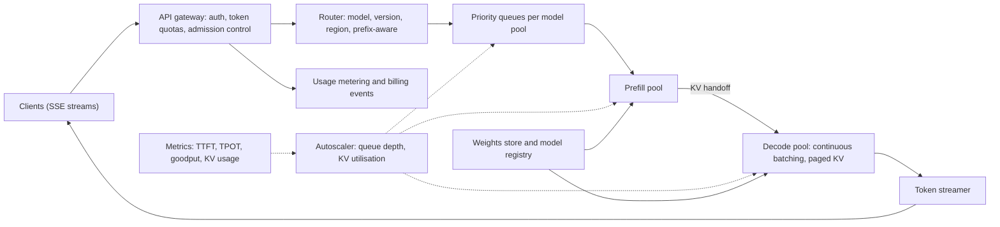

- **Trade-offs probed:** colocated continuous batching vs prefill/decode disaggregation (DistServe removes prefill-decode interference and lets each phase be tuned, at the price of KV transfer and fault propagation) [S18]; paged KV allocation to avoid the 60-80% memory waste of naive allocators [S15]; admission control and load shedding vs unbounded queueing; prefix-aware routing (cache hits) vs even load; autoscaling on queue depth and KV utilisation rather than CPU, with a warm pool because model loads take minutes; quantization vs quality; speculative decoding only in the low-QPS regime [S32].
- **Staff tell:** defines the SLO as *goodput* (requests per second per GPU that meet both TTFT and TPOT) rather than raw throughput [S18]; ties capacity to KV math (Section 6.6); specifies tenant fairness and a canary-with-eval-gate rollout.
- **Red flags:** "one request per GPU"; autoscaling on CPU; no distinction between prefill and decode.

#### A2. GPU request-batching service `[B][S01, S02, S03]`

- **Reported prompts:** "Design an inference batching system" and "an end-to-end batching system for LLM queries" are among the most frequently reported Anthropic design prompts; one reported variant frames the goal as a batched system where 100 requests take about the same time as one [C][S03].
- **Elicit:** max batch size; latency SLO; arrival rate and burstiness; input length variance; cancellation and timeout semantics; failure domain (one GPU vs many).

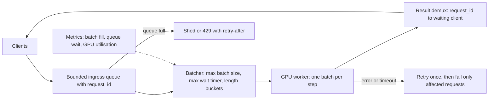

- **Trade-offs probed:** static batching with a timer vs dynamic vs *continuous* (iteration-level) batching, where new requests join a running batch (introduced by Orca; secondary source) [S18]; max-wait chosen from the latency budget (arrival rate x max-wait approximates batch fill, by Little's law; textbook, **D**); length bucketing to cut padding; head-of-line blocking from long prompts; backpressure vs queueing; correct demultiplexing of results to callers under partial failure.
- **Staff tell:** derives max-wait from the latency budget, then notes that continuous batching supersedes the timer design for generative workloads; handles poison requests and cancellation.
- **Red flags:** no bound on the queue; no answer for "one request in the batch fails".

#### A3. Offline / async batch-inference API `[B][S01, S27, S28]`

- **Reported prompts:** batch inference (12 Anthropic reports) [S01]. The real-world reference is the provider Batch API: results within 24 hours at 50% of standard token prices, with the batch discount stacking with prompt caching [A][S27, S28]. A related long-running generative-job prompt in OpenAI's reported pool is orchestrating AI video generation (Sora-style) [C][S13].
- **Elicit:** batch size limits (sources disagree on current limits; verify against current docs, **gap**); turnaround SLA; priority relative to online; result retrieval; idempotency; partial-failure semantics.

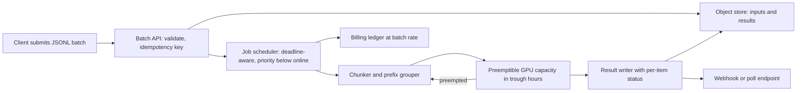

- **Trade-offs probed:** deadline-aware scheduling that fills the diurnal trough; preemption and checkpointing; grouping by shared prefix to reuse cache (cache hits inside batches are best-effort, so warm the cache first or use the 1-hour TTL) [S27]; idempotent retries; fairness with online traffic.
- **Staff tell:** treats price as a scheduling signal and batch work as the utilisation-smoothing layer for the fleet.

#### A4. GPU fleet scheduling, placement and credits `[B][S01, S03, S13]`

- **Reported prompts:** GPU cluster (7), mixed large/small model GPU allocation (4) [S01]; "GPU scheduling system using credits" [S03, C]; GPU-credit allocator, credit expiry tracking and atomic credit transactions at OpenAI [S13]; "GPU credit system and scheduler" in PracHub's ML-design pool [S10].
- **Elicit:** model memory footprints and TP degrees; heterogeneous GPUs; preemption policy; per-org quotas; cold-start tolerance.

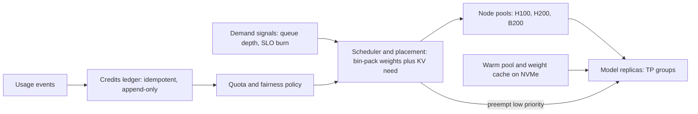

- **Trade-offs probed:** dedicated pools per model vs multiplexing; TP degree vs replica count; warm-pool cost vs cold-start latency; reserved vs spot; credit-ledger correctness (idempotency, double-spend, reconciliation).
- **Staff tell:** derives placement constraints from weights plus KV memory, and notes that context length sets the concurrency ceiling (Section 6.6).

#### A5. Model-weights distribution and safe rollout `[B][S01, S04]`

- **Reported prompts:** ML-model distribution (16), large-file streaming (2) [S01]; "large model file distribution" in Hello Interview's Staff list [S04].
- **Elicit:** weight size (100s of GB); fleet size; source bandwidth; integrity requirements; rollout and rollback policy; time-to-ready target.

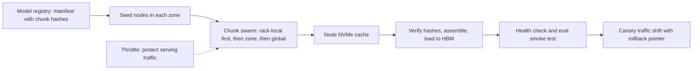

- **Trade-offs probed:** P2P vs hierarchical cache vs direct object-store fan-out; chunk size; topology awareness; throttling so distribution does not starve serving traffic; version consistency; verification cost.
- **CALCULATED example:** 140 GB to 1,000 nodes from a 100 Gbps source is 140 TB, about 11,200 s (3.1 h), whereas each node can ingest 140 GB in about 45 s on a 25 Gbps NIC, so the source is the bottleneck and a swarm or tree is justified.
- **Staff tell:** computes the distribution time before choosing a topology.

#### A6. LLM gateway / internal AI platform `[C][S37, S39]`

- **Reported prompts:** "design an LLM gateway/router" and "multi-team AI platform" in listicles [S39]; "Design a prompt caching and retrieval system" (Anthropic SWE candidates, IGotAnOffer) [S03, C]; platform teams at AI-heavy companies are hiring for this surface (**D**).
- **Elicit:** number of teams; providers; per-team budgets; compliance (PII); failover policy; reproducibility needs.

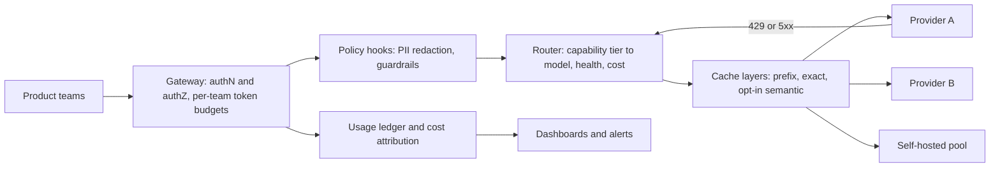

- **Trade-offs probed:** token-based limits (estimate pre-flight, reconcile post-flight) vs request limits; degrade-to-cheaper tier vs reject; semantic cache opt-in per route; pinned vs floating model versions; central logging vs privacy; backpressure through streaming proxies.
- **Staff tell:** org-level levers: model-change policy with eval gates, cost attribution, exception handling.

#### A7. Prompt playground / prompt registry and experimentation `[B][S01, S13]`

- **Reported prompts:** Prompt Playground (15 Anthropic reports) [S01]; "Design the OpenAI Playground" (reported as an OpenAI phone-screen prompt), "AI playground editor" and "ChatGPT Playground" [S09, S13].
- **Elicit:** users and scale; multi-model comparison; sharing and permissions; dataset runs; retention of completions.

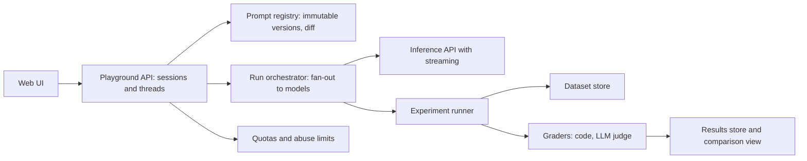

- **Trade-offs probed:** content-addressed immutable prompt versions; streaming transport and reconnect; fan-out cost and quotas; permission model for shared prompts; retention and privacy of stored completions.
- **Staff tell:** closes the loop playground to eval to CI gate to deployment ("prompts as code").

#### A8. Enterprise RAG / permission-aware enterprise search `[B/C][S03, S08, S11, S51, S52]`

- **Reported prompts:** "How would you build an LLM-powered enterprise search system?" (OpenAI, 2026 Glassdoor); low-latency RAG and an enterprise RAG assistant for internal documents (OpenAI ML-design pool on PracHub); distributed search over about 1B documents (the most consistently reported Anthropic design prompt per IGotAnOffer); RAG over sensitive, fast-changing documents (Databricks AI-FDE track); retrieval and reranking for coding agents (one reported Databricks phone screen) [S03, S08, S11, S13].
- **Elicit:** corpus size and modalities; ACL model; freshness; QPS; latency budget; citation requirement; accuracy bar and cost-of-wrong.

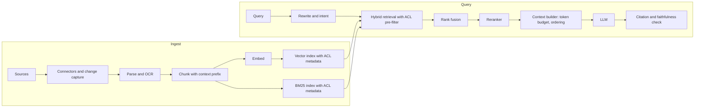

- **Trade-offs probed:** dense-only vs hybrid BM25 + dense + reranker. Anthropic's Contextual Retrieval study reports the top-20 retrieval failure rate falling from 5.7% to 3.7% with contextual embeddings, 2.9% with contextual BM25, and 1.9% with reranking added (single-vendor benchmark, top-20 metric, so gains are smaller at smaller k) [A][S52]; chunk size and context prefixes; rerank latency vs recall; ACL pre-filter vs post-filter (post-filter leaks and wastes top-k); re-embedding migration when the embedding model changes (also invalidates any semantic cache); long-context stuffing vs retrieval, given that accuracy falls when relevant facts sit mid-context and degrades with length across models [A/B][S51].
- **Staff tell:** treats ACL enforcement as a retrieval-time, fail-closed invariant; evaluates retrieval (recall@k) separately from generation (faithfulness); plans the embedding-model migration; applies the EchoLeak lesson that untrusted content and sensitive data must not meet in one context without egress control [S23].

#### A9. ChatGPT-style assistant with context assembly and memory `[B/C][S01, S09, S37, S38, S51]`

- **Reported prompts:** "Design ChatGPT" [S38]; "high-scale chat application" (OpenAI) [S09, S13]; chat system (7 Anthropic reports) [S01]; conversational memory [S37]; "design a high-level system for an LLM responding to a user query" and "a customer-support chatbot on a third-party LLM platform" (Aced's list of 2026 prompts) [S02, C].
- **Elicit:** DAU and concurrent streams; context length; tools; memory scope and deletion rules; moderation; multi-device sync.

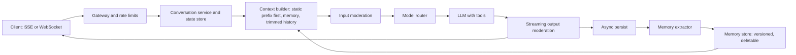

- **Trade-offs probed:** server-side state vs client re-send; summarization/compaction vs sliding window (compaction can drop details, so tune for recall first) [S51]; cache-friendly prompt layout (static content first) [S27]; memory write policy (supersession, contradiction) and deletion (privacy); moderating a stream without blocking time-to-first-token; SSE vs WebSocket.
- **Staff tell:** explains how layout choices drive the prefix-cache hit rate and cost, and names memory governance (what is stored, who can delete).

#### A10. Latency-critical code completion plus coding assistant `[C][S10, S37]`

- **Reported prompts:** "LLM-based coding assistant" in Meta's ML pool [S10]; code-completion design in coach lists [S37].
- **Elicit:** latency budget for inline completions (coach sources suggest a few hundred milliseconds, **C**); keystroke-rate bursts; privacy of code; telemetry.

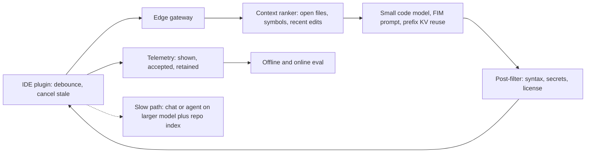

- **Trade-offs probed:** small model close to the user vs large model central; prefix reuse as the user types; speculative decoding helps most at low-to-medium QPS, with smaller gains at high QPS [S32]; context size vs TTFT; acceptance rate vs correctness (retained-after-N-seconds beats raw acceptance).
- **Staff tell:** pairs execution-based offline evals with online retention metrics and plans capacity for keystroke bursts.

#### A11. Long-running tool-using agent platform `[C][S03, S08, S11, S20, S24, S51]`

- **Reported prompts:** an agent system that adapts to new tasks (Anthropic, Applied-AI family) [S03]; "agents supporting a chat use case of executing tasks" (OpenAI, Aug 2026 review) [S08]; Google Cloud GenAI FDE loops include agentic system design [S06]; coding agents that run for hours and resume from checkpoints appear in listicles [S39, C].
- **Elicit:** side-effect classes (read-only vs reversible vs irreversible); budgets (steps, tokens, wall-clock); concurrency; tenancy; human-approval policy.

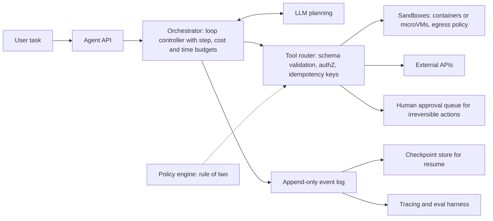

- **Trade-offs probed:** deterministic workflow vs autonomous agent; single vs multi-agent (multi-agent multiplies token cost but isolates context via sub-agents) [S51]; context management by compaction, structured notes and just-in-time retrieval [S51, B]; sandbox isolation strength vs start-up latency; reliability over many trials, where pass^k is the relevant metric [S20].
- **Staff tell:** designs the blast radius first (Rule of Two), makes tools idempotent, makes the loop resumable, and builds the eval harness *before* adding agent features.
- **Red flag:** an unbounded loop with no budgets.

#### A12. Real-time voice assistant `[C][S10, S50]`

- **Reported prompts:** "Design a Real-Time AI Voice System" appears in PracHub's software-engineer ML-design pool (a pool of about 97 questions across several companies) and in listicle compilations; no firm-level aggregate found [C][S10, S39].
- **Elicit:** end-to-end latency target (most vendor sources say about 800 ms voice-to-voice (range about 300-1,000 ms across vendors), against a human turn-gap of about 200 ms; one vendor's illustrative sequential budget sums to about 1,180 ms and only fits when stages overlap) [C][S50]; telephony vs WebRTC; barge-in; languages; cost per minute.

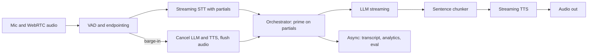

- **Trade-offs probed:** cascaded STT-LLM-TTS (observable, swappable) vs speech-to-speech (lower latency, less control); endpointing aggressiveness (premature cut-offs vs added delay); smaller model for lower TTFT; co-location to cut network hops; interruption semantics.
- **Staff tell:** states a per-stage p95 budget (Section 6.6) and overlaps stages (stream partial STT into the LLM, chunk sentences into TTS).

#### A13. Document / multimodal ingestion and extraction at scale `[C][S11, S28, S29, S39]`

- **Reported prompts:** document-processing pipeline that ingests heterogeneous documents for LLM use (Databricks track); summarizing very long documents; extraction with reliability targets (listicles) [S11, S39].
- **Elicit:** volume per day; document types and lengths; field-level accuracy target; turnaround; human-review capacity.

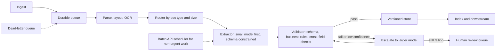

- **Trade-offs probed:** single-pass long-context vs chunked map-reduce (long context degrades mid-document) [S51]; sync vs batch API at half price [S28]; small-model-first cascade vs upfront router (RouteLLM-style savings vary 35-85% by workload) [S29]; schema-constrained decoding vs post-validation; OCR vs vision-LLM.
- **Staff tell:** reasons in cost per *correct* document and designs versioned outputs so a model or prompt change can be re-run safely.

#### A14. LLM / agent evaluation platform and observability `[B/C][S03, S20, S21]`

- **Reported prompts:** "Design a model evaluation and monitoring system" (Anthropic SWE candidates, IGotAnOffer) [C]; a system that runs evaluation benchmarks across hundreds of model variants (Anthropic, one aggregator) [S03]; "evaluation platform for many agent workflows" in Staff+ listicles [S39, C]; agent-harness-and-eval prompts in aggregators [S10, C]; "Evaluate an LLM System" is the most frequent question in Dataford's GenAI-engineer aggregate [S11, C].
- **Elicit:** number of teams and agents; trial cost; grader mix; CI integration; production sampling.

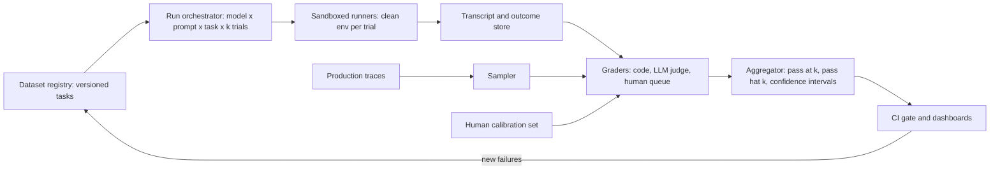

- **Trade-offs probed:** code vs LLM vs human graders (cost, determinism, nuance); grade outcomes rather than paths; number of trials vs cost (batch API for offline runs); static vs rolling datasets (saturation, contamination); judge-version pinning; flaky-task detection (Section 6.7).
- **Staff tell:** ownership model (platform owns infrastructure, product teams contribute tasks) and linking eval metrics to business outcomes.

#### A15. Safety, abuse and prompt-injection defense architecture `[A/B][S02, S03, S04, S22-S25]`

- **Reported prompts:** malware-analysis system (Hello Interview's Anthropic Staff list) [S04]; "LLM API with a safety layer" [S03, C]; "design safeguards for an AI system that can take actions on behalf of a user" (Aced's list of 2026 prompts) [S02, C]; moderation and multi-tenant agent isolation in Databricks-type tracks [S11, C].
- **Elicit:** trust boundaries (what content is untrusted); sensitive assets; irreversible actions; tenancy; false-positive tolerance; response-time overhead.

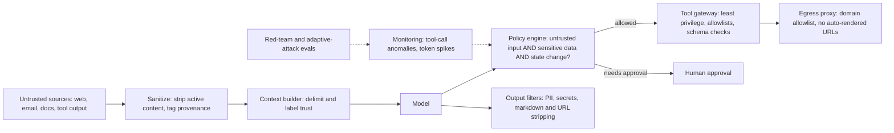

- **Trade-offs probed:** classifier-only vs architectural containment (Section 6.8); false positives vs missed attacks; human-in-the-loop friction; separation of read-only agents from acting agents.
- **Staff tell:** designs for compromise: blast-radius analysis, kill switches, audit trail and incident response.

### 6.3b Non-archetype round formats seen in 2026

| Format | Evidence | What it tests | How to prepare (SYNTHESIS unless stated) |
|---|---|---|---|
| **Design-document review** | Anthropic, first observed April 2026, 3 reports [B][S01]; Aced says the design-review format has come up for staff-level engineers and engineering leaders [B][S02] | Critique of a pre-written design: missing requirements, capacity assumptions, failure modes, rollout, alternatives | Practise reviewing RFCs against a checklist: requirements, numbers, failure modes, migration, observability, security, alternatives rejected. Time-box: 10 minutes read, then prioritised findings. |
| **Roofline analysis** | 4 Anthropic reports [B][S01] | Compute-bound vs memory-bound reasoning for prefill/decode | Know arithmetic intensity: decode at batch 1 is about 1 FLOP per byte against a ridge point of roughly 300 FLOP/byte on an H100 (**CALCULATED**: 989 TFLOPS / 3.35 TB/s) [S17, S19] |
| **p95 latency debugging** | One report: p95 jumps from about 100 ms to about 2,000 ms, as a debugging exercise inside the design round [C][S53] | Hypothesis-driven diagnosis | Segment by percentile and cohort; split queue vs prefill vs decode; check batch size, KV pressure, long-context outliers, retries/timeouts, cache-hit shift, noisy neighbour, recent deploy diff |
| **AI-enabled design round** | Meta, spring 2026, early signal [B/C][S05] | Using an AI assistant while designing, with Mermaid in CoderPad | Practise producing Mermaid quickly and critiquing AI output; policy varies by team |
| **Project deep dive** | Anthropic, OpenAI (a deep dive that works like a reverse design interview) and Uber loops [B/C][S02, S12, S13] | Depth on real systems, trade-offs and decisions | Out of scope here; rehearse two systems with numbers and rollbacks |

### 6.4 Trade-off analysis: the decisions interviewers probe

Each row gives a decision rule that follows from the cited evidence. Where no primary source was retrieved, the rule is marked **SYNTHESIS (D)** and should be treated as a starting position, not a finding.

| # | Decision | Evidence and rule | Grade |
|---|---|---|---|
| T1 | **Small fine-tuned model vs large prompt-engineered frontier model** | Price gap is large: on Anthropic's current list, Haiku 5.5 is $0.10/$0.50 per million input/output tokens vs Sonnet 5.5 $2/$10 (20x), Opus 5.5 $4/$20 (40x) and Fable 5.1 $10/$50 (100x) [A][S27]. Learned routing preserved about 95% of GPT-4 quality at 35-85% lower cost depending on benchmark [A][S29]. **Rule (SYNTHESIS):** prompt plus retrieve first; fine-tune or distil when the task is narrow, stable and high-volume, a small model is needed to hit a latency or cost target, and a golden set exists to prove parity. Budget a regression eval for every base-model upgrade. No primary source on fine-tune-vs-prompt outcomes was retrieved this session. | A (prices, routing) / D (rule) |
| T2 | **Dense vector search vs hybrid (BM25 + dense) + reranker** | Top-20 retrieval failure rate: 5.7% (embeddings), 3.7% (contextual embeddings), 2.9% (+ contextual BM25), 1.9% (+ reranking) in Anthropic's study; single-vendor, top-20 metric [A][S52]. **Rule:** start hybrid with rank fusion when the corpus has identifiers, jargon or exact terms; add a reranker when top-k precision matters and the latency budget allows; prove each stage on recall@k before adding it. | A |
| T3 | **Speculative decoding vs standard sampling** | Lossless by construction; 2-3x speedups reported on T5-XXL in the original paper [A][S33]. vLLM's docs position it for inter-token-latency reduction at medium-to-low QPS in memory-bound workloads, and note that output can still vary slightly in practice [A][S32]. **Rule:** enable on the interactive, latency-sensitive tier at moderate load; at high QPS vLLM's own table lists smaller but still positive gains for some methods, so measure acceptance rate and goodput before enabling by default. | A |
| T4 | **RAG vs long-context stuffing vs fine-tuning for knowledge** | Accuracy drops when relevant facts sit mid-context [A][S51 Liu et al.]; a technical report reports degradation with length across 18 models [B][S51 Chroma]. **Rule:** retrieve when the corpus exceeds the window, changes often, or needs per-user ACLs; use long context for a single bounded document, with a cached prefix; fine-tune for style or format, not for facts that change. | A/B + D |
| T5 | **Self-host vs provider API** | Self-hosting is a fixed cost (GPU-hours) vs a marginal cost per token. Compare at *equal quality* and *realistic utilisation*; use the unit-cost template F10. **Rule (SYNTHESIS):** self-host for high, steady volume, data-residency constraints, custom models, or latency control; otherwise use an API and add caching, batching and routing. | D (CALCULATED templates) |
| T6 | **Prefix cache vs exact cache vs semantic cache** | Prefix caching is exact-prefix and priced explicitly (reads 0.05-0.1x) [A][S27]. Semantic caches introduce false hits: GPTCache produced 233 false hits vs 89 for MeanCache in one evaluation in the MeanCache preprint, a self-benchmark by that system's authors [B][S30]; practitioner posts converge on tuning thresholds per route, scoping keys by tenant, keying on prompt and model version, and invalidating on embedding-model change [C][S31]. **Rule:** layer them in this order: prefix cache (free structure), exact cache, then semantic cache on low-stakes, high-repeat, non-personalized routes only. | A/B/C |
| T7 | **Up-front router vs cascade (try small, escalate)** | A router pays a prediction cost and sends each request to one model; a cascade pays the small model on *every* request plus escalations. **CALCULATED** (Section 6.6, F13): 70/30 router = $0.996M-equivalent vs a cascade at 30% escalation = $1.04M for the same load. **Rule:** cascades win when the small model's answers are cheap to verify; routers win when difficulty is predictable from the prompt. | A (RouteLLM) + CALC |
| T8 | **Colocated vs disaggregated prefill/decode** | Disaggregation removes prefill-decode interference and lets each phase use its own parallelism, at the price of KV transfer and fault propagation [A][S18]. A practitioner note: with short prompts prefill is a rounding error, and splitting pools just fragments capacity [B][S18 secondary]. **Rule:** disaggregate for long prompts with tight TTFT and TPOT SLOs on a large fleet. | A/B |
| T9 | **Workflow vs autonomous agent; single vs multi-agent** | Agent evals are harder (multi-turn, tool use, mutable state) [A][S20]. **Rule (SYNTHESIS):** default to a deterministic workflow; use an agent when the path cannot be predetermined; give every agent step, token and time budgets; split into sub-agents only to isolate context, accepting multiplied token cost [S51]. | A + D |
| T10 | **Synchronous vs batch API** | Batch is 50% cheaper for up to 24-hour latency and stacks with caching [A][S27, S28]. **Rule:** route everything non-interactive (evals, backfills, enrichment) to batch. | A |
| T11 | **ACL pre-filter vs post-filter in retrieval** | Post-filtering retrieves forbidden chunks into the candidate set (leak risk, wasted top-k); EchoLeak shows what happens when untrusted and sensitive content co-mingle [A][S23]. **Rule (SYNTHESIS):** pre-filter at the index with fail-closed semantics; re-check at context assembly. | D + A |
| T12 | **Code vs LLM vs human graders** | Code graders are fast and deterministic but brittle; LLM graders are flexible but need calibration; humans are the gold standard but slow [A][S20]. LLM judges show position, verbosity and self-enhancement bias [A][S21]. **Rule:** code first, LLM where needed, humans to calibrate. | A |
| T13 | **Streaming moderation vs post-hoc moderation** | Streaming protects users but adds latency and chunk-boundary errors. **Rule (SYNTHESIS):** moderate input before generation, moderate streamed output with a small lag buffer, and keep a post-hoc audit pass. | D |

### 6.5 The 45-minute navigation blueprint (SYNTHESIS)

**What the sources say.** Hello Interview recommends about 5 min requirements, 2 min entities, 5 min API, 10-15 min high-level design, about 10 min deep dives, and says capacity estimation should happen only when it will change the design [B][S34]. DesignGurus' general guidance is 5-7 / 10-15 / 15-20, with 35-40% of time on deep dives [C][S35]. GenAITrail's LLM-specific framework is 10% requirements, 15% high-level, 25% request path, 35% deep dive, 15% eval and what-breaks [C][S37]. Round lengths vary: Meta 2 x 45 (about 35-40 usable) [B][S05], Anthropic 50-55 per Aced's guide, 55-60 per its process page and about 60 per DesignGurus and interviewing.io [B/C][S02, S03, S56], Google L6 60 [B][S06], OpenAI 45-60 (60 in the phone screen per Aced) [B/C][S13]. A Blind debrief from a failed Anthropic infra round says the stated scale and constraints must drive a *minimal* design, and that deferring math is a mistake in that setting [C][S07].

**Reconciliation.** Everyone agrees on one criterion: numbers must change the design. In AI systems they almost always do (tokens decide cost, KV memory decides concurrency, TTFT decides architecture), so a short, *targeted* estimate belongs right after requirements.

**The blueprint (45 minutes):**

| Clock | Phase | Goal | What to do and say | Board output | Exit check |
|---|---|---|---|---|---|
| **0:00-0:05** (5) | **Frame and requirements** | Pin the problem, classify the family (predictive / generative / agentic / infra) and set SLOs | Ask six things: (1) users, QPS, tokens; (2) latency targets (TTFT, TPOT or end-to-end; interactive or batch); (3) does it *act* or only *answer* (side effects); (4) knowledge source, freshness, permissions; (5) quality bar and cost of a wrong answer (this becomes the eval spec); (6) constraints (privacy, residency, vendor, on-prem). Restate the top three requirements and what is out of scope. | Requirements list with 3-5 *quantified* non-functionals | Interviewer has agreed the numbers |
| **0:05-0:09** (4) | **Targeted estimate** | Find the number that breaks first | Compute only what decides architecture: requests to tokens per second; tokens to cost per request and per month; KV memory and concurrency if self-hosting; index size if RAG; a latency budget split. Say the *decision* each number forces. | 4-6 lines of math, one circled bottleneck | You can say "this is why we need X" |
| **0:09-0:18** (9) | **High-level design plus one request walk** | A complete, simple design that meets functional requirements | Draw left to right. Walk one request end to end, naming the data and state at each hop. Mark (do not build) the places for caches, queues, routers. Declare the two riskiest components for deep dives and why. | One diagram, one annotated request path | Interviewer has no open "what about the basic path" questions |
| **0:18-0:34** (16) | **Two deep dives (about 8 min each)** | Harden the riskiest parts; show depth and trade-offs | Choose by risk, not by comfort. For each: options, decision, number that supports it, failure mode, what you gave up. Leave room for probes; do not talk over the interviewer. | Zoomed-in sub-diagrams plus a trade-off line each | Each dive ends with "what I gave up" |
| **0:34-0:41** (7) | **Evaluation, safety, observability, scale and failure** | Show the system is trustworthy and operable | Offline golden set plus graders and CI gate; online sampling and A/B; guardrails by layer and blast-radius limits; the five metrics you would alert on; what happens when the provider or a GPU pool fails; the first bottleneck at 10x. | A small "eval and safety" box and a metrics list | Eval and safety were named, not implied |
| **0:41-0:45** (4) | **Wrap-up** | Land the plan | Summarize in three lines: what ships first, what you would measure, what you gave up and what you would do with two more weeks. Invite the interviewer to redirect. | None | Time check |

**Variants by round length (minutes per phase):**

| Round | Requirements | Estimate | HLD + walk | Deep dives (2) | Eval/safety/obs | Wrap-up |
|---|---|---|---|---|---|---|
| 35 usable (Meta) | 4 | 3 | 7 | 12 | 6 | 3 |
| **45 (default)** | **5** | **4** | **9** | **16** | **7** | **4** |
| 55 (Anthropic) | 5 | 6 | 10 | 22 | 8 | 4 |
| 60 (Google, OpenAI) | 6 | 6 | 11 | 24 | 9 | 4 |

**Adaptations by archetype family:**
- **Infrastructure (A1-A5):** lengthen the estimate (KV memory, batch fill, egress); deep dives on batching/scheduling and failure handling; replace "eval" with SLOs, rollout, rollback and observability.
- **RAG/search (A8):** deep dive 1 on retrieval quality and ACLs; deep dive 2 on context assembly and latency; evaluate retrieval and generation separately.
- **Agents (A11):** deep dive 1 on loop control, state and resumability; deep dive 2 on safety and blast radius; evaluate trajectories and outcomes over repeated trials.
- **Voice (A12):** the latency budget is the main artifact; deep dives on streaming overlap and barge-in.
- **Eval platform (A14):** deep dives on trial isolation and grader calibration.
- **Document-review round (Anthropic variant):** 5 min skim, 25 min findings ordered by severity, 10 min alternatives and rollout, 5 min summary (**SYNTHESIS**; format details not documented in any source found).

**Rescue moves (checkpoints):**
- *0:09 and no numbers on the board:* stop drawing; do the four-line estimate.
- *0:18 and no deep dives named:* say "these two components carry the most risk" and pick.
- *0:34 and eval/safety untouched:* jump there now; trim the second dive.
- *Interviewer passive (reported at OpenAI):* announce an agenda and ask for redirects at each phase boundary.
- *Interviewer changes a constraint:* redo the one affected number out loud; that is the scored behaviour.

**Phrases that signal maturity (my wording):**
- "Before I draw, I want to pin down scale, latency targets, whether this acts or only answers, and what a wrong answer costs."
- "I'll do only the numbers that decide the architecture."
- "The two places this is most likely to break are X and Y; I'd like to go deep there."
- "Here is what I gave up, and here is what I'd measure to find out if I was wrong."

### 6.6 Back-of-envelope formulas (core ten plus situational)

**Conventions.** Decimal GB (10^9 bytes) for capacity, KiB/GiB where stated. Prices are illustrative unless sourced; **memorize ratios, not prices**. Arithmetic marked **CALCULATED** was re-executed in a sandbox this session [S55].

**Hardware and price anchors**

| Item | Value | Grade |
|---|---|---|
| H100 SXM | 80 GB HBM3, about 3.35 TB/s | B [S19] |
| H200 | 141 GB HBM3e, about 4.8 TB/s | B [S19] |
| B200 | about 180-192 GB HBM3e (sources differ), about 8 TB/s | B [S19] |
| H100 dense BF16 compute | about 989 TFLOPS dense (vendor pages list FP8 dense at 1,979, and BF16 is half of FP8 on Hopper, recalled). Beware: some spec sheets list 1,979 for BF16, which is the with-sparsity figure | C/D [S19] |
| Rental price anchor | about $2.39 per H100-hour on one third-party listing | C |
| Claude list prices (per million tokens, input/output) | Haiku 5.5 $0.10/$0.50 (prompts up to 100K; $0.50/$2.50 above); Sonnet 5.5 $2/$10; Opus 5.5 $4/$20; Fable 5.1 $10/$50. Output is 5x input on every tier. Fetched 2026-10-21; verify before quoting | A [S27] |
| Cache multipliers | read 0.1x (0.05x Sonnet 5.5 and Opus 5.5; 0.025x Fable 5.1 and Mythos 5.1); 5-minute write 1.25x; 1-hour write 2x | A [S27] |

**Core ten**

| # | Formula | Worked example (CALCULATED) | Where it shows up |
|---|---|---|---|
| **F1** Traffic | avg_rps = requests / seconds; peak = k x avg (ask for k; 2-3 common) | 5M users x 10 sessions x 4 requests = 200M/month, 77 rps average, about 231 rps at 3x peak | Every prompt |
| **F2** Token cost | cost = N x (t_in x p_in + t_out x p_out) / 10^6 | 200M requests x (3,000 in, 400 out): input 600B tokens, output 80B. At $3/$15: $3.0M/month; at $0.15/$0.60: $138K (21.7x). At current Claude list: Haiku 5.5 $100K, Sonnet 5.5 $2.0M, Opus 5.5 $4.0M, Fable 5.1 $10M. Input is 88% of tokens but output is 40% of Sonnet cost | Cost, routing, caching |
| **F3** Prompt-cache cost | input cost = t_dyn x p + t_static x p x [h x r + (1-h) x w] (r = read multiplier, w = write multiplier, h = hit fraction). Break-even reads per write = (w - 1)/(1 - r) | 2,500 static + 500 dynamic tokens on Sonnet 5.5: uncached $0.0060; write request $0.00725; hit request $0.00125 (79% cheaper). Break-even is 0.26-0.28 reads (r = 0.05-0.1), so one read repays the write | Chat, RAG, agents |
| **F4** KV per token | 2 x L x H_kv x d_head x bytes | OPT-13B: 2 x 5,120 x 40 x 2 B = 800 KiB/token (matches the vLLM paper's example). Llama-3-8B: 128 KiB/token. Llama-3.1-70B: 320 KiB/token (4 KiB per layer): 2.68 GB at 8K, 10.7 GB at 32K, 40 GiB at 128K | Concurrency, cost |
| **F5** Weights and concurrency | W = P x bytes (BF16 2, FP8 1, INT4 0.5); concurrency = (HBM - W - overhead) / (KV/token x context) | 8xH100 (640 GB), 70B BF16 (140 GB), 20 GB overhead: 480 GB free, so 178 sequences at 8K, 44 at 32K, 11 at 128K (each rounded down). 8B on the same box: 562 at 8K | Self-hosting, A1, A4 |
| **F6** Decode ceiling | TPOT_min = (W + KV_active) / BW_total; tokens/s per stream = 1/TPOT; MBU = (bytes moved per token / TPOT) / BW_peak | 70B BF16, 8xH100 TP: 140 GB / 26.8 TB/s = 5.2 ms (about 191 tok/s ceiling). At the full-KV case above (about 620 GB per step): about 23 ms, about 43 tok/s per stream, about 7,700 tok/s aggregate. 70B FP8 on one H200: 14.6 ms, about 68 tok/s. Real systems reach a fraction (MBU) | Roofline, A1 |
| **F8** Latency composition | E2E = TTFT + (N_out - 1) x ITL; TTFT = queue + prefill + network (+ retrieval, guardrails) [A][S16] | 3,000-token prompt at about 10K tok/s prefill = 300 ms; 400 output tokens at 50 tok/s = 8.0 s. Halving output saves 4 s; cutting the prompt 3,000 to 1,200 saves about 180 ms. Output length dominates [A][S17] | Latency budgets |
| **F9** Capacity by Little's law | concurrent streams L = lambda x W | 231 rps x 8.3 s = about 1,920 streams; at 178 per node = 10.8, so 11 nodes (12 for headroom). 12 nodes x 8 GPUs x $2.39 x 730 h = about $167K/month (peak-provisioned; illustrative) | Self-hosting, sizing |
| **F11** Vector memory | N_vec x d x bytes | 50M docs x 20 chunks = 1B vectors x 1,024 x 4 B = 4.1 TB (fp32), about 1.0 TB (int8), about 0.13 TB (PQ ~32x). 1M docs x 15 chunks x 384 x 4 B = 23 GB | A8 |
| **F12** Reliability | pass@k = 1 - (1-p)^k; pass^k = p^k; chained steps = product of step reliabilities | p = 0.75: pass^3 = 42% [A][S20]; 0.98 per step over 20 steps = 67% (D, textbook) | Agents, evals |

**Situational**

| # | Formula | Worked example (CALCULATED) |
|---|---|---|
| **F7** Prefill time | t = 2 x P x T_in / (peak FLOPs x MFU) | 70B, 3,000 tokens, 8xH100 at an assumed 40% MFU: 4.2e14 FLOPs / 3.2e15 = about 133 ms (assumes 989 TFLOPS, **D**) |
| **F10** Self-host unit cost | $/M output tokens = (N_gpu x $/GPU-h) / (tok/s x 3,600) x 10^6 | 8 GPUs x $2.39 = $19.12/h; at the ideal of about 7,700 tok/s: $0.69/M; at 50% of ideal $1.4/M; at 25% $2.8/M (ignores prefill, idle time, ops; open-weights 70B, not frontier quality) |
| **F13** Router vs cascade | router = sum(share_i x c_i) + c_router; cascade = c_small + p_escalate x c_large | Per the F2 load: 70/30 router = $0.996M-equivalent, cascade at 30% escalation = $1.04M |
| **F14** Semantic-cache value | savings = h(1 - c_l) - (1-h) x c_l - f x C_wrong (c_l = lookup cost as fraction of an LLM call; f = false-hit rate) | With c_l = 1%: 5% hit rate saves about 4%, 20% saves about 19%, before the false-hit term, which dominates on high-stakes routes |
| **F15** Weight distribution | T = size x N / source egress | 140 GB x 1,000 nodes / 100 Gbps = 11,200 s (3.1 h) vs 45 s per node on a 25 Gbps NIC |
| **F16** Voice budget (template, C/D) | sum of stage p95s <= about 800 ms | Network in 40 + endpointing 200 + STT final 100 + LLM TTFT 300 + TTS first audio 150 + network out 40 = 830 ms, so trim endpointing or LLM TTFT |

**Reference implementation (any Python 3; the printed values below were verified by running it):**

```python
# ai_sd_calc.py: first-order estimators. Decimal GB; prices per million tokens.
def kv_bytes_per_token(layers, kv_heads, head_dim, bytes_per_el=2):
    return 2 * layers * kv_heads * head_dim * bytes_per_el

def concurrency(hbm_gb, weights_gb, overhead_gb, kv_per_token, ctx):
    return int((hbm_gb - weights_gb - overhead_gb) * 1e9 // (kv_per_token * ctx))

def decode_tpot_ms(weights_gb, kv_gb, bw_tb_s_total):
    return (weights_gb + kv_gb) * 1e9 / (bw_tb_s_total * 1e12) * 1e3

def monthly_cost(n_req, t_in, t_out, p_in, p_out):
    return n_req * (t_in * p_in + t_out * p_out) / 1e6

def cached_input_cost(t_static, t_dyn, p_in, hit, read_mult=0.1, write_mult=1.25):
    return (t_dyn * p_in + t_static * p_in * (hit * read_mult + (1 - hit) * write_mult)) / 1e6

kv70 = kv_bytes_per_token(80, 8, 128)                   # 327680 B = 320.0 KiB (Llama-3.1-70B, BF16)
for ctx in (8192, 32768, 131072):
    print(ctx, concurrency(640, 140, 20, kv70, ctx))    # 8xH100: 178, 44, 11
print(round(decode_tpot_ms(140, 0, 8 * 3.35), 1))       # 5.2 ms ideal decode step
print(monthly_cost(200e6, 3000, 400, 3, 15))            # 3000000.0 (illustrative prices)
print(round(cached_input_cost(2500, 500, 2.0, 1.0, 0.05), 5))  # 0.00125 (all-hit, Sonnet 5.5 prices)
```

**Caveats an expert will raise (all valid; see Section 7):** hybrid-attention models (sliding-window layers) make F4 an overestimate [B][S14]; DeepSeek-V3's latent attention needs about 70 KB per token, against 327 KB for Qwen-2.5 72B and 516 KB for Llama-3.1 405B in the DeepSeek hardware-insights paper [A][S57]; KV-cache quantization (FP8) halves KV bytes; real engines lose capacity to fragmentation and activation workspace; prefill and decode do not share one throughput number.

**How interviewers grade the estimate (SYNTHESIS from [S34, S37, S07]; no firm rubric found).** Interviewers do not grade arithmetic speed. They grade whether numbers change the design.

| Score | Behaviour |
|---|---|
| 0 | No numbers |
| 1 | Numbers with wrong units or order of magnitude |
| 2 | Correct arithmetic, no design consequence ("so it's a lot") |
| 3 | At least one number drives a design decision |
| 4 | Separates input and output tokens; includes KV or memory and cost; states assumptions; sanity-checks; updates when a constraint changes |
| 5 | Names the binding constraint and the lever that changes the curve (caching, routing, batching, quantization), and gives a sensitivity ("if output length doubles then...") |

### 6.7 Evaluation architecture rubric (offline and online)

The canonical source is Anthropic's January 2026 engineering guide on agent evals [A][S20], combined with the LLM-as-judge study [A][S21]. The layers below are what a complete answer names.

| Layer | What to say | Evidence |
|---|---|---|
| **L0 Spec** | Define "good" in measurable terms (task success, groundedness, safety, latency, cost) and map business metric to proxy to offline metric. The eval spec comes from the *cost of a wrong answer* asked in requirements. | SYNTHESIS (D) |
| **L1 Golden set** | Start with 20-50 tasks drawn from real failures; grow later. Each task must be unambiguous: two domain experts should reach the same pass/fail verdict independently. A task that nobody ever passes usually signals a broken task, not a weak model. Balance positive and negative cases (test when a behaviour should happen *and* when it should not). | [A][S20] |
| **L2 Suites** | Keep *capability* evals (hard, low pass rate, hill-climb) separate from *regression* evals (should stay near 100%, gate releases). Watch for saturation: a suite that sits near 100% stops giving signal. | [A][S20] |
| **L3 Graders** | **Code-based:** fast, cheap, deterministic, brittle to valid variation. **Model-based:** flexible and scalable but non-deterministic; calibrate against humans, give the judge an "Unknown" option, score one dimension per judge. **Human:** gold standard, slow and costly. Grade *outcomes* rather than exact tool-call paths. | [A][S20] |
| **L4 Judge validity** | A strong judge agreed with humans over 80% of the time on MT-Bench-style tasks, about the human-human rate, but exhibits **position bias, verbosity bias and self-enhancement bias** and has limited reasoning on math-like tasks. Mitigate by swapping answer order, using rubrics and references, avoiding judging with the same model family that generated, using multiple judges, and re-calibrating whenever the judge version changes (the last two are SYNTHESIS). The 80% figure is from 2023 and one benchmark; re-validate for your domain. | [A][S21] |
| **L5 Component evals** | Evaluate retrieval (recall@k, MRR) separately from generation (faithfulness, groundedness); tool selection and argument accuracy; router accuracy; semantic-cache false-hit rate; guardrail precision and recall. | SYNTHESIS (D) |
| **L6 Trial design** | Non-determinism requires multiple trials per task. **pass@k** = at least one success in k tries; **pass^k** = all k succeed. With p = 0.75: pass^3 is about 42%. Use pass^k for user-facing reliability. Run each trial in a clean, isolated environment so leftover state does not inflate or correlate results. | [A][S20] |
| **L7 Gating** | Run the suite on every prompt, model, retrieval or tool change; gate on regression with confidence intervals; ship through shadow or canary. Use the batch API (50% cheaper) for large offline runs. | [A][S20, S28] + D |
| **L8 Online** | Sample production traffic through the same graders; track implicit signals (regenerate, edits, abandonment, escalation) and explicit feedback; A/B for business outcomes; alert on drift; feed every incident back into the golden set. Anthropic frames this as layered "Swiss-cheese" coverage: automated evals, production monitoring, A/B tests, user feedback, transcript review and periodic human studies. | [A][S20] |
| **L9 Governance** | Version datasets; guard against contamination; read transcripts regularly. One reported benchmark score moved from 42% to 95% after grader bugs were fixed, so *the eval itself needs tests*. Define ownership: a platform team owns infrastructure, product teams contribute tasks. | [A][S20] |

**Sixty-second Staff-level eval answer (my wording):** "I'd define success from the cost of a wrong answer, build a 30-task golden set from real failures, split regression from capability suites, use code graders where outcomes are checkable and a calibrated LLM judge elsewhere, measure retrieval separately from generation, run several trials per task and report pass^k, gate CI on regressions, sample production traffic through the same graders, and turn every incident into a new task."

**What gets penalized:** "we'd test it with some prompts"; one uncalibrated LLM judge; a model judging its own outputs; grading only the final answer of an agent; no regression gate; no production feedback loop.

### 6.8 Safety, guardrails and prompt-injection rubric

**Threat vocabulary (OWASP Top 10 for LLM Applications, 2025 edition) [B][S25]:** LLM01 prompt injection (direct and indirect), LLM02 sensitive-information disclosure, LLM05 improper output handling, LLM06 excessive agency, LLM07 system-prompt leakage, LLM08 vector and embedding weaknesses, LLM09 misinformation, LLM10 unbounded consumption (cost and denial of service). Canonical page not fetched; confirmed across at least five secondary summaries.

**Evidence that shapes the rubric**
- **Defenses are not complete.** Twelve published prompt-injection and jailbreak defenses were bypassed by adaptive attacks with success rates above 90% for most [A][S22]. A static benchmark score is therefore weak evidence.
- **Real chains pass classifiers.** EchoLeak (CVE-2025-32711, Microsoft 365 Copilot) chained a bypass of the injection classifier, link redaction and a content-security-policy to exfiltrate data with no user click [A/B][S23].
- **Containment rules usable on a whiteboard.** Meta's "Agents Rule of Two": in one session an agent should have at most two of (A) untrusted inputs, (B) access to sensitive data or systems, (C) ability to change state or communicate externally; if all three are needed, add human approval or fresh supervision [B][S24]. Willison's "lethal trifecta" is the same idea: private data plus untrusted content plus an external channel [B][S24].

**Controls by layer (what a complete answer places)**

| Layer | Controls |
|---|---|
| Ingestion | Strip active content; tag provenance and trust level; scan documents |
| Retrieval | ACL pre-filter, fail-closed; per-tenant indices or namespaces; poisoning checks on ingest (OWASP LLM08) |
| Context assembly | Delimit and label untrusted spans; keep secrets out of prompts; never rely on the prompt to enforce permissions |
| Model | Instruction hierarchy and system-prompt hardening as *defense in depth*; do not treat as a boundary |
| Tool gateway | Least privilege, scoped short-lived credentials, per-user identity propagation, allowlists, schema validation, idempotency keys, rate limits, human approval for irreversible actions |
| Output | Treat output as untrusted input to downstream systems (OWASP LLM05): schema validation, strip auto-rendering markdown images and links, sandbox code execution, PII and secret filters |
| Egress | Domain allowlist and proxy; block data-bearing URLs; no unreviewed external calls |
| Cost and abuse | Token-based rate limits, max output tokens, per-tenant budgets (OWASP LLM10) |
| Response | Kill switch, audit log, replay, incident runbook; adaptive red-team evals in CI |

**Scoring ladder (SYNTHESIS grounded in [S22-S25, S37, S38]; no firm rubric found)**

| Level | Behaviour |
|---|---|
| Below bar | "Add guardrails"; "tell the model to ignore malicious instructions"; permissions enforced in the prompt |
| Senior | Places controls by layer; least-privilege tools; ACL in retrieval; output validation; human approval for irreversible actions; red-team tests |
| Staff / Principal | Starts from the trust-boundary analysis (Rule of Two), assumes injection *will* succeed and bounds the blast radius; egress control; provenance-based policy; incident response and kill switches; organisational policy for onboarding new tools; measures with adaptive attacks rather than static prompt sets |

**Thirty-second safety script (my wording):** "Anything the model reads from outside our trust boundary is untrusted. For any agent I check the three properties: untrusted input, sensitive access, ability to act externally. If all three are present I split the agent or add approval. I enforce permissions in the tool gateway and retrieval layer, not the prompt, restrict egress, and treat classifiers as one layer, because adaptive attacks beat them."

### 6.9 Observability and operations rubric

| Area | Signals to name | Evidence |
|---|---|---|
| Serving | TTFT p50/p95/p99, inter-token latency, end-to-end latency, goodput, queue depth, batch size, KV-cache utilisation, prefix-cache hit rate, GPU memory-bandwidth utilisation (MBU), timeouts, preemptions | [A/B][S16, S17, S18] |
| Application | Tokens in/out/cached per request, cost per request, per tenant and per feature, retries, route/model chosen, cache hit rate per layer, tool-call count/latency/failure, agent loop depth, guardrail triggers, human escalations | [A][S20 tracks turns, tool calls, tokens and latency metrics] |
| Quality | Sampled judge scores, retrieval recall proxies, groundedness, regenerate/edit/abandon rates, canary and shadow deltas, drift | [A][S20] |
| Security | Tool-call anomalies, egress attempts to non-allowlisted domains, injection-detector hits, token spikes | [A/B][S23, S25] |
| Traces | Prompt and model versions, retrieved document IDs, redacted tool I/O, seeds, replay | SYNTHESIS (D) |
| Alerts | Error-budget burn on TTFT and TPOT, cost anomalies, quality drift, safety anomalies | SYNTHESIS (D) |

**Operational questions interviewers use at Staff level:** What happens when the provider is down or a model version changes behaviour? How do you roll out a new model or embedding model? What is your on-call story for the cost spike at 3 a.m.? How do you reproduce a bad answer a user reported last week?

### 6.10 Senior vs Staff vs Principal: what separates the performances

**Evidence base.** General system-design level rubrics converge [B/C][S40-S43]: breadth falls and depth rises with level; Senior candidates lead most of the conversation; Staff candidates scope the problem, quantify unprompted and own cross-cutting concerns. For AI specifically, GenAITrail gives a mid/senior/staff table [C][S37] and a Staff AI Engineer job description describes Staff scope as building shared evaluation and observability practices that other teams consume [C][S44]. Google-specific coaching says that when the interviewer has to prompt you for trade-offs, you are signalling L5 in an L6 loop [C][S43]. **No firm-published AI rubric exists in the sources found, and no Principal-specific rubric was found; the Principal column is extrapolation (D).**

| Dimension | Senior (E5/L5-level signal) | Staff (E6/L6-level signal) | Principal (E7+/L7, extrapolated, **D**) |
|---|---|---|---|
| **Framing** | Clarifies requirements and SLOs; picks a sensible architecture | Questions the premise (is an LLM needed? build vs buy? what not to build); names stakeholders and success metrics | Connects to platform strategy and multi-year bets; frames portfolio-level risk |
| **Driving** | Leads most of the design; responds well to probes | Leads deep dives proactively, volunteers trade-offs and failure modes before being asked | Shapes the problem the interviewer should have asked |
| **Quantification** | Does token and capacity math aloud [C][S37] | Finds the *lever that changes the cost curve*, not only the constant (caching layout, routing, batching, quantization) [C][S37] | Models unit economics across products and the make-vs-buy crossover |
| **Depth** | Correct, detailed on one or two components | Depth where the risk is (batching, KV, retrieval quality, blast radius); can derive numbers from first principles | Knows where the field's constraints are moving (for example hardware or model-architecture shifts) and designs for change |
| **Trade-offs** | States pros and cons | States decision, number, failure mode and what was given up; notes reversibility | Chooses among strategic options with explicit regret analysis |
| **Evaluation** | Golden set plus LLM judge plus online metrics | Eval governance: shared contracts, judge calibration, regression gates, saturation management, ties to business metrics [C][S44] | Eval and safety as organisation-wide capabilities with ownership and funding |
| **Safety** | Layered guardrails, least privilege | Trust-boundary analysis, assume compromise, blast radius, incident response, tool-onboarding policy | Risk posture and governance across teams |
| **Operations** | Monitoring, rollout, retries | SLO and error budgets, capacity planning, multi-region, cost governance | Reliability and cost strategy across a fleet |
| **Organisation** | Single-team scope | Multi-team and multi-tenant; migration paths (model upgrades, embedding migration); platform vs product ownership [C][S37, S44] | Cross-org operating model; influence beyond the system |

**Observable behavioural markers (SYNTHESIS):**
1. Names the "number that breaks first" within the first 10 minutes.
2. States what they will *not* build, and why.
3. Proposes a staged rollout with exit criteria (MVP then v2).
4. Offers "what would change my mind" and handles a changed constraint by redoing one number out loud.
5. Separates reversible from irreversible decisions (D).

**Probes interviewers use to separate levels (SYNTHESIS):** What changes at 10x traffic? At 10x context length? What happens when the model version changes? How would three teams reuse this, and who owns the evals? How do you migrate embedding models without downtime? How do you know the LLM judge is right? Assume the injection succeeds: what is the worst outcome?

### 6.11 Red flags that lead to "No Hire" calibration (and the test of P1)

| # | Red flag | Why it hurts | Evidence | Grade | Fix |
|---|---|---|---|---|---|
| 1 | Opens with model architecture, embeddings or training instead of requirements and scale | Signals the wrong altitude; burns the clock | DesignGurus red-flag list; GenAITrail (spent 30 minutes on embeddings) | C [S37, S38] | Open with requirements and SLOs |
| 2 | Never quantifies | One coach calls it the most common Senior-level rejection; a Blind commenter ties over-engineering to missing quantitative analysis | [S37], [S07] | C | Targeted estimate at 0:05 |
| 3 | Over-engineers beyond the stated scale | A failed Anthropic infra round was attributed to over-engineering; coach list says the same | [S07], [S37] | C | Minimal design that meets the numbers, then scale |
| 4 | No evaluation story ("we'd test it") | Eval is a central discussion item in Google ML design and Anthropic-style rounds | [S43], [S37], [S38] | C | Section 6.7 script |
| 5 | Hand-wavy safety; permissions enforced in the prompt | Fails the main technical finding on injection | [S37], [S38]; technical basis [A][S22, S23] | C/A | Section 6.8 script |
| 6 | Treats the LLM as a source of truth; no validation | Ignores non-determinism | [S37] | C | Validators, citations, fallbacks |
| 7 | Ignores streaming and latency physics (TTFT vs TPOT) | Misses the user-visible constraint | [S37], [A][S16, S17] | C/A | State TTFT and TPOT targets |
| 8 | Unbounded agent loops | No budgets, no termination | [S38] | C | Step, token and time budgets |
| 9 | Waits to be guided | Reads as L5 in an L6 loop | [S42], [S43] | B/C | Announce an agenda; lead deep dives |
| 10 | Surface-level technology choices ("Kafka because Kafka") | Interviewers probe reasons | OpenAI guides and aggregators [S13] | B/C | Justify each choice with a number |
| 11 | Pattern-matching or pasting an LLM-generated design | Shape does not fit the stated constraints | [S07] | C | Derive from requirements |
| 12 | Preparing for the wrong round type (ML-SD vs LLM-SD vs classic) | Wrong altitude and vocabulary | [S37] | C | Ask the recruiter |
| 13 | Over-long requirements phase | Leaves no time for failure modes (inference from reported time pressure; Meta candidates call 40 minutes tight) | [S05] + D | B/D | 5-minute cap |
| 14 | Drops classic engineering once a model appears (queues, retries, idempotency) | AI-framed rounds are classic underneath | [S38], [S02] | B/C | Keep reliability basics |
| 15 | Does not say what was given up | Trade-offs unstated | [S37] | C | Close every dive with the give-up |

**Test of P1 (the supplied hypothesis).** *Directionally supported, quantitatively unsupported.* Red-flag lists (1, 4, 7) include depth on model internals instead of system design and missing latency and eval stories, which matches the prior's mechanism. But the same lists, and the only Blind debrief found, put at least as much weight on failing to quantify, over-engineering, passivity and wrong-round preparation. No source gives failure-cause proportions, so "almost always" cannot be confirmed. Several interview formats (batching, scheduling, weight distribution, document review) do not involve model training or tuning at all, so for those the failure cause is more likely classic systems weakness.

### 6.12 Tool catalog

**A. Whiteboarding and diagramming**

| Tool | Role in interviews | Evidence | Grade |
|---|---|---|---|
| **Excalidraw** | Most common virtual board in Meta design rounds; Hello Interview tells candidates to ask which tool the interviewer uses and to practise on it | [S05, S34] | B |
| **Mermaid in CoderPad** | Reported for Meta's AI-enabled design round (spring 2026, early signal); the diagrams in Section 6.3 are Mermaid and validate in a Mermaid parser | [S05] | B/C |
| **Google Meet / Google Docs / Colab** | Anthropic remote interviews run over Google Meet with CodeSignal or Colab for technical work [S04]; interviewing.io's Anthropic page says the one-hour design round is conducted in a shared Google Doc [S56], and a second summary repeats it [S53] | [S04], [S56], [S53] | B / C |
| **Eraser.io** (diagram-as-code, DiagramGPT) | Prep and design-doc tool; **no evidence** it is used in live interviews | [S47] | A (existence) |
| draw.io, Miro, Figma | Commonly used elsewhere; no interview-specific evidence found | | D |

**B. Mock-interview and prep platforms**

| Platform | What it offers (as seen) | Caveat | Grade |
|---|---|---|---|
| **Hello Interview** | Company- and level-specific guides (Anthropic, Meta, Google, OpenAI), delivery framework, ML system design course, guided practice | Commercial; guides aggregate reports | B [S04-S06, S34] |
| **Aced (formerly Exponent)** | Company system-design guides and reported questions; guide pages are titled "Aced (formerly Exponent)" | Older pages and brief materials still say "Exponent" | B [S46, S02] |
| **DesignGurus** | "Grokking the AI System Design Interview", three-family taxonomy, Anthropic and Stripe process guides | Vendor with disclosed commercial interest | C [S38] |
| **IGotAnOffer** | Company design guides (also a coaching marketplace, recalled, **D**) | Commercial | B/C [S13, S42] |
| **interviewing.io** | Mock-interview marketplace (recalled, **D**); publishes an Anthropic process-and-questions page that reports a one-hour design round in a shared Google Doc and prompts such as a Claude chat service | Commercial; page content is candidate-sourced | B/C [S56] |
| **PracHub, AceOffer, Dataford, Interview Query** | Question aggregators with candidate reports; AceOffer provides the Anthropic frequency table | Unaudited; syndication duplicates | B/C [S01, S10-S12] |
| **GenAITrail** | Free 15-question LLM design guide with worked numbers | Single author | C [S37] |

**C. Calculators and benchmark utilities**

| Tool | Use | Note | Grade |
|---|---|---|---|
| LMCache KV-cache calculator (referenced in MinIO sizing docs) | KV sizing per model and context | Docs cite it; page itself not opened | B [S14] |
| InventiveHQ LLM VRAM calculator | Weights, KV, overhead; accounts for sliding-window layers | Browser-based; bundled model dataset | B [S48] |
| Modular and BentoML GPU-memory handbook | Rule: memory = P x (bits/8) x (1 + overhead) | Overhead is a heuristic | B [S48] |
| Hugging Face Space "LLM-memory-calculator"; PyPI `llm-resource-planner` | Read model `config.json` to estimate VRAM | Heuristics; no fragmentation | B/C [S48] |
| PyPI `llm-mem-planner` | MLA-aware KV estimate plus a simple roofline | Small project | C [S48] |
| NVIDIA **AIPerf** (successor to GenAI-Perf) | Client-side TTFT, ITL, throughput and server-metric scraping | Definitions of ITL/TPOT differ across tools | A/B [S16, S49] |
| `vllm bench serve`; `lmcache bench` | Serve-time latency and cache benchmarking | Needs GPUs | B [S49] |
| SemiAnalysis InferenceX chip pages; vendor spec sheets | Hardware specs and inference benchmarks | B200 memory differs by source | B [S19] |
| Python or a spreadsheet using Section 6.6 | The only tools you will have in the room | | CALC |

**D. Evaluation and observability frameworks named in Anthropic's guide:** Harbor, Braintrust, LangSmith, Langfuse, Arize Phoenix [A][S20]. Serving engines referenced across sources: vLLM [A][S15, S32], TensorRT-LLM (mentioned in a calculator page), SGLang (recalled, **D**).

**Practice stack (recommendation, SYNTHESIS):** (1) Excalidraw for diagrams and a Mermaid cheat-sheet; (2) Hello Interview or Aced for company-specific guides and timed mocks with a human; (3) a spreadsheet or Python notebook with Section 6.6 formulas; (4) a calculator tool for cross-checking KV estimates; (5) AIPerf or `vllm bench serve` on a small model for hands-on TTFT/TPOT intuition. **Policy note:** live Anthropic interviews default to no AI assistance and allow documentation and web search per Hello Interview's summary [B][S04]; Anthropic's own guidance page was not fetched [D][S54]. Ask each recruiter.

### 6.13 Failure modes and falsification log

The brief requires actively searching for failure modes. Each row is evidence that *contradicts* a naive reading of the interview-prep folklore or limits a technique.

| # | Finding | Lesson for interviews | Source and grade |
|---|---|---|---|
| 1 | EchoLeak: a zero-click exfiltration chain walked past an injection classifier, link redaction and a CSP | Classifiers are one layer; design egress control and provenance policy | [A/B][S23] |
| 2 | Adaptive attacks bypassed 12 defenses with over 90% success in most cases | Evaluate defenses with adaptive attacks; do not cite benchmark scores as proof | [A][S22] |
| 3 | Prompt-cache breakpoint on a changing element (for example a timestamp) causes misses and repeated write charges | Put static content first; place breakpoints at stable boundaries; verify hit rate | [A][S27] |
| 4 | Caching inside batch jobs is best-effort | Warm the cache with the first request or use the longer TTL | [A][S27] |
| 5 | Semantic caches produce false hits; thresholds are workload-specific; embedding-model changes invalidate entries | Treat as last-layer, opt-in, measured | [B/C][S30, S31] |
| 6 | Grader bugs moved one benchmark from 42% to 95%; benchmarks saturate | Evals need tests; track saturation | [A][S20] |
| 7 | LLM judges show position, verbosity and self-enhancement bias; agreement figures are from 2023 | Calibrate per domain | [A][S21] |
| 8 | Speculative decoding is scoped by vLLM to medium-to-low QPS memory-bound workloads, with smaller gains at high QPS | Measure acceptance rate and goodput before enabling by default | [A][S32] |
| 9 | Accuracy degrades for mid-context facts and with length across models | Do not assume a bigger window removes the need for retrieval and context management | [A/B][S51] |
| 10 | Routing savings ranged from 35% to over 85% across benchmarks | Quote ranges and conditions, not one number | [A][S29] |
| 11 | Contextual Retrieval gains are reported at top-20 and by one vendor | Check metric and k before quoting | [A][S52] |
| 12 | A reported failed Anthropic design round was attributed to over-engineering | Minimal design that meets the numbers first | [C][S07] |
| 13 | Several "2026 guides" are syndicated copies of the same text | Do not count duplicates as corroboration | [B][S02] |
| 14 | Batch API size limits differ across secondary sources (10,000 vs 50,000 vs 100,000 requests) | Verify in current provider docs before stating limits (**open gap**) | [C][S28] |
| 15 | B200 memory is quoted as 180 GB and 192 GB by different sources | State the range or the source | [B][S19] |
| 16 | Spec sheets mix dense and with-sparsity throughput (H100 BF16 is about 989 TFLOPS dense; some listings show 1,979, which is the sparse figure) | Check the footnote before using FLOPs in a roofline | [B/C][S19] |

---

## 7. Open Questions & Risks

### 7.1 The strongest objections an expert would raise, and what the evidence says

| # | Objection | Evidence for the objection | Evidence against | Net assessment and what changed in this document |
|---|---|---|---|---|
| O1 | "Your archetype list and prevalence come from SEO-driven aggregators; real loops differ." | Much evidence is Grade C; several guides are syndicated copies; aggregator tallies are unaudited and measure posting frequency, not true prevalence. | The Anthropic table is quantified (112 reports) and corroborated by a staff-level Aced guide and Hello Interview's Staff guide; guides from different vendors converge on the same prompt families. | Prevalence confidence is **medium-low**. Each archetype carries a grade; the Recommendation tells the reader to confirm round flavour with the recruiter. |
| O2 | "AI-lab loops are mostly classic infrastructure; AI-native components such as semantic caches and eval harnesses are over-weighted in prep content." | Anthropic frequency table; Aced's statement that every prompt reduces to a classic problem; classic SWE rounds at Meta, Google, Stripe and Uber. | Applied-AI family and OpenAI 2026 reviews include agent, RAG and eval prompts; eval-platform prompts appear in Staff+ lists (C). | **Largely accepted.** Section 4 orders prep infra-first for labs; semantic caching is positioned as a last, conservative layer; P2 is refuted as a uniform claim. |
| O3 | "Hello Interview explicitly says to skip upfront estimation." | True [S34]. | Blind debrief from a failed Anthropic round and AI-specific coaches argue for early numbers [S07, S37]; Hello Interview's own criterion ("only if it changes the design") favours AI prompts. | **Reconciled, not resolved.** Blueprint uses a 4-minute *targeted* estimate; flagged SYNTHESIS. |
| O4 | "LLM-as-judge validity evidence is dated (2023, GPT-4, MT-Bench)." | True; the paper itself documents biases and limits [S21]. | Anthropic's 2026 guide still endorses model graders with human calibration [S20]. | **Accepted.** Document says to re-validate per domain and pin judge versions; no claim of general validity. |
| O5 | "The KV formula oversimplifies: hybrid attention, latent attention, KV quantization, paging, activation memory." | Sliding-window layers make it an overestimate; DeepSeek-V3's latent attention needs about 70 KB per token vs 327 KB for a comparable GQA model [S57]; FP8 KV halves bytes [S14]. | The formula is exact for dense GQA/MHA and reproduces the vLLM paper's OPT-13B figure [S15] (CALCULATED). | **Accepted as caveat** (Section 6.6). Evidence on how much error interviewers tolerate: none found (D). |
| O6 | "Semantic caching is rarely worth it" or, conversely, "you are too dismissive." | False hits, per-workload thresholds, invalidation on embedding change [S30, S31]. | Some low-stakes, repetitive routes may benefit; vendor claims of large savings exist but are unaudited (C). | Positioned as last layer, opt-in, measured; **no general hit-rate figure is asserted**. |
| O7 | "Prices will age, and the examples lean on one vendor's price list." | True: I fetched Anthropic's docs because they were primary; OpenAI and Google price pages were not fetched. | Ratios (output = 5x input; cached read = 0.05-0.1x; batch = 0.5x) are stable features of the tier structure in the fetched docs. | **Accepted.** Document says to memorize ratios; prices carry a fetch date; other vendors are an **open gap**. |
| O8 | "The Senior/Staff/Principal rubric is generic or invented." | No firm-published AI rubric found; the Principal column is extrapolation (D). | Multiple general-design rubrics converge [S40-S43]; two AI-specific tables align with them (C) [S37, S44]. | Confidence **low-medium**; Principal explicitly marked D. |
| O9 | "The time splits are arbitrary." | No firm publishes splits; sources disagree by a few minutes per phase. | Three independent frameworks agree within about 5 minutes per phase [S34, S35, S37]; the blueprint offers variants. | A guideline, not a rule; says so. |
| O10 | "Voice latency numbers are vendor marketing." | Sources are vendors and a preprint; the human turn-gap citation (a 2009 PNAS study, as cited by a vendor) was not opened; targets range from about 300 to 1,000 ms. | Most sources say about 800 ms voice-to-voice and about 150-350 ms for endpointing; the clinical-voice preprint targets about 500 ms to first token. | Grade C; used as a template only. |
| O11 | "You were asked for Blind and Levels.fyi debriefs and found almost none." | Correct: one directly relevant Blind debrief; zero Levels.fyi debriefs (Levels.fyi appears only as compensation data in one trend piece). | Searches covered Blind and Levels.fyi directly, plus Glassdoor, 1Point3Acres and PracHub. | **Stated as a gap.** The brief's "verified debriefs" criterion is not met beyond one anecdote. |
| O12 | "Selection bias: people who post reports are not representative." | Likely; unknowable here. | None. | Frequency tables are read as rankings of reported prompts only. |

**Residual risk statement.** The technical findings (formulas, eval design, injection containment, caching rules) are well grounded. The claims about *what interviewers ask and how they score it* rest mainly on coaching guides and aggregators, and should be validated against the specific company and role before anyone changes a hiring bar or study plan on them.

### 7.2 Open questions (not resolved by this session)

1. What rubrics do Meta, Google, OpenAI, Anthropic, Stripe and Uber interviewers actually score against for AI system design? None are public in the sources found.
2. What is the format of Anthropic's design-document review round (3 reports, April 2026)? No source describes it in detail.
3. How common are AI-native prompts in Meta and Google SWE loops? The sources give anecdotes, not rates.
4. Does an AI-assisted design round (Meta, spring 2026) change the scoring? Only an early signal exists.
5. Is there primary evidence on fine-tune vs prompt vs RAG outcomes that an interviewer would accept as ground truth? None retrieved.
6. Current OpenAI and Google pricing, and current batch-API size limits, were not verified from primary pages.
7. *(Resolved in the final audit.)* interviewing.io's Anthropic page states that the one-hour design round is run in a shared Google Doc. Whether this holds for every team and level is unknown.
8. The primary Meta post for the Rule of Two and Anthropic's context-engineering post were read only via secondary sources.

### 7.3 Risks in applying this work

- **Overfitting to listed prompts.** Question lists rotate; practise the archetype and the numbers, not the title.
- **Mis-targeted preparation.** Preparing app-layer patterns for an infrastructure loop (or the reverse) is the most likely avoidable failure; confirm the round type.
- **Numbers drift.** Prices, GPU specs and model families change quarterly; re-check anchors before quoting.
- **Formula overreach.** State assumptions (dense GQA, BF16, no paging loss) so a hybrid-attention or latent-attention model does not invalidate the estimate.
- **Policy risk.** Live-round AI-assistance rules vary and can disqualify; ask the recruiter.
- **Robotic delivery.** The blueprint is a scaffold. If the interviewer redirects, follow them and return to the scaffold.

---

## 8. Delta (belief-change table)

| # | Prior belief (initial, **RECALLED** unless noted) | What the evidence showed | Verdict | New belief | Grade |
|---|---|---|---|---|---|
| **P1** | Candidates "almost always" fail by focusing on training/tuning instead of serving, latency and evals (about 15% on "almost always"). | Red-flag lists cite opening with model architecture or embeddings and missing latency/eval stories; the same lists and the only Blind debrief weight quantification, over-engineering, passivity and wrong-round prep at least as heavily; no source quantifies failure causes; several formats never involve training. | **Partially supported qualitatively; unresolved quantitatively** | Model-internals focus is one of several common failure modes for LLM-application rounds, not the dominant cause across rounds | C |
| **P2** | Tier-1 firms uniformly run an AI-native design round with semantic caching, eval harnesses and context management (about 70%). | Anthropic's 112-report table is infrastructure-first (AI-native prompts such as eval/monitoring and prompt caching are reported but rarer); Meta/Google/Stripe/Uber SWE rounds are classic; AI-native prompts appear in ML/AI-engineer loops and some OpenAI teams; one vendor asserts they are spreading to any company shipping AI features. | **Contradicted as stated; confirmed as role-dependent** | About 25% for "uniform"; about 85% for "role-dependent" | B/C |
| **P3** | KV formula and Llama-3-70B at 320 KB/token (about 40 GiB at 128K); decode memory-bound (about 90%). | Confirmed by the vLLM paper's OPT-13B example, convergent sources and re-computation; decode memory-bound confirmed by Databricks and DistServe. Caveats: hybrid attention, latent attention, KV quantization. | **Confirmed, with caveats** | About 97% for dense GQA models | A/B + CALC |
| **P4** | Classifiers plus prompt hardening suffice as primary injection defense (about 55%). | Adaptive attacks beat 12 defenses at over 90%; EchoLeak chained past a classifier, redaction and CSP; Rule of Two and the lethal trifecta give architectural rules. | **Contradicted** | Containment (least privilege, egress control, approvals, ACL-at-retrieval) is primary; classifiers are one layer (about 90%) | A/B |
| **P5** | About 5 minutes of upfront estimation in every design round; 45 minutes is standard (about 65%). | Hello Interview says skip unless it changes the design; Blind and AI-specific coaches say do it early; lengths are about 35 usable (Meta), 45-60 elsewhere. | **Refined** | A 4-minute targeted estimate; time budgets vary by firm | B/C |
| A1 | Prompt-cache reads about 0.1x and writes about 1.25x. | Official docs: reads 0.1x with model-specific 0.05x (Sonnet 5.5, Opus 5.5) and 0.025x (Fable 5.1, Mythos 5.1); 5-minute write 1.25x; 1-hour write 2x; exact-prefix rule; breakpoint pitfall. | **Confirmed and updated** | Quote model-specific multipliers with a date | A |
| A2 | Batch APIs are 50% off. | Confirmed for Anthropic (primary) and OpenAI (secondary); size limits conflict across sources. | **Confirmed; limits unresolved** | 50% for up to 24 h; verify limits | A/B |
| A3 | Contextual retrieval cut failures by 49% and 67%. | Relative reductions of the top-20 failure rate: 5.7% to 2.9% to 1.9%; single vendor; top-20 metric. | **Confirmed with metric caveat** | Quote metric and k | A |
| A4 | LLM judges reach about 80% human agreement. | Confirmed (over 80%, about the human-human rate) with position, verbosity and self-enhancement biases; 2023 data. | **Confirmed, dated** | Calibrate per domain | A |
| A5 | Routers save about 85%. | 35-85% depending on benchmark. | **Updated** | Quote a range | A |
| A6 | Speculative decoding gives 2-3x. | Confirmed for the original setup; vLLM scopes it to medium-to-low QPS memory-bound workloads and lists smaller gains at high QPS. | **Confirmed with scope** | Use on the interactive tier; measure elsewhere | A |
| A7 | The prep platform is "Exponent". | Aced's guide pages are titled "Aced (formerly Exponent)"; older pages still use the Exponent name. | **Contradicted** | Use "Aced (formerly Exponent)" | B |
| A8 | Excalidraw is the standard board. | Confirmed for most Meta loops; Mermaid in CoderPad for Meta's AI-enabled variant; Anthropic uses Google Meet, and interviewing.io reports a shared Google Doc for its one-hour design round. | **Confirmed and extended** | Ask which tool; practise Mermaid and text-first design | B/C |
| A9 | Semantic caching is broadly beneficial. | False-hit evidence and per-workload thresholds. | **Updated** | Last layer, opt-in, measured | B/C |
| A10 | Voice-to-voice target of about 800 ms. | Most vendors and a preprint say about 800 ms; the range across sources is about 300-1,000 ms; sequential stage budgets overshoot unless stages overlap. | **Consistent, with range** | Use as template | C |
| A11 | Anthropic design loops are infra-focused. | Quantified (inference API 41 of 112 reports) and corroborated. | **Confirmed** | Infra-first prep for labs | B |
| A12 | Senior vs Staff is mainly "more depth". | Quantification lever, organisational scope, migration paths and eval governance also separate levels; Principal rubric absent. | **Updated** | Use the Section 6.10 table; Principal is extrapolation | B/C/D |
| A13 | Speculative decoding should be avoided at high QPS. | vLLM's own table lists smaller but positive gains for some methods at high QPS. | **Softened** | Measure rather than prohibit | A |
| A14 | H100 BF16 is about 989 TFLOPS. | Consistent with vendor-listed FP8 dense 1,979; some sheets list 1,979 for BF16, which is the with-sparsity figure. | **Consistent, with a gotcha** | Check dense vs sparse footnotes | C/D |
| A15 | Anthropic prompts on eval harnesses and caching are rare. | Absent from the top-11 tally, but IGotAnOffer lists eval/monitoring and prompt-caching prompts. | **Updated** | Second-tier preparation, not zero | C |
| A16 | Anthropic's design round is whiteboarded. | interviewing.io reports a shared Google Doc for the one-hour round. | **Contradicted** | Practise text-first design and quick Mermaid or ASCII diagrams | B/C |

---

## 9. Sources & Evidence Ledger

*URLs are as returned by search or fetch. "Fetched" means the page was opened in full this session; "Snippet" means only search-result text was seen. A final audit re-searched most URLs; sources that could not be re-confirmed were replaced, downgraded or retired. IDs S26, S36 and S45 are retired and unused. Grades follow the legend at the top.*

| ID | Source (title and locator) | Type | Access | Used for | Grade |
|---|---|---|---|---|---|
| S01 | AceOffer, "Anthropic System Design Interview Questions" (112 reports; frequency table). https://aceoffer.app/interviews/anthropic/system-design-questions | Aggregator | Fetched | K1, A1-A5, A7, 6.3b | B |
| S02 | Aced (formerly Exponent) guides: Anthropic design interview https://www.aced.io/blog/anthropic-system-design-interview (same text at https://www.tryexponent.com/blog/anthropic-system-design-interview; syndicated copies on two university career-site blogs count once); Anthropic SWE guide https://www.aced.io/guides/anthropic-software-engineer-interview ; Anthropic process https://www.tryexponent.com/blog/anthropic-interview-process ; a Staff candidate's account https://www.tryexponent.com/experiences/anthropic-staff-software-engineer-interview-9bfb57 ; "How to nail the system design interview" https://www.tryexponent.com/blog/how-to-nail-the-system-design-interview | Coaching guides, candidate account | Snippets | K1, K2, K8, 6.2, 6.3b, A9, A15 | B |
| S03 | Anthropic coaching and aggregator pages: DesignGurus https://www.designgurus.io/answers/detail/what-to-expect-in-the-anthropic-system-design-interview , https://www.designgurus.io/blog/anthropic-ai-engineer-interview , https://www.designgurus.io/blog/anthropic-interview-process ; Interview Query https://www.interviewquery.com/guides/anthropic-software-engineer ; Codemia https://codemia.io/guides/anthropic-software-engineer ; Jobright https://jobright.ai/blog/anthropic-technical-interview-questions-complete-guide-2026/ ; IGotAnOffer https://igotanoffer.com/en/advice/anthropic-interview-questions , https://igotanoffer.com/en/advice/anthropic-software-engineer-interview | Coaching and aggregator summaries | Snippets | Prompts, round shape | B/C |
| S04 | Hello Interview, "Anthropic Staff Software Engineer Interview Guide (2026)". https://www.hellointerview.com/guides/anthropic/staff (SWE guide: https://www.hellointerview.com/guides/anthropic/swe) | Coaching guide | Fetched (Staff); snippet (SWE) | K1, K11, 6.2, AI-use policy | B |
| S05 | Hello Interview, "Meta E6 Interview Guides & Questions (2026)". https://www.hellointerview.com/guides/meta/e6 | Coaching guide | Fetched | K2, K8, K11, tools | B |
| S06 | Google sources: Hello Interview L6 guide https://www.hellointerview.com/guides/google/l6 (URL from an earlier search; not re-verified in the final audit); Dataford practice prompt for LLM serving at Google https://dataford.io/questions/how-would-you-design-a-model-serving-infrastructure-capable-of-hosting-a-large-language-model-like-gemini-with-strict-sub-100ms-latency-requirements-at-google ; Glassdoor Google MLE review https://www.glassdoor.com.au/Interview/Google-Interview-E9079-RVW96521486.htm ; Educative, Google Cloud GenAI FDE guide https://www.educative.io/courses/forward-deployed-engineer/interview-guide-google-cloud-genai-fde | Coaching guides, practice question, review | Snippets | K2, K9, 6.2, A1, A11 | B/C |
| S07 | Blind, "Lessons learned from a failed Anthropic interview - and what role AI played in prep" (2026). https://www.teamblind.com/post/lessons-learned-from-a-failed-anthropic-interview-and-what-role-ai-played-in-prep-nzwtuar1 | Anonymous debrief | Fetched | K8, K9, red flags | C |
| S08 | Glassdoor, OpenAI interview reviews (2026). https://www.glassdoor.com.mx/Entrevista/OpenAI-Entrevista-E2210885-RVW91173698.htm | User reviews | Snippet | K2, 6.2, A8, A11 | C |
| S09 | Trend pieces: Formation.dev https://formation.dev/blog/3-ways-ai-has-changed-faang-interviews-in-2026 ; MentorCruise https://mentorcruise.com/blog/ai-engineer-interview-questions-how-to-prepare-for-every-round/ ; techinterview.org https://www.techinterview.org/post/3233474925/ml-engineer-interview-post-llm-era/ ; DEV https://dev.to/truongpx396/the-ai-engineer-interview-playbook-45pb ; Instahyre https://resources.instahyre.com/blog/system-design-interview-guide/ (the "add RAG or an agent" add-on pattern) | Blogs | Snippets | K2 context | C |
| S10 | PracHub ML-design pools: Meta https://prachub.com/companies/meta/categories/ml-system-design ; software-engineer pool https://prachub.com/positions/software-engineer/categories/ml-system-design?page=2 | Aggregator | Snippets | K2, A4, A10, A12, A14 | C |
| S11 | Databricks sources: Dataford https://dataford.io/interview-guides/databricks/ai-engineer , https://dataford.io/interview-guides/databricks/genai-engineer ; Dataford role aggregates https://dataford.io/roles/genai-engineer , https://dataford.io/roles/agentic-ai-engineer ; CleverPrep https://www.cleverprep.com/companies/databricks/machine-learning-engineer ; Codemia https://codemia.io/guides/databricks-software-engineer ; 1Point3Acres thread https://www.1point3acres.com/interview/thread/1175089 | Aggregators, forum | Snippets | K2, K9, 6.2, A1, A8, A11, A13, A14 | C |
| S12 | Stripe: DesignGurus https://www.designgurus.io/answers/detail/what-is-the-stripe-interview-process-like-round-by-round ; DG Learning https://dglearning.substack.com/p/inside-the-stripe-2026-interview ; Glassdoor https://www.glassdoor.fr/Entretien/Stripe-Entretien-E671932-RVW45809795.htm , https://www.glassdoor.com.mx/Entrevista/Stripe-Entrevista-E671932-RVW41233329.htm . Uber: CleverPrep https://www.cleverprep.com/companies/uber/machine-learning-engineer ; PracHub https://prachub.com/interview-experiences/uber-machine-learning-engineer-interview-experience-45-min-coding-plus-15-min-free-form-ml-design-onsite-invite-next-day ; Glassdoor https://www.glassdoor.es/Entrevista/Uber-Entrevista-E575263-RVW103566700.htm ; Uber Staff AI Platform (Michelangelo) job posting (jobs.anitab.org mirror) | Aggregators, reviews, job posting | Snippets | K2, 6.2 | C |
| S13 | OpenAI sources: Aced https://www.tryexponent.com/blog/openai-system-design-interview ; IGotAnOffer https://igotanoffer.com/en/advice/openai-system-design-interview ; DesignGurus https://www.designgurus.io/answers/detail/what-to-expect-in-the-openai-system-design-interview , https://www.designgurus.io/blog/openai-system-design-interview-questions ; Codemia https://codemia.io/guides/openai-software-engineer ; PracHub https://prachub.com/companies/openai , https://prachub.com/companies/openai/categories/system-design ; forum https://tianpan.co/forum/t/collecting-openai-interview-questions-2025-edition-share-your-experience/38 | Coaching guides, aggregators, forum | Snippets | K2, K8, 6.2, A3, A4, A7-A9 | B/C |
| S14 | KV-cache sources: MinIO docs https://docs.min.io/memkv/operate/kv-cache-sizing/ ; Frank Denneman https://frankdenneman.ai/2026-01-12-the-dynamic-world-of-llm-runtime-memory/ ; VMware, "LLM inference sizing and performance guidance" https://blogs.vmware.com/cloud-foundation/2024/09/25/llm-inference-sizing-and-performance-guidance/ ; InventiveHQ https://inventivehq.com/tools/developer/llm-vram-calculator | Vendor docs and blogs | Snippets | K4, F4, caveats | B |
| S15 | Kwon et al., "Efficient Memory Management for Large Language Model Serving with PagedAttention," arXiv 2309.06180. https://arxiv.org/pdf/2309.06180 | Paper | Snippet (earlier search) | K4, F4, A1 | A |
| S16 | NVIDIA NIM LLM benchmarking metrics https://docs.nvidia.com/nim/benchmarking/llm/latest/metrics.html ; NVIDIA blog, "LLM Inference Benchmarking: Fundamental Concepts" https://developer.nvidia.com/blog/llm-benchmarking-fundamental-concepts | Official docs, blog | Snippets | K4, F8 | A |
| S17 | Databricks, "LLM Inference Performance Engineering: Best Practices." https://www.databricks.com/blog/llm-inference-performance-engineering-best-practices | First-party engineering blog | Snippet | K4, F6, F8 | A |
| S18 | Zhong et al., "DistServe," OSDI '24. https://www.usenix.org/conference/osdi24/presentation/zhong-yinmin (arXiv 2401.09670); Orca (OSDI '22) via secondary summaries (a practitioner blog and a university course slide deck) | Paper; secondary | Snippets | K4, A1, A2, T8 | A / B |
| S19 | GPU specs and arithmetic: Tom's Hardware, H200 announcement https://www.tomshardware.com/news/nvidia-h200-gpu-announced ; VESSL https://vessl.ai/en/gpu/h200 , https://vessl.ai/en/blog/gpu-workload-guide-en ; Spheron https://www.spheron.network/blog/nvidia-h200-specs/ ; Fergus Finn, "How fast can an LLM go?" https://fergusfinn.com/blog/inference-arithmetic/ | Press, vendor pages, blog | Snippets | Hardware anchors, roofline | B |
| S20 | Anthropic Engineering, "Demystifying evals for AI agents" (Jan 9, 2026). https://www.anthropic.com/engineering/demystifying-evals-for-ai-agents | First-party engineering post | Fetched | K5, 6.7, 6.9, 6.13 | A |
| S21 | Zheng et al., "Judging LLM-as-a-Judge with MT-Bench and Chatbot Arena," NeurIPS 2023, arXiv 2306.05685. https://arxiv.org/abs/2306.05685 | Paper | Snippet (earlier search) | K5, 6.7 | A |
| S22 | Nasr, Carlini et al., "The Attacker Moves Second," arXiv 2510.09023. https://arxiv.org/abs/2510.09023 ; USENIX Security '26 listing https://www.usenix.org/conference/usenixsecurity26/presentation/nasr | Paper | Snippets | K6, 6.8, 6.13 | A |
| S23 | Reddy and Gujral, EchoLeak, AAAI-SS 2025. https://ojs.aaai.org/index.php/AAAI-SS/article/view/36899 ; arXiv 2509.10540; CVE-2025-32711 | Peer-reviewed paper, CVE | Snippets | K6, 6.8, 6.13 | A/B |
| S24 | Meta AI, "Agents Rule of Two" (Oct 31, 2025; post URL seen in a secondary document, not fetched: https://ai.meta.com/blog/practical-ai-agent-security/ ) and Willison's "lethal trifecta," as discussed in https://simonwillison.net/2025/Nov/2/new-prompt-injection-papers/ and https://simonw.substack.com/p/new-prompt-injection-papers-agents | Secondary discussion | Snippets | K6, 6.8 | B (primary Meta post not fetched) |
| S25 | OWASP Top 10 for LLM Applications 2025 (genai.owasp.org), confirmed via at least five secondary summaries (Coralogix, Invicti, SecureLayer7 and others) | Standards body (via secondary) | Snippets | 6.8 | B |
| S27 | Claude Platform Docs, "Prompt caching" (pricing table, multipliers, prefix and breakpoint rules; model prices). https://platform.claude.com/docs/en/build-with-claude/prompt-caching | Official documentation | Fetched 2026-10-21 | K7, F2, F3, T1, T6, 6.13 | A |
| S28 | Anthropic, "Introducing the Message Batches API." https://anthropic.com/news/message-batches-api ; OpenAI Batch API via secondary summaries | Official post; secondary | Snippets | K7, A3, T10 | A / B |
| S29 | RouteLLM: LMSYS blog https://lmsys.org/blog/2024-07-01-routellm/ ; Berkeley Sky https://sky.cs.berkeley.edu/project/routellm/ (arXiv 2406.18665). FrugalGPT seen only via secondary and not relied on | Paper and project pages | Snippets (earlier search) | K7, T1, T7 | A |
| S30 | MeanCache, arXiv 2403.02694. https://arxiv.org/pdf/2403.02694 | Preprint | Snippet | K7, T6 | B |
| S31 | Semantic-caching practitioner posts (DEV Community and similar; URLs not retained) | Practitioner blogs | Snippets | T6, 6.13 | C |
| S32 | vLLM docs, "Speculative Decoding." https://docs.vllm.ai/en/latest/features/speculative_decoding/ | Official documentation | Snippet | K7, T3, A10 | A |
| S33 | Leviathan, Kalman and Matias, "Fast Inference from Transformers via Speculative Decoding," ICML 2023. https://arxiv.org/abs/2211.17192 | Paper | Snippet | K7, T3 | A |
| S34 | Hello Interview, "System Design Delivery Framework." https://www.hellointerview.com/learn/courses/system-design/lesson/orientation/delivery | Coaching guide | Fetched | K8, 6.5, tools | B |
| S35 | DesignGurus, "Typical structure of a system design interview session." https://www.designgurus.io/answers/detail/typical-structure-of-a-system-design-interview-session | Coaching answer | Snippet | 6.5 | C |
| S37 | GenAITrail, "LLM System Design Interview: 15 Questions and Framework." https://genaitrail.com/llm-system-design-interview/ | Practitioner blog | Fetched | Framework, worked numbers, rubric, red flags | C |
| S38 | DesignGurus, "AI System Design Interview: The Complete Guide." https://www.designgurus.io/blog/ai-system-design-interview | Vendor blog | Fetched | Three families, red flags | C |
| S39 | Other listicles (InterviewBit, letsdatascience.com, lastroundai, agentswarms, interviewsvector, systemdesignhandbook, kebuk and others; URLs not retained for most) | Listicles | Snippets | Archetype breadth only | C/D |
| S40 | Hello Interview, "What is expected at each level." https://hellointerview.com/blog/the-system-design-interview-what-is-expected-at-each-level | Coaching blog | Snippet | 6.10 | B |
| S41 | AlgoMaster, system design interviews introduction (expectations by seniority). https://algomaster.io/learn/system-design-interviews/introduction | Coaching site | Snippet | 6.10 | C |
| S42 | IGotAnOffer, "Staff system design interview." https://igotanoffer.com/en/advice/staff-system-design-interview | Coaching guide | Snippet | 6.10, red flag 9 | C |
| S43 | Prepfully, "Google Software Engineer System Design Interview." https://prepfully.com/interview-guides/google-software-engineer-system-design-interview | Coaching guide | Snippet | 6.2, 6.10, red flags | C |
| S44 | Staff AI Engineer job description (Jobgether on Lever). https://jobs.lever.co/jobgether/47add6ec-8ee3-4a9b-a682-822d855f6066 | Job posting | Snippet | 6.10 | C |
| S46 | Aced guide pages titled "Aced (formerly Exponent)": https://www.aced.io/blog/anthropic-system-design-interview ; https://www.aced.io/guides/anthropic-software-engineer-interview | Vendor pages | Snippets | K11, 6.12 | B |
| S47 | Eraser.io product pages. https://www.eraser.io/ai-new | First-party product page | Snippet | 6.12 | A (existence only) |
| S48 | LLM memory calculators: https://inventivehq.com/tools/developer/llm-vram-calculator ; https://handbook.modular.com/getting-started/calculating-gpu-memory-for-llms/ ; https://www.bentoml.com/llm/getting-started/calculating-gpu-memory-for-llms ; https://huggingface.co/spaces/ThatsGroes/LLM-memory-calculator ; https://pypi.org/project/llm-resource-planner/ ; https://pypi.org/project/llm-mem-planner/ | Tool pages | Snippets | 6.12 | B/C |
| S49 | Benchmark tools: NVIDIA, "Benchmarking LLM Inference at Scale with AIPerf" (Sept 2026) https://developer.nvidia.com/blog/benchmarking-llm-inference-at-scale-with-aiperf ; AIPerf metrics reference https://docs.nvidia.com/aiperf/reference/ai-perf-metrics-reference ; `vllm bench serve` and `lmcache bench` from tutorial and doc pages seen in an earlier search (URLs not re-verified) | Official blog and docs; tutorials | Snippets | 6.12 | A/B |
| S50 | Voice-latency sources: Soniox https://soniox.com/wiki/voice-agent-latency-budget ; arXiv 2603.29893 https://arxiv.org/pdf/2603.29893 ; Twig https://www.twig.so/blog/voice-ai-agents-latency-budget-800ms ; ElevenLabs https://elevenlabs.io/blog/voice-agent-latency-optimization ; Vapi https://vapi.ai/playbook/build | Vendor pages, preprint | Snippets | A12, F16 | C |
| S51 | Context management: Liu et al., "Lost in the Middle," TACL 2024 https://aclanthology.org/2024.tacl-1.9.pdf (A); Chroma "Context Rot" (July 2025) via secondary summaries (B/C); Anthropic, "Effective context engineering for AI agents" (Sept 29, 2025) via secondary summaries https://docs.claude-mem.ai/context-engineering and https://agentic-ai.readthedocs.io/en/latest/ContextEngineering/anthropic/ (B; primary URL not located in search results) | Paper; technical report; secondary | Snippets | A8, A9, A11, T4 | A/B |
| S52 | Anthropic, "Introducing Contextual Retrieval." https://anthropic.com/news/contextual-retrieval | First-party post | Snippet (earlier search) | A8, T2 | A |
| S53 | Calibrd, Anthropic interview page (second-hand summary that cites interviewing.io; also lists the p95 latency-debugging exercise). https://www.calibrd.com/interview-prep/anthropic-interview | Aggregator | Snippet | 6.3b, 6.12 | C |
| S54 | Anthropic candidate AI-use guidance, referenced second-hand by S04 and S07; not fetched | Company policy (second-hand) | Not opened | AI-policy note | D |
| S55 | Sandbox calculations (`calc.py`, `calc2.py`, `ai_sd_calc.py`) executed 2026-10-21; Mermaid syntax validated with the Mermaid parser | Internal | Executed | All CALCULATED values, diagrams | n/a |
| S56 | interviewing.io, "Anthropic's Interview Process and Questions." https://interviewing.io/anthropic-interview-questions | Mock-interview platform page | Snippet | K1, K11, 6.2, 6.12 | B/C |
| S57 | DeepSeek-AI et al., "Insights into DeepSeek-V3: Scaling Challenges and Reflections on Hardware for AI Architectures," arXiv 2505.09343 | Paper | Snippet | 6.6 caveats, O5 | A |

**What was searched and not found (explicit):** AI-system-design-specific Levels.fyi debriefs (not found); firm-published AI system-design rubrics from Meta, Google, OpenAI, Anthropic, Stripe or Uber (not found); verified AI-specific mock-interview transcripts (not found); primary evidence comparing fine-tuning, prompting and RAG outcomes (not retrieved); non-Anthropic pricing pages and current batch size limits (not verified); the primary Anthropic context-engineering post and the primary Meta Rule-of-Two post (read only through secondary sources). A Together AI KV-cache post and a JoinAI skills matrix recalled from earlier searches could not be re-found in the final audit and were dropped.
