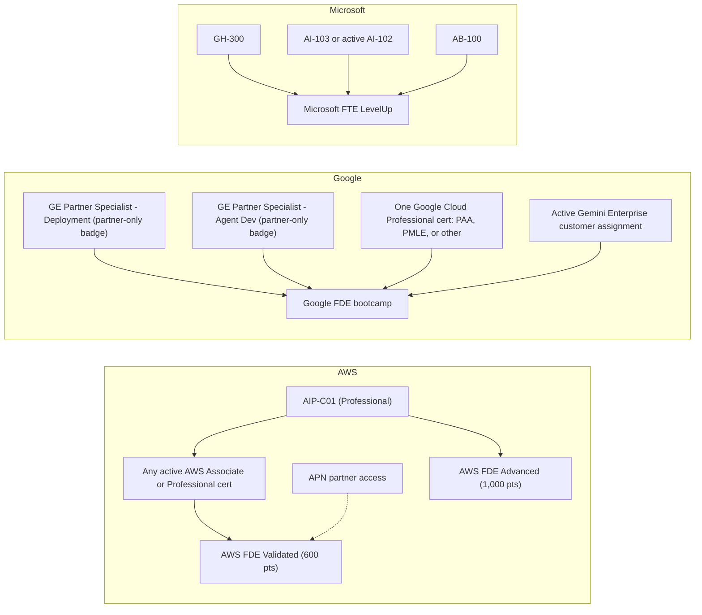

# GenAI / ML / AI-infra / FDE certification stack — ranking, sequencing, calendars

> **Read this first.** Three things in the brief's premise did not survive contact with the sources: (1) the Claude certifications are **not open to individuals** — they are gated to Claude Partner Network organisations; (2) Google's Agentic Architect is **not the first** GenAI credential with hands-on labs (AWS shipped timed hands-on "Demonstrated" microcredentials in Nov 2025); (3) **MLA-C01 is already retired** (English, 28 Sep 2026) and MLA-C02 goes GA 14 Jan 2027. The enumerated list also contains **24 credentials + 4 programme entries**, not "35 + 3" (see Research Question).

---

## 1. Prior

Initial beliefs recorded before searching (each is checkable; results are in §8 Delta).

| # | Proposition (what I believed going in) | Origin |
|---|---|---|
| P1 | Claude certifications are sold to anyone via Pearson VUE, 12-month validity. | recalled + brief |
| P2 | Google Professional Agentic Architect (PAA) is the first GenAI credential with hands-on labs. | brief (UNVERIFIED) |
| P3 | AWS ML Engineer Associate MLA-C01 is the current AWS ML associate exam. | recalled |
| P4 | FDE programme prerequisites are vendor-closed — another vendor's professional cert will not satisfy them. | recalled |
| P5 | Databricks GenAI Engineer and Context Engineer overlap heavily (≥ 50%). | recalled |
| P6 | Ordering the full stack by knowledge overlap saves ≥ 40% of cold-start study hours. | recalled |
| P7 | Hiring signal is strongest in partner/SI/GCC segments and weakest at frontier labs. | T0-11 F7 + recalled |

---

## 2. Research Question

> Given the credentials enumerated in the brief (as of 8 Nov 2026): which deliver the most career value per hour invested, what is their evidence-grounded rank order, and what sequence + calendar earns all (or a strategic subset) while maximising knowledge compounding, pass probability and hiring signal?

**Scope reconciliation (honest count).** The enumerated list contains 24 credentials (Claude 4, AWS GenAI 2, Google GenAI 4, Databricks GenAI 2, GitHub 3, NVIDIA 3, ML 4, AMD 1, AWS Business 1) and 4 programme entries (Google FDE, AWS FDE Validated, AWS FDE Advanced, Microsoft FTE). The brief's "35 + 3" cannot be reproduced from the list; I analysed what is enumerated, plus two Microsoft exams (AI-103, AB-100) that the Microsoft FTE programme hard-requires (the brief excludes Microsoft certifications but they are a prerequisite, so they are flagged as a **gap**, not scored).

**Method in one paragraph.** Vendor pages and exam guides first (Grade A), then partner press releases and consistent secondary sources (B/C), recall capped at D, and model-derived numbers labelled M. Overlap is computed by mapping every blueprint onto a 9-module taxonomy and taking the histogram intersection; hours savings apply a carry-over factor and a cap; all parameters are varied in sensitivity grids (§6.5–6.7). Nothing in the model is a measurement of learning; it is a transparent way to compare orderings.

**Evidence grades.** **A** official vendor page / exam guide / vendor-hosted JD · **B** ≥ 2 consistent secondary sources, or partner press release quoting vendor rules · **C** single secondary / community / training-vendor source · **D** recalled, unverified · **M** model estimate (derived, not measured).

---

## 3. Key Findings

**KF1 — Access, not price, is the binding constraint for 13 of 28 items.** Claude ×4 are open only to Claude Partner Network organisations; the two Gemini Enterprise Partner Specialist badges are partner-exclusive and exam-free; all four programmes are partner-gated; MLA-C01 is retired; GH-700 and AIB-C01 are beta (and PAA's GA exam only opens mid-November). An individual cannot simply "do all of them". [A — Pearson VUE Anthropic page; Anthropic Partner Academy eligibility/FAQ pages; Google Skills partner path; AWS exam pages]

**KF2 — Claude certifications are an institutional-demand instrument.** Four Pearson-VUE-proctored exams ($99 / $125 / $125 / $175; 720/1000; 120 min), 12-month validity with a free open-book renewal, and each certified individual counts toward the firm's partner tier (reported thresholds: Select ≥ 10, Preferred ≥ 100, Global Premier ≥ 1,000 active certified individuals). Content updates for three of the four exams land 7 Dec 2026. [A for fees/format/validity/eligibility; B for tier thresholds; official page not retrieved]

**KF3 — PAA is hybrid, but "first hands-on GenAI credential" is false.** PAA (GA fee $200, 1-year validity) combines a proctored MCQ with two hands-on labs delivered on Google Skills (< 5 h; labs due within two months of the MCQ pass). But AWS launched hands-on, timed-challenge microcredentials (Agentic AI Demonstrated, MLOps Demonstrated, and others) on 12 Nov 2025, and Google's own Gemini Enterprise specialist badges are lab-based. What PAA *may* be first at is a **professional-tier certification requiring both a proctored MCQ and labs**; lab proctoring is not stated, so "proctored hands-on" is **unverified**. [A — Google Cloud certification FAQ + PAA page; AWS Training & Certification blog; Credly AWS badge page]

**KF4 — AWS FDE is hands-on, free, and AWS-closed.** FDE Validated (600 pts) needs an active AWS Associate/Professional certification; FDE Advanced (1,000 pts) needs an active AIP-C01; assessments run in AWS-provisioned sandboxes. One participant account reports ≈ 6 h for Validated and ≈ 12 h more for Advanced. Pathways target AWS Partners (APN membership). [A for rules; C for hours]

**KF5 — The FDE prerequisite graph is vendor-closed.** No programme text accepts another vendor's credential: AWS names AWS certs; Google needs two Gemini Enterprise badges + one *Google Cloud* Professional certification + an active Gemini Enterprise customer project; Microsoft needs GH-300 + AI-103 (or active AI-102) + AB-100. No cross-vendor equivalence was found. Claude Architect – Professional will **not** satisfy Google's "1 professional certification". [A for AWS/Microsoft; B for Google (partner press release quoting rules)]

**KF6 — Minimum credential set for all three FDE ladders = 7 credentials.** AIP-C01 (covers both AWS levels) + PAA *or* PMLE + Gemini Enterprise Deployment badge + Gemini Enterprise Agent Development badge + GH-300 + AI-103 + AB-100; plus programme completions. ≈ $929 in exam fees (two Microsoft fees assumed $165 each) and ≈ 250 h optimised (359 h naive incl. 84 h of programme time). [A/B inputs; M for hours]

**KF7 — Exam churn is the norm, not the exception.** Claude exams update 7 Dec 2026; MLA-C01 retired 28 Sep 2026 (launched 2024 — launch date recalled, Grade D); PMLE guide rewritten 1 Jun 2026; Databricks GenAI Engineer exam changed 18 Mar 2026 (now includes agents/MCP); PAA beta → GA; GH-600 beta → GA; AIB-C01 beta; Google study material invalidated by product renames. Practical half-life of study material: ~6–9 months. [A]

**KF8 — Databricks GenAI Engineer ↔ Context Engineer: ~60% content overlap, ~37% hours saved.** The March 2026 GenAI Engineer guide already tests MCP/tool integration, persistent memory stores, MLflow agent evaluation and prompt versioning; Context Engineer (beta guide May 2026; 45 scored Qs, 90 min, $200, 2 years) goes deeper on compaction, memory architecture and failure-mode diagnosis. Neither "80%" nor "20%". [A for guides; M for percentages]

**KF9 — The agentic core is converging across vendors.** CCAR-F, GH-600, PAA, NCP-AAI, DB-Context and CCDV-F share agent loops, tool design/MCP, memory/context, guardrails and evaluation: mean pairwise blueprint overlap 57% (range 37–81%). One deep pass over this core amortises across five or six exams. GH-600 covers MCP as tool-use configuration/governance; PAA explicitly names MCP **and A2A** in a build-and-deploy context. [M with A/B-grade blueprint inputs; B for the GH-600/PAA depth comparison]

**KF10 — Ordering matters less than selection.** Across 3,000 random orderings of the 24 credentials the mean is 492 h (min 468, max 519) vs 815 h naive; the best order found is 458 h; the brief's listed order is 471 h. The *set* you choose moves total hours far more than the *order*: a 4-credential subset costs ≈ 144 h, whereas reordering all 24 moves the total by ≤ 60 h. Parameter sensitivity: savings range 29–58% (340–578 h). [M]

**KF11 — Hiring signal: no verified per-cert JD share > 10% (T0-11 F4 stands), but hard requirements exist in the SI segment.** Three Deloitte US JDs name AWS certs as requirements: "at least 3 of 6" (Cloud Practitioner, SAA, AIF-C01, AIP-C01, MLA-C01, Data Engineer Associate); "1 Associate + 1 Professional" (Professional list includes AIP-C01); and AIF-C01 outright for a GenAI Engineer role. One of the six named exams (MLA-C01) is already retired — JDs lag exams. [A for JD text]

**KF12 — Vendor-employed FDE roles screen on coding, partner-employed FDE capacity is credential-gated.** A Google Cloud Partner FDE listing requires Python without IDE/AI assistance in the interview; the partner ecosystem (Accenture's reported 1,000 Gemini Enterprise FDEs; Devoteam completing Google's FDE enablement) is where certification gates bite. [A for the JD; B for partner coverage]

**KF13 — Pay/outcome evidence is thin and mixed.** Employer-side surveys put the non-certified AI-skill premium (~14–15%) above the certification premium (~8%) (T0-11 F5; consistent with a Foote Partners figure repeated by secondary sources, C); the WGU Workforce Decoded finding reported by InfoWorld ranks hands-on experience (41%) above certifications (34%) as a hiring factor [B/C]; the only causal evidence remains Athey–Palikot (+11 pp employment for weak-signal candidates, ≈ 0 for strong résumés) [B, T0-11 F6]. No source found measures pay effect of *stacking*.

**KF14 — Cost: the whole in-scope list is ≈ $3,361 / ₹3.75 lakh (incl. 18% GST at ₹94.5/$); ~489 study hours in a practical order vs 815 naive.** $2,848 (₹3.18 lakh) of that has A/B-grade fee evidence; the rest uses placeholders (GH-700, MLA-C02) or single-source fees. Add ≈ $800 for a retake reserve (assumed fail rates; no pass-rate dataset exists). [A/B/C fees; M hours and reserve]

**KF15 — Databricks Context Engineer: "first" is a vendor claim; first *from a major platform vendor* is plausible, "first anywhere" is not.** Databricks markets it as the industry's first context-engineering certification; third-party AI CERTs sells an "AI+ Context Engineering" credential (launch date not found). Anthropic's CCAR-F devotes ~15% to context management but is not a dedicated credential. [A for the claim; C for the competitor]

**KF16 — Q1 2027 will move three rankings.** MLA-C02 GA 14 Jan 2027 (adds GenAI/agentic content; beta now at $75); AIB-C01 beta pricing/Early-Adopter window ends ≈ 15 Feb 2027; Gemini Enterprise badges expire 11 Feb 2027 (per brief; not independently verified). Beyond Q1: CompTIA AgentOps+ (reported Q2 2027), ISC2 AI security credential (2027), AMD ROCm higher tiers "coming". [A for AWS/ISC2; C for CompTIA via secondary source]

**KF17 — Signal-dilution risk is real for MCQ-only credentials.** Commercial "practice test / dump" listings for PAA appeared before its GA, and "real exam questions" listings exist for NVIDIA exams. Lab-based formats (PAA labs, AWS Demonstrated, AWS FDE sandbox) are structurally harder to dump. [C]

---

## 4. Recommendation

### 4.1 Value-ranked tier list (composite = W1 + W2 + W3 + W4 + W5, max 35)

Weights are the brief's own scales (hiring 0–10, utility 0–10, gateway 0–10, rigour 0–5, cost-efficiency 0–5); segment weights for W1 default to FL 10% / ST 15% / EP 25% / IT-GCC 25% / Partner-SI 25%. All component scores are **Grade M** anchored on cited evidence (rubric and sensitivity in §6.6). Tier bands: **T1 ≥ 26 · T2 20–25.9 · T3 17–19.9 · T4 < 17.** "Access" is shown separately because a high score is worthless if you cannot sit the exam.

| Rank | Credential | W1 hiring (0–10) | W2 utility (0–10) | W3 gateway (0–10) | W4 rigour (0–5) | W5 cost-eff (0–5) | **Composite (/35)** | Tier | Access | Notes |
|---|---|---|---|---|---|---|---|---|---|---|
| 1 | AWS Certified GenAI Developer – Professional | 5.8 | 8 | 9 | 4 | 3 | **29.8** | T1 | Open | Gateway to AWS FDE Advanced; satisfies FDE Validated; named in Deloitte FDE-AWS JD |
| 2 | Google Professional Agentic Architect (MCQ+labs) | 5.3 | 9 | 8 | 4.5 | 2 | **28.8** | T1 | Open (GA mid-Nov) | Only pro-tier cert needing MCQ **and** labs; Google FDE prerequisite; 1-yr validity; GA mid-Nov |
| 3 | Claude Certified Architect – Foundations | 4.7 | 8 | 6 | 3.5 | 4 | **26.1** | T1 | Partner-gated | Scenario-based; partner-tier counting; **access-gated**; 12-mo (free renewal) |
| 4 | Claude Certified Architect – Professional | 4.7 | 7 | 6 | 3.5 | 4 | **25.1** | T2 | Partner-gated | Heavy overlap with CCAR-F — sit only if seniority/partner role demands governance scope; access-gated |
| 5 | Google Professional ML Engineer | 5.3 | 7 | 6 | 4 | 2 | **24.3** | T2 | Open | Counts as 'Google Professional' for FDE; guide rewritten 1-Jun-26 |
| 6 | AWS ML Engineer Associate (C01 retired; C02 GA 14-Jan-27) | 5.0 | 7 | 5 | 3.5 | 3 | **23.6** | T2 | Beta→GA Jan-27 | C01 retired (EN) 28-Sep-26; take C02 (GA 14-Jan-27); counts as AWS Associate |
| 7 | Claude Certified Developer – Foundations | 4.2 | 7 | 5 | 3 | 4 | **23.1** | T2 | Partner-gated | Cheap; ~45% hours saved after CCAR-F; access-gated |
| 8 | GitHub Certified Agentic AI Developer | 4.0 | 7 | 4 | 3.5 | 4 | **22.6** | T2 | Open | Best-value agentic follow-on once CCAR-F/PAA known; GitHub-surface specific |
| 9 | Gemini Enterprise Partner Specialist – Agent Dev | 3.5 | 6 | 8 | 3 | 2 | **22.5** | T2 | Partner-only | **Partner-only, exam-free**; hard FDE prerequisite; expiry 11-Feb-27 (per brief) |
| 10 | GitHub Copilot | 4.0 | 4 | 6 | 2.5 | 5 | **21.6** | T2 | Open | Tier 2 only as Microsoft-FTE gate; otherwise Tier 3 |
| 11 | Gemini Enterprise Partner Specialist – Deployment | 3.5 | 5 | 8 | 3 | 2 | **21.5** | T2 | Partner-only | **Partner-only, exam-free**; hard FDE prerequisite |
| 12 | Databricks Context Engineer Associate | 3.8 | 8 | 3 | 3 | 3 | **20.8** | T2 | Open | Best context-engineering content; Databricks-stack only |
| 13 | Databricks GenAI Engineer Associate | 4.5 | 7 | 3 | 3 | 3 | **20.6** | T2 | Open | Databricks-stack hub; Mar-26 guide now includes MCP/agents |
| 14 | Databricks ML Engineer Professional | 4.0 | 7 | 2 | 4 | 2 | **19.1** | T3 | Open | Hardest Databricks exam; MLOps depth; stack-specific |
| 15 | NVIDIA NCP Agentic AI | 3.3 | 7 | 2 | 3.5 | 3 | **18.8** | T3 | Open | Only 7% NVIDIA-platform content (vendor-neutral heavy) but weak hiring signal |
| 16 | AWS Certified AI Practitioner | 3.9 | 4 | 3 | 2 | 5 | **17.9** | T3 | Open | On-ramp only; Deloitte JD list member; skip if you already hold AIP-C01 |
| 17 | NVIDIA NCP Generative AI LLMs | 3.1 | 8 | 1 | 3.5 | 2 | **17.6** | T3 | Open | Inference/training roles only |
| 18 | Claude Certified Associate – Foundations | 2.6 | 3 | 3 | 2.5 | 5 | **16.1** | T4 | Partner-gated | Non-technical; counts toward partner headcount only |
| 19 | NVIDIA NCA Generative AI LLMs | 2.6 | 6 | 1 | 2 | 4 | **15.7** | T4 | Open | Foundational; low signal |
| 20 | AMD ROCm Certified Associate | 1.1 | 5 | 1 | 3 | 5 | **15.2** | T4 | Open (free) | Free; AMD-ecosystem only; no outside recognition found |
| 21 | AWS Certified AI Business Strategist (beta) | 2.8 | 3 | 2 | 2.5 | 5 | **15.2** | T4 | Beta | Beta; business role; not for engineers |
| 22 | Google Generative AI Leader | 3.4 | 3 | 2 | 1.5 | 5 | **14.9** | T4 | Open | Non-technical literacy |
| 23 | Databricks ML Engineer Associate | 3.3 | 5 | 1 | 2.5 | 3 | **14.8** | T4 | Open | Superseded by Pro/AWS/Google ML if you already hold any |
| 24 | GitHub Agentic AI Business Professional (beta) | 1.8 | 2 | 1 | 2 | 5 | **11.8** | T4 | Beta | Beta; PM/BA audience |

**Final tiering after access / redundancy adjustments**

| Tier | Credentials | Condition |
|---|---|---|
| **Tier 1 — must-do** | **AIP-C01**, **PAA**, **CCAR-F** | CCAR-F only if you can obtain Claude Partner Network access (employer). Without it, use GH-600 as the agentic-core exam and take Anthropic's free Academy courses for the knowledge. |
| **Tier 1 programme** | **AWS FDE Validated → Advanced** | Free, hands-on, needs APN membership + AIP-C01. Best hours-to-signal ratio on the list. |
| **Tier 2 — strong situational** | PMLE, MLA-C02 (wait for GA), GH-600, CCDV-F, DB-Context, DB-GenAI, GE-Deploy/GE-AgentDev (partner-only), GH-300 (only as Microsoft-FTE gate), CCAR-P (only if governance/seniority scope demands it) | Pick by stack: Databricks shop → DB pair; ML-heavy role → PMLE + MLA-C02; Microsoft/GitHub-centric employer → GH-600 (+ GH-300). Google FDE and Microsoft FTE programmes: Tier 2, only with employer sponsorship and a named project. |
| **Tier 3 — nice-to-have** | DB-ML-P, NCP-AAI, AIF-C01 (on-ramp only), NCP-GENL | AIF-C01 is worth it only as a cheap on-ramp (or because a JD names it, as Deloitte's does). NCP-GENL only for inference/training roles. |
| **Tier 4 — skip / learning-only** | CCAO-F, NCA-GENL, ROCm-A, AIB-C01, GenAI Leader, DB-ML-A, GH-700 | Non-technical or foundational; study the material if useful, skip the fee unless an employer requires it. ROCm-A is free: do it only if you work on AMD GPUs. |

### 4.2 Optimal sequencing plan (exploit overlap, respect windows)

**Rules (in priority order).**
1. **Gate first, study second.** Confirm access (Claude Partner Network, APN, Google partner) before booking anything; if you are not at a partner, the plan collapses to the open credentials (AIP-C01, PAA, GH-600, Databricks, NVIDIA, PMLE, MLA-C02).
2. **Agentic core first.** CCAR-F (or GH-600) → AIP-C01 → PAA. After this trio every remaining credential's marginal cost falls (e.g., CCDV-F 25 → ≈ 14 h; DB-Context 30 → ≈ 18 h; GH-600 35 → ≈ 19 h; NCP-AAI 40 → ≈ 22 h; see §6.5).
3. **Cheap, expiring or windowed items by their window, not by overlap.** Gemini badges (expire 11 Feb 2027) and the Google FDE bootcamp before that; AIB-C01 beta before ≈ 15 Feb 2027; MLA-C02 on/after 14 Jan 2027; Claude exams whose content updates on 7 Dec 2026 *after* that date.
4. **12-month credentials last** (Claude ×4, PAA) so they are fresh when you interview, then renew (Claude: free open-book).
5. **Cluster the ML exams** (PMLE ↔ MLA-C02 ↔ DB-ML-A/P share 59–86% of blueprint) and take them back-to-back; do not interleave with agentic exams.

**"If you study X first, you already know …"** (directed % of the target's cold-start hours saved; carry-over 0.6, cap 45%; Grade M):

| studied first ↓ / target → |CCAR-F|GH-600|PAA|NCP-AAI|DB-GenAI|DB-Context|AIP-C01|CCDV-F|CCAR-P|PMLE|MLA-C02|DB-ML-P|
|---|---|---|---|---|---|---|---|---|---|---|---|---|
|**CCAR-F**|—|40|33|36|30|29|22|45|43|13|13|8|
|**AIP-C01**|24|31|35|33|41|28|—|24|33|18|27|12|
|**PAA**|34|40|—|43|38|28|35|34|42|25|18|12|
|**GH-600**|40|—|39|42|29|24|29|35|41|9|11|10|
|**DB-GenAI**|30|29|36|35|—|37|39|32|35|17|17|17|
|**MLA-C02**|14|12|17|14|17|12|27|14|15|45|—|43|
|**PMLE**|14|10|25|13|17|12|17|13|14|—|45|43|
|**AIF-C01**|16|19|23|19|31|15|31|22|22|24|25|18|

Highlights: CCAR-F → CCDV-F **45%**, CCAR-P **43%**, GH-600 **40%**, NCP-AAI **36%**; PAA → NCP-AAI **43%**, CCAR-P **42%**, GH-600 **40%**; DB-GenAI → DB-Context **37%**; MLA-C02 ↔ PMLE **45%** each way; ML cluster → agentic exams **10–25%** (do not expect transfer across clusters).

**Total hours (24 in-scope credentials, 'Grade M').**

| Ordering | Hours | vs naive |
|---|---|---|
| Naive: every credential from cold start | 815 | — |
| Random orders (mean of 3,000; min–max) | 492 (468–519) | −40% |
| Brief's listed order | 471 | −42% |
| Practical constrained order (§4.3 Plan C order, exam-study only) | 489 | −40% |
| Best order found (local search; not proven optimal) | 458 | −44% |
| Sensitivity: carry-over ρ ∈ {0.4, 0.6, 0.8} × cap ∈ {30, 45, 60}% | 340–578 | −29% to −58% |

### 4.3 Calendars (start Monday 9 Nov 2026)

Common assumptions: hours are *optimised study hours × 1.10 contingency* from the overlap model (not measured); the next block starts the day after each exam; exam dates fall on weekdays; Plans A/B pause 24 Dec–1 Jan; Plan C does not. Partner-run dates (Google FDE bootcamp) are placeholders. **Study h\*** = hours incl. contingency.

#### Plan A — working engineer, 10 h/week (strategic subset, not the whole stack)

Persona: ≥ 6 months of LLM/agent work, AWS familiarity, employer in the Claude Partner Network and APN (otherwise swap CCAR-F → GH-600 first; shift ≈ 1 week). Core = 5 blocks, **171.4 h**, finishes **Tue 23-Mar-27**; with the optional Databricks pair **214.3 h**, finishes **Fri 23-Apr-27**. Fees: core $790 (≈ ₹88k incl. GST); with DB pair $1,190 (≈ ₹133k).

| # | Block | Study h* | Study starts | Exam / completion | Notes |
|---|---|---|---|---|---|
| 1 | CCAR-F | 38.5 | Mon 09-Nov-26 | Mon 07-Dec-26 | needs Claude Partner Network access via employer (else swap GH-600 first) |
| 2 | GH-600 | 23.0 | Tue 08-Dec-26 | Mon 04-Jan-27 |  |
| 3 | AIP-C01 | 50.8 | Tue 05-Jan-27 | Tue 09-Feb-27 |  |
| 4 | AWS FDE Validated → Advanced pathways (Skill Builder; needs APN membership) | 19.8 | Wed 10-Feb-27 | Tue 23-Feb-27 |  |
| ▶ | **GATE 1 — decide before PAA: do you have ≥1 public, shipped agent project and a named reader (JD / partner programme) for the next credential?** | | | | |
| 5 | PAA | 39.3 | Wed 24-Feb-27 | Tue 23-Mar-27 | GA exam from mid-Nov-26; labs due ≤2 months after MCQ pass |
| ▶ | **GATE 2 — Tier-1 trio + AWS FDE done. Stop here unless a named employer/programme requires Phase 3.** | | | | |
| 6 | DB-GenAI | 24.2 | Wed 24-Mar-27 | Fri 09-Apr-27 | Phase 3 — only if Databricks is in your stack |
| 7 | DB-Context | 18.6 | Sat 10-Apr-27 | Fri 23-Apr-27 | Phase 3 — ~43% of hours saved by DB-GenAI |
| ▶ | **GATE 3 — end of plan. Further credentials only with an explicit employer or programme requirement.** | | | | |

*Extension if you really want everything at 10 h/week:* ≈ 678 h ÷ 10 ≈ 68 weeks (to ≈ spring 2028) — not recommended; credentials would expire mid-plan and the decision gates would have long since said stop.

#### Plan B — career switcher, 20 h/week (14 h certification + 6 h portfolio)

Persona: no production LLM experience yet; weak-signal profile (the Athey–Palikot population). All exam hours ×1.35 for missing experience; a 40 h foundation block first. Only **open-access** credentials (no partner gating). **291.1 h** of study, finishing **Mon 19-Apr-27**; ≈ 138 h of portfolio time in parallel (≈ 1–2 substantial or ≈ 3 small shipped projects). Fees: $915 (≈ ₹102k incl. GST).

| # | Block | Study h* | Study starts | Exam / completion | Notes |
|---|---|---|---|---|---|
| 1 | Foundation block: Python + LLM-API basics; free Anthropic Academy courses; AWS Skill Builder free AI Practitioner plan | 40.0 | Mon 09-Nov-26 | Mon 30-Nov-26 | not an exam; portfolio project #1 starts here |
| 2 | AIF-C01 | 29.7 | Tue 01-Dec-26 | Tue 15-Dec-26 | experience multiplier ×1.35 applied to all B exams |
| 3 | AIP-C01 | 71.5 | Wed 16-Dec-26 | Fri 29-Jan-27 |  |
| ▶ | **GATE 1 — after AIF-C01 + AIP-C01: portfolio has ≥2 small shipped projects? start applying now; do not wait for the rest.** | | | | |
| 4 | MLA-C02 | 57.6 | Sat 30-Jan-27 | Mon 01-Mar-27 | take on/after MLA-C02 GA 14-Jan-27 (beta now: $75, delayed results) |
| ▶ | **GATE 2 — after MLA-C02: re-test the market. PAA is a stretch for <3 yrs cloud experience; skip if interview conversion is already healthy.** | | | | |
| 5 | PAA | 62.8 | Tue 02-Mar-27 | Fri 02-Apr-27 | stretch: recommended 3+ yrs cloud / 1+ yr agents |
| 6 | GH-600 | 29.5 | Sat 03-Apr-27 | Mon 19-Apr-27 | optional |
| ▶ | **GATE 3 — end of plan.** | | | | |

#### Plan C — "the whole stack as fast as possible", 40 h/week

Persona: experienced engineer with partner access to Claude, AWS (APN), Google and Microsoft programmes — **an explicit assumption**; without it Plan C is infeasible. Includes the 24 credentials + AI-103 + AB-100 + three FDE ladders. **677.7 h**, **≈ 21.1 weeks**, finishes **Tue 06-Apr-27**. Fees ≈ $3,691 (≈ ₹4.12 lakh incl. GST) + ≈ $890 retake reserve. 40 h/week for five months is a high-attrition load; the gates are mandatory, not decorative.

| # | Block | Study h* | Study starts | Exam / completion | Notes |
|---|---|---|---|---|---|
| 1 | CCAR-F | 38.5 | Mon 09-Nov-26 | Mon 16-Nov-26 | assumes ≥6 months hands-on Claude work; partner access |
| 2 | GH-600 | 23.0 | Tue 17-Nov-26 | Mon 23-Nov-26 |  |
| 3 | AIP-C01 | 50.8 | Tue 24-Nov-26 | Wed 02-Dec-26 | assumes prior AWS fundamentals |
| 4 | AWS FDE Validated → Advanced pathways | 19.8 | Thu 03-Dec-26 | Mon 07-Dec-26 |  |
| 5 | AIB-C01 | 12.7 | Tue 08-Dec-26 | Thu 10-Dec-26 | take in beta ($50) before ~15-Feb-27 for Early Adopter badge |
| 6 | PAA | 39.3 | Fri 11-Dec-26 | Thu 17-Dec-26 | first GA attempt; labs ≤2 months after MCQ pass |
| ▶ | **GATE 1 (mid-Dec 2026) — Tier 1 + AWS FDE complete (~170 h). Hard stop-and-assess: shipped projects? interview conversion? named reader for the rest?** | | | | |
| 7 | GE-Deploy | 13.3 | Fri 18-Dec-26 | Mon 21-Dec-26 | partner-only; badges expire 11-Feb-27 (per brief) — finish and use first |
| 8 | GE-AgentDev | 15.1 | Tue 22-Dec-26 | Thu 24-Dec-26 |  |
| 9 | Google FDE bootcamp (4-day in-person, partner-run) | 35.2 | Fri 25-Dec-26 | Thu 31-Dec-26 | dates set by Google/partner; needs active Gemini Enterprise project |
| ▶ | **GATE 2 (end-Dec 2026) — AWS and Google FDE prerequisites cleared. Continue only for a named reader.** | | | | |
| 10 | DB-GenAI | 24.2 | Fri 01-Jan-27 | Tue 05-Jan-27 |  |
| 11 | DB-Context | 18.6 | Wed 06-Jan-27 | Mon 11-Jan-27 |  |
| 12 | NCP-AAI | 24.2 | Tue 12-Jan-27 | Mon 18-Jan-27 |  |
| 13 | AIF-C01 | 13.0 | Tue 19-Jan-27 | Thu 21-Jan-27 |  |
| 14 | GenAI Leader | 7.3 | Fri 22-Jan-27 | Mon 25-Jan-27 |  |
| 15 | GH-300 | 14.1 | Tue 26-Jan-27 | Thu 28-Jan-27 |  |
| 16 | AI-103 | 24.2 | Fri 29-Jan-27 | Tue 02-Feb-27 |  |
| 17 | AB-100 | 21.2 | Wed 03-Feb-27 | Mon 08-Feb-27 |  |
| 18 | Microsoft FTE: Project Ready + CoE/HVE (≈34 h incremental) | 37.4 | Tue 09-Feb-27 | Mon 15-Feb-27 |  |
| ▶ | **GATE 3 (mid-Feb 2027) — all three FDE ladders done (minimum FDE set achieved).** | | | | |
| 19 | GH-700 | 7.3 | Tue 16-Feb-27 | Wed 17-Feb-27 |  |
| 20 | MLA-C02 | 42.6 | Thu 18-Feb-27 | Thu 25-Feb-27 | GA 14-Jan-27 |
| 21 | PMLE | 42.4 | Fri 26-Feb-27 | Fri 05-Mar-27 |  |
| 22 | DB-ML-A | 19.3 | Sat 06-Mar-27 | Tue 09-Mar-27 |  |
| 23 | DB-ML-P | 30.3 | Wed 10-Mar-27 | Mon 15-Mar-27 |  |
| ▶ | **GATE 4 — ML cluster done; remaining items are Tier 3/4: justify each individually.** | | | | |
| 24 | NCA-GENL | 15.1 | Tue 16-Mar-27 | Thu 18-Mar-27 |  |
| 25 | NCP-GENL | 39.1 | Fri 19-Mar-27 | Thu 25-Mar-27 |  |
| 26 | ROCm-A | 5.5 | Fri 26-Mar-27 | Fri 26-Mar-27 |  |
| 27 | CCDV-F | 15.1 | Sat 27-Mar-27 | Mon 29-Mar-27 | after 7-Dec-26 content update; use guide dated 17-Nov-26 |
| 28 | CCAR-P | 24.2 | Tue 30-Mar-27 | Mon 05-Apr-27 | after 7-Dec-26 update |
| 29 | CCAO-F | 4.8 | Tue 06-Apr-27 | Tue 06-Apr-27 | after 7-Dec-26 update |
| ▶ | **END — Claude trio valid to Mar–Apr 2028; CCAR-F (Nov-26) and PAA (Dec-26) lapse Nov/Dec 2027 unless renewed.** | | | | |

#### Decision gates (apply to every plan)

| Gate | Trigger | Question | Default action |
|---|---|---|---|
| G0 | before spending | Do I have access (partner network / APN), and which employer segment am I targeting? | Frontier lab / AI startup target → cap at Tier 1 (max three exams) and put the hours into portfolio. |
| G1 | after the first 1–2 exams (~65–100 h) | ≥ 1 public, shipped agent project? Applications out? | If not, pause credentials and build. |
| G2 | after Tier-1 trio + AWS FDE (~170 h) | Is the *next* credential named by a JD, a partner-tier requirement or a programme gate? | **No named reader → stop certifying.** |
| G3 | after 5 credentials | Has interview conversion moved since G1? | If flat, stop; further certs have ≈ 0 evidence of marginal value (§6.9). |
| G4 | any new credential | Will it expire before I use it? | 12-month credentials only within 3 months of a planned job search. |

---

## 5. Alternatives Considered

| Alternative | What it would look like | Why not the default | When it wins |
|---|---|---|---|
| **A. Portfolio-only** | Put all hours into shipped agent projects and OSS | No causal evidence exists for portfolio effects either; certificates have the only causal evidence found (Athey–Palikot, weak-signal candidates) and gate partner/SI roles outright | Frontier-lab or AI-startup targets; strong existing résumé |
| **B. Microcredentials-only (AWS "Demonstrated")** | Free hands-on timed-lab badges (Agentic AI, MLOps, etc.) | Cheapest hands-on signal, but no JD or programme found that *names* them as a requirement | Career switchers who need a verifiable artefact fast; pair with Plan B |
| **C. One-vendor depth** (AWS ladder: AIF → AIP → MLA → FDE) | Four AWS items, ≈ 200 h | Strongest *verified* JD requirement evidence (Deloitte) and a free FDE ladder; but concentrates risk in one vendor and ignores the Claude/Google partner markets | Target employer is an AWS-centric SI/GCC |
| **D. Vendor-neutral bundle** (NVIDIA NCA/NCP-GENL/NCP-AAI) | NVIDIA ladder ≈ 125 h | NCP-AAI has only ~7% NVIDIA-platform content (good neutrality) but weak hiring signal in every segment audited; no partner programme counts it | GPU/inference-focused roles |
| **E. Full stack in order of the brief** | Take everything in listed order | 471 h vs 458 h best: nearly as good on hours, but ignores windows (Claude Dec-7 update, MLA-C02 GA, Gemini badge expiry) and has no stop rules | Never as a plan; fine as a catalogue |
| **F. Include Microsoft ladder fully** (AI-103, AB-100, AB-731, GH-300/600) | Microsoft-centric path | Excluded by the requester, but **mandatory** for Microsoft FTE; flagged as a gap in §7 | Microsoft-partner employer |

---

## 6. Detailed Findings

### 6.1 Fact sheets — logistics (verified where graded A)

Credly earner counts: **not retrievable.** Credly badge pages fetched without login (e.g. AWS Agentic AI Demonstrated, Gemini Enterprise Deployment) expose no earner count, so the "market-penetration proxy" requested in Phase 1(c) could not be collected for any credential. Secondary proxies only: Anthropic's own partner-programme materials and press coverage cite tens of thousands of certified individuals across partner firms (e.g. one secondary source says > 36,000 across 1,300+ organisations by late July 2026 [C/D]; EPAM publicly targets > 10,000 certified architects [A, Anthropic blog]). Vendor pass rates are not published; community reports are anecdotal (one AIP-C01 write-up: 779/1000 after ~20 h as a former AWS consultant [C]; Databricks passing mark ≈ 70% [C]).

| ID | Credential | Format (Qs · minutes · pass) | Fee | Validity | Delivery / proctoring | Access · status | Grade |
|---|---|---|---|---|---|---|---|
| 1.1.1 | CCAO-F | ~60 Q MCQ/MR, 7 domains · 120 · 720/1000 | $99 | 12 mo; free open-book renewal | Pearson VUE (OnVUE / test centre) | Partner-network gated; content update 7-Dec-26 | A (format, validity, delivery) · B (fee, Q-count) |
| 1.1.2 | CCDV-F | ~53 Q, 8 domains · 120 · 720 | $125 | 12 mo | Pearson VUE | gated; update 7-Dec-26 | A / B |
| 1.1.3 | CCAR-F | 60 Q from 4 of 6 scenarios, 5 domains · 120 · 720 | $125 | 12 mo | Pearson VUE | gated; no Dec-7 update announced | A |
| 1.1.4 | CCAR-P | ~63 Q, 7 domains · 120 · 720 | $175 | 12 mo | Pearson VUE | gated; update 7-Dec-26 | A / B |
| 1.2.1 | AIF-C01 | 65 Q (50 scored) · 90 · 700/1000 (D) | $100 | 3 yr (C — AWS standard policy) | Pearson VUE centre / online | Open | A (fee, format) |
| 1.2.2 | AIP-C01 | 75 Q (65 scored), MC/MR · 180 · 750/1000 | $300 | 3 yr (C) | Pearson VUE centre / online | Open | A |
| 1.3.1 | GenAI Leader | 50–60 MCQ · 90 · not published | $99 | 3 yr | online or onsite proctored | Open | A |
| 1.3.2 | PAA | GA: MCQ (~2 h) + 2 hands-on labs (< 5 h total; labs ≤ 2 months after MCQ pass) | $200 GA ($120 beta) | 1 yr | MCQ proctored (online / test centre); labs on Google Skills — lab proctoring **not stated** | Open; GA mid-Nov-26 | A |
| 1.3.3 | GE Partner Specialist – Deployment | exam-free; earned by completing three skill badges (challenge labs) | no exam fee found | badge; expiry 11-Feb-27 (**per brief; not independently verified**) | none (lab-based) | Partner-exclusive | A (Credly + partner path) |
| 1.3.4 | GE Partner Specialist – Agent Dev | exam-free; earning criteria not retrieved | no exam fee found | expiry 11-Feb-27 (per brief) | — | Partner-exclusive | A/C |
| 1.4.1 | DB GenAI Engineer Assoc. | 45 scored MC/MS · 90 · ≈ 70% (C) | $200 | 2 yr | online proctored | Open; current guide 18-Mar-26 | A |
| 1.4.2 | DB Context Engineer Assoc. | 45 scored · 90 · — | $200 | 2 yr | online proctored or test centre | Open; beta guide May-26; page modified 6-Nov-26 | A |
| 1.5.1 | GH-300 Copilot | not verified (≈ 65 Q recalled, D) | $99 (C) | 2 yr (C) | Pearson VUE (assumed) | Open | C/D |
| 1.5.2 | GH-600 Agentic AI Dev | 120 · 700/1000; Q-count not verified; may include interactive components | $165 GA (C; beta fees of $83–99 reported) | 2 yr (C) — conflicts with Microsoft boilerplate "expire annually" | proctored (Pearson VUE) | Open; GA | A (weights, format) · C (fee, validity) |
| 1.5.3 | GH-700 Agentic AI Business Prof. | 100 min (C) · 700/1000 | not found | not found | — | Beta | A (existence) · C |
| 1.6.1 | NCA-GENL | 50–60 Q · 60 | $125 | 2 yr | remote proctored (Certiverse) | Open | A |
| 1.6.2 | NCP-GENL | 60–70 Q · 120 | $200 | 2 yr | Certiverse remote | Open | A |
| 1.6.3 | NCP-AAI | 60–70 Q · 120 | $200 | 2 yr | Certiverse remote | Open | A |
| 2.1 | PMLE | 50–60 Q · 120 | $200 | 2 yr (C) | online / onsite proctored | Open; guide dated 1-Jun-26 | A / B |
| 2.2 | AWS MLE Assoc. | C01: 65 Q · 130 · 720 · $150 — **retired in English 28-Sep-26**. C02 beta: 85 Q · 170 min · $75; GA 14-Jan-27 | $150 assumed at GA (D) | 3 yr | Pearson VUE | Beta → GA | A (retirement, beta) · C (GA date via secondary summary of AWS notice) |
| 2.3 | DB ML Engineer Assoc. | 48 scored · 90 | $200 | 2 yr | online proctored | Open; Aug-26 guide | B/C |
| 2.4 | DB ML Engineer Prof. | 59 scored · 120 | $200 | 2 yr | online proctored | Open | B/C |
| 3.1 | AMD ROCm Certified Assoc. | 3-h hands-on workshop + 1-h exam (launched 24-Jul-26) | free | not found | ID/proctoring policy exists; delivered at AMD events / AI Academy | Open | A |
| 4.1 | AWS AI Business Strategist (AIB-C01) | beta: 85 Q · 170 min; standard ≈ 130 min (C) | $50 beta · $100 standard | not found | Pearson VUE | Beta (Early Adopter badge window ≈ 15-Feb-27, C) | A (fee) · C |

### 6.2 Blueprint domains (weights as retrieved)

| Credential | Domain weights | Grade |
|---|---|---|
| CCAR-F | Agentic architecture & orchestration 27 · Claude Code configuration & workflows 20 · Prompt engineering & structured output 20 · Tool design & MCP integration 18 · Context management & reliability 15 | B (≥ 5 consistent secondary sources; official guide is behind Partner Academy login) |
| AIP-C01 | FM integration, data management & compliance 31 · Implementation & integration 26 · AI safety, security & governance 20 · Operational efficiency & optimisation 12 · Testing, validation & troubleshooting 11 | A |
| PAA | five sections ≈ 13 (low-code agents) · 17 (coding agents / dev tooling) · 33 (custom agents: ADK, multi-agent, MCP/A2A) · 22 (evaluate & deploy) · 15 (secure & govern); section labels paraphrased | A (weights) · M (labels) |
| GH-600 | six domains: 15–20 · 20–25 (tool use) · 10–15 · 15–20 · 15–20 · 10–15 | A (ranges) |
| DB Context Eng. | foundations & failure modes 16 · system prompt & instruction design 9 · retrieval & Genie 20 · memory architecture (Lakebase + MLflow) 18 · tool design & MCP 13 · compression/compaction 11 · multi-agent & long-horizon 13 | B (derived from official guide by a study repo) |
| DB GenAI Eng. | design 14 · assembling & deploying 22 · governance 8 · evaluation & monitoring 12 · data prep + app development = remaining 44 (split unknown) | A/C |
| NCA-GENL | core ML/AI 30 · software development 24 · experimentation 22 · data analysis & visualisation 14 · trustworthy AI 10 | A |
| NCP-AAI | agent architecture & design 15 · NVIDIA platform 7 · safety/ethics 5 · human-in-the-loop 5 · six further domains not retrieved | A (partial) |
| DB ML Assoc. / Prof. | 38 / 19 / 31 / 12 · 44 / 44 / 12 | C |
| AIB-C01 | 24 / 28 / 24 / (24 implied) | C |
| GenAI Leader | four domains (fundamentals, Google Cloud offerings, improving outputs, business strategy); weights unpublished | A (structure) |
| Not retrieved | CCDV-F, CCAO-F, CCAR-P (domain count only); NCP-GENL; GE badges; GH-300 (recalled); AIF-C01 (recalled D); ROCm | gap |

### 6.3 FDE programmes, prerequisite graph, minimum set

| Programme | Hard prerequisites | Format | Cost | Hours | Grade |
|---|---|---|---|---|---|
| **AWS FDE Validated** | Active AWS Associate **or** Professional certification; AWS Partner access (APN) | Pathway: knowledge assessment + SimuLearn labs + microcredentials; 600-point pathway (C); hands-on in AWS-provisioned sandboxes | free | ≈ 6 h (C) | A / C |
| **AWS FDE Advanced** | Active **AIP-C01**; 1,000-point pathway (C) | as above, more advanced labs | free | ≈ +12 h (C) | A / C |
| **Google FDE (Gemini Enterprise)** | **2 Gemini Enterprise certifications** (Deployment + Agent Development partner specialists) + **1 Google Cloud Professional certification** + active assignment to a Gemini Enterprise customer project | 4-day partner-run enablement programme | not found | 32 h contact | B (partner press release quoting rules; Google's own FDE page not retrieved) |
| **Microsoft FTE (LevelUp)** | **GH-300 + AI-103 (or active AI-102) + AB-100** | 11 courses over 3 milestones; reported ≈ 86 h; free exam vouchers for partner staff on ≥ 80% practice scores (B) | free (partner) / exam fees otherwise | ≈ 86 (≈ 76 net of GH-300 prep) | A/B |

**Minimum set for all three ladders (7 credentials):** AIP-C01 · PAA (or PMLE: 2-year validity, no labs) · GE-Deployment · GE-Agent Dev · GH-300 · AI-103 · AB-100. Exam fees ≈ **$929 / ₹103.6k incl. GST** (AI-103 and AB-100 fees assumed $165 each, Grade D); hours naive 275 + 84 programme = **359**, optimised **166 + 84 = 250** (best order: GE-Deploy → GH-300 → PAA → GE-AgentDev → AIP-C01 → AI-103 → AB-100). **Binding constraints:** Gemini badges are partner-only and (per brief) expire 11 Feb 2027; Google FDE needs an active project that an individual cannot self-assign; AWS FDE needs partner access. **Cross-vendor:** none of the three programmes accepts another vendor's credential in any source found.

### 6.4 Hiring-signal audit

**What was done.** Targeted web searches for explicit credential mentions in job listings (Deloitte, Google Careers, aggregator mirrors), partner-programme requirement pages, and secondary analyses of job-posting certification mention rates. **What was not done (honest gaps):** live count queries on LinkedIn / Indeed / Wellfound / Ashby (not executable with the tools available); recruiter Boolean-string audits; ATS-filter evidence. A search for postings naming the "Claude Certified Architect" returned mostly unrelated "architect" listings — **no posting requiring or preferring it was found** (Grade C; absence of evidence, not evidence of absence — the credential is < 8 months old).

**Verified hard requirements and gates**

| Signal | Evidence | Segment | Grade |
|---|---|---|---|
| Deloitte "Forward Deployed Engineer – AWS": ≥ 3 of 6 named AWS certs (Cloud Practitioner, SAA, AIF-C01, AIP-C01, MLA-C01, Data Engineer Assoc.) | JD text (req. 350570 / 329080, mirrors) | IT services / SI | A |
| Deloitte "Senior AWS FDE – GPS": ≥ 1 AWS Associate-level **and** ≥ 1 Professional-level (SAP, DevOps Pro, **AIP-C01**) | apply.deloitte.com JD (req. 367967) | SI | A |
| Deloitte "GenAI Engineer": AWS Certified AI Practitioner listed as required | apply.deloitte.com JD (req. 316160) | SI | A |
| AWS FDE Validated / Advanced prerequisites | AWS APN blog | Partner | A |
| Google FDE: 2 Gemini Enterprise certs + 1 Professional | Devoteam press release | Partner | B |
| Microsoft FTE: GH-300 + AI-103/AI-102 + AB-100 | LevelUp programme page | Partner | A/B |
| Claude partner tiers: certified-individual counts per firm | Anthropic / secondary partner-network write-ups | Partner | A (existence) · B (thresholds) |
| Google Cloud Partner FDE role: coding interview in Python without IDE/AI assistance | Google Careers listing | Vendor-employed | A |

**Observations.** (i) Three separate Deloitte JDs reference AWS certifications, one of which lists a retired exam (MLA-C01): **JDs lag exams**, so a "new" credential has weaker keyword presence than an "old" one for 12–24 months. (ii) Two of the six AWS options in the "3 of 6" JD are non-AI certs: the AI credential alone does not satisfy it; the benefit is *AWS-family stacking*. (iii) Secondary analyses say AI certifications are usually "preferred", not "required", in postings (C) and that India's services/GCC market weighs formal credentials more heavily than Western product firms (C, aitechconnect). (iv) No source found shows any per-certification share of AI JDs above 10% (T0-11 F4 stands). (v) Searches for evidence that *stacking* is a negative signal at frontier labs found only opinion-grade statements (C/D) — see §6.9(b).

**Segment scores used for W1** (0–10, Grade M anchored on the rows above; 0 = no evidence anyone screens or counts it, 5 = occasional "preferred"/counts toward internal mobility, 8–10 = explicit hard requirement or partner-tier counting):

| Credential | Frontier lab | AI startup | Enterprise product | IT services / GCC | Partner / SI | W1 (weighted) |
|---|---|---|---|---|---|---|
| AIP-C01 | 1 | 3 | 5 | 7 | 9 | 5.8 |
| PAA | 1 | 3 | 5 | 6 | 8 | 5.3 |
| CCAR-F | 1 | 2 | 3 | 6 | 8 | 4.7 |
| CCAR-P | 1 | 2 | 3 | 6 | 8 | 4.7 |
| PMLE | 1 | 3 | 6 | 6 | 7 | 5.3 |
| MLA-C02 | 1 | 3 | 5 | 6 | 7 | 5.0 |
| CCDV-F | 1 | 2 | 3 | 5 | 7 | 4.2 |
| GH-600 | 1 | 3 | 4 | 4 | 6 | 4.0 |
| GE-AgentDev | 0 | 0 | 1 | 5 | 8 | 3.5 |
| GH-300 | 0 | 2 | 4 | 5 | 6 | 4.0 |
| GE-Deploy | 0 | 0 | 1 | 5 | 8 | 3.5 |
| DB-Context | 1 | 3 | 4 | 4 | 5 | 3.8 |
| DB-GenAI | 1 | 3 | 5 | 5 | 6 | 4.5 |
| DB-ML-P | 1 | 3 | 5 | 4 | 5 | 4.0 |
| NCP-AAI | 1 | 3 | 4 | 3 | 4 | 3.3 |
| AIF-C01 | 0 | 1 | 3 | 6 | 6 | 3.9 |
| NCP-GENL | 2 | 3 | 4 | 3 | 3 | 3.1 |
| CCAO-F | 0 | 1 | 2 | 3 | 5 | 2.6 |
| NCA-GENL | 1 | 2 | 3 | 3 | 3 | 2.6 |
| ROCm-A | 1 | 2 | 1 | 1 | 1 | 1.1 |
| AIB-C01 | 0 | 0 | 3 | 4 | 4 | 2.8 |
| GenAI Leader | 0 | 1 | 3 | 5 | 5 | 3.4 |
| DB-ML-A | 0 | 2 | 4 | 4 | 4 | 3.3 |
| GH-700 | 0 | 0 | 2 | 2 | 3 | 1.8 |

### 6.5 Knowledge-overlap model

**Taxonomy (9 modules).** A GenAI fundamentals/prompting/model selection · B retrieval/RAG/data prep · C agent architecture/orchestration/tool use/MCP/A2A · D context/memory/state · E evaluation/observability/guardrails/safety/governance/security · F vendor-platform operations (deploy, IAM, cost, tooling) · G ML fundamentals/training/MLOps · H business strategy/adoption · I GPU/inference/distributed optimisation.

**Rules.** Each credential's blueprint is mapped to modules summing to 100. *Content overlap* between two credentials = Σ min(weightₘ(X), weightₘ(Y)); the vendor-platform module F counts fully only for the same vendor (GitHub↔Microsoft 40%; other cross-vendor 20%, reflecting generic IAM/cost/deployment concepts). *Hours saved* for target Y given studied set S = min(cap, ρ × Σ min(coverageₘ(S), weightₘ(Y)) / 100) with ρ = 0.6 (carry-over: vocabulary mismatch, depth, decay), cap = 45% (platform vocabulary and practice exams cannot be skipped), coverage taken as the *maximum* depth seen across S (so overlaps compound but never double-count). Mapping domains → modules is my judgement (**Grade M**); where a credential's weights are not published I flagged the row M-low.

| Credential | A | B | C | D | E | F | G | H | I | Basis for weights |
|---|---|---|---|---|---|---|---|---|---|---|
| AIP-C01 | 8 | 15 | 16 |  | 35 | 26 |  |  |  | official domain weights 31/26/20/12/11 [A] |
| PAA | 4 | 8 | 31 | 6 | 25 | 26 |  |  |  | official ~13/17/33/22/15 [A] |
| CCAR-F | 14 |  | 53 | 10 | 11 | 12 |  |  |  | cited domain weights 27/20/20/18/15 [B] |
| CCAR-P | 10 |  | 30 | 10 | 25 | 10 |  | 15 |  | domain list only (7) – estimate [M-low] |
| PMLE | 8 | 5 |  |  | 12 | 20 | 55 |  |  | pre-Jun-26 weights; new guide unread [M-low] |
| MLA-C02 | 5 | 4 | 4 |  | 12 | 20 | 55 |  |  | recalled C01 weights + C02 delta [M-low] |
| CCDV-F | 25 |  | 35 | 10 | 10 | 20 |  |  |  | domain count only (8) – estimate [M-low] |
| GH-600 |  |  | 43.5 | 12.5 | 30 | 14 |  |  |  | official ranges, midpoints normalised [A] |
| GE-AgentDev |  | 15 | 45 |  | 15 | 25 |  |  |  | no criteria retrieved [M-low] |
| GH-300 | 22 |  |  |  | 24 | 54 |  |  |  | recalled [D] |
| GE-Deploy |  |  | 20 |  | 20 | 60 |  |  |  | badge description only [M-low] |
| DB-Context | 12 | 20 | 21 | 40 | 3 | 4 |  |  |  | 7 domains 16/9/20/18/13/11/13 [A/C] |
| DB-GenAI | 18 | 22 | 19 | 3 | 24 | 14 |  |  |  | official outline; 4 of 6 section weights known [A/C] |
| DB-ML-P |  |  |  |  | 14 | 30 | 56 |  |  | cited 44/44/12 [C] |
| NCP-AAI |  | 12 | 40 | 6 | 22 | 12 |  |  | 8 | 4 of 10 weights known – estimate [M-low] |
| AIF-C01 | 42 | 8 |  |  | 30 | 6 | 14 |  |  | recalled weights [D] |
| NCP-GENL | 10 | 12 |  |  | 8 | 5 | 25 |  | 40 | no weights found – estimate [M-low] |
| CCAO-F | 55 |  |  |  | 20 |  |  | 25 |  | domain count only (7) – estimate [M-low] |
| NCA-GENL | 28 | 8 |  |  | 10 | 8 | 41 |  | 5 | official 30/24/22/14/10 [A] |
| ROCm-A |  |  |  |  |  | 20 | 10 |  | 70 | workshop description [M-low] |
| AIB-C01 | 24 |  |  |  | 24 |  |  | 52 |  | cited 24/28/24 + implied 24 [C] |
| GenAI Leader | 45 | 5 |  |  |  | 35 |  | 15 |  | practice-bank proxy [M-low] |
| DB-ML-A |  |  |  |  |  | 40 | 60 |  |  | cited 38/19/31/12 [C] |
| GH-700 | 30 |  |  |  | 20 |  |  | 50 |  | audience only [M-low] |

**Pairwise content overlap — top-16 composite credentials (%, Grade M).** Read: the share of the blueprint-weight mass the two credentials have in common.

| |AIP-C01|PAA|CCAR-F|CCAR-P|PMLE|MLA-C02|CCDV-F|GH-600|GE-AgentDev|GH-300|GE-Deploy|DB-Context|DB-GenAI|DB-ML-P|NCP-AAI|AIF-C01|
|---|---|---|---|---|---|---|---|---|---|---|---|---|---|---|---|---|
|**AIP-C01**|—|58|37|51|29|45|38|49|51|37|41|43|66|19|52|52|
|**PAA**|58|—|54|67|41|28|55|65|79|33|66|43|61|19|69|38|
|**CCAR-F**|37|54|—|71|21|22|81|67|58|27|33|47|49|13|59|26|
|**CCAR-P**|51|67|71|—|22|23|70|67|47|36|42|45|58|16|60|36|
|**PMLE**|29|41|21|22|—|80|22|15|37|24|32|17|28|71|19|40|
|**MLA-C02**|45|28|22|23|80|—|23|19|24|21|20|17|28|71|22|41|
|**CCDV-F**|38|55|81|70|22|23|—|58|49|36|34|47|53|14|53|36|
|**GH-600**|49|65|67|67|15|19|58|—|61|38|43|37|49|17|70|31|
|**GE-AgentDev**|51|79|58|47|37|24|49|61|—|20|60|40|52|19|69|24|
|**GH-300**|37|33|27|36|24|21|36|38|20|—|31|16|45|20|24|47|
|**GE-Deploy**|41|66|33|42|32|20|34|43|60|31|—|24|42|20|42|21|
|**DB-Context**|43|43|47|45|17|17|47|37|40|16|24|—|61|7|43|24|
|**DB-GenAI**|66|61|49|58|28|28|53|49|52|45|42|61|—|28|58|51|
|**DB-ML-P**|19|19|13|16|71|71|14|17|19|20|20|7|28|—|16|29|
|**NCP-AAI**|52|69|59|60|19|22|53|70|69|24|42|43|58|16|—|31|
|**AIF-C01**|52|38|26|36|40|41|36|31|24|47|21|24|51|29|31|—|

**ML cluster (the four ML credentials share most of their fundamentals):**

| |PMLE|MLA-C02|DB-ML-A|DB-ML-P|
|---|---|---|---|---|
|**PMLE**|—|80|59|71|
|**MLA-C02**|80|—|59|71|
|**DB-ML-A**|59|59|—|86|
|**DB-ML-P**|71|71|86|—|

**Marginal cost once the Tier-1 trio (CCAR-F + AIP-C01 + PAA) is studied** (naive → optimised hours; Grade M):

| Credential | Naive h | Optimised h | Saved |
|---|---|---|---|
| CCAO-F | 8 | 6.4 | 20% |
| ROCm-A | 8 | 7.8 | 3% |
| GenAI Leader | 12 | 8.8 | 27% |
| GH-700 | 12 | 9.6 | 20% |
| AIB-C01 | 15 | 11.6 | 23% |
| GE-Deploy | 20 | 12.1 | 40% |
| AIF-C01 | 20 | 13.0 | 35% |
| CCDV-F | 25 | 13.8 | 45% |
| GE-AgentDev | 25 | 13.8 | 45% |
| GH-300 | 20 | 14.8 | 26% |
| DB-Context | 30 | 18.3 | 39% |
| GH-600 | 35 | 19.2 | 45% |
| NCA-GENL | 25 | 19.4 | 22% |
| CCAR-P | 40 | 22.0 | 45% |
| DB-GenAI | 40 | 22.0 | 45% |
| NCP-AAI | 40 | 22.0 | 45% |
| DB-ML-A | 30 | 29.1 | 3% |
| MLA-C02 | 60 | 43.8 | 27% |
| DB-ML-P | 50 | 44.2 | 12% |
| NCP-GENL | 60 | 47.4 | 21% |
| PMLE | 70 | 51.1 | 27% |

**Reading the numbers.** The agentic core is a tight cluster (CCAR-F ↔ CCDV-F 81, CCAR-F ↔ CCAR-P 71, GH-600 ↔ NCP-AAI 70, PAA ↔ NCP-AAI 69, CCAR-F ↔ GH-600 67). The ML cluster is a separate island (PMLE ↔ MLA-C02 80; DB-ML-A ↔ DB-ML-P 86) with ≤ 25% transfer into agentic exams. NVIDIA's NCP-GENL is a third island (training/inference). Sensitivity to the module taxonomy was not re-run with alternative taxonomies — a limitation (§7).

### 6.6 Composite scoring — rubric and sensitivity

**Rubric (all Grade M, anchored on cited evidence).**
- **W1 hiring (0–10):** Σ segment-weight × segment score (table in §6.4). Anchors above.
- **W2 utility (0–10):** do the blueprint topics transfer to production work? 8–10 = scenario/architecture/build-oriented with substantial agent, retrieval, evaluation, safety content (PAA with labs 9; CCAR-F, AIP-C01, DB-Context, NCP-GENL 8); 4–5 = literacy or platform-feature coverage (GH-300, AIF-C01); 2–3 = non-technical.
- **W3 gateway (0–10):** 9 = hard prerequisite for a programme (AIP-C01 → AWS FDE Advanced and satisfies FDE Validated); 8 = hard prerequisite for FDE (PAA/GE badges); 6 = counts toward partner tier or is one of three FTE prerequisites; 1–3 = no programme linkage found.
- **W4 rigour (0–5):** proctored +, professional-level +, hands-on +; 4.5 PAA (MCQ + labs); 4 AIP-C01, PMLE, DB-ML-P; 3–3.5 scenario/professional exams; 1.5–2.5 foundational MCQ.
- **W5 cost-efficiency (0–5):** 3-year horizon cost ÷ 3, where cost = fee + naive hours × $30/h + renewals falling inside the horizon (Claude: free + 3 h; Google PAA: assumed 6 h; AWS 3-yr: none; Databricks/NVIDIA/PMLE: full retake at 50% hours; GitHub/Microsoft: assumed free 4 h). Bands: ≤ $350/yr → 5; ≤ $550 → 4; ≤ $800 → 3; ≤ $1,100 → 2; ≤ $1,500 → 1.

**Sensitivity.**

| Scenario | Spearman ρ vs base | Top-5 (composite order) | Tier-1 trio all in top-5? |
|---|---|---|---|
| Base weights | 1.000 | AIP-C01, PAA, CCAR-F, CCAR-P, PMLE | yes |
| Frontier/startup-heavy (FL .35, ST .35, EP .20, IT .05, PS .05) | 0.987 | AIP-C01, PAA, CCAR-F, CCAR-P, PMLE | yes |
| SI/GCC-heavy (FL 0, ST .05, EP .20, IT .35, PS .40) | 0.994 | AIP-C01, PAA, CCAR-F, CCAR-P, PMLE | yes |
| W1 doubled | 0.988 | AIP-C01, PAA, CCAR-F, CCAR-P, PMLE | yes |
| Cost term removed (W5 = 0) | 0.965 | AIP-C01, PAA, PMLE, CCAR-F, CCAR-P | yes |
| Opportunity cost $60/h | 0.985 | AIP-C01, PAA, CCAR-F, CCAR-P, PMLE | yes |
| Opportunity cost $10/h | 0.969 | AIP-C01, PAA, PMLE, CCAR-F, CCAR-P | yes |

The Tier-1 trio stays in the top five under every scenario tested; rank correlation with the base case never falls below 0.96. Removing the cost term lets PMLE overtake CCAR-F (expected: PMLE is expensive in hours). The Frontier/startup-heavy scenario does **not** reorder the top ranks because *no* credential scores above 2 for frontier labs (or above 3 for AI startups) — the correct reading is that, for that segment, the whole composite is dominated by the W2–W5 terms and the best move is fewer exams (Gate G0).

### 6.7 Cost and hours model

FX: ₹94.5/USD (rupee closed at 94.46 on 5-Nov-26 per PTI via HDFC Sky; other trackers vary — a ₹96 rate would add ≈ 1.6%). GST: **18% assumed** on exam fees (actual invoicing differs by vendor and whether the listed price is tax-inclusive — verify at checkout). Hours: cold-start estimates for a competent software engineer new to each vendor (Grade M/D; training-vendor ranges and one anecdote, not measurements), optimised hours from the overlap model in the practical (Plan C) order.

| Credential | Fee (USD) | Fee grade | ₹ incl. 18% GST @ ₹94.5/$ | Naive study h | Optimised h (in this order) | Validity |
|---|---|---|---|---|---|---|
| CCAR-F | 125 | A | ₹13,939 | 35 | 35.0 | 1 yr |
| GH-600 | 165 | C | ₹18,399 | 35 | 21.0 | 2 yr |
| AIP-C01 | 300 | A | ₹33,453 | 70 | 46.1 | 3 yr |
| PAA | 200 | A | ₹22,302 | 65 | 35.8 | 1 yr |
| GE-Deploy | 0 | A | ₹0 | 20 | 12.1 | badge, expires 11-Feb-27 (per brief) |
| GE-AgentDev | 0 | A | ₹0 | 25 | 13.8 | badge, expires 11-Feb-27 (per brief) |
| DB-GenAI | 200 | A | ₹22,302 | 40 | 22.0 | 2 yr |
| DB-Context | 200 | A | ₹22,302 | 30 | 16.9 | 2 yr |
| NCP-AAI | 200 | A | ₹22,302 | 40 | 22.0 | 2 yr |
| AIF-C01 | 100 | A | ₹11,151 | 20 | 12.6 | 3 yr |
| GenAI Leader | 99 | A | ₹11,039 | 12 | 6.6 | 3 yr |
| GH-300 | 99 | C | ₹11,039 | 20 | 12.8 | 2 yr |
| GH-700 | 99 | D | ₹11,039 | 12 | 7.3 | 2 yr |
| MLA-C02 | 150 | D | ₹16,726 | 60 | 38.8 | 3 yr |
| PMLE | 200 | B | ₹22,302 | 70 | 38.5 | 2 yr |
| DB-ML-A | 200 | B | ₹22,302 | 30 | 17.6 | 2 yr |
| DB-ML-P | 200 | B | ₹22,302 | 50 | 27.5 | 2 yr |
| NCA-GENL | 125 | A | ₹13,939 | 25 | 13.8 | 2 yr |
| NCP-GENL | 200 | A | ₹22,302 | 60 | 35.5 | 2 yr |
| ROCm-A | 0 | A | ₹0 | 8 | 5.0 | not found |
| CCDV-F | 125 | B | ₹13,939 | 25 | 13.8 | 1 yr |
| CCAR-P | 175 | B | ₹19,514 | 40 | 22.0 | 1 yr |
| CCAO-F | 99 | B | ₹11,039 | 8 | 4.4 | 1 yr |
| AIB-C01 | 100 | A | ₹11,151 | 15 | 8.2 | not found (3 yr assumed) |
| **Total (24 in-scope)** | **3361** | | **₹374,785** | **815** | **489** | |

- **Total fees, 24 in-scope credentials:** **$3,361 = ₹374,785** incl. GST. Of this, **$2,848 (₹317,580)** has A/B-grade fee evidence; the rest are single-source (GH-300, GH-600) or placeholders (GH-700, MLA-C02 at assumed GA price).
- **Retake reserve** (assumed fail probabilities 10–35% by exam; **no pass-rate dataset exists**): ≈ **$801** → fees + reserve ≈ **₹464,066**.
- **Hours:** **815 naive → ≈ 489 in the practical order (−40%) → 458 best order found (−44%)**; plausible range 340–578 h. Adding AI-103, AB-100 and the three FDE programmes (+ 41 h + 84 h) and 10% contingency gives Plan C's ≈ 678 h.
- **Validity-adjusted view:** 12-month credentials (Claude ×4, PAA) cost a renewal inside every 3-year horizon; Claude's renewal is free and open-book, PAA's mechanism ("continuous education" path) was not detailed. Microcredential-style items (Gemini badges) lapse in ≈ 3 months.

### 6.8 Domain probes — answers

| # | Probe | Answer | Grade |
|---|---|---|---|
| 1 | First GenAI credential with proctored hands-on labs? | **Not PAA as "first hands-on".** PAA is hybrid (proctored MCQ + 2 labs), but AWS Agentic AI Demonstrated (12-Nov-25) is a hands-on timed-challenge credential with no MCQ, and AWS FDE assessments are sandbox-based. Whether PAA's *labs* are proctored is not stated. Defensible claim: first *professional-tier certification* requiring MCQ + labs. | A (formats) · unverified (lab proctoring, "first") |
| 2 | Do FDE programmes accept other vendors' prerequisites? | No evidence of any cross-vendor acceptance; Claude Architect – Professional does **not** satisfy Google FDE's "1 Google Cloud Professional certification". | A (AWS, MS) · B (Google) |
| 3 | DB Context vs GenAI Engineer overlap — 80% or 20%? | Neither: **≈ 61% content overlap, ≈ 37% hours saved** (45 scored Qs each; the Mar-26 GenAI guide already covers MCP, memory stores, agent evaluation). | M with A inputs |
| 4 | GH-600 vs PAA on MCP / A2A? | GH-600: tool-use/MCP is the largest domain (20–25%) but framed around GitHub/Copilot configuration and governance; no A2A in the retrieved outline. PAA: MCP **and A2A** explicitly, in build-and-deploy context with ADK. Overlap of whole blueprints 65%. | B |
| 5 | Claude vs vendor-neutral credentials; recognised outside Anthropic's ecosystem? | Content is mostly vendor-neutral agentic patterns (≈ 88% non-platform content for CCAR-F in my mapping) but delivery and counting are partner-network-specific; **no employer recognition outside partner/SI contexts found**. | B/C |
| 6 | AMD ROCm: value beyond AMD GPU work? | ROCm/HIP + inference serving content; free; launched 24-Jul-26; no employer outside AMD's ecosystem found recognising it; higher tiers announced. Learning-only unless you target AMD stacks. | B/C |
| 7 | Total cost and hours | **$3,361 / ₹3.75 lakh** incl. 18% GST (A/B-evidenced part $2,848 / ₹3.18 lakh); **815 h naive → 489 h practical → 458 h best (range 340–578)**. | A/B fees · M hours |
| 8 | Minimum set for all three FDE programmes | 7 credentials (§6.3): AIP-C01, PAA/PMLE, 2 Gemini badges, GH-300, AI-103, AB-100; ≈ $929, ≈ 250 h optimised. | A/B |
| 9 | Shortest validity; effect on sequencing | Claude ×4 and PAA: 12 months; Gemini badges expire 11-Feb-27 (per brief). → take them last (or just before use) and renew; Claude renewal free/open-book. | A |
| 10 | Q1 2027 launches that change ranking | MLA-C02 GA 14-Jan-27; AIB-C01 Early-Adopter window ≈ 15-Feb-27; Gemini badge expiry 11-Feb-27; Claude exam update 7-Dec-26; CompTIA AgentOps+ reported Q2-27; ISC2 AI security credential 2027; AMD ROCm higher tiers. Not checked: re:Invent 2026 / Next 2027 / Build 2027 announcements. | A/B/C |

Probes answered at Grade A or B: **#1, #2, #4, #7 (fees), #8, #9, #10** — the ≥ 3 requirement is met.

### 6.9 Falsification and counter-arguments

**(a) Strongest argument that earning all of these is a waste.** (1) The only causal study (Athey–Palikot) finds certificates help weak-signal candidates and ≈ 0 for strong résumés (B, T0-11); stacking beyond the first signals adds nothing in that evidence. (2) No per-certificate JD share exceeds 10% (T0-11 F4); postings overwhelmingly say "preferred". (3) Employer-side premiums favour non-certified skills (~14–15% vs ~8%) (B/C). (4) The exams churn faster than careers: MLA-C01 retired after roughly two years (launch date recalled); Claude and PAA lapse in 12 months; Claude exams change 7 Dec 2026. (5) Several top credentials cannot be sat by an individual. (6) For vendor-employed FDE roles the screen is a coding interview (Google JD). **Net:** a full stack is rational only where a *named reader* (JD, partner-tier headcount, programme gate) exists — which is precisely the partner/SI/GCC segment.

**(b) Where does the full stack help vs hurt, by segment?**

| Segment | Effect of stacking | Evidence |
|---|---|---|
| Frontier lab | No evidence of help; opportunity cost; *direct* evidence of harm not found | Vendor-side FDE screened by coding (A); "too many certs" red-flag claims are opinion-grade (C/D) |
| AI startup | Neutral to slightly negative vs portfolio | Practitioner commentary (C); no data |
| Enterprise product | Tie-breaker, mainly the first 1–2 | T0-11; Athey–Palikot |
| IT services / GCC | Helps: JD requirements, billing-level credentials, internal mobility | Deloitte JDs ×3 (A); India weighing credentials formally (C) |
| Partner / SI | Strongest: firm-level tier counts and FDE gates make the individual *the unit being counted* | Claude tiers (B), AWS/Google/Microsoft gates (A/B) |

**(c) Obsolescence risk and sequencing effect.** Churn events in the last 12 months: Claude Dec-7 update; MLA-C01 retired / MLA-C02 GA Jan-27; PMLE guide rewritten Jun-26; DB GenAI re-based Mar-26; PAA beta → GA; GH-600 beta → GA; AIB-C01 beta; Google product renames invalidating study material; Gemini badges expiring Feb-27. **Implications built into the plans:** never study for a beta unless it is the only version available (take MLA-C02, not C01); hold Claude exams affected by 7 Dec until after it; time 12-month credentials in the last third; weight concept-heavy credentials over platform-feature-heavy ones when choosing between equals (platform content has a short half-life).

**(d) What could the same hours buy in portfolio?** Assuming ≈ 80–100 h per substantial shipped agent project (Grade M): Plan A core (171 h) ≈ 2 projects; Plan B's 291 h of study ≈ 3 projects; Plan C's 678 h ≈ 7–8 projects. **No head-to-head study of certification-hours vs portfolio-hours on hiring outcomes was found.** What exists: Athey–Palikot favouring certificates for weak-signal candidates (B), WGU/InfoWorld ranking hands-on experience above certifications as a hiring factor (B/C), and practitioner commentary that certifications "get the interview" and portfolios "get the job" (C, Dice). **Hedge:** prefer formats that *are* portfolio-like — PAA's labs, AWS FDE sandboxes, AWS Demonstrated microcredentials — and always run the portfolio in parallel (Plan B bakes in 30%).

---

## 7. Open Questions & Risks

**Strongest objections an expert would raise, and what the evidence says**

| # | Objection | Evidence for / against | Status |
|---|---|---|---|
| O1 | "Your composite scores are subjective." | True — W1–W4 are judgement (M). Mitigation: segment table shown; 7 sensitivity scenarios; Tier-1 trio robust (ρ ≥ 0.96). Not mitigated: no inter-rater check. | Partly answered |
| O2 | "Hours are invented." | Cold-start hours are ranges from training-vendor guides and anecdotes (M/D); no vendor publishes measured hours. Savings parameters varied 3×3 (340–578 h). | Open — treat as relative, not absolute |
| O3 | "Module taxonomy drives the overlap result." | Not tested with an alternative taxonomy. Directional claims (agentic cluster ≫ ML cluster) are robust to any sensible taxonomy; exact percentages are not. | Open |
| O4 | "Claude certs are meaningless without a partner employer." | Consistent with the evidence: no non-partner recognition found. But partner-tier counting makes them highly valuable *inside* the partner/SI segment. | Supported |
| O5 | "Hands-on exams make MCQ ranks obsolete." | Hands-on formats exist (PAA labs, AWS Demonstrated, AWS FDE), but no JD or programme was found that requires an AWS Demonstrated badge; the signal is untested in hiring. | Open |
| O6 | "Credly counts would show real penetration." | Could not be collected (login wall). | Gap |
| O7 | "Frontier-lab penalty for stacking is asserted, not shown." | Agreed: absence of positive evidence, not evidence of a penalty. | Stated as such |
| O8 | "Google FDE prerequisites come from a partner press release." | True (B). Google's own programme page was not retrieved. | Gap |

**Other open items.** Official Claude exam guides (CCDV-F, CCAO-F, CCAR-P domain weights) sit behind Partner Academy login; GH-300 and GH-700 fees/format unverified; AI-103 and AB-100 fees assumed; AWS and Google validity for AIF-C01 / AIP-C01 / PMLE rely on standard-policy recall or secondary sources; Gemini badge expiry (11-Feb-27) is taken from the brief; AWS FDE validity period not found; ROCm and AIB-C01 validity not found; MLA-C02 GA date rests on a secondary summary of an AWS notice (AWS's own page says "TBD").

**Risks to the plans.** (1) Access: Plans A and C assume partner access; without it, drop Claude/GE/FDE rows and re-sequence (rule 2 still holds with GH-600 as the agentic core). (2) Pace: Plan C's 40 h/week for ~21 weeks is atypical; slippage of 25% moves the finish to ≈ mid-May 2027. (3) Beta exams (MLA-C02, AIB-C01, GH-700) can change scope at GA. (4) Exam-content churn between booking and sitting. (5) GST/FX assumptions (±2%). (6) Retake waits not modelled.

---

## 8. Delta (belief change)

| # | Before | After | Evidence | Direction |
|---|---|---|---|---|
| P1 | Claude exams are open to individuals | **Partner-network-gated**; 12-month validity confirmed; free open-book renewal | Pearson VUE page; Partner Academy FAQ/eligibility (A) | Contradicted (access) / confirmed (validity) |
| P2 | PAA = first GenAI credential with hands-on labs | PAA is hybrid (A); **not first** — AWS Agentic AI Demonstrated (Nov 2025) and AWS FDE sandboxes | Google FAQ; AWS blog; Credly (A) | Contradicted |
| P3 | MLA-C01 is current | **Retired (EN) 28-Sep-26**; MLA-C02 GA 14-Jan-27 | AWS blog (A); secondary for GA date (C) | Contradicted |
| P4 | FDE prerequisites vendor-closed | Confirmed for all four programmes; minimum cross-vendor set = 7 credentials incl. 2 Microsoft exams | AWS blog (A); LevelUp (A/B); Devoteam (B) | Confirmed |
| P5 | DB overlap ≥ 50% | ≈ 61% content, ≈ 37% hours saved | Guides (A) + model (M) | Confirmed, quantified |
| P6 | Full-stack sequencing saves ≥ 40% | 40–44% at central parameters, **range 29–58%**; ordering effect is small (≈ 7% best vs random) | Model + sensitivity (M) | Confirmed with caveat |
| P7 | Signal strongest in partner/SI/GCC, weakest at frontier labs | Strongly supported for partner/SI (3 Deloitte JDs, programme gates, Claude tiers); frontier-lab claim is **absence of evidence** | A/B | Refined |
| Brief UNVERIFIED #2 | Claude certs only 12-month; AWS FDE sandbox-based | Both confirmed | A | Confirmed |
| Brief UNVERIFIED #3 | Context Engineer = industry first | Vendor claim confirmed; a third-party "AI+ Context Engineering" credential exists | A / C | Qualified |
| T0-11 F9 | "No in-scope exam had proctored hands-on labs" | Outdated for the Nov-26 landscape: PAA labs, AWS Demonstrated, AWS FDE (lab proctoring unverified) | A | Superseded |
| T0-11 F4 / F5 / F6 / F7 | per-cert JD share < 10%; non-cert premium > cert premium; RCT; partner demand | No contradicting evidence; F7 strengthened (Deloitte JDs, tier thresholds) | A/B/C | Stands / strengthened |

---

## 9. Sources & Evidence Ledger

Locator = canonical URL where retrieved verbatim; otherwise domain + page title (exact path not re-verified).

| ID | Claim(s) supported | Source · locator | Grade |
|---|---|---|---|
| S1 | Claude exam delivery (Pearson VUE), eligibility (partner organisations), update 7-Dec-26 | Pearson VUE — Anthropic · https://www.pearsonvue.com/us/en/anthropic.html | A |
| S2 | CCAR-F fee $125; Claude FDE learning path exists on Partner Academy | Anthropic Partner Academy · https://anthropic-partners.skilljar.com/claude-certified-architect-foundations-certification | A |
| S3 | 12-month validity, free open-book renewal, eligibility, policies | Anthropic Partner Academy FAQ / policies / eligibility pages · anthropic-partners.skilljar.com (search-result snippets) | A |
| S4 | Four role-based Claude certifications; EPAM > 10,000 | claude.com blog · "four role-based Claude certifications" | A |
| S5 | Claude exam counts, fees $99/$125/$125/$175, 720/1000, 120 min | claudecertificationguide.com blog; github.com/dnacenta/claude-certified-architect; trainingcamp.com articles | C (consistent) → B |
| S6 | Partner-tier thresholds (10 / 100 / 1,000 certified individuals) | kanerika.com Claude Partner Network; aventis-advisors.com partner-network explainer; Anthropic news (services track) | B |
| S7 | > 36,000 certified across 1,300+ orgs (late Jul-26) | aicodex.to Claude certifications guide | C/D |
| S8 | CCAR-F weights 27/20/20/18/15 | Five+ secondary study guides (e.g. open-exam-prep.com CCA-F guide; github.com/timothywarner-org/claude-architect) | B |
| S9 | AIP-C01 format, fee, 75 Q/180 min | AWS · https://aws.amazon.com/certification/certified-generative-ai-developer-professional | A |
| S10 | AIP-C01 domains 31/26/20/12/11, 750 pass | AWS exam guide · https://docs.aws.amazon.com/aws-certification/latest/ai-professional-01/ai-professional-01.html | A |
| S11 | AWS FDE Validated/Advanced prerequisites, free, hands-on | AWS APN blog · https://aws.amazon.com/blogs/apn/new-fde-pathways-for-aws-partners-get-ready-for-production-agentic-ai-delivery/ | A |
| S12 | AWS FDE programme background | AWS APN blog · https://aws.amazon.com/blogs/apn/introducing-forward-deployed-engineering-for-partners-winning-the-future-of-enterprise-ai/ | A |
| S13 | ≈ 6 h Validated / ≈ 12 h Advanced; 600/1,000 pts | builder.aws.com participant write-up | C |
| S14 | Deloitte FDE-AWS: ≥ 3 of 6 AWS certs | Deloitte "Forward Deployed Engineer – AWS" (req. 350570 / 329080), Monster mirror · https://www.monster.com/job-openings/forward-deployed-engineer-aws-tempe-az--e6489610-0da1-45f4-8c8b-cd4c94d8c8a4 | A |
| S15 | Deloitte Senior AWS FDE-GPS: Associate + Professional incl. AIP-C01 | https://apply.deloitte.com/en_US/careers/JobDetail/Senior-AWS-Forward-Deployed-Engineer-GPS/367967 | A |
| S16 | Deloitte GenAI Engineer requires AWS AI Practitioner | https://apply.deloitte.com/en_US/careers/JobDetail/GenAI-Engineer/316160 | A |
| S17 | AWS microcredentials (Agentic AI Demonstrated etc.): hands-on, timed | AWS Training & Certification blog · https://aws.amazon.com/blogs/training-and-certification/prove-your-agentic-ai-skills-two-new-microcredentials-now-available/ | A |
| S18 | Microcredentials free; launch 12-Nov-25 | AWS T&C blog "microcredentials … now free"; aboutamazon.com AWS AI certification news | A |
| S19 | Credly page lacks earner counts | https://www.credly.com/org/amazon-web-services/badge/aws-agentic-ai-demonstrated | A |
| S20 | AIB-C01 beta/standard fees, domains | AWS · https://aws.amazon.com/fr/certification/certified-ai-business-strategist/ ; tutorialsdojo.com AIB-C01 intro | A / C |
| S21 | AIF-C01 format and fee | AWS · https://aws.amazon.com/en/certification/certified-ai-practitioner/ | A |
| S22 | Sept-26 AWS new offerings (beta exams) | AWS T&C blog · https://aws.amazon.com/blogs/training-and-certification/september-2026-new-offerings/ | A |
| S23 | MLA-C01 retirement; MLA-C02 beta | AWS T&C blog · https://aws.amazon.com/blogs/training-and-certification/updates-to-aws-certified-machine-learning-engineer-associate-mla-c02/ | A |
| S24 | MLA-C02 GA 14-Jan-27 | aws-news.com Sept-26 certification updates; dev.to MLA-C02 guide | C |
| S25 | MLA-C01 format/fee | AWS · https://aws.amazon.com/certification/certified-machine-learning-engineer-associate | A |
| S26 | AIP-C01 anecdotal score/time | codedchords.dev AIP-C01 write-up | C |
| S27 | PAA hybrid format, 1-yr validity, labs ≤ 2 months, GA mid-Nov, $200 | Google Cloud certification FAQ · https://support.google.com/cloud-certification/answer/18080541?hl=en | A |
| S28 | PAA exam page | https://cloud.google.com/learn/certification/agentic-architect | A |
| S29 | PAA domain weights ≈ 13/17/33/22/15 | Google exam guide PDF · https://services.google.com/fh/files/misc/professional_agentic_architect_exam_guide_english.pdf ; certempire.com | A (snippet) / C |
| S30 | GenAI Leader format, fee, 3-yr | Google · https://cloud.google.com/learn/certification/generative-ai-leader?hl=en | A |
| S31 | PMLE guide dated 1-Jun-26; 50–60 Q / 2 h / $200 | Google PMLE exam guide PDF · https://services.google.com/fh/files/misc/professional_machine_learning_engineer_exam_guide_english_new.pdf | A/B |
| S32 | GE Deployment badge: validation, three skill badges | Credly · https://www.credly.com/org/google-cloud/badge/certified-partner-specialist-gemini-enterprise-depl | A |
| S33 | GE badges partner-exclusive, exam-free | partner.skills.google (Gemini Enterprise partner path) | A (snippet) |
| S34 | Google FDE prerequisites (2 GE certs + 1 Professional + project) | Devoteam press release · https://www.devoteam.com/en-se/news-and-pr/devoteam-becomes-one-of-the-first-companies-in-europe-to-complete-google-clouds-forward-deployed-engineer-fde-enablement-program/ | B |
| S35 | Accenture ≈ 1,000 Gemini Enterprise FDEs | ChannelDive · https://www.channeldive.com/news/accenture-google-cloud-gemini-enterprise-forward-deployed-engineers/829981/ | B |
| S36 | Google Partner FDE interview requires Python without IDE/AI assistance | Google Careers — Partner Forward Deployed Engineer, Strategic Partners, Google Cloud (listing) | A |
| S37 | DB Context Engineer: 45 Q / 90 min / $200 / 2 yr, proctoring | Databricks certification page · databricks.com/learn/certification/context-engineer-associate | A |
| S38 | DB GenAI Engineer Mar-26 guide (MCP, memory, agent eval) | https://www.databricks.com/sites/default/files/2026-03/Databricks-Certified-Generative-AI-Engineer-Associate-Exam-Guide-Mar26.pdf | A |
| S39 | Context Engineer "industry's first" (vendor claim) | Databricks blog · https://databricks.com/blog/databricks-context-engineer-associate-industrys-first-certification-reliable-ai-agent-systems | A (claim) |
| S40 | Context Engineer domain weights; two-week sprint after GenAI | github.com/lukaleet/databricks-context-engineer-exam-notes | C → B |
| S41 | Competing "AI+ Context Engineering" credential | https://www.aicerts.ai/certifications/development/ai-context-engineering/ | C |
| S42 | DB ML Assoc/Prof formats | open-exam-prep.com (Databricks ML pages); databricks.com ML Associate guide (Aug-26) | B/C |
| S43 | GH-600 domains and ranges | Microsoft Learn study guide · https://learn.microsoft.com/credentials/certifications/resources/study-guides/gh-600 | A |
| S44 | GH-600 certification page | https://learn.microsoft.com/credentials/certifications/agentic-ai-developer/ | A |
| S45 | GH-600 $165 / GA; GH-300 $99, 2 yr | trainingcamp.com GH-600 and GH-300 pages | C |
| S46 | GH-700 = GitHub Agentic AI Business Professional (beta) | developer.microsoft.com Reactor event page; aguidetocloud.com GH-700 | A / C |
| S47 | Microsoft FTE prerequisites, ≈ 86 h, milestones | Microsoft LevelUp Frontier programme page · skillupwithlevelup.com | A/B |
| S48 | NCP-AAI format, fee, weights (partial) | NVIDIA · https://www.nvidia.com/en-us/learn/certification/agentic-ai-professional/ | A |
| S49 | NCA-GENL / NCP-GENL format, fee, weights | NVIDIA certification pages (generative-ai-llm-associate / -professional) | A |
| S50 | AMD ROCm Associate: free, 3 h workshop + 1 h exam, launched 24-Jul-26 | AMD developer announcement of the ROCm certification program · amd.com/developer | A |
| S51 | Hands-on 41% vs certifications 34% (WGU Workforce Decoded) | InfoWorld · https://www.infoworld.com/article/4242723/are-ai-certifications-still-worth-it-what-changed-in-2026.html | B/C |
| S52 | Certifications mostly "preferred" in postings; premium figures | aicertatlas.com — what employers want | C |
| S53 | "Certifications get the interview, portfolios the job" | Dice career advice · https://www.dice.com/career-advice/certifications-get-you-the-interview.-portfolios-get-you-the-job | C |
| S54 | Stacking-without-portfolio warnings; certification value commentary | KDnuggets · https://www.kdnuggets.com/5-ai-certifications-worth-paying-for-in-2026-and-which-to-skip | C |
| S55 | India market weighs formal credentials | aitechconnect.in · https://aitechconnect.in/tips/ai-certifications-worth-it-2026 | C |
| S56 | PAA "practice test / dump" listings pre-GA | dumpsgate.com PAA practice tests | C |
| S57 | CompTIA AgentOps+ planned 2027 | windowsforum.com summary of CompTIA announcement | C |
| S58 | ISC2 AI security credential (2027) | https://www.isc2.org/new-ai-certification | A |
| S59 | ₹94.46/USD close 5-Nov-26 | HDFC Sky (PTI) · https://hdfcsky.com/news/rupee-settles-flat-at-94-46-against-us-dollar | B |
| S60 | Upstream findings T0-11 F4–F9 | T0-11 evidence base (Oct 2026), as supplied in the brief | B (as supplied) |
| S61 | Vendor-side FDE "seed" profile | joinplank.com AWS FDE research | C |

*Not found after searching:* any posting that requires or prefers a Claude certification; Credly earner counts for any listed credential; a vendor-published pass rate for any listed exam; a source recognising AMD ROCm Associate outside AMD's ecosystem; direct evidence that credential stacking *hurts* at frontier labs; Google's own FDE-programme page; the six remaining NCP-AAI domain weights.
